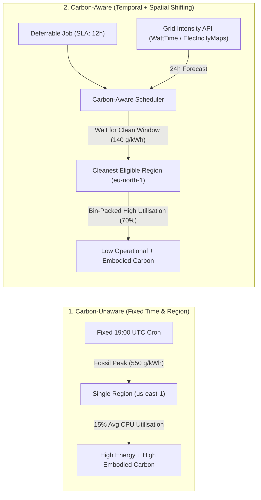
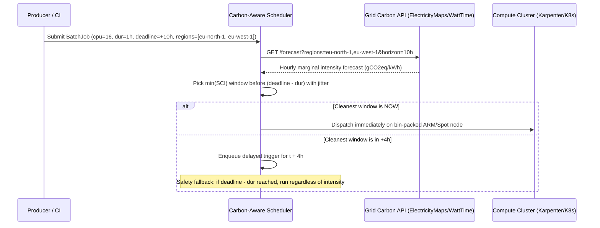

# Sustainability & Green Software: Carbon-Aware Computing

> **Prerequisites:** [Lesson 22: Distributed Job Scheduling: Leader Election, Delayed Jobs & Idempotency](../22-distributed-job-scheduling/README.md) · [Lesson 15: Cost-Aware Architecture](../15-cost-aware-architecture/README.md).  
> **Estimated Reading Time:** 24–28 minutes  
> **Target Audience:** Staff/principal engineers, cloud architects, and FinOps/GreenOps leads designing carbon-aware batch pipelines, multi-region compute placement, and energy-efficient backends.  
> **Free PDF Notes:** [Download SD-V-023.pdf](https://backendroadmap.com/notes/system-design/SD-V-023.pdf)

> [!NOTE]
> **In one line:** **Green Software Engineering** reduces the carbon emissions of software using the **Software Carbon Intensity (SCI)** model—combining **energy efficiency** (fewer CPU/GPU cycles per unit of work), **hardware efficiency** (higher utilisation, fewer idle servers), and **carbon awareness** (running flexible workloads **when** and **where** the electrical grid is cleanest). You gain **15–60% lower operational emissions and lower cloud spend**; you pay with **scheduler complexity, cross-region data egress/residency trade-offs, and SLA slack management**.

> [!TIP]
> **The Golden Rule:** **Optimise Utilisation First, Then Shift in Time and Space.** An idle server still draws 30–50% of its peak power—so consolidating 15%-utilised VMs (or serverless scale-to-zero) cuts both **energy and embodied carbon**, while shifting flexible batch jobs to low-carbon grid windows cuts **grid carbon intensity** without rewriting application code.

---

## 1. What Carbon-Aware Computing Is, and What It Isn't

Every kilowatt-hour (kWh) of electricity drawn by a data center carries a **grid carbon intensity** ($I$, measured in $\text{gCO}_2\text{eq/kWh}$) that varies dramatically by **location** (e.g., Quebec hydro ~20 g vs coal-heavy grids ~700 g) and **time of day** (solar noon vs fossil-fuel evening peak). **Carbon-aware computing** feeds real-time and forecasted grid intensity signals into your scheduler and load balancer so deferrable work runs when and where clean energy is abundant.

| Term | Precise Meaning | Example |
| :--- | :--- | :--- |
| **SCI (Software Carbon Intensity)** | ISO/IEC 21031 metric: carbon emitted per functional unit $R$ | $\text{gCO}_2\text{eq}$ per 1,000 API calls or per ML training run |
| **Grid Carbon Intensity ($I$)** | Marginal or average emissions per kWh of electricity on a regional grid | `ca-central-1` (~25 g/kWh) vs `ap-south-1` (~650 g/kWh) |
| **PUE (Power Usage Effectiveness)** | Ratio of total data center power (cooling + lights + IT) to IT power | Hyperscaler avg ~1.10–1.20; legacy on-prem ~1.80 |
| **Embodied Carbon ($M$)** | Emissions from manufacturing, shipping, and disposing of server hardware | ~1,000–1,500 $\text{kgCO}_2\text{eq}$ per server over 4-year lifespan |
| **Temporal Shifting** | Delaying flexible batch jobs to the cleanest grid hours within an SLA window | Running nightly ETL at 13:00 solar peak instead of 19:00 |
| **Spatial Shifting** | Routing stateless batch/inference jobs to a cleaner cloud region | Dispatching GPU batch to `eu-north-1` (Sweden) instead of `eu-central-1` |
| **Not** | Purchasing unverified carbon offsets to excuse wasteful 10%-utilised fleets | Real reductions come from energy + hardware efficiency + grid alignment |

### Why It Matters
1. **Cost and Carbon align tightly:** Idle servers, over-provisioned Kubernetes nodes, and chatty serialization waste both **cloud dollars** and **operational + embodied carbon**.
2. **AI & Batch compute explosion:** Large batch ETL, CI/CD builds, video transcoding, and ML training are **delay-tolerant**—making them prime candidates for temporal and spatial carbon shifting.
3. **Regulatory & Enterprise RFPs:** ISO/IEC 21031 (SCI) and EU CSRD reporting increasingly require engineering teams to measure and reduce software emissions per transaction.

---

## 2. Anatomy: Carbon-Unaware vs Carbon-Aware Scheduler



In architecture (2), a batch job arrives with a **deadline SLA** (e.g., "complete within 12 hours") and **data-residency constraints** (e.g., `EU-only`). The scheduler queries the **marginal carbon intensity forecast** across eligible regions, picks the `(region, start_window)` pair that minimises $\text{SCI}$ without violating egress or deadline bounds, and runs on high-utilisation, bin-packed nodes.

| Lever | Mechanism | Typical Reduction | Primary Trade-Off |
| :--- | :--- | :---: | :--- |
| **Energy Efficiency** | Faster algorithms, compiled languages, caching, zero-copy I/O | 20% – 70% | Engineering refactoring effort |
| **Hardware Efficiency** | Kubernetes bin-packing, ARM/Graviton, scale-to-zero, longer server life | 30% – 60% | Headroom / cold-start tuning |
| **Temporal Shifting** | Delay batch jobs to low-carbon grid hours | 15% – 40% | Requires SLA slack (hours) |
| **Spatial Shifting** | Route compute to hydro/nuclear/wind regions | 40% – 85% | Cross-region data transfer & GDPR |

> [!WARNING]
> **Beware the "Cross-Region Data Gravity" Trap.** Shipping 50 TB of raw video across continents to a clean region can consume more energy in optical/network transit (and $4,500+ in egress fees) than the compute savings. **Only spatially shift compute when data is small or already replicated.**

---

## 3. Mathematical Model: Software Carbon Intensity (SCI) & Shifting Gain

The Green Software Foundation's **SCI specification (ISO/IEC 21031)** defines carbon intensity per functional unit $R$ (e.g., per 1,000 requests, per training epoch):

$$\text{SCI} = \frac{(E \cdot I) + M}{R}$$

Where:
- $E$: Energy consumed by the software system in $\text{kWh}$ (including data center overhead: $E = E_{\text{IT}} \cdot \text{PUE}$).
- $I$: Location-based marginal grid carbon intensity in $\text{gCO}_2\text{eq/kWh}$.
- $M$: Embodied carbon of the hardware allocated to the workload:

$$M = \text{TE} \cdot \left(\frac{\text{Time}_{\text{used}}}{\text{Lifespan}}\right) \cdot \left(\frac{\text{vCPU}_{\text{used}}}{\text{vCPU}_{\text{total}}}\right)$$

**Worked Numerical Example.**
Suppose a nightly ML batch job runs on 1 dedicated server ($\text{TE} = 1{,}200{,}000\text{ gCO}_2\text{eq}$ over a 4-year = $35{,}040\text{ h}$ lifespan, 64 vCPUs total) using **32 vCPUs** for **2 hours**, drawing $E_{\text{IT}} = 0.6\text{ kWh}$ with $\text{PUE} = 1.20$ (so $E = 0.72\text{ kWh}$), processing $R = 100$ batches:

1. **Embodied carbon $M$:**
   $$M = 1{,}200{,}000 \times \left(\frac{2}{35{,}040}\right) \times \left(\frac{32}{64}\right) \approx 34.25\text{ gCO}_2\text{eq}$$

2. **Baseline (Fossil evening peak, $I = 520\text{ g/kWh}$):**
   $$\text{SCI}_{\text{base}} = \frac{(0.72 \times 520) + 34.25}{100} = \frac{374.4 + 34.25}{100} = 4.09\text{ gCO}_2\text{eq / batch}$$

3. **Carbon-Aware Shift (Solar/wind window, $I = 140\text{ g/kWh}$, same hardware):**
   $$\text{SCI}_{\text{shifted}} = \frac{(0.72 \times 140) + 34.25}{100} = \frac{100.8 + 34.25}{100} = 1.35\text{ gCO}_2\text{eq / batch}$$

**Result:** A **67% reduction in SCI** with zero changes to the ML model—simply by shifting the start time to a clean grid window.

---

## 4. Metrics & Percentiles

| Metric | Meaning | Alert when |
| :--- | :--- | :--- |
| **SCI ($\text{gCO}_2\text{eq} / R$)** | Carbon per functional unit (API call, job, GB processed) | Trending upward release-over-release |
| **Fleet CPU / GPU Utilisation ($p_{50}$)** | Average active compute vs provisioned capacity | < 25% (massive idle power + embodied carbon waste) |
| **Data Center PUE** | Total facility energy / IT compute energy | > 1.35 (legacy/inefficient facility) |
| **Carbon-Shifted Job %** | Share of deferrable batch jobs run in low-carbon windows | Drops below target (e.g., < 70% due to tight SLAs) |
| **Idle / Zombie Node Count** | Provisioned nodes with < 5% CPU for > 1 hour | > 0 in autoscaled clusters |
| **Energy per Request ($\text{Wh / req}$)** | Direct compute energy per transaction | Regression > 10% after a code deploy |

### Worked Example (Demand Shaping on a Video Platform)
During a high-carbon grid peak ($I > 500\text{ g/kWh}$), a streaming platform switches background 4K thumbnail/preview pre-rendering from eager (immediate) to **deferred** (queued until $I < 200\text{ g/kWh}$), and defaults non-critical autoplay previews to 480p instead of 1080p (**demand shaping**). Peak energy draw drops 28% during dirty-grid hours with zero impact on primary playback SLOs.

---

## 5. Compounding & Failure Modes

| Failure Mode | Mechanism | Impact at Scale |
| :--- | :--- | :--- |
| **Idle Server Power Floor** | 1,000 VMs running at 10% CPU instead of 200 VMs at 50% CPU | Servers draw ~35–50% peak power even at 10% CPU -> **2.5x–3x wasted energy + 5x embodied carbon** |
| **Carbon-Window Thundering Herd** | Every tenant's scheduler waits for the exact same cleanest 15-min slot | Massive burst at `13:00` causes spot-instance preemption, autoscaling thrash, and job failures |
| **Ignoring Embodied Carbon ($M$)** | Upgrading servers every 18 months for a 5% CPU efficiency gain | Manufacturing emissions ($M$) dwarf operational savings ($E \cdot I$) on clean grids |
| **Egress-Blind Spatial Shifting** | Moving a 10 TB ETL job across regions to save 2 kg $\text{CO}_2$ | Network transit + replication energy + $900 egress bill wipe out the compute gain |

---

## 6. Numbers Every Engineer Must Know

| Item | Typical | Implication |
| :--- | :---: | :--- |
| Server idle power draw | 30% – 50% of peak TDP | Consolidate workloads; scale-to-zero beats 10%-utilised fleets |
| Hyperscaler PUE | 1.10 – 1.20 | Cloud data centers are far more cooling-efficient than 1.6–2.0 on-prem |
| Clean hydro/nuclear grid ($I$) | 15 – 60 $\text{gCO}_2\text{eq/kWh}$ | e.g., Quebec (`ca-central-1`), Sweden (`eu-north-1`), France (`eu-west-3`) |
| Coal/fossil-heavy grid ($I$) | 500 – 850 $\text{gCO}_2\text{eq/kWh}$ | Up to **30x higher** operational carbon for the exact same CPU instruction |
| Embodied carbon per server ($\text{TE}$) | ~1,000 – 1,500 $\text{kgCO}_2\text{eq}$ | Extending server/instance life from 3 to 5 years cuts $M$ by 40% |
| ARM (Graviton) efficiency gain | ~30% – 60% less energy / vCPU | Lower energy + lower cloud cost for stateless microservices |

---

## 7. Protocol / Mechanism Deep Dive: Carbon-Aware Scheduling Loop



| Question | Answer |
| :--- | :--- |
| **Average vs Marginal carbon intensity—which should schedulers use?** | Use **marginal** intensity for scheduling decisions: it measures the *extra* power plant (often a dirty gas/coal peaker) that spins up to serve your *new* job, whereas average intensity reflects historical mix. |
| **What if the grid stays dirty all the way up to the job's deadline?** | Always enforce a **hard deadline fallback** (`latest_start = deadline - estimated_duration`) so carbon awareness never causes an SLA breach. |
| **How does Demand Shaping work for user-facing APIs?** | Instead of delaying real-time requests, gracefully degrade non-essential work during high-carbon peaks (e.g., lower background sync frequency, serve cached/lighter payloads, pause non-urgent re-indexing). |

**When NOT to use carbon-aware shifting:**
- Latency-critical synchronous user requests (checkout, auth, live video): serve from the nearest region; focus on **energy + hardware efficiency** (caching, ARM, bin-packing) instead.
- Workloads that require moving huge datasets across regions just for a 1-hour compute job (network egress + data gravity dominate).

---

## 8. Hierarchical Budgets & Design Rules

| Slice | Rule | Control |
| :--- | :--- | :--- |
| **Utilisation** | Target > 50–60% average CPU on active nodes | Kubernetes Karpenter bin-packing + scale-to-zero |
| **Silicon** | Prefer ARM/Graviton instances for stateless services | Multi-arch container builds (`linux/amd64,arm64`) |
| **Temporal Shifting** | Tag batch jobs with `sla_deadline_hours` and `deferrable=true` | Carbon-aware scheduler picks lowest-intensity window |
| **Spatial Shifting** | Restrict eligible regions to data-residency + co-located data | Policy-as-Code regional allowlist (`eu-north-1`, `eu-west-3`) |
| **Network & Storage** | Compress payloads, expire cold logs/snapshots, edge-cache static assets | S3 lifecycle policies (30d/90d) + Brotli/zstd |
| **Measurement** | Track $\text{SCI}$ per 1,000 transactions in CI/CD & FinOps dashboards | Cloud carbon footprint + Keplar/Scaphandre power metrics |

---

## 9. Top Mitigations

1. **Right-size and bin-pack clusters** (Karpenter / VPA) to eliminate 10%-utilised zombie nodes that burn 40% idle power.
2. **Adopt ARM/Graviton processors** for stateless APIs and workers (~30–60% better performance-per-watt).
3. **Add `deferrable` + `deadline` metadata to batch/CI jobs** and schedule them during forecasted low-carbon grid windows.
4. **Co-locate new stateless batch/ML workloads in clean-grid regions** (`eu-north-1`, `ca-central-1`) where data gravity allows.
5. **Apply storage lifecycle & log retention policies**—storing petabytes of unqueried debug logs wastes continuous disk/SSD power and embodied carbon.
6. **Use Demand Shaping** during grid peaks (defer background indexing, thumbnails, and non-urgent emails).
7. **Prevent carbon-window thundering herds** by adding randomized jitter within the top 20% cleanest hours rather than piling every job onto the single cleanest 5-minute slot.

---

## 10. Production Reference: Carbon-Aware CI/CD & ML Retraining Pipeline

A media platform ran 4,000 nightly model-retraining and video-transcoding jobs at a fixed `02:00 UTC` cron in `us-east-1` (Virginia), where evening/night fossil generation kept grid intensity around 420–480 $\text{gCO}_2\text{eq/kWh}$, and dedicated GPU nodes sat idle 14 hours/day.


- **Root Cause of Excess Emissions:** Rigid wall-clock cron scheduling (`02:00 UTC`) ignored both regional clean-grid availability and time-of-day solar peaks, while static GPU pools burned idle power.
- **The Fix:** Tagged non-urgent retraining jobs with a 14-hour SLA, enabled **Karpenter scale-to-zero** on GPU node pools, and integrated a carbon-intensity forecast check that shifted eligible jobs to solar-peak windows or `ca-central-1` (hydro). Operational carbon for batch compute dropped **64%** and GPU cloud spend dropped **38%**.

---

## 11. Multi-Language Production Code Tabs

A **Carbon-Aware Window & Region Selector + SCI Calculator** (computes $\text{SCI} = (E \cdot I + M) / R$ and picks the cleanest execution window before the job's hard deadline).

````carousel
```go
// Go: Carbon-Aware Window Selector & SCI Calculator (stdlib only).
package main

import "fmt"

type GridSlot struct {
	HourOffset int
	Region     string
	IntensityG float64 // gCO2eq / kWh
}

func ComputeSCI(energyKWh, intensityG, embodiedG, units float64) float64 {
	return ((energyKWh * intensityG) + embodiedG) / units
}

// PickCleanestSlot selects the lowest-carbon slot that finishes before deadlineHours.
func PickCleanestSlot(slots []GridSlot, durationHours, deadlineHours int) (GridSlot, bool) {
	var best GridSlot
	found := false
	for _, s := range slots {
		if s.HourOffset+durationHours > deadlineHours {
			continue // would breach SLA deadline
		}
		if !found || s.IntensityG < best.IntensityG {
			best = s
			found = true
		}
	}
	return best, found
}

func main() {
	forecast := []GridSlot{
		{0, "us-east-1", 480}, {2, "us-east-1", 410},
		{4, "us-east-1", 160}, {1, "ca-central-1", 28},
	}
	best, ok := PickCleanestSlot(forecast, 2, 8)
	if ok {
		sci := ComputeSCI(0.72, best.IntensityG, 34.25, 100)
		fmt.Printf("Best slot: region=%s offset=+%dh intensity=%.0fg SCI=%.2f gCO2eq/unit\n",
			best.Region, best.HourOffset, best.IntensityG, sci)
	}
}
```
<!-- slide -->
```typescript
// TypeScript: Carbon-Aware Job Scheduler & SCI Estimator.
export interface GridForecast {
  hourOffset: number;
  region: string;
  intensityGPerKwh: number;
}

export function calculateSCI(
  energyKwh: number,
  intensityGPerKwh: number,
  embodiedG: number,
  functionalUnits: number,
): number {
  return (energyKwh * intensityGPerKwh + embodiedG) / functionalUnits;
}

export function scheduleCarbonAware(
  forecasts: GridForecast[],
  jobDurationHours: number,
  slaDeadlineHours: number,
  allowedRegions: Set<string>,
): GridForecast {
  const eligible = forecasts.filter(
    (f) => allowedRegions.has(f.region) && f.hourOffset + jobDurationHours <= slaDeadlineHours,
  );
  if (eligible.length === 0) {
    throw new Error("No slot satisfies SLA deadline and data-residency constraints");
  }
  return eligible.reduce((best, cur) =>
    cur.intensityGPerKwh < best.intensityGPerKwh ? cur : best,
  );
}
```
<!-- slide -->
```python
# Python: Software Carbon Intensity (SCI) & Temporal/Spatial Shifting Calculator (stdlib only).
def compute_sci(
    energy_it_kwh: float,
    pue: float,
    grid_intensity_g_kwh: float,
    total_embodied_g: float,
    job_hours: float,
    server_lifespan_hours: float,
    vcpu_share: float,
    functional_units: float,
) -> dict:
    total_energy = energy_it_kwh * pue
    operational_g = total_energy * grid_intensity_g_kwh
    embodied_g = total_embodied_g * (job_hours / server_lifespan_hours) * vcpu_share
    sci = (operational_g + embodied_g) / functional_units
    return {
        "operational_g": round(operational_g, 2),
        "embodied_g": round(embodied_g, 2),
        "sci_per_unit_g": round(sci, 3),
    }

if __name__ == "__main__":
    base = compute_sci(0.6, 1.20, 520, 1_200_000, 2, 35_040, 0.5, 100)
    shifted = compute_sci(0.6, 1.20, 140, 1_200_000, 2, 35_040, 0.5, 100)
    print("Baseline (520 g/kWh):", base)
    print("Shifted  (140 g/kWh):", shifted)
```
<!-- slide -->
```csharp
// C#: Carbon-Aware Scheduler & SCI Calculator.
public sealed record GridSlot(int HourOffset, string Region, double IntensityGPerKwh);

public static class CarbonAwareScheduler
{
    public static double ComputeSci(double energyKwh, double intensityG, double embodiedG, double units)
        => ((energyKwh * intensityG) + embodiedG) / units;

    public static GridSlot PickOptimalSlot(
        IEnumerable<GridSlot> forecast, int durationHours, int deadlineHours, ISet<string> allowedRegions)
    {
        return forecast
            .Where(s => allowedRegions.Contains(s.Region) && s.HourOffset + durationHours <= deadlineHours)
            .OrderBy(s => s.IntensityGPerKwh)
            .First();
    }
}
```
````

---

## 12. Hands-On CLI Verification Workflows

Verify the SCI calculation and 67% shifting reduction in Python:

```bash
python3 -c '
def sci(I, E_it=0.6, pue=1.20, TE=1_200_000, hrs=2, life=35040, share=0.5, R=100):
    M = TE * (hrs / life) * share
    return round(((E_it * pue * I) + M) / R, 2)
b, s = sci(520), sci(140)
print(f"Baseline SCI: {b} g/unit | Shifted SCI: {s} g/unit | Reduction: {(1 - s/b)*100:.1f}%")
'
```

Inspect real Kubernetes node utilisation and Carbon-Aware SDK / Kepler power telemetry:

```bash
# Find under-utilised Kubernetes nodes wasting idle power + embodied carbon
kubectl top nodes

# Query Green Software Foundation Carbon Aware SDK API for cleanest window
curl -s "https://carbon-aware-api.example/emissions/bylocations/best?location=eastus&location=canadacentral&location=swedencentral"

# Check Karpenter / Cluster Autoscaler node consolidation events
kubectl get events -A --field-selector reason=Consolidating
```

---

## 13. Common Mistakes to Avoid

1. **Ignoring idle server power**, leaving clusters at 10% utilisation where idle draw wastes 40%+ peak watts.
2. **Spatially shifting compute without checking data gravity**, burning more energy and egress fees moving TB datasets than saved on compute.
3. **Using average instead of marginal grid intensity** when deciding whether to run a new batch job now vs later.
4. **Forgetting a hard SLA deadline fallback**, causing deferrable jobs to starve during prolonged low-wind/cloudy periods.
5. **Creating a carbon-window thundering herd** by scheduling every tenant's batch job to the exact same 5-minute cleanest slot.
6. **Ignoring embodied carbon ($M$)** by replacing hardware prematurely for tiny efficiency gains.
7. **Relying on carbon offsets instead of measurable SCI reductions** in energy, hardware, and carbon awareness.

---

## 14. Key Terms Glossary

| Key Term | Definition |
| :--- | :--- |
| **Software Carbon Intensity (SCI)** | ISO/IEC 21031 metric measuring $\text{gCO}_2\text{eq}$ per functional unit: $((E \cdot I) + M) / R$. |
| **Operational Carbon ($E \cdot I$)** | Emissions from the electricity consumed while running the software. |
| **Embodied Carbon ($M$)** | Amortised manufacturing and disposal emissions of the underlying hardware. |
| **Grid Carbon Intensity ($I$)** | $\text{gCO}_2\text{eq}$ emitted per kWh of electricity on a specific regional grid. |
| **Marginal Carbon Intensity** | Emissions rate of the *next* power plant dispatched to meet additional demand. |
| **Power Usage Effectiveness (PUE)** | Total data center energy divided by IT equipment energy (1.0 is theoretical ideal). |
| **Temporal Shifting** | Delaying flexible workloads to cleaner hours within an SLA window. |
| **Spatial Shifting** | Moving workloads to regions with cleaner electrical grids. |
| **Demand Shaping** | Dynamically adjusting app features/quality during high-carbon grid peaks. |
| **Idle Power Floor** | Baseline 30–50% peak power drawn by a running server even at near-zero CPU. |

---

## 15. System Design Interview Questions & Answers

### Basic Conceptual Questions

<details>
<summary><strong>Q1: What are the three pillars of Green Software Engineering? [BASIC]</strong></summary>

**Answer:**
(1) **Energy Efficiency** (use less electricity per unit of work via better algorithms, caching, efficient runtimes), (2) **Hardware Efficiency** (maximise utilisation, bin-pack, scale-to-zero, extend hardware lifespan to amortise embodied carbon), and (3) **Carbon Awareness** (shift flexible workloads in time and space to cleaner electricity grids).
</details>

<details>
<summary><strong>Q2: Explain the Software Carbon Intensity (SCI) formula. [BASIC]</strong></summary>

**Answer:**
$\text{SCI} = ((E \cdot I) + M) / R$, where $E$ is energy consumed (kWh, including PUE), $I$ is location-based marginal grid carbon intensity ($\text{gCO}_2\text{eq/kWh}$), $M$ is amortised embodied hardware carbon, and $R$ is the functional unit (e.g., per 1,000 API requests or per ML job).
</details>

<details>
<summary><strong>Q3: Why does consolidating 10%-utilised servers save so much energy? [BASIC]</strong></summary>

**Answer:**
Physical servers are not energy-proportional: an idle server still consumes 30–50% of its peak power. Consolidating five 10%-utilised servers onto one 50%-utilised server eliminates 4× idle power floors *and* cuts embodied carbon $M$ by 80%.
</details>

<details>
<summary><strong>Q4: What is the difference between temporal and spatial carbon shifting? [BASIC]</strong></summary>

**Answer:**
**Temporal shifting** delays a flexible job within the same region to a cleaner time of day (e.g., solar noon). **Spatial shifting** moves the workload to a different geographic region with a cleaner electrical grid (e.g., hydro-powered Sweden/Quebec).
</details>

### Scenario-Based Architecture Questions

<details>
<summary><strong>Q5: Design a carbon-aware nightly ETL and ML training scheduler for a global SaaS platform. [SCENARIO]</strong></summary>

**Answer:**
Require jobs to declare `estimated_duration`, `sla_deadline`, and `residency_regions`. Have the scheduler query a grid carbon forecast API (WattTime/ElectricityMaps) for the allowed horizon, select the lowest marginal-intensity window that finishes before `sla_deadline`, add small jitter to prevent thundering herds, and fall back to immediate execution if `now >= sla_deadline - estimated_duration`.
</details>

<details>
<summary><strong>Q6: Should you spatially shift a 50 TB Spark analytics job from Virginia to Quebec to save carbon? [SCENARIO]</strong></summary>

**Answer:**
Usually **no** unless the data is already replicated there. Transferring 50 TB across regions incurs significant network energy, latency, and ~$4,500 in cloud egress fees, which typically outweigh the compute carbon savings. Instead, use **temporal shifting** in Virginia and right-size/ARM-optimise the Spark cluster.
</details>

<details>
<summary><strong>Q7: How can a real-time user-facing web app become more carbon-aware without adding latency? [SCENARIO]</strong></summary>

**Answer:**
Real-time traffic cannot be delayed, so use **energy & hardware efficiency** (CDN edge caching, ARM/Graviton, aggressive payload compression, autoscaling/scale-to-zero) plus **demand shaping**: during high-carbon grid peaks, defer non-critical background tasks (analytics rollups, thumbnail pre-generation, search re-indexing) and serve lighter media defaults.
</details>

<details>
<summary><strong>Q8: Why did moving from 3-year to 5-year server refresh cycles reduce total emissions? [SCENARIO]</strong></summary>

**Answer:**
Embodied carbon ($M$) from manufacturing a server (~1,200 $\text{kgCO}_2\text{eq}$) is front-loaded. Extending lifespan from 3 to 5 years amortises $M$ over 67% more hours, cutting annualised embodied emissions by 40%—which outweighs minor generational CPU efficiency gains on clean grids.
</details>

### Advanced & Tricky Interview Questions

<details>
<summary><strong>Q9: Why should a carbon-aware scheduler use *marginal* rather than *average* carbon intensity? [TRICKY]</strong></summary>

**Answer:**
When you add a new 1 MW workload, baseload renewables (hydro/nuclear) are already running at capacity; the grid meets your *incremental* load by dispatching a **marginal power plant** (often a gas or coal peaker). Marginal intensity accurately reflects the real-world emissions caused by running your job right now vs later.
</details>

<details>
<summary><strong>Q10: How do you prevent 1,000 carbon-aware tenants from causing an outage during the cleanest hour? [TRICKY]</strong></summary>

**Answer:**
If every scheduler targets the global minimum slot, it creates a self-inflicted thundering herd (spot preemptions, DB saturation). Mitigate by selecting randomly/deterministically among the **top $k$% cleanest windows** (e.g., any slot within 10% of the minimum) and enforcing per-cluster concurrency/rate limits.
</details>

<details>
<summary><strong>Q11: Why don't cloud "renewable energy matching" (100% RECs) eliminate the need for carbon-aware computing? [TRICKY]</strong></summary>

**Answer:**
Annualised Renewable Energy Certificates (RECs) often match solar power generated at noon in one region against fossil power burned at midnight in another. **24/7 hourly carbon-free energy** and SCI require reducing actual *location-based marginal* emissions at the hour and place electricity is consumed.
</details>

<details>
<summary><strong>Q12: What is the trade-off between Spot instances and Carbon-Aware computing? [TRICKY]</strong></summary>

**Answer:**
They often complement each other (surplus renewable hours frequently correlate with lower wholesale electricity prices and spare compute), *except* when a clean-grid region becomes crowded during a solar/wind peak, increasing Spot preemption rates. Checkpointed, idempotent jobs handle both cleanly.
</details>

---

## 16. One-Page Master Cheat Sheet

```
+---------------------------------------------------------------------------------------------------------+
|                    SUSTAINABILITY & GREEN SOFTWARE — MASTER CHEAT SHEET                                 |
+---------------------------------------------------------------------------------------------------------+
| 1. SCI FORMULA (ISO 21031): SCI = ((E * I) + M) / R   [E = E_IT * PUE; I = marginal gCO2/kWh].          |
+---------------------------------------------------------------------------------------------------------+
| 2. THREE LEVERS: Energy efficiency (code/cache) + Hardware efficiency (bin-pack/ARM) + Carbon awareness.|
+---------------------------------------------------------------------------------------------------------+
| 3. IDLE POWER TRAP: Servers burn 30-50% peak power at 10% CPU -> consolidate & scale-to-zero first!     |
+---------------------------------------------------------------------------------------------------------+
| 4. SHIFTING: Temporal (delay batch to clean hours) & Spatial (clean regions, mind data gravity/egress). |
+---------------------------------------------------------------------------------------------------------+
| 5. SAFETY: Always enforce a hard SLA deadline fallback + jitter across top-k clean slots.               |
+---------------------------------------------------------------------------------------------------------+
| 6. EMBODIED CARBON (M): ~1,200 kgCO2eq/server -> higher utilisation + longer hardware life cuts M.      |
+---------------------------------------------------------------------------------------------------------+
```

---

## Further Reading & Sources

- Green Software Foundation, [Software Carbon Intensity (SCI) Specification — ISO/IEC 21031](https://sci.greensoftware.foundation/).
- Green Software Foundation, [Learn Green Software (Energy, Hardware, Carbon Awareness)](https://learn.greensoftware.foundation/).
- Google Cloud, [Carbon Footprint & 24/7 Carbon-Free Energy Architecture](https://cloud.google.com/carbon-footprint).
- Microsoft Azure Architecture Center, [Sustainability Design Principles](https://learn.microsoft.com/en-us/azure/well-architected/sustainability/).

---

## Free PDF Notes

[SD-V-023.pdf](https://backendroadmap.com/notes/system-design/SD-V-023.pdf)

---

## Next

Continue with [Track 20: AI & GenAI System Design](../../20-ai-and-genai-system-design/README.md).
