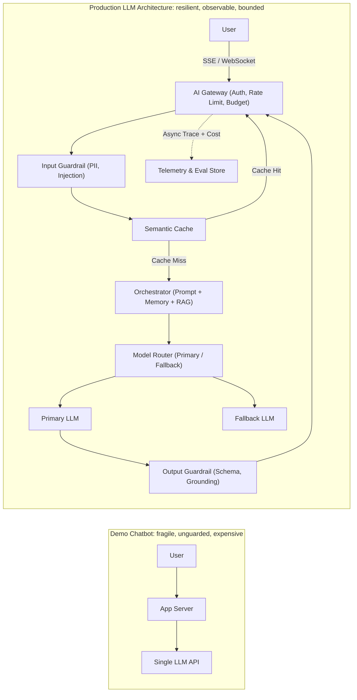
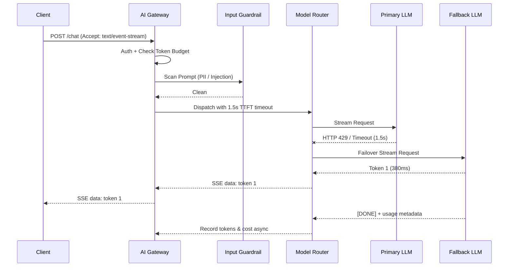
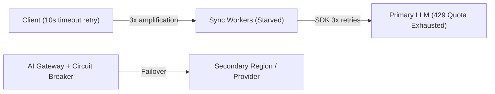

# LLM Application Architecture: From Demo Chatbot to Production

> **Prerequisites:** [Lesson 23: Sustainability & Green Software](../../19-cloud-and-platform/23-sustainability-green-software/README.md) · Track 20 Overview: [AI and GenAI System Design](../README.md).  
> **Estimated Reading Time:** 24–28 minutes  
> **Target Audience:** Backend and staff engineers taking an LLM prototype to production, and candidates asked "how do you architect a production GenAI application?"  
> **Free PDF Notes:** [Download SD-S-001.pdf](https://backendroadmap.com/notes/system-design/SD-S-001.pdf)

> [!NOTE]
> **In one line:** A demo chatbot is a raw HTTP wrapper around an LLM API; a **production LLM architecture** wraps that non-deterministic, high-latency, expensive model in **an AI gateway, prompt registry, context/retrieval pipeline, semantic cache, guardrails, streaming transport, and offline/online evaluation**.

> [!TIP]
> **The Golden Rule:** Treat the LLM as an **unreliable, slow, expensive external dependency with probabilistic outputs**—never put it on an unguarded synchronous path without timeouts, fallbacks, budget caps, input/output validation, and observability.

---

## 1. What Production LLM Architecture Is, and What It Isn't

A weekend hackathon chatbot takes a user string, concatenates `"You are a helpful assistant"`, calls `POST /v1/chat/completions`, and prints the JSON response. In production, that naive wrapper breaks within hours: a single prompt injection leaks system instructions, a 30-second model stall exhausts web worker threads, a viral spike blows through a $10,000 token budget in 20 minutes, and a silent upstream model update degrades answer quality without triggering a single HTTP 500.

| Term | Precise Meaning | Example |
| :--- | :--- | :--- |
| **Demo / Wrapper App** | Direct client-to-LLM call with hardcoded prompt and no guardrails | `fetch(openaiUrl, { body: userText })` |
| **AI Gateway** | Centralized proxy handling auth, rate limits, token budgets, routing, and fallbacks | LiteLLM, Envoy AI Gateway, Kong AI |
| **Orchestration Layer** | Coordinates prompt assembly, retrieval, tool calls, and memory | LangGraph, custom state machine |
| **Guardrails** | Deterministic + model-based checks on inputs (PII, injection) and outputs (schema, toxicity) | NeMo Guardrails, Lakera, JSON Schema |
| **Semantic Cache** | Vector-similarity cache returning prior answers for equivalent queries | RedisVL, GPTCache |
| **Eval Pipeline** | Automated scoring of accuracy, groundedness, and regressions before/after deploy | Golden dataset + LLM-as-judge |
| **Not** | Just "calling OpenAI with a better system prompt" | Model quality is only ~20% of production reliability |

### Why It Matters
1. **Non-determinism breaks traditional testing:** HTTP 200 no longer means "correct"; you need schema validation, groundedness checks, and continuous evaluation.
2. **Latency and cost are orders of magnitude higher than CRUD:** A DB query takes 2 ms and fractions of a microcent; an LLM call takes 1–15 s and cents per request.
3. **Interviewer expectation:** Senior candidates must separate the **online serving plane** (gateway, streaming, cache, guardrails) from the **offline data/eval plane** (ingestion, embeddings, golden evals).

---

## 2. Anatomy: Demo Chatbot vs Production LLM Architecture



In production, the request never hits the model directly. The **AI Gateway** authenticates the tenant and enforces token-per-minute (TPM) and dollar budgets. **Input Guardrails** redact PII and block jailbreaks before tokens are paid for. A **Semantic Cache** short-circuits frequent, near-identical queries in ~15 ms. Only on a cache miss does the **Orchestrator** assemble the prompt, conversation history, and retrieved documents, then dispatch via a **Model Router** capable of failing over across providers or downgrading to a smaller model under load.

| Dimension | Demo Chatbot | Production Architecture |
| :--- | :--- | :--- |
| **Transport** | Blocking HTTP `POST` (waits 10+ s) | Streaming SSE / WebSocket (`TTFT < 500 ms`) |
| **Model Coupling** | Hardcoded single vendor SDK | Abstracted router with multi-provider fallback |
| **Cost Control** | None (unbounded context & retries) | Per-tenant token quotas, semantic cache, model tiering |
| **Safety** | Blind trust in user & model output | Input PII/injection filter + output schema/grounding check |
| **Observability** | `console.log(err)` | Trace IDs, TTFT, TPOT, token counts, cost, eval scores |

> [!WARNING]
> **The #1 Trap: Blocking synchronous workers on LLM responses.** A 10-second LLM call holds an HTTP thread/worker 500x longer than a 20 ms database query. Without async I/O, streaming, and strict concurrency limits, just 200 concurrent users can exhaust a 200-worker API fleet and take down non-AI endpoints too.

---

## 3. Mathematical Model: Cost, Latency & Availability

**End-to-End Request Cost.** With $N_{\text{in}}$ input tokens at price $c_{\text{in}}$, $N_{\text{out}}$ output tokens at price $c_{\text{out}}$, and semantic cache hit rate $h \in [0, 1]$:

$$C_{\text{req}} = (1 - h) \cdot \left( \frac{N_{\text{in}}}{10^6} c_{\text{in}} + \frac{N_{\text{out}}}{10^6} c_{\text{out}} \right) + C_{\text{guard}} + C_{\text{embed}}$$

**Perceived Latency (Streaming vs Blocking).** Blocking users wait for the entire generation; streaming users wait only for prefill + first token (TTFT), provided generation speed exceeds reading speed (~5 tokens/s):

$$T_{\text{block}} = T_{\text{net}} + T_{\text{guard}} + T_{\text{RAG}} + \text{TTFT} + N_{\text{out}} \cdot \text{TPOT}$$

$$T_{\text{perceived}} = T_{\text{net}} + T_{\text{guard}} + T_{\text{RAG}} + \text{TTFT}$$

**Composite Availability with Fallback.** If primary provider availability is $a_1$ and independent fallback provider availability is $a_2$, routing across both yields:

$$A_{\text{router}} = 1 - (1 - a_1)(1 - a_2)$$

### Worked Numerical Example
Suppose an enterprise support bot handles $100{,}000$ requests/day with average $N_{\text{in}} = 2{,}500$ tokens ($c_{\text{in}} = \$2.50 / 1\text{M}$) and $N_{\text{out}} = 400$ tokens ($c_{\text{out}} = \$10.00 / 1\text{M}$).
- **Without cache ($h = 0$):**
  $$C_{\text{req}} = \frac{2{,}500}{10^6}(2.50) + \frac{400}{10^6}(10.00) = \$0.00625 + \$0.00400 = \$0.01025/\text{req}$$
  Daily cost = $\$1{,}025/\text{day}$ ($\approx \$30{,}750/\text{month}$).
- **With semantic cache ($h = 0.35$) and tiered routing (50% routed to a $5\times$ cheaper mini-model):**
  Effective LLM cost drops by $(1 - 0.35) \times (0.5 \times 1 + 0.5 \times 0.2) = 0.65 \times 0.60 = 0.39$, reducing daily spend from $\$1{,}025$ to **$\$399.75/\text{day}$** (saving **$\$18{,}757/\text{month}$**).
- **Availability:** Two providers at $a_1 = a_2 = 99.5\%$ give $A_{\text{router}} = 1 - (0.005)^2 = 99.9975\%$ (four nines instead of two-and-a-half).

---

## 4. Metrics & Percentiles

| Metric | Meaning | Alert when |
| :--- | :--- | :--- |
| **TTFT ($p_{95}$)** | Time to First Token (user perceives responsiveness) | $> 800\text{ ms}$ (chat) or $> 2\text{ s}$ (agent) |
| **TPOT / ITL ($p_{95}$)** | Time Per Output Token / Inter-Token Latency | $> 80\text{ ms/token}$ ($< 12.5\text{ tok/s}$) |
| **Token Spend / Tenant** | Dollar burn rate per user/org per hour | $> 80\%$ of tenant quota or $3\times$ baseline |
| **Semantic Cache Hit Rate** | Fraction of requests served from vector cache | Drops $> 10\%$ (embedding/threshold drift) |
| **Guardrail Block Rate** | Fraction of inputs/outputs rejected or redacted | Sudden spike (attack) or drop (bypass) |
| **Fallback Rate** | Percentage of requests routed to secondary model | $> 2\%$ sustained (primary degradation) |
| **Schema / Parse Failure** | Structured outputs failing JSON/Pydantic validation | $> 0.5\%$ |

### Worked Example (Support Copilot SLA)
A SaaS support copilot has an SLO of **TTFT $p_{95} \le 700\text{ ms}$** and **Schema Failure $< 0.2\%$**. The budget is split as: Gateway + Auth ($20\text{ ms}$), Input Guardrail ($45\text{ ms}$), Semantic Cache lookup ($15\text{ ms}$), RAG retrieval ($120\text{ ms}$), and LLM prefill + first token ($450\text{ ms}$) = $650\text{ ms}$ total. When a new 8,000-token system prompt is deployed, LLM prefill jumps from $450\text{ ms}$ to $1{,}150\text{ ms}$, breaching TTFT $p_{95}$ ($1{,}350\text{ ms}$). Telemetry pinpoints the prefill stage immediately, prompting prompt compression and prefix caching.

---

## 5. Compounding & Failure Modes at Scale

Consider a 1,000 RPS peak workload with 10% retry rate on timeouts and no circuit breaker:

| Failure Mode | Mechanism | Quantitative Impact |
| :--- | :--- | :--- |
| **Retry Storm on 429s** | Naive exponential backoff without jitter retries against a saturated upstream | $1.0\times \to 2.8\times$ traffic amplification; burns TPM quota in seconds |
| **Context Bloat** | Unbounded chat history appends 500 tokens/turn over 20 turns | Input tokens grow $10\times$; quadratic attention cost + TTFT spikes $4\times$ |
| **Thread Pool Starvation** | Sync workers wait 12 s per LLM call (`Little's Law`: $L = \lambda W$) | At $\lambda = 50\text{ RPS}$, $L = 50 \times 12 = 600$ active threads needed (vs $1$ thread at $20\text{ ms}$) |
| **Silent Quality Regression** | Upstream provider silently updates model weights or quantization | HTTP 200 stays 100%, but JSON parse failures jump from $0.1\%$ to $6.4\%$ |

Using Little's Law ($L = \lambda W$), moving from a 20 ms DB service ($L = 50 \times 0.02 = 1$ concurrent slot) to a 10 s LLM service ($L = 50 \times 10 = 500$ concurrent slots) increases in-flight connections by **500x** for the exact same RPS.

---

## 6. Numbers Every Engineer Must Know

| Item | Typical | Implication |
| :--- | :---: | :--- |
| **Network + AI Gateway overhead** | $10\text{–}30\text{ ms}$ | Negligible compared to model inference |
| **Small classifier / guardrail latency** | $20\text{–}60\text{ ms}$ | Run in parallel with RAG retrieval to hide latency |
| **Semantic cache lookup (Redis/Qdrant)** | $10\text{–}25\text{ ms}$ | Saves $1\text{–}10\text{ s}$ and 100% of generation cost on hit |
| **TTFT (frontier model, 2k prompt)** | $300\text{–}900\text{ ms}$ | Dominated by prompt prefill; keep prompts concise |
| **Output generation speed** | $40\text{–}120\text{ tok/s}$ | Stream tokens via SSE; human reading speed is ~5 tok/s |
| **Connection hold time (streaming)** | $3\text{–}20\text{ s}$ | Use async event loops (Go/Node/AsyncIO), not sync threads |
| **Cost ratio (Frontier vs Mini model)** | $10\times\text{–}30\times$ | Route simple classification/routing to mini models |

---

## 7. Protocol Deep Dive: Streaming, Guardrails & Multi-Provider Fallback



| Question | Answer |
| :--- | :--- |
| **Why SSE instead of WebSockets for most LLM apps?** | Token streaming is unidirectional (server $\to$ client); SSE works over standard HTTP/2, auto-reconnects, and plays nicely with load balancers. |
| **Can you run output guardrails on a streamed response?** | Yes, via a **sliding token buffer** (e.g., buffer 20–50 tokens or sentence boundaries) before flushing to the client, or async post-audit for low-risk UIs. |
| **When should you NOT use an LLM at all?** | When deterministic rules, regex, SQL, or a $5\text{ ms}$ trained classifier (e.g., XGBoost/DistilBERT) solves the task with higher accuracy and $1000\times$ lower cost. |

---

## 8. Hierarchical Budgets & Design Rules

| Slice | Rule | Control |
| :--- | :--- | :--- |
| **Concurrency** | Never hold OS threads waiting on LLM I/O | Async I/O + bounded semaphores |
| **Timeouts** | Separate TTFT timeout ($1.5\text{ s}$) from total stream timeout ($30\text{ s}$) | Abort & failover if TTFT stalls |
| **Budgets** | Hard per-tenant and global daily dollar/token caps | Token bucket in Redis at AI Gateway |
| **Caching** | Exact cache first, then semantic cache ($\cos \ge 0.96$) | TTL + tenant-scoped cache keys |
| **Routing** | Route by task complexity (80% mini model, 20% frontier) | Semantic/rule-based router |
| **Safety** | Validate input before LLM; validate JSON schema after LLM | Deterministic parser + retry-with-error |
| **Observability** | Log `trace_id`, `prompt_version`, `model`, `tokens`, `cost`, `ttft` | OpenTelemetry GenAI semantic conventions |

---

## 9. Top Mitigations

1. **Put an AI Gateway in front of all LLM calls** to centralize keys, rate limits, cost tracking, and provider fallbacks.
2. **Stream every user-facing response via SSE** so perceived latency is TTFT (~500 ms) instead of full generation (~10 s).
3. **Run input guardrails and retrieval in parallel** where possible to shave 50–150 ms off critical-path latency.
4. **Enforce strict token and dollar budgets per tenant** using a sliding-window counter in Redis before dispatching to the model.
5. **Use tiered model routing:** send extraction, classification, and simple Q&A to fast mini-models; reserve frontier models for complex reasoning.
6. **Bind every LLM response to a strict schema** (JSON Schema / Pydantic / Zod) with a max-1-retry repair loop on parse failure.
7. **Isolate LLM worker pools and queues** from core transactional APIs so an LLM provider outage never degrades checkout or auth.

---

## 10. Production Reference / War Story: The Unbounded Retry Storm (SEV-1)

A B2B SaaS company launched an AI contract-summarization feature using a direct SDK call inside a synchronous Celery/Gunicorn worker pool. During a Monday morning spike, the upstream LLM provider's p99 latency rose to 25 s and began returning `HTTP 429 Too Many Requests`.

- **Root Cause:** The SDK defaulted to 3 automatic retries with minimal jitter, while the frontend also auto-retried after a 10 s HTTP timeout. Every stalled request multiplied into $3 \times 3 = 9$ upstream calls, exhausting the company's organization-wide TPM quota and starving all Gunicorn workers across unrelated API endpoints.
- **Fix:**
  1. Deployed an **AI Gateway** with a circuit breaker (trip after 5% 429s in 10 s) and automatic failover to a secondary cloud region/provider.
  2. Moved batch contract summarization to an **async queue** with bounded concurrency; kept interactive chat on **async SSE**.
  3. Disabled client-side blind retries and enforced `max_retries=1` with full jitter at the gateway only.



---

## 11. Multi-Language Production Code Tabs

A minimal, dependency-free **AI Gateway Router** with per-request timeout, provider fallback, and token-budget enforcement.

````carousel
```go
// Go: AI Gateway Router with context timeout, provider fallback, and budget check.
package main

import (
	"context"
	"errors"
	"fmt"
	"sync/atomic"
	"time"
)

var ErrBudgetExceeded = errors.New("tenant token budget exceeded")

type LLMProvider interface {
	Name() string
	Complete(ctx context.Context, prompt string) (text string, tokens int, err error)
}

type AIGateway struct {
	providers   []LLMProvider
	budgetLeft  atomic.Int64
	callTimeout time.Duration
}

func NewAIGateway(providers []LLMProvider, budgetTokens int64, timeout time.Duration) *AIGateway {
	gw := &AIGateway{providers: providers, callTimeout: timeout}
	gw.budgetLeft.Store(budgetTokens)
	return gw
}

func (g *AIGateway) Generate(ctx context.Context, prompt string, maxExpectedTokens int64) (string, string, error) {
	if g.budgetLeft.Load() < maxExpectedTokens {
		return "", "", ErrBudgetExceeded
	}
	var lastErr error
	for _, p := range g.providers {
		cctx, cancel := context.WithTimeout(ctx, g.callTimeout)
		text, used, err := p.Complete(cctx, prompt)
		cancel()
		if err == nil {
			g.budgetLeft.Add(-int64(used))
			return text, p.Name(), nil
		}
		lastErr = fmt.Errorf("%s failed: %w", p.Name(), err)
	}
	return "", "", fmt.Errorf("all providers failed: %w", lastErr)
}
```
<!-- slide -->
```typescript
// TypeScript: AI Gateway Router with AbortController timeout, fallback, and budget guard.
export interface LLMProvider {
  name: string;
  complete(prompt: string, signal: AbortSignal): Promise<{ text: string; tokens: number }>;
}

export class AIGateway {
  constructor(
    private readonly providers: LLMProvider[],
    private budgetTokens: number,
    private readonly timeoutMs = 1500
  ) {}

  async generate(prompt: string, estimatedTokens = 500): Promise<{ text: string; provider: string }> {
    if (this.budgetTokens < estimatedTokens) {
      throw new Error("Tenant token budget exceeded");
    }
    let lastError: unknown;
    for (const provider of this.providers) {
      const controller = new AbortController();
      const timer = setTimeout(() => controller.abort(), this.timeoutMs);
      try {
        const res = await provider.complete(prompt, controller.signal);
        this.budgetTokens -= res.tokens;
        return { text: res.text, provider: provider.name };
      } catch (err) {
        lastError = err;
      } finally {
        clearTimeout(timer);
      }
    }
    throw new Error(`All LLM providers failed: ${String(lastError)}`);
  }
}
```
<!-- slide -->
```python
# Python: Production cost, TTFT, and availability calculator + simple fallback router.
from dataclasses import dataclass
from typing import Callable, List, Tuple


@dataclass
class GatewayConfig:
    cost_in_per_1m: float = 2.50
    cost_out_per_1m: float = 10.00
    cache_hit_rate: float = 0.35
    mini_route_fraction: float = 0.50
    mini_cost_ratio: float = 0.20


def estimate_daily_cost(requests_per_day: int, avg_in: int, avg_out: int, cfg: GatewayConfig) -> float:
    base_req_cost = (avg_in / 1e6) * cfg.cost_in_per_1m + (avg_out / 1e6) * cfg.cost_out_per_1m
    routing_multiplier = (1 - cfg.mini_route_fraction) + cfg.mini_route_fraction * cfg.mini_cost_ratio
    effective_cost = base_req_cost * (1 - cfg.cache_hit_rate) * routing_multiplier
    return round(requests_per_day * effective_cost, 2)


def composite_availability(availabilities: List[float]) -> float:
    fail_prob = 1.0
    for a in availabilities:
        fail_prob *= (1.0 - a)
    return 1.0 - fail_prob


def route_with_fallback(providers: List[Tuple[str, Callable[[str], str]]], prompt: str) -> Tuple[str, str]:
    last_err = None
    for name, fn in providers:
        try:
            return name, fn(prompt)
        except Exception as exc:
            last_err = exc
    raise RuntimeError(f"All providers failed: {last_err}")
```
<!-- slide -->
```csharp
// C#: AI Gateway Router with CancellationTokenSource timeout, fallback, and atomic budget.
using System;
using System.Collections.Generic;
using System.Threading;
using System.Threading.Tasks;

public interface ILlmProvider
{
    string Name { get; }
    Task<(string Text, int Tokens)> CompleteAsync(string prompt, CancellationToken ct);
}

public sealed class AiGateway
{
    private readonly IReadOnlyList<ILlmProvider> _providers;
    private readonly TimeSpan _timeout;
    private long _budgetTokens;

    public AiGateway(IReadOnlyList<ILlmProvider> providers, long budgetTokens, TimeSpan timeout)
    {
        _providers = providers;
        _budgetTokens = budgetTokens;
        _timeout = timeout;
    }

    public async Task<(string Text, string Provider)> GenerateAsync(string prompt, long minRequired, CancellationToken ct)
    {
        if (Interlocked.Read(ref _budgetTokens) < minRequired)
            throw new InvalidOperationException("Tenant token budget exceeded.");

        Exception? lastError = null;
        foreach (var provider in _providers)
        {
            using var cts = CancellationTokenSource.CreateLinkedTokenSource(ct);
            cts.CancelAfter(_timeout);
            try
            {
                var (text, tokens) = await provider.CompleteAsync(prompt, cts.Token);
                Interlocked.Add(ref _budgetTokens, -tokens);
                return (text, provider.Name);
            }
            catch (Exception ex)
            {
                lastError = ex;
            }
        }
        throw new AggregateException("All LLM providers failed.", lastError!);
    }
}
```
````

---

## 12. Hands-On CLI Verification Workflows

Verify the cost & availability math from Section 3 and test SSE streaming behavior locally:

```bash
# 1. Verify daily cost savings and multi-provider availability with Python
python -c "
def cost(reqs, n_in, n_out, h=0.0, mini=0.0):
    base = (n_in/1e6)*2.5 + (n_out/1e6)*10.0
    return round(reqs * base * (1 - h) * ((1 - mini) + mini * 0.2), 2)

print('No cache/routing: $', cost(100_000, 2500, 400))
print('35% cache + 50% mini: $', cost(100_000, 2500, 400, h=0.35, mini=0.5))
print('2x 99.5% availability:', round(1 - (1 - 0.995)**2, 6))
"

# 2. Measure TTFT vs total time on any SSE-capable LLM endpoint with curl
curl -N -s -w "\nTTFT: %{time_starttransfer}s | Total: %{time_total}s\n" \
  -H "Content-Type: application/json" \
  -H "Authorization: Bearer $OPENAI_API_KEY" \
  -d '{"model":"gpt-4o-mini","stream":true,"messages":[{"role":"user","content":"Say hello in 5 words."}]}' \
  https://api.openai.com/v1/chat/completions
```

---

## 13. Common Mistakes to Avoid

1. **Calling the LLM SDK directly from business logic** with no gateway, making provider swaps or failover impossible.
2. **Blocking synchronous web workers** on 10-second model calls, starving unrelated endpoints.
3. **Omitting per-tenant token and dollar budgets**, leaving the system vulnerable to abuse or infinite agent loops.
4. **Using default SDK retries without circuit breakers**, triggering 429 retry storms.
5. **Treating HTTP 200 as success** without schema validation, grounding checks, or offline evals.
6. **Running input guardrails, RAG, and memory sequentially** when independent steps can execute concurrently.
7. **Routing every trivial classification task to a frontier model**, inflating cost 10x–30x.

---

## 14. Key Terms Glossary

| Key Term | Definition |
| :--- | :--- |
| **AI Gateway** | Centralized proxy for LLM auth, rate limiting, routing, fallbacks, and spend tracking. |
| **TTFT** | Time to First Token; measures perceived responsiveness in streaming UIs. |
| **TPOT / ITL** | Time Per Output Token / Inter-Token Latency; measures streaming generation smoothness. |
| **Semantic Cache** | Vector-similarity cache that returns stored responses for semantically equivalent prompts. |
| **Guardrails** | Pre- and post-model checks for PII, prompt injection, toxicity, and schema compliance. |
| **Model Router** | Component that selects primary/fallback or tiered models based on cost, latency, or health. |
| **Structured Output** | Constraining model generation to a strict JSON Schema / grammar. |
| **Eval Pipeline** | Automated offline/online scoring of LLM outputs against a golden dataset. |
| **Prefix Caching** | Reusing KV-cache computations for identical system prompt prefixes across requests. |
| **Little's Law** | $L = \lambda W$; concurrency equals arrival rate times average residence time. |

---

## 15. System Design Interview Questions & Answers

### Basic Conceptual Questions

<details>
<summary><strong>Q1: What separates a demo LLM wrapper from a production LLM architecture? [BASIC]</strong></summary>

**Answer:**
A demo wrapper calls a single model synchronously with a hardcoded prompt. Production adds an AI Gateway (auth, budgets, rate limits), input/output guardrails, semantic caching, RAG/context management, streaming (SSE), multi-provider fallback routing, telemetry (TTFT, tokens, cost), and an offline/online evaluation pipeline.
</details>

<details>
<summary><strong>Q2: Why is streaming (SSE) critical for LLM user experience? [BASIC]</strong></summary>

**Answer:**
Full LLM generation can take 5–15 seconds, which feels broken in a blocking UI. Streaming via Server-Sent Events (SSE) reduces perceived latency to **TTFT** (~300–800 ms) because the first tokens appear immediately and subsequent tokens stream faster than humans read (~5 tok/s).
</details>

<details>
<summary><strong>Q3: What is an AI Gateway and why use one? [BASIC]</strong></summary>

**Answer:**
An AI Gateway is a reverse proxy specialized for LLM traffic. It centralizes API keys, enforces per-tenant token/dollar quotas, normalizes provider APIs, implements circuit breakers and multi-provider fallbacks, and emits unified cost and latency telemetry.
</details>

<details>
<summary><strong>Q4: When should you NOT use an LLM in a backend system? [BASIC]</strong></summary>

**Answer:**
When deterministic logic, SQL, regex, or a lightweight ML classifier can solve the problem. Deterministic code has sub-millisecond latency, near-zero cost, and 100% repeatability, whereas LLMs are slow, expensive, and probabilistic.
</details>

### Scenario-Based Architecture Questions

<details>
<summary><strong>Q5: Your primary LLM provider starts returning 429s and 20s timeouts. How do you keep the app up? [SCENARIO]</strong></summary>

**Answer:**
Set a tight TTFT timeout (e.g., 1.5 s) and a circuit breaker at the AI Gateway. When tripped, automatically fail over to a secondary provider or secondary cloud region, downgrade non-critical features to a smaller model, serve cached responses where possible, and disable blind client-side retries.
</details>

<details>
<summary><strong>Q6: Monthly LLM spend jumped from $5,000 to $45,000. How do you cut costs without hurting quality? [SCENARIO]</strong></summary>

**Answer:**
First, add a semantic cache for repetitive queries (typically 25–40% hit rate). Second, implement tiered routing so simple classification/extraction uses a 10x–20x cheaper mini-model. Third, cap conversation history and trim bloated system prompts, and enable provider prefix caching.
</details>

<details>
<summary><strong>Q7: Users report that your AI endpoint occasionally hangs and takes down your whole API server. Why? [SCENARIO]</strong></summary>

**Answer:**
By Little's Law ($L = \lambda W$), 10-second LLM calls hold 500x more concurrent worker slots than 20 ms DB calls. Sync worker pools (e.g., Gunicorn sync workers) get completely exhausted. Fix by isolating AI endpoints onto async event-loop services, enforcing bounded semaphores, and using queues for batch jobs.
</details>

<details>
<summary><strong>Q8: How do you guarantee an LLM response can be parsed by downstream microservices? [SCENARIO]</strong></summary>

**Answer:**
Use provider-enforced Structured Outputs (constrained decoding against a JSON Schema) where supported, validate the response with a strict parser (Pydantic/Zod/Go struct), and implement a bounded 1-retry repair loop feeding the validation error back to the model, with a deterministic fallback if it still fails.
</details>

### Advanced & Tricky Interview Questions

<details>
<summary><strong>Q9: How do you apply output guardrails when streaming tokens over SSE? [TRICKY]</strong></summary>

**Answer:**
Streaming token-by-token makes whole-response checks impossible before display. The standard pattern is a **sliding lookahead buffer** (buffer 20–50 tokens or one sentence), run fast deterministic/regex PII checks on the buffer before flushing, and run heavier semantic/grounding checks asynchronously—aborting the stream and replacing the message in the UI if a violation is detected.
</details>

<details>
<summary><strong>Q10: Why can't HTTP 200 rate be your primary health metric for an LLM service? [TRICKY]</strong></summary>

**Answer:**
LLM failures are often **semantic, not transport-level**. A silent model weight update, prompt regression, or broken RAG retriever still returns HTTP 200 while hallucinating or failing JSON schemas. You must monitor schema failure rate, groundedness/faithfulness scores, guardrail block rates, and continuous golden-set evals.
</details>

<details>
<summary><strong>Q11: How do you prevent a single tenant or runaway agent loop from draining your entire LLM budget? [TRICKY]</strong></summary>

**Answer:**
Combine three controls: (1) an atomic token-bucket/sliding-window dollar quota per tenant in Redis at the AI Gateway, (2) a hard `max_tokens` cap per request, and (3) a `max_steps` / loop-detection limit inside the orchestrator so an agent cannot call itself indefinitely.
</details>

<details>
<summary><strong>Q12: Should input guardrails run before or after the semantic cache? [TRICKY]</strong></summary>

**Answer:**
Run lightweight **PII redaction and injection checks before** the semantic cache. If you cache raw PII or serve a cached response to a prompt-injection probe, you risk cross-tenant data leakage or bypassing safety policies.
</details>

---

## 16. One-Page Master Cheat Sheet

```
+---------------------------------------------------------------------------------------------------------+
|                  PRODUCTION LLM APPLICATION ARCHITECTURE — MASTER CHEAT SHEET                           |
+---------------------------------------------------------------------------------------------------------+
| 1. DEMO VS PROD: Demo = raw HTTP wrapper. Prod = Gateway + Guardrails + Cache + Orchestrator + Evals.   |
+---------------------------------------------------------------------------------------------------------+
| 2. LATENCY: Stream via SSE so user waits for TTFT (~500ms), not full generation (~10s).                 |
|    Run input guardrails and RAG retrieval in parallel; separate TTFT timeout from total stream timeout. |
+---------------------------------------------------------------------------------------------------------+
| 3. COST CONTROL: C_req = (1 - h) * (N_in*c_in + N_out*c_out).                                           |
|    Semantic cache (25-40% hit) + tiered routing (mini vs frontier) routinely cuts spend 60%+.           |
+---------------------------------------------------------------------------------------------------------+
| 4. CONCURRENCY: Little's Law L = lambda * W. 10s LLM call holds 500x more slots than 20ms DB call.      |
|    Always use async I/O, bounded semaphores, and isolated worker pools.                                 |
+---------------------------------------------------------------------------------------------------------+
| 5. RELIABILITY: Multi-provider fallback A = 1 - (1-a1)(1-a2). Circuit breakers prevent 429 retry storms.|
+---------------------------------------------------------------------------------------------------------+
| 6. OBSERVABILITY: HTTP 200 != correct. Track TTFT, TPOT, tokens, cost, schema failures & eval scores.   |
+---------------------------------------------------------------------------------------------------------+
```

---

## Further Reading & Sources

- Chip Huyen, *AI Engineering: Building Applications with Foundation Models* (O'Reilly, 2025), Chapters 1 & 10 (AI Engineering Architecture).
- Eugene Yan et al., [What We Learned from a Year of Building with LLMs](https://www.oreilly.com/radar/what-we-learned-from-a-year-of-building-with-llms-part-i/) (O'Reilly Radar).
- OpenTelemetry, [Semantic Conventions for Generative AI Systems](https://opentelemetry.io/docs/specs/semconv/gen-ai/).
- Anthropic / OpenAI Engineering Blogs, [Building Effective Agents](https://www.anthropic.com/research/building-effective-agents).

---

## Free PDF Notes

[SD-S-001.pdf](https://backendroadmap.com/notes/system-design/SD-S-001.pdf)

---

## Next

Continue with [Lesson 02: LLM Fundamentals for System Design: Tokens, Context, Temperature, Latency](../02-llm-fundamentals-for-system-design/README.md).
