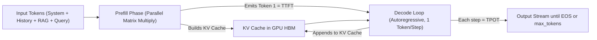
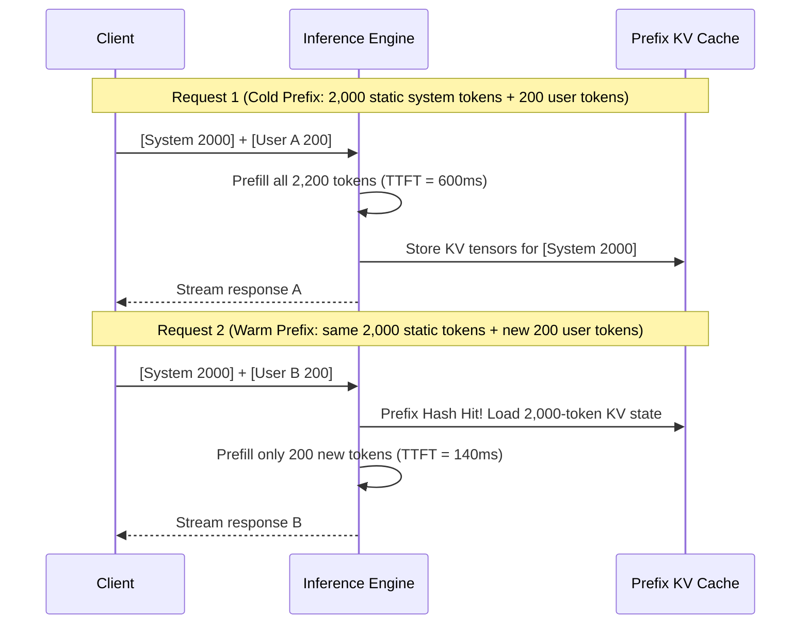
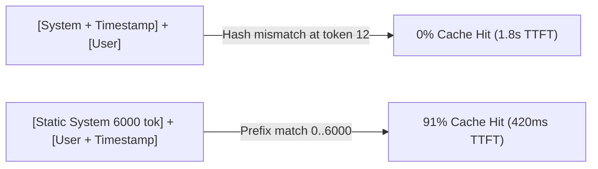

# LLM Fundamentals for System Design: Tokens, Context, Temperature, Latency

> **Prerequisites:** [Lesson 01: LLM Application Architecture: From Demo Chatbot to Production](../01-llm-application-architecture/README.md).  
> **Estimated Reading Time:** 24–28 minutes  
> **Target Audience:** Backend engineers sizing capacity, latency SLOs, and token budgets for GenAI services, and candidates asked "what drives LLM latency and cost?"  
> **Free PDF Notes:** [Download SD-S-002.pdf](https://backendroadmap.com/notes/system-design/SD-S-002.pdf)

> [!NOTE]
> **In one line:** LLMs process **tokens** (sub-word units) in two distinct phases—parallel **prefill** (compute-bound, sets **TTFT**) and sequential **decode** (memory-bandwidth-bound, sets **TPOT**)—inside a finite **context window** whose attention and KV-cache costs scale rapidly with length.

> [!TIP]
> **The Golden Rule:** Optimize **input tokens** for TTFT and cost, optimize **output tokens** for total latency and 3x–5x higher per-token pricing, and keep `temperature = 0` for deterministic backend workflows.

---

## 1. What LLM Inference Fundamentals Are, and What They Aren't

Engineers coming from traditional web services often assume an LLM API behaves like a database query: send a payload, wait a fixed ~50 ms, get a response. In reality, transformer inference has completely different physics. Output tokens are generated **one at a time** (autoregressively), output tokens cost **3x–5x more** than input tokens, and doubling your prompt length can more than double your Time to First Token while silently degrading accuracy ("lost in the middle").

| Term | Precise Meaning | Example |
| :--- | :--- | :--- |
| **Token** | Sub-word unit produced by BPE/SentencePiece tokenizer (~4 chars / ~0.75 words in English) | `"unbelievable"` $\to$ `["un", "believ", "able"]` (3 tokens) |
| **Context Window** | Max sum of input + output tokens the model can attend to in one call | 128k tokens (input + output combined) |
| **Prefill Phase** | Parallel forward pass over all input tokens to build the KV cache | Sets **TTFT**; compute-bound (FLOPs) |
| **Decode Phase** | Sequential loop generating 1 output token per step using the KV cache | Sets **TPOT**; memory-bandwidth-bound |
| **KV Cache** | Stored Key/Value tensors for prior tokens to avoid recomputation during decode | Grows linearly with sequence length |
| **Temperature ($T$)** | Softmax scaling factor controlling output randomness ($0$ = greedy/deterministic) | $T=0$ for JSON/SQL, $T=0.7$ for creative copy |
| **Not** | Character count or word count; and a 128k window does not mean "free" or "fast" | 100k tokens still costs $$$ and adds seconds of TTFT |

### Why It Matters
1. **Capacity planning:** You cannot size rate limits in RPS alone; LLM quotas are enforced in **Tokens Per Minute (TPM)** and **Requests Per Minute (RPM)**.
2. **Latency budgeting:** Knowing prefill vs decode tells you whether to shrink your prompt (fixes TTFT) or cap `max_tokens` (fixes total time).
3. **Accuracy vs cost:** Stuffing the entire context window hurts both latency and recall; smaller, cleaner contexts outperform bloated ones.

---

## 2. Anatomy: Prefill vs Decode & The Context Window



During **Prefill**, the GPU processes all $N_{\text{in}}$ prompt tokens in parallel—high arithmetic intensity, saturating Tensor Cores. Once the first token is sampled, the **Decode** loop begins: each new token requires reading the entire model weights plus the growing **KV cache** from GPU High-Bandwidth Memory (HBM) just to emit **one** token. Because decode is memory-bandwidth-bound, generating 500 output tokens takes far longer than prefilling 500 input tokens.

| Parameter | Low Setting | High Setting | System Design Trade-off |
| :--- | :--- | :--- | :--- |
| **Temperature ($T$)** | `0.0` (greedy) | `0.8–1.0` (diverse) | Use `0.0` for tool calls, extraction, classification; higher only for creative text |
| **Top-p (Nucleus)** | `0.1–0.5` | `0.95–1.0` | Truncates tail probability mass; tune one of `temperature` or `top_p`, not both |
| **`max_tokens`** | `150–500` | `4096+` | Always set explicitly; bounds worst-case latency and reserves TPM quota |
| **Context Length** | `2k–8k` | `64k–200k` | Longer context increases TTFT, KV-cache VRAM pressure, and "lost in the middle" |

> [!WARNING]
> **The #1 Trap: Leaving `max_tokens` unset or relying on `128k` context as a dumping ground.** Many gateways reserve `max_tokens` upfront against your TPM rate limit. Unbounded `max_tokens` exhausts quotas prematurely, and stuffing 80k tokens into every call drives TTFT into multiple seconds while degrading retrieval precision.

---

## 3. Mathematical Model: Tokens, KV Cache & Generation Latency

**Token Estimation.** For English prose, 1 token $\approx 0.75$ words ($\approx 4$ characters); for code or JSON, tokenization is denser (~2.5–3.5 chars/token):

$$N_{\text{tokens}} \approx \frac{\text{chars}}{4} \quad (\text{English}), \qquad N_{\text{tokens}} \approx \frac{\text{chars}}{3} \quad (\text{JSON / Code})$$

**Total Generation Latency.** With fixed overhead $T_0$, prefill rate $R_{\text{prefill}}$ (tokens/s), and decode rate $R_{\text{decode}}$ (tokens/s):

$$\text{TTFT} = T_0 + \frac{N_{\text{in}}}{R_{\text{prefill}}}, \qquad T_{\text{total}} = \text{TTFT} + \frac{N_{\text{out}}}{R_{\text{decode}}}$$

**KV Cache Memory per Request.** For a transformer with $L$ layers, $n_{\text{kv}}$ KV heads (with Grouped-Query Attention), head dimension $d_h$, sequence length $S = N_{\text{in}} + N_{\text{out}}$, and precision $p$ bytes (2 bytes for FP16/BF16):

$$M_{\text{KV}} = 2 \cdot L \cdot n_{\text{kv}} \cdot d_h \cdot S \cdot p$$

### Worked Numerical Example
Consider an LLaMA-style 70B model using GQA ($L = 80$ layers, $n_{\text{kv}} = 8$ KV heads, $d_h = 128$, BF16 $p = 2$ bytes) serving a request with $N_{\text{in}} = 4{,}000$ and $N_{\text{out}} = 500$ ($S = 4{,}500$):
1. **KV Cache Size:**
   $$M_{\text{KV}} = 2 \times 80 \times 8 \times 128 \times 4{,}500 \times 2\text{ B} = 1{,}474{,}560{,}000\text{ B} \approx 1.37\text{ GiB per concurrent request}$$
   On an 80 GB H100 (with ~70 GB weights in FP8/INT4 or tensor-parallel across GPUs), KV cache memory—not compute—caps max batch size.
2. **Latency:** If $T_0 = 80\text{ ms}$, $R_{\text{prefill}} = 10{,}000\text{ tok/s}$, and $R_{\text{decode}} = 60\text{ tok/s}$:
   $$\text{TTFT} = 80\text{ ms} + \frac{4{,}000}{10{,}000}\text{ s} = 480\text{ ms}$$
   $$T_{\text{total}} = 0.48\text{ s} + \frac{500}{60}\text{ s} = 0.48 + 8.33 = 8.81\text{ s}$$
   Notice that **94.5% of total latency** is spent in the 500-token decode phase!

---

## 4. Metrics & Percentiles

| Metric | Meaning | Alert when |
| :--- | :--- | :--- |
| **TTFT ($p_{50}, p_{95}, p_{99}$)** | Time from request sent to first output token | $p_{95} > 800\text{ ms}$ (interactive chat) |
| **TPOT ($p_{95}$)** | Time per output token during decode | $> 50\text{ ms/tok}$ ($< 20\text{ tok/s}$) |
| **TPM Utilization** | Tokens per minute consumed vs provider quota | $> 75\%$ (risk of 429 throttling) |
| **Input : Output Ratio** | $N_{\text{in}} / N_{\text{out}}$ per endpoint | Sudden shift (prompt bloat or verbose output) |
| **Finish Reason (`length`)** | Fraction of responses truncated by `max_tokens` | $> 1\%$ (responses being cut off mid-JSON) |
| **KV Cache Utilization** | Self-hosted vLLM/TGI GPU KV-cache occupancy | $> 85\%$ (triggers request preemption/queuing) |

### Worked Example (TPM Quota Sizing)
Your service expects **300 RPM** (5 RPS) with average $N_{\text{in}} = 3{,}000$ and $N_{\text{out}} = 400$.
- Average tokens/req = $3{,}400$.
- Average TPM = $300 \times 3{,}400 = 1{,}020{,}000\text{ TPM}$.
- With a $2.5\times$ peak burst factor, you must provision at least **$2.55\text{M TPM}$** (or split across two regions/providers) so peak bursts do not trigger HTTP 429s.

---

## 5. Compounding & Failure Modes

| Phenomenon | What Happens | Quantitative Effect |
| :--- | :--- | :--- |
| **Output Verbosity** | Model writes 600 tokens instead of 150 tokens | Total latency jumps $4\times$; output bill jumps $4\times$ |
| **Non-English Tokenization** | CJK, Cyrillic, or complex Unicode text splits into more sub-word tokens | $2\times\text{–}4\times$ more tokens per character than English |
| **Lost in the Middle** | Key facts placed in the middle of a 32k–100k context window | Retrieval accuracy drops 20–35% vs start/end placement |
| **KV Cache Eviction** | Self-hosted GPU runs out of KV cache under high concurrency | Requests preempted & re-prefilled; $p_{99}$ TTFT spikes $5\times$ |

---

## 6. Numbers Every Engineer Must Know

| Item | Typical | Implication |
| :--- | :---: | :--- |
| **1 token (English)** | $\sim 4\text{ chars} / 0.75\text{ words}$ | 1,000 words $\approx 1{,}333$ tokens |
| **Output vs Input price ratio** | $3\times\text{–}5\times$ more expensive | Constrain output length; put heavy instructions in input |
| **Prompt cache discount** | $50\%\text{–}90\%$ cheaper on cached prefix | Keep static system prompt + tools at the very top |
| **Human reading speed** | $\sim 4\text{–}6\text{ tokens/s}$ | Streaming $> 15\text{ tok/s}$ feels instantaneous |
| **Temperature = 0** | Near-deterministic (floating-point tie-breaks exist) | Still validate output; don't assume 100% bitwise repeatability |
| **Finish reason `stop` vs `length`** | `length` = truncated | Always check `finish_reason` before parsing JSON |

---

## 7. Protocol Deep Dive: Prefix Caching & Softmax Sampling



| Question | Answer |
| :--- | :--- |
| **Why must static instructions go at the start of the prompt?** | Prefix KV caching matches from token 0 sequentially. Putting a dynamic timestamp or user ID at line 1 invalidates the entire prefix cache on every request. |
| **Why isn't `temperature = 0` 100% deterministic across runs?** | Floating-point non-associativity in parallel GPU reductions (and Mixture-of-Experts batch routing) can occasionally flip near-tied top-1 logits. |
| **When NOT to use high context windows?** | When latency SLO is $< 1\text{ s}$ or you can retrieve the top-5 relevant chunks via RAG; 100k-token prompts are slow, costly, and prone to distraction. |

---

## 8. Hierarchical Budgets & Design Rules

| Slice | Rule | Control |
| :--- | :--- | :--- |
| **Tokenization** | Count tokens locally (`tiktoken` / model tokenizer) before calling API | Reject or truncate oversized inputs pre-flight |
| **Prompt Layout** | Static system prompt + few-shot examples first; dynamic user/RAG last | Maximizes prefix KV-cache hit rate |
| **Sampling** | `temperature = 0` for structured/tool tasks; `0.5–0.8` for creative | Enforce per-endpoint config |
| **Output Bounds** | Always set `max_tokens`; check `finish_reason == "stop"` | Prevents truncated JSON and runaway bills |
| **Context Budget** | Reserve explicit slices: System + Tools + History + RAG + Output | Never let history crowd out RAG or output |
| **Quota Sizing** | Size RPM & TPM for $2.5\times$ peak burst, not average traffic | Multi-region / multi-key load balancing |

---

## 9. Top Mitigations

1. **Put static system prompts and tool definitions at the very beginning** to unlock 50–90% prefix caching discounts and faster TTFT.
2. **Count tokens pre-flight** using a local tokenizer so oversized payloads are rejected or summarized before hitting the LLM.
3. **Always set `max_tokens` explicitly** and inspect `finish_reason` so truncated outputs fail fast instead of corrupting downstream state.
4. **Use `temperature = 0` for backend logic** (JSON extraction, routing, SQL generation) to minimize variance.
5. **Instruct the model to be concise** (or use structured fields) because every unnecessary output token costs 3x–5x more and slows total latency.
6. **Avoid placing dynamic timestamps or UUIDs in the system prompt**, which silently busts prefix caching on every call.

---

## 10. Production Reference / War Story: The Prefix-Cache Killer Timestamp

An engineering team enabled provider prefix caching on a 6,000-token legal-analysis system prompt expecting a 75% TTFT drop and 50% input cost savings. After deployment, cache hit rates stayed at **0%**, and p95 TTFT remained at 1.8 seconds.

- **Root Cause:** Line 2 of their system prompt contained `Current UTC time: 2026-11-25T08:01:33Z`. Because prefix caches hash tokens sequentially from index 0, changing the timestamp every second invalidated the entire 6,000-token prefix on every single request.
- **Fix:** Moved `Current date/time` into the **user message** at the end of the prompt (and rounded to the minute/hour where precision allowed). Prefix cache hit rate jumped from **0% to 91%**, cutting input token spend by 68% and dropping p95 TTFT from 1.8 s to 420 ms.



---

## 11. Multi-Language Production Code Tabs

A **Token Budget & Latency Estimator** that validates context window limits, reserves `max_tokens`, and computes expected TTFT/total latency and cost.

````carousel
```go
// Go: Context window budget validator and latency/cost estimator.
package main

import (
	"errors"
	"fmt"
	"math"
)

var ErrContextOverflow = errors.New("prompt + max_tokens exceeds context window")

type ModelSpec struct {
	ContextWindow   int
	CostInPer1M     float64
	CostOutPer1M    float64
	PrefillTokPerS  float64
	DecodeTokPerS   float64
	BaseOverheadMs  float64
}

func EstimateTokens(text string) int {
	return int(math.Ceil(float64(len(text)) / 4.0))
}

func PlanCall(spec ModelSpec, prompt string, maxOut int) (ttftMs, totalMs, maxCost float64, err error) {
	inTokens := EstimateTokens(prompt)
	if inTokens+maxOut > spec.ContextWindow {
		return 0, 0, 0, fmt.Errorf("%w: %d + %d > %d", ErrContextOverflow, inTokens, maxOut, spec.ContextWindow)
	}
	ttftMs = spec.BaseOverheadMs + (float64(inTokens)/spec.PrefillTokPerS)*1000.0
	totalMs = ttftMs + (float64(maxOut)/spec.DecodeTokPerS)*1000.0
	maxCost = (float64(inTokens)/1e6)*spec.CostInPer1M + (float64(maxOut)/1e6)*spec.CostOutPer1M
	return ttftMs, totalMs, maxCost, nil
}
```
<!-- slide -->
```typescript
// TypeScript: Context window budget validator and latency/cost estimator.
export interface ModelSpec {
  contextWindow: number;
  costInPer1M: number;
  costOutPer1M: number;
  prefillTokPerS: number;
  decodeTokPerS: number;
  baseOverheadMs: number;
}

export function estimateTokens(text: string, isCodeOrJson = false): number {
  const charsPerToken = isCodeOrJson ? 3.0 : 4.0;
  return Math.ceil(text.length / charsPerToken);
}

export function planCall(spec: ModelSpec, prompt: string, maxOut: number) {
  const inTokens = estimateTokens(prompt);
  if (inTokens + maxOut > spec.contextWindow) {
    throw new Error(`Context overflow: ${inTokens} + ${maxOut} > ${spec.contextWindow}`);
  }
  const ttftMs = spec.baseOverheadMs + (inTokens / spec.prefillTokPerS) * 1000;
  const totalMs = ttftMs + (maxOut / spec.decodeTokPerS) * 1000;
  const maxCostUsd = (inTokens / 1e6) * spec.costInPer1M + (maxOut / 1e6) * spec.costOutPer1M;
  return { inTokens, ttftMs: Math.round(ttftMs), totalMs: Math.round(totalMs), maxCostUsd };
}
```
<!-- slide -->
```python
# Python: KV-cache memory, TTFT/total latency, and TPM quota calculator (stdlib only).
import math


def kv_cache_gib(layers: int, kv_heads: int, head_dim: int, seq_len: int, bytes_per_param: int = 2) -> float:
    total_bytes = 2 * layers * kv_heads * head_dim * seq_len * bytes_per_param
    return round(total_bytes / (1024 ** 3), 3)


def latency_breakdown_ms(n_in: int, n_out: int, prefill_tps: float = 10000, decode_tps: float = 60, overhead_ms: float = 80):
    ttft = overhead_ms + (n_in / prefill_tps) * 1000
    total = ttft + (n_out / decode_tps) * 1000
    return {"ttft_ms": round(ttft, 1), "total_ms": round(total, 1)}


def required_tpm(rpm: int, avg_in: int, avg_out: int, burst_factor: float = 2.5) -> int:
    return math.ceil(rpm * (avg_in + avg_out) * burst_factor)
```
<!-- slide -->
```csharp
// C#: Context window budget validator and latency/cost estimator.
using System;

public sealed record ModelSpec(
    int ContextWindow,
    double CostInPer1M,
    double CostOutPer1M,
    double PrefillTokPerS,
    double DecodeTokPerS,
    double BaseOverheadMs);

public static class LlmPlanner
{
    public static int EstimateTokens(string text, bool isCodeOrJson = false)
        => (int)Math.Ceiling(text.Length / (isCodeOrJson ? 3.0 : 4.0));

    public static (int InTokens, double TtftMs, double TotalMs, double MaxCostUsd) PlanCall(
        ModelSpec spec, string prompt, int maxOut)
    {
        int inTokens = EstimateTokens(prompt);
        if (inTokens + maxOut > spec.ContextWindow)
            throw new InvalidOperationException($"Context overflow: {inTokens} + {maxOut} > {spec.ContextWindow}");

        double ttftMs = spec.BaseOverheadMs + (inTokens / spec.PrefillTokPerS) * 1000.0;
        double totalMs = ttftMs + (maxOut / spec.DecodeTokPerS) * 1000.0;
        double maxCost = (inTokens / 1e6) * spec.CostInPer1M + (maxOut / 1e6) * spec.CostOutPer1M;
        return (inTokens, Math.Round(ttftMs, 1), Math.Round(totalMs, 1), maxCost);
    }
}
```
````

---

## 12. Hands-On CLI Verification Workflows

Run the KV-cache, latency, and TPM calculations from Sections 3 & 4:

```bash
python -c "
# 70B GQA model: 80 layers, 8 kv heads, 128 head_dim, 4500 seq_len, BF16 (2 bytes)
kv_bytes = 2 * 80 * 8 * 128 * 4500 * 2
print('KV cache (GiB):', round(kv_bytes / 1024**3, 2))

# Latency: 4000 in @ 10k tok/s, 500 out @ 60 tok/s, 80ms overhead
ttft = 0.08 + 4000/10000
total = ttft + 500/60
print(f'TTFT: {ttft*1000:.0f} ms | Total: {total:.2f} s')

# TPM quota: 300 RPM, 3400 avg tokens, 2.5x burst
print('Required TPM:', int(300 * 3400 * 2.5))
"
```

---

## 13. Common Mistakes to Avoid

1. **Sizing rate limits in RPS instead of TPM**, leading to unexpected 429 errors on long-context requests.
2. **Leaving `max_tokens` unset**, which reserves excessive TPM quota and allows runaway generation latency.
3. **Putting dynamic variables (timestamps, user IDs) at the top of the system prompt**, breaking prefix KV caching.
4. **Assuming `temperature = 0` guarantees identical outputs** across hardware/versions without schema validation.
5. **Ignoring `finish_reason == "length"`**, causing downstream JSON parsers to crash on truncated responses.
6. **Using 128k context windows as a lazy substitute for retrieval**, spiking TTFT and hurting recall ("lost in the middle").
7. **Estimating token counts with `word_count`** on JSON, code, or non-English text, which underestimates tokens by 2x–4x.

---

## 14. Key Terms Glossary

| Key Term | Definition |
| :--- | :--- |
| **Token** | Sub-word unit processed by an LLM (~4 chars in English, ~3 chars in code/JSON). |
| **Context Window** | Maximum combined input + output tokens a model can process in one call. |
| **Prefill** | Parallel processing of input tokens; compute-bound and determines TTFT. |
| **Decode** | Sequential generation of output tokens; memory-bandwidth-bound and determines TPOT. |
| **KV Cache** | GPU memory storing Key/Value tensors of past tokens to accelerate decode. |
| **Temperature** | Controls sampling randomness; `0` selects the highest-probability token. |
| **Top-p (Nucleus)** | Limits sampling to the smallest token set whose cumulative probability reaches `p`. |
| **TPM / RPM** | Tokens Per Minute / Requests Per Minute rate-limit quotas. |
| **Prefix Caching** | Reusing KV-cache states for identical leading prompt tokens across requests. |
| **Finish Reason** | Metadata indicating why generation stopped (`stop`, `length`, `tool_calls`, `content_filter`). |

---

## 15. System Design Interview Questions & Answers

### Basic Conceptual Questions

<details>
<summary><strong>Q1: What is the difference between prefill and decode in LLM inference? [BASIC]</strong></summary>

**Answer:**
**Prefill** processes all input prompt tokens in parallel to compute the initial KV cache and emit the first token; it is compute-bound and determines **TTFT**. **Decode** generates output tokens one by one autoregressively using the KV cache; it is memory-bandwidth-bound and determines **TPOT** and total generation time.
</details>

<details>
<summary><strong>Q2: Why do output tokens cost 3x–5x more than input tokens? [BASIC]</strong></summary>

**Answer:**
Prefill processes thousands of input tokens in parallel with high GPU utilization. Decode must load the entire model weights and KV cache from GPU HBM for every single output token generated, resulting in much lower hardware utilization per token.
</details>

<details>
<summary><strong>Q3: How does `temperature` affect system behavior? [BASIC]</strong></summary>

**Answer:**
`temperature` scales the logits before softmax. At `0`, sampling is greedy (highest-probability token), which is best for deterministic backend tasks like JSON extraction, classification, and SQL generation. Higher values (`0.7–1.0`) flatten the distribution for creative writing.
</details>

<details>
<summary><strong>Q4: What is a context window and what counts toward it? [BASIC]</strong></summary>

**Answer:**
The context window is the hard upper limit on `input_tokens + output_tokens` in a single request. System prompts, tool schemas, conversation history, RAG chunks, the user query, and the generated output all count toward this limit.
</details>

### Scenario-Based Architecture Questions

<details>
<summary><strong>Q5: Your RAG app has a 3-second TTFT, even though output is only 100 tokens. What is wrong and how do you fix it? [SCENARIO]</strong></summary>

**Answer:**
TTFT is dominated by prefill (and upstream retrieval). A 3-second TTFT means the input prompt is too large (e.g., 20k+ tokens of unranked chunks) or prefix caching is broken. Fix by reducing retrieved chunks (top-k + reranking), compressing the system prompt, and moving static instructions to the start for prefix caching.
</details>

<details>
<summary><strong>Q6: You have 300 RPM with 3,000 input tokens and 400 output tokens. How do you size provider quotas? [SCENARIO]</strong></summary>

**Answer:**
Average TPM is $300 \times 3{,}400 = 1.02\text{M TPM}$. With a $2.5\times$ burst multiplier, provision at least $2.55\text{M TPM}$ across primary and fallback providers/regions, and set explicit `max_tokens` so gateways don't over-reserve TPM per request.
</details>

<details>
<summary><strong>Q7: Your JSON parser intermittently fails on valid-looking LLM responses. What should you check first? [SCENARIO]</strong></summary>

**Answer:**
Check `finish_reason`. If it is `"length"`, the response was truncated at `max_tokens` before closing the JSON braces. Raise `max_tokens` (or reduce verbosity), enable Structured Outputs, and fail fast when `finish_reason != "stop"`.
</details>

<details>
<summary><strong>Q8: Why did prefix caching give 0% hit rate after you enabled it? [SCENARIO]</strong></summary>

**Answer:**
Prefix caching requires an exact token-by-token match starting from token 0. A dynamic field (timestamp, request ID, user name) placed at the top of the system prompt invalidates the prefix on every request. Move all dynamic variables to the end of the prompt.
</details>

### Advanced & Tricky Interview Questions

<details>
<summary><strong>Q9: Why does KV cache memory often bottleneck self-hosted LLM throughput before GPU FLOPs? [TRICKY]</strong></summary>

**Answer:**
Each concurrent request holds $2 \cdot L \cdot n_{\text{kv}} \cdot d_h \cdot S \cdot p$ bytes of KV cache in GPU HBM—often 1–2+ GiB per long-context request. When HBM fills up, the scheduler (e.g., vLLM) must pause or evict requests, limiting batch size and forcing decode steps to remain memory-bandwidth-bound.
</details>

<details>
<summary><strong>Q10: If a model has a 1M-token context window, why not dump the entire database/codebase into the prompt instead of using RAG? [TRICKY]</strong></summary>

**Answer:**
Three reasons: (1) **Cost**—paying for 500k input tokens per query is 100x+ more expensive than retrieving 2k relevant tokens; (2) **Latency**—prefilling 500k tokens takes many seconds of TTFT; (3) **Accuracy**—LLMs suffer from "lost in the middle" degradation and distraction when irrelevant context drowns out key facts.
</details>

<details>
<summary><strong>Q11: Why can `temperature = 0` still produce different outputs on identical inputs? [TRICKY]</strong></summary>

**Answer:**
GPU parallel matrix multiplications use non-associative floating-point addition whose order varies with batch size, and Mixture-of-Experts (MoE) routers can drop or reorder tokens across batches. When two tokens have nearly identical logits, tiny rounding differences can flip the winner.
</details>

<details>
<summary><strong>Q12: How does speculative decoding speed up the decode phase without changing output quality? [TRICKY]</strong></summary>

**Answer:**
A tiny, fast draft model proposes $k$ candidate tokens sequentially, and the large target model verifies all $k$ tokens in a **single parallel prefill-like forward pass**. Accepted tokens are emitted in one step, converting memory-bandwidth-bound decode into compute-bound verification while preserving the exact target distribution.
</details>

---

## 16. One-Page Master Cheat Sheet

```
+---------------------------------------------------------------------------------------------------------+
|                    LLM FUNDAMENTALS FOR SYSTEM DESIGN — MASTER CHEAT SHEET                              |
+---------------------------------------------------------------------------------------------------------+
| 1. TOKENS: ~4 chars (English), ~3 chars (code/JSON). Output tokens cost 3x-5x more than input tokens.   |
+---------------------------------------------------------------------------------------------------------+
| 2. TWO PHASES: Prefill (parallel, compute-bound -> TTFT) vs Decode (sequential, memory-BW -> TPOT).     |
|    T_total = T_0 + N_in / R_prefill + N_out / R_decode.                                                 |
+---------------------------------------------------------------------------------------------------------+
| 3. KV CACHE: M_kv = 2 * L * n_kv * d_h * S * p bytes. Caps concurrent batch size in self-hosted GPUs.   |
+---------------------------------------------------------------------------------------------------------+
| 4. PREFIX CACHING: Put static system prompt + tools FIRST; dynamic user/time LAST (50-90% savings).     |
+---------------------------------------------------------------------------------------------------------+
| 5. SAMPLING & BOUNDS: T=0 for backend logic. Always set max_tokens and check finish_reason == "stop".   |
+---------------------------------------------------------------------------------------------------------+
| 6. QUOTAS: Size in TPM (RPM * avg_tokens * 2.5x burst), not just RPS.                                   |
+---------------------------------------------------------------------------------------------------------+
```

---

## Further Reading & Sources

- Ashish Vaswani et al., [Attention Is All You Need](https://arxiv.org/abs/1706.03762) (Transformer architecture & attention scaling).
- Woosuk Kwon et al., [Efficient Memory Management for Large Language Model Serving with PagedAttention (vLLM)](https://arxiv.org/abs/2309.06180).
- Nelson F. Liu et al., [Lost in the Middle: How Language Models Use Long Contexts](https://arxiv.org/abs/2307.03172).
- OpenAI / Anthropic Documentation on [Prompt Caching](https://docs.anthropic.com/en/docs/build-with-claude/prompt-caching) and Tokenization.

---

## Free PDF Notes

[SD-S-002.pdf](https://backendroadmap.com/notes/system-design/SD-S-002.pdf)

---

## Next

Continue with [Lesson 03: Prompt Management: Templates, Versioning & Safe Prompt Rollouts](../03-prompt-management/README.md).
