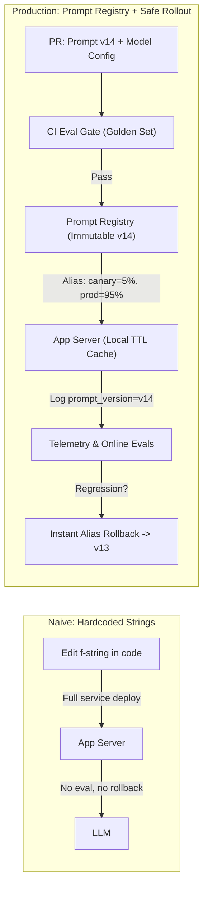
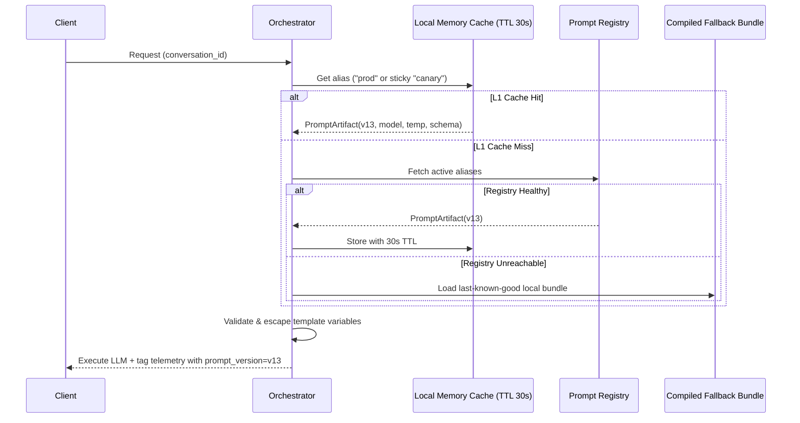
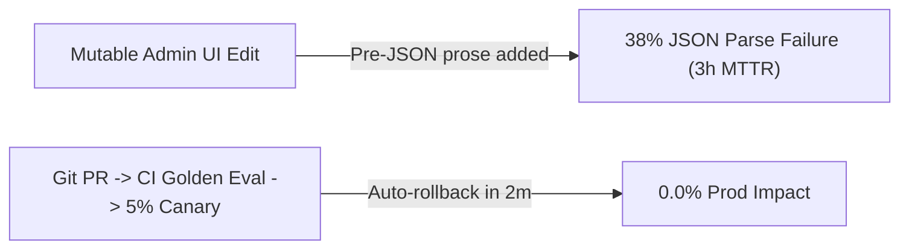

# Prompt Management: Templates, Versioning & Safe Prompt Rollouts

> **Prerequisites:** [Lesson 02: LLM Fundamentals for System Design: Tokens, Context, Temperature, Latency](../02-llm-fundamentals-for-system-design/README.md).  
> **Estimated Reading Time:** 23–27 minutes  
> **Target Audience:** Backend and platform engineers managing production prompts across teams, and candidates asked "how do you version, test, and safely roll out prompt changes?"  
> **Free PDF Notes:** [Download SD-S-003.pdf](https://backendroadmap.com/notes/system-design/SD-S-003.pdf)

> [!NOTE]
> **In one line:** In production GenAI systems, a **prompt is code + configuration**: it must live in a **versioned Prompt Registry** as a typed template, pass **automated offline evals** in CI, and roll out via **canary traffic splitting and instant rollback**—never edited inline in application code or a live database.

> [!TIP]
> **The Golden Rule:** Decouple **prompt + model + hyperparameters** as a single immutable artifact (`prompt_version_id`), and never ship a prompt edit without running it against your golden regression dataset.

---

## 1. What Prompt Management Is, and What It Isn't

In early prototypes, prompts are multi-line f-strings buried inside service handlers (`f"Summarize this for {user}: {text}"`). When a product manager wants to tweak the tone, an engineer edits the string, redeploys the whole microservice, and crosses their fingers. Worse, when a prompt is coupled to `gpt-4o` and someone upgrades the model to `claude-3-7-sonnet` without re-evaluating the prompt, formatting breaks silently in production.

| Term | Precise Meaning | Example |
| :--- | :--- | :--- |
| **Prompt Template** | Parameterized, typed prompt structure with explicit input variables | `system` + `user` with `{schema}` & `{query}` |
| **Prompt Artifact** | Immutable bundle of template, target model, temperature, `max_tokens`, and output schema | `support-triage@v14` |
| **Prompt Registry** | Versioned store (Git or DB-backed) serving prompt artifacts with environment aliases (`prod`, `canary`) | Langfuse, PromptLayer, Git + S3/Redis |
| **Eval Gate** | CI/CD check running the candidate prompt against a golden dataset before promotion | Must score $\ge 95\%$ accuracy & $0\%$ schema errors |
| **Canary Rollout** | Routing a small percentage (e.g., 5%) of live traffic to a new prompt version while comparing metrics | 95% `v13` / 5% `v14` |
| **Prompt Injection** | Untrusted user/RAG text hijacking template instructions | `"Ignore previous instructions..."` |
| **Not** | Storing unversioned strings in an admin panel that anyone can mutate in live prod | Mutable live edits cause untraceable regressions |

### Why It Matters
1. **Prompts are tightly coupled to model weights:** A prompt tuned for Model A can drop 15% accuracy on Model B; you must version them together.
2. **Fast iteration without full deploys:** Decoupling prompts into a cached registry lets teams iterate and roll back in seconds, not 20-minute CI builds.
3. **Auditability & compliance:** Every production response must log the exact `prompt_version` that generated it so regressions can be reproduced.

---

## 2. Anatomy: Hardcoded Prompts vs Versioned Prompt Registry



A production Prompt Registry separates **authoring** (PRs with diff review + CI evals) from **serving** (application servers fetching immutable versions with a local in-memory cache and a fallback bundle). Traffic splitting happens via **environment aliases** (`prod`, `canary`, `staging`) rather than mutating a version in place.

| Approach | Iteration Speed | Safety / Audit | Best For |
| :--- | :--- | :--- | :--- |
| **Hardcoded in App Code** | Slow (requires full deploy) | High Git audit, zero runtime agility | Early prototypes |
| **Mutable DB / Admin UI** | Instant | Dangerous (no diff, no CI gate, untraceable) | Never in prod |
| **Git-Backed Registry + Alias** | Fast (seconds via cache refresh) | Immutable versions + CI eval gate + instant rollback | Production standard |

> [!WARNING]
> **The #1 Trap: String-interpolating untrusted input directly into system instructions.** If user input or retrieved RAG documents are concatenated without clear structural delimiters (or separate `user` role messages), attackers can inject instructions that override your system prompt or exfiltrate secrets.

---

## 3. Mathematical Model: Canary Sample Size & Regression Detection

**Minimum Canary Sample Size.** To detect a quality drop (e.g., pass rate dropping from $p_0$ to $p_1$, $\Delta = p_0 - p_1$) with significance level $\alpha$ (e.g., $0.05$, $Z_{\alpha/2} = 1.96$) and statistical power $1 - \beta$ (e.g., $0.80$, $Z_{\beta} = 0.84$):

$$n \approx \frac{\left(Z_{\alpha/2}\sqrt{2\bar{p}(1-\bar{p})} + Z_{\beta}\sqrt{p_0(1-p_0) + p_1(1-p_1)}\right)^2}{(p_0 - p_1)^2}, \qquad \bar{p} = \frac{p_0 + p_1}{2}$$

**Blast Radius.** During a canary rollout at traffic fraction $f \in (0, 1]$ over arrival rate $\lambda$ (req/min) and detection/rollback time $T_{\text{detect}}$ (min):

$$N_{\text{impacted}} = f \cdot \lambda \cdot T_{\text{detect}}$$

### Worked Numerical Example
Suppose baseline prompt `v13` has a **96%** valid-JSON & task-pass rate ($p_0 = 0.96$), and you want to detect a **4% regression** ($p_1 = 0.92$, $\Delta = 0.04$) with 95% confidence ($Z_{\alpha/2} = 1.96$) and 80% power ($Z_{\beta} = 0.84$):
1. **Required Sample Size per Variant:**
   $$\bar{p} = \frac{0.96 + 0.92}{2} = 0.94$$
   $$n \approx \frac{\left(1.96\sqrt{2(0.94)(0.06)} + 0.84\sqrt{0.96(0.04) + 0.92(0.08)}\right)^2}{(0.04)^2}$$
   $$n \approx \frac{(1.96 \times 0.3359 + 0.84 \times 0.3347)^2}{0.0016} = \frac{(0.658 + 0.281)^2}{0.0016} \approx 551\text{ requests per variant}$$
2. **Canary Duration & Blast Radius:**
   At $\lambda = 200\text{ req/min}$ with a **5% canary** ($f = 0.05$), the canary receives $10\text{ req/min}$. It takes $551 / 10 \approx 55\text{ minutes}$ to reach statistical significance. If a severe bug causes immediate schema failures ($T_{\text{detect}} = 2\text{ min}$), only $0.05 \times 200 \times 2 = 20$ users are impacted before auto-rollback.

---

## 4. Metrics & Percentiles

| Metric | Meaning | Alert when |
| :--- | :--- | :--- |
| **Schema / Parse Error Rate** | Outputs failing JSON/Pydantic validation per `prompt_version` | $> 0.5\%$ (auto-rollback canary) |
| **Offline Eval Pass Rate** | Score on golden dataset in CI before promotion | Drops $> 1\%$ vs current `prod` version |
| **User Thumbs-Down / Retry Rate** | Explicit negative feedback or immediate user re-asks | $> 2\times$ baseline on canary |
| **Token Delta per Version** | Change in average $N_{\text{in}}$ and $N_{\text{out}}$ | $> 15\%$ unexpected cost/latency jump |
| **Prompt Cache Hit Rate** | Local registry cache hits vs remote fetches | $< 99\%$ (risk of registry outage impact) |
| **Template Render Error Rate** | Missing required variables or type mismatches | $> 0$ (must fail fast in validation) |

### Worked Example (Canary Auto-Rollback)
Prompt `v14` adds chain-of-thought reasoning to improve accuracy from 91% to 94% in offline evals. In a 5% canary rollout, online telemetry shows:
- `v13` (`prod`): `avg_out = 180 tokens`, `p95_total = 3.2 s`, `schema_err = 0.1%`.
- `v14` (`canary`): `avg_out = 620 tokens`, `p95_total = 10.8 s`, `schema_err = 1.9%` (due to hitting `max_tokens=700`).
Automated canary gates detect the $3.4\times$ latency spike and $>0.5\%$ schema error rate within 4 minutes and automatically flip the `canary` pointer back to `v13`.

---

## 5. Compounding & Failure Modes

| Failure Mode | Mechanism | Impact |
| :--- | :--- | :--- |
| **Prompt-Model Drift** | Upgrading `gpt-4o-2024-05` $\to$ `2024-08` without re-running evals | Formatting rules ignored; accuracy drops 8–15% silently |
| **Registry SPOF** | App fetches prompt from remote registry on every request with no local fallback | Registry outage takes down 100% of LLM traffic |
| **Split-Brain Multi-Turn** | User's 5-turn chat switches from `v13` to `v14` mid-conversation | Inconsistent persona/format confuses the model |
| **Variable Injection** | Unescaped `{user_input}` contains braces or adversarial instructions | Template engine crash or prompt injection |

---

## 6. Numbers Every Engineer Must Know

| Item | Typical | Implication |
| :--- | :---: | :--- |
| **Golden eval dataset size** | $100\text{–}1{,}000$ curated cases | Small enough to run in CI in $< 3$ min; large enough to catch regressions |
| **Local prompt cache TTL** | $30\text{–}60\text{ s}$ (with stale-while-revalidate) | Zero network latency on hot path; sub-minute rollback |
| **Initial canary traffic** | $1\%\text{–}5\%$ | Bounds blast radius while collecting 500+ samples |
| **Sticky session pinning** | Pin `prompt_version` per `conversation_id` | Prevents mid-conversation behavior shifts during rollout |
| **Rollback time** | $< 60\text{ s}$ | Alias pointer flip + cache TTL expiry |

---

## 7. Protocol Deep Dive: Prompt Resolution, Caching & Canary Routing



| Question | Answer |
| :--- | :--- |
| **Should prompt versions be pinned per request or per conversation?** | Pin per **conversation** (sticky routing via `hash(conversation_id) % 100 < canary_pct`) so multi-turn chats stay consistent. |
| **Why bundle a fallback prompt inside the app binary/container?** | So a Prompt Registry outage never causes an application outage; the app degrades gracefully to its compiled last-known-good prompt. |
| **When NOT to use a dynamic remote Prompt Registry?** | For tiny single-prompt services or strict air-gapped environments where Git-versioned prompts deployed via standard CI/CD are simpler and safer. |

---

## 8. Hierarchical Budgets & Design Rules

| Slice | Rule | Control |
| :--- | :--- | :--- |
| **Immutability** | Published prompt versions (`v13`, `v14`) are never edited in place | Append-only versions; move `prod`/`canary` aliases |
| **Coupling** | Bind `template + model + temperature + max_tokens + schema` together | Single `PromptArtifact` struct |
| **CI Gate** | Every prompt PR runs against golden dataset + schema checks | Block merge if eval score drops below threshold |
| **Resilience** | App reads from L1 cache with compiled fallback bundle | Registry is never a runtime SPOF |
| **Safety** | Separate `system` instructions from `user` data; delimit untrusted RAG text | Strict variable typing + XML/JSON delimiters |
| **Rollout** | Canary 5% sticky by `conversation_id`, auto-rollback on error/latency spike | Automated canary analyzer |

---

## 9. Top Mitigations

1. **Treat prompts as immutable, versioned artifacts** bundled with their exact model ID, temperature, `max_tokens`, and output schema.
2. **Gate every prompt change in CI** against a curated golden evaluation dataset (100–1,000 examples covering happy paths, edge cases, and adversarial inputs).
3. **Cache prompts locally in memory** (30–60 s TTL) and ship a compiled fallback bundle in the container so the registry is never a runtime SPOF.
4. **Use sticky canary rollouts** (`hash(conversation_id) % 100`) so a user never flips prompt versions mid-conversation.
5. **Log `prompt_version` on every LLM trace** so quality regressions or cost spikes can be immediately bisected by version.
6. **Sanitize and delimit untrusted inputs** (e.g., `<user_query>...</user_query>`) instead of raw string concatenation into system instructions.

---

## 10. Production Reference / War Story: The Silent Formatting Regression

A fintech company stored its customer-support prompt in a mutable PostgreSQL table edited via an internal admin UI. One afternoon, a well-meaning PM added a single sentence to the live prompt: *"Always be extra polite and explain your reasoning clearly."*

- **Root Cause:** No versioning, no schema validation gate, and no canary rollout. The new sentence caused the model to prepend `"Certainly! Here is my reasoning..."` before the JSON payload, breaking the downstream strict `JSON.parse()` in 38% of support tickets. Because no `prompt_version` was logged, engineers spent 3 hours debugging the API gateway before discovering the live prompt edit.
- **Fix:**
  1. Replaced the mutable admin UI with a **Git-backed immutable Prompt Registry** (`v1`, `v2`, ...) and PR reviews.
  2. Added a **CI Eval Gate** testing 250 golden cases for strict JSON schema compliance.
  3. Implemented **5% sticky canary rollouts** with automatic rollback if `schema_error_rate > 0.5%`.



---

## 11. Multi-Language Production Code Tabs

An immutable **Prompt Registry & Sticky Canary Router** with local fallback bundle and strict template variable validation.

````carousel
```go
// Go: Immutable PromptRegistry with sticky canary routing and local fallback.
package main

import (
	"fmt"
	"hash/fnv"
	"strings"
	"sync"
)

type PromptArtifact struct {
	Version     string
	Model       string
	Temperature float64
	Template    string
	Required    []string
}

type PromptRegistry struct {
	mu         sync.RWMutex
	versions   map[string]PromptArtifact
	prodVer    string
	canaryVer  string
	canaryPct  uint32
}

func (r *PromptRegistry) Resolve(conversationID string) PromptArtifact {
	r.mu.RLock()
	defer r.mu.RUnlock()
	if r.canaryVer != "" && r.canaryPct > 0 {
		h := fnv.New32a()
		_, _ = h.Write([]byte(conversationID))
		if h.Sum32()%100 < r.canaryPct {
			return r.versions[r.canaryVer]
		}
	}
	return r.versions[r.prodVer]
}

func RenderPrompt(art PromptArtifact, vars map[string]string) (string, error) {
	out := art.Template
	for _, key := range art.Required {
		val, ok := vars[key]
		if !ok {
			return "", fmt.Errorf("missing required prompt variable: %s", key)
		}
		out = strings.ReplaceAll(out, "{{"+key+"}}", val)
	}
	return out, nil
}
```
<!-- slide -->
```typescript
// TypeScript: Immutable PromptRegistry with sticky canary routing and strict rendering.
export interface PromptArtifact {
  readonly version: string;
  readonly model: string;
  readonly temperature: number;
  readonly template: string;
  readonly requiredVars: readonly string[];
}

export class PromptRegistry {
  private versions = new Map<string, PromptArtifact>();
  private prodVersion = "";
  private canaryVersion: string | null = null;
  private canaryPct = 0;

  register(artifact: PromptArtifact, alias?: "prod" | "canary", canaryPct = 0): void {
    this.versions.set(artifact.version, Object.freeze(artifact));
    if (alias === "prod") this.prodVersion = artifact.version;
    if (alias === "canary") {
      this.canaryVersion = artifact.version;
      this.canaryPct = canaryPct;
    }
  }

  resolve(conversationId: string): PromptArtifact {
    if (this.canaryVersion && this.canaryPct > 0) {
      let hash = 2166136261;
      for (let i = 0; i < conversationId.length; i++) {
        hash = Math.imul(hash ^ conversationId.charCodeAt(i), 16777619);
      }
      if ((hash >>> 0) % 100 < this.canaryPct) {
        return this.versions.get(this.canaryVersion)!;
      }
    }
    return this.versions.get(this.prodVersion)!;
  }

  render(artifact: PromptArtifact, vars: Record<string, string>): string {
    let result = artifact.template;
    for (const key of artifact.requiredVars) {
      if (!(key in vars)) throw new Error(`Missing prompt variable: ${key}`);
      result = result.replaceAll(`{{${key}}}`, vars[key]);
    }
    return result;
  }
}
```
<!-- slide -->
```python
# Python: Immutable PromptRegistry with sticky canary routing & canary sample-size math.
from dataclasses import dataclass
import hashlib
import math
from typing import Dict, List, Optional


@dataclass(frozen=True)
class PromptArtifact:
    version: str
    model: str
    temperature: float
    template: str
    required_vars: tuple[str, ...]


class PromptRegistry:
    def __init__(self, fallback: PromptArtifact):
        self._versions: Dict[str, PromptArtifact] = {fallback.version: fallback}
        self._prod = fallback.version
        self._canary: Optional[str] = None
        self._canary_pct = 0

    def register(self, artifact: PromptArtifact, alias: Optional[str] = None, canary_pct: int = 0):
        self._versions[artifact.version] = artifact
        if alias == "prod":
            self._prod = artifact.version
        elif alias == "canary":
            self._canary = artifact.version
            self._canary_pct = canary_pct

    def resolve(self, conversation_id: str) -> PromptArtifact:
        if self._canary and self._canary_pct > 0:
            bucket = int(hashlib.sha256(conversation_id.encode()).hexdigest(), 16) % 100
            if bucket < self._canary_pct:
                return self._versions[self._canary]
        return self._versions[self._prod]

    @staticmethod
    def render(artifact: PromptArtifact, variables: Dict[str, str]) -> str:
        text = artifact.template
        for k in artifact.required_vars:
            if k not in variables:
                raise ValueError(f"Missing prompt variable: {k}")
            text = text.replace(f"{{{{{k}}}}}", variables[k])
        return text


def canary_sample_size(p0: float, p1: float, z_alpha: float = 1.96, z_beta: float = 0.84) -> int:
    p_bar = (p0 + p1) / 2
    num = (z_alpha * math.sqrt(2 * p_bar * (1 - p_bar)) + z_beta * math.sqrt(p0 * (1 - p0) + p1 * (1 - p1))) ** 2
    return math.ceil(num / ((p0 - p1) ** 2))
```
<!-- slide -->
```csharp
// C#: Immutable PromptRegistry with sticky canary routing and strict rendering.
using System;
using System.Collections.Generic;
using System.Security.Cryptography;
using System.Text;

public sealed record PromptArtifact(
    string Version,
    string Model,
    double Temperature,
    string Template,
    IReadOnlyList<string> RequiredVars);

public sealed class PromptRegistry
{
    private readonly Dictionary<string, PromptArtifact> _versions = new();
    private string _prodVersion = "";
    private string? _canaryVersion;
    private int _canaryPct;

    public void Register(PromptArtifact artifact, string? alias = null, int canaryPct = 0)
    {
        _versions[artifact.Version] = artifact;
        if (alias == "prod") _prodVersion = artifact.Version;
        if (alias == "canary") { _canaryVersion = artifact.Version; _canaryPct = canaryPct; }
    }

    public PromptArtifact Resolve(string conversationId)
    {
        if (_canaryVersion is not null && _canaryPct > 0)
        {
            var hash = SHA256.HashData(Encoding.UTF8.GetBytes(conversationId));
            uint bucket = BitConverter.ToUInt32(hash, 0) % 100;
            if (bucket < _canaryPct) return _versions[_canaryVersion];
        }
        return _versions[_prodVersion];
    }

    public static string Render(PromptArtifact artifact, IReadOnlyDictionary<string, string> vars)
    {
        var output = artifact.Template;
        foreach (var key in artifact.RequiredVars)
        {
            if (!vars.TryGetValue(key, out var val))
                throw new ArgumentException($"Missing prompt variable: {key}");
            output = output.Replace($"{{{{{key}}}}}", val);
        }
        return output;
    }
}
```
````

---

## 12. Hands-On CLI Verification Workflows

Verify canary sample size math and run a local CI-style prompt schema check:

```bash
# 1. Calculate required canary sample size to detect a 96% -> 92% quality drop
python -c "
import math
p0, p1 = 0.96, 0.92
p_bar = (p0 + p1) / 2
n = ((1.96 * math.sqrt(2*p_bar*(1-p_bar)) + 0.84 * math.sqrt(p0*(1-p0) + p1*(1-p1))) ** 2) / ((p0 - p1) ** 2)
print('Samples per variant:', math.ceil(n))
print('Minutes at 200 RPM with 5% canary:', round(math.ceil(n) / (200 * 0.05), 1))
"

# 2. Validate prompt template YAML/JSON artifacts in CI using jq/python
python -c "
import json
artifact = {'version': 'v14', 'model': 'gpt-4o-mini', 'temperature': 0.0, 'required_vars': ['query']}
assert artifact['temperature'] == 0.0 and 'version' in artifact
print('Prompt artifact valid:', json.dumps(artifact))
"
```

---

## 13. Common Mistakes to Avoid

1. **Editing prompts live in a database/admin UI** without immutable versions, diffs, or CI evals.
2. **Versioning the prompt text separately from the target model and temperature**, causing silent breakage on model upgrades.
3. **Making the Prompt Registry a synchronous runtime dependency** with no local cache or compiled fallback bundle.
4. **Rolling out a new prompt to 100% of traffic at once** instead of using a sticky 1%–5% canary.
5. **Flipping prompt versions mid-conversation** instead of pinning by `conversation_id`.
6. **Concatenating untrusted user or RAG text into the system prompt** without delimiters or role separation.
7. **Forgetting to log `prompt_version` in telemetry**, making post-incident root-cause analysis guesswork.

---

## 14. Key Terms Glossary

| Key Term | Definition |
| :--- | :--- |
| **Prompt Template** | Parameterized prompt structure with explicitly typed input placeholders. |
| **Prompt Artifact** | Immutable bundle of template, model ID, sampling params, and output schema. |
| **Prompt Registry** | Versioned store managing immutable prompt artifacts and environment aliases. |
| **Environment Alias** | Mutable pointer (`prod`, `canary`, `staging`) referencing an immutable version. |
| **Golden Dataset** | Curated set of input/output test cases used to catch regressions in CI. |
| **Canary Rollout** | Routing a small percentage of live traffic to a candidate prompt to measure real-world metrics. |
| **Sticky Routing** | Pinning a `conversation_id` to a single prompt version for the duration of a session. |
| **Fallback Bundle** | Last-known-good prompts packaged inside the service binary/container for resilience. |
| **Prompt-Model Drift** | Quality degradation when a prompt is run on a different model or checkpoint than it was tuned for. |
| **Prompt Injection** | Adversarial input attempting to override system instructions or leak prompt contents. |

---

## 15. System Design Interview Questions & Answers

### Basic Conceptual Questions

<details>
<summary><strong>Q1: Why shouldn't prompts just be hardcoded strings in application code? [BASIC]</strong></summary>

**Answer:**
Hardcoded prompts couple every wording tweak to a full microservice build and deploy cycle, make A/B testing and instant rollback hard, and scatter model/temperature configs across codebases. A versioned Prompt Registry decouples prompt iteration from code deploys while keeping immutability and auditability.
</details>

<details>
<summary><strong>Q2: What belongs inside a versioned Prompt Artifact? [BASIC]</strong></summary>

**Answer:**
Not just the text template—it must bundle the **template, required variable schema, target model ID, sampling parameters (`temperature`, `top_p`, `max_tokens`), and expected output JSON schema**. Prompts are tightly coupled to model weights and parameters.
</details>

<details>
<summary><strong>Q3: How do you roll back a bad prompt in under a minute? [BASIC]</strong></summary>

**Answer:**
Use immutable versions (`v13`, `v14`) with mutable environment aliases (`prod -> v13`, `canary -> v14`). Rolling back simply repoints the alias to `v13`, which propagates to app servers within one local cache TTL (e.g., 30 s) without redeploying containers.
</details>

<details>
<summary><strong>Q4: What is a Golden Dataset in prompt engineering? [BASIC]</strong></summary>

**Answer:**
A curated suite of 100–1,000 representative, edge-case, and adversarial inputs with expected outputs or rubrics. It runs in CI on every prompt or model change to catch accuracy, latency, and schema regressions before production.
</details>

### Scenario-Based Architecture Questions

<details>
<summary><strong>Q5: Your Prompt Registry goes down during peak traffic. How do you ensure 0% impact on your LLM API? [SCENARIO]</strong></summary>

**Answer:**
App servers never call the registry on the critical path synchronously without caching. They use an in-memory L1 cache (30–60 s TTL) with stale-while-revalidate, plus a **compiled fallback bundle** baked into the container image at build time.
</details>

<details>
<summary><strong>Q6: You want to test a new prompt on 5% of production traffic. How do you route requests? [SCENARIO]</strong></summary>

**Answer:**
Use **sticky routing** by hashing `conversation_id` (`hash(conversation_id) % 100 < 5`), not random per-request sampling. This ensures a multi-turn conversation stays on one prompt version, preventing jarring tone or format shifts mid-chat.
</details>

<details>
<summary><strong>Q7: A PM wants an admin UI to edit live production prompts directly. How do you respond? [SCENARIO]</strong></summary>

**Answer:**
Explain that unreviewed live edits cause silent, untraceable outages (like breaking JSON parsing). Offer a Git-backed or registry workflow where edits create a new immutable version, automatically pass CI golden evals, and roll out via a 5% canary with auto-rollback.
</details>

<details>
<summary><strong>Q8: You are migrating from Model A to Model B. What is your rollout plan? [SCENARIO]</strong></summary>

**Answer:**
Create a new prompt artifact bound to Model B, run the golden eval suite (both accuracy and JSON schema adherence), tune the prompt if Model B has different formatting quirks, deploy to a 5% canary comparing TTFT, cost, and user retry rate, and ramp to 100% only after hitting statistical significance.
</details>

### Advanced & Tricky Interview Questions

<details>
<summary><strong>Q9: How many canary requests do you need before declaring a new prompt safe? [TRICKY]</strong></summary>

**Answer:**
It depends on baseline pass rate and the minimum regression $\Delta$ you want to detect. Using the two-proportion sample size formula, detecting a 4% drop from 96% to 92% at 95% confidence and 80% power requires ~550 requests per variant. For schema failures (10x spikes), sequential/SPRT checks can trigger auto-rollback in < 50 requests.
</details>

<details>
<summary><strong>Q10: How do you defend against prompt injection when rendering templates with user and RAG data? [TRICKY]</strong></summary>

**Answer:**
Never interpolate untrusted text into the `system` role. Keep instructions in `system`, place untrusted user/RAG text in `user` wrapped in explicit XML/JSON delimiters, validate variable types, run an input guardrail classifier for known jailbreaks, and enforce strict output schemas/least-privilege tool permissions.
</details>

<details>
<summary><strong>Q11: How do you handle prompt changes that alter tool-calling schemas? [TRICKY]</strong></summary>

**Answer:**
A prompt that expects a new tool parameter cannot roll out independently of backend code. Use **expand-and-contract**: deploy backend code supporting both old and new tool schemas first, then roll out the new prompt version via canary, and remove old schema support later.
</details>

<details>
<summary><strong>Q12: Why should prompt evaluation scores be tracked alongside cost and latency? [TRICKY]</strong></summary>

**Answer:**
A prompt change can raise accuracy by 2% while tripling output tokens (via verbose chain-of-thought), tripling cost and blowing the TTFT/total latency SLO. Decisions require evaluating the **Pareto frontier of Quality × Cost × Latency**.
</details>

---

## 16. One-Page Master Cheat Sheet

```
+---------------------------------------------------------------------------------------------------------+
|                    PROMPT MANAGEMENT & SAFE ROLLOUTS — MASTER CHEAT SHEET                               |
+---------------------------------------------------------------------------------------------------------+
| 1. PROMPT = CODE: Bundle (template + model + temp + max_tokens + schema) as an immutable artifact.      |
+---------------------------------------------------------------------------------------------------------+
| 2. REGISTRY & RESILIENCE: Serve via immutable versions + mutable aliases (prod/canary).                 |
|    Use L1 memory cache (30-60s TTL) + compiled fallback bundle so registry is never a runtime SPOF.     |
+---------------------------------------------------------------------------------------------------------+
| 3. CI EVAL GATE: Run 100-1,000 golden test cases + schema validation before any version hits prod.      |
+---------------------------------------------------------------------------------------------------------+
| 4. CANARY ROLLOUT: Route 1-5% sticky by hash(conversation_id). Auto-rollback on schema/latency spikes.  |
|    Sample size n ~ 550/variant to detect 4% drop (96% -> 92%) at 95% conf / 80% power.                  |
+---------------------------------------------------------------------------------------------------------+
| 5. OBSERVABILITY: Tag every LLM trace with prompt_version for instant regression bisection.             |
+---------------------------------------------------------------------------------------------------------+
| 6. SECURITY: Never interpolate untrusted input into system role; delimit user/RAG data strictly.        |
+---------------------------------------------------------------------------------------------------------+
```

---

## Further Reading & Sources

- Anthropic, [Prompt Engineering & Evaluation Best Practices](https://docs.anthropic.com/en/docs/build-with-claude/prompt-engineering/overview).
- Hamel Husain, [Your AI Product Needs Evals](https://hamel.dev/blog/posts/evals/).
- OWASP, [LLM01: Prompt Injection (OWASP Top 10 for LLM Applications)](https://genai.owasp.org/llmrisk/llm01-prompt-injection/).
- Chip Huyen, *AI Engineering* (O'Reilly, 2025), Chapter 5 (Prompt Engineering & Evaluation).

---

## Free PDF Notes

[SD-S-003.pdf](https://backendroadmap.com/notes/system-design/SD-S-003.pdf)

---

## Next

Continue with [Lesson 04: Conversation Context Management: History, Truncation & Summary Memory](../04-conversation-context-management/README.md).
