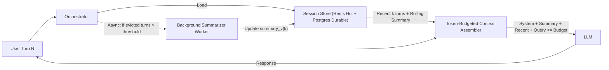
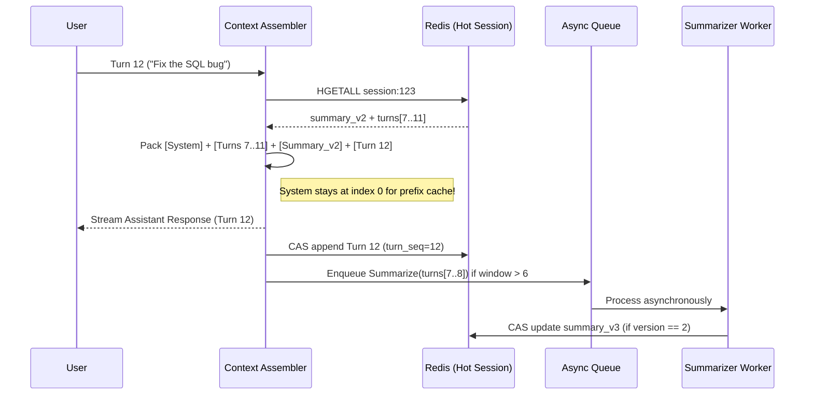
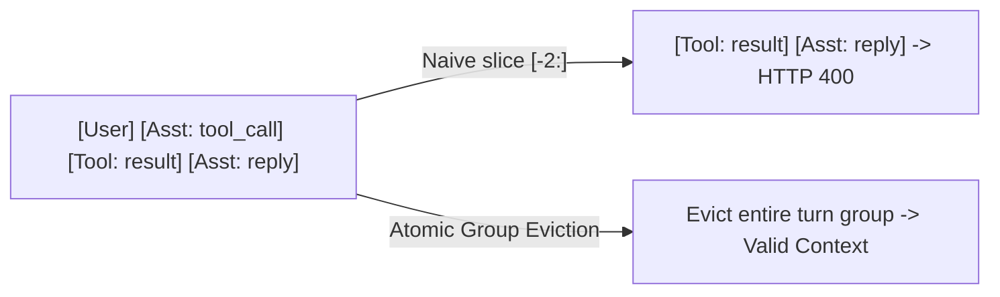

# Conversation Context Management: History, Truncation & Summary Memory

> **Prerequisites:** [Lesson 03: Prompt Management: Templates, Versioning & Safe Prompt Rollouts](../03-prompt-management/README.md).  
> **Estimated Reading Time:** 23–27 minutes  
> **Target Audience:** Backend engineers building stateful multi-turn chatbots and AI agents, and candidates asked "how do you manage conversation history at scale?"  
> **Free PDF Notes:** [Download SD-S-004.pdf](https://backendroadmap.com/notes/system-design/SD-S-004.pdf)

> [!NOTE]
> **In one line:** LLMs are **stateless**; multi-turn memory is an illusion created by re-sending curated history on every request using a **token-budgeted context assembler** (combining **sliding-window recent turns**, **rolling summaries**, and **semantic memory retrieval**) backed by durable session storage.

> [!TIP]
> **The Golden Rule:** Allocate **explicit token budgets** per context slice (System > Output Reserve > RAG > Recent Turns > Summary), and run **summary compaction asynchronously** off the critical path so the user never waits for memory maintenance.

---

## 1. What Conversation Context Management Is, and What It Isn't

Because LLM APIs are stateless, a 20-turn conversation requires the backend to send the previous turns along with turn 21. Naive implementations simply `SELECT * FROM messages WHERE session_id = ?` and append everything to the prompt. By turn 25, input tokens explode, TTFT doubles, cost grows **quadratically** ($O(T^2)$ across the session), and eventually the request crashes with `ContextLengthExceededError`.

| Term | Precise Meaning | Example |
| :--- | :--- | :--- |
| **Stateless Inference** | LLM retains zero memory between HTTP calls; backend supplies all context | `messages: [sys, u1, a1, u2, a2, u3]` |
| **Sliding Window** | Keeping only the last $k$ turns (or $B_{\text{hist}}$ tokens) of verbatim history | Last 6 turns (verbatim) |
| **Rolling Summary Memory** | Periodically compressing older evicted turns into a compact summary | `"User prefers Python, building a SaaS..."` |
| **Long-Term / Episodic Memory** | Vector/KV store of user facts retrieved across separate sessions | `"User's timezone is PST"` |
| **Token-Budgeted Assembly** | Deterministic packing of slices into $W_{\text{ctx}} - M_{\text{out}}$ | Priority order: System $\to$ Query $\to$ RAG $\to$ Window |
| **Not** | Storing chat history in LLM "RAM" or dumping all messages until the API errors | Unbounded history = $O(T^2)$ cost explosion |

### Why It Matters
1. **Quadratic cost trap:** Re-sending $T$ growing turns over a session costs $O(T^2)$ tokens unless bounded.
2. **Latency & accuracy:** Bounded, high-signal history keeps TTFT fast and avoids "lost in the middle" distraction.
3. **Persistence & concurrency:** Multi-pod backends need shared session storage (Redis + Postgres) with optimistic concurrency control.

---

## 2. Anatomy: Unbounded History vs Hybrid Memory Pipeline



In a production **Hybrid Memory** architecture, the hot path reads the latest **rolling summary** plus the **last $k$ verbatim turns** from Redis (falling back to Postgres on cache miss). The **Context Assembler** packs slices in strict priority order so the prompt never overflows. Whenever evicted turns exceed a threshold (e.g., 2,000 tokens), an **asynchronous background worker** updates the rolling summary without blocking the user's response.

| Strategy | Token Cost | Recall of Early Facts | Latency Impact | Best For |
| :--- | :--- | :--- | :--- | :--- |
| **Full History** | $O(T^2)$ (explodes) | High (until overflow) | Degrades every turn | Short $< 5$-turn demos |
| **Sliding Window ($k$ turns)** | $O(1)$ per turn | **Zero** beyond $k$ turns | Fast & predictable | Stateless Q&A / support |
| **Rolling Summary + Window** | $O(1)$ bounded | High (compressed) | Fast (if async) | Long multi-turn assistants |
| **Summary + Semantic Memory** | $O(1)$ bounded | High across sessions | $+15\text{ ms}$ vector lookup | Personalized copilots/agents |

> [!WARNING]
> **The #1 Trap: Running synchronous summarization on the user's hot path.** Calling the LLM *again* to summarize old turns before answering the user's current message doubles latency and failure rate. Always summarize **asynchronously after** streaming the response.

---

## 3. Mathematical Model: Quadratic Cost vs Bounded Memory

**Unbounded History Cost.** If each turn adds $d$ tokens (user + assistant) and the static system prompt has $S$ tokens, the input tokens on turn $t \in \{1 \dots T\}$ are $S + (t-1)d$. Total input tokens across a $T$-turn session:

$$N_{\text{unbounded}}(T) = \sum_{t=1}^{T} \big(S + (t-1)d\big) = T \cdot S + d \cdot \frac{T(T-1)}{2} = O(T^2)$$

**Bounded Hybrid Memory Cost.** With a rolling summary capped at $M_{\text{sum}}$ tokens and a sliding window capped at $W$ turns ($W \cdot d$ tokens), plus async summarization of evicted turns (each turn summarized once at cost $d$):

$$N_{\text{bounded}}(T) \le T \cdot \big(S + M_{\text{sum}} + W \cdot d\big) + T \cdot d = O(T)$$

### Worked Numerical Example
Suppose $S = 1{,}000$ tokens, each turn adds $d = 500$ tokens, and a user has a **$T = 40$-turn** coding/debugging session ($c_{\text{in}} = \$2.50 / 1\text{M}$ tokens):
1. **Unbounded History:**
   $$N_{\text{unbounded}}(40) = 40(1{,}000) + 500 \cdot \frac{40 \times 39}{2} = 40{,}000 + 390{,}000 = 430{,}000\text{ input tokens}$$
   Input cost for this single session = **$1.075** (and turn 40 sends $20{,}500$ input tokens!).
2. **Bounded Hybrid Memory** ($M_{\text{sum}} = 400$ tokens, $W = 6$ turns $= 3{,}000$ tokens):
   Steady-state input per turn = $1{,}000 + 400 + 3{,}000 = 4{,}400$ tokens. Including ~20,000 tokens for async summarization across 40 turns:
   $$N_{\text{bounded}}(40) \approx 40(4{,}400) + 20{,}000 = 196{,}000\text{ input tokens}$$
   At $T=100$ turns, unbounded costs **$2.575\text{M}$ tokens** ($6.44$), while bounded costs **$490\text{k}$ tokens** ($1.23)—an **81% cost reduction** and capped TTFT.

---

## 4. Metrics & Percentiles

| Metric | Meaning | Alert when |
| :--- | :--- | :--- |
| **Context Utilization %** | `(assembled_in + max_out) / context_window` | $> 90\%$ (risk of silent truncation) |
| **Turns Dropped / Truncated** | Messages evicted before summarization | $> 0$ (indicates summarizer lag) |
| **Summary Lag** | Time between turn eviction and summary update | $> 30\text{ s}$ |
| **Session Store Latency ($p_{99}$)** | Redis/Postgres read+write time for chat history | $> 25\text{ ms}$ |
| **Optimistic Lock Conflicts** | Concurrent writes to the same `session_id` | Rising (double-click / multi-tab race) |
| **Summary Compression Ratio** | `evicted_tokens / summary_tokens` | $< 2.0$ (summary not compressing enough) |

### Worked Example (Multi-Tab Race Condition)
A user opens the same chat in two browser tabs and submits two messages 200 ms apart. Without optimistic locking (`version` / `ETag` on the session row), Tab B overwrites Tab A's turn, or both trigger duplicate async summarizations. Adding a monotonic `turn_seq` with `Compare-And-Swap` (CAS) in Redis/Postgres guarantees linearizable turn ordering.

---

## 5. Compounding & Failure Modes

| Failure Mode | Mechanism | Impact |
| :--- | :--- | :--- |
| **Lossy "Telephone Game" Summary** | Re-summarizing a summary 10 times | Exact IDs, URLs, numbers, and constraints get distorted |
| **Orphaned Tool-Call Pairs** | Sliding window cuts between `assistant(tool_call)` and `tool(result)` | LLM API rejects request with `400 Bad Request` |
| **Prefix Cache Busting** | Updating `rolling_summary` at the top of the system prompt every turn | Invalidates prefix KV cache on every single turn |
| **Cross-Tenant Memory Leak** | Vector memory query forgets `WHERE tenant_id = ?` | User A retrieves User B's private conversation facts |

---

## 6. Numbers Every Engineer Must Know

| Item | Typical | Implication |
| :--- | :---: | :--- |
| **Recent verbatim window** | $4\text{–}10$ turns ($1.5\text{k–}4\text{k}$ tokens) | Preserves exact phrasing and recent tool calls |
| **Rolling summary cap** | $300\text{–}600$ tokens | Compact enough for $O(1)$ overhead; summarize incrementally |
| **Redis hot session TTL** | $1\text{–}24\text{ hours}$ | Fast $< 5\text{ ms}$ reads; Postgres holds cold archive |
| **Truncation granularity** | **Atomic turn groups** (user + tool_calls + assistant) | Never split a tool call from its tool response |
| **Long-term memory retrieval** | Top $3\text{–}5$ facts ($\sim 300$ tokens) | Strictly scoped by `tenant_id` and `user_id` |

---

## 7. Protocol Deep Dive: Atomic Turn Packing & Prefix-Friendly Layout



| Question | Answer |
| :--- | :--- |
| **Where should the rolling summary be placed in the prompt?** | **After** the static system prompt (e.g., as a `developer` or first `user` context block) so the static system prompt at index 0 still hits the provider's prefix KV cache! |
| **How do you prevent tool-call API errors during truncation?** | Group `(assistant tool_call + tool result(s))` into an **atomic unit**. Evict either the entire group or none of it. |
| **When NOT to use summary memory?** | In single-turn search, classification, or short 2–3 turn transactional flows where a simple 4-turn sliding window is cheaper and lossless. |

---

## 8. Hierarchical Budgets & Design Rules

| Slice | Priority | Rule |
| :--- | :---: | :--- |
| **1. System Prompt + Tools** | P0 (Fixed) | Always included first at index 0 (prefix-cacheable) |
| **2. Output Reserve (`max_tokens`)** | P0 (Fixed) | Subtracted from `context_window` before packing input |
| **3. Current User Query** | P0 (Fixed) | Never truncated (reject pre-flight if alone > budget) |
| **4. RAG / Tool Context** | P1 | Capped at e.g. $30\%\text{–}40\%$ of remaining budget |
| **5. Recent Verbatim Turns** | P2 | Packed newest-to-oldest in **atomic turn groups** |
| **6. Rolling Summary / Long-Term Memory** | P3 | Placed after static system prompt; updated asynchronously |

---

## 9. Top Mitigations

1. **Enforce a strict token-budgeted Context Assembler** that packs System, Output Reserve, Query, RAG, Recent Window, and Summary deterministically.
2. **Never split tool-call / tool-result pairs** when truncating history; always evict atomic turn groups.
3. **Run rolling summarization asynchronously** after streaming the response to the user, using a cheap mini-model.
4. **Keep static system prompts at token 0** and place dynamic summaries/memories *after* them to preserve prefix KV-cache hits.
5. **Store exact structured facts (IDs, dates, constraints) in a JSON state object** rather than prose summaries so they don't degrade in a "telephone game."
6. **Use Redis (hot) + Postgres (durable) with optimistic CAS (`turn_seq`)** to prevent multi-tab race conditions.
7. **Always scope long-term memory queries by `tenant_id` and `user_id`** to eliminate cross-tenant data leakage.

---

## 10. Production Reference / War Story: The Orphaned Tool-Call Outage

A coding-assistant startup implemented a naive character/token sliding window: `messages[-10:]`. Whenever a user's conversation exceeded 10 messages, the backend sliced the list and sent it to the LLM.

- **Root Cause:** On turn 11, slicing `messages[-10:]` cut right between an `assistant` message containing `tool_calls: [run_tests]` and its corresponding `tool` result message. The LLM API strictly requires every `tool` message to be preceded by its matching `assistant` `tool_call`, so it immediately returned `HTTP 400 InvalidRequestError`, permanently bricking that user's chat session!
- **Fix:**
  1. Refactored history storage into **atomic turn groups** (each user turn + any intermediate tool calls/results + final assistant reply).
  2. Updated the token-budgeted assembler to evict whole groups only, and added a pre-flight invariant check verifying every `tool` message has its parent `tool_call_id` present.



---

## 11. Multi-Language Production Code Tabs

A **Token-Budgeted Context Assembler** that packs System, Query, Rolling Summary, and **atomic turn groups** newest-first without ever splitting tool calls or overflowing the context window.

````carousel
```go
// Go: Token-budgeted ContextAssembler with atomic turn groups.
package main

type Message struct {
	Role   string
	Text   string
	Tokens int
}

type TurnGroup struct {
	Messages    []Message // atomic: e.g. user + tool_call + tool_result + assistant
	TotalTokens int
}

func AssembleContext(
	contextWindow, maxOut int,
	system, summary, query Message,
	history []TurnGroup,
) []Message {
	budget := contextWindow - maxOut - system.Tokens - query.Tokens
	if budget < 0 {
		return []Message{system, query}
	}

	var kept []TurnGroup
	for i := len(history) - 1; i >= 0; i-- {
		if history[i].TotalTokens <= budget {
			kept = append(kept, history[i])
			budget -= history[i].TotalTokens
		} else {
			break // stop at first group that doesn't fit to preserve chronological order
		}
	}

	out := []Message{system}
	if summary.Text != "" && summary.Tokens <= budget {
		out = append(out, summary)
	}
	for i := len(kept) - 1; i >= 0; i-- {
		out = append(out, kept[i].Messages...)
	}
	return append(out, query)
}
```
<!-- slide -->
```typescript
// TypeScript: Token-budgeted ContextAssembler with atomic turn groups.
export interface ChatMessage {
  role: "system" | "user" | "assistant" | "tool";
  content: string;
  tokens: number;
}

export interface TurnGroup {
  messages: ChatMessage[];
  totalTokens: number;
}

export function assembleContext(
  contextWindow: number,
  maxOut: number,
  system: ChatMessage,
  summary: ChatMessage | null,
  query: ChatMessage,
  history: TurnGroup[]
): ChatMessage[] {
  let budget = contextWindow - maxOut - system.tokens - query.tokens;
  const kept: TurnGroup[] = [];

  for (let i = history.length - 1; i >= 0; i--) {
    if (history[i].totalTokens <= budget) {
      kept.push(history[i]);
      budget -= history[i].totalTokens;
    } else {
      break; // preserve contiguous recent history
    }
  }

  const assembled: ChatMessage[] = [system];
  if (summary && summary.tokens <= budget) {
    assembled.push(summary);
  }
  for (let i = kept.length - 1; i >= 0; i--) {
    assembled.push(...kept[i].messages);
  }
  assembled.push(query);
  return assembled;
}
```
<!-- slide -->
```python
# Python: Token-budgeted ContextAssembler + quadratic vs bounded cost simulator.
from dataclasses import dataclass
from typing import List, Optional


@dataclass
class Message:
    role: str
    content: str
    tokens: int


@dataclass
class TurnGroup:
    messages: List[Message]

    @property
    def total_tokens(self) -> int:
        return sum(m.tokens for m in self.messages)


def assemble_context(
    context_window: int,
    max_out: int,
    system: Message,
    query: Message,
    history: List[TurnGroup],
    summary: Optional[Message] = None,
) -> List[Message]:
    budget = context_window - max_out - system.tokens - query.tokens
    kept: List[TurnGroup] = []
    for group in reversed(history):
        if group.total_tokens <= budget:
            kept.append(group)
            budget -= group.total_tokens
        else:
            break
    out = [system]
    if summary and summary.tokens <= budget:
        out.append(summary)
    for group in reversed(kept):
        out.extend(group.messages)
    out.append(query)
    return out


def compare_session_tokens(turns: int = 40, sys_tok: int = 1000, turn_tok: int = 500, win: int = 6, sum_tok: int = 400):
    unbounded = turns * sys_tok + turn_tok * turns * (turns - 1) // 2
    bounded = turns * (sys_tok + sum_tok + win * turn_tok) + turns * turn_tok
    return {"unbounded": unbounded, "bounded": bounded}
```
<!-- slide -->
```csharp
// C#: Token-budgeted ContextAssembler with atomic turn groups.
using System.Collections.Generic;
using System.Linq;

public sealed record ChatMessage(string Role, string Content, int Tokens);

public sealed record TurnGroup(IReadOnlyList<ChatMessage> Messages)
{
    public int TotalTokens => Messages.Sum(m => m.Tokens);
}

public static class ContextAssembler
{
    public static IReadOnlyList<ChatMessage> Assemble(
        int contextWindow,
        int maxOut,
        ChatMessage system,
        ChatMessage? summary,
        ChatMessage query,
        IReadOnlyList<TurnGroup> history)
    {
        int budget = contextWindow - maxOut - system.Tokens - query.Tokens;
        var kept = new List<TurnGroup>();

        for (int i = history.Count - 1; i >= 0; i--)
        {
            int t = history[i].TotalTokens;
            if (t <= budget)
            {
                kept.Add(history[i]);
                budget -= t;
            }
            else break;
        }

        var result = new List<ChatMessage> { system };
        if (summary is not null && summary.Tokens <= budget)
            result.Add(summary);
        for (int i = kept.Count - 1; i >= 0; i--)
            result.AddRange(kept[i].Messages);
        result.Add(query);
        return result;
    }
}
```
````

---

## 12. Hands-On CLI Verification Workflows

Verify the quadratic vs bounded token growth from Section 3:

```bash
python -c "
def compare(T, S=1000, d=500, W=6, M_sum=400):
    unbounded = T * S + d * T * (T - 1) // 2
    bounded = T * (S + M_sum + W * d) + T * d
    savings = (1 - bounded / unbounded) * 100
    print(f'T={T:3d} | Unbounded: {unbounded:9,d} | Bounded: {bounded:7,d} | Saved: {savings:.1f}%')

for t in [10, 20, 40, 100]:
    compare(t)
"
```

---

## 13. Common Mistakes to Avoid

1. **Sending unbounded chat history** on every turn, creating $O(T^2)$ token cost and eventual context overflow.
2. **Slicing messages by count (`messages[-10:]`)** instead of atomic turn groups, splitting tool calls from tool results.
3. **Running summarization synchronously** before answering the user, doubling latency.
4. **Putting the dynamic rolling summary at index 0** of the system prompt, destroying prefix KV-cache hit rates.
5. **Re-summarizing prose summaries repeatedly**, causing a "telephone game" that loses exact IDs and numbers.
6. **Storing session state only in local pod memory**, breaking multi-turn chats behind a load balancer.
7. **Omitting optimistic concurrency (`turn_seq` CAS)** on session writes, allowing multi-tab races to corrupt history.

---

## 14. Key Terms Glossary

| Key Term | Definition |
| :--- | :--- |
| **Stateless Inference** | Model retains no state between calls; the backend must supply all needed context. |
| **Sliding Window** | Keeping only the most recent $k$ turns (or token budget) of verbatim history. |
| **Rolling Summary** | Compact prose/JSON summary of older turns that were evicted from the verbatim window. |
| **Atomic Turn Group** | A user turn plus its associated tool calls, tool results, and assistant reply kept together. |
| **Long-Term Memory** | Cross-session user preferences or facts stored in a vector/KV database. |
| **Context Assembler** | Deterministic component packing prompt slices within `context_window - max_tokens`. |
| **Quadratic Cost ($O(T^2)$)** | Token growth when full history is re-sent on every turn of a $T$-turn session. |
| **Telephone-Game Drift** | Loss of exact details when summaries are repeatedly re-summarized. |
| **Optimistic CAS** | Compare-And-Swap using a monotonic `turn_seq` to prevent concurrent session corruption. |
| **Session Store** | Durable + hot storage (e.g., Postgres + Redis) holding conversation state. |

---

## 15. System Design Interview Questions & Answers

### Basic Conceptual Questions

<details>
<summary><strong>Q1: Why is conversation memory a backend problem rather than a model feature? [BASIC]</strong></summary>

**Answer:**
LLM inference APIs are stateless; the model does not remember prior calls. The backend must persist turns, select what fits inside the context window, and re-send the curated history on every request.
</details>

<details>
<summary><strong>Q2: What is the difference between sliding window memory and summary memory? [BASIC]</strong></summary>

**Answer:**
A **sliding window** keeps the last $k$ turns verbatim (exact detail, zero recall beyond $k$). **Summary memory** compresses older evicted turns into a compact summary (retains long-term context, loses fine-grained wording). Production systems combine both.
</details>

<details>
<summary><strong>Q3: Why does sending full history cost $O(T^2)$ tokens? [BASIC]</strong></summary>

**Answer:**
On turn 1 you send 1 turn; on turn 2 you send 2 turns; on turn $T$ you send $T$ turns. The sum $1 + 2 + \dots + T = T(T+1)/2$, which grows quadratically in both cost and prefill tokens.
</details>

<details>
<summary><strong>Q4: Where should conversation state be stored in a horizontally scaled backend? [BASIC]</strong></summary>

**Answer:**
In a shared store: **Redis** (hot cache, $< 5\text{ ms}$ reads, TTL) backed by **PostgreSQL** (durable archive for audit, replay, and cold sessions)—never in local container memory.
</details>

### Scenario-Based Architecture Questions

<details>
<summary><strong>Q5: A user's 30-turn debugging chat suddenly fails with HTTP 400 about orphaned tool messages. Why? [SCENARIO]</strong></summary>

**Answer:**
Naive truncation sliced the message array between an `assistant` `tool_call` and its `tool` response. Fix by grouping `(user + tool_calls + tool_results + assistant)` into **atomic turn groups** and only evicting whole groups.
</details>

<details>
<summary><strong>Q6: Adding summary memory increased your p95 response latency by 1.5 seconds. Why and how do you fix it? [SCENARIO]</strong></summary>

**Answer:**
Summarization was run synchronously before answering the user. Move summarization to an **asynchronous background worker** triggered *after* streaming the response, using a fast mini-model.
</details>

<details>
<summary><strong>Q7: Users complain the bot forgets their exact order IDs from 15 turns ago even with rolling summaries. Fix it. [SCENARIO]</strong></summary>

**Answer:**
Prose summaries suffer from "telephone-game" compression loss. Extract structured entities (`order_id`, `user_tier`, `constraints`) into a **structured JSON scratchpad** alongside the prose summary so exact identifiers are never paraphrased away.
</details>

<details>
<summary><strong>Q8: How do you share conversation memory across multiple browser tabs without race conditions? [SCENARIO]</strong></summary>

**Answer:**
Use optimistic concurrency control with a monotonic `turn_seq` (or `version`) on the session record. Writes use `Compare-And-Swap` (CAS) in Redis/Postgres; conflicting concurrent submissions either serialize via a per-session lock or return `409 Conflict` to refresh.
</details>

### Advanced & Tricky Interview Questions

<details>
<summary><strong>Q9: How do you combine rolling summaries with provider prefix KV caching? [TRICKY]</strong></summary>

**Answer:**
Prefix caching hashes from token 0. If you prepend or update the rolling summary inside the system prompt at token 0, you bust the cache on every update. Keep the **static system prompt and tool schemas at token 0**, and place the rolling summary *after* them (e.g., as a synthetic context message), only updating it in batches (every $N$ evicted turns).
</details>

<details>
<summary><strong>Q10: How do you design cross-session long-term memory safely for a multi-tenant SaaS? [TRICKY]</strong></summary>

**Answer:**
Extract durable user facts asynchronously into a vector/KV store, **strictly partitioned/filtered by `(tenant_id, user_id)`**. Retrieve top-k memories with a low latency budget ($< 20\text{ ms}$), include a memory expiration/deletion API (GDPR), and let users inspect/delete stored memories.
</details>

<details>
<summary><strong>Q11: What happens when a single user turn (e.g., pasting a 50k-line log) exceeds the history budget? [TRICKY]</strong></summary>

**Answer:**
Don't silently drop the user's current input or crash. Either (1) reject pre-flight with a clear token limit message, (2) chunk and index the pasted log into ephemeral session-scoped RAG, or (3) apply head+tail truncation with a notice (`[...truncated 40k lines...]`).
</details>

<details>
<summary><strong>Q12: How do you evaluate whether your summary memory is actually working? [TRICKY]</strong></summary>

**Answer:**
Run **long-horizon needle-in-a-haystack evals** over simulated 30–50 turn conversations where key constraints are stated in turns 2–5 and tested in turns 30–40. Measure fact-retention recall, summary compression ratio, and cost/latency vs full-history baselines.
</details>

---

## 16. One-Page Master Cheat Sheet

```
+---------------------------------------------------------------------------------------------------------+
|                    CONVERSATION CONTEXT MANAGEMENT — MASTER CHEAT SHEET                                 |
+---------------------------------------------------------------------------------------------------------+
| 1. UNBOUNDED = O(T^2): Re-sending all turns grows quadratically. Hybrid memory bounds cost to O(T).     |
+---------------------------------------------------------------------------------------------------------+
| 2. HYBRID MEMORY: Rolling Summary (300-600 tok) + Recent Verbatim Window (4-10 turns) + Long-Term KV.   |
+---------------------------------------------------------------------------------------------------------+
| 3. ATOMIC TURN GROUPS: Never slice between assistant(tool_call) and tool(result) -> avoids HTTP 400.    |
+---------------------------------------------------------------------------------------------------------+
| 4. ASYNC SUMMARIZATION: Update rolling summary in a background worker AFTER streaming the response.     |
|    Keep exact IDs/constraints in a JSON scratchpad to avoid "telephone-game" prose loss.                |
+---------------------------------------------------------------------------------------------------------+
| 5. PREFIX CACHE SAFE: Static system prompt at index 0; dynamic summary/history AFTER it.                |
+---------------------------------------------------------------------------------------------------------+
| 6. STORAGE: Redis (hot, <5ms) + Postgres (durable) with monotonic turn_seq CAS for multi-tab safety.    |
+---------------------------------------------------------------------------------------------------------+
```

---

## Further Reading & Sources

- Charles Packer et al., [MemGPT: Towards LLMs as Operating Systems](https://arxiv.org/abs/2310.08560).
- LangGraph Documentation, [Memory & Thread Persistence Patterns](https://langchain-ai.github.io/langgraph/concepts/memory/).
- Chip Huyen, *AI Engineering* (O'Reilly, 2025), Chapter 6 (RAG, Agents & Memory).

---

## Free PDF Notes

[SD-S-004.pdf](https://backendroadmap.com/notes/system-design/SD-S-004.pdf)

---

## Next

Continue with [Lesson 05: RAG Architecture Explained: Retrieval-Augmented Generation vs Fine-Tuning](../05-rag-architecture-explained/README.md).
