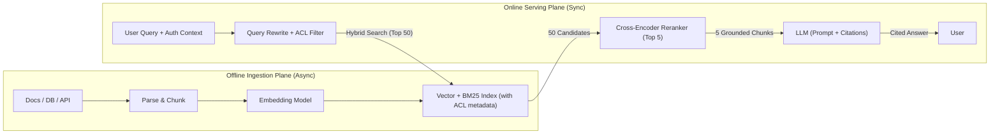
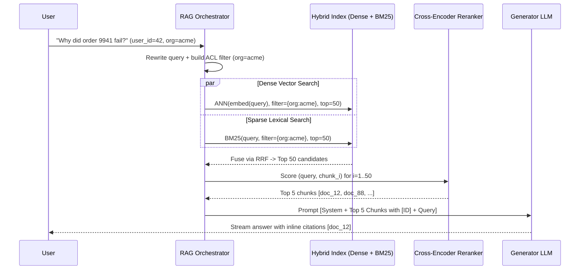
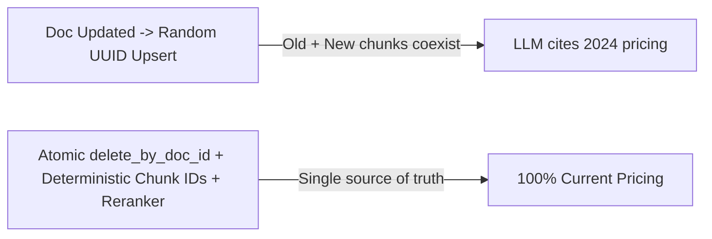

# RAG Architecture Explained: Retrieval-Augmented Generation vs Fine-Tuning

> **Prerequisites:** [Lesson 04: Conversation Context Management: History, Truncation & Summary Memory](../04-conversation-context-management/README.md).  
> **Estimated Reading Time:** 25–28 minutes  
> **Target Audience:** Backend and AI systems engineers designing enterprise knowledge assistants, and candidates asked "RAG vs fine-tuning—when do you use each, and how do you architect RAG?"  
> **Free PDF Notes:** [Download SD-S-005.pdf](https://backendroadmap.com/notes/system-design/SD-S-005.pdf)

> [!NOTE]
> **In one line:** **RAG (Retrieval-Augmented Generation)** injects fresh, permission-checked external knowledge into the prompt at query time (**dynamic facts, citations, access control**), whereas **Fine-Tuning** updates model weights offline to teach **style, domain jargon, or output format**—never use fine-tuning as a database for mutable facts.

> [!TIP]
> **The Golden Rule:** Start with **Prompt Engineering $\to$ RAG $\to$ Fine-Tuning** in that exact order. Use RAG when the model needs *knowledge* (what to say); use Fine-Tuning when the model needs *behavior* (how to say it).

---

## 1. What RAG Is, and What It Isn't

A base LLM's knowledge is frozen at its training cutoff and contains zero private company data. When an enterprise asks "build a bot that answers questions from our 500,000 internal docs," teams often debate: *Should we fine-tune the model on our docs, stuff everything into a 1M-token context window, or build RAG?* Fine-tuning cannot enforce per-user ACLs or update instantly when a document changes; stuffing 500k tokens costs dollars per query and takes tens of seconds. **RAG** solves this by retrieving only the top-$k$ relevant, authorized chunks at query time and grounding the LLM's answer in those exact citations.

| Term | Precise Meaning | Example |
| :--- | :--- | :--- |
| **RAG** | Query-time retrieval of external chunks injected into the LLM prompt | Retrieve top-5 Confluence chunks + cite sources |
| **Fine-Tuning (SFT/LoRA)** | Updating model weights on curated `(input, output)` pairs offline | Teaching a small model strict medical coding style |
| **Offline Ingestion Plane** | Async pipeline: parse $\to$ chunk $\to$ embed $\to$ index + ACL metadata | Kafka/worker indexing updated docs in $< 60\text{ s}$ |
| **Online Serving Plane** | Sync path: query rewrite $\to$ hybrid search $\to$ rerank $\to$ generate | $< 150\text{ ms}$ retrieval + streaming generation |
| **Hybrid Search** | Combining dense vector similarity + sparse BM25 lexical search | Reciprocal Rank Fusion (RRF) |
| **Cross-Encoder Reranker** | High-precision model scoring `(query, chunk)` pairs jointly | Narrowing top-50 candidates to top-5 |
| **Not** | Just `embed(query) -> top_5 -> prompt` | Naive vector-only RAG fails on exact IDs, ACLs, and tables |

### Why It Matters
1. **Freshness & ACLs:** Documents change every minute and users have different permissions; RAG enforces real-time RBAC/ABAC filters at retrieval time.
2. **Hallucination & Citations:** Grounding answers in retrieved chunks lets users verify clickable source links and enables automated faithfulness scoring.
3. **Classic Interview Question:** "RAG vs Fine-Tuning vs Long Context" is the single most common GenAI system design question.

---

## 2. Anatomy: RAG vs Fine-Tuning & Two-Plane Architecture



Notice the clean separation between the **Offline Ingestion Plane** (throughput-oriented, asynchronous) and the **Online Serving Plane** (latency-oriented, synchronous). On the online path, **ACL filtering happens inside the search index** (*pre-filtering*), never after retrieval, so unauthorized documents never leak into the candidate pool or reduce `top_k` results.

| Dimension | RAG | Fine-Tuning | Long Context (128k–1M) |
| :--- | :--- | :--- | :--- |
| **Best for** | Dynamic, private, cited facts | Tone, format, domain jargon, latency via smaller model | One-off analysis of a single large doc |
| **Knowledge freshness** | Real-time (seconds after index) | Stale (requires retraining) | Real-time (if pasted in prompt) |
| **Per-user access control** | **Native** (metadata pre-filter) | **Impossible** (weights are global) | Native (app passes authorized doc) |
| **Cost per query** | Low (~2k–4k input tokens) | Lowest (short prompt, smaller model) | **Very High** ($10\times\text{–}100\times$ more input tokens) |
| **Hallucination control** | High (grounded + verifiable citations) | Low (memorized facts still hallucinate) | Medium ("lost in the middle" at high lengths) |

> [!WARNING]
> **The #1 Trap: Post-filtering ACLs after vector search.** If you retrieve the global top-5 vector matches and *then* filter out documents the user cannot access, a user without access to the top 5 hits gets **0 results**—even if 20 authorized relevant documents exist at ranks 6–25! Always push `tenant_id` and `acl_groups` into the index query as a **pre-filter**.

---

## 3. Mathematical Model: Recall@K, Hybrid RRF & Latency/Cost

**Reciprocal Rank Fusion (RRF).** Combining ranks from dense vector search $r_{\text{vec}}(d)$ and sparse BM25 search $r_{\text{bm25}}(d)$ with smoothing constant $k = 60$:

$$\text{RRF}(d) = \frac{1}{k + r_{\text{vec}}(d)} + \frac{1}{k + r_{\text{bm25}}(d)}$$

**End-to-End Retrieval + Generation Latency.** With query embedding $T_{\text{embed}}$, hybrid index search $T_{\text{search}}$, cross-encoder reranking $T_{\text{rerank}}$, and LLM TTFT:

$$\text{TTFT}_{\text{RAG}} = T_{\text{rewrite}} + T_{\text{embed}} + T_{\text{search}} + T_{\text{rerank}} + \text{TTFT}_{\text{LLM}}$$

**End-to-EndRAG Accuracy Bound.** If retriever recall is $R@K$ (probability the gold chunk is in the top $K$) and generator faithfulness given the gold chunk is $P(\text{correct} \mid \text{retrieved})$:

$$P(\text{correct}) \le R@K \cdot P(\text{correct} \mid \text{retrieved})$$

### Worked Numerical Example
Suppose a support corpus has 1,000,000 chunks.
1. **RRF Scoring:** Document `D1` ranks **#1** in BM25 (exact error code `ERR_5042`) and **#18** in vector search. Document `D2` ranks **#3** in vector search and **#40** in BM25:
   $$\text{RRF}(D_1) = \frac{1}{60 + 1} + \frac{1}{60 + 18} = 0.01639 + 0.01282 = 0.02921$$
   $$\text{RRF}(D_2) = \frac{1}{60 + 3} + \frac{1}{60 + 40} = 0.01587 + 0.01000 = 0.02587$$
   `D1` wins cleanly because RRF rewards exact keyword matches without requiring brittle score normalization between cosine similarity and BM25!
2. **Latency & Cost vs Long-Context:**
   - **RAG:** $T_{\text{embed}} (15\text{ ms}) + T_{\text{search}} (35\text{ ms}) + T_{\text{rerank}} (60\text{ ms}) + \text{TTFT}_{\text{LLM}}(350\text{ ms}\text{ for }2{,}500\text{ tokens}) = \mathbf{460\text{ ms}}$ TTFT. Cost at $\$2.50/1\text{M}$ in: **$\$0.00625$/query**.
   - **Long-Context (200k tokens):** $\text{TTFT} \approx \mathbf{4{,}500\text{ ms}}$ ($10\times$ slower), input cost **$\$0.50$/query** ($80\times$ more expensive).

---

## 4. Metrics & Percentiles (The RAG Triad)

Evaluate retrieval and generation **separately** so you know which half is broken:

| Metric | Meaning | Alert when |
| :--- | :--- | :--- |
| **Recall@K / MRR** | Fraction of queries where gold chunk appears in top-$K$ | $R@5 < 0.85$ (retrieval is broken) |
| **Context Precision** | Fraction of retrieved chunks actually relevant to query | $< 0.60$ (noisy chunks distracting LLM) |
| **Faithfulness (Groundedness)** | Claims in answer supported by retrieved chunks (no hallucination) | $< 0.92$ |
| **Answer Relevance** | Does the generated answer actually address the user's question? | $< 0.90$ |
| **Retrieval Latency ($p_{95}$)** | Embed + Hybrid Search + Rerank time | $> 180\text{ ms}$ |
| **Ingestion Freshness Lag** | Time from doc edit to searchable in vector+BM25 index | $> 60\text{ s}$ (for live knowledge bases) |

### Worked Example (Diagnosing a Quality Drop)
Users report wrong answers on product SKUs. Splitting the RAG Triad reveals:
- **Faithfulness = 0.96** (the LLM is faithfully following what it is given).
- **Recall@5 = 0.52** (the retriever is failing to find the SKU doc!).
Why? Dense embeddings compress exact alphanumeric SKUs like `SKU-9941-B` poorly. Adding **BM25 hybrid search + RRF** raises `Recall@5` from `0.52` to `0.94`, immediately fixing end-to-end accuracy without touching the LLM or prompt.

---

## 5. Compounding & Failure Modes

| Failure Mode | Mechanism | Impact |
| :--- | :--- | :--- |
| **Vector-Only Blindness** | Exact IDs, error codes, acronyms, and names embed poorly | Misses obvious keyword hits (`ERR_5042`, `RFC-8259`) |
| **Naive Fixed Chunking** | Splitting every 500 chars cuts tables, code blocks, and headings in half | Context loses its subject ("...costs $50/mo" without which plan) |
| **Multi-Hop Query Failure** | Single query vector cannot match two disparate documents needed together | Fails comparative questions ("Compare Policy A vs Policy B") |
| **Stale / Duplicate Index** | Ingestion updates chunks without deleting old versions of the same doc | LLM cites deprecated pricing alongside current pricing |

---

## 6. Numbers Every Engineer Must Know

| Item | Typical | Implication |
| :--- | :---: | :--- |
| **Chunk size** | $256\text{–}512$ tokens ($10\%\text{–}15\%$ overlap) | Balances precision (small) vs surrounding context (large) |
| **First-stage retrieval ($K_{\text{cand}}$)** | Top $30\text{–}100$ candidates | Broad recall from Hybrid (Dense + BM25) |
| **Reranked final context ($K_{\text{final}}$)** | Top $3\text{–}8$ chunks ($\sim 1.5\text{k–}4\text{k}$ tokens) | High signal-to-noise ratio for the LLM |
| **Query embedding latency** | $10\text{–}25\text{ ms}$ | Negligible; cache frequent query embeddings in Redis |
| **HNSW vector search latency** | $15\text{–}50\text{ ms}$ (1M–10M vectors) | Keep HNSW index in RAM for sub-50 ms $p_{95}$ |
| **Cross-encoder rerank latency** | $40\text{–}100\text{ ms}$ (for 50 pairs on GPU) | Highest ROI upgrade for RAG precision |

---

## 7. Protocol Deep Dive: Multi-Stage Retrieval & Grounded Citations



| Question | Answer |
| :--- | :--- |
| **Why use a two-stage retriever (Bi-Encoder + Cross-Encoder)?** | Bi-encoders precompute doc embeddings offline (fast $O(1)$ ANN search) but compress meaning into one vector. Cross-encoders attend across `(query, doc)` tokens jointly—much more accurate, but only fast enough for top 50 candidates. |
| **How do you make the LLM say "I don't know" instead of hallucinating?** | Instruct it explicitly to answer *only* from `[Context]` and return a structured `insufficient_evidence` flag if the answer isn't present, backed by a minimum reranker score threshold. |
| **When should you combine RAG + Fine-Tuning?** | When you need **both** fresh private knowledge (RAG) and specialized output behavior/formatting or domain terminology (Fine-Tuning)—e.g., fine-tuning a small 8B model to follow strict legal citation style over RAG-retrieved case law. |

---

## 8. Hierarchical Budgets & Design Rules

| Slice | Rule | Control |
| :--- | :--- | :--- |
| **Retrieval Stack** | Always Hybrid (Dense + BM25) fused with RRF + Cross-Encoder Rerank | Never ship vector-only search for enterprise text |
| **Security / ACLs** | Pre-filter `tenant_id` & `acl_groups` inside the search index | Zero post-filtering leaks; integration test cross-tenant isolation |
| **Chunking** | Structure-aware (headings, markdown, tables) + parent-child metadata | Preserve document title & section path in every chunk |
| **Freshness** | Idempotent upsert by `doc_id` + delete tombstones on source removal | No ghost/stale chunks in index |
| **Grounding** | Numbered chunk IDs (`[1]`, `[2]`) + strict citation instructions | Refuse/abstain when reranker max score $<$ threshold |
| **Latency Budget** | Total retrieval (embed + search + rerank) $\le 180\text{ ms}$ $p_{95}$ | Parallelize dense/sparse + cache frequent queries |

---

## 9. Top Mitigations

1. **Use Hybrid Search (Dense + BM25) with RRF** so exact IDs, SKUs, and error codes are never missed by semantic embeddings.
2. **Add a Cross-Encoder Reranker** on the top 30–50 candidates to cut noise and boost top-5 precision by 15–30%.
3. **Pre-filter ACLs and `tenant_id` in the search query**, never after retrieval.
4. **Prepend document title and section hierarchy** (e.g., `Doc: Billing FAQ > Refunds > Enterprise`) to every chunk before embedding so chunks are self-contained.
5. **Implement idempotent document upserts and tombstone deletes** so edited or deleted docs never leave stale ghost chunks.
6. **Abstain gracefully** when top reranker score falls below a calibrated threshold instead of forcing the LLM to guess.
7. **Evaluate Retrieval and Generation independently** (Recall@K + Context Precision + Faithfulness) using automated golden eval sets.

---

## 10. Production Reference / War Story: The Ghost Pricing Hallucination

An enterprise SaaS deployed a customer-facing RAG bot over its pricing and help-center docs. Three weeks after launching a new pricing tier, customers received confident, cited answers quoting **deprecated 2024 pricing**.

- **Root Cause:** Two compounding bugs: (1) The ingestion pipeline appended newly chunked documents with random UUIDs instead of deleting/replacing old chunks for the same `doc_id`, leaving both 2024 and 2026 pricing chunks in the vector DB; (2) Dense vector search ranked the older, wordier 2024 chunk #1.
- **Fix:**
  1. Switched chunk IDs to deterministic hashes (`doc_id:chunk_index`) and executed atomic `delete_by_doc_id` + `upsert` on every document update.
  2. Added `updated_at` metadata and a **cross-encoder reranker** + recency boost.
  3. Built an automated freshness test asserting updated docs are reflected in search within 60 seconds.



---

## 11. Multi-Language Production Code Tabs

A dependency-free **Hybrid Reciprocal Rank Fusion (RRF) & ACL Pre-Filter** implementation showing how dense vector ranks and sparse BM25 ranks are fused into a single ranked candidate list.

````carousel
```go
// Go: Hybrid Reciprocal Rank Fusion (RRF) with ACL pre-filtering.
package main

import "sort"

type Chunk struct {
	ID       string
	TenantID string
	Text     string
}

type ScoredChunk struct {
	Chunk Chunk
	Score float64
}

func HybridRRF(denseRanked, bm25Ranked []Chunk, tenantID string, k int) []ScoredChunk {
	scores := make(map[string]float64)
	chunks := make(map[string]Chunk)

	add := func(list []Chunk) {
		rank := 0
		for _, c := range list {
			if c.TenantID != tenantID { // enforce tenant isolation
				continue
			}
			rank++
			chunks[c.ID] = c
			scores[c.ID] += 1.0 / float64(k+rank)
		}
	}
	add(denseRanked)
	add(bm25Ranked)

	out := make([]ScoredChunk, 0, len(scores))
	for id, s := range scores {
		out = append(out, ScoredChunk{Chunk: chunks[id], Score: s})
	}
	sort.Slice(out, func(i, j int) bool { return out[i].Score > out[j].Score })
	return out
}
```
<!-- slide -->
```typescript
// TypeScript: Hybrid Reciprocal Rank Fusion (RRF) with ACL pre-filtering.
export interface Chunk {
  id: string;
  tenantId: string;
  text: string;
}

export function hybridRRF(
  denseRanked: Chunk[],
  bm25Ranked: Chunk[],
  tenantId: string,
  k = 60
): Array<{ chunk: Chunk; score: number }> {
  const scores = new Map<string, number>();
  const byId = new Map<string, Chunk>();

  const accumulate = (list: Chunk[]) => {
    let rank = 0;
    for (const chunk of list) {
      if (chunk.tenantId !== tenantId) continue;
      rank += 1;
      byId.set(chunk.id, chunk);
      scores.set(chunk.id, (scores.get(chunk.id) ?? 0) + 1 / (k + rank));
    }
  };

  accumulate(denseRanked);
  accumulate(bm25Ranked);

  return Array.from(scores.entries())
    .map(([id, score]) => ({ chunk: byId.get(id)!, score }))
    .sort((a, b) => b.score - a.score);
}
```
<!-- slide -->
```python
# Python: Hybrid Reciprocal Rank Fusion (RRF) + RAG accuracy/cost helper (stdlib only).
from dataclasses import dataclass
from typing import Dict, List, Tuple


@dataclass(frozen=True)
class Chunk:
    id: str
    tenant_id: str
    text: str


def hybrid_rrf(
    dense_ranked: List[Chunk],
    bm25_ranked: List[Chunk],
    tenant_id: str,
    k: int = 60,
) -> List[Tuple[Chunk, float]]:
    scores: Dict[str, float] = {}
    by_id: Dict[str, Chunk] = {}

    for ranked in (dense_ranked, bm25_ranked):
        rank = 0
        for chunk in ranked:
            if chunk.tenant_id != tenant_id:
                continue
            rank += 1
            by_id[chunk.id] = chunk
            scores[chunk.id] = scores.get(chunk.id, 0.0) + 1.0 / (k + rank)

    return sorted(((by_id[cid], s) for cid, s in scores.items()), key=lambda x: x[1], reverse=True)
```
<!-- slide -->
```csharp
// C#: Hybrid Reciprocal Rank Fusion (RRF) with ACL pre-filtering.
using System.Collections.Generic;
using System.Linq;

public sealed record Chunk(string Id, string TenantId, string Text);

public static class HybridRetriever
{
    public static IReadOnlyList<(Chunk Chunk, double Score)> FuseRrf(
        IEnumerable<Chunk> denseRanked,
        IEnumerable<Chunk> bm25Ranked,
        string tenantId,
        int k = 60)
    {
        var scores = new Dictionary<string, double>();
        var byId = new Dictionary<string, Chunk>();

        void Accumulate(IEnumerable<Chunk> list)
        {
            int rank = 0;
            foreach (var c in list)
            {
                if (c.TenantId != tenantId) continue;
                rank++;
                byId[c.Id] = c;
                scores[c.Id] = scores.GetValueOrDefault(c.Id) + 1.0 / (k + rank);
            }
        }

        Accumulate(denseRanked);
        Accumulate(bm25Ranked);

        return scores
            .Select(kv => (Chunk: byId[kv.Key], Score: kv.Value))
            .OrderByDescending(x => x.Score)
            .ToList();
    }
}
```
````

---

## 12. Hands-On CLI Verification Workflows

Verify the RRF math from Section 3 and test Recall@K evaluation locally:

```bash
python -c "
def rrf(rank_vec, rank_bm25, k=60):
    return round(1/(k + rank_vec) + 1/(k + rank_bm25), 5)

print('D1 (BM25 #1, Vec #18):', rrf(18, 1))
print('D2 (Vec #3, BM25 #40):', rrf(3, 40))

# Evaluate Recall@5 across a sample query set
gold = {'q1': 'docA', 'q2': 'docB', 'q3': 'docC'}
retrieved = {'q1': ['docX', 'docA'], 'q2': ['docY', 'docZ'], 'q3': ['docC']}
recall_at_5 = sum(1 for q, g in gold.items() if g in retrieved[q][:5]) / len(gold)
print('Recall@5:', round(recall_at_5, 3))
"
```

---

## 13. Common Mistakes to Avoid

1. **Fine-tuning an LLM to memorize mutable company facts** instead of using RAG.
2. **Using vector-only search** without BM25 hybrid retrieval, failing on exact IDs, SKUs, and error codes.
3. **Post-filtering ACLs after vector search**, leaking unauthorized existence or returning empty results.
4. **Skipping a cross-encoder reranker**, forcing the LLM to sift through noisy top-20 chunks.
5. **Appending updated document chunks without deleting old versions**, causing ghost/stale citations.
6. **Chunking blindly by character count** without preserving headings, tables, or document titles.
7. **Evaluating only the final answer** instead of measuring Retrieval (`Recall@K`) and Generation (`Faithfulness`) separately.

---

## 14. Key Terms Glossary

| Key Term | Definition |
| :--- | :--- |
| **RAG** | Retrieval-Augmented Generation; injecting retrieved external chunks into the prompt at query time. |
| **Fine-Tuning** | Updating model weights offline on curated examples to teach style, format, or specialized skills. |
| **Dense Embedding** | Fixed-dimension vector capturing semantic meaning for approximate nearest-neighbor (ANN) search. |
| **BM25** | Sparse lexical keyword-ranking algorithm excelling at exact IDs, codes, and rare terms. |
| **Reciprocal Rank Fusion (RRF)** | Scoreless rank-merging formula: $\sum 1 / (k + r_i)$ combining dense and sparse results. |
| **Cross-Encoder Reranker** | Model that jointly scores `(query, chunk)` pairs for high-precision top-$k$ selection. |
| **ACL Pre-Filtering** | Applying `tenant_id` and permission filters *inside* the index query before selecting top-$k$. |
| **Recall@K** | Fraction of queries whose ground-truth chunk appears in the top-$K$ retrieved results. |
| **Faithfulness** | Degree to which generated claims are strictly supported by the retrieved context. |
| **RAG Triad** | Core eval metrics: Context Relevance, Groundedness/Faithfulness, and Answer Relevance. |

---

## 15. System Design Interview Questions & Answers

### Basic Conceptual Questions

<details>
<summary><strong>Q1: When should you use RAG vs Fine-Tuning? [BASIC]</strong></summary>

**Answer:**
Use **RAG** when the model needs external, private, frequently changing, or permission-scoped **knowledge** with verifiable citations. Use **Fine-Tuning** when the model needs to learn a specific **behavior**, output format, tone, or domain jargon—or to distill a large model's capability into a smaller, faster model.
</details>

<details>
<summary><strong>Q2: Why isn't vector search alone enough for production RAG? [BASIC]</strong></summary>

**Answer:**
Dense embeddings compress text into a single vector, losing exact lexical details like product SKUs, error codes (`ERR_5042`), and proper nouns. Combining dense vector search with **BM25 lexical search** via **RRF** captures both semantic meaning and exact keyword matches.
</details>

<details>
<summary><strong>Q3: What is the difference between a Bi-Encoder and a Cross-Encoder? [BASIC]</strong></summary>

**Answer:**
A **Bi-Encoder** embeds query and document separately so document vectors can be precomputed and searched in milliseconds via HNSW. A **Cross-Encoder** processes `[query, document]` together with full cross-attention—far more accurate, but too slow for millions of docs, so it is used as a Stage-2 reranker on the top 30–50 candidates.
</details>

<details>
<summary><strong>Q4: What is the RAG Triad for evaluation? [BASIC]</strong></summary>

**Answer:**
Three metrics isolating retrieval from generation: (1) **Context Relevance / Precision** (did we retrieve the right chunks?), (2) **Faithfulness / Groundedness** (did the LLM stick to those chunks without hallucinating?), and (3) **Answer Relevance** (did the response actually answer the user's question?).
</details>

### Scenario-Based Architecture Questions

<details>
<summary><strong>Q5: Your RAG bot has great answers in general, but fails completely when users search for exact ticket IDs or error codes. Fix it. [SCENARIO]</strong></summary>

**Answer:**
This is classic dense-embedding blindness. Add **BM25 sparse search** alongside dense vector search, merge results using **Reciprocal Rank Fusion (RRF)**, and optionally add a metadata exact-match boost for detected ID patterns.
</details>

<details>
<summary><strong>Q6: A user without admin access asks a question. Your vector DB returns top-5 admin docs, post-filtering drops all 5, and the user gets "No results found" despite public docs existing. What happened? [SCENARIO]</strong></summary>

**Answer:**
You used **post-filtering** instead of **pre-filtering**. Push `tenant_id` and `acl_groups` directly into the vector/BM25 index query so the top-$k$ search only considers documents the user is authorized to read.
</details>

<details>
<summary><strong>Q7: After updating a policy document, your RAG bot keeps citing the old policy alongside the new one. Why? [SCENARIO]</strong></summary>

**Answer:**
The ingestion pipeline lacked **idempotent upserts and tombstone deletes**. Use deterministic chunk IDs (`doc_id:chunk_idx`) and run an atomic `delete_by_doc_id` before upserting new chunks whenever a source document is updated or removed.
</details>

<details>
<summary><strong>Q8: Your company has a 1M-token context LLM. Why not skip RAG and paste all 300 PDFs into the prompt? [SCENARIO]</strong></summary>

**Answer:**
Three reasons: (1) **Cost**—200k+ input tokens per query is $50\times\text{–}100\times$ more expensive than 3k RAG tokens; (2) **Latency**—prefilling 200k tokens adds several seconds of TTFT; (3) **Accuracy**—"lost in the middle" causes recall to drop when irrelevant text drowns out key facts.
</details>

### Advanced & Tricky Interview Questions

<details>
<summary><strong>Q9: How do you handle multi-hop questions like "Compare the SLA of Enterprise Plan A vs Plan B" in RAG? [TRICKY]</strong></summary>

**Answer:**
A single query embedding often retrieves only Plan A or a generic overview. Use **query decomposition** (an LLM/planner splits the question into two sub-queries: `"Enterprise Plan A SLA"` and `"Enterprise Plan B SLA"`), run both hybrid searches in parallel, fuse/rerank per sub-query, and synthesize the comparison.
</details>

<details>
<summary><strong>Q10: How do you prevent a RAG system from hallucinating when no relevant document exists? [TRICKY]</strong></summary>

**Answer:**
Combine three defenses: (1) calibrate a **minimum reranker score threshold**—if no chunk passes, short-circuit and return "I couldn't find verified info on that"; (2) instruct the LLM to cite `[chunk_id]` for every claim and output `abstain` if unsupported; (3) run a post-generation faithfulness check in high-stakes domains.
</details>

<details>
<summary><strong>Q11: How do you handle RAG over documents with complex tables and charts? [TRICKY]</strong></summary>

**Answer:**
Standard text splitters shred tables into meaningless fragments. Use layout-aware parsers (preserving tables as Markdown/HTML), keep entire tables intact as single chunks (or summarize tables for retrieval while storing the raw table in **parent-document storage**), and use multimodal embeddings/VLMs for complex charts.
</details>

<details>
<summary><strong>Q12: How do you design a multi-tenant RAG index for 10,000 enterprise customers (some small, some huge)? [TRICKY]</strong></summary>

**Answer:**
Use a **tiered isolation strategy**: shared HNSW/BM25 collections partitioned by `tenant_id` metadata pre-filter for the 9,900 small/medium tenants (cost-efficient), and **dedicated namespaces/collections** (or physical shards) for massive or compliance-strict enterprise whales to avoid noisy-neighbor HNSW graph degradation.
</details>

---

## 16. One-Page Master Cheat Sheet

```
+---------------------------------------------------------------------------------------------------------+
|                    RAG ARCHITECTURE EXPLAINED — MASTER CHEAT SHEET                                      |
+---------------------------------------------------------------------------------------------------------+
| 1. RAG VS FINE-TUNING: RAG = external/fresh/ACL-scoped KNOWLEDGE (what to say).                         |
|    Fine-Tuning = style, format, domain jargon, smaller-model distillation (how to say it).              |
+---------------------------------------------------------------------------------------------------------+
| 2. TWO PLANES: Offline Ingestion (parse -> chunk -> embed -> upsert/delete by doc_id)                   |
|    Online Serving (query rewrite -> ACL pre-filter -> Hybrid Search -> Cross-Encoder Rerank -> LLM).    |
+---------------------------------------------------------------------------------------------------------+
| 3. HYBRID + RRF: RRF(d) = 1/(k + r_vec) + 1/(k + r_bm25). Captures semantics AND exact IDs/SKUs.        |
+---------------------------------------------------------------------------------------------------------+
| 4. SECURITY: ALWAYS pre-filter tenant_id & ACLs inside the index query; never post-filter.              |
+---------------------------------------------------------------------------------------------------------+
| 5. RAG TRIAD: Measure Retrieval (Recall@K, Context Precision) separately from Generation (Faithfulness).|
+---------------------------------------------------------------------------------------------------------+
| 6. ABSTENTION: Calibrate reranker threshold + require inline [chunk_id] citations to stop hallucinations.|
+---------------------------------------------------------------------------------------------------------+
```

---

## Further Reading & Sources

- Patrick Lewis et al., [Retrieval-Augmented Generation for Knowledge-Intensive NLP Tasks](https://arxiv.org/abs/2005.11401).
- Cormack, Clarke, and Buettcher, [Reciprocal Rank Fusion outperforms Condorcet and individual Rank Learning Methods](https://plg.uwaterloo.ca/~gvcormac/cormacksigir09-rrf.pdf) (SIGIR 2009).
- Chip Huyen, *AI Engineering* (O'Reilly, 2025), Chapter 6 (RAG & Agents) and Chapter 7 (Fine-Tuning).
- Anthropic, [Contextual Retrieval](https://www.anthropic.com/news/contextual-retrieval).

---

## Free PDF Notes

[SD-S-005.pdf](https://backendroadmap.com/notes/system-design/SD-S-005.pdf)

---

## Next

Continue with [Lesson 06: Document Ingestion for RAG: Connectors, Parsing & Incremental Sync](../06-document-ingestion-for-rag/README.md).
