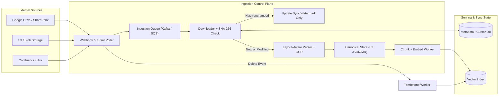
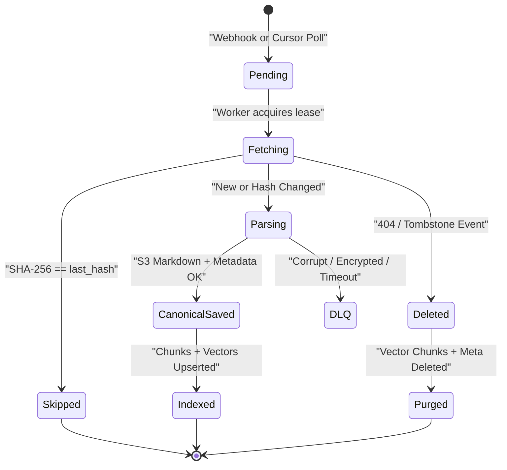
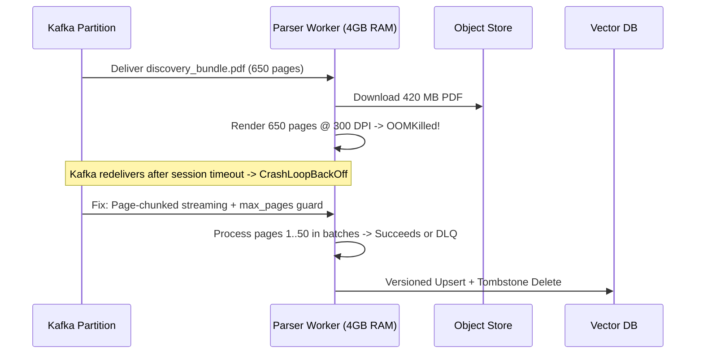

# Document Ingestion for RAG: Connectors, Parsing & Incremental Sync

> **Prerequisites:** [Lesson 05: RAG Architecture Explained](../05-rag-architecture-explained/README.md).  
> **Estimated Reading Time:** 24–28 minutes  
> **Target Audience:** Backend and AI platform engineers building enterprise RAG pipelines, and candidates asked "how do you ingest millions of PDFs, Notion pages, and Jira tickets and keep the vector index fresh?"  
> **Free PDF Notes:** [Download SD-S-006.pdf](https://backendroadmap.com/notes/system-design/SD-S-006.pdf)

> [!NOTE]
> **In one line:** Document ingestion is the **ETL pipeline of RAG**—extracting raw files via source connectors, parsing unstructured formats (PDFs, tables, HTML, OCR) into clean canonical text, and running **incremental change-data-capture (CDC) syncs** so edits and deletions propagate in seconds without re-indexing the entire corpus.

> [!TIP]
> **The Golden Rule:** Treat **object storage + canonical Markdown/JSON** as your source of truth, not the vector database. If you separate **connector sync** (fetching bytes + ACLs), **layout-aware parsing**, and **content-hash deduplication**, you can re-chunk or re-embed later without re-crawling external APIs.

---

## 1. What Document Ingestion Is, and What It Isn't

A user updates a salary policy in Confluence at 10:00 AM, or deletes a confidential Google Doc at 10:05 AM. If your RAG pipeline only runs a nightly `cron` job that re-downloads everything, the chatbot either hallucinates yesterday's policy for 23 hours or leaks a deleted document. Worse, if your PDF parser flattens a two-column financial table into scrambled text, even the best LLM and embedding model will fail to answer basic questions ("Garbage In, Garbage Out").

| Term | Precise Meaning | Example |
| :--- | :--- | :--- |
| **Connector** | Authenticated adapter that polls or receives webhooks from a SaaS/storage source | Google Drive, Confluence, S3, SharePoint, Jira |
| **Layout-aware parser** | Extracts reading-order text, headings, and tables (often to Markdown) | Docling, Unstructured, LlamaParse, Marker |
| **OCR / VLM fallback** | Extracts text from scanned images or complex charts | Tesseract, AWS Textract, Vision LLM |
| **Content hash** | Cryptographic digest (e.g., SHA-256) of raw bytes or parsed canonical text | Skip downstream embedding when hash is unchanged |
| **Incremental sync (CDC)** | Fetching only created, updated, and deleted documents since a cursor/watermark | Drive `changes.list` pageToken, S3 EventBridge |
| **Tombstone / hard delete** | Removing all chunks of a deleted or revoked source document from the index | `DELETE FROM chunks WHERE doc_id = ?` |
| **Not** | A one-off Python script looping over `os.walk()` | Fails on rate limits, deletions, tables, and scale |

### Why It Matters
1. **Retrieval quality ceiling:** 80% of "RAG accuracy problems" in production trace back to broken PDF table extraction, missing headers, or stale documents—not the vector database.
2. **API & compute cost:** Re-parsing and re-embedding 10M documents daily wastes tens of thousands of dollars and trips SaaS rate limits (e.g., Google Drive or Notion 3 req/s).
3. **Security & compliance:** When a document is deleted or permissions change at the source, failing to propagate tombstones creates an immediate data-leakage vulnerability.

---

## 2. Anatomy: Full Re-Crawl vs Event-Driven Incremental Pipeline



In a production ingestion pipeline, **fetching** is decoupled from **parsing** via a durable queue. Connectors store a per-tenant sync cursor (`pageToken`, `deltaLink`, or `updated_at` watermark) in a relational metadata database. When a document arrives, the worker computes its SHA-256 hash: if the bytes (or canonical text) match the last indexed version, the pipeline short-circuits and avoids expensive OCR and embedding calls.

| Dimension | Full Nightly Re-Crawl | Incremental CDC + Content Hash |
| :--- | :--- | :--- |
| **Freshness** | Hours to 24h stale | Seconds (webhooks) to minutes (cursor poll) |
| **SaaS API quota** | Exhausts rate limits at >100k docs | Only fetches deltas (~1–3% daily churn) |
| **Deletions** | Requires full diff against index | Explicit tombstone events delete chunks immediately |
| **Parse/Embed cost** | Pays $O(N)$ every night | Pays $O(\Delta N)$ for actual content changes |
| **Failure recovery** | Restarting loses progress | Idempotent per-doc state machine + DLQ |

> [!WARNING]
> **The Webhook-Only Trap:** Webhooks from SaaS providers (Slack, Notion, Drive) are *best-effort*—they drop events during outages, expire silently (Google Drive watch channels expire after 7 days), and arrive out of order. Always pair real-time webhooks with a **periodic cursor-based reconciliation sweep** (e.g., every 4–24 hours) so missed events and deletions never drift permanently.

---

## 3. Mathematical Model: Throughput, Crawl Time, and Hash Savings

**Ingestion Throughput & Backlog.** Suppose an enterprise corpus has $N$ documents, average raw size $\bar{s}$ MB, daily churn rate $r_{\text{churn}}$, and a parser cluster of $W$ workers each capable of parsing $p$ docs/sec (CPU-only text parsing is ~20–50 docs/sec; layout + OCR on GPUs is ~0.5–3 pages/sec).

$$\text{Time}_{\text{initial}} = \frac{N}{W \cdot p}, \qquad \text{Daily}_{\text{work}} = N \cdot r_{\text{churn}}$$

**SaaS Rate-Limit Bound.** If a connector API enforces rate limit $R_{\text{api}}$ requests/sec and requires $k$ calls per document (metadata + content + permissions), max crawl rate is:

$$\lambda_{\text{max}} = \frac{R_{\text{api}}}{k}$$

**Worked Numerical Example:**
- Corpus: $N = 2{,}000{,}000$ PDFs, average 10 pages each ($20\text{M}$ pages).
- Daily churn: $r_{\text{churn}} = 2\%$ ($40{,}000$ modified/new docs/day), of which $25\%$ ($10{,}000$ docs) are metadata-only edits (same file hash, e.g., folder rename).
- GPU OCR/layout parser: $p = 2$ pages/sec/GPU ($0.2$ docs/sec/GPU).
- **Initial backfill** with $W = 50$ GPUs:
  $$\text{Time}_{\text{initial}} = \frac{2{,}000{,}000}{50 \times 0.2} = 200{,}000\text{ s} \approx 55.6\text{ hours}$$
- **Daily incremental sync** with SHA-256 deduplication: only $40{,}000 \times 0.75 = 30{,}000$ docs need re-parsing ($300{,}000$ pages). With just $W = 4$ GPUs, daily sync finishes in $300{,}000 / (4 \times 2) = 37{,}500\text{ s} \approx 10.4\text{ hours}$—saving **98.5% of compute** compared to a full daily re-crawl.

---

## 4. Metrics & Percentiles

| Metric | Meaning | Alert when |
| :--- | :--- | :--- |
| **Sync lag ($p_{95}$, $p_{99}$)** | Time from source `updated_at` to vector index visibility | Exceeds freshness SLO (e.g., > 5 min for live docs) |
| **Connector error / 429 rate** | Throttling or expired OAuth tokens per tenant | > 1% of API calls or token refresh failure |
| **Parse failure / DLQ rate** | Corrupt PDFs, password-protected files, OOM crashes | > 0.5% of ingested documents |
| **Hash-hit (dedup) ratio** | Fraction of queued events skipped due to identical SHA-256 | Drops unexpectedly (indicates noisy timestamp churn) |
| **OCR fallback ratio** | Docs routed to expensive VLM/OCR vs fast native text | Spikes suddenly (cost explosion risk) |
| **Tombstone propagation lag** | Time from source deletion to vector chunk removal | > 60 seconds (security/compliance risk) |

### Worked Example (`Confluence Space Sync`)
A connector polls Confluence every 60 seconds using `lastModified >= watermark`. At 10:02:00, 120 pages are returned: 85 were only re-tagged (content hash unchanged), 30 have body edits, and 5 were archived/deleted. The downloader skips 85 pages in 200 ms, routes 30 pages to the HTML-to-Markdown parser (completing in 4 seconds), and issues 5 `DELETE WHERE doc_id IN (...)` tombstones to the vector DB in 50 ms.

---

## 5. Compounding & Failure Modes

What happens when you ingest heterogeneous enterprise files at scale?

| Failure Mode | What Breaks | Quantitative Impact |
| :--- | :--- | :--- |
| **Naive `pypdf` on multi-column PDFs** | Reads left-to-right across columns, merging unrelated sentences | Retrieval Recall@5 drops by **25–45%** on academic/financial PDFs |
| **OOM on giant / zip-bomb PDFs** | A single 800-page CAD/scanned PDF consumes 12 GB RAM in parser | Kills worker pod; Kafka consumer rebalance loops poison the whole partition |
| **Missing deletion sync** | Deleted docs stay in vector DB forever ("zombie chunks") | Up to **5–15% stale/revoked results** after 6 months |
| **Clock skew on `updated_at` polling** | Polling `updated_at > last_run` misses docs written in the same second | Silent **0.1–1% permanent data loss** unless using overlap window + idempotency |
| **Unbounded retries on corrupt files** | A password-locked PDF retries infinitely | Blocks partition consumption; sync lag climbs linearly |

---

## 6. Numbers Every Engineer Must Know

| Item | Typical | Implication |
| :--- | :---: | :--- |
| Native PDF text extraction (`pypdfium2` / `PyMuPDF`) | 5–30 ms / page (CPU) | Fast, cheap; use as first pass when text layer is clean |
| Layout-aware ML parsing (Docling / Marker) | 200–1,500 ms / page (GPU) | Required for multi-column layouts and complex tables |
| VLM / Cloud OCR (Textract / GPT-4o-mini vision) | 1–4 s / page, $0.001–$0.015 / page | Reserve for scanned PDFs, handwritten notes, diagrams |
| Notion / Slack / Drive API rate limits | 3–10 req/s per token/user | Must implement token-bucket rate limiters + jittered backoff |
| Ingestion queue max payload size | 256 KB (SQS) / 1 MB (Kafka default) | Pass **S3 URI references** in messages, never raw PDF bytes |
| Watermark overlap safety buffer | 60–300 seconds | Prevents clock-skew misses; rely on SHA-256 hash to dedup |

---

## 7. Protocol / Mechanism Deep Dive: Incremental Sync State Machine



| Question | Answer |
| :--- | :--- |
| **How do you route between fast PDF parsing and expensive OCR?** | Inspect page text density and font/glyph validity: if extracted characters < 50 per page or garbled (CID-font errors), route that page to OCR/VLM. |
| **How do you handle a document update without partial-index reads?** | Upsert new chunks with a new `version_id` (or atomic batch replace), then delete chunks where `doc_id = X AND version_id != new_version_id`. |
| **How do you prevent duplicate work during overlapping polls?** | Store `(tenant_id, external_doc_id, content_hash, version)` in Postgres with optimistic locking or `ON CONFLICT DO NOTHING`. |
| **When NOT to build custom connectors?** | When standard SaaS connectors (Airbyte, Fivetran, LlamaHub, Unstructured) already handle OAuth refresh, pagination cursors, and rate limits—focus engineering on parsing quality and ACLs. |

---

## 8. Hierarchical Budgets & Design Rules

| Slice | Rule | Control |
| :--- | :--- | :--- |
| **Transport** | Never push raw file blobs onto Kafka/SQS | Upload to S3/GCS, publish `{doc_id, s3_uri, event_type}` |
| **Deduplication** | Hash raw bytes AND canonical parsed text | Skip parsing on raw-hash hit; skip embedding on text-hash hit |
| **Parser routing** | Tiered parsing: HTML/MD -> Native PDF -> Layout ML -> OCR | Page-level heuristic classifier before GPU/VLM dispatch |
| **Memory & timeout** | Hard per-document memory cap (e.g., 2 GB) and timeout (120 s) | Subprocess isolation or K8s worker pod limits + DLQ |
| **Rate limiting** | Per-tenant token bucket + exponential backoff on `429 Retry-After` | Prevents one noisy tenant from starving others |
| **Consistency** | Pair webhooks with periodic cursor reconciliation + overlap window | Guarantees eventual consistency for missed events/deletes |
| **Versioning** | Retain canonical parsed Markdown in S3 keyed by `doc_id/version` | Enables zero-crawl re-chunking and re-embedding later |

---

## 9. Top Mitigations

1. **Pass S3 claim-check pointers in queues**, never raw multi-megabyte documents.
2. **Use two-level content hashing** (raw byte hash before parsing, canonical text hash before embedding) to eliminate redundant compute.
3. **Preserve document structure as Markdown/JSON** (headings, table rows as Markdown/HTML tables, page numbers) rather than stripping to flat `.txt`.
4. **Enforce strict parser sandboxing** (page count limits, timeouts, memory caps) so one malformed 1,000-page PDF cannot crash a shared worker.
5. **Implement versioned chunk replacement + tombstones** so updates never leave orphaned trailing chunks when a document shrinks.
6. **Combine webhooks with periodic cursor sweeps** (with a 2-minute overlap window) to catch dropped webhooks and out-of-order timestamps.
7. **Quarantine poison documents** (password-protected, 0-byte, unsupported binary) into a Dead-Letter Queue with clear user-facing status ("Failed: password-protected").

---

## 10. Production Reference: The "Zombie Chunk & OOM Storm" SEV-1

A B2B legal-tech platform ingested 4M contracts from SharePoint. Two bugs collided during a customer bulk-upload:
1. A customer uploaded a 650-page scanned PDF (`discovery_bundle.pdf`). The parser worker tried to load all 650 pages into memory at 300 DPI for OCR, hitting the 4 GB container limit (`OOMKilled`). Kafka redelivered the message to the next worker, killing all 12 parser pods in a cascading poison-pill loop.
2. Meanwhile, when lawyers deleted sensitive drafts, the ingestion pipeline only handled `UPSERT` events—leaving old chunks in the vector index that surfaced in search results 3 weeks later.



**Root Cause:** Unbounded in-memory PDF rasterization, no poison-pill retry cap, and missing deletion/tombstone handling.  
**Fix:** (1) Stream PDFs in 20-page slices with a 2 GB subprocess memory limit and max-retry=2 before DLQ; (2) Use SharePoint `deltaLink` to emit explicit `DELETE` tombstone events that purge `doc_id` from both the canonical store and the vector DB.

---

## 11. Multi-Language Production Code Tabs

An idempotent incremental ingestion worker demonstrating **content-hash deduplication**, **tiered parsing**, and **versioned tombstone cleanup**.

````carousel
```go
// Go: idempotent document ingestion with SHA-256 dedup and versioned upsert.
package main

import (
	"context"
	"crypto/sha256"
	"encoding/hex"
	"errors"
	"fmt"
)

type EventType string

const (
	EventUpsert EventType = "UPSERT"
	EventDelete EventType = "DELETE"
)

type IngestEvent struct {
	TenantID string
	DocID    string
	Type     EventType
	RawBytes []byte
}

type DocStateStore interface {
	GetHash(ctx context.Context, tenantID, docID string) (string, int, error)
	SaveState(ctx context.Context, tenantID, docID, hash string, version int) error
	DeleteState(ctx context.Context, tenantID, docID string) error
}

type VectorIndex interface {
	UpsertChunks(ctx context.Context, docID string, version int, chunks []string) error
	DeleteStaleVersions(ctx context.Context, docID string, keepVersion int) error
	DeleteAll(ctx context.Context, docID string) error
}

func ProcessEvent(ctx context.Context, ev IngestEvent, store DocStateStore, idx VectorIndex) error {
	if ev.Type == EventDelete {
		if err := idx.DeleteAll(ctx, ev.DocID); err != nil {
			return err
		}
		return store.DeleteState(ctx, ev.TenantID, ev.DocID)
	}

	sum := sha256.Sum256(ev.RawBytes)
	newHash := hex.EncodeToString(sum[:])

	oldHash, oldVer, err := store.GetHash(ctx, ev.TenantID, ev.DocID)
	if err == nil && oldHash == newHash {
		return nil // Content unchanged: skip expensive parsing and embedding
	}
	if len(ev.RawBytes) == 0 {
		return errors.New("empty document: route to DLQ")
	}

	newVer := oldVer + 1
	chunks := []string{fmt.Sprintf("Parsed v%d: %s", newVer, string(ev.RawBytes))}
	if err := idx.UpsertChunks(ctx, ev.DocID, newVer, chunks); err != nil {
		return err
	}
	if err := idx.DeleteStaleVersions(ctx, ev.DocID, newVer); err != nil {
		return err
	}
	return store.SaveState(ctx, ev.TenantID, ev.DocID, newHash, newVer)
}
```
<!-- slide -->
```typescript
// TypeScript: incremental sync worker with content-hash short-circuit and tombstones.
import { createHash } from "crypto";

export type SyncEvent =
  | { kind: "UPSERT"; tenantId: string; docId: string; rawBytes: Buffer; mimeType: string }
  | { kind: "DELETE"; tenantId: string; docId: string };

interface SyncState {
  contentHash: string;
  version: number;
}

export class IngestionWorker {
  private state = new Map<string, SyncState>();
  private index = new Map<string, { version: number; text: string }[]>();

  async handle(event: SyncEvent): Promise<"SKIPPED" | "INDEXED" | "DELETED"> {
    const key = `${event.tenantId}:${event.docId}`;
    if (event.kind === "DELETE") {
      this.index.delete(key);
      this.state.delete(key);
      return "DELETED";
    }

    const hash = createHash("sha256").update(event.rawBytes).digest("hex");
    const prev = this.state.get(key);
    if (prev && prev.contentHash === hash) {
      return "SKIPPED"; // Metadata-only change; avoid re-parsing & re-embedding
    }

    const nextVersion = (prev?.version ?? 0) + 1;
    const parsed = this.parseTiered(event.rawBytes, event.mimeType);
    // Atomic version replacement: write new version, prune old version chunks
    this.index.set(key, [{ version: nextVersion, text: parsed }]);
    this.state.set(key, { contentHash: hash, version: nextVersion });
    return "INDEXED";
  }

  private parseTiered(raw: Buffer, mimeType: string): string {
    if (mimeType === "text/markdown" || mimeType === "text/plain") {
      return raw.toString("utf-8").trim();
    }
    return `[LayoutParsed:${mimeType}] ${raw.toString("utf-8").slice(0, 200)}`;
  }
}
```
<!-- slide -->
```python
# Python: incremental RAG ingestion with two-level hashing and parser routing (stdlib only).
import hashlib
from dataclasses import dataclass
from typing import Dict, List, Literal, Optional


@dataclass
class DocRecord:
    doc_id: str
    raw_hash: str
    text_hash: str
    version: int


class IncrementalIngestor:
    def __init__(self) -> None:
        self.meta: Dict[str, DocRecord] = {}
        self.vector_chunks: Dict[str, List[dict]] = {}

    def _sha256(self, data: bytes) -> str:
        return hashlib.sha256(data).hexdigest()

    def _route_parser(self, raw: bytes, is_scanned_pdf: bool) -> str:
        if is_scanned_pdf:
            return f"[OCR] {raw.decode('utf-8', errors='replace').strip()}"
        return raw.decode("utf-8", errors="replace").strip()

    def ingest(self, doc_id: str, raw: bytes, is_scanned_pdf: bool = False) -> str:
        raw_hash = self._sha256(raw)
        prev = self.meta.get(doc_id)
        if prev and prev.raw_hash == raw_hash:
            return "SKIP_RAW_HASH"

        canonical_text = self._route_parser(raw, is_scanned_pdf)
        text_hash = self._sha256(canonical_text.encode("utf-8"))
        if prev and prev.text_hash == text_hash:
            prev.raw_hash = raw_hash  # e.g., PDF metadata changed, text identical
            return "SKIP_TEXT_HASH"

        next_ver = (prev.version + 1) if prev else 1
        self.vector_chunks[doc_id] = [{"version": next_ver, "text": canonical_text}]
        self.meta[doc_id] = DocRecord(doc_id, raw_hash, text_hash, next_ver)
        return f"INDEXED_V{next_ver}"

    def delete(self, doc_id: str) -> bool:
        self.vector_chunks.pop(doc_id, None)
        return self.meta.pop(doc_id, None) is not None
```
<!-- slide -->
```csharp
// C#: incremental ingestion pipeline with SHA-256 deduplication and versioned cleanup.
using System.Collections.Concurrent;
using System.Security.Cryptography;
using System.Text;

public sealed record DocState(string Hash, int Version);

public sealed class RagIngestor
{
    private readonly ConcurrentDictionary<string, DocState> _state = new();
    private readonly ConcurrentDictionary<string, (int Version, string Text)> _index = new();

    public string Upsert(string docId, ReadOnlySpan<byte> rawBytes)
    {
        var hash = Convert.ToHexString(SHA256.HashData(rawBytes));
        if (_state.TryGetValue(docId, out var prev) && prev.Hash == hash)
            return "SKIPPED";

        int nextVer = (prev?.Version ?? 0) + 1;
        string parsed = Encoding.UTF8.GetString(rawBytes).Trim();
        _index[docId] = (nextVer, parsed);
        _state[docId] = new DocState(hash, nextVer);
        return $"INDEXED_V{nextVer}";
    }

    public bool Delete(string docId)
    {
        bool removedIndex = _index.TryRemove(docId, out _);
        bool removedState = _state.TryRemove(docId, out _);
        return removedIndex || removedState;
    }
}
```
````

---

## 12. Hands-On CLI Verification Workflows

Verify two-level hash deduplication and inspect PDF text density before routing to OCR:

```bash
# 1. Test the Python incremental ingestor (raw hash vs text hash vs delete)
python -c "
from ingest import IncrementalIngestor
ing = IncrementalIngestor()
print(ing.ingest('doc-1', b'Quarterly revenue: \$12M'))   # INDEXED_V1
print(ing.ingest('doc-1', b'Quarterly revenue: \$12M'))   # SKIP_RAW_HASH
print(ing.ingest('doc-1', b'Quarterly revenue: \$12M '))  # SKIP_TEXT_HASH (whitespace normalized)
print(ing.delete('doc-1'))                                # True
"

# 2. Check if a PDF has a native text layer or needs OCR (using poppler pdftotext)
pdftotext sample.pdf - | wc -c
# If character count / page_count < 50, route to OCR/VLM pipeline

# 3. Inspect Kafka ingestion DLQ lag
kafka-consumer-groups.sh --bootstrap-server localhost:9092 \
  --describe --group rag-parser-workers
```

---

## 13. Common Mistakes to Avoid

1. **Treating the vector DB as the primary document store** instead of keeping raw + canonical Markdown in S3.
2. **Using naive text extractors (`pypdf` / `BeautifulSoup.get_text()`)** that destroy tables and multi-column reading order.
3. **Ignoring deletions and permission revocations** ("zombie chunks" leaking deleted data).
4. **Relying solely on webhooks** without a periodic cursor-based reconciliation sweep.
5. **Pushing raw multi-MB file payloads into Kafka/SQS** instead of S3 claim-check URIs.
6. **Running OCR on every PDF** instead of checking native text density per page first.
7. **Polling `updated_at > last_sync` with zero overlap**, silently dropping documents modified within the same timestamp tick.
8. **Letting one malformed PDF crash shared parser workers** without subprocess memory limits and a DLQ.

---

## 14. Key Terms Glossary

| Key Term | Definition |
| :--- | :--- |
| **Connector** | Component that authenticates with and extracts documents/ACLs from a data source. |
| **CDC (Change Data Capture)** | Tracking only inserts, updates, and deletes since the last sync watermark. |
| **Sync Cursor / Watermark** | Opaque token (`pageToken`, `deltaLink`, timestamp) marking the last synced position. |
| **Content Hash** | SHA-256 digest used to skip re-parsing or re-embedding unchanged documents. |
| **Canonical Format** | Normalized representation (typically Markdown + JSON metadata) stored between parsing and chunking. |
| **Layout-Aware Parsing** | Extracting text in visual reading order while preserving headings, lists, and tables. |
| **OCR Fallback** | Routing image-only or garbled PDF pages to optical character recognition or a VLM. |
| **Tombstone** | Explicit delete marker instructing downstream indexes to purge all chunks for a `doc_id`. |
| **Claim-Check Pattern** | Storing large payloads in object storage and passing only the URI through the message queue. |
| **Poison Pill** | A malformed/corrupt document that repeatedly crashes parser workers until quarantined in a DLQ. |

---

## 15. System Design Interview Questions & Answers

### Basic Conceptual Questions

<details>
<summary><strong>Q1: Why not just store raw text in the vector database and skip object storage? [BASIC]</strong></summary>

**Answer:**
Vector databases are optimized for approximate nearest neighbor search, not bulk scans or schema evolution. If you later change your chunk size (e.g., 512 to 256 tokens) or upgrade your embedding model, having canonical Markdown/JSON in S3 lets you re-chunk and re-embed locally without re-crawling rate-limited SaaS APIs or re-running expensive OCR.
</details>

<details>
<summary><strong>Q2: What is the difference between full re-indexing and incremental sync? [BASIC]</strong></summary>

**Answer:**
Full re-indexing crawls and processes all $N$ documents on every run ($O(N)$ API calls, compute, and embedding cost). Incremental sync uses source change APIs (webhooks + cursor tokens) and SHA-256 content hashes to process only created, modified, or deleted documents ($O(\Delta N)$).
</details>

<details>
<summary><strong>Q3: Why do standard PDF text extractors hurt RAG accuracy? [BASIC]</strong></summary>

**Answer:**
PDFs store positioned glyphs rather than logical paragraphs. Naive extractors read across multi-column layouts line-by-line, scramble table cells, and drop headers/footers into the middle of sentences. Layout-aware parsers reconstruct reading order and emit structured Markdown tables.
</details>

<details>
<summary><strong>Q4: What is a tombstone in RAG ingestion? [BASIC]</strong></summary>

**Answer:**
A tombstone is a deletion event (`doc_id`) emitted when a source document is deleted or archived. Consumers use it to delete every chunk belonging to that `doc_id` from the vector database and metadata store so stale or unauthorized content cannot be retrieved.
</details>

### Scenario-Based Architecture Questions

<details>
<summary><strong>Q5: Design an ingestion pipeline for 5M Google Drive and Confluence docs with <5 min freshness. [SCENARIO]</strong></summary>

**Answer:**
Use source webhooks (Drive push notifications, Confluence webhooks) for sub-minute triggers, backed by a 4-hour cursor-based reconciliation sweep (`changes.list` / `lastModified` with a 2-minute overlap). Push `{tenant_id, doc_id, event_type}` to Kafka/SQS. Workers download bytes to S3, check SHA-256 hashes, route native PDFs/HTML to fast CPU parsers and low-text pages to GPU layout/OCR workers, save canonical Markdown to S3, and emit versioned chunk updates or tombstones.
</details>

<details>
<summary><strong>Q6: How do you handle a document update where the new version is shorter than the old version? [SCENARIO]</strong></summary>

**Answer:**
If the old document had 10 chunks (`doc1_0`..`doc1_9`) and the new version has 4 chunks, simple upserts leave orphaned chunks `4..9` in the index. Solve this by tagging every chunk with a monotonically increasing `version_id` (or `content_hash`), upserting the new 4 chunks, and then running `DELETE FROM chunks WHERE doc_id = 'doc1' AND version_id != new_version_id`.
</details>

<details>
<summary><strong>Q7: Your OCR/VLM bill spiked 10x after onboarding a new customer. How do you fix it? [SCENARIO]</strong></summary>

**Answer:**
Inspect the OCR fallback ratio. Most likely, native digital PDFs are being routed to VLM/OCR unnecessarily. Add a per-page pre-flight gate: run fast CPU extraction (`PyMuPDF`/`pdfium`) first, and only route individual pages to OCR/VLM if extracted character count < 50, image coverage > 80%, or CID-font garbling is detected.
</details>

<details>
<summary><strong>Q8: A single 500 MB PDF keeps crashing your parser pods in a loop. What do you change? [SCENARIO]</strong></summary>

**Answer:**
First, enforce max file size / max page count limits at the downloader. Second, process PDFs in streaming page batches (e.g., 20 pages at a time) inside an isolated subprocess with a hard memory limit (`RLIMIT_AS`) and timeout. Third, track delivery attempts and route files exceeding 2–3 failures to a Dead-Letter Queue (DLQ) so they cannot poison the partition.
</details>

### Advanced & Tricky Interview Questions

<details>
<summary><strong>Q9: Why isn't `updated_at > last_sync_timestamp` enough for incremental sync? [TRICKY]</strong></summary>

**Answer:**
Two reasons: (1) Clock skew and transaction commit ordering—a document written at `10:00:00.200` might become visible after a poll at `10:00:00.500` with `last_sync = 10:00:00`, causing permanent misses; (2) Hard deletions disappear from the table entirely and never appear in `updated_at > last_sync`. Use opaque monotonic change tokens/CDC logs when available, add a 1–5 minute overlap window with SHA-256 dedup, and periodically reconcile active IDs for deletes.
</details>

<details>
<summary><strong>Q10: How do you handle SaaS rate limits in a multi-tenant RAG platform? [TRICKY]</strong></summary>

**Answer:**
Use per-tenant token-bucket rate limiters (keyed by OAuth app/user) rather than a global queue. Respect `429 Retry-After` headers with exponential backoff + jitter, prioritize interactive/webhook events over background backfill in separate queues, and cache unchanged folder/permission trees.
</details>

<details>
<summary><strong>Q11: What is two-level hashing and when does it pay off? [TRICKY]</strong></summary>

**Answer:**
Level 1 hashes raw file bytes before parsing; Level 2 hashes canonical parsed Markdown before chunking/embedding. If someone updates PDF metadata, re-saves a Word doc without text changes, or edits CSS in an HTML page, Level 1 misses, but Level 2 catches the identical text and saves 100% of downstream embedding and vector-write costs.
</details>

<details>
<summary><strong>Q12: How do you handle cross-page tables in PDFs during ingestion? [TRICKY]</strong></summary>

**Answer:**
Page-by-page parsing splits a multi-page table into disconnected fragments without column headers. Layout-aware parsers detect consecutive pages where a table ends at the bottom margin and another begins at the top margin with matching column geometry, merging them into one logical table (or repeating the header row on each split).
</details>

---

## 16. One-Page Master Cheat Sheet

```
+---------------------------------------------------------------------------------------------------------+
|                        DOCUMENT INGESTION FOR RAG — MASTER CHEAT SHEET                                  |
+---------------------------------------------------------------------------------------------------------+
| 1. SOURCE OF TRUTH: Raw bytes + Canonical Markdown/JSON in S3, NOT the vector database.                 |
+---------------------------------------------------------------------------------------------------------+
| 2. INCREMENTAL SYNC: Webhooks (seconds) + Periodic Cursor Sweep (hours) + Overlap Window + Tombstones.  |
+---------------------------------------------------------------------------------------------------------+
| 3. TWO-LEVEL HASHING: SHA-256(raw) skips parsing; SHA-256(canonical text) skips chunking & embedding.   |
+---------------------------------------------------------------------------------------------------------+
| 4. TIERED PARSING: HTML/MD -> Fast CPU PDF -> Layout ML (tables/columns) -> Page-level OCR/VLM.         |
+---------------------------------------------------------------------------------------------------------+
| 5. SAFE UPDATES: Claim-check S3 URI in queue; upsert with new version_id, then delete old versions.     |
+---------------------------------------------------------------------------------------------------------+
| 6. HARDENING: Subprocess memory/time caps, per-tenant rate limits (429 backoff), and DLQ for poison PDFs.|
+---------------------------------------------------------------------------------------------------------+
```

---

## Further Reading & Sources

- Martin Kleppmann, *Designing Data-Intensive Applications*, Chapter 11 ("Stream Processing" & Change Data Capture).
- Unstructured / Docling Architecture Documentation, "Layout-Aware Document Parsing for RAG".
- Google Drive API Documentation, [Manage Changes and Push Notifications (`changes.list`)](https://developers.google.com/drive/api/guides/manage-changes).
- Enterprise Integration Patterns, [Claim Check Pattern](https://www.enterpriseintegrationpatterns.com/patterns/messaging/StoreInLibrary.html).

---

## Free PDF Notes

[SD-S-006.pdf](https://backendroadmap.com/notes/system-design/SD-S-006.pdf)

---

## Next

Continue with [Chunking Strategies for RAG: Fixed, Structural, Semantic, Parent-Child](../07-chunking-strategies-for-rag/README.md).
