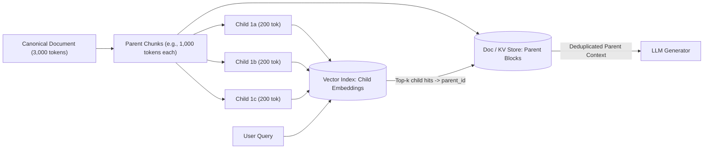
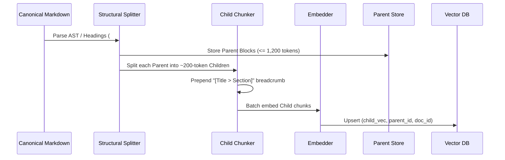
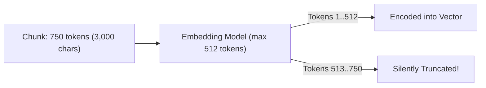

# Chunking Strategies for RAG: Fixed, Structural, Semantic, Parent-Child

> **Prerequisites:** [Lesson 06: Document Ingestion for RAG](../06-document-ingestion-for-rag/README.md).  
> **Estimated Reading Time:** 24–28 minutes  
> **Target Audience:** Backend and AI engineers tuning retrieval precision/recall, and candidates asked "how do you chunk documents for RAG and avoid losing context?"  
> **Free PDF Notes:** [Download SD-S-007.pdf](https://backendroadmap.com/notes/system-design/SD-S-007.pdf)

> [!NOTE]
> **In one line:** Chunking splits documents into retrieval-sized units that balance **embedding specificity** (small chunks match queries cleanly) against **LLM context completeness** (large chunks preserve surrounding reasoning). **Structural** and **parent-child (small-to-big)** chunking outperform naive fixed-size splitting in almost every production system.

> [!TIP]
> **The Golden Rule:** **Embed small, retrieve big.** Index small, focused child chunks (150–300 tokens) for sharp vector similarity, but return their **parent section** (800–1,500 tokens) or prepend document/section headers so the LLM never answers out of context.

---

## 1. What Chunking Is, and What It Isn't

Embedding models compress an entire text span into a single fixed-length vector (e.g., 1,536 floats). If you embed a 40-page manual as one vector, its meaning blurs into an unreadable average—a query about "refund deadlines" won't match strongly. Conversely, if you split every 100 characters, a sentence like *"It expires after 30 days"* loses what *"It"* refers to, and a table row loses its column headers.

| Strategy | Precise Meaning | Best For |
| :--- | :--- | :--- |
| **Fixed-size (token/char)** | Splits every $C$ tokens with overlap $O$ | Unstructured plain text, quick baselines |
| **Recursive character** | Tries separators in order (`\n\n`, `\n`, `. `, ` `) up to $C$ | General prose where paragraph breaks matter |
| **Structural (Markdown/AST)** | Splits on headings (`#`, `##`), code blocks, or HTML/table boundaries | Docs, wikis, API references, legal contracts |
| **Semantic chunking** | Computes sentence embeddings and splits where cosine similarity drops | Transcripts, essays, topic-shifting raw text |
| **Parent-child (Small-to-Big)** | Indexes small child chunks; fetches larger parent block at query time | High-precision + high-context production RAG |
| **Contextual enrichment** | Prepends doc title + section path (or LLM summary) to each chunk | Eliminating pronoun/entity ambiguity |
| **Not** | A one-size-fits-all hyperparameter (`chunk_size=500`) | Different corpora need different boundaries |

### Why It Matters
1. **Signal-to-noise ratio:** A 200-token chunk about one topic produces a sharp vector; a 2,000-token chunk spanning 5 topics dilutes similarity scores.
2. **Context window & latency:** Passing 10 bloated 1,500-token chunks (15,000 tokens) bloats LLM TTFT, cost, and "lost-in-the-middle" errors.
3. **Boundary integrity:** Splitting mid-table or mid-function destroys structured facts and code semantics.

---

## 2. Anatomy: Fixed vs Parent-Child (Small-to-Big) Retrieval



In **Fixed/Recursive** chunking, the unit you embed is the exact unit you pass to the LLM—forcing an uncomfortable compromise around 400–600 tokens. In **Parent-Child** chunking, you decouple the *search unit* (child, ~200 tokens) from the *synthesis unit* (parent, ~1,000 tokens). Multiple child hits pointing to the same `parent_id` are deduplicated before hitting the LLM.

| Strategy | Retrieval Precision | Context Completeness | Ingestion Cost | Index Size |
| :--- | :---: | :---: | :---: | :---: |
| **Fixed / Recursive** | Medium | Low–Medium | Very Low (CPU) | $1\times$ |
| **Structural (MD/AST)** | High | High | Low (CPU) | $1\times$ |
| **Semantic** | Medium–High | High | High (embeds every sentence) | $1\times$ |
| **Parent-Child** | **Very High** | **Very High** | Low–Medium | $1.2\times$–$1.5\times$ (tiny children + parent KV) |

> [!WARNING]
> **The Overlap Fallacy:** Adding 20% overlap (`overlap=100` on `size=500`) does *not* fix broken context for pronouns or tables, and it increases your total chunk count, embedding cost, and vector storage by **25%** (`1 / (1 - 0.2)`). Prefer structural boundaries + header injection over blind overlap.

---

## 3. Mathematical Model: Chunk Count, Overlap Inflation, and Context Budget

**Chunk Count with Overlap.** Given a document of $L$ tokens, chunk size $C$, and overlap $O$ ($0 \le O < C$), the stride is $S = C - O$, and the number of chunks $N_{\text{chunks}}$ is:

$$N_{\text{chunks}} = \left\lceil \frac{\max(0, L - O)}{C - O} \right\rceil$$

**Storage & Embedding Cost Multiplier.** Relative to zero-overlap chunking ($L / C$), overlap inflates chunk count by:

$$M_{\text{overlap}} = \frac{C}{C - O}$$

**Worked Numerical Example:**
- Corpus: $100{,}000$ documents, average length $L = 2{,}400$ tokens ($240\text{M}$ tokens total).
- **Config A (Fixed 512 tokens, 128-token / 25% overlap):**
  $$S = 512 - 128 = 384, \qquad N_{\text{chunks/doc}} = \left\lceil \frac{2400 - 128}{384} \right\rceil = \lceil 5.91 \rceil = 6 \text{ chunks}$$
  Total chunks = $600{,}000$. Overlap inflation $M = 512 / 384 = 1.33\times$ (33% extra vectors and embedding tokens!).
- **Config B (Parent-Child: 1,000-token parents, 200-token non-overlapping children):**
  $12$ child chunks/doc = $1{,}200{,}000$ tiny vectors, but if top-$k=6$ child hits map to 3 unique parents, the LLM receives $3 \times 1{,}000 = 3{,}000$ coherent tokens instead of 6 fragmented 512-token windows ($3{,}072$ tokens).

---

## 4. Metrics & Percentiles

| Metric | Meaning | Alert when |
| :--- | :--- | :--- |
| **Chunk token length ($p_{50}, p_{95}, p_{\max}$)** | Token distribution after splitting | $p_{\max} >$ embedding model limit (e.g., 512 or 8,192) |
| **Context Recall@k** | % of ground-truth answers contained in top-$k$ retrieved chunks | Drops after changing chunk size or boundary rules |
| **Context Precision@k** | % of retrieved tokens actually relevant to the answer | Low (< 40%) -> chunks are too large/noisy |
| **Table / Code intactness** | % of tables/functions not split mid-row or mid-block | < 95% on technical/financial corpora |
| **Duplicate parent ratio** | How often top-$k$ child chunks collapse to the same parent | > 70% -> child chunks are too small or $k$ is too low |

### Worked Example (`API Documentation RAG`)
An engineering team switched from fixed 500-character chunking to **Markdown-structural + 256-token child / 1,024-token parent** chunking with breadcrumb headers (`[Doc: Auth API > OAuth2 > Token Refresh]`). Context Recall@5 jumped from **68% to 89%** because queries like *"how long is the refresh token valid?"* matched the crisp 180-token child chunk, while the LLM received the full 900-token `Token Refresh` section including error codes.

---

## 5. Compounding & Failure Modes

| Failure Mode | Mechanism | Impact at Scale |
| :--- | :--- | :--- |
| **Silent truncation by embedding model** | Chunk is 1,200 tokens, but model (`bge-small`, `e5`) truncates at 512 tokens | Bottom **57%** of every large chunk is invisible to vector search! |
| **Orphaned pronouns / headers** | Chunk starts with *"This limit applies to Pro tier"* without section title | False negatives on queries mentioning *"Pro tier rate limit"* |
| **Micro-chunking (< 50 tokens)** | Fragmenting bullet points into isolated chunks | Vector index grows $5\times$; retrieval returns meaningless fragments |
| **Semantic chunking latency cliff** | Embedding every sentence of 10M docs just to find split points | Ingestion compute cost spikes **$5\times$–$10\times$** for marginal gains over structural splitting |

---

## 6. Numbers Every Engineer Must Know

| Item | Typical | Implication |
| :--- | :---: | :--- |
| Optimal child / search chunk size | 150–350 tokens | Sweet spot for dense vector specificity |
| Optimal parent / LLM context chunk | 800–1,500 tokens | Preserves full reasoning, examples, and tables |
| Popular embedding max context | 512 tokens (BGE/E5) to 8,192 (OpenAI/Voyage) | Never exceed model max tokens per chunk |
| Typical overlap (if using fixed) | 10%–15% (50–80 tokens) | Keep low to avoid 25–50% index bloat |
| Characters per English token | ~4 chars/token (~0.75 words/token) | Use real tokenizers (`tiktoken`/HF), not `len(text)` alone |
| Contextual header overhead | 15–40 tokens per chunk | Massive recall boost for negligible token cost |

---

## 7. Protocol / Mechanism Deep Dive: Structural + Parent-Child Pipeline



| Question | Answer |
| :--- | :--- |
| **When should you use Semantic Chunking?** | Only on unstructured transcripts, books, or OCR dumps with **no headings or paragraph structure**. For Markdown, HTML, code, or PDFs with headings, structural splitting is faster, deterministic, and usually better. |
| **How do you chunk Markdown tables?** | Never split a table mid-row. Keep small tables (< 1,000 tokens) intact as one chunk; for huge tables, split by row groups and **repeat the header row** in every chunk. |
| **How do you chunk source code?** | Use Tree-sitter AST boundaries (`function`, `class`, `method`) rather than line counts, and prepend file path + class signature. |
| **When NOT to use Parent-Child?** | When documents are already short (e.g., Slack messages, tweets, FAQ pairs < 300 tokens)—one level of chunking is enough. |

---

## 8. Hierarchical Budgets & Design Rules

| Slice | Rule | Control |
| :--- | :--- | :--- |
| **Measurement** | Always measure chunk limits in **tokens**, not characters | `tiktoken` / model tokenizer in ingestion pipeline |
| **Hard cap** | `chunk_tokens <= min(target_size, model_max_tokens)` | Assert in unit tests; never rely on silent truncation |
| **Boundaries** | Respect Markdown headings, code fences, and table rows first | AST/regex structural splitter before recursive fallback |
| **Context injection** | Prepend `doc_title > h1 > h2` to every child chunk before embedding | +15–40 tokens; prevents entity/pronoun loss |
| **Parent dedup** | Deduplicate `parent_id`s at retrieval time, preserving rank order | Avoids sending the same 1,000-token block twice to LLM |
| **Table handling** | Repeat table headers when splitting large tables | Preserves column semantics per chunk |

---

## 9. Top Mitigations

1. **Prepend hierarchical breadcrumbs** (`Document Title > Section > Subsection`) to every chunk before embedding.
2. **Use Parent-Child (Small-to-Big)** retrieval to decouple vector search precision from LLM synthesis context.
3. **Never split inside fenced code blocks (` ``` `) or Markdown tables**; treat them as atomic units up to a max cap.
4. **Count tokens with the target embedding model's tokenizer** so you never hit silent 512-token truncation.
5. **Keep overlap minimal (0–15%)** when using structural or parent-child chunking to avoid paying 30%+ extra vector storage.
6. **Evaluate chunking changes offline** with a golden Q&A dataset measuring Context Recall@5 and Precision@5 before re-indexing production.

---

## 10. Production Reference: The "Silent 512-Token Truncation" Incident

An enterprise support bot used `bge-large-en-v1.5` (512-token max input) with a LangChain splitter configured at `chunk_size=3000` characters (~750 tokens). For 4 months, users complained that the bot could never find troubleshooting steps located at the bottom of long sections.



**Root Cause:** The chunker measured characters, not tokens, and exceeded the embedding model's 512-token limit by 46%. Every token after 512 was silently dropped during embedding, even though the full 750-token text was stored in the payload.  
**Fix:** Switched to token-aware structural splitting (`max_child_tokens=256`, `parent_tokens=1024`) using the model's HuggingFace tokenizer. Context Recall@5 on bottom-of-section answers rose from **31% to 92%**.

---

## 11. Multi-Language Production Code Tabs

A production **Structural + Parent-Child Chunker** with breadcrumb header injection and zero external dependencies.

````carousel
```go
// Go: structural Markdown parent-child chunker with breadcrumb headers.
package main

import (
	"fmt"
	"strings"
)

type ParentChunk struct {
	ID      string
	Header  string
	Content string
}

type ChildChunk struct {
	ID       string
	ParentID string
	Text     string // Includes breadcrumb for sharper embeddings
}

func ChunkMarkdown(docTitle, md string, maxChildWords int) ([]ParentChunk, []ChildChunk) {
	lines := strings.Split(md, "\n")
	var parents []ParentChunk
	var children []ChildChunk

	curHeader := docTitle
	var buf []string
	flushParent := func() {
		body := strings.TrimSpace(strings.Join(buf, "\n"))
		if body == "" {
			return
		}
		pID := fmt.Sprintf("p-%d", len(parents)+1)
		parents = append(parents, ParentChunk{ID: pID, Header: curHeader, Content: body})

		words := strings.Fields(body)
		for i := 0; i < len(words); i += maxChildWords {
			end := i + maxChildWords
			if end > len(words) {
				end = len(words)
			}
			cID := fmt.Sprintf("%s-c-%d", pID, len(children)+1)
			text := fmt.Sprintf("[%s] %s", curHeader, strings.Join(words[i:end], " "))
			children = append(children, ChildChunk{ID: cID, ParentID: pID, Text: text})
		}
		buf = nil
	}

	for _, line := range lines {
		if strings.HasPrefix(line, "#") {
			flushParent()
			curHeader = docTitle + " > " + strings.TrimSpace(strings.TrimLeft(line, "# "))
		} else {
			buf = append(buf, line)
		}
	}
	flushParent()
	return parents, children
}
```
<!-- slide -->
```typescript
// TypeScript: structural parent-child Markdown chunker with breadcrumb injection.
export interface ParentChunk {
  id: string;
  header: string;
  content: string;
}

export interface ChildChunk {
  id: string;
  parentId: string;
  text: string;
}

export function chunkMarkdownParentChild(
  docTitle: string,
  markdown: string,
  maxChildWords = 180
): { parents: ParentChunk[]; children: ChildChunk[] } {
  const parents: ParentChunk[] = [];
  const children: ChildChunk[] = [];
  let currentHeader = docTitle;
  let buffer: string[] = [];

  const flush = () => {
    const content = buffer.join("\n").trim();
    if (!content) return;
    const parentId = `p-${parents.length + 1}`;
    parents.push({ id: parentId, header: currentHeader, content });

    const words = content.split(/\s+/);
    for (let i = 0; i < words.length; i += maxChildWords) {
      const slice = words.slice(i, i + maxChildWords).join(" ");
      children.push({
        id: `${parentId}-c-${children.length + 1}`,
        parentId,
        text: `[${currentHeader}] ${slice}`,
      });
    }
    buffer = [];
  };

  for (const line of markdown.split("\n")) {
    if (/^#{1,4}\s+/.test(line)) {
      flush();
      currentHeader = `${docTitle} > ${line.replace(/^#{1,4}\s+/, "").trim()}`;
    } else {
      buffer.push(line);
    }
  }
  flush();
  return { parents, children };
}
```
<!-- slide -->
```python
# Python: structural + parent-child Markdown chunker with breadcrumb headers (stdlib only).
from dataclasses import dataclass
from typing import List, Tuple
import re


@dataclass
class ParentChunk:
    id: str
    header: str
    content: str


@dataclass
class ChildChunk:
    id: str
    parent_id: str
    text: str


def chunk_markdown(
    doc_title: str, markdown: str, max_child_words: int = 180
) -> Tuple[List[ParentChunk], List[ChildChunk]]:
    parents: List[ParentChunk] = []
    children: List[ChildChunk] = []
    header_stack: List[str] = [doc_title]
    buf: List[str] = []

    def flush() -> None:
        body = "\n".join(buf).strip()
        if not body:
            return
        p_id = f"p-{len(parents) + 1}"
        breadcrumb = " > ".join(header_stack)
        parents.append(ParentChunk(id=p_id, header=breadcrumb, content=body))

        words = body.split()
        for i in range(0, len(words), max_child_words):
            c_id = f"{p_id}-c-{len(children) + 1}"
            piece = " ".join(words[i : i + max_child_words])
            children.append(ChildChunk(id=c_id, parent_id=p_id, text=f"[{breadcrumb}] {piece}"))
        buf.clear()

    for line in markdown.splitlines():
        m = re.match(r"^(#{1,4})\s+(.*)$", line)
        if m:
            flush()
            level = len(m.group(1))
            header_stack = header_stack[:level] + [m.group(2).strip()]
        else:
            buf.append(line)
    flush()
    return parents, children
```
<!-- slide -->
```csharp
// C#: structural Markdown parent-child chunker with breadcrumb headers.
using System.Text.RegularExpressions;

public sealed record ParentChunk(string Id, string Header, string Content);
public sealed record ChildChunk(string Id, string ParentId, string Text);

public static class MarkdownChunker
{
    public static (List<ParentChunk> Parents, List<ChildChunk> Children) Chunk(
        string docTitle, string markdown, int maxChildWords = 180)
    {
        var parents = new List<ParentChunk>();
        var children = new List<ChildChunk>();
        var currentHeader = docTitle;
        var buffer = new List<string>();

        void Flush()
        {
            var body = string.Join("\n", buffer).Trim();
            if (string.IsNullOrEmpty(body)) return;

            var pId = $"p-{parents.Count + 1}";
            parents.Add(new ParentChunk(pId, currentHeader, body));

            var words = body.Split((char[]?)null, StringSplitOptions.RemoveEmptyEntries);
            for (int i = 0; i < words.Length; i += maxChildWords)
            {
                int count = Math.Min(maxChildWords, words.Length - i);
                var slice = string.Join(" ", words, i, count);
                children.Add(new ChildChunk($"{pId}-c-{children.Count + 1}", pId, $"[{currentHeader}] {slice}"));
            }
            buffer.Clear();
        }

        foreach (var line in markdown.Split('\n'))
        {
            var m = Regex.Match(line, @"^#{1,4}\s+(.+)$");
            if (m.Success)
            {
                Flush();
                currentHeader = $"{docTitle} > {m.Groups[1].Value.Trim()}";
            }
            else
            {
                buffer.Add(line);
            }
        }
        Flush();
        return (parents, children);
    }
}
```
````

---

## 12. Hands-On CLI Verification Workflows

Verify chunk count math, overlap inflation, and token length distribution:

```bash
# 1. Verify chunk count & overlap inflation formula in Python
python -c "
import math
def chunks(L, C, O):
    return math.ceil(max(0, L - O) / (C - O))
print('No overlap (2400, 512, 0):', chunks(2400, 512, 0))      # 5
print('25% overlap (2400, 512, 128):', chunks(2400, 512, 128)) # 6 (+20% chunks)
"

# 2. Check max token length across a JSONL file of chunks using tiktoken
python -c "
import json, tiktoken
enc = tiktoken.get_encoding('cl100k_base')
lens = [len(enc.encode(json.loads(line)['text'])) for line in open('chunks.jsonl')]
print(f'count={len(lens)} p50={sorted(lens)[len(lens)//2]} max={max(lens)}')
"
```

---

## 13. Common Mistakes to Avoid

1. **Measuring `chunk_size` in characters** instead of the embedding model's tokens, causing silent truncation.
2. **Splitting inside tables or code blocks**, separating table headers from rows or breaking function context.
3. **Using huge fixed overlaps (30–50%)** that inflate storage and embedding bills without fixing boundary semantics.
4. **Omitting document/section titles from chunks**, leaving pronouns like *"it"* or *"this policy"* unanchored.
5. **Running expensive semantic chunking on structured docs** where Markdown/HTML headings already mark topic boundaries.
6. **Passing duplicate parent blocks to the LLM** when multiple child chunks from the same parent match top-$k$.
7. **Using the same chunk size for every corpus** (e.g., tweets vs 100-page legal contracts).

---

## 14. Key Terms Glossary

| Key Term | Definition |
| :--- | :--- |
| **Fixed-Size Chunking** | Splitting text every $N$ tokens/characters regardless of semantic boundaries. |
| **Recursive Splitting** | Splitting hierarchically by `\n\n`, `\n`, sentence, then word until under max size. |
| **Structural Chunking** | Splitting along document AST boundaries (headings, tables, functions, XML/HTML tags). |
| **Semantic Chunking** | Splitting where cosine similarity between adjacent sentence embeddings drops sharply. |
| **Parent-Child (Small-to-Big)** | Indexing small child chunks for precision, returning larger parent blocks for LLM context. |
| **Chunk Overlap** | Repeating $O$ trailing tokens from chunk $i$ at the start of chunk $i+1$. |
| **Breadcrumb Enrichment** | Prepending `Doc Title > H1 > H2` to each chunk before embedding. |
| **Silent Truncation** | Embedding model discarding tokens beyond its max sequence length without erroring. |
| **Context Recall@k** | Fraction of ground-truth evidence present in the top-$k$ retrieved chunks. |
| **Context Precision@k** | Signal-to-noise ratio of retrieved chunks that actually contribute to the answer. |

---

## 15. System Design Interview Questions & Answers

### Basic Conceptual Questions

<details>
<summary><strong>Q1: Why can't we just embed an entire 50-page document as one vector? [BASIC]</strong></summary>

**Answer:**
First, embedding models have strict token limits (typically 512 to 8,192 tokens) and truncate anything beyond that. Second, compressing 50 pages into a single vector averages out dozens of topics, destroying semantic specificity for targeted queries. Third, passing 50 pages into the LLM for every hit blows up context limits, latency, and cost.
</details>

<details>
<summary><strong>Q2: What is the trade-off between small chunks and large chunks? [BASIC]</strong></summary>

**Answer:**
Small chunks (150–300 tokens) produce sharper embeddings and higher retrieval precision, but risk losing surrounding context. Large chunks (1,000+ tokens) preserve full context for the LLM, but dilute vector similarity and waste context window tokens on irrelevant text.
</details>

<details>
<summary><strong>Q3: How does Parent-Child (Small-to-Big) chunking solve this trade-off? [BASIC]</strong></summary>

**Answer:**
You split a document into ~1,000-token parent blocks and ~200-token child chunks. Only the child chunks are embedded and searched in the vector DB. At query time, you map matched `parent_id`s to the parent blocks, deduplicate them, and pass the rich parent context to the LLM.
</details>

<details>
<summary><strong>Q4: Why is chunk overlap often a suboptimal band-aid? [BASIC]</strong></summary>

**Answer:**
Overlap (e.g., 20%) increases total chunks, embedding cost, and index size by 25% (`1 / (1 - 0.2)`), yet still fails to preserve a document title or table header located 500 tokens earlier. Structural splitting + breadcrumb header injection solves context loss with far less bloat.
</details>

### Scenario-Based Architecture Questions

<details>
<summary><strong>Q5: How would you chunk a corpus of financial PDFs containing dense multi-row tables? [SCENARIO]</strong></summary>

**Answer:**
Use a layout-aware parser to extract tables as structured Markdown/HTML. Never split a table mid-row. Keep small tables intact as a single chunk; for tables exceeding the token limit, split by row groups and repeat the table title + column header row at the top of every chunk. Optionally also embed an LLM-generated natural-language summary of the table pointing to the raw table.
</details>

<details>
<summary><strong>Q6: You are building a RAG assistant over a 10M-LOC Python/Go monorepo. How do you chunk it? [SCENARIO]</strong></summary>

**Answer:**
Use Tree-sitter AST-based structural chunking rather than fixed line counts. Split at top-level functions, methods, and structs/classes, keeping docstrings attached. Prepend file path, package/module name, and class signature as a breadcrumb header to each chunk.
</details>

<details>
<summary><strong>Q7: After deploying a new chunker, retrieval latency dropped but LLM answer accuracy fell. Why? [SCENARIO]</strong></summary>

**Answer:**
Likely causes: (1) Chunks became too small without parent expansion or breadcrumb headers, stripping necessary context; (2) Chunks exceeded the embedding model's max token limit and suffered silent truncation; or (3) Structural boundaries broke tables/code blocks. Check chunk token $p_{\max}$, Context Recall@k, and inspect failing retrieved chunks.
</details>

<details>
<summary><strong>Q8: Should you use semantic chunking for a 5M-page Confluence wiki? [SCENARIO]</strong></summary>

**Answer:**
No. Confluence pages already have explicit HTML/Markdown headings, lists, and code blocks. Semantic chunking requires embedding every individual sentence across 5M pages just to detect topic shifts—increasing ingestion cost and latency by $5\times$–$10\times$ with no advantage over deterministic structural splitting.
</details>

### Advanced & Tricky Interview Questions

<details>
<summary><strong>Q9: How does Anthropic's "Contextual Retrieval" improve chunking? [TRICKY]</strong></summary>

**Answer:**
Before embedding (and BM25 indexing), an LLM generates a 50–100 token context blurb situating each chunk within the full document (e.g., *"This chunk is from ACME Corp's Q2 2024 SEC filing, discussing revenue growth..."*) and prepends it to the chunk. Using prompt caching over the parent document makes this affordable and cuts retrieval failure rates significantly.
</details>

<details>
<summary><strong>Q10: In Parent-Child retrieval, what happens if 4 of your top-5 child hits belong to the same parent? [TRICKY]</strong></summary>

**Answer:**
If you naively fetch and concatenate parents, you pass the same 1,000-token block 4 times, wasting tokens and crowding out other relevant documents. You must deduplicate by `parent_id` (preserving highest child score) and over-fetch child candidates (e.g., fetch top-20 children to yield 5 unique parents).
</details>

<details>
<summary><strong>Q11: What is "late chunking" and when does it matter? [TRICKY]</strong></summary>

**Answer:**
With long-context embedding models (e.g., 8,192 tokens), late chunking runs the transformer's self-attention over the *entire* document first—so pronouns and cross-references attend to their antecedents—and *then* applies mean pooling per chunk boundary over the token embeddings. It captures cross-chunk context without LLM enrichment costs, provided the document fits in the model's context window.
</details>

<details>
<summary><strong>Q12: How do you version and migrate chunking strategies without downtime? [TRICKY]</strong></summary>

**Answer:**
Because canonical Markdown is stored in S3, run an offline backfill job reading S3 and writing the new chunking scheme to a new vector collection/index (or namespace) with `chunk_schema_version=v2`. Shadow-test and evaluate Recall@k, then atomically flip the retrieval alias/pointer from `v1` to `v2`.
</details>

---

## 16. One-Page Master Cheat Sheet

```
+---------------------------------------------------------------------------------------------------------+
|                         CHUNKING STRATEGIES FOR RAG — MASTER CHEAT SHEET                                |
+---------------------------------------------------------------------------------------------------------+
| 1. GOLDEN RULE: Embed small (150-300 tok child) for sharp vectors; return big (800-1500 tok parent).    |
+---------------------------------------------------------------------------------------------------------+
| 2. NEVER: Measure in chars blindly (silent 512-tok truncation) or split mid-table / mid-code-block.     |
+---------------------------------------------------------------------------------------------------------+
| 3. BREADCRUMBS: Prepend [Doc Title > H1 > H2] to every chunk (+20 tok, huge recall gain).               |
+---------------------------------------------------------------------------------------------------------+
| 4. OVERLAP MATH: N = ceil((L - O) / (C - O)). 25% overlap = 1.33x chunks, cost, and index size.        |
+---------------------------------------------------------------------------------------------------------+
| 5. STRATEGY PICK: Structural (MD/HTML/AST) for structured docs; Semantic only for unformatted dumps.    |
+---------------------------------------------------------------------------------------------------------+
| 6. PARENT DEDUP: Over-fetch child hits (top-20) -> deduplicate parent_id -> pass top-5 unique parents.  |
+---------------------------------------------------------------------------------------------------------+
```

---

## Further Reading & Sources

- Anthropic Engineering, [Introducing Contextual Retrieval](https://www.anthropic.com/news/contextual-retrieval).
- Jina AI, *Late Chunking: Contextual Chunk Embeddings Using Long-Context Embedding Models* (2024).
- LlamaIndex Documentation, *Node Parsers, Structural Splitters & Sentence-Window / Parent-Child Retrieval*.
- Greg Kamradt, *5 Levels of Text Splitting for Retrieval*.

---

## Free PDF Notes

[SD-S-007.pdf](https://backendroadmap.com/notes/system-design/SD-S-007.pdf)

---

## Next

Continue with [Embedding Generation at Scale: Models, Batching & Re-Embedding Migrations](../08-embedding-generation-at-scale/README.md).
