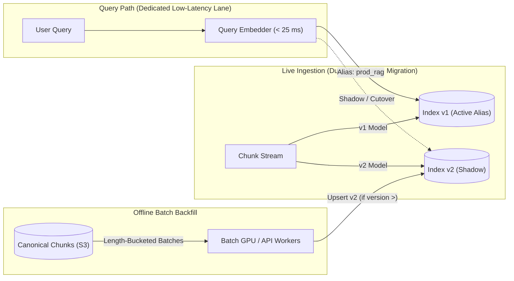
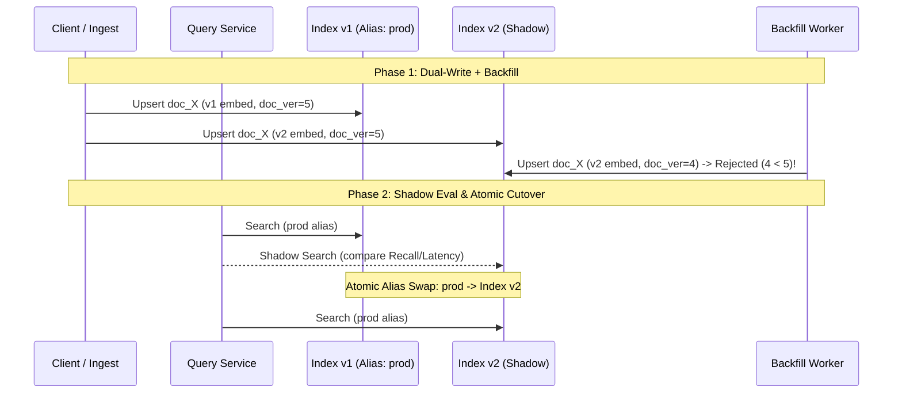
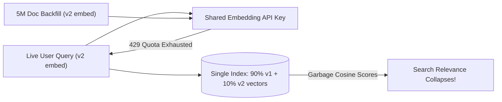

# Embedding Generation at Scale: Models, Batching & Re-Embedding Migrations

> **Prerequisites:** [Lesson 07: Chunking Strategies for RAG](../07-chunking-strategies-for-rag/README.md).  
> **Estimated Reading Time:** 24–28 minutes  
> **Target Audience:** ML/Backend platform engineers scaling embedding throughput to tens of millions of chunks, and candidates asked "how do you migrate 50M vectors to a new embedding model with zero downtime?"  
> **Free PDF Notes:** [Download SD-S-008.pdf](https://backendroadmap.com/notes/system-design/SD-S-008.pdf)

> [!NOTE]
> **In one line:** Embedding generation turns text chunks into dense float vectors using GPU batching, dynamic length-bucketing, and rate-limited worker pools—while **zero-downtime re-embedding migrations** require **dual-write + shadow backfills + atomic alias swaps** because vectors from different models live in incompatible geometric spaces.

> [!TIP]
> **The Golden Rule:** **Never mix vectors from two embedding models (or even two versions of the same model) in the same index.** Always stamp every vector with `embedding_model_id` and migrate via a **blue-green index alias swap**.

---

## 1. What Embedding Generation at Scale Is, and What It Isn't

Calling an embedding API one chunk at a time in a `for` loop works for 500 docs. At 50 million chunks, sequential calls take weeks, unbucketed GPU batches waste 70% of VRAM on padding tokens, and upgrading from `text-embedding-ada-002` to a newer model breaks search because cosine similarity between two different vector spaces is mathematical nonsense.

| Term | Precise Meaning | Example |
| :--- | :--- | :--- |
| **Dense embedding** | Fixed-dimension float vector encoding semantic meaning | 1,536-dim FP32/FP16 (`text-embedding-3-large`, `bge-m3`) |
| **Dynamic batching** | Grouping requests up to a max token budget (e.g., 16k tokens) | Packing 64x 256-tok chunks per GPU forward pass |
| **Length bucketing** | Sorting chunks by token length before batching to minimize padding | Grouping 100-tok chunks together, 500-tok together |
| **Matryoshka (MRL)** | Models trained so prefix dimensions ($256, 512$) retain high accuracy | Truncating 3,072-dim to 512-dim ($6\times$ smaller index) |
| **Asymmetric retrieval** | Using different prefixes for queries vs documents | `"query: ..."` vs `"passage: ..."` in E5 / Nomic |
| **Re-embedding migration** | Backfilling an entire corpus into a new model's vector space | Dual-write live traffic + offline batch backfill + alias swap |
| **Not** | Just `model.encode(chunks)` in a synchronous web handler | Causes GPU OOM, 429 storms, and mixed-space corruption |

### Why It Matters
1. **GPU & API economics:** Batching + length bucketing increases GPU throughput by **$5\times$–$15\times$** and avoids paying for idle padding compute.
2. **Model lock-in risk:** Embedding models improve every 6–12 months; without a zero-downtime migration architecture, teams get stuck on obsolete models for years.
3. **Query-path latency:** At query time, embedding a single user query must finish in **< 20–40 ms** (never queued behind bulk ingestion backfills!).

---

## 2. Anatomy: Query vs Bulk Lanes & Blue-Green Re-Embedding Migration



During a migration from Model `v1` to Model `v2`:
1. **Provision** `Index v2` with the new dimension/metric.
2. **Enable dual-write** for all new/updated documents (write to both `v1` and `v2`).
3. **Run offline backfill** from your canonical S3 store into `v2` using length-bucketed batch workers (ensuring older backfill writes never overwrite newer dual-writes via `doc_version`).
4. **Evaluate & Shadow**, then **atomically swap** the `prod_rag` alias (and query embedder model) from `v1` to `v2`.

| Dimension | Self-Hosted GPU (vLLM / TEI / Triton) | Managed Embedding API (OpenAI / Cohere / Voyage) |
| :--- | :--- | :--- |
| **Unit cost at scale (>50M chunks)** | Very low (~$0.002–$0.01 / 1M tokens on spot GPUs) | Higher (~$0.02–$0.13 / 1M tokens) |
| **Latency control** | Dedicated query GPUs (< 15 ms $p_{99}$) | Subject to multi-tenant jitter (30–150 ms) |
| **Ops burden** | High (autoscaling, CUDA, ONNX/TensorRT, health checks) | Zero infra ops; just rate-limit + retry handling |
| **Data privacy** | Data never leaves VPC | Leaves VPC unless private endpoint / Bedrock / Azure |

> [!WARNING]
> **Never share one embedding pool between live queries and bulk backfills.** A 10M-chunk backfill will saturate GPU queues or exhaust your API TPM (Tokens Per Minute) quota, spiking live user query latency from 20 ms to 10+ seconds and causing 429 errors on user-facing search. Always isolate **interactive query traffic** from **batch ingestion**.

---

## 3. Mathematical Model: Batch Throughput, Padding Waste, and TPM Backfill Time

**Padding Waste Without Bucketing.** If a batch of $B$ sequences has lengths $l_1, \dots, l_B$ and max length $L_{\max} = \max_i l_i$, transformer attention computes over $B \times L_{\max}$ tokens. The padding waste fraction is:

$$W_{\text{pad}} = 1 - \frac{\sum_{i=1}^B l_i}{B \cdot L_{\max}}$$

**API Rate-Limit Backfill Time.** Given $N_{\text{chunks}}$ chunks of average $\bar{t}$ tokens and an API quota of $\text{TPM}$ tokens per minute (reserving fraction $\alpha$ for live queries):

$$T_{\text{backfill (min)}} = \frac{N_{\text{chunks}} \cdot \bar{t}}{\text{TPM} \cdot (1 - \alpha)}$$

**Vector Storage Footprint.** For $N$ vectors of dimension $D$ and bytes-per-float $b$ ($b=4$ for FP32, $2$ for FP16, $1$ for INT8):

$$\text{Raw Vector RAM} = N \cdot D \cdot b$$

**Worked Numerical Example:**
- Corpus: $N = 50{,}000{,}000$ chunks, average $\bar{t} = 250$ tokens ($12.5\text{B}$ tokens total).
- **API Backfill:** Quota $\text{TPM} = 10{,}000{,}000$ tokens/min, reserving $\alpha = 20\%$ for live queries (effective $8\text{M}$ TPM):
  $$T_{\text{backfill}} = \frac{12{,}500{,}000{,}000}{8{,}000{,}000} = 1{,}562.5\text{ minutes} \approx 26.0\text{ hours}$$
- **MRL Dimension Reduction:** Switching from $D = 1{,}536$ (FP32, $b=4$) to Matryoshka $D = 512$ (FP16, $b=2$) shrinks raw vector RAM from:
  $$50\text{M} \times 1536 \times 4 = 307.2\text{ GB} \quad \longrightarrow \quad 50\text{M} \times 512 \times 2 = 51.2\text{ GB} \text{ (6x reduction!)}$$

---

## 4. Metrics & Percentiles

| Metric | Meaning | Alert when |
| :--- | :--- | :--- |
| **Query embed latency ($p_{95}, p_{99}$)** | Time to embed a single user query | $p_{99} > 50\text{ ms}$ (eats into RAG SLO) |
| **Batch throughput (tokens/sec)** | Sustained GPU or API embedding rate | Drops > 20% below baseline (padding or throttling) |
| **TPM / RPM utilization** | % of API provider token/request quota consumed | > 85% (risk of cascading 429s on live queries) |
| **Padding ratio** | `(padded_tokens - real_tokens) / padded_tokens` | > 25% (need tighter length bucketing) |
| **Backfill version skew** | % of chunks in `v2` still missing or older than `v1` | Stalls before alias cutover |
| **L2 norm check** | $\|\mathbf{v}\|_2$ of produced vectors | $\ne 1.0$ when index expects cosine/dot-product unit vectors |

### Worked Example (`Length-Bucketed Batching`)
A batch of 32 chunks has 31 chunks of 80 tokens and 1 chunk of 512 tokens. Without bucketing, the GPU computes $32 \times 512 = 16{,}384$ tokens—**82% wasted padding** ($1 - (31\times80 + 512)/16384 = 0.817$). With length bucketing (buckets: `[0..128]`, `[129..256]`, `[257..512]`), the 31 short chunks run in one batch of $31 \times 80 = 2{,}480$ tokens, cutting GPU compute by **$5.5\times$**.

---

## 5. Compounding & Failure Modes

| Failure Mode | Mechanism | Impact at Scale |
| :--- | :--- | :--- |
| **Mixed-model index corruption** | Writing `v2` vectors into `v1` index during rolling deploy | Cosine similarity becomes random; Recall@5 collapses to near 0% |
| **Asymmetric prefix mismatch** | Indexing docs with `"passage: "` but querying without `"query: "` | **10–25% drop** in retrieval NDCG@10 |
| **Unnormalized vectors with Dot Product** | Index uses `inner_product`, model outputs unnormalized vectors | Longer/higher-norm texts unfairly dominate top-$k$ |
| **Retry storm on API `429`** | 200 workers retry simultaneously without jitter or token bucket | Sustained 429 lockout; throughput drops to near zero |
| **Backfill overwriting live edits** | Slow backfill writes `doc_v1` over a newer dual-write `doc_v2` | Silent stale data regression in the new `v2` index |

---

## 6. Numbers Every Engineer Must Know

| Item | Typical | Implication |
| :--- | :---: | :--- |
| Query embedding latency (GPU local / API) | 5–15 ms (local) / 25–80 ms (API) | Always cache frequent/exact queries in Redis |
| TEI / vLLM throughput on 1x L4/A10G GPU | 8,000–25,000 tokens/sec | 1B tokens takes ~11–35 hours on a single L4 |
| OpenAI Batch API discount | 50% cheaper, 24h SLA | Ideal for offline re-embedding backfills |
| Matryoshka (MRL) truncation (3072 -> 512) | ~95–98% of full accuracy | $6\times$ RAM and index savings |
| FP32 -> INT8 scalar quantization | $4\times$ memory reduction, < 1–2% recall loss | Crucial at > 50M vectors |
| Optimal token-budget batch size (GPU) | 8,192–32,768 tokens/batch | Bound by max tokens, not fixed chunk count |

---

## 7. Protocol / Mechanism Deep Dive: Zero-Downtime Re-Embedding Migration



| Question | Answer |
| :--- | :--- |
| **How do you prevent backfill from overwriting newer dual-writes?** | Store `doc_version` (or `updated_at`) as a payload/optimistic-lock field and only upsert in backfill if the record does not exist or `existing.doc_version < backfill.doc_version`. |
| **What if you cannot afford 2x vector DB RAM during migration?** | Use **disk-backed / quantized shadow index** during backfill, or migrate tenant-by-tenant (sharded namespaces) so only one shard doubles temporarily. |
| **When NOT to self-host embedding GPUs?** | When volume is < 50M chunks/month, traffic is spiky, or you lack ML/GPU infra engineers—managed APIs (with Batch API for backfills) are far cheaper in engineering time. |

---

## 8. Hierarchical Budgets & Design Rules

| Slice | Rule | Control |
| :--- | :--- | :--- |
| **Lane isolation** | Separate API keys / GPU pools for **live query** vs **bulk ingestion** | Dedicated `query-embed` deployment + separate TPM quota |
| **Batching** | Pack batches by **max token budget** + **length bucketing** | Sort buffer by token count; flush at `max_tokens` or `max_wait_ms` |
| **Normalization** | L2-normalize vectors on write/query if using cosine/dot-product | Assert `abs(norm - 1.0) < 1e-4` in unit tests |
| **Model versioning** | Stamp `embedding_model` + `model_version` on every vector record | Reject mismatched query/index model IDs at startup |
| **Rate limiting** | Token-bucket limiter tracking *tokens/min* (TPM), not just req/min | Respect `Retry-After` + exponential backoff with full jitter |
| **Query caching** | Cache `(model_id, normalized_query) -> vector` in Redis (TTL 24h) | Absorbs 20–40% of repeated/popular queries at < 1 ms |

---

## 9. Top Mitigations

1. **Isolate query-time embedding from batch ingestion** using separate GPU pools or API keys/quotas.
2. **Use length-bucketed, token-budgeted batching** to cut GPU padding waste from ~70% to < 10%.
3. **Cache identical chunk hashes and frequent user queries** in Redis/S3 so re-runs never re-embed unchanged text.
4. **Use OpenAI/provider Batch APIs (50% off)** or spot GPUs for multi-million-chunk re-embedding backfills.
5. **Enforce version-monotonicity (`doc_version`)** during dual-write + backfill so stale writes never win.
6. **Leverage Matryoshka (MRL) + INT8/FP16 quantization** before scaling to multi-node vector clusters.

---

## 10. Production Reference: The "Mixed-Space Deploy & TPM Starvation" Outage

A SaaS knowledge-base platform upgraded its embedding model from `v1` (768-dim) to `v2` (768-dim, same dimension!). Because the dimensions matched, the team deployed `v2` directly to production without creating a new index—assuming new documents would gradually replace old ones. Simultaneously, a background script started re-embedding 5M docs using the *same* API key.



**Root Cause:** (1) Same-dimension `v1` and `v2` vectors are geometrically incompatible, so mixing them in one index broke similarity ranking; (2) Sharing an API key between backfill and live queries triggered 429 starvation.  
**Fix:** Enforced `embedding_model_id` checks, built a blue-green index migration pipeline with dual-writes + versioned backfill, and separated live query API keys from batch backfill keys.

---

## 11. Multi-Language Production Code Tabs

A **Token-Budgeted, Length-Bucketed Batch Embedder** with **TPM rate limiting** and **L2 normalization**.

````carousel
```go
// Go: length-bucketed, token-budgeted batcher with L2 normalization.
package main

import (
	"math"
	"sort"
)

type ChunkItem struct {
	ID     string
	Tokens int
	Text   string
}

// BuildTokenBatches sorts by token length to minimize padding, then packs up to maxTokens.
func BuildTokenBatches(items []ChunkItem, maxTokens, maxBatchSize int) [][]ChunkItem {
	sorted := append([]ChunkItem(nil), items...)
	sort.Slice(sorted, func(i, j int) bool { return sorted[i].Tokens < sorted[j].Tokens })

	var batches [][]ChunkItem
	var cur []ChunkItem
	curTokens := 0

	for _, item := range sorted {
		if len(cur) > 0 && (curTokens+item.Tokens > maxTokens || len(cur) >= maxBatchSize) {
			batches = append(batches, cur)
			cur = nil
			curTokens = 0
		}
		cur = append(cur, item)
		curTokens += item.Tokens
	}
	if len(cur) > 0 {
		batches = append(batches, cur)
	}
	return batches
}

func NormalizeL2(vec []float32) []float32 {
	var sum float64
	for _, v := range vec {
		sum += float64(v) * float64(v)
	}
	norm := float32(math.Sqrt(sum))
	if norm == 0 {
		return vec
	}
	out := make([]float32, len(vec))
	for i, v := range vec {
		out[i] = v / norm
	}
	return out
}
```
<!-- slide -->
```typescript
// TypeScript: length-bucketed token batcher + L2 normalizer + jittered retry.
export interface EmbedItem {
  id: string;
  tokens: number;
  text: string;
}

export function buildTokenBatches(
  items: EmbedItem[],
  maxTokensPerBatch = 16000,
  maxItems = 128
): EmbedItem[][] {
  const sorted = [...items].sort((a, b) => a.tokens - b.tokens);
  const batches: EmbedItem[][] = [];
  let current: EmbedItem[] = [];
  let tokenSum = 0;

  for (const item of sorted) {
    if (current.length > 0 && (tokenSum + item.tokens > maxTokensPerBatch || current.length >= maxItems)) {
      batches.push(current);
      current = [];
      tokenSum = 0;
    }
    current.push(item);
    tokenSum += item.tokens;
  }
  if (current.length > 0) batches.push(current);
  return batches;
}

export function normalizeL2(vec: number[]): number[] {
  const norm = Math.sqrt(vec.reduce((acc, v) => acc + v * v, 0));
  return norm === 0 ? vec : vec.map((v) => v / norm);
}
```
<!-- slide -->
```python
# Python: length-bucketed batching, padding waste calculator, and L2 normalization (stdlib only).
import math
from dataclasses import dataclass
from typing import List


@dataclass
class ChunkItem:
    id: str
    tokens: int
    text: str


def build_token_batches(
    items: List[ChunkItem], max_tokens: int = 16000, max_items: int = 128
) -> List[List[ChunkItem]]:
    sorted_items = sorted(items, key=lambda x: x.tokens)
    batches: List[List[ChunkItem]] = []
    cur: List[ChunkItem] = []
    cur_tokens = 0
    for item in sorted_items:
        if cur and (cur_tokens + item.tokens > max_tokens or len(cur) >= max_items):
            batches.append(cur)
            cur, cur_tokens = [], 0
        cur.append(item)
        cur_tokens += item.tokens
    if cur:
        batches.append(cur)
    return batches


def padding_waste(batch: List[ChunkItem]) -> float:
    if not batch:
        return 0.0
    max_len = max(x.tokens for x in batch)
    real = sum(x.tokens for x in batch)
    return 1.0 - (real / (len(batch) * max_len))


def normalize_l2(vec: List[float]) -> List[float]:
    norm = math.sqrt(sum(v * v for v in vec))
    return vec if norm == 0 else [v / norm for v in vec]
```
<!-- slide -->
```csharp
// C#: length-bucketed token batcher and L2 normalization for embedding pipelines.
public sealed record EmbedItem(string Id, int Tokens, string Text);

public static class EmbeddingBatcher
{
    public static List<List<EmbedItem>> BuildBatches(
        IEnumerable<EmbedItem> items, int maxTokens = 16000, int maxItems = 128)
    {
        var batches = new List<List<EmbedItem>>();
        var current = new List<EmbedItem>();
        int tokenSum = 0;

        foreach (var item in items.OrderBy(x => x.Tokens))
        {
            if (current.Count > 0 && (tokenSum + item.Tokens > maxTokens || current.Count >= maxItems))
            {
                batches.Add(current);
                current = new List<EmbedItem>();
                tokenSum = 0;
            }
            current.Add(item);
            tokenSum += item.Tokens;
        }
        if (current.Count > 0) batches.Add(current);
        return batches;
    }

    public static float[] NormalizeL2(float[] vec)
    {
        double sumSq = 0;
        foreach (var v in vec) sumSq += (double)v * v;
        float norm = (float)Math.Sqrt(sumSq);
        if (norm == 0f) return vec;
        var res = new float[vec.Length];
        for (int i = 0; i < vec.Length; i++) res[i] = vec[i] / norm;
        return res;
    }
}
```
````

---

## 12. Hands-On CLI Verification Workflows

Benchmark padding waste with vs without length bucketing, and test HuggingFace Text Embeddings Inference (TEI):

```bash
# 1. Measure padding waste reduction with length bucketing in Python
python -c "
from embed_batcher import ChunkItem, build_token_batches, padding_waste
items = [ChunkItem(str(i), (i % 8 + 1) * 64, 'x') for i in range(256)]
naive = [items[i:i+32] for i in range(0, len(items), 32)]
bucketed = build_token_batches(items, max_tokens=4096, max_items=32)
print('Naive avg waste:', round(sum(padding_waste(b) for b in naive)/len(naive), 3))
print('Bucketed avg waste:', round(sum(padding_waste(b) for b in bucketed)/len(bucketed), 3))
"

# 2. Local GPU/CPU embedding server with HuggingFace TEI (Docker)
docker run --gpus all -p 8080:80 \
  ghcr.io/huggingface/text-embeddings-inference:latest \
  --model-id BAAI/bge-large-en-v1.5 --max-batch-tokens 16384

# 3. Verify embedding endpoint latency & L2 norm
curl -s http://localhost:8080/embed \
  -H 'Content-Type: application/json' \
  -d '{"inputs": ["query: how to rotate API keys?"]}' | head -c 200
```

---

## 13. Common Mistakes to Avoid

1. **Mixing vectors from two models (even with the same dimension)** in a single index.
2. **Sharing one API key / GPU pool** between bulk re-embedding backfills and live user queries.
3. **Batching by fixed chunk count** (e.g., `batch=64`) without length bucketing, wasting up to 70% GPU compute on padding.
4. **Forgetting asymmetric query/passage prefixes** (`"query: "` vs `"passage: "`) required by models like E5/Nomic.
5. **Skipping L2 normalization** when using dot-product (`IP`) similarity metrics.
6. **Allowing backfill workers to overwrite newer live dual-writes** without a `doc_version` check.
7. **Re-embedding unchanged chunks** during partial document updates instead of checking `text_hash`.

---

## 14. Key Terms Glossary

| Key Term | Definition |
| :--- | :--- |
| **Dense Vector** | Fixed-size float array representing semantic meaning in $\mathbb{R}^D$. |
| **Length Bucketing** | Sorting chunks by token count before batching to minimize padding tokens. |
| **Token-Budget Batching** | Capping each batch by total tokens (`max_batch_tokens`) to prevent GPU OOM. |
| **Matryoshka (MRL)** | Training embeddings so leading dimensions ($256, 512$) remain useful when truncated. |
| **Asymmetric Retrieval** | Prepending task-specific prefixes to queries vs documents during embedding. |
| **L2 Normalization** | Scaling a vector to unit length ($\|\mathbf{v}\|_2 = 1$) so dot product equals cosine similarity. |
| **Dual-Write** | Writing live updates to both old (`v1`) and new (`v2`) indexes during migration. |
| **Index Alias Swap** | Atomically repointing a logical index name (`prod_rag`) from `v1` to `v2`. |
| **TPM / RPM** | Tokens Per Minute / Requests Per Minute rate limits enforced by LLM/embedding APIs. |
| **TEI / Triton** | High-throughput inference servers (Text Embeddings Inference, NVIDIA Triton) with dynamic batching. |

---

## 15. System Design Interview Questions & Answers

### Basic Conceptual Questions

<details>
<summary><strong>Q1: Why can't you upgrade an embedding model in-place by just embedding new documents with the new model? [BASIC]</strong></summary>

**Answer:**
Every embedding model defines its own arbitrary coordinate space. Even if both models output 768-dimensional vectors, dimension 42 in `v1` has no relationship to dimension 42 in `v2`. Comparing a `v2` query vector against `v1` document vectors produces meaningless similarity scores.
</details>

<details>
<summary><strong>Q2: How does length bucketing speed up GPU embedding? [BASIC]</strong></summary>

**Answer:**
GPUs process a batch as a rectangular tensor of shape `(batch_size, max_seq_len_in_batch)`. If one 512-token chunk is batched with thirty-one 64-token chunks, the 31 short chunks are padded to 512 tokens—wasting ~85% of compute. Sorting by length and grouping similar-length chunks minimizes padding.
</details>

<details>
<summary><strong>Q3: What is Matryoshka Representation Learning (MRL) and why does it matter for scale? [BASIC]</strong></summary>

**Answer:**
MRL trains the model so the most important semantic information is packed into the earliest dimensions. You can truncate a 3,072-dim vector down to 512 or 256 dims with only a 2–4% accuracy drop, cutting vector DB RAM, disk, and network bandwidth by $6\times$–$12\times$.
</details>

<details>
<summary><strong>Q4: Why should live query embedding be isolated from bulk ingestion? [BASIC]</strong></summary>

**Answer:**
Live queries require < 30 ms $p_{99}$ latency, while bulk ingestion saturates GPU batch queues and API TPM quotas. Sharing resources causes queueing delays and `429` errors for end users whenever a large document batch is ingested.
</details>

### Scenario-Based Architecture Questions

<details>
<summary><strong>Q5: Design a zero-downtime migration of 100M vectors from Model v1 to Model v2. [SCENARIO]</strong></summary>

**Answer:**
1. Create `index_v2` for Model `v2`.
2. Enable **dual-write** on the ingestion pipeline (new/updated chunks go to both `v1` and `v2`, tagged with `doc_version`).
3. Run a rate-limited, length-bucketed **offline backfill** from canonical S3 chunks into `v2`, rejecting writes where `existing.doc_version >= backfill.doc_version`.
4. Run shadow queries against `v2` to verify Recall@k and latency.
5. Atomically swap the `prod_rag` read alias (and query embedder config) from `v1` to `v2`, then decommission `v1` after a rollback window.
</details>

<details>
<summary><strong>Q6: You need to embed 10M chunks (2.5B tokens) via an external API with a 5M TPM limit. How long does it take? [SCENARIO]</strong></summary>

**Answer:**
Reserving 20% (1M TPM) for live queries leaves 4M TPM for backfill. $2{,}500\text{M} / 4\text{M} = 625\text{ minutes} \approx 10.4\text{ hours}$. To go faster without hitting 429s, use the provider's asynchronous Batch API (often separate higher quotas + 50% cheaper) or distribute across multiple regional endpoints/quotas.
</details>

<details>
<summary><strong>Q7: Should you self-host `bge-large` on GPUs or use a managed embedding API? [SCENARIO]</strong></summary>

**Answer:**
Use a managed API early on or for spiky workloads (zero ops, pay-per-token). Switch to self-hosted GPUs (TEI/vLLM on spot L4/A10G instances) when sustained volume exceeds ~50M–100M tokens/day, when strict VPC data residency is required, or when you need predictable < 15 ms query latency.
</details>

<details>
<summary><strong>Q8: How do you reduce embedding costs when documents are edited frequently? [SCENARIO]</strong></summary>

**Answer:**
Compute a SHA-256 hash per individual *chunk*, not just per document. When a 50-page document has 1 paragraph edited, 98% of chunks have identical hashes—look up their existing vectors (or skip upsert) and only call the embedding model for the 2% modified chunks.
</details>

### Advanced & Tricky Interview Questions

<details>
<summary><strong>Q9: How do you handle race conditions between offline backfill and live dual-writes? [TRICKY]</strong></summary>

**Answer:**
Store a monotonically increasing `doc_version` (or source `updated_at`) on each chunk in `index_v2`. Backfill workers use conditional upserts (or check a metadata state table) so a slow backfill reading an older S3 snapshot cannot overwrite a fresher live dual-write. Similarly, deletions during migration must emit tombstones to *both* `v1` and `v2`.
</details>

<details>
<summary><strong>Q10: Why do we L2-normalize vectors, and when does it break? [TRICKY]</strong></summary>

**Answer:**
When vectors are unit-normalized ($\|\mathbf{v}\|_2 = 1$), dot product equals cosine similarity, allowing faster `IP` kernels without runtime division. It breaks if a downstream component forgets to normalize query vectors or if you use a model trained specifically for unnormalized Euclidean distance.
</details>

<details>
<summary><strong>Q11: What is INT8 / binary quantization of embeddings, and how do you recover lost accuracy? [TRICKY]</strong></summary>

**Answer:**
Scalar quantization (FP32 -> INT8) cuts RAM $4\times$ with < 1–2% recall loss; binary quantization (1 bit/dim) cuts RAM $32\times$ with ~5–10% loss. To recover accuracy, use **oversampling + rescoring**: retrieve top-50 candidates using fast binary/INT8 vectors in RAM, then rescore those 50 using full FP32 vectors read from disk (NVMe).
</details>

<details>
<summary><strong>Q12: How do you handle a chunk that exceeds the embedding model's context window? [TRICKY]</strong></summary>

**Answer:**
Never let it silently truncate. Enforce a pre-embedding token-count assertion matching the model's tokenizer. If a chunk exceeds the limit, either split it further at the chunker stage or—for special long-document cases—mean-pool embeddings of overlapping windows (though proper upstream chunking is strongly preferred).
</details>

---

## 16. One-Page Master Cheat Sheet

```
+---------------------------------------------------------------------------------------------------------+
|                    EMBEDDING GENERATION AT SCALE — MASTER CHEAT SHEET                                   |
+---------------------------------------------------------------------------------------------------------+
| 1. GOLDEN RULE: Never mix vectors from two models in one index. Stamp embedding_model_id everywhere.    |
+---------------------------------------------------------------------------------------------------------+
| 2. BATCHING: Sort by token length (bucketing) + pack by max_tokens to cut GPU padding waste (~70%->10%).|
+---------------------------------------------------------------------------------------------------------+
| 3. ISOLATION: Separate live query embedder (< 25 ms p99) from bulk backfill GPUs / TPM quotas.          |
+---------------------------------------------------------------------------------------------------------+
| 4. MIGRATION: Create v2 -> Dual-write (doc_version) -> Offline backfill -> Shadow -> Atomic alias swap. |
+---------------------------------------------------------------------------------------------------------+
| 5. STORAGE MATH: RAM = N * D * bytes. MRL (3072->512) + INT8/FP16 cuts memory 6x-12x.                  |
+---------------------------------------------------------------------------------------------------------+
| 6. DEDUP & CACHE: Chunk-level SHA-256 skips unchanged chunks; Redis caches top repeated user queries.   |
+---------------------------------------------------------------------------------------------------------+
```

---

## Further Reading & Sources

- HuggingFace, [Text Embeddings Inference (TEI) Architecture](https://huggingface.co/docs/text-embeddings-inference/index).
- Kusupati et al., *Matryoshka Representation Learning* (NeurIPS 2022).
- OpenAI / Cohere Engineering Docs, *Batch API & Rate Limit Handling*.
- Qdrant / Pinecone Engineering Blogs, *Zero-Downtime Vector Index Migrations & Quantization Rescoring*.

---

## Free PDF Notes

[SD-S-008.pdf](https://backendroadmap.com/notes/system-design/SD-S-008.pdf)

---

## Next

Continue with [Vector Databases: pgvector vs Managed vs Search Engines, HNSW & Scale](../09-vector-databases/README.md).
