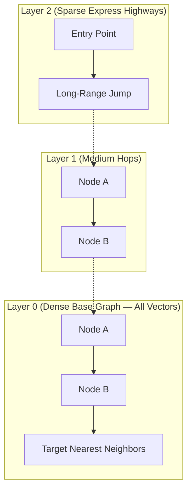
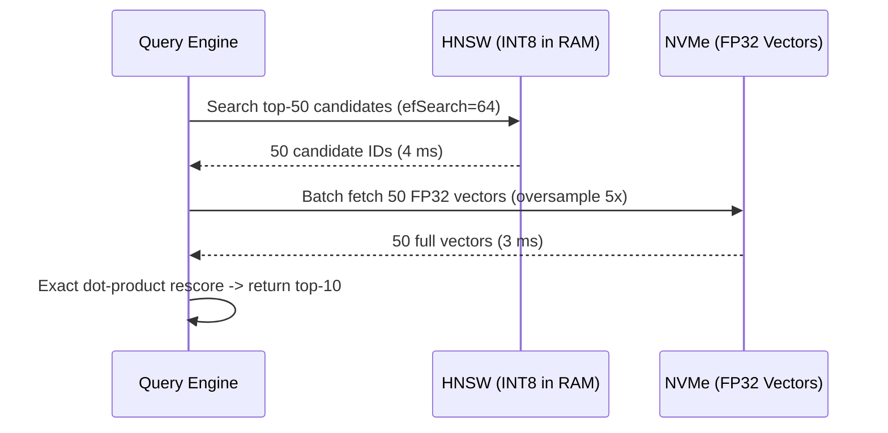
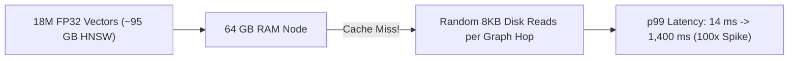

# Vector Databases: pgvector vs Managed vs Search Engines, HNSW & Scale

> **Prerequisites:** [Lesson 08: Embedding Generation at Scale](../08-embedding-generation-at-scale/README.md).  
> **Estimated Reading Time:** 25–30 minutes  
> **Target Audience:** Backend and platform engineers choosing a vector store, and candidates asked "would you use pgvector, Pinecone/Qdrant, or Elasticsearch—and how does HNSW scale?"  
> **Free PDF Notes:** [Download SD-S-009.pdf](https://backendroadmap.com/notes/system-design/SD-S-009.pdf)

> [!NOTE]
> **In one line:** Vector databases trade **exact $O(N)$ brute-force search** for **Approximate Nearest Neighbor (ANN)** indexes like **HNSW** ($O(\log N)$ latency, ~95–99% recall) or **DiskANN/IVF-PQ**. Your choice between **pgvector**, **dedicated vector DBs** (Qdrant, Milvus, Pinecone), and **search engines** (OpenSearch/Elasticsearch) hinges on **scale, memory budget, hybrid search needs, and operational simplicity**.

> [!TIP]
> **The Golden Rule:** **Start with pgvector if you are under ~5M–10M vectors and already run Postgres** (transactional consistency + zero new infra). Move to a **dedicated vector DB or search engine** when you outgrow single-node RAM, need sub-20 ms $p_{99}$ at 50M+ vectors, or require heavy hybrid BM25 + vector filtering.

---

## 1. What a Vector Database Is, and What It Isn't

Exact $k$-Nearest Neighbor ($k$-NN) search computes the distance between a query vector and *every* vector in the database. At 100,000 vectors, that takes ~5 ms. At 100 million 1,536-dim vectors, exact scan touches 600 GB of data per query—taking seconds and melting CPUs. Vector databases solve this using **ANN (Approximate Nearest Neighbor)** indexes, trading 1–3% recall for $100\times$–$1000\times$ faster queries.

| Term | Precise Meaning | Example |
| :--- | :--- | :--- |
| **Exact $k$-NN (Flat)** | Brute-force distance calculation against all $N$ vectors | 100% recall, $O(N \cdot D)$ latency |
| **HNSW** | Hierarchical Navigable Small World multi-layer proximity graph | Fastest in-RAM ANN (~5–15 ms), high memory overhead |
| **IVF-PQ** | Inverted File (cluster centroids) + Product Quantization compression | Lower RAM, slightly lower recall, needs training step |
| **DiskANN / Vamana** | Graph index optimized for NVMe SSDs with compressed vectors in RAM | Scales to 100M–1B vectors at fraction of HNSW RAM cost |
| **Quantization (SQ / BQ)** | Compressing FP32 floats to INT8 ($4\times$) or 1-bit binary ($32\times$) | Fits $4\times$–$32\times$ more vectors in RAM + rescore |
| **Recall@k** | Fraction of true exact-$k$ nearest neighbors found by ANN | Target $\ge 0.95$ in production |
| **Not** | A replacement for your primary OLTP database | Keep source-of-truth docs/ACLs in Postgres/S3 |

### Why It Matters
1. **RAM is the primary cost driver:** Uncompressed HNSW for 100M 1,536-dim vectors requires **~800+ GB of RAM**—costing tens of thousands of dollars per month if not quantized or tiered to disk.
2. **Operational sprawl vs capability:** Adding a new distributed database (Milvus/Elasticsearch) when you only have 500k chunks creates unnecessary ops burden; conversely, forcing 100M vectors into a single Postgres node causes OOMs and vacuum stalls.
3. **Write amplification:** HNSW graph insertions are CPU-heavy ($O(\log N)$ edge updates) and deletes leave "tombstone holes" that degrade graph navigability until compacted.

---

## 2. Anatomy: HNSW Multi-Layer Graph & Storage Tiering



HNSW works like a skip-list for geometry: **Layer 2** has very few nodes with long-range edges to jump quickly across the vector space; **Layer 0** contains every vector with dense local connections (`M` neighbors per node). Search greedily descends from the top layer to Layer 0, then expands a beam search of width `efSearch`.

| Platform | Best Sweet Spot | Strengths | Limitations |
| :--- | :--- | :--- | :--- |
| **pgvector (Postgres + HNSW)** | < 10M vectors (or per-tenant partitioned) | ACID joins with ACLs/metadata, zero new infra | Single-node write/RAM ceiling; HNSW build/vacuum slower at >20M |
| **Managed Vector DB (Pinecone, Qdrant Cloud)** | 5M–500M+ vectors | Serverless/auto-sharding, quantization, fast filtered ANN | Extra vendor/network hop; eventual consistency with OLTP |
| **Self-Hosted Vector DB (Qdrant, Milvus, Weaviate)** | 10M–1B+ vectors, strict VPC | Full control over HNSW/DiskANN, INT8/BQ, payload indexes | Cluster ops, shard rebalancing, backup/restore management |
| **Search Engine (OpenSearch / Elasticsearch)** | Heavy **BM25 + Vector** hybrid workloads | Best-in-class lexical BM25, aggregations, mature ops | Higher RAM/JVM overhead; ANN tuning less flexible than Qdrant |

> [!WARNING]
> **The HNSW Memory & Delete Trap:** HNSW requires the graph *and* vectors (or quantized vectors) in RAM for fast traversal. Furthermore, **deleting vectors from HNSW does not immediately reclaim RAM**—it marks nodes as deleted, forcing queries to traverse dead nodes until segment compaction/vacuuming runs.

---

## 3. Mathematical Model: HNSW Memory, Complexity, and Quantization Savings

**HNSW Memory Footprint.** For $N$ vectors of dimension $D$, float size $b$ bytes ($4$ for FP32, $1$ for INT8), and average links per node $M$ (Layer 0 has $2M$ links, upper layers add $\sim M$, so $\approx 2.2M$ edges of 4-byte node IDs):

$$\text{RAM}_{\text{HNSW}} \approx N \cdot \left( D \cdot b + 2.2 \cdot M \cdot 4 \right) \cdot 1.15\text{ (allocator/metadata overhead)}$$

**Query Latency Scaling.** HNSW search complexity is logarithmic in corpus size and linear in beam width `efSearch`:

$$T_{\text{query}} \propto \text{efSearch} \cdot \log(N) \cdot D$$

**Worked Numerical Example (50M vectors, $D = 1{,}536$, $M = 16$):**
- **Link overhead per vector:** $2.2 \times 16 \times 4 \approx 141\text{ bytes/vector}$.
- **FP32 ($b = 4$):**
  $$\text{Vector bytes} = 1{,}536 \times 4 = 6{,}144\text{ B} \implies (6{,}144 + 141) \times 1.15 = 7{,}228\text{ B/vec}$$
  $$\text{Total RAM} = 50\text{M} \times 7{,}228\text{ B} \approx 361.4\text{ GB RAM}$$
- **INT8 Scalar Quantization ($b = 1$) + Disk-backed FP32 rescore:**
  $$\text{Vector bytes} = 1{,}536 \times 1 = 1{,}536\text{ B} \implies (1{,}536 + 141) \times 1.15 = 1{,}929\text{ B/vec}$$
  $$\text{Total RAM} = 50\text{M} \times 1{,}929\text{ B} \approx 96.5\text{ GB RAM (3.7x cheaper!)}$$

---

## 4. Metrics & Percentiles

| Metric | Meaning | Alert when |
| :--- | :--- | :--- |
| **Search latency ($p_{95}, p_{99}$)** | Vector ANN lookup time excluding embedding | $p_{99} > 40\text{ ms}$ (check `efSearch` or disk I/O) |
| **Recall@10 (vs exact $k$-NN)** | ANN accuracy measured on a 1,000-query golden sample | $< 0.95$ (increase `efSearch` or `M`) |
| **Index RAM utilization** | Resident set size vs node memory limit | $> 80\%$ (risk of Linux OOMKill or swap thrashing) |
| **Deleted-node ratio** | Tombstoned vectors waiting for segment merge/compaction | $> 15\%$ (triggers recall drop and latency spike) |
| **QPS per shard / CPU saturation** | Concurrent queries saturating cores | $> 75\%$ CPU (add read replicas or shards) |

### Worked Example (`pgvector HNSW Tuning`)
A SaaS app with 2M chunks on `pgvector` saw $p_{99}$ search latency spike from 12 ms to 280 ms. `EXPLAIN ANALYZE` showed `hnsw.ef_search` was set to 400 (overkill) and `maintenance_work_mem` was too small during index rebuilds. Lowering `hnsw.ef_search` to `64` and enabling `halfvec` (FP16, $2\times$ smaller) cut RAM in half and restored $p_{99}$ latency to **14 ms** at 97% Recall@10.

---

## 5. Compounding & Failure Modes

| Failure Mode | Mechanism | Impact at Scale |
| :--- | :--- | :--- |
| **HNSW graph spills out of RAM** | Index exceeds `shared_buffers`/RAM; OS swaps pages from disk | Latency jumps from **10 ms to 500–2,000 ms** ($100\times$ cliff) |
| **Single-shard hotspotting** | Routing all writes/queries to 1 shard instead of sharding by `tenant_id` | Cannot scale QPS; index rebuilds block traffic |
| **Tombstone fragmentation** | Heavy update/delete churn without compaction | Search traverses dead edges; Recall@10 silently degrades |
| **Suboptimal `M` / `efConstruction`** | Setting `M=4` to save RAM on 1,536-dim vectors | Disconnected graph islands; Recall@10 caps at ~75% |

---

## 6. Numbers Every Engineer Must Know

| Item | Typical | Implication |
| :--- | :---: | :--- |
| HNSW `M` (links per node) | 16–32 | Higher `M` = better recall on high-dim vectors, more RAM |
| HNSW `efConstruction` | 100–200 | Build-time accuracy; higher = slower writes, better graph |
| HNSW `efSearch` | 40–128 | Query-time knob; tunable per request without rebuilding |
| pgvector `halfvec` (FP16) | 50% RAM of FP32, <0.5% recall loss | Always use `halfvec` over `vector` in modern pgvector |
| Typical single-shard sweet spot | 1M–10M vectors/shard | Shard horizontally beyond 10M–20M per node |
| DiskANN / NVMe rescore latency | 15–40 ms $p_{99}$ | Enables 100M+ vectors on a fraction of HNSW RAM |

---

## 7. Protocol / Mechanism Deep Dive: HNSW Search & Rescoring



| Question | Answer |
| :--- | :--- |
| **How does `efSearch` affect latency vs recall?** | `efSearch` is the dynamic candidate list size during Layer 0 traversal. Doubling `efSearch` roughly doubles query CPU time and pushes Recall@10 from e.g. 93% to 98%. |
| **Why does `pgvector` struggle past ~10M–20M vectors on one node?** | Postgres lacks native distributed sharding for HNSW, vacuuming dead tuples in HNSW is expensive, and if the HNSW index exceeds `shared_buffers` + OS page cache, random disk I/O destroys latency. |
| **When NOT to use a dedicated vector database?** | When you have < 5M vectors and already run Postgres (`pgvector`), or when you need strict ACID transactions joining vectors with user/billing/ACL tables in one query. |

---

## 8. Hierarchical Budgets & Design Rules

| Slice | Rule | Control |
| :--- | :--- | :--- |
| **Sizing** | Keep entire HNSW index (or quantized graph) **100% resident in RAM** | Monitor page faults / cache hit ratio > 99% |
| **Precision** | Use **FP16 (`halfvec`) or INT8** + oversampling rescore by default | Saves $2\times$–$4\times$ RAM with negligible recall drop |
| **Sharding** | Shard at > 10M–20M vectors per node (or by `tenant_id`) | Consistent hashing / tenant routing key |
| **Tuning** | Start with `M=16, efConstruction=128, efSearch=64` | Benchmark Recall@10 against exact $k$-NN before tuning |
| **Compaction** | Schedule periodic segment compaction / `VACUUM` on high-churn collections | Alert when deleted-node ratio > 15% |
| **Backups** | Snapshot vector DB + retain canonical S3 chunks as rebuildable fallback | Never rely solely on live index without S3 source |

---

## 9. Top Mitigations

1. **Use `pgvector` with `halfvec` (FP16) up to ~5M–10M vectors** to avoid distributed DB complexity and keep ACID ACL joins.
2. **Apply INT8 or Binary Quantization + $3\times$–$5\times$ oversampling rescore** to cut RAM bills by $4\times$–$16\times$.
3. **Never let an HNSW index spill to disk**; size RAM with a 25% headroom buffer for segments and OS cache.
4. **Shard by `tenant_id` or hash key** once a collection crosses ~10M–20M vectors.
5. **Measure Recall@k against exact brute-force $k$-NN** on 500–1,000 real queries whenever changing `M`, `efSearch`, or quantization.
6. **Tune `efSearch` dynamically per query tier** (e.g., `efSearch=32` for autocomplete, `efSearch=128` for deep research).

---

## 10. Production Reference: The "HNSW RAM Spill Cliff" Outage

A customer-support AI platform grew from 4M to 18M 1,536-dim FP32 chunks on a single 64 GB RAM Postgres (`pgvector`) instance. At 12M vectors (~65 GB HNSW index), the index no longer fit in RAM. Every query triggered hundreds of random 8 KB page reads from EBS/NVMe.



**Root Cause:** Uncompressed FP32 HNSW exceeded physical RAM, causing OS page-cache thrashing on random graph-traversal hops.  
**Fix:** Converted the column to `halfvec(1536)` (cutting index size from 95 GB to ~47 GB), enabled `INT8` quantization, and partitioned the table by `tenant_id`—restoring $p_{99}$ latency to **16 ms**.

---

## 11. Multi-Language Production Code Tabs

A **Quantized Vector Store + Exact Rescoring** engine demonstrating **INT8 scalar quantization** in RAM with **FP32 oversampled rescoring**.

````carousel
```go
// Go: INT8 quantized vector search + exact FP32 oversampled rescoring.
package main

import (
	"math"
	"sort"
)

type VectorRecord struct {
	ID    string
	FP32  []float32
	INT8  []int8
	Scale float32
}

func QuantizeINT8(v []float32) ([]int8, float32) {
	var maxAbs float32
	for _, x := range v {
		if a := float32(math.Abs(float64(x))); a > maxAbs {
			maxAbs = a
		}
	}
	scale := maxAbs / 127.0
	if scale == 0 {
		scale = 1
	}
	q := make([]int8, len(v))
	for i, x := range v {
		q[i] = int8(math.Round(float64(x / scale)))
	}
	return q, scale
}

func DotFP32(a, b []float32) float32 {
	var s float32
	for i := range a {
		s += a[i] * b[i]
	}
	return s
}

func SearchWithRescore(query []float32, records []VectorRecord, topK, oversample int) []string {
	qQuery, _ := QuantizeINT8(query)
	type scored struct {
		idx   int
		score float32
	}
	approx := make([]scored, len(records))
	for i, r := range records {
		var s int32
		for d := range qQuery {
			s += int32(qQuery[d]) * int32(r.INT8[d])
		}
		approx[i] = scored{idx: i, score: float32(s) * r.Scale}
	}
	sort.Slice(approx, func(i, j int) bool { return approx[i].score > approx[j].score })

	limit := topK * oversample
	if limit > len(approx) {
		limit = len(approx)
	}
	reranked := make([]scored, limit)
	for i := 0; i < limit; i++ {
		recIdx := approx[i].idx
		reranked[i] = scored{idx: recIdx, score: DotFP32(query, records[recIdx].FP32)}
	}
	sort.Slice(reranked, func(i, j int) bool { return reranked[i].score > reranked[j].score })

	out := make([]string, 0, topK)
	for i := 0; i < topK && i < len(reranked); i++ {
		out = append(out, records[reranked[i].idx].ID)
	}
	return out
}
```
<!-- slide -->
```typescript
// TypeScript: INT8 scalar quantization + oversampled FP32 rescoring.
export interface QuantizedRecord {
  id: string;
  fp32: number[];
  int8: Int8Array;
  scale: number;
}

export function quantizeInt8(vec: number[]): { int8: Int8Array; scale: number } {
  const maxAbs = vec.reduce((m, v) => Math.max(m, Math.abs(v)), 0);
  const scale = maxAbs === 0 ? 1 : maxAbs / 127;
  const int8 = new Int8Array(vec.length);
  for (let i = 0; i < vec.length; i++) int8[i] = Math.round(vec[i] / scale);
  return { int8, scale };
}

export function searchWithRescore(
  query: number[],
  records: QuantizedRecord[],
  topK = 5,
  oversample = 4
): string[] {
  const q = quantizeInt8(query);
  const approx = records.map((r, idx) => {
    let dot = 0;
    for (let i = 0; i < q.int8.length; i++) dot += q.int8[i] * r.int8[i];
    return { idx, score: dot * r.scale };
  });
  approx.sort((a, b) => b.score - a.score);

  const candidates = approx.slice(0, topK * oversample).map((c) => {
    const fp32 = records[c.idx].fp32;
    const exact = query.reduce((acc, v, i) => acc + v * fp32[i], 0);
    return { id: records[c.idx].id, score: exact };
  });
  candidates.sort((a, b) => b.score - a.score);
  return candidates.slice(0, topK).map((c) => c.id);
}
```
<!-- slide -->
```python
# Python: HNSW RAM estimator & INT8 quantization + oversampled rescoring (stdlib only).
from typing import List, Tuple


def estimate_hnsw_ram_gb(n_vectors: int, dims: int, bytes_per_dim: int = 4, m: int = 16) -> float:
    link_bytes = int(2.2 * m * 4)
    per_vec = (dims * bytes_per_dim + link_bytes) * 1.15
    return round((n_vectors * per_vec) / (1024 ** 3), 2)


def quantize_int8(vec: List[float]) -> Tuple[List[int], float]:
    max_abs = max((abs(v) for v in vec), default=0.0)
    scale = (max_abs / 127.0) if max_abs > 0 else 1.0
    return [round(v / scale) for v in vec], scale


def search_rescore(
    query: List[float],
    corpus: List[Tuple[str, List[float], List[int], float]],
    top_k: int = 5,
    oversample: int = 4,
) -> List[str]:
    q_int8, _ = quantize_int8(query)
    approx = []
    for doc_id, fp32, c_int8, scale in corpus:
        dot = sum(a * b for a, b in zip(q_int8, c_int8)) * scale
        approx.append((dot, doc_id, fp32))
    approx.sort(reverse=True, key=lambda x: x[0])

    reranked = []
    for _, doc_id, fp32 in approx[: top_k * oversample]:
        exact = sum(a * b for a, b in zip(query, fp32))
        reranked.append((exact, doc_id))
    reranked.sort(reverse=True, key=lambda x: x[0])
    return [doc_id for _, doc_id in reranked[:top_k]]
```
<!-- slide -->
```csharp
// C#: INT8 scalar quantization + oversampled FP32 rescoring.
public sealed record QuantizedVec(string Id, float[] Fp32, sbyte[] Int8, float Scale);

public static class VectorSearch
{
    public static (sbyte[] Int8, float Scale) Quantize(float[] vec)
    {
        float maxAbs = 0f;
        foreach (var v in vec) maxAbs = Math.Max(maxAbs, Math.Abs(v));
        float scale = maxAbs == 0f ? 1f : maxAbs / 127f;
        var q = new sbyte[vec.Length];
        for (int i = 0; i < vec.Length; i++) q[i] = (sbyte)Math.Round(vec[i] / scale);
        return (q, scale);
    }

    public static List<string> SearchRescore(
        float[] query, List<QuantizedVec> corpus, int topK = 5, int oversample = 4)
    {
        var (qInt8, _) = Quantize(query);
        var approx = corpus
            .Select(r =>
            {
                int dot = 0;
                for (int i = 0; i < qInt8.Length; i++) dot += qInt8[i] * r.Int8[i];
                return (Record: r, Score: dot * r.Scale);
            })
            .OrderByDescending(x => x.Score)
            .Take(topK * oversample)
            .Select(x =>
            {
                float exact = 0f;
                for (int i = 0; i < query.Length; i++) exact += query[i] * x.Record.Fp32[i];
                return (x.Record.Id, Exact: exact);
            })
            .OrderByDescending(x => x.Exact)
            .Take(topK)
            .Select(x => x.Id)
            .ToList();
        return approx;
    }
}
```
````

---

## 12. Hands-On CLI Verification Workflows

Estimate HNSW RAM requirements and inspect `pgvector` HNSW index usage:

```bash
# 1. Calculate HNSW RAM across FP32, FP16, and INT8 for 50M 1536-dim vectors
python -c "
from vec_store import estimate_hnsw_ram_gb
for label, b in [('FP32', 4), ('FP16', 2), ('INT8', 1)]:
    print(f'{label}: {estimate_hnsw_ram_gb(50_000_000, 1536, b)} GB RAM')
"

# 2. Create pgvector HNSW index using halfvec (FP16) and verify query plan
psql "$DATABASE_URL" -c "
CREATE INDEX IF NOT EXISTS idx_chunks_hnsw
  ON chunks USING hnsw ((embedding::halfvec(1536)) halfvec_cosine_ops)
  WITH (m = 16, ef_construction = 128);
SET hnsw.ef_search = 64;
EXPLAIN ANALYZE
  SELECT id FROM chunks ORDER BY (embedding::halfvec(1536)) <=> '[0.1, ...]'::halfvec(1536) LIMIT 10;
"
```

---

## 13. Common Mistakes to Avoid

1. **Over-engineering with Milvus/Elasticsearch at 200k vectors** when `pgvector` would run in < 10 ms with zero new infra.
2. **Allowing HNSW indexes to exceed available RAM**, causing a $100\times$ latency cliff from disk page faults.
3. **Storing FP32 vectors by default** instead of FP16 (`halfvec`) or INT8 + rescore.
4. **Never measuring Recall@k against exact $k$-NN** after tuning `M`, `efSearch`, or quantization.
5. **Ignoring deleted-vector tombstones** in HNSW, letting dead nodes degrade both recall and latency.
6. **Using default `ivfflat` without `lists` tuning or clustering** when HNSW gives better recall out of the box.
7. **Putting 100M vectors on a single unsharded node** with no tenant or hash partitioning.

---

## 14. Key Terms Glossary

| Key Term | Definition |
| :--- | :--- |
| **ANN (Approximate Nearest Neighbor)** | Sub-linear search trading 1–3% recall for $100\times$–$1000\times$ speedups over exact scan. |
| **HNSW** | Hierarchical Navigable Small World—multi-layer proximity graph for fast in-RAM ANN. |
| **`M` / `efConstruction`** | HNSW graph degree and build-time beam width controlling index quality and RAM. |
| **`efSearch`** | Query-time HNSW beam width trading latency for recall without rebuilding. |
| **IVF-PQ** | Inverted File + Product Quantization; memory-efficient centroid + codebook index. |
| **DiskANN** | SSD-optimized graph index keeping compressed vectors in RAM and full vectors on NVMe. |
| **Scalar Quantization (INT8)** | Mapping FP32 floats to 8-bit integers for $4\times$ RAM reduction. |
| **Oversampling + Rescoring** | Fetching $k \times r$ quantized candidates and reranking with exact FP32 vectors. |
| **`halfvec`** | `pgvector` FP16 vector type cutting index RAM and disk footprint by 50%. |
| **Recall@k** | Percentage of true exact-$k$ nearest neighbors returned by the ANN index. |

---

## 15. System Design Interview Questions & Answers

### Basic Conceptual Questions

<details>
<summary><strong>Q1: Why do we use ANN indexes like HNSW instead of exact $k$-NN? [BASIC]</strong></summary>

**Answer:**
Exact $k$-NN scans all $N$ vectors ($O(N \cdot D)$), which requires reading tens or hundreds of gigabytes per query at scale. HNSW builds a multi-layer navigable graph that finds 95–99% of the true top-$k$ neighbors in $O(\log N)$ time (typically 5–20 ms).
</details>

<details>
<summary><strong>Q2: When should you choose `pgvector` vs a dedicated vector DB (Qdrant/Pinecone) vs Elasticsearch? [BASIC]</strong></summary>

**Answer:**
Choose **pgvector** under ~5M–10M vectors when you already use Postgres and want ACID joins with ACLs/metadata. Choose a **dedicated vector DB** at 10M–500M+ vectors for native sharding, DiskANN/quantization, and low-latency filtered ANN. Choose **Elasticsearch/OpenSearch** when lexical BM25 + aggregations are just as critical as vector search.
</details>

<details>
<summary><strong>Q3: What do `M`, `efConstruction`, and `efSearch` control in HNSW? [BASIC]</strong></summary>

**Answer:**
`M` is the max edges per node (controls RAM and graph connectivity). `efConstruction` is the candidate pool size when inserting nodes (controls build speed vs graph quality). `efSearch` is the query-time candidate pool size (lets you trade query latency for recall dynamically).
</details>

<details>
<summary><strong>Q4: Why is RAM the main bottleneck for HNSW? [BASIC]</strong></summary>

**Answer:**
HNSW performs random pointer-chasing hops across a graph. Both the vectors and the ~140 bytes/vector of graph edges must stay in RAM; if the working set spills to disk, random 4–8 KB disk reads spike $p_{99}$ latency by $50\times$–$100\times$.
</details>

### Scenario-Based Architecture Questions

<details>
<summary><strong>Q5: You have 100M 1,536-dim vectors and a tight memory budget. How do you design the index? [SCENARIO]</strong></summary>

**Answer:**
Uncompressed FP32 HNSW needs ~720+ GB RAM. Reduce this by: (1) using Matryoshka truncation (e.g., 1,536 -> 512 dims, $3\times$ smaller); (2) applying INT8 scalar quantization ($4\times$ smaller) or Binary Quantization ($32\times$ smaller) in RAM with DiskANN/NVMe FP32 rescoring; and (3) sharding across 4–8 nodes by `tenant_id` or hash key.
</details>

<details>
<summary><strong>Q6: Your `pgvector` queries suddenly slowed from 15 ms to 900 ms as data grew. How do you debug and fix? [SCENARIO]</strong></summary>

**Answer:**
Run `EXPLAIN (ANALYZE, BUFFERS)` to check (1) if the planner fell back to a sequential scan (missing index or selective filter), or (2) if `shared_buffers` / RAM is exhausted causing disk reads. Fix by migrating `vector` to `halfvec` (50% RAM), tuning `ef_search`, partitioning by tenant, or moving to a dedicated sharded vector DB.
</details>

<details>
<summary><strong>Q7: How do you handle high-frequency updates and deletes in an HNSW-backed RAG system? [SCENARIO]</strong></summary>

**Answer:**
HNSW deletes mark nodes as tombstones rather than immediately freeing RAM or rewiring edges. Monitor the deleted-node ratio and configure background segment compaction (Qdrant/Milvus) or `VACUUM` (pgvector) when dead nodes exceed 10–15%. For append-heavy logs, partition by time window so old partitions drop cleanly.
</details>

<details>
<summary><strong>Q8: How do you size shards for a 200M-vector multi-tenant SaaS? [SCENARIO]</strong></summary>

**Answer:**
Keep each shard around 5M–15M vectors so rebuilds, snapshots, and RAM stay manageable. Route large enterprise tenants to dedicated shards/collections and pack small tenants onto shared shards using a `tenant_id` payload filter and routing key.
</details>

### Advanced & Tricky Interview Questions

<details>
<summary><strong>Q9: Why does HNSW recall drop when you apply a selective metadata filter? [TRICKY]</strong></summary>

**Answer:**
In post-filtering, HNSW finds top-$k$ globally and then discards non-matching items (returning < $k$ results). In pre-filtering, if only 1% of nodes match the filter, the HNSW graph becomes disconnected—traversing only matching nodes gets stuck in local minima. Solutions include ACORN/filtered-HNSW (traversing non-matching nodes as bridges) or tenant partitioning (covered in Lesson 10).
</details>

<details>
<summary><strong>Q10: How does DiskANN achieve near-HNSW latency without holding all FP32 vectors in RAM? [TRICKY]</strong></summary>

**Answer:**
DiskANN stores Product-Quantized (PQ) compressed codes in RAM for fast graph distance approximations, and lays out each node's full FP32 vector *together with its adjacency list* on NVMe SSDs—fetching them in minimal sequential/parallel NVMe IOs and rescoring in memory.
</details>

<details>
<summary><strong>Q11: What happens to `pgvector` HNSW index build time as $N$ grows, and how do you speed it up? [TRICKY]</strong></summary>

**Answer:**
HNSW build time grows as $O(N \log N)$ and slows dramatically if the graph exceeds `maintenance_work_mem` during creation. Speed it up by increasing `maintenance_work_mem` (e.g., to 8–16 GB), setting `max_parallel_maintenance_workers`, building the index *after* bulk `COPY` rather than inserting row-by-row, and using `halfvec`.
</details>

<details>
<summary><strong>Q12: How do you benchmark a vector DB fairly before committing to a vendor? [TRICKY]</strong></summary>

**Answer:**
Never benchmark latency alone—always plot **QPS vs $p_{99}$ latency at fixed Recall@10 (e.g., $\ge 0.95$)** against exact brute-force $k$-NN, using *your* real vector dimensions, realistic concurrent writes/deletes, and realistic metadata filters.
</details>

---

## 16. One-Page Master Cheat Sheet

```
+---------------------------------------------------------------------------------------------------------+
|                        VECTOR DATABASES & HNSW — MASTER CHEAT SHEET                                     |
+---------------------------------------------------------------------------------------------------------+
| 1. CHOICE RULE: <5-10M vectors + Postgres -> pgvector (halfvec). 10M-500M+ -> Dedicated Vector DB.      |
|    Heavy BM25 + Aggregations -> Elasticsearch / OpenSearch.                                             |
+---------------------------------------------------------------------------------------------------------+
| 2. HNSW MATH: RAM ~ N * (D * bytes + 2.2*M*4) * 1.15. Query ~ efSearch * log(N) * D.                    |
+---------------------------------------------------------------------------------------------------------+
| 3. GOLDEN KNOBS: M=16-32 (graph links), efConstruction=128 (build), efSearch=64 (query latency/recall). |
+---------------------------------------------------------------------------------------------------------+
| 4. RAM CLIFF: HNSW spilling to disk causes a 50x-100x latency spike. Use FP16 / INT8 / BQ + rescore.    |
+---------------------------------------------------------------------------------------------------------+
| 5. CHURN & DELETES: HNSW deletes leave tombstones; compact/vacuum when dead-node ratio > 15%.           |
+---------------------------------------------------------------------------------------------------------+
| 6. BENCHMARKING: Always compare QPS & p99 latency at a fixed Recall@10 >= 0.95 against exact k-NN.      |
+---------------------------------------------------------------------------------------------------------+
```

---

## Further Reading & Sources

- Malkov & Yashunin, *Efficient and Robust Approximate Nearest Neighbor Search Using Hierarchical Navigable Small World Graphs* (IEEE TPAMI 2018).
- Subramanya et al., *DiskANN: Fast Accurate Billion-point Nearest Neighbor Search on a Single Node* (NeurIPS 2019).
- `pgvector` Documentation, [HNSW Index & `halfvec` Performance Guide](https://github.com/pgvector/pgvector).
- ANN-Benchmarks, [Standardized Recall vs QPS Benchmarks](https://ann-benchmarks.com/).

---

## Free PDF Notes

[SD-S-009.pdf](https://backendroadmap.com/notes/system-design/SD-S-009.pdf)

---

## Next

Continue with [Metadata Filtering in RAG: ACLs, Pre- vs Post-Filtering & Partitioning](../10-metadata-filtering-in-rag/README.md).
