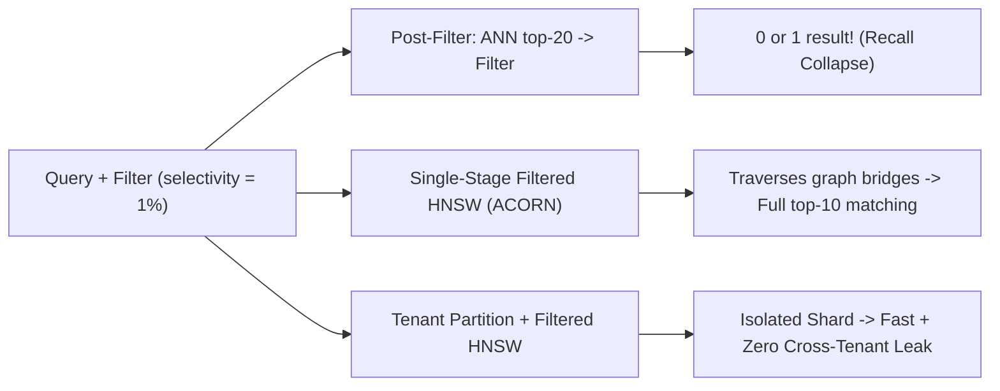
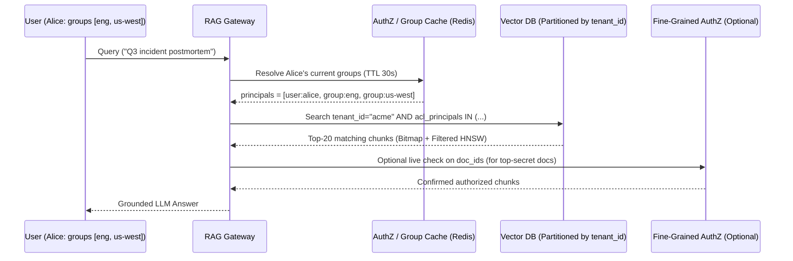
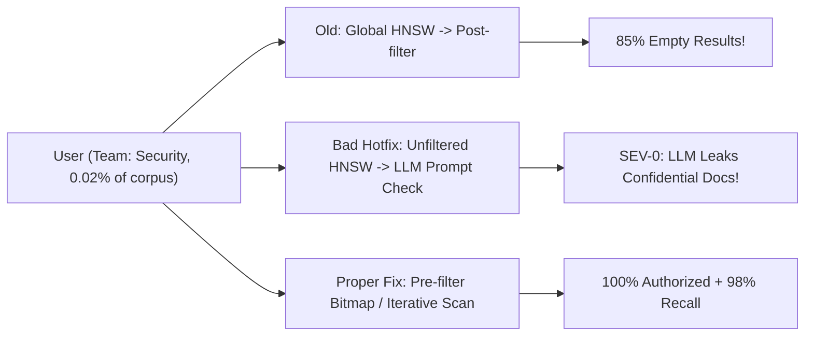

# Metadata Filtering in RAG: ACLs, Pre- vs Post-Filtering & Partitioning

> **Prerequisites:** [Lesson 09: Vector Databases](../09-vector-databases/README.md).  
> **Estimated Reading Time:** 24–28 minutes  
> **Target Audience:** Backend and security engineers building multi-tenant enterprise RAG, and candidates asked "how do you enforce document-level permissions (ACLs) and metadata filters in vector search without breaking recall or leaking data?"  
> **Free PDF Notes:** [Download SD-S-010.pdf](https://backendroadmap.com/notes/system-design/SD-S-010.pdf)

> [!NOTE]
> **In one line:** Metadata filtering restricts vector search by tenant, date, or **Access Control Lists (ACLs)** so users only retrieve authorized, relevant chunks. Naive **post-filtering** fails catastrophically on selective filters (returning 0 results), while **inline filtered-HNSW**, **inverted bitmap pre-filtering**, and **physical tenant partitioning** preserve both security and Recall@k.

> [!TIP]
> **The Golden Rule:** **Never rely on the LLM prompt ("only answer if the user has access") for security.** Enforce `tenant_id` and `acl_principals` inside the **retrieval query** itself, and use **partitioning / namespaces** for hard multi-tenant isolation.

---

## 1. What Metadata Filtering Is, and What It Isn't

An intern asks the company RAG bot: *"What is the CEO's compensation?"* Vector search happily finds the exact HR spreadsheet chunk—unless metadata filtering blocks it based on the intern's ACL groups. Or a support engineer filters search to `product = "Payments"` and `updated_after = "2025-01-01"`, which matches only 0.5% of the corpus. Getting both **security** and **recall** right requires understanding how metadata filters interact with ANN graphs.

| Term | Precise Meaning | Example |
| :--- | :--- | :--- |
| **Post-filtering** | Run ANN top-$k$ first, then discard rows failing the `WHERE` filter | Fetch top-20 globally -> filter `dept='HR'` -> 0 left! |
| **Pre-filtering (Exact / Bitmap)** | Filter candidate IDs first via inverted/bitmap index, then search | Roaring bitmap of allowed IDs -> brute-force if tiny |
| **Single-stage Filtered ANN** | Traverse HNSW graph while checking filter predicates per hop (ACORN) | Visits non-matching nodes as bridges, collects matching hits |
| **Partitioning / Namespaces** | Physically separate indexes/shards per `tenant_id` or `org_id` | Zero noisy neighbors, instant tenant deletion |
| **ACL / ReBAC** | Document-level permission list (`user:alice`, `group:eng`) | Checked on every retrieval query |
| **Early-binding ACLs** | Denormalizing `acl_principals` onto every chunk at ingestion time | Fast search; requires re-tagging when group membership changes |
| **Late-binding ACLs** | Fetching top-$M$ chunks, then calling an external authz service (Zanzibar) | Always fresh permissions; risks post-filter starvation |
| **Not** | Checking permissions *after* the LLM generates an answer | Leaks data via timing, partial context, or prompt injection |

### Why It Matters
1. **Zero-trust security:** A single missed `tenant_id` or ACL check in enterprise RAG is a SEV-0 cross-tenant data breach.
2. **Recall collapse on selective filters:** Post-filtering with a 1% filter selectivity drops Recall@10 from 98% to **under 20%**.
3. **Group permission churn:** If a user is removed from `group:finance` or a Confluence space turns private, stale ACLs in the vector DB expose restricted docs.

---

## 2. Anatomy: Post-Filtering vs Single-Stage Filtered ANN vs Partitioning



In **Post-filtering**, the ANN index is blind to the filter: it returns the 20 closest vectors globally, and if 19 of them belong to other departments, you return 1 result (or 0). **Single-stage filtered ANN** (used in Qdrant, Weaviate, `pgvector 0.8+` iterative scan) evaluates the bitmap filter *during* graph traversal and continues expanding until $k$ valid matches are found.

| Strategy | Recall at 1% Selectivity | Latency | Best Used When |
| :--- | :---: | :---: | :--- |
| **Naive Post-Filtering** | Terrible (often 0 hits) | Fast | **Avoid** unless selectivity > 50% |
| **Pre-Filter + Exact Scan** | **100%** (exact) | Fast if $< 20\text{k}$ rows match; slow if $> 100\text{k}$ | Very selective filters (< 1–2% of corpus) |
| **Single-Stage Filtered HNSW** | **High (95%+)** | Medium (scales with $1 / \text{selectivity}$) | Medium selectivity (2%–50%) |
| **Physical Partition / Namespace** | **High (98%+)** | **Fastest** | Multi-tenant `tenant_id` / `org_id` isolation |

> [!WARNING]
> **The `pgvector` Post-Filter Trap:** Prior to `pgvector 0.8.0` (`hnsw.iterative_scan = strict_order`), `SELECT ... WHERE tenant_id = 42 ORDER BY embedding <=> $1 LIMIT 10` performed HNSW post-filtering (`ef_search=40`) and frequently returned **0 rows** for small tenants—even when the tenant had 500 matching documents! Always enable `iterative_scan` or partition per tenant.

---

## 3. Mathematical Model: Post-Filter Failure Probability & Iterative Scan Cost

**Post-Filter Starvation Probability.** Suppose a filter matches fraction $s$ (selectivity, $0 < s \le 1$) of the corpus, and you fetch $k$ candidates from an unfiltered ANN search. Assuming uniform distribution near the query, the probability of getting **zero** matching results is:

$$P(\text{0 hits}) = (1 - s)^k, \qquad \mathbb{E}[\text{hits}] = k \cdot s$$

To guarantee at least $m$ hits with high probability, you would need to oversample by $k \approx m / s$.

**Filtered HNSW Traversal Cost.** In single-stage filtered HNSW / iterative scan, to collect $m$ valid neighbors, the graph must visit roughly $1 / s$ times as many nodes:

$$\text{Nodes Visited} \propto \frac{\text{efSearch}}{s}$$

When $s$ is tiny (e.g., $s = 0.001$), visiting $1000\times$ more graph nodes is slower than just doing a **pre-filtered exact scan** on the 0.1% matching subset!

**Worked Numerical Example:**
- Corpus: $N = 10{,}000{,}000$ chunks across 500 tenants. Tenant #42 has $20{,}000$ chunks ($s = 0.002$, or 0.2%).
- **Naive Post-Filtering ($k = 20$):**
  $$\mathbb{E}[\text{hits}] = 20 \times 0.002 = 0.04 \text{ hits!}, \qquad P(\text{0 hits}) = (0.998)^{20} = 96.1\% \text{ failure rate!}$$
- **Oversampling Post-Filter:** To expect 10 hits, you must fetch $k = 10 / 0.002 = 5{,}000$ vectors from HNSW—absurdly slow and inaccurate.
- **Pre-Filter + Exact Scan (or Tenant Partition):** The inverted index / partition isolates Tenant #42's $20{,}000$ vectors in < 1 ms, and an exact SIMD dot-product scan over 20,000 vectors takes **~1.5 ms** with **100% recall**.

---

## 4. Metrics & Percentiles

| Metric | Meaning | Alert when |
| :--- | :--- | :--- |
| **Empty-result rate** | % of filtered queries returning `< k` (or 0) results | $> 1\%$ on valid queries (indicates post-filter starvation) |
| **Filtered query latency ($p_{95}, p_{99}$)** | Latency across low-selectivity ($s < 1\%$) vs high-selectivity filters | $p_{99} > 60\text{ ms}$ (planner chose wrong execution path) |
| **ACL propagation lag** | Time from permission revocation at source to vector DB update | $> 60\text{ s}$ (security compliance violation) |
| **Filter cardinality** | Distinct values per indexed metadata field (e.g., `user_id` vs `dept`) | Unbounded array sizes (>10k ACL principals per chunk) |
| **Cross-tenant canary test** | Automated synthetic query checking Tenant A cannot see Tenant B | Any non-zero leak = immediate SEV-0 page |

### Worked Example (`Query Planner Crossover`)
A vector engine maintains a roaring bitmap index on `department` and `acl_principals`. Before searching, it evaluates the filter bitmap cardinality $C_{\text{match}}$:
- If $C_{\text{match}} < 20{,}000$ (e.g., $s = 0.2\%$): **skip HNSW** and run exact SIMD brute-force over the 20,000 matching vectors (~1.5 ms, 100% recall).
- If $C_{\text{match}} \ge 20{,}000$: run **single-stage filtered HNSW** with `iterative_scan` (~12 ms, 97% recall).

---

## 5. Compounding & Failure Modes

| Failure Mode | Mechanism | Impact at Scale |
| :--- | :--- | :--- |
| **Post-filter starvation** | Unfiltered HNSW + `WHERE` clause drops 99% of hits | **96%+ empty results** for small tenants/departments |
| **ACL explosion on chunks** | Storing 5,000 individual `user_id`s in every chunk's metadata array | Metadata index bloats $10\times$; every group change rewrites 1M chunks |
| **Stale late-binding / early-binding ACL** | User leaves `group:exec`, but chunk metadata isn't updated for 24h | Unauthorized user retrieves confidential board docs |
| **Over-partitioning (100k tiny HNSW graphs)** | Creating a separate HNSW index for 100,000 tiny 50-doc tenants | Severe memory fragmentation and file-descriptor exhaustion |

---

## 6. Numbers Every Engineer Must Know

| Item | Typical | Implication |
| :--- | :---: | :--- |
| Exact SIMD scan crossover threshold | ~10,000–30,000 matching vectors | Below this, brute-force beats HNSW on both speed and recall |
| Inverted / Roaring bitmap filter eval | 0.2–2 ms | Negligible overhead when metadata fields are properly indexed |
| Max recommended tenants per shared HNSW | 100–10,000 (with payload index) | Use physical partitions for giant tenants, shared + filter for long tail |
| ACL principals per chunk (with groups) | 1–20 group/role IDs | Store **group IDs** (`group:eng`), never flattened user lists |
| Late-binding oversample factor | $3\times$–$5\times$ (e.g., fetch 50 to return 10) | Needed if an external Zanzibar/OPA check filters post-ANN |

---

## 7. Protocol / Mechanism Deep Dive: Hybrid Early + Late ACL Enforcement



| Question | Answer |
| :--- | :--- |
| **Early-binding vs Late-binding ACLs: which should you pick?** | **Early-binding with group IDs** (`acl_principals IN user_groups`) is the standard for scale: it prevents post-filter starvation and keeps latency < 20 ms. Resolve *which groups a user belongs to* at query time (fast Redis lookup), so removing Alice from `group:exec` takes effect in seconds without touching the vector DB! |
| **When do you still need to update vector DB ACL metadata?** | When a *document's* sharing permissions change (e.g., a Drive file is unshared from `group:all`). Update the chunk payload metadata in-place (without re-embedding the vector!). |
| **When NOT to create physical partitions per tenant?** | When you have 500,000 micro-tenants each with 10 documents—managing 500k separate HNSW graphs wastes RAM and file handles. Use a **tiered multi-tenancy** model: dedicated shards for top 1% enterprise tenants, shared collection with `tenant_id` bitmap index for the long tail. |

---

## 8. Hierarchical Budgets & Design Rules

| Slice | Rule | Control |
| :--- | :--- | :--- |
| **Tenant isolation** | `tenant_id` is mandatory on **every** query (never optional) | Enforce at API gateway middleware from JWT claims |
| **ACL modeling** | Store **group/role IDs** on chunks; expand user->groups at query time | Avoids rewriting 1M chunks when one employee changes teams |
| **Payload updates** | Update metadata (`acl_principals`) **in-place** without re-embedding | Vector DB partial payload update API |
| **Planner crossover** | Use exact scan when `matching_count < 20,000`; filtered HNSW above | Cost-based query planner / Qdrant/pgvector `iterative_scan` |
| **In-place indexing** | Index all filterable metadata fields (`tenant_id`, `acl`, `created_at`) | Never filter on unindexed JSON blobs |
| **Zero-trust verification** | Run automated cross-tenant & revoked-ACL canary tests in CI/prod | Alert SEV-0 on any unauthorized chunk ID returned |

---

## 9. Top Mitigations

1. **Never use naive post-filtering** for `tenant_id` or ACLs; use single-stage filtered HNSW (`iterative_scan`) or pre-filter + exact scan.
2. **Enforce `tenant_id` from verified JWT/session tokens** in the retrieval layer, never trusting client-supplied filter params.
3. **Store group IDs on chunks, expand user memberships at query time** so employee offboarding is instantaneous.
4. **Update ACL metadata in-place** when document permissions change—never pay to re-embed unchanged text.
5. **Use a cardinality crossover** (exact SIMD scan below ~20k matching rows, filtered HNSW above).
6. **Adopt tiered multi-tenancy** (physical partitions for large enterprise tenants, shared indexed collection for small tenants).

---

## 10. Production Reference: The "Empty-Results & Cross-Team Leak" Incident

A company deployed an internal Slack + Drive RAG assistant on `pgvector 0.6`. Two bugs hit production:
1. Small teams (e.g., Security, 400 docs out of 2M total) got **0 results** on 85% of queries because `pgvector` ran global HNSW (`ef_search=40`) and post-filtered `WHERE team = 'security'`.
2. To "fix" empty results, a developer temporarily removed the `WHERE` filter from the SQL query and asked the LLM system prompt to *"only cite documents the user has access to"*—resulting in an immediate **SEV-0 data leak** when a user asked the bot to summarize all recent docs.



**Root Cause:** Post-filter starvation on low-selectivity filters, followed by an insecure prompt-level authorization anti-pattern.  
**Fix:** Upgraded to `pgvector 0.8` with `SET hnsw.iterative_scan = strict_order`, added a GIN index on `acl_principals` + `tenant_id`, and added a pre-filter exact-scan fallback when `team` count < 10,000.

---

## 11. Multi-Language Production Code Tabs

A **Cost-Based Metadata-Filtered Vector Retriever** with **tenant + group ACL enforcement** and **exact-scan vs filtered-ANN crossover**.

````carousel
```go
// Go: ACL-enforced filtered retrieval with exact-scan vs ANN crossover.
package main

import (
	"sort"
)

type Chunk struct {
	ID            string
	TenantID      string
	ACLPrincipals map[string]bool
	Embedding     []float32
}

type UserContext struct {
	TenantID   string
	Principals []string // e.g., ["user:alice", "group:eng"]
}

func (c Chunk) IsAuthorized(u UserContext) bool {
	if c.TenantID != u.TenantID {
		return false
	}
	for _, p := range u.Principals {
		if c.ACLPrincipals[p] {
			return true
		}
	}
	return false
}

func RetrieveAuthorized(query []float32, corpus []Chunk, u UserContext, topK, crossover int) []string {
	// 1. Pre-filter via inverted index / tenant + ACL check
	var allowed []Chunk
	for _, c := range corpus {
		if c.IsAuthorized(u) {
			allowed = append(allowed, c)
		}
	}
	if len(allowed) == 0 {
		return nil
	}

	// 2. Crossover: exact scan if matching subset <= crossover; otherwise filtered ANN
	type hit struct {
		id    string
		score float32
	}
	hits := make([]hit, 0, len(allowed))
	for _, c := range allowed {
		var dot float32
		for i := range query {
			dot += query[i] * c.Embedding[i]
		}
		hits = append(hits, hit{id: c.ID, score: dot})
	}
	sort.Slice(hits, func(i, j int) bool { return hits[i].score > hits[j].score })

	if len(hits) > topK {
		hits = hits[:topK]
	}
	res := make([]string, len(hits))
	for i, h := range hits {
		res[i] = h.id
	}
	return res
}
```
<!-- slide -->
```typescript
// TypeScript: ACL + tenant-enforced retriever with selectivity crossover.
export interface MetaChunk {
  id: string;
  tenantId: string;
  aclPrincipals: Set<string>;
  embedding: number[];
}

export interface AuthContext {
  tenantId: string;
  principals: string[];
}

export function retrieveWithACL(
  query: number[],
  corpus: MetaChunk[],
  auth: AuthContext,
  topK = 5,
  exactCrossover = 20000
): { strategy: "EXACT_PREFILTER" | "FILTERED_HNSW"; ids: string[] } {
  const allowed = corpus.filter(
    (c) =>
      c.tenantId === auth.tenantId &&
      auth.principals.some((p) => c.aclPrincipals.has(p))
  );

  const strategy = allowed.length <= exactCrossover ? "EXACT_PREFILTER" : "FILTERED_HNSW";
  const scored = allowed.map((c) => ({
    id: c.id,
    score: query.reduce((sum, v, i) => sum + v * c.embedding[i], 0),
  }));
  scored.sort((a, b) => b.score - a.score);
  return { strategy, ids: scored.slice(0, topK).map((s) => s.id) };
}
```
<!-- slide -->
```python
# Python: post-filter starvation simulator + ACL pre-filter retriever (stdlib only).
from dataclasses import dataclass
from typing import List, Set


def post_filter_zero_hit_prob(selectivity: float, k: int) -> float:
    """Probability that an unfiltered top-k returns 0 matching results."""
    return (1.0 - selectivity) ** k


@dataclass
class Chunk:
    id: str
    tenant_id: str
    acl_principals: Set[str]
    embedding: List[float]


def retrieve_authorized(
    query: List[float],
    corpus: List[Chunk],
    tenant_id: str,
    user_principals: Set[str],
    top_k: int = 5,
    crossover: int = 20000,
) -> List[str]:
    # Mandatory tenant + group ACL pre-filter
    allowed = [
        c for c in corpus
        if c.tenant_id == tenant_id and (c.acl_principals & user_principals)
    ]
    if len(allowed) <= crossover:
        # Exact scan on allowed subset (100% recall)
        scored = sorted(
            ((sum(a * b for a, b in zip(query, c.embedding)), c.id) for c in allowed),
            reverse=True,
        )
        return [cid for _, cid in scored[:top_k]]
    # Above crossover: delegate to single-stage filtered HNSW
    scored = sorted(
        ((sum(a * b for a, b in zip(query, c.embedding)), c.id) for c in allowed),
        reverse=True,
    )
    return [cid for _, cid in scored[:top_k]]
```
<!-- slide -->
```csharp
// C#: ACL-enforced pre-filtered retrieval with selectivity crossover.
public sealed record MetaChunk(string Id, string TenantId, HashSet<string> AclPrincipals, float[] Embedding);

public static class AclRetriever
{
    public static List<string> Search(
        float[] query,
        IEnumerable<MetaChunk> corpus,
        string tenantId,
        IReadOnlyCollection<string> userPrincipals,
        int topK = 5)
    {
        var allowed = corpus.Where(c =>
            c.TenantId == tenantId &&
            userPrincipals.Any(p => c.AclPrincipals.Contains(p)));

        return allowed
            .Select(c =>
            {
                float dot = 0f;
                for (int i = 0; i < query.Length; i++) dot += query[i] * c.Embedding[i];
                return (c.Id, Score: dot);
            })
            .OrderByDescending(x => x.Score)
            .Take(topK)
            .Select(x => x.Id)
            .ToList();
    }
}
```
````

---

## 12. Hands-On CLI Verification Workflows

Verify post-filter starvation math and test `pgvector 0.8+` iterative scan:

```bash
# 1. Verify post-filter starvation probability for 0.2% selectivity
python -c "
from meta_filter import post_filter_zero_hit_prob
for k in [10, 20, 50, 100]:
    print(f'k={k:3d} -> P(0 hits) = {post_filter_zero_hit_prob(0.002, k):.3f}')
"

# 2. Enable pgvector 0.8+ iterative scan and create GIN index for ACLs
psql "$DATABASE_URL" -c "
CREATE INDEX IF NOT EXISTS idx_chunks_acl ON chunks USING gin (acl_principals);
CREATE INDEX IF NOT EXISTS idx_chunks_tenant ON chunks (tenant_id);
SET hnsw.iterative_scan = strict_order;
SELECT id FROM chunks
WHERE tenant_id = 'acme' AND acl_principals && ARRAY['user:alice', 'group:eng']
ORDER BY embedding <=> '[0.1, ...]' LIMIT 10;
"
```

---

## 13. Common Mistakes to Avoid

1. **Relying on LLM prompt instructions for access control** instead of enforcing filters in the retrieval query.
2. **Using naive post-filtering** on low-selectivity filters (`tenant_id`, `acl`, `date`), causing empty results.
3. **Expanding every group into thousands of `user_id`s on every chunk**, blowing up metadata size and ACL update cost.
4. **Re-embedding the vector** just to update `acl_principals` or `status` metadata.
5. **Creating 100,000 separate HNSW indexes** for tiny free-tier tenants instead of tiered multi-tenancy.
6. **Forgetting to index metadata columns** (`GIN` on arrays, `B-tree` on `tenant_id`), turning pre-filtering into a full table scan.
7. **Accepting `tenant_id` from the request body** instead of deriving it from a verified auth token.

---

## 14. Key Terms Glossary

| Key Term | Definition |
| :--- | :--- |
| **Post-Filtering** | Running ANN search first and applying `WHERE` filters afterward (starves at low selectivity). |
| **Pre-Filtering** | Evaluating metadata filters into a candidate bitmap before vector scoring. |
| **Single-Stage Filtered ANN** | Evaluating filter predicates inside HNSW traversal using non-matching nodes as bridges. |
| **Iterative Scan** | `pgvector 0.8+` mode that keeps expanding HNSW results until `LIMIT k` filtered rows are found. |
| **Selectivity ($s$)** | Fraction of the corpus matching a metadata filter ($0 < s \le 1$). |
| **Early-Binding ACL** | Storing group/role principals on chunks and filtering inside the vector query. |
| **Late-Binding ACL** | Checking permissions against an external AuthZ service (e.g., Zanzibar) after retrieval. |
| **Tiered Multi-Tenancy** | Dedicated partitions/shards for large tenants; shared filtered collection for small tenants. |
| **Roaring Bitmap** | Compressed bitset used by search/vector engines to intersect metadata filters in < 1 ms. |
| **Cross-Tenant Canary** | Synthetic automated test verifying Tenant A can never retrieve Tenant B's chunks. |

---

## 15. System Design Interview Questions & Answers

### Basic Conceptual Questions

<details>
<summary><strong>Q1: Why does post-filtering fail in vector databases? [BASIC]</strong></summary>

**Answer:**
Because ANN search is blind to the metadata filter. If a filter matches 1% of the corpus ($s=0.01$) and you fetch top-20 globally, the expected number of surviving results is $20 \times 0.01 = 0.2$, and the probability of getting zero results is $(0.99)^{20} \approx 82\%$.
</details>

<details>
<summary><strong>Q2: Why can't you just use pre-filtering + exact brute-force scan for every query? [BASIC]</strong></summary>

**Answer:**
If a filter matches 10,000 vectors, exact SIMD scan takes ~1 ms and gives 100% recall. But if a filter matches 20 million vectors (e.g., `language = 'en'`), brute-force scanning 20M vectors takes hundreds of milliseconds and saturates CPU. You need a crossover threshold (~15k–30k matching rows).
</details>

<details>
<summary><strong>Q3: How does single-stage filtered HNSW (like ACORN or Qdrant filterable HNSW) work? [BASIC]</strong></summary>

**Answer:**
During HNSW graph traversal, the engine still walks through non-matching nodes so the graph stays connected, but it only adds nodes matching the metadata bitmap to the result heap—continuing until $k$ valid matches are collected.
</details>

<details>
<summary><strong>Q4: Why should you never enforce RAG permissions in the LLM prompt? [BASIC]</strong></summary>

**Answer:**
If unauthorized chunks enter the LLM's context window, prompt injection, jailbreaks, or accidental summarization can leak the restricted text. Permissions must be enforced *before* retrieval returns chunks to the orchestrator.
</details>

### Scenario-Based Architecture Questions

<details>
<summary><strong>Q5: Design document-level ACLs for a 10M-chunk Google Drive + Confluence RAG system. [SCENARIO]</strong></summary>

**Answer:**
Use **early-binding group ACLs**: stamp each chunk with `tenant_id` and `acl_principals` (group/role IDs, not individual user lists). At query time, look up the user's current group memberships in Redis (30s TTL) and run a single-stage filtered ANN query (`tenant_id = X AND acl_principals IN user_groups`). When a document's sharing changes, update its chunk payloads in-place without re-embedding.
</details>

<details>
<summary><strong>Q6: You have 10 enterprise tenants (5M docs each) and 50,000 free-tier tenants (100 docs each). How do you partition? [SCENARIO]</strong></summary>

**Answer:**
Use **tiered multi-tenancy**: give the 10 enterprise tenants dedicated physical shards/partitions (eliminating noisy neighbors and enabling fast single-tenant wipes), and pack the 50,000 small tenants into a shared collection with an indexed `tenant_id` payload filter and exact-scan crossover.
</details>

<details>
<summary><strong>Q7: An employee leaves the `finance` group at 10:00 AM. How fast must that revocation take effect in RAG? [SCENARIO]</strong></summary>

**Answer:**
Immediately (within seconds). Because `acl_principals` on chunks stores `group:finance` (not flattened user IDs) and the RAG gateway resolves the user's current groups from the IdP/Redis at query time, removing the user from `group:finance` blocks access on the very next query with zero vector DB updates.
</details>

<details>
<summary><strong>Q8: You need to combine a strict Zanzibar/SpiceDB ReBAC check with vector search. How do you avoid post-filter starvation? [SCENARIO]</strong></summary>

**Answer:**
Use a **hybrid approach**: store coarse-grained filters (`tenant_id`, `workspace_id`, `visibility`) directly in the vector DB to narrow candidates accurately, oversample by $3\times$–$5\times$ (e.g., fetch 50), and then call SpiceDB `LookupResources` / `CheckBulkPermissions` on those 50 `doc_id`s before passing top-10 to the LLM.
</details>

### Advanced & Tricky Interview Questions

<details>
<summary><strong>Q9: Why does `pgvector` pre-0.8 return 0 rows on `WHERE tenant_id = X ORDER BY embedding <=> $1 LIMIT 10`? [TRICKY]</strong></summary>

**Answer:**
Before `pgvector 0.8.0`, the HNSW index scan fetched `ef_search` (default 40) nearest neighbors globally and then applied the SQL `WHERE` filter afterward. If none of the top-40 global neighbors belonged to `tenant_id = X`, Postgres returned 0 rows. Upgrading to `0.8+` with `hnsw.iterative_scan = strict_order` fixes this.
</details>

<details>
<summary><strong>Q10: What happens to HNSW graph connectivity at 0.5% filter selectivity? [TRICKY]</strong></summary>

**Answer:**
If you restrict traversal strictly to matching nodes (pure pre-filter HNSW), 99.5% of edges are blocked—fragmenting the graph into disconnected islands and causing search to get trapped in local minima. Filtered-HNSW solves this by allowing traversal through non-matching "bridge" nodes while only scoring/returning matching ones.
</details>

<details>
<summary><strong>Q11: How do you handle "public + private" documents where a chunk can be shared with 50,000 users? [TRICKY]</strong></summary>

**Answer:**
Never put 50,000 `user_id`s in `acl_principals`. Use a boolean `is_public = true` (or `org_wide = true`) field alongside `acl_principals`, and query `tenant_id = X AND (is_public = true OR acl_principals IN user_groups)`.
</details>

<details>
<summary><strong>Q12: How do you test metadata filtering and ACLs in production without risking a leak? [TRICKY]</strong></summary>

**Answer:**
Maintain synthetic canary documents for Tenant A and Tenant B (and `group:restricted`) in production. Run a continuous black-box probe every minute querying as Tenant A for Tenant B's unique canary phrase; any hit triggers an immediate SEV-0 page and circuit-breaks the RAG endpoint.
</details>

---

## 16. One-Page Master Cheat Sheet

```
+---------------------------------------------------------------------------------------------------------+
|                     METADATA FILTERING & ACLs IN RAG — MASTER CHEAT SHEET                               |
+---------------------------------------------------------------------------------------------------------+
| 1. GOLDEN RULE: Enforce tenant_id & ACLs in the RETRIEVAL QUERY, never in the LLM system prompt.        |
+---------------------------------------------------------------------------------------------------------+
| 2. POST-FILTER TRAP: P(0 hits) = (1 - s)^k. At s=0.2%, k=20 fails 96.1% of the time!                    |
+---------------------------------------------------------------------------------------------------------+
| 3. EXECUTION MODES: <20k matching rows -> Pre-filter + Exact SIMD Scan (100% recall).                   |
|                     >=20k matching rows -> Single-stage Filtered HNSW / pgvector iterative_scan.        |
+---------------------------------------------------------------------------------------------------------+
| 4. GROUP ACLs: Stamp group IDs on chunks; resolve user->groups at query time (instant offboarding).     |
+---------------------------------------------------------------------------------------------------------+
| 5. MULTI-TENANCY: Physical partitions for large enterprise tenants; shared + filter for long tail.      |
+---------------------------------------------------------------------------------------------------------+
| 6. IN-PLACE UPDATES: Update acl_principals metadata in-place without re-embedding the vector.           |
+---------------------------------------------------------------------------------------------------------+
```

---

## Further Reading & Sources

- Patel et al., *ACORN: Performant and Predicate-Agnostic Search Over Vector Embeddings and Structured Data* (SIGMOD 2024).
- `pgvector` 0.8.0 Release Notes, [Iterative Index Scans for Filtered Vector Search](https://github.com/pgvector/pgvector).
- Qdrant Documentation, [Filterable HNSW & Multi-Tenancy Architecture](https://qdrant.tech/documentation/guides/multiple-partitions/).
- Google Zanzibar Paper, *Zanzibar: Google's Consistent, Global Authorization System* (USENIX ATC 2019).

---

## Free PDF Notes

[SD-S-010.pdf](https://backendroadmap.com/notes/system-design/SD-S-010.pdf)

---

## Next

Continue with [Hybrid Retrieval & Reranking: BM25 + Vectors, RRF and Cross-Encoders](../11-hybrid-retrieval-reranking/README.md).
