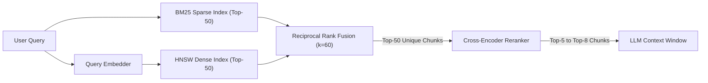
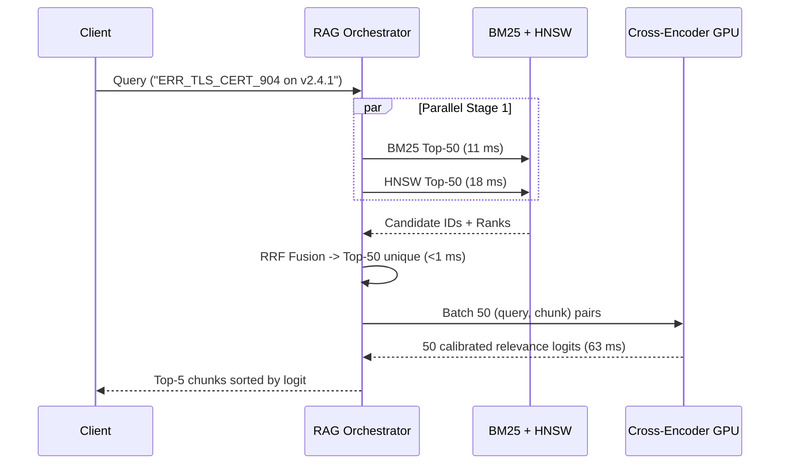
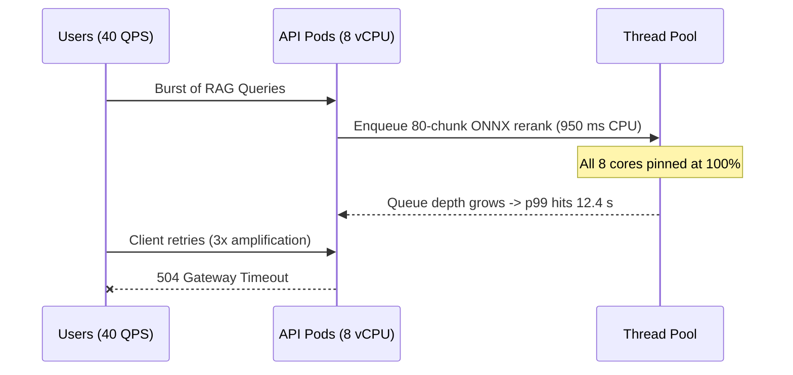

# Hybrid Retrieval & Reranking: BM25 + Vectors, RRF and Cross-Encoders

> **Prerequisites:** [Lesson 10: Metadata Filtering in RAG](../10-metadata-filtering-in-rag/README.md) · [Lesson 07: Vector Indexes: HNSW, IVF, PQ](../09-vector-databases/README.md).  
> **Estimated Reading Time:** 24–28 minutes  
> **Target Audience:** Backend and ML platform engineers building production RAG pipelines, and candidates asked "why isn't pure vector search enough, and how do you combine keyword search with semantic search?"  
> **Free PDF Notes:** [Download SD-S-011.pdf](https://backendroadmap.com/notes/system-design/SD-S-011.pdf)

> [!NOTE]
> **In one line:** **Hybrid retrieval** runs sparse lexical search (BM25) and dense vector search (bi-encoder ANN) in parallel, merges their candidate lists via **Reciprocal Rank Fusion (RRF)** without needing calibrated scores, and then refines the top-$K$ candidates with a **cross-encoder reranker** that attends jointly across query and document tokens for maximum precision.

> [!TIP]
> **The Golden Rule:** Never feed raw bi-encoder top-5 directly to an LLM in high-stakes RAG. Retrieve wide ($K \approx 50\text{–}100$ per retriever), fuse with RRF ($k = 60$), and cross-encoder rerank down to the final $5\text{–}10$ chunks within a strict 80–150 ms rerank budget.

---

## 1. What Hybrid Retrieval & Reranking Is, and What It Isn't

Consider an enterprise support bot asked: *"Why does error code `ERR_TLS_CERT_904` happen on SDK v2.4.1?"* A pure dense embedding model compresses the entire query into a single 1536-dimensional vector. It understands "TLS certificate error on SDK" semantically, but it routinely blurs `ERR_TLS_CERT_904` with `ERR_TLS_HANDSHAKE_401` and `v2.4.1` with `v2.3.0`. Conversely, pure BM25 matches `ERR_TLS_CERT_904` and `v2.4.1` with surgical precision, yet misses a troubleshooting doc titled *"X.509 validation failures during client upgrade"* because it uses none of the query's exact words.

| Term | Precise Meaning | Example |
| :--- | :--- | :--- |
| **Sparse Retrieval (BM25)** | Inverted-index lexical scoring based on term frequency, inverse document frequency, and length normalization | Exact match on `ERR_TLS_CERT_904`, SKUs, UUIDs, acronyms |
| **Dense Retrieval (Bi-Encoder)** | Independent encoding of query and document into vectors scored by cosine/dot-product via ANN (HNSW/IVF) | Matches *"client upgrade X.509 failure"* to *"TLS cert error"* |
| **Hybrid Retrieval** | Parallel execution of sparse + dense retrieval followed by rank or score fusion | BM25 top-50 + HNSW top-50 merged into 80 unique chunks |
| **Reciprocal Rank Fusion (RRF)** | Scoreless rank-based fusion summing $1/(k + r)$ across retrievers | Combining uncalibrated BM25 scores (14.2) and cosine (0.83) |
| **Cross-Encoder Reranker** | Transformer that ingests `[CLS] query [SEP] doc [SEP]` jointly with full cross-attention | Re-scores top-50 fused candidates down to top-5 |
| **Not** | A replacement for good chunking or metadata filtering | Garbage chunks reranked are still garbage |

### Why It Matters
1. Pure vector search consistently underperforms on exact identifiers, product codes, rare proper nouns, and Boolean-style constraints—the exact queries enterprise users ask most.
2. Bi-encoders must compress all meaning into one vector *before* seeing the query, creating an information bottleneck; cross-encoders remove that bottleneck at the cost of $O(K)$ forward passes.
3. Two-stage retrieval (fast wide recall $\rightarrow$ slow narrow precision) is the foundational pattern behind modern web search, e-commerce, and production RAG.

---

## 2. Anatomy: Two-Stage Hybrid Retrieval Pipeline



In Stage 1 (Recall), BM25 and dense ANN run concurrently. Because their raw scores live on incompatible scales (BM25 is unbounded $[0, \infty)$; cosine similarity is $[-1, 1]$), **RRF** ignores raw scores and fuses purely by rank position. In Stage 2 (Precision), a cross-encoder evaluates each `(query, chunk)` pair with full token-to-token self-attention, catching subtle negations, version mismatches, and causal relationships that bi-encoders miss.

| Stage | Latency Budget | Candidate Count | Primary Goal | Compute Profile |
| :--- | :--- | :--- | :--- | :--- |
| **Sparse (BM25)** | 5–15 ms | Top 50–100 | Exact lexical recall | CPU + RAM inverted index |
| **Dense (HNSW)** | 10–25 ms | Top 50–100 | Semantic paraphrase recall | Vector index + 1 query embed |
| **RRF Fusion** | < 1 ms | 60–150 unique | Scale-invariant merging | In-memory hash map |
| **Cross-Encoder** | 40–120 ms | Top 50 $\rightarrow$ Top 5 | Token-level precision | GPU batch inference (FP16/INT8) |

> [!WARNING]
> **The #1 Trap: Reranking Too Many Candidates on CPU.** Running a 300M-parameter cross-encoder (e.g., `bge-reranker-large`) on 200 chunks on CPU takes 1.5–3.0 seconds, blowing your entire RAG latency SLO. Always cap the reranker input at $K \le 50$, batch pairs in a single GPU forward pass, or use a distilled 6-layer MiniLM reranker.

---

## 3. Mathematical Model: BM25, Cosine, RRF, and Linear Fusion

**BM25 Score.** For query $Q$ with terms $q_i$ and document $D$ of length $|D|$ against average corpus length $\text{avgdl}$:

$$\text{BM25}(D, Q) = \sum_{i=1}^{n} \text{IDF}(q_i) \cdot \frac{f(q_i, D) \cdot (k_1 + 1)}{f(q_i, D) + k_1 \cdot \left(1 - b + b \cdot \frac{|D|}{\text{avgdl}}\right)}$$

Typical defaults are $k_1 = 1.5$ (term-frequency saturation) and $b = 0.75$ (document-length normalization).

**Reciprocal Rank Fusion (RRF).** Given a set of retrievers $R$ and rank $r_i(d) \in \{1, 2, \dots\}$ of document $d$ in retriever $i$:

$$\text{RRF}(d) = \sum_{i \in R} \frac{w_i}{k + r_i(d)}$$

where $k = 60$ is the smoothing constant (from Cormack et al., 2009) that prevents rank-1 outliers from dominating, and $w_i$ is an optional retriever weight (default $w_i = 1$).

**Convex Linear Combination ($\alpha$-blending).** When using normalized scores instead of ranks:

$$S_{\text{hybrid}}(d) = \alpha \cdot \tilde{S}_{\text{dense}}(d) + (1 - \alpha) \cdot \tilde{S}_{\text{sparse}}(d), \quad \alpha \in [0, 1]$$

Min-max normalization ($\tilde{s} = \frac{s - s_{\min}}{s_{\max} - s_{\min}}$) is fragile when $s_{\max} \approx s_{\min}$ (a flat query); RRF avoids this entirely.

### Worked Numerical Example
Suppose $k = 60$, equal weights $w_{\text{bm25}} = w_{\text{vec}} = 1$, and three chunks appear at these ranks:
- **Chunk A:** BM25 rank 1, Vector rank 12
- **Chunk B:** BM25 rank 4, Vector rank 3
- **Chunk C:** Not in BM25 top-50, Vector rank 1

Calculating RRF scores:
- $\text{RRF}(A) = \frac{1}{60 + 1} + \frac{1}{60 + 12} = 0.01639 + 0.01389 = \mathbf{0.03028}$
- $\text{RRF}(B) = \frac{1}{60 + 4} + \frac{1}{60 + 3} = 0.01563 + 0.01587 = \mathbf{0.03150}$
- $\text{RRF}(C) = 0 + \frac{1}{60 + 1} = \mathbf{0.01639}$

**Result:** Chunk B wins overall ($0.03150 > 0.03028$) because both retrievers agree it is strong, whereas Chunk C—which ranked #1 in vector search alone—drops below both consensus candidates.

---

## 4. Metrics & Percentiles

| Metric | Meaning | Alert when |
| :--- | :--- | :--- |
| **Recall@50 (pre-rerank)** | Fraction of relevant chunks entering the reranker | $< 0.85$ (reranker cannot rescue missing docs) |
| **NDCG@5 (post-rerank)** | Position-weighted ranking quality of top-5 chunks | Drops $> 3\%$ after model/index change |
| **Reranker Latency $p_{95}$** | Time to score $K$ `(query, chunk)` pairs | $> 120\text{ ms}$ (threatens total TTFT SLO) |
| **Overlap Ratio** | $\frac{|D_{\text{bm25}} \cap D_{\text{vec}}|}{K}$ between sparse and dense lists | $> 0.85$ (one retriever is redundant) or $< 0.05$ |
| **Score Margin ($\Delta_{1,5}$)** | Difference between top-1 and top-5 reranker logits | Low variance across all candidates (noisy query) |
| **Zero-Hit BM25 Rate** | Queries returning 0 lexical matches | $> 15\%$ (tokenizer/stemmer mismatch) |

### Worked Example (`ERR_TLS_CERT_904` Troubleshooting)
A corpus has 2M engineering runbooks and support tickets.
- **Dense-only top-5:** Recall@5 = 0.40 (returns generic TLS docs; misses the exact error code patch note).
- **BM25-only top-5:** Recall@5 = 0.60 (finds exact error code, misses the root-cause architecture doc phrased as "certificate chain expiration").
- **Hybrid (BM25@50 + HNSW@50 $\rightarrow$ RRF $\rightarrow$ Cross-Encoder@5):** Recall@50 before rerank = 0.96; NDCG@5 after rerank = 0.91. Total retrieval + rerank $p_{95}$ latency = 94 ms (12 ms BM25 + 18 ms HNSW parallel, 1 ms RRF, 63 ms GPU batch cross-encoder on 50 chunks).

---

## 5. Compounding & Reranker Latency Scaling

Why does candidate count $K$ matter so much for cross-encoders? A bi-encoder embeds the query **once** ($O(1)$ neural pass) and compares vectors via HNSW in $O(\log N)$ dot products. A cross-encoder runs a full transformer forward pass for **every** candidate ($O(K \cdot L^2)$ attention where $L$ is token length).

| Rerank Depth $K$ | Pairs Scored | GPU (T4 FP16, batch=32) | CPU (8-core ONNX INT8) | Marginal Recall@5 Gain |
| :--- | :--- | :--- | :--- | :--- |
| **$K = 10$** | 10 | 18 ms | 190 ms | Baseline (+0.00) |
| **$K = 25$** | 25 | 34 ms | 460 ms | +0.07 NDCG@5 |
| **$K = 50$** | 50 | 63 ms | 910 ms | +0.11 NDCG@5 |
| **$K = 100$** | 100 | 122 ms | 1,810 ms | +0.12 NDCG@5 (diminishing) |
| **$K = 200$** | 200 | 240 ms | 3,600 ms | +0.12 NDCG@5 (wasted compute) |

The knee of the curve is **$K \in [30, 50]$**: beyond 50 candidates, marginal NDCG@5 flattens while GPU latency scales linearly.

---

## 6. Numbers Every Engineer Must Know

| Item | Typical | Implication |
| :--- | :--- | :--- |
| **RRF constant $k$** | 60 | Standard default; lower ($k=20$) rewards top-1 spikes more aggressively |
| **Stage-1 recall depth** | 50–100 per retriever | Large enough for high Recall@50 without saturating RRF |
| **Stage-2 rerank depth** | 25–50 candidates | Sweet spot for precision vs GPU batch latency |
| **Final LLM context chunks** | 5–8 chunks | Keeps prompt compact and avoids "lost in the middle" |
| **Bi-encoder query embed** | 8–20 ms | Amortized once per query |
| **BM25 inverted index query** | 5–15 ms | Sub-20 ms up to tens of millions of chunks in RAM/OS page cache |
| **Cross-encoder max tokens** | 512 tokens | Truncate or split long chunks so query + chunk fits in 512 |
| **GPU rerank batch latency** | 40–80 ms ($K=50$) | Requires FP16/BF16 batching on L4/T4/A10G |

---

## 7. Protocol / Mechanism Deep Dive: Bi-Encoder vs Cross-Encoder vs Late Interaction (ColBERT)



| Architecture | Document Precomputation | Query-Doc Interaction | Latency (50 docs) | Accuracy |
| :--- | :--- | :--- | :--- | :--- |
| **Bi-Encoder** | 1 vector per chunk | Single dot product | ~1 ms | Good |
| **Late Interaction (ColBERT)** | 1 vector per token (MaxSim) | Token-level MaxSim matrix | ~10–20 ms | Very Good |
| **Cross-Encoder** | None (raw text) | Full self-attention across all layers | ~60 ms (GPU) | Best |

**When NOT to use Hybrid + Reranking:**
- **Ultra-low-latency autocomplete (< 20 ms total):** Skip cross-encoder; use BM25 + bi-encoder with RRF only.
- **Purely structured / exact-ID lookups:** If users only query by `order_id` or `user_id`, use a primary-key DB lookup or metadata filter—not vector search or reranking.
- **Tiny corpora (< 500 short docs):** Full-context prompting or a fast BM25 scan beats multi-stage retrieval complexity.

---

## 8. Hierarchical Budgets & Design Rules

| Slice | Rule | Control |
| :--- | :--- | :--- |
| **End-to-End Retrieval SLO** | Total Stage 1 + Fusion + Stage 2 $\le 150\text{ ms}$ $p_{95}$ | Enforce per-stage `context.WithTimeout` |
| **Stage 1 (BM25 + Dense)** | Run concurrently; degrade gracefully if one times out | Return available retriever results if the other exceeds 40 ms |
| **Fusion Layer** | Use RRF ($k=60$) by default; tune $\alpha$ only with labeled eval set | Log both BM25 rank and Vector rank per chunk for debugging |
| **Reranker Input Cap** | Hard cap at $K = 50$ candidates, max 512 tokens/pair | Truncate tail of chunk if `len(query + chunk) > 512` |
| **Fallback Circuit Breaker** | If GPU reranker is unhealthy or $> 150\text{ ms}$, bypass Stage 2 | Fall back to RRF top-5 directly so RAG stays available |
| **Score Thresholding** | Filter out cross-encoder logits below a calibrated floor | Prevents hallucination when no retrieved chunk is relevant |

---

## 9. Top Mitigations

1. **Deduplicate near-identical chunks before reranking:** Overlapping sliding-window chunks waste reranker slots; deduplicate by `doc_id + overlapping span` or MinHash so top-50 has diverse passages.
2. **Preserve exact tokens in BM25 analyzers:** Disable aggressive stemming on code/ID fields; keep a `keyword` or whitespace+delimiter sub-field so `ERR_TLS_CERT_904` isn't mangled.
3. **Batch cross-encoder inference dynamically:** Group `(query, chunk)` pairs into a single padded tensor batch (e.g., batch size 32 or 50) on GPU with FP16/ONNX Runtime.
4. **Use a relevance score cutoff post-rerank:** Cross-encoders produce calibrated logits (or sigmoid probabilities in $[0, 1]$). Drop chunks $< 0.25$ and return "I don't have enough information" rather than feeding noise to the LLM.
5. **Distill large rerankers for latency-critical paths:** Distilling a 560M cross-encoder into a 6-layer MiniLM or `bge-reranker-base` cuts GPU latency by 3–4x with $< 1.5\%$ NDCG loss.
6. **Cache `(query_hash, top_k)` reranker results:** For repeated FAQ or support queries, caching the final reranked chunk IDs in Redis with a short TTL eliminates GPU load on hot queries.
7. **Apply metadata filters *before* Stage 1:** Always push tenant, ACL, and date filters into both BM25 and HNSW queries so top-50 slots aren't wasted on unauthorized documents.

---

## 10. Production Reference / War Story: The CPU Reranker Death Spiral

**Incident (SEV-1):** A SaaS knowledge-base assistant launched hybrid retrieval with `bge-reranker-large` on 8-vCPU API pods without a dedicated GPU inference service. During a Monday morning traffic spike (40 QPS), each request reranked 80 chunks on CPU.



**Root Cause:**
1. Reranker depth was set to $K = 80$ without a timeout or circuit breaker.
2. CPU-bound ONNX inference shared the same process/cores as the async HTTP event loop, starving health checks and causing Kubernetes to kill and restart pods in a cascade.

**Fix:**
1. Offloaded reranking to a dedicated GPU Triton/vLLM-style inference pool (FP16, batch=32) with a strict **100 ms timeout**.
2. Reduced Stage-2 input from $K = 80$ to $K = 40$, cutting GPU $p_{95}$ from 950 ms (CPU) to **48 ms (GPU)**.
3. Added a circuit breaker that falls back to **RRF top-5** if the reranker queue depth exceeds 64 or latency $> 100\text{ ms}$.

---

## 11. Multi-Language Production Code Tabs

````carousel
```go
// Go: Concurrent BM25 + Vector retrieval, RRF fusion, and circuit-broken reranking.
package main

import (
	"context"
	"fmt"
	"sort"
	"sync"
	"time"
)

type ScoredDoc struct {
	ID    string
	Text  string
	Score float64
}

func ReciprocalRankFusion(lists [][]ScoredDoc, k int) []ScoredDoc {
	scores := make(map[string]float64)
	texts := make(map[string]string)
	for _, list := range lists {
		for rank, doc := range list {
			scores[doc.ID] += 1.0 / float64(k+rank+1)
			texts[doc.ID] = doc.Text
		}
	}
	merged := make([]ScoredDoc, 0, len(scores))
	for id, s := range scores {
		merged = append(merged, ScoredDoc{ID: id, Text: texts[id], Score: s})
	}
	sort.Slice(merged, func(i, j int) bool { return merged[i].Score > merged[j].Score })
	return merged
}

func HybridRetrieve(ctx context.Context, query string, rerankFn func(context.Context, string, []ScoredDoc) ([]ScoredDoc, error)) []ScoredDoc {
	var wg sync.WaitGroup
	var bm25Res, vecRes []ScoredDoc
	wg.Add(2)
	go func() {
		defer wg.Done()
		bm25Res = []ScoredDoc{{ID: "A", Text: "ERR_TLS_CERT_904 fix"}, {ID: "B", Text: "SDK v2.4.1 TLS"}}
	}()
	go func() {
		defer wg.Done()
		vecRes = []ScoredDoc{{ID: "C", Text: "X.509 upgrade guide"}, {ID: "B", Text: "SDK v2.4.1 TLS"}}
	}()
	wg.Wait()

	fused := ReciprocalRankFusion([][]ScoredDoc{bm25Res, vecRes}, 60)
	if len(fused) > 50 {
		fused = fused[:50]
	}

	rCtx, cancel := context.WithTimeout(ctx, 100*time.Millisecond)
	defer cancel()
	if reranked, err := rerankFn(rCtx, query, fused); err == nil {
		return reranked
	}
	return fused // Graceful fallback to RRF if reranker times out
}

func main() {
	res := HybridRetrieve(context.Background(), "ERR_TLS_CERT_904", func(_ context.Context, _ string, docs []ScoredDoc) ([]ScoredDoc, error) {
		return docs, nil
	})
	fmt.Printf("Top doc: %s (%.5f)\n", res[0].ID, res[0].Score)
}
```
<!-- slide -->
```typescript
// TypeScript: Hybrid RRF fusion + bounded cross-encoder rerank with timeout fallback.
export interface Doc {
  id: string;
  text: string;
  score: number;
}

export function reciprocalRankFusion(lists: Doc[][], k = 60): Doc[] {
  const scores = new Map<string, number>();
  const texts = new Map<string, string>();

  for (const list of lists) {
    list.forEach((doc, idx) => {
      const prev = scores.get(doc.id) ?? 0;
      scores.set(doc.id, prev + 1 / (k + idx + 1));
      texts.set(doc.id, doc.text);
    });
  }

  return Array.from(scores.entries())
    .map(([id, score]) => ({ id, text: texts.get(id)!, score }))
    .sort((a, b) => b.score - a.score);
}

export async function hybridSearch(
  query: string,
  bm25Fn: (q: string) => Promise<Doc[]>,
  vectorFn: (q: string) => Promise<Doc[]>,
  rerankFn: (q: string, docs: Doc[], signal: AbortSignal) => Promise<Doc[]>,
  topK = 5
): Promise<Doc[]> {
  const [bm25Docs, vecDocs] = await Promise.all([bm25Fn(query), vectorFn(query)]);
  const fused = reciprocalRankFusion([bm25Docs, vecDocs], 60).slice(0, 50);

  const controller = new AbortController();
  const timer = setTimeout(() => controller.abort(), 100); // 100 ms rerank budget
  try {
    const reranked = await rerankFn(query, fused, controller.signal);
    return reranked.slice(0, topK);
  } catch {
    return fused.slice(0, topK); // Fallback to RRF on timeout/failure
  } finally {
    clearTimeout(timer);
  }
}
```
<!-- slide -->
```python
# Python 3.13: RRF + BM25/Dense simulation + Cross-Encoder budget guard.
from dataclasses import dataclass
from typing import Callable, Sequence


@dataclass(frozen=True)
class Chunk:
    chunk_id: str
    text: str
    score: float = 0.0


def reciprocal_rank_fusion(
    ranked_lists: Sequence[Sequence[Chunk]],
    k: int = 60,
    weights: Sequence[float] | None = None,
) -> list[Chunk]:
    """Fuse multiple ranked lists without score normalization."""
    w = weights if weights is not None else [1.0] * len(ranked_lists)
    scores: dict[str, float] = {}
    texts: dict[str, str] = {}

    for weight, lst in zip(w, ranked_lists, strict=True):
        for rank, chunk in enumerate(lst, start=1):
            scores[chunk.chunk_id] = scores.get(chunk.chunk_id, 0.0) + weight / (k + rank)
            texts[chunk.chunk_id] = chunk.text

    ordered = sorted(scores.items(), key=lambda kv: kv[1], reverse=True)
    return [Chunk(chunk_id=cid, text=texts[cid], score=sc) for cid, sc in ordered]


def hybrid_pipeline(
    query: str,
    bm25_hits: Sequence[Chunk],
    dense_hits: Sequence[Chunk],
    reranker: Callable[[str, list[Chunk]], list[Chunk]] | None = None,
    rerank_k: int = 50,
    final_k: int = 5,
    min_logit: float = 0.25,
) -> list[Chunk]:
    fused = reciprocal_rank_fusion([bm25_hits, dense_hits], k=60)[:rerank_k]
    if reranker is None:
        return fused[:final_k]
    reranked = reranker(query, fused)
    filtered = [c for c in reranked if c.score >= min_logit]
    return filtered[:final_k]
```
<!-- slide -->
```csharp
// C#: Parallel sparse/dense retrieval, RRF fusion, and timeout-protected reranker.
using System;
using System.Collections.Generic;
using System.Linq;
using System.Threading;
using System.Threading.Tasks;

public sealed record RetrievedChunk(string Id, string Text, double Score);

public static class HybridRetriever
{
    public static List<RetrievedChunk> ReciprocalRankFusion(
        IEnumerable<IReadOnlyList<RetrievedChunk>> lists, int k = 60)
    {
        var scores = new Dictionary<string, double>();
        var texts = new Dictionary<string, string>();

        foreach (var list in lists)
        {
            for (int i = 0; i < list.Count; i++)
            {
                var doc = list[i];
                scores[doc.Id] = scores.GetValueOrDefault(doc.Id) + 1.0 / (k + i + 1);
                texts[doc.Id] = doc.Text;
            }
        }

        return scores
            .OrderByDescending(kv => kv.Value)
            .Select(kv => new RetrievedChunk(kv.Key, texts[kv.Key], kv.Value))
            .ToList();
    }

    public static async Task<List<RetrievedChunk>> SearchAsync(
        string query,
        Func<string, Task<IReadOnlyList<RetrievedChunk>>> bm25,
        Func<string, Task<IReadOnlyList<RetrievedChunk>>> dense,
        Func<string, List<RetrievedChunk>, CancellationToken, Task<List<RetrievedChunk>>> rerank,
        int finalK = 5)
    {
        var t1 = bm25(query);
        var t2 = dense(query);
        await Task.WhenAll(t1, t2);

        var fused = ReciprocalRankFusion(new[] { t1.Result, t2.Result }, k: 60).Take(50).ToList();
        using var cts = new CancellationTokenSource(TimeSpan.FromMilliseconds(100));
        try
        {
            var reranked = await rerank(query, fused, cts.Token);
            return reranked.Take(finalK).ToList();
        }
        catch (OperationCanceledException)
        {
            return fused.Take(finalK).ToList(); // Fallback to RRF
        }
    }
}
```
````

---

## 12. Hands-On CLI Verification Workflows

Verify RRF math and rank-consensus behavior locally with Python:

```bash
python -c "
k = 60
rrf_A = 1/(k+1) + 1/(k+12)
rrf_B = 1/(k+4) + 1/(k+3)
rrf_C = 0 + 1/(k+1)
print(f'A={rrf_A:.5f}, B={rrf_B:.5f}, C={rrf_C:.5f}')
"
# Output: A=0.03028, B=0.03150, C=0.01639
```

Test hybrid search + RRF in Elasticsearch / OpenSearch or Qdrant via `curl`:

```bash
# Elasticsearch 8+ native RRF retriever
curl -s -X POST "http://localhost:9200/docs/_search" -H "Content-Type: application/json" -d '{
  "retriever": {
    "rrf": {
      "retrievers": [
        { "standard": { "query": { "match": { "text": "ERR_TLS_CERT_904 v2.4.1" } } } },
        { "knn": { "field": "embedding", "query_vector": [0.01, -0.04], "k": 50, "num_candidates": 100 } }
      ],
      "rank_window_size": 50,
      "rank_constant": 60
    }
  },
  "size": 10
}' | jq '.hits.hits[]._id'
```

---

## 13. Common Mistakes to Avoid

1. **Summing raw BM25 and cosine scores directly** without normalization or RRF—BM25 (0–25) completely drowns out cosine (0–1).
2. **Reranking 200+ chunks on CPU**, turning a 100 ms RAG pipeline into a 3-second timeout generator.
3. **Stemming or lowercasing away exact error codes/SKUs** in the BM25 analyzer.
4. **Skipping chunk deduplication before reranking**, wasting 20 of your 50 reranker slots on overlapping slices of the same page.
5. **Applying metadata filters *after* retrieval** (post-filtering), which leaves you with 0–2 results when a tenant filter is selective.
6. **No fallback when the reranker GPU pool is overloaded**, causing total RAG downtime instead of graceful RRF degradation.
7. **Passing low-logit reranked chunks to the LLM** without a relevance threshold, inviting hallucinations.

---

## 14. Key Terms Glossary

| Key Term | Definition |
| :--- | :--- |
| **BM25** | Best Matching 25; probabilistic lexical ranking function over an inverted index. |
| **Bi-Encoder** | Embedding model that encodes query and document independently into fixed-size vectors. |
| **Cross-Encoder** | Transformer that jointly encodes `[CLS] query [SEP] doc [SEP]` with full cross-attention. |
| **RRF** | Reciprocal Rank Fusion; scoreless rank-merging formula $\sum 1/(k + r_i)$. |
| **Late Interaction (ColBERT)** | Multi-vector retrieval computing token-level MaxSim between query and precomputed doc tokens. |
| **Recall@K** | Fraction of all relevant documents present in the top-$K$ retrieved candidates. |
| **NDCG@K** | Normalized Discounted Cumulative Gain; position-sensitive ranking quality metric. |
| **Stage 1 / Stage 2** | Fast wide recall (BM25 + ANN) followed by slower high-precision reranking. |
| **Score Calibration** | Mapping raw model outputs to comparable probabilities or thresholds. |
| **Post-Filtering** | Filtering after top-$K$ ANN search; dangerous when filters are selective. |

---

## 15. System Design Interview Questions & Answers

### Basic Conceptual Questions

<details>
<summary><strong>Q1: Why isn't pure dense vector search enough for production RAG? [BASIC]</strong></summary>

**Answer:**
Dense embeddings compress text into a single vector, losing exact lexical fidelity. They struggle with exact error codes (`ERR_TLS_CERT_904`), SKUs, UUIDs, version numbers, and out-of-domain acronyms. Pairing dense search with BM25 ensures exact token matches are never lost while preserving semantic paraphrase recall.
</details>

<details>
<summary><strong>Q2: What is the difference between a bi-encoder and a cross-encoder? [BASIC]</strong></summary>

**Answer:**
A bi-encoder embeds the query and document separately, allowing document vectors to be precomputed and indexed in HNSW for millisecond search, at the cost of no token-level interaction. A cross-encoder concatenates query and document into one sequence so every query token attends to every document token, yielding much higher precision but requiring $O(K)$ forward passes at query time.
</details>

<details>
<summary><strong>Q3: Why use Reciprocal Rank Fusion (RRF) instead of averaging BM25 and cosine scores? [BASIC]</strong></summary>

**Answer:**
BM25 scores are unbounded ($[0, \infty)$) and vary wildly across queries, while cosine similarity sits in $[-1, 1]$. Min-max normalization is unstable when score ranges are narrow. RRF uses only rank positions ($\sum 1/(k + r_i)$), making it scale-invariant, parameter-light, and robust without training a meta-learner.
</details>

<details>
<summary><strong>Q4: What does the constant $k=60$ do in RRF? [BASIC]</strong></summary>

**Answer:**
It dampens the impact of very high ranks (rank 1 vs rank 2) so a single retriever's #1 outlier doesn't automatically beat a document ranked #3 and #4 by both retrievers. Lowering $k$ (e.g., 10–20) favors top-1 spikes; raising $k$ smooths differences across top ranks.
</details>

### Scenario-Based Architecture Questions

<details>
<summary><strong>Q5: Your RAG system has a 200 ms retrieval SLO, and a cross-encoder on 100 chunks takes 250 ms. How do you fix it? [SCENARIO]</strong></summary>

**Answer:**
First, cap reranker input at $K = 40\text{–}50$ candidates (beyond 50, marginal NDCG@5 gains are tiny). Second, run FP16/INT8 batched inference on GPU or switch to a distilled 6-layer MiniLM reranker. Third, add a 100 ms timeout circuit breaker that falls back to RRF top-5 if the reranker stalls.
</details>

<details>
<summary><strong>Q6: Users search for exact part numbers like "X99-REV3-B" and get irrelevant semantically similar parts. What is wrong? [SCENARIO]</strong></summary>

**Answer:**
Either you are using dense-only retrieval, or your BM25 analyzer is splitting/stemming hyphens and alphanumerics away, or your RRF weights treat dense and sparse equally when lexical match should dominate. Add a keyword/exact-match sub-field in BM25, use hybrid retrieval, and optionally boost exact-match BM25 weight ($w_{\text{bm25}} > w_{\text{vec}}$) for short identifier queries.
</details>

<details>
<summary><strong>Q7: How do you decide $K$ for Stage 1 vs Stage 2? [SCENARIO]</strong></summary>

**Answer:**
Measure **Recall@K** on a golden evaluation set. Choose Stage-1 $K$ (typically 50–100 per retriever) where Recall@K exceeds 90–95%, because the cross-encoder cannot promote a chunk it never sees. Then choose Stage-2 $K$ (typically 25–50) at the latency/NDCG@5 knee of your GPU budget.
</details>

<details>
<summary><strong>Q8: Your cross-encoder returns 5 chunks, all with low relevance scores (e.g., < 0.1), and the LLM hallucinates anyway. How do you stop this? [SCENARIO]</strong></summary>

**Answer:**
Enforce a calibrated **relevance score threshold** after reranking. If no chunk passes the threshold (e.g., sigmoid logit $< 0.25$), short-circuit the LLM or instruct it to respond that no supporting evidence was found.
</details>

### Advanced & Tricky Interview Questions

<details>
<summary><strong>Q9: When does RRF underperform learned linear fusion ($\alpha$-blending)? [TRICKY]</strong></summary>

**Answer:**
RRF throws away score magnitude—it cannot tell if rank 1 had cosine 0.95 (exact match) vs 0.41 (weak guess), or if BM25 rank 1 scored 28.0 vs 1.2. On domain-specific corpora with a large labeled dataset, tuning $\alpha$ on z-score or percentile-normalized scores (or training a lightweight logistic/GBDT combiner) can beat RRF by 2–4% NDCG.
</details>

<details>
<summary><strong>Q10: How does ColBERT (late interaction) bridge the gap between bi-encoders and cross-encoders? [TRICKY]</strong></summary>

**Answer:**
ColBERT precomputes one vector **per token** of every document offline. At query time, it computes a MaxSim score between every query token and its best-matching document token. This preserves token-level interaction (like exact phrase/code matching) without running a full transformer forward pass over the document at query time, though it increases vector index storage by 10–30x.
</details>

<details>
<summary><strong>Q11: A query has 3 overlapping chunks from the same PDF page in the RRF top-10. Why is that bad for reranking and generation? [TRICKY]</strong></summary>

**Answer:**
Overlapping chunks waste Stage-2 reranker compute and crowd out diverse evidence from other documents in the final top-5 LLM context. Deduplicate or apply **Maximal Marginal Relevance (MMR)** / span-merging before or immediately after reranking so the LLM sees distinct passages.
</details>

<details>
<summary><strong>Q12: Should you run BM25 and Dense search sequentially or in parallel, and what happens if one fails? [TRICKY]</strong></summary>

**Answer:**
Always run them **in parallel** so Stage-1 latency is $\max(t_{\text{bm25}}, t_{\text{vec}})$ rather than $t_{\text{bm25}} + t_{\text{vec}}$. Use bounded timeouts (e.g., 40 ms) and degraded-mode logic: if BM25 times out, proceed with Dense-only candidates (and vice versa) rather than failing the user request.
</details>

---

## 16. One-Page Master Cheat Sheet

```
+---------------------------------------------------------------------------------------------------------+
|                    HYBRID RETRIEVAL & RERANKING — MASTER CHEAT SHEET                                    |
+---------------------------------------------------------------------------------------------------------+
| 1. STAGE 1 (RECALL): Run BM25 (exact IDs/codes) + Bi-Encoder HNSW (semantics) IN PARALLEL.              |
|    Pull K = 50-100 from each. Apply tenant/ACL metadata filters BEFORE Stage 1.                         |
+---------------------------------------------------------------------------------------------------------+
| 2. FUSION (RRF): RRF(d) = sum( w_i / (k + rank_i(d)) ), default k = 60.                                 |
|    No score normalization needed; rewards consensus across sparse and dense retrievers.                 |
+---------------------------------------------------------------------------------------------------------+
| 3. STAGE 2 (PRECISION): Cross-Encoder scores [CLS] query [SEP] doc [SEP] on Top-30..50 unique chunks.   |
|    GPU FP16 batching (~40-80 ms); NEVER run large cross-encoders on CPU in the hot path.                |
+---------------------------------------------------------------------------------------------------------+
| 4. GUARDRAILS: Deduplicate overlapping chunks · Set 100 ms rerank timeout -> fallback to RRF Top-5.     |
|    Apply calibrated relevance floor post-rerank to prevent LLM hallucination on irrelevant hits.        |
+---------------------------------------------------------------------------------------------------------+
| 5. METRICS: Recall@50 (Stage 1 ceiling) · NDCG@5 (Stage 2 quality) · Rerank p95 · Retriever Overlap.    |
+---------------------------------------------------------------------------------------------------------+
```

---

## Further Reading & Sources

- Gordon V. Cormack, Charles L. A. Clarke, and Stefan Büttcher, *"Reciprocal Rank Fusion outperforms Condorcet and individual Rank Learning Methods"* (SIGIR 2009).
- Stephen Robertson and Hugo Zaragoza, *"The Probabilistic Relevance Framework: BM25 and Beyond"* (Foundations and Trends in Information Retrieval, 2009).
- Omar Khattab and Matei Zaharia, *"ColBERT: Efficient and Effective Passage Search via Contextualized Late Interaction over BERT"* (SIGIR 2020).
- Elasticsearch Documentation, [Reciprocal Rank Fusion (RRF) Retriever](https://www.elastic.co/guide/en/elasticsearch/reference/current/rrf.html).

---

## Free PDF Notes

[SD-S-011.pdf](https://backendroadmap.com/notes/system-design/SD-S-011.pdf)

---

## Next

Continue with [Query Transformation in RAG: Condensation, Multi-Query, HyDE](../12-query-transformation-in-rag/README.md).
