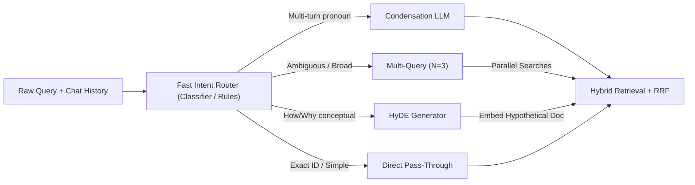
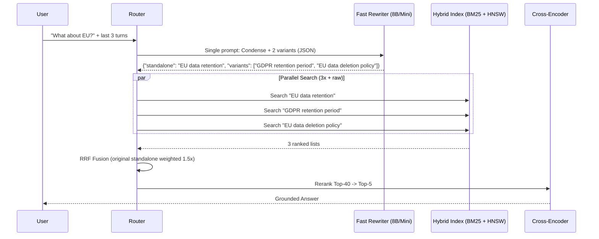
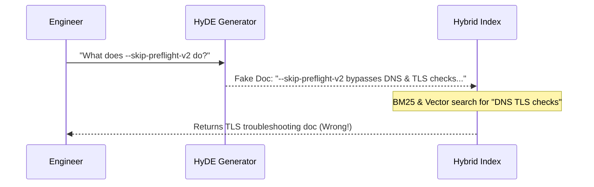

# Query Transformation in RAG: Condensation, Multi-Query, HyDE

> **Prerequisites:** [Lesson 11: Hybrid Retrieval & Reranking](../11-hybrid-retrieval-reranking/README.md) · [Lesson 06: Embeddings & Semantic Search](../08-embedding-generation-at-scale/README.md).  
> **Estimated Reading Time:** 23–27 minutes  
> **Target Audience:** AI platform engineers and backend architects designing conversational RAG systems, and candidates asked "how do you handle vague follow-up questions or vocabulary mismatch in RAG?"  
> **Free PDF Notes:** [Download SD-S-012.pdf](https://backendroadmap.com/notes/system-design/SD-S-012.pdf)

> [!NOTE]
> **In one line:** **Query transformation** rewrites, expands, or translates a user's raw input *before* retrieval—using **condensation** to resolve conversational pronouns, **multi-query expansion** to cover multiple facets, **step-back prompting** for broader principles, and **HyDE** to bridge the question-to-answer embedding gap—trading 100–400 ms of pre-retrieval latency for higher recall.

> [!TIP]
> **The Golden Rule:** Always run **condensation** on multi-turn chat follow-ups (it is mandatory when pronouns exist), but gate **Multi-Query** and **HyDE** behind a lightweight query router so simple exact-match or single-hop queries don't pay unnecessary LLM latency and token cost.

---

## 1. What Query Transformation Is, and What It Isn't

In a multi-turn enterprise copilot, a user asks: *"How do I rotate our Stripe webhook secret?"* and gets an answer. Next turn, they type: *"What happens to in-flight events when I do that?"* If you embed *"What happens to in-flight events when I do that?"* directly, vector search has no idea what *"that"* refers to, and BM25 searches for *"in-flight events"*, missing Stripe webhook secret rotation entirely.

Even on single-turn queries, a user's **question** (*"Why is my Pod stuck in CrashLoopBackOff?"*) is often phrased very differently from the **answer** (*"Exit code 137 indicates OOMKilled; inspect `kubectl describe pod`..."*). Query transformation bridges both the **context gap** and the **semantic phrasing gap** before hitting the index.

| Technique | Precise Meaning | Example Input $\rightarrow$ Output |
| :--- | :--- | :--- |
| **Condensation (Rewrite)** | Rewrites a follow-up using chat history into a standalone query | *"What about EU?"* $\rightarrow$ *"What is the data retention policy for EU?"* |
| **Multi-Query Expansion** | Generates $N$ paraphrased/sub-angle queries, runs all in parallel, and fuses results | *"RAG latency slow"* $\rightarrow$ 3 queries (reranker, embedding, TTFT) |
| **HyDE (Hypothetical Doc Embeddings)** | LLM generates a fake ideal answer; embed the *hypothetical answer* instead of the query | *"Fix OOMKilled"* $\rightarrow$ embeds synthetic runbook paragraph |
| **Step-Back Prompting** | Abstracts a hyper-specific query into a broader foundational concept query | *"Error 429 on gpt-4o tier 2"* $\rightarrow$ *"OpenAI rate limit & backoff architecture"* |
| **Query Decomposition** | Splits a multi-hop comparison into independent sub-queries | *"Compare Kafka vs SQS cost"* $\rightarrow$ `["Kafka pricing", "SQS pricing"]` |
| **Not** | A substitute for hybrid search or bad chunking | Rewriting 5x still fails if the doc isn't indexed |

### Why It Matters
1. Conversational RAG fails catastrophically on turn 2+ without condensation because vector indexes are stateless.
2. Questions and answers live in asymmetric regions of embedding space; HyDE aligns the query vector with document space.
3. Every transformation adds pre-retrieval LLM latency and token cost, so knowing *when* to trigger each pattern is a core system design trade-off.

---

## 2. Anatomy: Pre-Retrieval Query Transformation Router



Rather than running every transformation blindly on every request, production systems place a **fast router** (a small classifier, regex/heuristic for pronouns + history length, or a tiny 8B/nano model) in front of the transformation stage.

| Pattern | Extra LLM Calls | Retrieval Fan-out | Latency Added ($p_{95}$) | Best For |
| :--- | :--- | :--- | :--- | :--- |
| **Direct Pass-Through** | 0 | $1\times$ | 0 ms | Exact codes, single-turn clear queries |
| **Condensation** | 1 (small model) | $1\times$ | 120–250 ms | Multi-turn chat with coreferences |
| **Multi-Query ($N=3$)** | 1 (structured JSON) | $3\times$ | 180–320 ms | Broad, ambiguous, multi-aspect queries |
| **HyDE** | 1 (short 100-tok gen) | $1\times$ (dense) | 250–450 ms | Conceptual "how/why" questions |
| **Decomposition** | 1 | $2\times\text{–}4\times$ | 200–350 ms | Multi-hop comparisons ("A vs B") |

> [!WARNING]
> **The #1 Trap: Using HyDE on Exact-Match or Fresh-Fact Queries.** If a user asks *"What is the Q3 2026 revenue of Acme Corp?"* or *"Fix error `ORA-12154`"*, HyDE will hallucinate plausible-looking fake numbers or wrong error descriptions. Embedding that hallucinated paragraph pulls retrieval *away* from the real document. Never use HyDE for entity-specific facts, numbers, or exact codes.

---

## 3. Mathematical Model: Recall Gain vs Latency & Fan-out Cost

**Multi-Query Recall Amplification.** Suppose a single query formulation has independent probability $p$ of retrieving a relevant chunk in top-$K$. Generating $m$ diverse query variants yields cumulative recall:

$$R_{\text{multi}}(m) = 1 - (1 - p)^m$$

If a single raw query achieves $p = 0.65$, then $m = 3$ diverse queries yield:

$$R_{\text{multi}}(3) = 1 - (1 - 0.65)^3 = 1 - 0.35^3 = 1 - 0.0429 = \mathbf{0.9571}\;(95.7\%)$$

(In practice, query variants are positively correlated with correlation $\rho \in [0.3, 0.6]$, so real recall lands around $82\text{–}88\%$ rather than $95.7\%$.)

**Total End-to-End Retrieval Latency.** Because Multi-Query retrieval calls run in parallel after the rewrite LLM finishes:

$$T_{\text{total}} = T_{\text{rewrite}} + \max_{i=1..m} T_{\text{search}, i} + T_{\text{RRF}} + T_{\text{rerank}}$$

### Worked Numerical Example
Assume:
- Small fast rewriter (`gpt-4o-mini` / `Llama-3.1-8B`): $T_{\text{rewrite}} = 180\text{ ms}$
- Parallel hybrid search per variant: $T_{\text{search}} = 25\text{ ms}$ (vector + BM25)
- RRF across $m=3$ lists of 30 docs each: $T_{\text{RRF}} = 2\text{ ms}$
- Cross-encoder rerank on top-50 fused unique docs: $T_{\text{rerank}} = 60\text{ ms}$

$$T_{\text{total}} = 180 + 25 + 2 + 60 = \mathbf{267\text{ ms}}$$

**Index QPS Cost:** If your service handles $100\text{ RPS}$ and $40\%$ of queries trigger $m=3$ Multi-Query, your vector/BM25 index load becomes:

$$\text{Index QPS} = 100 \times (0.60 \times 1 + 0.40 \times 3) = 100 \times 1.8 = \mathbf{180\text{ QPS}}$$

You must provision your vector DB and BM25 cluster for $1.8\times$ your API RPS.

---

## 4. Metrics & Percentiles

| Metric | Meaning | Alert when |
| :--- | :--- | :--- |
| **Rewrite Latency $p_{95}$** | Time spent in the query-transform LLM | $> 350\text{ ms}$ (eats into TTFT budget) |
| **Coreference Resolution Accuracy** | % of follow-up queries standalone-valid on eval set | $< 92\%$ |
| **Fan-out Multiplier** | Average index searches per user request | $> 2.5\times$ (cost/QPS runaway) |
| **Unique Candidate Yield** | New unique chunks added by variants $2..m$ | $< 10\%$ (variants are near-duplicates) |
| **HyDE Drift Rate** | Queries where HyDE drops Recall@10 vs raw query | $> 10\%$ (router sending wrong intents to HyDE) |
| **Transform Token Cost / 1k req** | Extra input+output tokens for rewriting | Exceeds 15% of total RAG token budget |

### Worked Example (Multi-Turn Support Copilot)
A 10-turn support chat averages 4.2 turns per session:
- **Without Condensation:** Turn 1 Recall@10 = 0.88; Turn 2+ Recall@10 = **0.31** (pronouns like *"it"*, *"that config"*, *"same error"* fail).
- **With Condensation (last 3 turns + user query, 8B model):** Turn 2+ Recall@10 jumps from 0.31 to **0.84**, adding 145 ms $p_{95}$ and ~180 prompt tokens per follow-up.

---

## 5. Compounding & Failure Modes: Drift, Fan-out, and Latency Stacking

What happens when teams chain transformations sequentially (*Condense $\rightarrow$ Multi-Query $\rightarrow$ HyDE*)?
1. **Latency Stacking:** $180\text{ ms} + 220\text{ ms} + 300\text{ ms} = 700\text{ ms}$ before a single document is even fetched.
2. **Semantic Drift (Telephone Game):** Each LLM rewrite slightly shifts the user's intent; by step 3, the query asks about a related topic the user never mentioned.
3. **Index Saturation:** $m = 5$ variants $\times$ HyDE + raw query = $6\times$ vector/BM25 QPS, triggering rate limits or HNSW CPU exhaustion during traffic bursts.

**Rule:** Never chain more than **one** transformation step (or combine Condensation + Multi-Query into a **single** structured-output LLM call).

---

## 6. Numbers Every Engineer Must Know

| Item | Typical | Implication |
| :--- | :--- | :--- |
| **Condensation history window** | Last 2–4 turns (4–8 messages) | Longer history adds noise & latency without helping coreference |
| **Multi-Query variant count $m$** | 3–4 variants (including original) | Beyond $m=4$, duplicate overlap $> 80\%$ and QPS spikes |
| **HyDE output length** | 60–120 tokens (`max_tokens=120`) | Long HyDE essays add 500+ ms latency for zero extra recall |
| **Rewriter model size** | 3B–8B / mini-tier | Frontier models (70B+) are overkill for query rewriting |
| **Router classification latency** | 2–20 ms (rules or tiny encoder) | Must be $< 10\%$ of rewrite latency |
| **Always include raw query** | Weight $1.5\text{–}2.0\times$ in RRF | Protects against bad LLM rewrites |

---

## 7. Protocol / Mechanism Deep Dive: Condensation + Multi-Query Single-Pass Flow



**When NOT to use Query Transformation:**
- **Turn 1 with an explicit entity/code:** e.g., `"GET /v2/invoices 403 error"`—skip rewriting completely (0 ms overhead).
- **Structured SQL / Filter-only queries:** If a query maps to metadata filters (`status=failed, region=eu`), extract filters instead of paraphrasing.
- **Strict < 100 ms search UX:** Typeahead or instant search cannot afford an LLM call before retrieval.

---

## 8. Hierarchical Budgets & Design Rules

| Slice | Rule | Control |
| :--- | :--- | :--- |
| **Router Gate** | Skip LLM transform if `history.len == 0` and query is $< 8$ words with IDs | Regex/heuristic + lightweight intent classifier |
| **Single-Call Budget** | Combine Condensation + Multi-Query in 1 JSON call; `timeout = 300 ms` | Fallback to raw query if rewriter times out |
| **Original Query Anchor** | Always execute the original/condensed query alongside variants | Weight original $1.5\times$ in RRF so drift cannot erase exact hits |
| **Fan-out Cap** | Hard cap $m \le 4$ parallel searches per user request | Semaphore / rate-limit protection on vector DB |
| **HyDE Guardrail** | Only enable HyDE for conceptual "how/why" queries; `max_tokens = 100` | Disable for numbers, dates, SKUs, and proper nouns |
| **Degradation Mode** | If rewriter LLM returns 429/5xx, degrade to raw query immediately | Never fail a search because the rewriter is down |

---

## 9. Top Mitigations

1. **Always retain the original query in RRF:** Even when Multi-Query or HyDE runs, include the un-rewritten (or condensed) query in the RRF pool with a higher weight ($1.5\times$) so a bad rewrite cannot tank recall.
2. **Merge Condensation + Multi-Query into one prompt:** Saves an entire LLM round-trip (180 ms) by returning `{ "standalone": "...", "variants": [...] }` in a single structured JSON response.
3. **Cap conversation history passed to Condensation:** Only pass the last 2–3 turns (or a rolling summary), avoiding 10,000-token rewriter prompts.
4. **Use a fast small model for rewriting:** Use `gpt-4o-mini`, `claude-3-haiku`, or a self-hosted `Llama-3.1-8B` / `Qwen-2.5-7B`—never a reasoning model (`o1`/`R1`) in the pre-retrieval path.
5. **For HyDE, embed the hypothetical doc for dense search ONLY:** Keep the *original* query for BM25 so synthetic hallucinated words in the HyDE paragraph don't pollute lexical keyword matching.
6. **Deduplicate transformed queries before hitting the index:** Lowercase/normalize variants and drop near-duplicates to avoid paying $3\times$ index cost for the same string.
7. **Log `(raw_query, transformed_queries, final_recall)`:** Continuously audit rewrite quality; bad rewrites are the #1 silent killer of conversational RAG.

---

## 10. Production Reference / War Story: HyDE Hallucination Poisoning

**Incident (SEV-2):** An internal developer-docs RAG bot enabled HyDE globally for all queries. Engineers began reporting completely wrong answers when asking about internal CLI flags like `--skip-preflight-v2`.



**Root Cause:**
1. The internal flag `--skip-preflight-v2` wasn't in the LLM's pretraining data, so HyDE invented a plausible-sounding meaning ("bypasses DNS & TLS checks").
2. The pipeline sent that HyDE paragraph to *both* BM25 and Dense search, causing BM25 to match "DNS" and "TLS" docs while drowning out the single doc containing `--skip-preflight-v2`.

**Fix:**
1. Added an intent router that **bypasses HyDE** whenever a query contains CLI flags (`--*`), camelCase/snake_case symbols, or error codes.
2. Restricted HyDE strictly to **dense vector search**, while **BM25 always receives the raw/condensed query**.
3. Kept the raw query in RRF with weight $1.5\times$. Recall@5 on internal CLI flags recovered from 22% to **94%**.

---

## 11. Multi-Language Production Code Tabs

````carousel
```go
// Go: Single-pass Condensation + Multi-Query with timeout fallback and parallel search.
package main

import (
	"context"
	"fmt"
	"strings"
	"sync"
	"time"
)

type QueryPlan struct {
	Standalone string
	Variants   []string
}

func NeedsCondensation(query string, historyLen int) bool {
	if historyLen == 0 {
		return false
	}
	lower := strings.ToLower(query)
	for _, p := range []string{"it", "that", "those", "this", "they", "same"} {
		if strings.Contains(lower, " "+p+" ") || strings.HasPrefix(lower, p+" ") || strings.HasSuffix(lower, " "+p) {
			return true
		}
	}
	return len(strings.Fields(query)) < 6
}

func TransformAndSearch(ctx context.Context, rawQuery string, history []string,
	rewriter func(context.Context, string, []string) (QueryPlan, error),
	search func(context.Context, string) []string) [][]string {

	queries := []string{rawQuery}
	if NeedsCondensation(rawQuery, len(history)) {
		tCtx, cancel := context.WithTimeout(ctx, 300*time.Millisecond)
		defer cancel()
		if plan, err := rewriter(tCtx, rawQuery, history); err == nil && plan.Standalone != "" {
			queries = append([]string{plan.Standalone}, plan.Variants...)
		}
	}
	if len(queries) > 4 {
		queries = queries[:4] // Hard fan-out cap
	}

	results := make([][]string, len(queries))
	var wg sync.WaitGroup
	for i, q := range queries {
		wg.Add(1)
		go func(idx int, query string) {
			defer wg.Done()
			results[idx] = search(ctx, query)
		}(i, q)
	}
	wg.Wait()
	return results
}

func main() {
	fmt.Println("Needs condensation:", NeedsCondensation("What about EU?", 2))
}
```
<!-- slide -->
```typescript
// TypeScript: Query router + HyDE-for-dense-only + raw-for-BM25 hybrid pattern.
export type TransformMode = "direct" | "condense" | "multi_query" | "hyde";

export function routeQuery(query: string, historyTurns: number): TransformMode {
  const hasCodeOrId = /(--[a-z0-9-]+|[A-Z]{2,}_[A-Z0-9_]+|\bv\d+\.\d+)/.test(query);
  if (historyTurns > 0 && (query.split(/\s+/).length < 7 || /\b(it|that|those|they|same)\b/i.test(query))) {
    return "condense";
  }
  if (hasCodeOrId) return "direct";
  if (/^(how|why|explain|what causes)\b/i.test(query.trim())) return "hyde";
  return "multi_query";
}

export async function transformAndRetrieve(
  query: string,
  history: string[],
  rewriteFn: (q: string, h: string[], mode: TransformMode) => Promise<string[]>,
  bm25Search: (q: string) => Promise<string[]>,
  denseSearch: (q: string) => Promise<string[]>
): Promise<{ bm25: string[][]; dense: string[][] }> {
  const mode = routeQuery(query, history.length);
  let variants = [query];

  if (mode !== "direct") {
    try {
      const controller = new AbortController();
      const timer = setTimeout(() => controller.abort(), 300);
      variants = await Promise.race([
        rewriteFn(query, history.slice(-4), mode),
        new Promise<string[]>((_, rej) => controller.signal.addEventListener("abort", () => rej(new Error("timeout")))),
      ]);
      clearTimeout(timer);
    } catch {
      variants = [query]; // Degrade safely to raw query
    }
  }

  // HyDE text goes ONLY to denseSearch; BM25 always uses the raw/condensed query
  const bm25Promise = bm25Search(mode === "condense" ? variants[0] : query);
  const densePromises = variants.slice(0, 4).map((v) => denseSearch(v));
  const [bm25Res, ...denseRes] = await Promise.all([bm25Promise, ...densePromises]);

  return { bm25: [bm25Res], dense: denseRes };
}
```
<!-- slide -->
```python
# Python 3.13: Query transformation router, recall math, and deduplicated fan-out.
import re
from dataclasses import dataclass
from typing import Callable


@dataclass(frozen=True)
class TransformPlan:
    mode: str
    bm25_query: str
    dense_queries: list[str]


CODE_OR_ID_RE = re.compile(r"(--[a-z0-9-]+|[A-Z]{2,}_[A-Z0-9_]+|\bv\d+\.\d+)")
PRONOUN_RE = re.compile(r"\b(it|that|those|they|this|same)\b", re.IGNORECASE)


def route_query(query: str, history: list[str]) -> str:
    if history and (PRONOUN_RE.search(query) or len(query.split()) < 6):
        return "condense"
    if CODE_OR_ID_RE.search(query):
        return "direct"
    if query.lower().startswith(("how ", "why ", "explain ")):
        return "hyde"
    return "multi_query"


def build_transform_plan(
    query: str,
    history: list[str],
    llm_rewrite: Callable[[str, list[str], str], list[str]],
    max_variants: int = 4,
) -> TransformPlan:
    mode = route_query(query, history)
    if mode == "direct":
        return TransformPlan(mode=mode, bm25_query=query, dense_queries=[query])

    try:
        generated = llm_rewrite(query, history[-4:], mode)
    except Exception:
        return TransformPlan(mode="fallback", bm25_query=query, dense_queries=[query])

    # Deduplicate while preserving order; always anchor with raw/condensed query
    seen: set[str] = set()
    dense_queries: list[str] = []
    for q in ([query] if mode != "condense" else []) + generated:
        norm = " ".join(q.strip().split())
        if norm and norm.lower() not in seen:
            seen.add(norm.lower())
            dense_queries.append(norm)
        if len(dense_queries) >= max_variants:
            break

    bm25_q = dense_queries[0] if mode == "condense" else query
    return TransformPlan(mode=mode, bm25_query=bm25_q, dense_queries=dense_queries)


def multi_query_recall(single_recall: float, variants: int) -> float:
    """Theoretical independent recall amplification: 1 - (1 - p)^m."""
    return 1.0 - (1.0 - single_recall) ** variants
```
<!-- slide -->
```csharp
// C#: Query router and bounded fan-out transformation pipeline.
using System;
using System.Collections.Generic;
using System.Linq;
using System.Text.RegularExpressions;
using System.Threading;
using System.Threading.Tasks;

public enum TransformMode { Direct, Condense, MultiQuery, HyDE }

public static class QueryTransformer
{
    private static readonly Regex CodePattern = new(@"(--[a-z0-9-]+|[A-Z]{2,}_[A-Z0-9_]+|\bv\d+\.\d+)", RegexOptions.Compiled);
    private static readonly Regex PronounPattern = new(@"\b(it|that|those|they|same)\b", RegexOptions.IgnoreCase | RegexOptions.Compiled);

    public static TransformMode Route(string query, int historyCount)
    {
        if (historyCount > 0 && (PronounPattern.IsMatch(query) || query.Split(' ', StringSplitOptions.RemoveEmptyEntries).Length < 6))
            return TransformMode.Condense;
        if (CodePattern.IsMatch(query))
            return TransformMode.Direct;
        if (query.StartsWith("how ", StringComparison.OrdinalIgnoreCase) || query.StartsWith("why ", StringComparison.OrdinalIgnoreCase))
            return TransformMode.HyDE;
        return TransformMode.MultiQuery;
    }

    public static async Task<IReadOnlyList<string>> ExpandWithTimeoutAsync(
        string query,
        IReadOnlyList<string> history,
        Func<string, IReadOnlyList<string>, TransformMode, CancellationToken, Task<IReadOnlyList<string>>> llmFn)
    {
        var mode = Route(query, history.Count);
        if (mode == TransformMode.Direct) return new[] { query };

        using var cts = new CancellationTokenSource(TimeSpan.FromMilliseconds(300));
        try
        {
            var res = await llmFn(query, history.TakeLast(4).ToList(), mode, cts.Token);
            return res.Prepend(query).Distinct(StringComparer.OrdinalIgnoreCase).Take(4).ToList();
        }
        catch (OperationCanceledException)
        {
            return new[] { query };
        }
    }
}
```
````

---

## 12. Hands-On CLI Verification Workflows

Verify Multi-Query recall amplification and router logic locally:

```bash
python -c "
for p in [0.5, 0.65, 0.75]:
    for m in [1, 2, 3, 4]:
        r = 1 - (1 - p)**m
        print(f'p={p:.2f}, m={m} -> R={r:.4f}')
"
```

Benchmark rewriter JSON latency against a local vLLM / Ollama endpoint:

```bash
curl -s -w "\nTotal time: %{time_total}s\n" http://localhost:11434/api/generate -d '{
  "model": "llama3.1:8b",
  "prompt": "Rewrite into 3 search queries as JSON array. History: [Stripe webhook secret]. Query: What happens to in-flight events when I do that?",
  "stream": false,
  "options": { "num_predict": 100, "temperature": 0 }
}' | jq -r '.response'
```

---

## 13. Common Mistakes to Avoid

1. **Passing the full 20-turn conversation to the condensation model**, inflating input tokens and latency.
2. **Sending HyDE hypothetical text to BM25**, which pollutes lexical search with hallucinated keywords.
3. **Dropping the original query after Multi-Query expansion**, allowing LLM paraphrase drift to lose exact matches.
4. **Chaining Condense $\rightarrow$ Multi-Query $\rightarrow$ HyDE sequentially**, stacking 600–900 ms of pre-retrieval latency.
5. **Running HyDE on exact identifiers, dates, or financial numbers**, where the LLM invents wrong facts.
6. **Using a frontier reasoning model for query rewriting**, wasting seconds and dollars on a simple 8B task.
7. **Failing the entire RAG request when the rewriter times out**, instead of falling back to the raw query.

---

## 14. Key Terms Glossary

| Key Term | Definition |
| :--- | :--- |
| **Query Condensation** | Rewriting a conversational follow-up into a self-contained standalone query using chat history. |
| **Coreference Resolution** | Resolving pronouns (*it*, *that*, *they*) back to the concrete entity from earlier turns. |
| **Multi-Query Expansion** | Generating $m$ diverse query paraphrases and fusing their retrieval results via RRF. |
| **HyDE** | Hypothetical Document Embeddings; generating a synthetic answer and embedding it for dense search. |
| **Step-Back Prompting** | Abstracting a specific question into a broader conceptual query to retrieve foundational context. |
| **Query Decomposition** | Breaking a multi-hop or comparison query into independent atomic sub-queries. |
| **Intent Router** | Fast classifier/heuristic deciding which transformation (if any) to run per query. |
| **Semantic Drift** | Gradual distortion of user intent caused by repeated or unconstrained LLM rewrites. |
| **Fan-out Multiplier** | Ratio of index queries executed per incoming user query. |
| **Pre-Retrieval Latency** | Time spent transforming the query before hitting BM25 or the vector index. |

---

## 15. System Design Interview Questions & Answers

### Basic Conceptual Questions

<details>
<summary><strong>Q1: What is query condensation and why is it mandatory for multi-turn RAG? [BASIC]</strong></summary>

**Answer:**
Vector and BM25 indexes are stateless—they only see the current query string. In multi-turn chat, follow-up questions contain pronouns or implicit references (*"How much does it cost?"*). Condensation uses recent chat history to rewrite the follow-up into a standalone query (*"How much does Datadog APM cost?"*) so retrieval works accurately.
</details>

<details>
<summary><strong>Q2: How does HyDE work, and what problem does it solve? [BASIC]</strong></summary>

**Answer:**
Questions and answers occupy different regions in embedding space (a short question vs a detailed declarative paragraph). HyDE prompts an LLM to generate a *hypothetical* answer document, embeds that synthetic document, and uses its vector for nearest-neighbor search—aligning the query vector with the document distribution.
</details>

<details>
<summary><strong>Q3: What is Multi-Query expansion and how are its results combined? [BASIC]</strong></summary>

**Answer:**
An LLM generates 2–4 alternative phrasings or sub-angles of the user's query. All variants are searched in parallel against the index, and the resulting ranked lists are merged and deduplicated using Reciprocal Rank Fusion (RRF) before reranking.
</details>

<details>
<summary><strong>Q4: What is the difference between Step-Back Prompting and Query Decomposition? [BASIC]</strong></summary>

**Answer:**
Query Decomposition splits a complex multi-part question (*"Compare A and B"*) into parallel sub-queries (*"What is A?"*, *"What is B?"*). Step-Back Prompting abstracts a narrow question (*"Why did my Python script hit Error X on ARM64?"*) into a broader principle (*"How does Python memory allocation work on ARM64?"*) to retrieve high-level context.
</details>

### Scenario-Based Architecture Questions

<details>
<summary><strong>Q5: Adding Multi-Query ($m=4$) and Condensation doubled your p95 latency and tripled vector DB CPU. How do you optimize it? [SCENARIO]</strong></summary>

**Answer:**
First, merge Condensation and Multi-Query into a single structured JSON LLM call using a small 8B/mini model. Second, add a fast intent router so simple single-turn or exact-ID queries bypass transformation completely. Third, cap variants at $m \le 3$ and deduplicate near-identical variants before hitting the vector DB.
</details>

<details>
<summary><strong>Q6: Users ask about internal error codes and HyDE makes retrieval worse. Why, and how do you fix it? [SCENARIO]</strong></summary>

**Answer:**
The LLM doesn't know internal error codes and hallucinates plausible-sounding wrong descriptions, pulling embeddings toward unrelated docs. Fix it by routing exact-code/CLI-flag queries away from HyDE, sending HyDE embeddings *only* to dense search (never BM25), and anchoring RRF with the raw query.
</details>

<details>
<summary><strong>Q7: How do you handle a 20-turn conversation without blowing up condensation prompt tokens? [SCENARIO]</strong></summary>

**Answer:**
Pass only a sliding window of the last 2–4 turns (4–8 messages) or a compact rolling entity summary to the condensation model. Most coreferences resolve within the immediately preceding 1–2 turns.
</details>

<details>
<summary><strong>Q8: Your rewriter LLM service experiences a 5-second spike. What happens to user search? [SCENARIO]</strong></summary>

**Answer:**
If you enforce a strict 250–300 ms timeout on the transformation step and fall back to the raw user query on timeout/error, search stays available with slightly lower recall on multi-turn queries rather than failing completely.
</details>

### Advanced & Tricky Interview Questions

<details>
<summary><strong>Q9: How do you evaluate whether Multi-Query or HyDE is actually helping vs hurting? [TRICKY]</strong></summary>

**Answer:**
Run an offline A/B ablation on a labeled golden set sliced by query type (multi-turn, conceptual, exact-ID, multi-hop). Measure **Recall@50** (pre-rerank) and **NDCG@5** (post-rerank) alongside $p_{95}$ latency and index QPS. Track **HyDE Drift Rate**—the fraction of queries where transformation lowers Recall@10 compared to the raw query.
</details>

<details>
<summary><strong>Q10: In Multi-Query + RRF, why should the original query receive a higher weight than generated variants? [TRICKY]</strong></summary>

**Answer:**
Generated variants can introduce synonyms that shift domain meaning (semantic drift). Giving the original (or condensed) query weight $1.5\text{–}2.0\times$ in RRF ensures exact user intent anchors the top of the fused list while variants boost consensus and fill recall gaps.
</details>

<details>
<summary><strong>Q11: Can you replace LLM-based query expansion with learned sparse expansion like SPLADE? [TRICKY]</strong></summary>

**Answer:**
Partially. SPLADE expands documents and queries into weighted vocabulary terms using a BERT MLM head in ~10 ms without generative LLM latency, solving synonym mismatch cleanly. However, SPLADE cannot resolve multi-turn conversational pronouns or decompose multi-hop logic—those still require an LLM or seq2seq rewriter.
</details>

<details>
<summary><strong>Q12: What happens if you run HyDE on a cross-encoder reranker? [TRICKY]</strong></summary>

**Answer:**
Never pass the synthetic HyDE document to the cross-encoder reranker! The cross-encoder should always score the **real/condensed user query** against each retrieved chunk; otherwise, the reranker rewards chunks that match the LLM's hallucinated phrasing rather than what the user actually asked.
</details>

---

## 16. One-Page Master Cheat Sheet

```
+---------------------------------------------------------------------------------------------------------+
|                    QUERY TRANSFORMATION IN RAG — MASTER CHEAT SHEET                                     |
+---------------------------------------------------------------------------------------------------------+
| 1. CONDENSATION: Mandatory for multi-turn chat. Pass last 2-4 turns -> standalone query.                |
| 2. MULTI-QUERY: Generate 2-3 variants -> parallel search -> RRF. Weight original query 1.5x.            |
|    Theoretical recall: 1 - (1 - p)^m. Provision index for fan-out QPS!                                  |
| 3. HyDE: Generate 60-120 tok fake answer -> embed for DENSE search ONLY. Never send to BM25/Reranker.   |
|    NEVER use HyDE for exact IDs, CLI flags, dates, or numbers.                                          |
| 4. STEP-BACK / DECOMPOSITION: Abstract for principles; split for multi-hop "A vs B" comparisons.        |
| 5. ROUTER & BUDGETS: Gate behind fast intent router. Merge Condense+MultiQuery in 1 JSON call (8B/mini).|
|    Set 300 ms timeout -> fallback to raw query so search never goes down.                               |
+---------------------------------------------------------------------------------------------------------+
```

---

## Further Reading & Sources

- Luyu Gao et al., *"Precise Zero-Shot Dense Retrieval without Relevance Labels (HyDE)"* (ACL 2023).
- Huaixiu Steven Zheng et al., *"Take a Step Back: Evoking Reasoning via Abstraction in Large Language Models"* (ICLR 2024).
- LangChain & LlamaIndex Documentation, *Query Transformations (Multi-Query, HyDE, Sub-Question Decomposition)*.
- Thibault Formal et al., *"SPLADE: Sparse Lexical and Expansion Model for First Stage Ranking"* (SIGIR 2021).

---

## Free PDF Notes

[SD-S-012.pdf](https://backendroadmap.com/notes/system-design/SD-S-012.pdf)

---

## Next

Continue with [Retrieval Evaluation for RAG: Golden Sets, Recall@k, MRR & LLM Judges](../13-retrieval-evaluation-for-rag/README.md).
