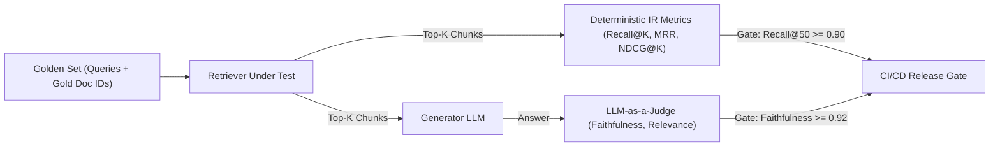
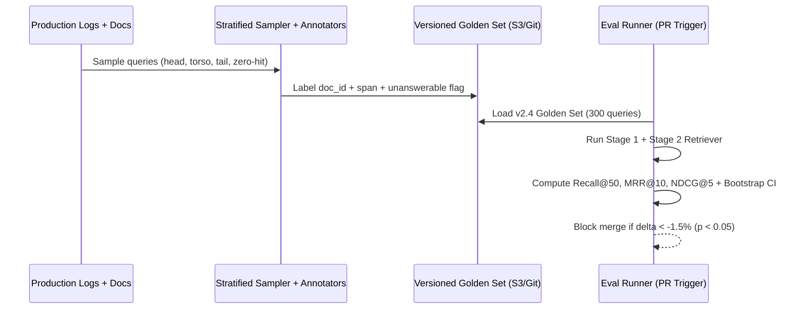
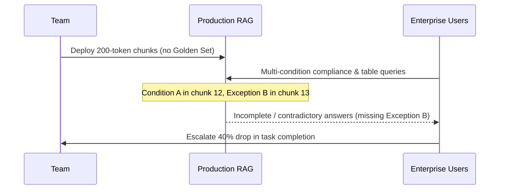

# Retrieval Evaluation for RAG: Golden Sets, Recall@k, MRR & LLM Judges

> **Prerequisites:** [Lesson 12: Query Transformation in RAG](../12-query-transformation-in-rag/README.md) · [Lesson 11: Hybrid Retrieval & Reranking](../11-hybrid-retrieval-reranking/README.md).  
> **Estimated Reading Time:** 24–28 minutes  
> **Target Audience:** ML/backend engineers shipping RAG to production, and candidates asked "how do you know if changing your chunking or embedding model actually improved your RAG system?"  
> **Free PDF Notes:** [Download SD-S-013.pdf](https://backendroadmap.com/notes/system-design/SD-S-013.pdf)

> [!NOTE]
> **In one line:** **RAG evaluation** separates **retrieval** (did we find the right chunks?) from **generation** (did the LLM answer faithfully from those chunks?), measuring retrieval deterministically with **Recall@k, MRR, and NDCG@k** on a curated **golden dataset**, and scaling qualitative checks with calibrated **LLM-as-a-Judge** metrics (Context Precision, Context Recall, Faithfulness).

> [!TIP]
> **The Golden Rule:** Never judge a RAG system solely by reading 5 cherry-picked answers ("vibe-checking"). Build a stratified 100–500 query **golden set** first, gate every PR on **Recall@k** (for Stage 1) and **NDCG@k / MRR** (for Stage 2), and calibrate any LLM judge against human labels ($\kappa \ge 0.75$) before trusting it in CI.

---

## 1. What Retrieval Evaluation Is, and What It Isn't

A team swaps their embedding model from `text-embedding-3-small` to `bge-m3` and changes chunk size from 512 to 256 tokens. On 5 manual test prompts, the answers "look better." Two weeks after deploying, support tickets spike because multi-paragraph policy tables were split in half and exact-code queries regressed. Without **offline retrieval metrics**, you cannot tell whether an answer failed because the retriever missed the chunk or because the LLM ignored a chunk it was given.

| Term | Precise Meaning | Example |
| :--- | :--- | :--- |
| **Golden Set (Eval Dataset)** | Curated `(query, expected_doc_ids, reference_answer)` pairs representing real traffic | 300 queries stratified by intent, difficulty, and tenant |
| **Recall@k** | Fraction of relevant documents for a query found in the top-$k$ retrieved | 2 of 3 relevant docs in top-10 $\rightarrow$ Recall@10 = 0.67 |
| **MRR (Mean Reciprocal Rank)** | Average of $1/\text{rank}$ of the *first* relevant document across queries | First hit at rank 2 $\rightarrow$ RR = 0.50 |
| **NDCG@k** | Position-discounted ranking quality supporting graded relevance (0, 1, 2, 3) | Rewards putting exact answer at rank 1 vs rank 8 |
| **RAGAS / LLM-as-a-Judge** | Reference-free or reference-assisted LLM scoring of Context Relevance & Faithfulness | Frontier LLM scores whether retrieved context supports answer |
| **Not** | End-to-end "vibe checking" or BLEU/ROUGE string overlap | BLEU penalizes valid paraphrases and misses factual errors |

### Why It Matters
1. You cannot optimize what you cannot separate: **Retrieval Recall** is the hard upper bound on RAG accuracy—an LLM cannot cite a document it never received.
2. Deterministic IR metrics (**Recall@k**, **MRR**, **NDCG@k**) run in milliseconds for $0 cost on every CI commit, unlike LLM judges.
3. Interviewers routinely ask how you prevent regressions when tuning chunking, embeddings, HNSW `efSearch`, or rerankers.

---

## 2. Anatomy: The RAG Evaluation Triad & CI Gate



A production evaluation pipeline runs in **two tiers**:
1. **Fast Deterministic Tier (Every PR, < 10 seconds):** Evaluates Stage-1 **Recall@50** and Stage-2 **NDCG@5 / MRR@10** against `expected_doc_ids` (or chunk spans). Zero LLM API cost, zero non-determinism.
2. **Semantic LLM-Judge Tier (Nightly / Pre-Release):** Evaluates **Context Precision**, **Context Recall**, and **Answer Faithfulness** using a strong judge model (e.g., `gpt-4o` / `claude-3.5-sonnet`) with fixed `temperature=0` and pairwise/rubric prompts.

| Evaluation Layer | Inputs Needed | Speed & Cost | Catches |
| :--- | :--- | :--- | :--- |
| **Stage-1 IR (Recall@50)** | `query`, `gold_doc_ids` | ~50 ms/query, $0 | Missing docs due to chunking, embeddings, or BM25 |
| **Stage-2 IR (MRR, NDCG@5)** | `query`, `gold_doc_ids` + grades | ~50 ms/query, $0 | Poor reranking, bad RRF weights |
| **LLM Context Judge** | `query`, `retrieved_chunks` | ~1–2 s/query, ~$0.005 | Chunks technically match keywords but don't answer query |
| **LLM Faithfulness Judge** | `retrieved_chunks`, `answer` | ~1–2 s/query, ~$0.005 | Generator hallucinations not supported by context |

> [!WARNING]
> **The #1 Trap: Evaluating Chunk IDs When Chunking Changes.** If your golden set stores `chunk_id = "doc42_chunk_7"`, changing your chunk size from 512 to 256 tokens breaks every `chunk_id` in the golden set! Always anchor golden labels to **immutable `doc_id` + character/page span** (or exact answer-bearing passage text) and compute overlap at evaluation time.

---

## 3. Mathematical Model: Recall@k, MRR, and NDCG@k

**Recall@k.** For a query $q$ with ground-truth relevant document set $G_q$ and retrieved top-$k$ set $R_{q,k}$:

$$\text{Recall@}k(q) = \frac{|G_q \cap R_{q,k}|}{|G_q|}$$

**Mean Reciprocal Rank (MRR).** For a set of $Q$ queries where $\text{rank}_q$ is the 1-based position of the *first* relevant document in $R_{q,k}$ (or $\infty$ if none found):

$$\text{MRR} = \frac{1}{|Q|} \sum_{q=1}^{|Q|} \frac{1}{\text{rank}_q}$$

**Normalized Discounted Cumulative Gain (NDCG@k).** With graded relevance $\text{rel}_i \in \{0, 1, 2, 3\}$ at rank $i$:

$$\text{DCG@}k = \sum_{i=1}^{k} \frac{2^{\text{rel}_i} - 1}{\log_2(i + 1)}, \qquad \text{NDCG@}k = \frac{\text{DCG@}k}{\text{IDCG@}k}$$

where $\text{IDCG@}k$ is the $\text{DCG@}k$ of the ideal (sorted) ranking.

### Worked Numerical Example
Suppose a query has 2 relevant documents: `D1` (highly relevant, $\text{rel}=3$) and `D2` (partially relevant, $\text{rel}=1$).
Your retriever returns top-4: `[D_noise, D1, D_noise2, D2]`.

1. **Recall@4:** Both `D1` and `D2` are in top-4 $\rightarrow \frac{2}{2} = \mathbf{1.00}$. (At $k=2$, Recall@2 $= \frac{1}{2} = \mathbf{0.50}$.)
2. **Reciprocal Rank (RR):** First relevant doc (`D1`) is at rank 2 $\rightarrow \text{RR} = \frac{1}{2} = \mathbf{0.50}$.
3. **DCG@4:**
   - Rank 1 (`D_noise`, $\text{rel}=0$): $0$
   - Rank 2 (`D1`, $\text{rel}=3$): $\frac{2^3 - 1}{\log_2(3)} = \frac{7}{1.585} = 4.416$
   - Rank 3 (`D_noise2`, $\text{rel}=0$): $0$
   - Rank 4 (`D2`, $\text{rel}=1$): $\frac{2^1 - 1}{\log_2(5)} = \frac{1}{2.322} = 0.431$
   - $\text{DCG@4} = 4.416 + 0.431 = \mathbf{4.847}$
4. **Ideal Ranking (`[D1, D2, D_noise, D_noise2]`):**
   - $\text{IDCG@4} = \frac{7}{\log_2(2)} + \frac{1}{\log_2(3)} = 7.000 + 0.631 = \mathbf{7.631}$
5. **NDCG@4:** $\frac{4.847}{7.631} = \mathbf{0.635}$.

Notice how Recall@4 says `1.00`, but NDCG@4 (`0.635`) exposes that `D1` and `D2` were pushed down by noise at rank 1 and rank 3.

---

## 4. Metrics & Percentiles

| Metric | Meaning | Alert when |
| :--- | :--- | :--- |
| **Recall@50 (Stage 1)** | Ceiling of retrievable evidence before rerank | $< 0.90$ or drops $> 2\%$ on PR |
| **NDCG@5 (Stage 2)** | Final ranking quality entering LLM prompt | Drops $> 2\%$ on PR |
| **MRR@10** | How high the first good hit appears | $< 0.70$ for single-answer FAQ bots |
| **Context Precision** | Fraction of retrieved top-$k$ chunks actually useful | $< 0.65$ (context window noise) |
| **Faithfulness (Judge)** | % of answer claims entailed by retrieved chunks | $< 0.92$ (hallucination spike) |
| **Judge-Human Agreement ($\kappa$)** | Cohen's kappa between LLM judge and human raters | $< 0.75$ (judge prompt is uncalibrated) |

### Worked Example (Statistical Significance on a Golden Set)
With $N = 50$ queries, a $4\%$ Recall@10 difference ($0.84 \rightarrow 0.88$) has a binomial standard error of $\sqrt{0.86 \cdot 0.14 / 50} \approx 4.9\%$—meaning it is **pure noise**! At $N = 300$ queries, the standard error drops to $2.0\%$, and paired bootstrap resampling confirms whether the improvement is statistically significant ($p < 0.05$).

---

## 5. Compounding & LLM-Judge Biases

LLM-as-a-Judge is powerful for scaling evaluation, but exhibits four systematic biases if used naively:
1. **Position Bias:** Judges prefer the *first* option in pairwise comparisons ~10–15% more often. Fix: run A/B in both orders `(A, B)` and `(B, A)` and average.
2. **Verbosity Bias:** Judges rate longer, more formal answers higher even when they contain fluff. Fix: use explicit binary/3-point rubrics anchored to factual claims.
3. **Self-Enhancement Bias:** `gpt-4o` rates `gpt-4o` outputs slightly higher than `claude` outputs of equal quality. Fix: use a neutral or cross-family judge, or calibrate on human labels.
4. **Prompt Sensitivity:** Changing 3 words in the judge rubric can shift absolute scores by $\pm 8\%$. Fix: version-control judge prompts and track relative deltas against a baseline.

---

## 6. Numbers Every Engineer Must Know

| Item | Typical | Implication |
| :--- | :--- | :--- |
| **Minimum Golden Set size** | 150–300 queries | Below 100, $\pm 3\%$ deltas are statistically indistinguishable from noise |
| **Stratification slices** | 4–6 categories | Slice by exact-ID, multi-hop, unanswerable, multi-turn, and long-tail |
| **Unanswerable queries slice** | 10–15% of golden set | Verifies the retriever/reranker abstains instead of forcing hallucinations |
| **Human calibration sample** | 50–100 pairs | Required to validate Cohen's $\kappa \ge 0.75$ for any LLM judge |
| **IR eval runtime (300 q)** | < 15 seconds | Fast enough to block merges in GitHub Actions |
| **Bootstrap resamples** | 1,000 iterations | Computes 95% confidence intervals on Recall@k / NDCG@k deltas |

---

## 7. Protocol / Mechanism Deep Dive: Building & Running a Golden Set Pipeline



**When NOT to rely solely on Synthetic Golden Sets:**
- Generating 500 questions by feeding chunks to GPT-4 and asking *"Write a question this chunk answers"* creates **artificially easy** queries that mirror the chunk's exact phrasing. Always mix synthetic coverage with **real anonymized production logs** and **adversarial/unanswerable** queries.

---

## 8. Hierarchical Budgets & Design Rules

| Slice | Rule | Control |
| :--- | :--- | :--- |
| **Immutable Anchors** | Label golden hits by `(doc_id, char_start, char_end)` or answer substring | Never couple golden labels to mutable `chunk_id`s |
| **Unanswerable Slice** | Include 15% queries whose answer is NOT in the corpus | Assert top reranker score $<$ threshold (abstention rate $\ge 90\%$) |
| **PR Gate (Fast)** | Run deterministic Recall@50 & NDCG@5 on every retrieval PR | Block merge if any slice drops $> 2\%$ |
| **Nightly Gate (Judge)** | Run LLM-as-a-Judge Faithfulness + Context Precision nightly | Track trend; page on $> 3\%$ drop |
| **Judge Calibration** | Measure Cohen's $\kappa$ vs 2 human engineers quarterly | Re-tune rubric if $\kappa < 0.75$ |
| **Production Feedback** | Log thumbs-down / reformulated queries into next golden set version | Continuous flywheel of hard negative examples |

---

## 9. Top Mitigations

1. **Separate Retrieval Eval from Generation Eval:** Always measure Recall@k/NDCG@k independently of LLM answer quality so you know which component broke.
2. **Stratify your golden set:** Don't over-index on easy FAQ head queries; ensure long-tail, exact-code, multi-turn, and unanswerable slices each have $\ge 30$ queries.
3. **Use paired bootstrap testing:** Before celebrating a "+2% NDCG@5" win, run 1,000 bootstrap resamples to verify the 95% confidence interval doesn't cross zero.
4. **Prevent data leakage:** Never tune BM25/RRF weights or fine-tune embeddings on your golden evaluation set; maintain a separate dev/tuning split.
5. **Decompose Faithfulness into Atomic Claims:** Instead of asking an LLM *"Is this answer faithful 1–5?"*, extract atomic claims from the answer and verify each claim independently against the retrieved chunks.
6. **Pin the Judge Model Snapshot:** Never use floating model aliases (`gpt-4o-latest`) for evaluation; pin exact dated snapshots (`gpt-4o-2024-08-06`) so scores don't drift silently.
7. **Track "Zero-Relevant-Retrieved" rate:** The fraction of queries where Recall@K = 0 is your pure failure rate—optimize this first.

---

## 10. Production Reference / War Story: The "Improved" Chunking Regression

**Incident (SEV-2):** An engineering team reduced chunk size from 512 tokens to 200 tokens because an online blog post claimed "smaller chunks improve embedding precision." They tested 10 single-fact questions manually, saw great answers, and shipped to production.



**Root Cause:**
1. Golden labels weren't tracked, so nobody noticed that **Recall@5** on multi-clause policy queries dropped from **0.89 to 0.54** (exceptions were severed from rules).
2. A 10-query manual check had massive selection bias toward short, single-sentence facts.

**Fix:**
1. Built a 250-query golden set anchored on `(doc_id, answer_span)` with a dedicated **multi-clause policy slice**.
2. Evaluated chunk sizes `[200, 384, 512, 768]` + parent-document retrieval offline; **512-token chunks with 64-token overlap** restored multi-clause Recall@5 to **0.91**.
3. Added a mandatory CI gate blocking any index/chunking PR that drops Recall@50 or NDCG@5 on any slice.

---

## 11. Multi-Language Production Code Tabs

````carousel
```go
// Go: Deterministic Recall@K, MRR, and NDCG@K evaluator for RAG CI gates.
package main

import (
	"fmt"
	"math"
)

func RecallAtK(retrieved []string, relevant map[string]bool, k int) float64 {
	if len(relevant) == 0 {
		return 1.0
	}
	hits := 0
	limit := min(k, len(retrieved))
	for i := 0; i < limit; i++ {
		if relevant[retrieved[i]] {
			hits++
		}
	}
	return float64(hits) / float64(len(relevant))
}

func ReciprocalRank(retrieved []string, relevant map[string]bool) float64 {
	for i, id := range retrieved {
		if relevant[id] {
			return 1.0 / float64(i+1)
		}
	}
	return 0.0
}

func NDCGAtK(retrieved []string, grades map[string]float64, k int) float64 {
	dcg := 0.0
	for i := 0; i < min(k, len(retrieved)); i++ {
		rel := grades[retrieved[i]]
		dcg += (math.Pow(2, rel) - 1) / math.Log2(float64(i+2))
	}
	// Ideal DCG
	ideal := make([]float64, 0, len(grades))
	for _, g := range grades {
		ideal = append(ideal, g)
	}
	for i := 0; i < len(ideal); i++ {
		for j := i + 1; j < len(ideal); j++ {
			if ideal[j] > ideal[i] {
				ideal[i], ideal[j] = ideal[j], ideal[i]
			}
		}
	}
	idcg := 0.0
	for i := 0; i < min(k, len(ideal)); i++ {
		idcg += (math.Pow(2, ideal[i]) - 1) / math.Log2(float64(i+2))
	}
	if idcg == 0 {
		return 0
	}
	return dcg / idcg
}

func main() {
	ret := []string{"noise1", "D1", "noise2", "D2"}
	rel := map[string]bool{"D1": true, "D2": true}
	grades := map[string]float64{"D1": 3, "D2": 1}
	fmt.Printf("Recall@4=%.2f RR=%.2f NDCG@4=%.3f\n", RecallAtK(ret, rel, 4), ReciprocalRank(ret, rel), NDCGAtK(ret, grades, 4))
}
```
<!-- slide -->
```typescript
// TypeScript: Retrieval evaluation suite with Recall@K, MRR, NDCG@K, and CI threshold check.
export interface EvalCase {
  query: string;
  relevantGrades: Record<string, number>; // docId -> grade (e.g. 1..3)
}

export function recallAtK(retrieved: string[], relevantIds: Set<string>, k: number): number {
  if (relevantIds.size === 0) return 1;
  const topK = retrieved.slice(0, k);
  const hits = topK.filter((id) => relevantIds.has(id)).length;
  return hits / relevantIds.size;
}

export function reciprocalRank(retrieved: string[], relevantIds: Set<string>): number {
  const idx = retrieved.findIndex((id) => relevantIds.has(id));
  return idx === -1 ? 0 : 1 / (idx + 1);
}

export function ndcgAtK(retrieved: string[], grades: Record<string, number>, k: number): number {
  const dcg = retrieved.slice(0, k).reduce((sum, id, i) => {
    const rel = grades[id] ?? 0;
    return sum + (Math.pow(2, rel) - 1) / Math.log2(i + 2);
  }, 0);

  const idealGrades = Object.values(grades).sort((a, b) => b - a).slice(0, k);
  const idcg = idealGrades.reduce((sum, rel, i) => sum + (Math.pow(2, rel) - 1) / Math.log2(i + 2), 0);
  return idcg === 0 ? 0 : dcg / idcg;
}

export function evaluateSuite(
  cases: EvalCase[],
  results: string[][],
  k = 5
): { recall: number; mrr: number; ndcg: number } {
  let rSum = 0, mrrSum = 0, ndcgSum = 0;
  cases.forEach((c, i) => {
    const relSet = new Set(Object.keys(c.relevantGrades));
    rSum += recallAtK(results[i], relSet, k);
    mrrSum += reciprocalRank(results[i], relSet);
    ndcgSum += ndcgAtK(results[i], c.relevantGrades, k);
  });
  const n = cases.length || 1;
  return { recall: rSum / n, mrr: mrrSum / n, ndcg: ndcgSum / n };
}
```
<!-- slide -->
```python
# Python 3.13: Recall@k, MRR, NDCG@k, and paired bootstrap significance test.
import math
import random
from typing import Sequence


def recall_at_k(retrieved: Sequence[str], relevant: set[str], k: int) -> float:
    if not relevant:
        return 1.0
    hits = sum(1 for doc_id in retrieved[:k] if doc_id in relevant)
    return hits / len(relevant)


def reciprocal_rank(retrieved: Sequence[str], relevant: set[str]) -> float:
    for rank, doc_id in enumerate(retrieved, start=1):
        if doc_id in relevant:
            return 1.0 / rank
    return 0.0


def ndcg_at_k(retrieved: Sequence[str], grades: dict[str, int], k: int) -> float:
    dcg = sum(
        (2 ** grades.get(doc_id, 0) - 1) / math.log2(i + 2)
        for i, doc_id in enumerate(retrieved[:k])
    )
    ideal = sorted(grades.values(), reverse=True)[:k]
    idcg = sum((2**rel - 1) / math.log2(i + 2) for i, rel in enumerate(ideal))
    return 0.0 if idcg == 0 else dcg / idcg


def paired_bootstrap_ci(
    baseline_scores: Sequence[float],
    candidate_scores: Sequence[float],
    n_boot: int = 1000,
    seed: int = 42,
) -> tuple[float, float, float]:
    """Return (mean_delta, ci_low_95, ci_high_95)."""
    rng = random.Random(seed)
    n = len(baseline_scores)
    deltas = []
    for _ in range(n_boot):
        idxs = [rng.randrange(n) for _ in range(n)]
        b_mean = sum(baseline_scores[i] for i in idxs) / n
        c_mean = sum(candidate_scores[i] for i in idxs) / n
        deltas.append(c_mean - b_mean)
    deltas.sort()
    mean_d = sum(c - b for b, c in zip(baseline_scores, candidate_scores)) / n
    return mean_d, deltas[int(0.025 * n_boot)], deltas[int(0.975 * n_boot)]
```
<!-- slide -->
```csharp
// C#: Deterministic Recall@K, MRR, and NDCG@K metrics for RAG evaluation.
using System;
using System.Collections.Generic;
using System.Linq;

public static class RetrievalMetrics
{
    public static double RecallAtK(IReadOnlyList<string> retrieved, IReadOnlySet<string> relevant, int k)
    {
        if (relevant.Count == 0) return 1.0;
        int hits = retrieved.Take(k).Count(relevant.Contains);
        return (double)hits / relevant.Count;
    }

    public static double ReciprocalRank(IReadOnlyList<string> retrieved, IReadOnlySet<string> relevant)
    {
        for (int i = 0; i < retrieved.Count; i++)
        {
            if (relevant.Contains(retrieved[i])) return 1.0 / (i + 1);
        }
        return 0.0;
    }

    public static double NdcgAtK(IReadOnlyList<string> retrieved, IReadOnlyDictionary<string, int> grades, int k)
    {
        double dcg = 0.0;
        for (int i = 0; i < Math.Min(k, retrieved.Count); i++)
        {
            int rel = grades.GetValueOrDefault(retrieved[i], 0);
            dcg += (Math.Pow(2, rel) - 1) / Math.Log2(i + 2);
        }

        double idcg = grades.Values
            .OrderByDescending(v => v)
            .Take(k)
            .Select((rel, i) => (Math.Pow(2, rel) - 1) / Math.Log2(i + 2))
            .Sum();

        return idcg == 0 ? 0.0 : dcg / idcg;
    }
}
```
````

---

## 12. Hands-On CLI Verification Workflows

Verify the worked Recall@4, RR, and NDCG@4 numbers in Python:

```bash
python -c "
import math
ret = ['noise1', 'D1', 'noise2', 'D2']
grades = {'D1': 3, 'D2': 1}
dcg = sum((2**grades.get(d, 0) - 1) / math.log2(i + 2) for i, d in enumerate(ret))
idcg = sum((2**r - 1) / math.log2(i + 2) for i, r in enumerate([3, 1]))
print(f'DCG={dcg:.3f}, IDCG={idcg:.3f}, NDCG@4={dcg/idcg:.3f}')
"
# Output: DCG=4.847, IDCG=7.631, NDCG@4=0.635
```

Run an automated CI check using `pytest` or a Python eval script against your golden JSONL file:

```bash
# Example CI evaluation command failing if Recall@50 < 0.90 or NDCG@5 < 0.78
python -m eval.run_retrieval_eval \
  --golden-set s3://rag-evals/golden_v2.4.jsonl \
  --k-stage1 50 \
  --k-stage2 5 \
  --min-recall50 0.90 \
  --min-ndcg5 0.78
```

---

## 13. Common Mistakes to Avoid

1. **Evaluating only end-to-end answers**, making it impossible to tell if a failure was retrieval or generation.
2. **Labeling golden sets by `chunk_id`**, which breaks every time you change chunk size or overlap.
3. **Using a 20-query eval set**, where $\pm 5\%$ swings are statistical noise.
4. **Generating the entire golden set synthetically from chunks**, creating trivially easy queries that overstate production accuracy.
5. **Omitting unanswerable/negative queries**, leaving abstention and hallucination resistance untested.
6. **Using floating LLM judge versions (`gpt-4o-latest`)** without human $\kappa$ calibration.
7. **Tuning RRF weights directly on the test golden set**, causing overfitting to your eval set.

---

## 14. Key Terms Glossary

| Key Term | Definition |
| :--- | :--- |
| **Golden Set** | Curated, versioned benchmark of `(query, gold_doc_ids, reference_answer)` pairs. |
| **Recall@k** | Fraction of all relevant documents present in the top-$k$ retrieved results. |
| **MRR** | Mean Reciprocal Rank; average of $1/\text{rank}$ of the first relevant hit. |
| **NDCG@k** | Normalized Discounted Cumulative Gain; graded, position-discounted ranking score. |
| **Faithfulness** | Degree to which an LLM's generated claims are entailed by the retrieved context. |
| **Context Precision** | Signal-to-noise ratio of relevant chunks within the top-$k$ retrieved context. |
| **Context Recall** | Fraction of ground-truth answer facts covered by the retrieved chunks. |
| **LLM-as-a-Judge** | Using a calibrated LLM with a rubric to score qualitative RAG dimensions at scale. |
| **Cohen's Kappa ($\kappa$)** | Inter-rater agreement metric correcting for chance agreement between judge and humans. |
| **Paired Bootstrap** | Resampling method to test whether a metric delta between two retrievers is statistically significant. |

---

## 15. System Design Interview Questions & Answers

### Basic Conceptual Questions

<details>
<summary><strong>Q1: Why should you evaluate RAG retrieval separately from generation? [BASIC]</strong></summary>

**Answer:**
Because retrieval and generation have distinct failure modes and fixes. If an answer is wrong, you need to know whether the retriever failed to fetch the right document (**Recall@k** problem $\rightarrow$ fix chunking, BM25, embeddings) or the LLM ignored/misread the fetched document (**Faithfulness** problem $\rightarrow$ fix prompting, reranking, or model).
</details>

<details>
<summary><strong>Q2: When do you use Recall@k vs MRR vs NDCG@k? [BASIC]</strong></summary>

**Answer:**
Use **Recall@k** for Stage-1 retrieval (e.g., Recall@50) because it measures whether the relevant docs entered the candidate pool at all. Use **MRR** when there is typically one best answer (like FAQ lookup) and you care how high it ranks. Use **NDCG@k** for Stage-2 final ranking (e.g., NDCG@5) when multiple chunks have varying degrees of relevance and top positions matter most.
</details>

<details>
<summary><strong>Q3: Why are BLEU and ROUGE bad metrics for RAG evaluation? [BASIC]</strong></summary>

**Answer:**
BLEU and ROUGE measure n-gram word overlap against a reference string. A factually correct paraphrase scores poorly, while a dangerous hallucination that swaps `"not"` or changes a number (`$10` vs `$100`) still gets a high ROUGE score.
</details>

<details>
<summary><strong>Q4: What makes a good RAG golden dataset? [BASIC]</strong></summary>

**Answer:**
At least 150–300 queries stratified across real traffic patterns (exact-ID, conceptual, multi-hop, multi-turn, and 10–15% unanswerable queries), with ground-truth labels anchored to immutable `(doc_id, span)` rather than mutable `chunk_id`s.
</details>

### Scenario-Based Architecture Questions

<details>
<summary><strong>Q5: Your team wants to change chunk size from 512 to 256 tokens. How do you evaluate the impact safely? [SCENARIO]</strong></summary>

**Answer:**
Re-index into a shadow collection with 256-token chunks, run the deterministic golden set (anchored by `doc_id + answer_span` overlap), and compare **Recall@50**, **NDCG@5**, and latency per query slice—especially multi-clause/table slices—using paired bootstrap confidence intervals before shipping.
</details>

<details>
<summary><strong>Q6: How do you build an evaluation set from scratch when launching a new RAG product with zero users? [SCENARIO]</strong></summary>

**Answer:**
Start with 50–100 seed queries written by domain experts (including tricky edge cases and unanswerable questions), supplement with controlled synthetic queries grounded in real documents (reviewed by humans), and immediately replace/augment with real anonymized user logs and thumbs-down failures once live.
</details>

<details>
<summary><strong>Q7: Your LLM judge gives 95% Faithfulness, yet users complain about hallucinations. What went wrong? [SCENARIO]</strong></summary>

**Answer:**
Either the judge prompt is uncalibrated (check Cohen's $\kappa$ against human raters on 50 failed examples), or the judge is suffering from verbosity/self-enhancement bias, or the failure is actually **Context Recall** (the answer is faithful to a wrong/outdated chunk that happened to be retrieved).
</details>

<details>
<summary><strong>Q8: How do you integrate RAG evaluation into CI/CD without spending $50 per PR on LLM judges? [SCENARIO]</strong></summary>

**Answer:**
Split evaluation into two tiers: run fast, $0 deterministic IR metrics (**Recall@50**, **MRR@10**, **NDCG@5**) on every PR in CI (~10 seconds), and run the slower, paid **LLM-as-a-Judge** suite nightly or on release candidates.
</details>

### Advanced & Tricky Interview Questions

<details>
<summary><strong>Q9: How do you mitigate Position Bias and Verbosity Bias in LLM-as-a-Judge? [TRICKY]</strong></summary>

**Answer:**
For pairwise comparisons, evaluate both `(A, B)` and `(B, A)` and only count consistent wins (or average scores). For pointwise grading, decompose the answer into atomic factual claims and judge each claim independently as `Supported / Unsupported` against the retrieved context rather than asking for a holistic 1–5 score.
</details>

<details>
<summary><strong>Q10: Why can Recall@5 go *down* when you increase chunk overlap or add more documents, even if Recall@50 goes up? [TRICKY]</strong></summary>

**Answer:**
Higher overlap creates near-duplicate chunks that crowd the top-5 slots with the same passage, pushing other relevant documents out of top-5. Similarly, adding noisy documents increases false-positive collisions in top-5. Deduplication/MMR and Stage-2 reranking fix this.
</details>

<details>
<summary><strong>Q11: A candidate retriever improves Recall@10 from 0.82 to 0.85 on 60 queries. Should you ship it? [TRICKY]</strong></summary>

**Answer:**
Not without checking statistical significance. On $N=60$ queries, a $+3\%$ delta is well within the $\sim \pm 4.5\%$ standard error. Run paired bootstrap resampling on a larger 200–300 query set to confirm the 95% CI excludes zero and check for regressions in critical slices.
</details>

<details>
<summary><strong>Q12: How do you evaluate retrieval for multi-hop questions where two separate documents are both required? [TRICKY]</strong></summary>

**Answer:**
Track **All-Evidence Recall@k** (a query only passes if *every* required document in $G_q$ appears in top-$k$, i.e., $G_q \subseteq R_{q,k}$) in addition to standard fractional Recall@k, because missing even one hop makes the final answer incomplete.
</details>

---

## 16. One-Page Master Cheat Sheet

```
+---------------------------------------------------------------------------------------------------------+
|                    RETRIEVAL EVALUATION FOR RAG — MASTER CHEAT SHEET                                    |
+---------------------------------------------------------------------------------------------------------+
| 1. SEPARATE RETRIEVAL FROM GENERATION: Recall@K is the ceiling; Faithfulness checks LLM grounding.      |
| 2. DETERMINISTIC IR METRICS ($0, CI on every PR):                                                       |
|    - Stage 1: Recall@50 (>= 0.90)  - Stage 2: MRR@10 & NDCG@5 (position + graded relevance).            |
| 3. GOLDEN SET RULES: 150-300+ queries · Stratified slices + 15% unanswerable · Anchor to (doc_id, span) |
|    NEVER anchor to mutable chunk_id! Use paired bootstrap CI before shipping small deltas.              |
| 4. LLM-AS-A-JUDGE (Nightly/Release): Context Precision, Context Recall, Atomic-Claim Faithfulness.      |
|    Pin model snapshot · Swap A/B order (position bias) · Calibrate vs human labels (kappa >= 0.75).     |
+---------------------------------------------------------------------------------------------------------+
```

---

## Further Reading & Sources

- Shahul Es et al., *"RAGAS: Automated Evaluation of Retrieval Augmented Generation"* (EACL 2024).
- Lianmin Zheng et al., *"Judging LLM-as-a-Judge with MT-Bench and Chatbot Arena"* (NeurIPS 2023).
- Christopher D. Manning, Prabhakar Raghavan, and Hinrich Schütze, *Introduction to Information Retrieval*, Chapter 8 ("Evaluation in information retrieval").
- Hamel Husain, *"Your AI Product Needs Evals"* (Applied Evals Guide).

---

## Free PDF Notes

[SD-S-013.pdf](https://backendroadmap.com/notes/system-design/SD-S-013.pdf)

---

## Next

Continue with [RAG Index Freshness: Incremental Updates, Deletions & Tombstones](../14-rag-index-freshness/README.md).
