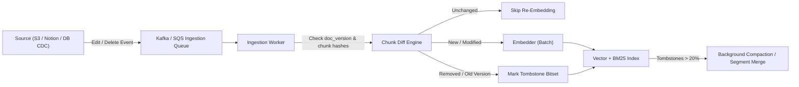
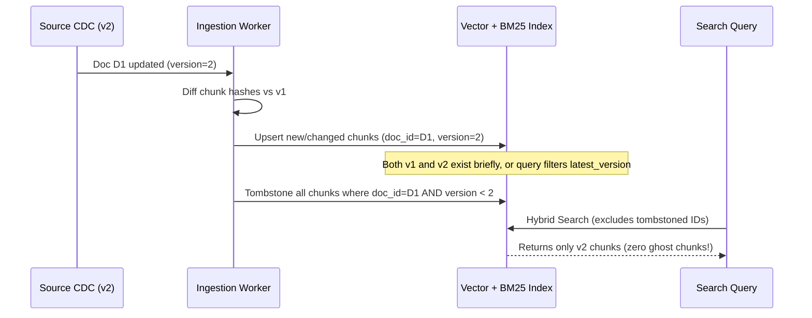
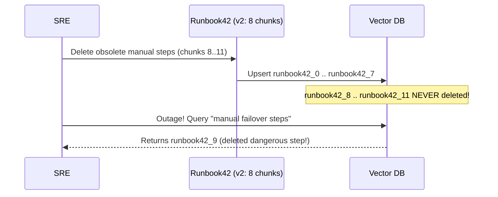

# RAG Index Freshness: Incremental Updates, Deletions & Tombstones

> **Prerequisites:** [Lesson 13: Retrieval Evaluation for RAG](../13-retrieval-evaluation-for-rag/README.md) · [Lesson 07: Vector Indexes: HNSW, IVF, PQ](../09-vector-databases/README.md).  
> **Estimated Reading Time:** 23–27 minutes  
> **Target Audience:** Distributed systems and AI data-pipeline engineers designing live RAG ingestion, and candidates asked "how do you keep a vector + BM25 index fresh when documents are edited or deleted without rebuilding the whole index?"  
> **Free PDF Notes:** [Download SD-S-014.pdf](https://backendroadmap.com/notes/system-design/SD-S-014.pdf)

> [!NOTE]
> **In one line:** **RAG index freshness** keeps vector (HNSW/IVF) and lexical (BM25) indexes synchronized with live source-of-truth mutations via **content-hash chunk diffing**, **atomic delete-before-insert (or versioned) upserts**, **tombstone bitmaps** for soft deletes, and **periodic compaction** to reclaim HNSW graph health and storage.

> [!TIP]
> **The Golden Rule:** Never run a nightly full-corpus re-embed at scale, and never leave orphan chunks behind when a document shrinks from 12 chunks to 8. Key chunks deterministically by `(doc_id, version)` or content hash, mark old chunks with **tombstones** for instant search exclusion, and compact HNSW segments asynchronously.

---

## 1. What RAG Index Freshness Is, and What It Isn't

At 10:02 AM, Legal updates a pricing policy PDF in Notion/S3, removing an old $99 tier. At 10:05 AM, a sales rep asks the RAG assistant about pricing and receives the deleted $99 tier—because the nightly batch re-index won't run until 2:00 AM. Worse: even if the pipeline *did* run incrementally, if the edited PDF shrank from 10 chunks to 7 chunks and the ingestion worker only upserted chunks `0..6`, **chunks `7, 8, 9` remain in the vector index forever as "ghost chunks."**

| Term | Precise Meaning | Example |
| :--- | :--- | :--- |
| **Index Freshness SLO** | Max allowed lag between source mutation and search visibility | $p_{95} \le 60\text{ s}$ for edits; $\le 5\text{ s}$ for security deletions |
| **Incremental Ingestion (CDC)** | Processing only changed/deleted docs via webhooks, Kafka, or CDC | S3 `ObjectCreated` / `ObjectRemoved` $\rightarrow$ ingestion queue |
| **Content-Hash Diffing** | Hashing `(chunk_text + metadata)` to skip re-embedding unchanged chunks | 90% of a 50-page doc is unchanged $\rightarrow$ embed only 10% |
| **Ghost / Orphan Chunks** | Stale chunks left behind when a document shrinks or is edited | Old chunks `7..9` still returned in top-5 after edit |
| **Tombstone** | Lightweight bitset/flag marking a vector ID as deleted without immediate graph surgery | HNSW skips tombstoned IDs at query time ($< 1\text{ ms}$) |
| **Compaction / Vacuum** | Background rebuild/merge removing tombstoned vectors & freeing RAM | Triggered when tombstone ratio $> 15\text{–}20\%$ |
| **Not** | In-place HNSW edge rewiring on every delete | Deleting from HNSW in-place degrades graph connectivity |

### Why It Matters
1. Stale or ghost chunks cause **confident, cited hallucinations**—the LLM quotes a deleted policy with a valid-looking source link.
2. Vector embeddings are expensive ($O(\text{tokens})$ GPU/API cost); full nightly rebuilds don't scale past hundreds of thousands of documents.
3. HNSW graphs cannot cheaply "un-delete" nodes in-place without breaking small-world navigation; tombstones + compaction are how production vector DBs (Qdrant, Milvus, Vespa, Lucene) solve this.

---

## 2. Anatomy: Event-Driven Incremental Indexing & Tombstone Lifecycle



Notice the two-speed design:
- **Fast Path (Seconds):** Tombstones immediately hide deleted/superseded chunks from search results (using a roaring bitmap / deleted-ID filter during HNSW traversal), and new chunks are appended to a writable delta segment or live index.
- **Slow Path (Minutes/Hours):** Background compaction merges segments, physically purges tombstoned vectors, and rebuilds clean HNSW sub-graphs without blocking reads.

| Operation | Naive Approach | Production Approach | Failure Avoided |
| :--- | :--- | :--- | :--- |
| **Document Edit** | Re-embed all chunks, upsert `chunk_0..N` | Diff chunk hashes; upsert new + tombstone old `doc_id` chunks | Ghost chunks & wasted embedding cost |
| **Document Delete** | Nightly full rebuild | Immediate tombstone bitset + async compaction | Serving deleted/revoked data for 24h |
| **Bulk Re-index** | Overwrite live index in-place | Dual-write / Blue-Green index alias swap | Partial/mixed embedding versions during migration |

> [!WARNING]
> **The #1 Trap: Out-of-Order Ingestion Events.** If `Edit(v1)` is retried from a dead-letter queue *after* `Edit(v2)` already succeeded, `v1` silently overwrites `v2`! Always attach a monotonic `doc_version` (or `updated_at` timestamp) to every event and reject writes where `incoming_version <= stored_version`.

---

## 3. Mathematical Model: Freshness Lag, Tombstone Overhead & Compaction

**End-to-End Freshness Lag.** For an event-driven CDC pipeline:

$$T_{\text{fresh}} = T_{\text{cdc}} + T_{\text{queue}} + T_{\text{parse+embed}} + T_{\text{index\_commit}}$$

**HNSW Tombstone Traversal Penalty.** When fraction $\delta \in [0, 1)$ of vectors in an HNSW segment are tombstoned (soft-deleted), only $(1 - \delta)$ of visited nodes are valid candidates. To still return $k$ valid results at target recall, the effective search budget `efSearch` must expand:

$$\text{efSearch}_{\text{eff}} \approx \frac{\text{efSearch}_{\text{base}}}{1 - \delta}$$

and query latency scales roughly proportionally to $\frac{1}{1 - \delta}$ until compaction runs.

**Incremental Cost Savings.** If a corpus has $N = 1{,}000{,}000$ chunks and $p = 2\%$ of documents change daily (with $40\%$ of chunks inside edited docs unchanged):

$$\text{Chunks Embedded (Incremental)} = 1{,}000{,}000 \times 0.02 \times (1 - 0.40) = \mathbf{12{,}000/\text{day}}$$

compared to $1{,}000{,}000/\text{day}$ for a full rebuild—an **$83.3\times$ cost and compute reduction**.

### Worked Numerical Example (Tombstone Degradation)
Suppose an HNSW index holds $2{,}000{,}000$ chunks with baseline `efSearch = 64` and $p_{95}$ latency $= 14\text{ ms}$.
- At **$\delta = 0.20$ (20% tombstoned):** $\text{efSearch}_{\text{eff}} \approx 64 / 0.80 = 80$, latency rises modestly to $\sim 17.5\text{ ms}$.
- At **$\delta = 0.70$ (70% tombstoned, compaction neglected):** $\text{efSearch}_{\text{eff}} \approx 64 / 0.30 = 213$, latency jumps to $\sim 47\text{ ms}$, and disconnected graph islands cause Recall@10 to drop sharply.

**Takeaway:** Trigger background compaction when segment tombstone ratio $\delta \ge 0.15\text{–}0.20$.

---

## 4. Metrics & Percentiles

| Metric | Meaning | Alert when |
| :--- | :--- | :--- |
| **Freshness Lag $p_{95}$** | Time from source edit/delete to index visibility | Exceeds SLO (e.g., $> 60\text{ s}$ for edits, $> 10\text{ s}$ for deletes) |
| **Tombstone Ratio ($\delta$)** | Fraction of soft-deleted vectors in active segments | $> 0.20$ (compaction falling behind) |
| **Ghost Chunk Rate** | Stale/deleted `doc_id`s appearing in audit queries | $> 0$ (broken delete/version logic) |
| **Chunk Cache Hit Rate** | % of chunks skipped via content-hash match on edit | Sudden drop (unstable chunker or non-deterministic IDs) |
| **Ingestion DLQ Depth** | Failed parse/embed events stuck in dead-letter queue | $> 0$ sustained (silent index staleness) |
| **Dual-Index Sync Drift** | Count/version mismatch between BM25 and Vector DB | $> 0.1\%$ (one store updated, other failed) |

### Worked Example (Live Legal Policy Portal)
A legal portal stores 500,000 contracts (~4M chunks). Daily churn is 3,000 edits and 500 deletions:
- **Edit pipeline:** S3/DB CDC $\rightarrow$ Kafka $\rightarrow$ worker hashes chunks $\rightarrow$ embeds only changed chunks (18,000/day instead of 4M) $\rightarrow$ writes new version `v_new` $\rightarrow$ tombstones `v_old`. Freshness $p_{95} = 18\text{ s}$.
- **Delete pipeline:** Priority topic bypasses embedding queue, directly marks all `doc_id` chunks tombstoned in both Qdrant/Milvus and Elasticsearch in **$< 2\text{ s}$**.

---

## 5. Compounding & Failure Modes: Dual-Write Drift & Compaction Storms

1. **Vector + BM25 Split-Brain:** If an ingestion worker writes to the Vector DB and crashes before updating Elasticsearch (or vice versa), hybrid search returns deleted docs from one engine and new docs from the other. **Fix:** Use a durable workflow/outbox or idempotent retry queue keyed by `(doc_id, version)` that updates both stores before acking.
2. **Compaction I/O Storm:** If all shards hit $\delta = 0.20$ at the same time (e.g., after a bulk tenant deletion), simultaneous HNSW rebuilds saturate CPU and disk IOPS, spiking search $p_{99}$ by $5\times$. **Fix:** Rate-limit compaction concurrency (1 segment at a time per node) and isolate compaction CPU pools.

---

## 6. Numbers Every Engineer Must Know

| Item | Typical | Implication |
| :--- | :--- | :--- |
| **Compaction threshold ($\delta$)** | 15%–20% tombstones | Balances RAM waste & latency vs rebuild CPU |
| **Delete propagation SLO** | 1–10 seconds | Security/GDPR deletes must bypass slow embedding queues |
| **Edit freshness SLO** | 15–120 seconds | Event-driven CDC + micro-batch embedding |
| **Content hash savings** | 40%–85% fewer embeds | Huge GPU/API savings on minor doc edits |
| **Version retention window** | 1–5 minutes | Keep `v_old` until `v_new` is committed, then tombstone `v_old` |
| **Blue-Green full re-index** | Only on model/dim change | Never mix 2 different embedding models in 1 vector space |

---

## 7. Protocol / Mechanism Deep Dive: Atomic Versioned Swap (Zero-Downtime Edit)



Why **upsert-new-then-tombstone-old** instead of **delete-old-then-insert-new**?
- If you delete `v1` *first* and embedding `v2` takes 8 seconds (or fails mid-way), the document **vanishes completely** from search during that window!
- By inserting `v2` first and then tombstoning `version < 2`, the document stays searchable throughout, and ghost chunks are eliminated atomically.

**When NOT to use Incremental Tombstones:**
- **Changing the embedding model or vector dimensions:** You cannot mix `text-embedding-3-small` (1536d) and `bge-m3` (1024d) in the same HNSW index. Stand up a **new Blue-Green index**, backfill offline, validate on your golden set, and atomically flip the read alias.

---

## 8. Hierarchical Budgets & Design Rules

| Slice | Rule | Control |
| :--- | :--- | :--- |
| **Idempotent Keys** | Deterministic chunk ID = `sha256(doc_id + version + chunk_index)` | Prevents duplicate vectors on queue retries |
| **Monotonic Versioning** | Reject events where `event.version <= doc_store.latest_version` | Prevents out-of-order stale overwrites |
| **Delete Fast-Lane** | Route `DELETE` events to a dedicated high-priority queue | No embedding needed; tombstones apply in $< 5\text{ s}$ |
| **Atomic Visibility** | Insert `v_new` before tombstoning `version < v_new` | Eliminates search blackout window during edits |
| **Tombstone Cap** | Trigger throttled compaction when $\delta > 0.20$ | Keeps `efSearch` effective and RAM bounded |
| **Model Migration** | Blue-Green index + dual-write during cutover + alias swap | Zero-downtime embedding upgrades |

---

## 9. Top Mitigations

1. **Always include `doc_version` in chunk metadata:** Enables one-shot cleanup (`delete where doc_id = X and version < Y`) so shrinking documents never leave ghost chunks.
2. **Use content-hash chunk diffing:** Store `chunk_hash` in a fast metadata DB (Postgres/Redis/DynamoDB); if `new_hash` already exists for `doc_id`, reuse the existing vector or skip re-embedding.
3. **Separate Delete and Upsert queues:** A 50,000-doc backfill must never block a user's immediate `DELETE` request.
4. **Enforce monotonic version checks:** Protect against Kafka rebalance/DLQ replay ordering bugs with an atomic compare-and-set on `doc_version`.
5. **Throttle background compaction:** Cap compaction threads/IOPS so HNSW rebuilds don't degrade live search $p_{99}$.
6. **Run a periodic reconciliation sweeper:** A lightweight weekly job compares `doc_id`s in the source-of-truth DB against the vector/BM25 index to catch any missed webhook/CDC events.
7. **Dual-write both Vector DB and BM25 from one idempotent orchestrator:** Retrying until both succeed prevents lexical/semantic split-brain.

---

## 10. Production Reference / War Story: The Shrinking Runbook Ghost

**Incident (SEV-2):** An engineering team used deterministic IDs `docId_chunkIndex` (e.g., `runbook42_0` through `runbook42_11`) without deleting trailing chunks on edit. A critical database failover runbook was edited to remove 4 obsolete manual steps, shrinking from 12 chunks to 8 chunks.



**Root Cause:**
1. Chunk IDs were positional (`docId_chunkIndex`), and the ingestion pipeline only overwrote `0..7`, leaving `8..11` alive forever.
2. No `doc_version` metadata or tombstone cleanup existed.

**Fix:**
1. Switched to **versioned upserts + tombstone cleanup**: upsert `doc_id=runbook42, version=v2`, then immediately delete/tombstone `doc_id=runbook42 AND version < v2`.
2. Added a nightly reconciliation audit checking `chunk_count(index) == chunk_count(expected)` for recently modified docs.

---

## 11. Multi-Language Production Code Tabs

````carousel
```go
// Go: Monotonic versioned upsert + content-hash diff + tombstone cleanup.
package main

import (
	"crypto/sha256"
	"encoding/hex"
	"fmt"
	"sync"
)

type ChunkRecord struct {
	ID      string
	DocID   string
	Version int64
	Hash    string
	Deleted bool
}

type VersionedIndex struct {
	mu          sync.Mutex
	latestVer   map[string]int64
	chunks      map[string]ChunkRecord
}

func hashText(s string) string {
	h := sha256.Sum256([]byte(s))
	return hex.EncodeToString(h[:8])
}

func (idx *VersionedIndex) UpsertDocument(docID string, version int64, texts []string) (embedded int, tombstoned int) {
	idx.mu.Lock()
	defer idx.mu.Unlock()

	if version <= idx.latestVer[docID] {
		return 0, 0 // Reject stale / out-of-order event
	}

	// 1. Insert new version chunks first (zero blackout)
	for i, txt := range texts {
		id := fmt.Sprintf("%s_v%d_%d", docID, version, i)
		idx.chunks[id] = ChunkRecord{ID: id, DocID: docID, Version: version, Hash: hashText(txt)}
		embedded++
	}

	// 2. Tombstone all older versions of this docID
	for id, rec := range idx.chunks {
		if rec.DocID == docID && rec.Version < version && !rec.Deleted {
			rec.Deleted = true
			idx.chunks[id] = rec
			tombstoned++
		}
	}
	idx.latestVer[docID] = version
	return embedded, tombstoned
}

func main() {
	idx := &VersionedIndex{latestVer: map[string]int64{}, chunks: map[string]ChunkRecord{}}
	fmt.Println(idx.UpsertDocument("doc1", 1, []string{"a", "b", "c"})) // 3, 0
	fmt.Println(idx.UpsertDocument("doc1", 2, []string{"a", "d"}))      // 2, 3 (no ghosts!)
}
```
<!-- slide -->
```typescript
// TypeScript: Content-hash chunk diffing + monotonic version guard.
import { createHash } from "crypto";

export interface IndexedChunk {
  id: string;
  docId: string;
  version: number;
  hash: string;
  tombstoned: boolean;
}

export class FreshIndex {
  private docVersions = new Map<string, number>();
  private store = new Map<string, IndexedChunk>();

  private hashChunk(text: string): string {
    return createHash("sha256").update(text).digest("hex").slice(0, 16);
  }

  upsertDoc(docId: string, version: number, chunks: string[]): { embedded: number; reused: number; tombstoned: number } {
    const currentVer = this.docVersions.get(docId) ?? 0;
    if (version <= currentVer) return { embedded: 0, reused: 0, tombstoned: 0 }; // Stale event

    const existingHashes = new Set(
      Array.from(this.store.values())
        .filter((c) => c.docId === docId && !c.tombstoned)
        .map((c) => c.hash)
    );

    let embedded = 0, reused = 0, tombstoned = 0;
    const newHashes = new Set<string>();

    chunks.forEach((text, i) => {
      const hash = this.hashChunk(text);
      newHashes.add(hash);
      if (existingHashes.has(hash)) {
        reused++;
      } else {
        const id = `${docId}_v${version}_${i}`;
        this.store.set(id, { id, docId, version, hash, tombstoned: false });
        embedded++;
      }
    });

    for (const [id, rec] of this.store.entries()) {
      if (rec.docId === docId && !rec.tombstoned && (!newHashes.has(rec.hash) || rec.version < version && !existingHashes.has(rec.hash))) {
        if (!newHashes.has(rec.hash)) {
          rec.tombstoned = true;
          this.store.set(id, rec);
          tombstoned++;
        }
      }
    }
    this.docVersions.set(docId, version);
    return { embedded, reused, tombstoned };
  }
}
```
<!-- slide -->
```python
# Python 3.13: Incremental chunk diffing, tombstone tracking, and compaction trigger.
import hashlib
from dataclasses import dataclass, replace


@dataclass(frozen=True)
class Chunk:
    chunk_id: str
    doc_id: str
    version: int
    content_hash: str
    tombstoned: bool = False


class IncrementalRAGIndex:
    def __init__(self, compaction_threshold: float = 0.20) -> None:
        self.doc_versions: dict[str, int] = {}
        self.chunks: dict[str, Chunk] = {}
        self.compaction_threshold = compaction_threshold

    @staticmethod
    def _hash(text: str) -> str:
        return hashlib.sha256(text.encode("utf-8")).hexdigest()[:16]

    def upsert_document(self, doc_id: str, version: int, chunk_texts: list[str]) -> dict[str, int]:
        if version <= self.doc_versions.get(doc_id, 0):
            return {"skipped_stale": 1, "embedded": 0, "tombstoned": 0}

        # 1. Insert new version chunks first
        for i, text in enumerate(chunk_texts):
            cid = f"{doc_id}:v{version}:{i}"
            self.chunks[cid] = Chunk(cid, doc_id, version, self._hash(text))

        # 2. Tombstone all older versions for doc_id
        tombstoned = 0
        for cid, ch in list(self.chunks.items()):
            if ch.doc_id == doc_id and ch.version < version and not ch.tombstoned:
                self.chunks[cid] = replace(ch, tombstoned=True)
                tombstoned += 1

        self.doc_versions[doc_id] = version
        return {"skipped_stale": 0, "embedded": len(chunk_texts), "tombstoned": tombstoned}

    def tombstone_ratio(self) -> float:
        if not self.chunks:
            return 0.0
        dead = sum(1 for c in self.chunks.values() if c.tombstoned)
        return dead / len(self.chunks)

    def compact_if_needed(self) -> int:
        if self.tombstone_ratio() < self.compaction_threshold:
            return 0
        before = len(self.chunks)
        self.chunks = {cid: c for cid, c in self.chunks.items() if not c.tombstoned}
        return before - len(self.chunks)
```
<!-- slide -->
```csharp
// C#: Atomic versioned document upsert with tombstone cleanup and compaction check.
using System;
using System.Collections.Generic;
using System.Linq;
using System.Security.Cryptography;
using System.Text;

public sealed record ChunkEntry(string Id, string DocId, long Version, string Hash, bool Tombstoned);

public sealed class FreshRagIndex
{
    private readonly Dictionary<string, long> _versions = new();
    private readonly Dictionary<string, ChunkEntry> _store = new();

    private static string HashText(string s) =>
        Convert.ToHexString(SHA256.HashData(Encoding.UTF8.GetBytes(s)))[..16];

    public (int Embedded, int Tombstoned) Upsert(string docId, long version, IReadOnlyList<string> texts)
    {
        if (_versions.TryGetValue(docId, out var cur) && version <= cur)
            return (0, 0); // Ignore stale event

        for (int i = 0; i < texts.Count; i++)
        {
            var id = $"{docId}:v{version}:{i}";
            _store[id] = new ChunkEntry(id, docId, version, HashText(texts[i]), false);
        }

        int tombstoned = 0;
        foreach (var kv in _store.Where(x => x.Value.DocId == docId && x.Value.Version < version && !x.Value.Tombstoned).ToList())
        {
            _store[kv.Key] = kv.Value with { Tombstoned = true };
            tombstoned++;
        }

        _versions[docId] = version;
        return (texts.Count, tombstoned);
    }

    public double TombstoneRatio() =>
        _store.Count == 0 ? 0.0 : (double)_store.Values.Count(c => c.Tombstoned) / _store.Count;
}
```
````

---

## 12. Hands-On CLI Verification Workflows

Simulate tombstone ratio and effective `efSearch` scaling in Python:

```bash
python -c "
ef_base = 64
for delta in [0.0, 0.15, 0.20, 0.50, 0.70]:
    ef_eff = ef_base / (1 - delta)
    print(f'tombstone={delta:.0%} -> efSearch_eff={ef_eff:.1f}')
"
```

Inspect segment/tombstone health and trigger deletion in Qdrant / Elasticsearch:

```bash
# Qdrant: delete all chunks for a stale doc version via payload filter
curl -s -X POST "http://localhost:6333/collections/docs/points/delete" \
  -H "Content-Type: application/json" \
  -d '{
    "filter": {
      "must": [
        { "key": "doc_id", "match": { "value": "runbook42" } },
        { "key": "version", "range": { "lt": 2 } }
      ]
    }
  }'

# Elasticsearch: check deleted (tombstoned) doc ratio per index
curl -s "http://localhost:9200/_cat/indices/docs?v&h=index,docs.count,docs.deleted,store.size"
```

---

## 13. Common Mistakes to Avoid

1. **Overwriting `docId_chunkIndex` without deleting trailing chunks**, leaving permanent ghost chunks whenever a document shrinks.
2. **Deleting old chunks *before* embedding new ones**, creating a search blackout window if embedding is slow or fails.
3. **Ignoring out-of-order queue retries**, allowing a delayed `v1` event to overwrite `v2`.
4. **Running nightly full-corpus re-embeds**, wasting 95%+ compute and violating freshness SLOs.
5. **Never compacting tombstoned HNSW segments**, causing `efSearch` latency inflation and graph degradation.
6. **Updating Vector DB and BM25 non-atomically without retries**, causing lexical vs semantic split-brain.
7. **Mixing two embedding models in the same index** during an incremental rollout instead of using a Blue-Green alias swap.

---

## 14. Key Terms Glossary

| Key Term | Definition |
| :--- | :--- |
| **Index Freshness SLO** | Target maximum delay between a source mutation and search index visibility. |
| **CDC (Change Data Capture)** | Streaming database or storage mutations (inserts, updates, deletes) into an ingestion pipeline. |
| **Content-Hash Diffing** | Comparing hashes of new chunks against stored hashes to skip re-embedding unchanged text. |
| **Ghost / Orphan Chunk** | Stale chunk remaining in an index after a document is edited/shrunk or deleted. |
| **Tombstone** | Soft-delete marker (bitset/flag) excluding a vector from search until background compaction. |
| **Compaction** | Background segment merge that physically purges tombstoned vectors and rebuilds clean HNSW graphs. |
| **Monotonic Version Guard** | Rejecting ingestion events whose `version <= stored_version` to prevent stale overwrites. |
| **Dual-Write Drift** | Desynchronization between the Vector DB and BM25 index after partial write failure. |
| **Blue-Green Index** | Building a new index offline (e.g., for a new embedding model) and swapping the read alias atomically. |
| **Reconciliation Sweeper** | Periodic audit comparing source-of-truth document IDs/versions against the search index. |

---

## 15. System Design Interview Questions & Answers

### Basic Conceptual Questions

<details>
<summary><strong>Q1: Why can't you just delete nodes in-place from an HNSW graph? [BASIC]</strong></summary>

**Answer:**
HNSW is a multi-layer proximity graph where every node acts as a routing hop for other nodes. Removing a node in-place requires expensive local rewiring and can still fragment graph connectivity. Instead, vector DBs mark deleted nodes with a **tombstone** (bitset) to skip them at query time and physically purge them during periodic background **compaction**.
</details>

<details>
<summary><strong>Q2: What are "ghost chunks" and how do they happen? [BASIC]</strong></summary>

**Answer:**
Ghost chunks are leftover stale chunks from an older version of an edited document. If `doc1` had 10 chunks (`doc1_0..9`) and an edit shrinks it to 6 chunks (`doc1_0..5`), simply upserting `0..5` leaves `6..9` in the index forever, causing the LLM to cite deleted content.
</details>

<details>
<summary><strong>Q3: How does content-hash diffing save cost on incremental updates? [BASIC]</strong></summary>

**Answer:**
When a 50-page document has a 1-paragraph typo fix, 98% of its chunks are identical. By hashing each chunk's text + metadata and comparing against stored hashes for that `doc_id`, you only call the embedding model on the 1–2 changed chunks.
</details>

<details>
<summary><strong>Q4: Why should you upsert `v_new` before tombstoning `v_old`? [BASIC]</strong></summary>

**Answer:**
Deleting `v_old` first creates a window (seconds to minutes while `v_new` is chunked and embedded) where the document is completely missing from search. Inserting `v_new` first and then tombstoning `version < v_new` guarantees zero search downtime.
</details>

### Scenario-Based Architecture Questions

<details>
<summary><strong>Q5: A user deletes a confidential HR file and expects it unsearchable within 5 seconds, but your embedding queue has a 20-minute backlog. What do you do? [SCENARIO]</strong></summary>

**Answer:**
Decouple `DELETE` events onto a **dedicated high-priority fast lane** that bypasses chunking and embedding completely. The delete worker immediately issues a metadata-filter delete/tombstone (`doc_id = X`) to both the Vector DB and BM25 in under 2 seconds.
</details>

<details>
<summary><strong>Q6: After 3 months of heavy churn, your HNSW search latency doubled even though total active vectors stayed flat. Why? [SCENARIO]</strong></summary>

**Answer:**
Accumulated **tombstones** (e.g., 50%+ deleted vectors in segments). HNSW still traverses tombstoned nodes and must expand `efSearch` by $1/(1-\delta)$ to collect $k$ valid results. Triggering background compaction when $\delta > 15\text{–}20\%$ restores baseline latency.
</details>

<details>
<summary><strong>Q7: How do you handle upgrading from `text-embedding-3-small` to a new embedding model on 50M chunks with zero downtime? [SCENARIO]</strong></summary>

**Answer:**
Use a **Blue-Green index alias** pattern: provision a new index for the new model, backfill all 50M chunks offline while dual-writing live CDC updates to both old and new indexes, validate Recall@50/NDCG@5 on your golden set, and atomically flip the search alias.
</details>

<details>
<summary><strong>Q8: Your Kafka consumer retries a failed `v1` edit event after `v2` was already indexed. How do you prevent data regression? [SCENARIO]</strong></summary>

**Answer:**
Store a monotonic `doc_version` (or source `etag`/`updated_at`) per document and enforce an atomic version check (`if incoming_version <= stored_version: ack and drop`) before writing to the index.
</details>

### Advanced & Tricky Interview Questions

<details>
<summary><strong>Q9: How do you guarantee consistency between a Vector DB and a BM25 engine during incremental updates? [TRICKY]</strong></summary>

**Answer:**
Neither supports distributed 2PC across the other. Use an **idempotent orchestrator** (or Temporal/outbox pattern) keyed by `(doc_id, version)` that writes to both stores with retries until both succeed, backed by a periodic reconciliation sweeper that diffs `(doc_id, version)` across source, Vector DB, and BM25.
</details>

<details>
<summary><strong>Q10: If you insert `v2` before tombstoning `v1`, can a user briefly see both `v1` and `v2` chunks in the same query? [TRICKY]</strong></summary>

**Answer:**
Yes, for a few milliseconds between the two writes. If strict atomic cutover is required, store `active_version` in a fast metadata cache or use an index-level version filter; otherwise, deduplicating by `doc_id` or keeping the window sub-100 ms (tombstoning immediately after batch upsert) is acceptable for most RAG apps.
</details>

<details>
<summary><strong>Q11: Why can't you just use `content_hash` alone as the primary key across different documents? [TRICKY]</strong></summary>

**Answer:**
Two different documents (e.g., two tenants or two projects) can share identical boilerplate paragraphs (*"Confidentiality Notice..."*). If `content_hash` alone is the primary key, deleting Document A would delete Document B's chunk! Always namespace primary keys by `(tenant_id, doc_id, version, chunk_index)`.
</details>

<details>
<summary><strong>Q12: How do you prevent background HNSW compaction from causing a p99 latency spike in production? [TRICKY]</strong></summary>

**Answer:**
Rate-limit compaction IOPS/CPU, stagger compaction across shards so only one segment compacts at a time per node, or route search traffic to read replicas while the primary/builder node compacts and swaps segments.
</details>

---

## 16. One-Page Master Cheat Sheet

```
+---------------------------------------------------------------------------------------------------------+
|                    RAG INDEX FRESHNESS — MASTER CHEAT SHEET                                             |
+---------------------------------------------------------------------------------------------------------+
| 1. INCREMENTAL CDC: Webhook/Kafka -> hash-diff chunks -> embed ONLY changed chunks (80x+ savings).      |
| 2. ZERO GHOST CHUNKS: Upsert v_new FIRST, then tombstone all (doc_id, version < v_new).                 |
|    Reject out-of-order events with monotonic version guard (incoming_ver <= stored_ver).                |
| 3. DELETE FAST-LANE: Bypass embedding queue; tombstone by doc_id in < 5s for security/GDPR deletes.     |
| 4. TOMBSTONES & COMPACTION: Tombstones hide deleted vectors instantly; efSearch scales as 1/(1-delta).  |
|    Compact asynchronously when tombstone ratio > 15-20% (throttle CPU/IOPS!).                           |
| 5. MODEL UPGRADES: Never mix embeddings in 1 index -> Blue-Green index + dual-write + alias swap.       |
+---------------------------------------------------------------------------------------------------------+
```

---

## Further Reading & Sources

- Qdrant Documentation, [Indexing, Segments, and Optimizer / Vacuum](https://qdrant.tech/documentation/concepts/optimizer/).
- Apache Lucene / Elasticsearch Documentation, [Near Real-Time Search & Segment Merging](https://www.elastic.co/guide/en/elasticsearch/reference/current/index-modules-merge.html).
- Yu. A. Malkov and D. A. Yashunin, *"Efficient and robust approximate nearest neighbor search using Hierarchical Navigable Small World graphs"* (IEEE TPAMI 2018).
- Martin Kleppmann, *Designing Data-Intensive Applications*, Chapter 11 ("Stream Processing & Change Data Capture").

---

## Free PDF Notes

[SD-S-014.pdf](https://backendroadmap.com/notes/system-design/SD-S-014.pdf)

---

## Next

Continue with [Tenant-Aware RAG: Isolation with Per-Tenant Indexes and Filters](../15-tenant-aware-rag/README.md).
