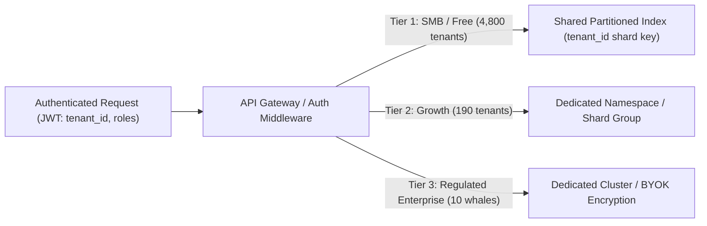
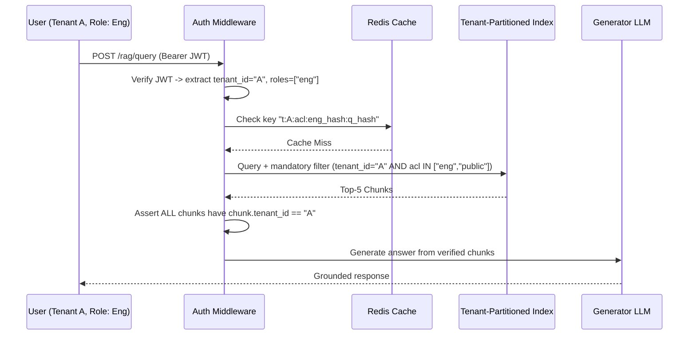
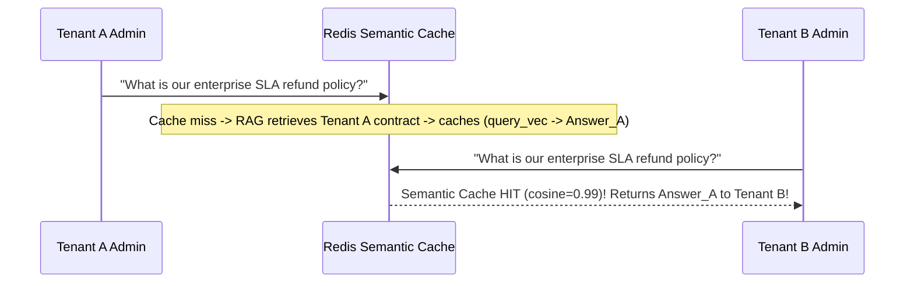

# Tenant-Aware RAG: Isolation with Per-Tenant Indexes and Filters

> **Prerequisites:** [Lesson 14: RAG Index Freshness](../14-rag-index-freshness/README.md) · [Lesson 10: Metadata Filtering in RAG](../10-metadata-filtering-in-rag/README.md).  
> **Estimated Reading Time:** 24–28 minutes  
> **Target Audience:** Staff/principal engineers designing multi-tenant B2B SaaS AI platforms, and candidates asked "how do you isolate tenant data in a vector database without going broke on RAM or leaking data across customers?"  
> **Free PDF Notes:** [Download SD-S-015.pdf](https://backendroadmap.com/notes/system-design/SD-S-015.pdf)

> [!NOTE]
> **In one line:** **Tenant-aware RAG** enforces strict **zero-leakage data isolation** and **noisy-neighbor protection** across multi-tenant corpora by choosing along the isolation spectrum—from **shared index + mandatory `tenant_id` filter**, to **tenant-partitioned HNSW sub-indexes (payload-indexed / shard-keyed)**, to **dedicated per-tenant indexes**—and enforcing `tenant_id` + ACLs server-side from verified JWT claims.

> [!TIP]
> **The Golden Rule:** Never trust a `tenant_id` sent in a client JSON body, and never spin up 10,000 separate HNSW collections on day one. Use a **tiered isolation model**: shared **tenant-partitioned** index for SMB/long-tail tenants (with server-injected `tenant_id` filters + payload-indexed HNSW) and **dedicated indexes/clusters** only for Enterprise/regulated whales.

---

## 1. What Tenant-Aware RAG Is, and What It Isn't

A B2B SaaS platform serves 5,000 companies. Company A asks its AI assistant: *"What is our Q4 acquisition budget?"* If a bug drops the `tenant_id` filter—or if an HNSW post-filter finds zero Company A matches in the global top-50 and returns Company B's M&A memo—that is an existential **cross-tenant data leak (SEV-0)**. Conversely, if you create 5,000 separate HNSW collections in memory, 4,900 tiny idle tenants still consume fixed per-index RAM, file descriptors, and segment overhead, bankrupting your vector cluster.

| Term | Precise Meaning | Example |
| :--- | :--- | :--- |
| **Shared Index + Filter** | All tenants in one vector/BM25 index; every query requires `tenant_id = X` | 5,000 SMB tenants in one Qdrant/OpenSearch collection |
| **Tenant-Partitioned HNSW** | Single logical collection with per-tenant HNSW sub-graphs or shard routing | Qdrant `is_tenant: true` payload index / Pinecone namespaces |
| **Dedicated Per-Tenant Index** | Isolated collection, shard, or cluster per enterprise customer | Healthcare/banking tenant with CMK encryption & EU residency |
| **Server-Side Auth Context** | Extracting `tenant_id` + `user_acl` from verified JWT/OIDC, never request body | API gateway injects `tenant_id` into retrieval filter |
| **Noisy Neighbor** | One tenant's bulk re-index or 500 QPS burst degrading other tenants' latency | Enterprise tenant ingests 1M PDFs and starves SMB search |
| **Not** | Prompt-level isolation (*"Only answer for Tenant A"*) | Prompts are advisory; isolation MUST be enforced in the DB query |

### Why It Matters
1. **Security & Compliance:** A single cross-tenant retrieval leak violates SOC 2 / GDPR / HIPAA and destroys customer trust—and the LLM will happily summarize leaked chunks if they enter its context window.
2. **HNSW Recall Trap:** In a global HNSW index, a tiny tenant (0.05% of vectors) gets starved by standard post-filtering; tenant-aware HNSW partitioning is required to preserve both speed and recall.
3. **Unit Economics:** Choosing between shared, partitioned, and dedicated indexes is a classic capacity-planning and cost-per-tenant trade-off in B2B AI interviews.

---

## 2. Anatomy: Three-Tier Multi-Tenant Isolation Spectrum



| Dimension | Shared + Filter | Tenant-Partitioned HNSW | Dedicated Per-Tenant Index |
| :--- | :--- | :--- | :--- |
| **Blast Radius (Bug)** | High (missing filter = leak) | Medium-Low (shard/namespace key) | Minimal (physical DB/cluster boundary) |
| **Small-Tenant Recall** | Poor with post-filter; OK with ACORN/pre-filter | High (dedicated per-tenant HNSW links) | Perfect (isolated graph) |
| **Fixed Overhead / Tenant** | ~0 bytes | Low (~few KB metadata) | High (MBs RAM, OS file handles, shards) |
| **GDPR / Offboarding Delete** | `delete where tenant_id=X` + compaction | Drop tenant partition/namespace | `DROP COLLECTION` (instant, zero tombstones) |
| **Noisy Neighbor Risk** | High (shared CPU/IOPS/compaction) | Medium (shard-level isolation possible) | Zero (isolated compute & storage) |
| **Max Tenants per Cluster** | 100,000+ | 10,000–50,000 | 50–500 |

> [!WARNING]
> **The #1 Trap: Global HNSW + Post-Filtering for Small Tenants.** Suppose Tenant X has 200 chunks inside a 2,000,000-chunk global HNSW index (selectivity $0.01\%$). If you run global ANN `topK = 50` and *then* filter `tenant_id == X`, almost all 50 global neighbors belong to larger tenants—leaving Tenant X with **0 results**! Always use **tenant-partitioned HNSW sub-graphs** or **single-stage filtered HNSW (ACORN / pre-filter bitmap)**, never post-filtering.

---

## 3. Mathematical Model: Memory Overhead, Selectivity, and Cost per Tenant

**Per-Tenant Index Fixed Overhead.** In Lucene/HNSW engines, each separate index/collection allocates fixed metadata, segment buffers, and HNSW layer tables $M_{\text{fixed}}$ (typically $15\text{–}50\text{ MB}$ minimum per shard/collection even when nearly empty), plus vector payload memory $N_t \cdot d \cdot b$:

$$M_{\text{dedicated}} = \sum_{t=1}^{T} \left( M_{\text{fixed}} + N_t \cdot d \cdot b \cdot (1 + \gamma_{\text{HNSW}}) \right)$$

where $d$ is embedding dimension, $b$ is bytes per component (4B FP32, 1B int8), and $\gamma_{\text{HNSW}} \approx 0.3\text{–}0.5$ is graph link overhead.

**Post-Filter Failure Probability.** If Tenant $t$ has fraction $p_t = N_t / N_{\text{total}}$ of the corpus and global ANN retrieves $K$ candidates before filtering, the expected number of tenant hits is $K \cdot p_t$, and the probability of getting **zero** hits (even when relevant docs exist) is approximately:

$$P(\text{zero hits}) \approx (1 - p_t)^K$$

### Worked Numerical Example
Consider $T = 5{,}000$ tenants, $d = 1536$ (FP32 = 6,144 B/vector, $\gamma_{\text{HNSW}} = 0.4 \Rightarrow 8{,}600\text{ B/vector}$), and average $N_t = 2{,}000$ chunks/tenant ($10\text{M}$ total vectors).

1. **Dedicated Index per Tenant ($M_{\text{fixed}} = 25\text{ MB}$):**
   - Vector RAM: $10{,}000{,}000 \times 8{,}600\text{ B} = 86\text{ GB}$
   - Fixed per-index overhead: $5{,}000 \times 25\text{ MB} = \mathbf{125{,}000\text{ MB} = 125\text{ GB}}$
   - **Total RAM:** $86 + 125 = \mathbf{211\text{ GB}}$ (59% of RAM is pure empty index overhead!).
2. **Shared Partitioned Index:**
   - Fixed overhead: $1 \times 25\text{ MB} \approx 0.025\text{ GB}$
   - **Total RAM:** $\approx \mathbf{86\text{ GB}}$ (saves **125 GB RAM** and 5,000× shard management!).
3. **Post-Filter Trap for Small Tenant ($N_t = 200$ in $10\text{M}$ total, $p_t = 2 \times 10^{-5}$, $K = 50$):**
   - $E[\text{hits}] = 50 \times 2 \times 10^{-5} = 0.001$
   - $P(\text{zero hits}) = (1 - 2 \times 10^{-5})^{50} = \mathbf{99.90\%}$ failure rate!

---

## 4. Metrics & Percentiles

| Metric | Meaning | Alert when |
| :--- | :--- | :--- |
| **Cross-Tenant Leak Count** | Retrieved chunk `doc.tenant_id != auth.tenant_id` | **$> 0$ (SEV-0 immediate page + circuit break)** |
| **Per-Tenant Recall@10** | Retrieval recall sliced by tenant size (small vs whale) | Small-tenant Recall@10 $< 0.80$ |
| **Tenant Search Latency $p_{99}$** | Tail latency per tenant tier | SMB $p_{99}$ spikes during whale ingestion |
| **Ingestion Queue Lag by Tenant** | Backlog per tenant | One tenant starving shared worker pool |
| **Storage / RAM per Tenant** | Resource footprint per customer | Whale tenant exceeds tier quota without auto-migration |
| **Missing-Filter Rejection Rate** | Queries rejected by DB proxy for lacking `tenant_id` | $> 0$ (catches developer bugs before DB hit) |

### Worked Example (Tiered B2B SaaS Routing)
A SaaS AI platform has 4,950 SMB tenants (1k–20k chunks each) and 50 Enterprise whales (2M–10M chunks each):
- **SMBs** live in a **shared tenant-partitioned Qdrant/OpenSearch cluster** routed by `tenant_id` shard key, with per-tenant rate limits (20 RPS search, 50 chunks/s ingest).
- **Whales** are auto-promoted to **dedicated shard groups / isolated indexes** with custom KMS keys and independent autoscaling.
- Result: $p_{95}$ search latency stays **$< 35\text{ ms}$** for both a 50-chunk startup and a 10M-chunk Fortune 500 tenant.

---

## 5. Compounding & Failure Modes: Noisy Neighbors & Document-Level ACLs

1. **Ingestion Noisy Neighbor:** An enterprise tenant uploads 500,000 PDFs at once. If all tenants share one Kafka topic and one embedding worker pool, SMB customers wait 4 hours for a 1-page edit to index. **Fix:** Fair-share scheduling (per-tenant token buckets or separate `whale_ingest` vs `smb_ingest` queues).
2. **Cache Poisoning Across Tenants:** A semantic/embedding response cache keyed only by `hash(query)` returns Tenant A's answer to Tenant B! **Fix:** Every cache key (Redis, semantic cache, reranker cache) MUST be prefixed with `(tenant_id, acl_group_hash, index_version)`.
3. **Coarse `tenant_id` Without User ACLs:** Tenant A's intern asks *"What is the CEO's compensation?"* Even with `tenant_id = A`, if the RAG index lacks user-level `acl_groups` (`["hr_exec"]`), it leaks confidential HR docs *within* the tenant. **Fix:** Always enforce `tenant_id == auth.tenant_id AND acl_groups INTERSECTS auth.user_groups`.

---

## 6. Numbers Every Engineer Must Know

| Item | Typical | Implication |
| :--- | :--- | :--- |
| **Dedicated index threshold** | $> 500\text{k–}1\text{M}$ chunks or compliance | Below this, shared partitioned index wins on RAM & ops |
| **Max collections per cluster** | 500–2,000 (engine-dependent) | Beyond this, metadata/file-handle overhead destabilizes nodes |
| **Tenant-partitioned HNSW** | `is_tenant: true` (Qdrant) / namespaces | Builds per-tenant HNSW sub-graphs inside 1 collection |
| **Cache key prefix** | `t:{tenant_id}:acl:{acl_hash}:q:{hash}` | Mandatory to prevent cross-tenant/cross-role cache leaks |
| **Per-tenant rate limit** | e.g., 20–100 RPS, 100 chunks/s | Prevents 1 tenant from exhausting shared GPU/DB pool |
| **Defense-in-depth assertion** | Post-query `assert doc.tenant == auth.tenant` | Zero-cost final guardrail before passing chunks to LLM |

---

## 7. Protocol / Mechanism Deep Dive: Defense-in-Depth Auth & Retrieval Flow



**When NOT to use a Shared Index:**
- **Strict Regulatory / Legal Isolation:** HIPAA, FedRAMP, or banking contracts requiring physical compute/storage separation or **Customer-Managed Encryption Keys (CMK/BYOK)** per tenant.
- **Data Residency Laws:** Tenant A requires data pinned to `eu-central-1` (Frankfurt) while Tenant B is in `us-east-1` (Virginia).
- **Custom Embedding Models per Tenant:** Tenant A uses a domain-fine-tuned medical embedder while Tenant B uses `text-embedding-3-large`.

---

## 8. Hierarchical Budgets & Design Rules

| Slice | Rule | Control |
| :--- | :--- | :--- |
| **Auth Boundary** | Extract `tenant_id` & `acl_groups` strictly from signed JWT/session | Reject or ignore any `tenant_id` in client request payload |
| **DB Proxy Guard** | Retrieval client refuses to execute any query without a non-empty `tenant_id` | Compile-time typed `TenantContext` parameter |
| **Post-Retrieval Assert** | Verify `chunk.tenant_id == ctx.tenant_id` on every returned chunk | Drop + trigger SEV-0 alert if mismatch ever occurs |
| **Cache Isolation** | Include `tenant_id` + `acl_hash` in every cache key | Prevents cross-tenant & privilege-escalation cache leaks |
| **Fair-Share Quotas** | Per-tenant token buckets for search RPS and ingestion throughput | Isolates noisy neighbors on shared clusters |
| **Tier Promotion** | Auto-promote tenants $> 1\text{M}$ chunks to dedicated shard/index | Keeps shared cluster balanced and whales isolated |

---

## 9. Top Mitigations

1. **Make `TenantContext` a required typed parameter in your retrieval SDK:** Never expose an unfiltered `search(query)` method to application code; require `search(ctx: TenantContext, query: str)`.
2. **Use tenant-partitioned HNSW (`is_tenant: true` / namespaces):** Gives you the RAM efficiency of 1 collection with the recall and speed of per-tenant HNSW graphs.
3. **Enforce user-level ACLs alongside `tenant_id`:** Index `acl_groups: list[str]` on every chunk and filter `acl_groups ∩ user.groups != ∅` so private HR/exec docs never leak inside a company.
4. **Add a post-retrieval runtime assertion before the LLM call:** A 3-line loop checking `if chunk.tenant_id != ctx.tenant_id: raise SecurityError` acts as an unbreakable last line of defense.
5. **Isolate semantic/embedding caches by `(tenant_id, acl_hash)`:** Never share LLM response caches across tenants or permission levels.
6. **Fair-queue ingestion by `tenant_id`:** Use round-robin or weighted fair queuing across tenants so a 500k-doc onboarding dump doesn't stall everyone else's 1-doc updates.
7. **Automate GDPR / tenant offboarding:** For shared indexes, run `delete_by_query(tenant_id=X)` + force-merge/compaction; for dedicated indexes, `drop_collection` is instant and cryptographically clean.

---

## 10. Production Reference / War Story: The Semantic Cache Cross-Tenant Leak

**Incident (SEV-0):** A multi-tenant customer-support AI platform added a Redis **semantic cache** (embedding similarity $> 0.96$) in front of its RAG pipeline to cut OpenAI costs by 35%. Two days later, Tenant B's admin asked *"What is our enterprise SLA refund policy?"* and received **Tenant A's confidential custom contract terms**.



**Root Cause:**
1. The vector/BM25 database itself had perfect `tenant_id` isolation, **but the semantic cache layer in front of it** indexed cached query vectors globally without partitioning by `tenant_id`!
2. Even within a single tenant, caching without `acl_group_hash` would have leaked HR/executive answers to standard employees.

**Fix:**
1. Immediately flushed the global semantic cache and disabled cross-tenant caching.
2. Rebuilt the cache key/filter to **require `(tenant_id, acl_group_hash, index_version)`** as a mandatory partition prefix before any similarity lookup.
3. Added an automated integration test in CI that runs identical queries as Tenant A and Tenant B and asserts zero shared cache hits or document IDs.

---

## 11. Multi-Language Production Code Tabs

````carousel
```go
// Go: Type-safe TenantContext, mandatory DB filter, and defense-in-depth post-assert.
package main

import (
	"context"
	"errors"
	"fmt"
)

type TenantContext struct {
	TenantID  string
	ACLGroups []string
}

type Chunk struct {
	ID       string
	TenantID string
	ACL      []string
	Text     string
}

var ErrSecurityViolation = errors.New("cross-tenant data leak detected")

func SearchTenantSafe(ctx context.Context, tc TenantContext, query string,
	backendSearch func(context.Context, string, string, []string) ([]Chunk, error)) ([]Chunk, error) {

	if tc.TenantID == "" {
		return nil, errors.New("tenant_id is required")
	}

	// 1. Mandatory server-side filter pushed to Vector + BM25 index
	chunks, err := backendSearch(ctx, query, tc.TenantID, tc.ACLGroups)
	if err != nil {
		return nil, err
	}

	// 2. Defense-in-depth runtime assertion before LLM sees any chunk
	for _, c := range chunks {
		if c.TenantID != tc.TenantID {
			return nil, fmt.Errorf("%w: expected %s got %s", ErrSecurityViolation, tc.TenantID, c.TenantID)
		}
	}
	return chunks, nil
}

func main() {
	tc := TenantContext{TenantID: "acme", ACLGroups: []string{"eng", "public"}}
	res, err := SearchTenantSafe(context.Background(), tc, "SLA policy", func(_ context.Context, _ string, tid string, _ []string) ([]Chunk, error) {
		return []Chunk{{ID: "c1", TenantID: tid, Text: "99.9% SLA"}}, nil
	})
	fmt.Println(len(res), err)
}
```
<!-- slide -->
```typescript
// TypeScript: Tenant-scoped RAG retriever with isolated cache key & post-query assertion.
import { createHash } from "crypto";

export interface AuthContext {
  readonly tenantId: string;
  readonly aclGroups: readonly string[];
}

export interface RagChunk {
  id: string;
  tenantId: string;
  text: string;
}

export function buildTenantCacheKey(auth: AuthContext, query: string, indexVer: number): string {
  if (!auth.tenantId) throw new Error("Missing tenantId");
  const aclHash = createHash("sha256")
    .update([...auth.aclGroups].sort().join(","))
    .digest("hex")
    .slice(0, 12);
  const qHash = createHash("sha256").update(query.trim().toLowerCase()).digest("hex").slice(0, 16);
  return `rag:v${indexVer}:t:${auth.tenantId}:acl:${aclHash}:q:${qHash}`;
}

export async function retrieveForTenant(
  auth: AuthContext,
  query: string,
  vectorSearch: (q: string, filter: { tenantId: string; aclGroups: readonly string[] }) => Promise<RagChunk[]>
): Promise<RagChunk[]> {
  if (!auth.tenantId) throw new Error("Unauthenticated tenant context");

  const chunks = await vectorSearch(query, { tenantId: auth.tenantId, aclGroups: auth.aclGroups });

  // Defense-in-depth invariant check
  for (const ch of chunks) {
    if (ch.tenantId !== auth.tenantId) {
      throw new Error(`SEV-0 Cross-tenant leak blocked: expected ${auth.tenantId}, got ${ch.tenantId}`);
    }
  }
  return chunks;
}
```
<!-- slide -->
```python
# Python 3.13: Tiered tenant router, isolated cache key, and zero-leakage assertion.
import hashlib
from dataclasses import dataclass
from typing import Callable


@dataclass(frozen=True)
class TenantContext:
    tenant_id: str
    acl_groups: frozenset[str]
    tier: str = "smb"  # "smb" | "growth" | "enterprise"


@dataclass(frozen=True)
class Chunk:
    chunk_id: str
    tenant_id: str
    acl_groups: frozenset[str]
    text: str


def tenant_cache_key(ctx: TenantContext, query: str, index_version: int) -> str:
    if not ctx.tenant_id:
        raise ValueError("tenant_id must be non-empty")
    acl_sig = hashlib.sha256(",".join(sorted(ctx.acl_groups)).encode()).hexdigest()[:12]
    q_sig = hashlib.sha256(query.strip().lower().encode()).hexdigest()[:16]
    return f"t:{ctx.tenant_id}:acl:{acl_sig}:v{index_version}:q:{q_sig}"


def resolve_index_target(ctx: TenantContext) -> str:
    """Route SMBs to shared partitioned index; whales to dedicated index."""
    if ctx.tier == "enterprise":
        return f"rag_dedicated_{ctx.tenant_id}"
    return "rag_shared_partitioned"


def safe_retrieve(
    ctx: TenantContext,
    query: str,
    search_fn: Callable[[str, str, TenantContext], list[Chunk]],
) -> list[Chunk]:
    if not ctx.tenant_id:
        raise PermissionError("Missing tenant_id in auth context")

    target_index = resolve_index_target(ctx)
    results = search_fn(target_index, query, ctx)

    # Unbreakable runtime guard before LLM generation
    for chunk in results:
        if chunk.tenant_id != ctx.tenant_id:
            raise SecurityError(f"Blocked cross-tenant chunk {chunk.chunk_id} ({chunk.tenant_id})")
        if not (chunk.acl_groups & ctx.acl_groups):
            raise PermissionError(f"Blocked unauthorized ACL chunk {chunk.chunk_id}")
    return results


class SecurityError(RuntimeError):
    pass
```
<!-- slide -->
```csharp
// C#: Mandatory TenantContext filter and defense-in-depth post-retrieval guard.
using System;
using System.Collections.Generic;
using System.Security;
using System.Threading.Tasks;

public sealed record TenantContext(string TenantId, IReadOnlySet<string> AclGroups, string Tier = "smb");
public sealed record TenantChunk(string Id, string TenantId, IReadOnlySet<string> AclGroups, string Text);

public static class TenantAwareRetriever
{
    public static string ResolveIndex(TenantContext ctx) =>
        ctx.Tier == "enterprise" ? $"rag_dedicated_{ctx.TenantId}" : "rag_shared_partitioned";

    public static async Task<IReadOnlyList<TenantChunk>> SearchAsync(
        TenantContext ctx,
        string query,
        Func<string, string, TenantContext, Task<IReadOnlyList<TenantChunk>>> dbSearch)
    {
        if (string.IsNullOrWhiteSpace(ctx.TenantId))
            throw new SecurityException("Missing authenticated TenantId.");

        var indexName = ResolveIndex(ctx);
        var hits = await dbSearch(indexName, query, ctx);

        foreach (var hit in hits)
        {
            if (!string.Equals(hit.TenantId, ctx.TenantId, StringComparison.Ordinal))
                throw new SecurityException($"Cross-tenant leak blocked: {hit.TenantId} != {ctx.TenantId}");
            if (!hit.AclGroups.Overlaps(ctx.AclGroups))
                throw new SecurityException($"ACL violation blocked on chunk {hit.Id}");
        }
        return hits;
    }
}
```
````

---

## 12. Hands-On CLI Verification Workflows

Verify dedicated vs shared RAM overhead and post-filter zero-hit probability in Python:

```bash
python -c "
tenants = 5000
fixed_mb = 25
vec_bytes = 1536 * 4 * 1.4  # FP32 + HNSW overhead
avg_chunks = 2000
dedicated_gb = (tenants * fixed_mb) / 1024 + (tenants * avg_chunks * vec_bytes) / (1024**3)
shared_gb = fixed_mb / 1024 + (tenants * avg_chunks * vec_bytes) / (1024**3)
p_zero = (1 - (200 / 10_000_000)) ** 50
print(f'Dedicated RAM: {dedicated_gb:.1f} GB, Shared RAM: {shared_gb:.1f} GB, Post-filter zero-hit P: {p_zero:.4%}')
"
```

Create a tenant-partitioned HNSW collection in Qdrant (`is_tenant: true` builds per-tenant HNSW sub-graphs inside one collection):

```bash
curl -s -X PUT "http://localhost:6333/collections/rag_shared" -H "Content-Type: application/json" -d '{
  "vectors": { "size": 1536, "distance": "Cosine" },
  "hnsw_config": { "payload_m": 16, "m": 0 }
}'

curl -s -X PUT "http://localhost:6333/collections/rag_shared/index" -H "Content-Type: application/json" -d '{
  "field_name": "tenant_id",
  "field_schema": { "type": "keyword", "is_tenant": true }
}'
```

---

## 13. Common Mistakes to Avoid

1. **Reading `tenant_id` from the client's JSON request body** instead of a verified JWT/OIDC token.
2. **Creating a separate HNSW collection for every free/SMB tenant**, blowing up RAM and file handles with fixed per-index overhead.
3. **Using global HNSW + post-filtering** for small tenants, causing 99%+ zero-hit failures.
4. **Relying on system prompts (*"Only use Tenant A data"*) for isolation** instead of database-level filtering.
5. **Caching RAG responses or embeddings globally** without `(tenant_id, acl_hash)` in the cache key.
6. **Ignoring intra-tenant ACLs**, letting interns retrieve executive/HR documents belonging to the same `tenant_id`.
7. **Sharing one unthrottled ingestion queue across all tenants**, allowing one whale bulk upload to starve everyone else.

---

## 14. Key Terms Glossary

| Key Term | Definition |
| :--- | :--- |
| **Multi-Tenancy** | Serving multiple isolated customers (tenants) from shared or tiered infrastructure. |
| **Tenant-Partitioned HNSW** | Single collection storing per-tenant HNSW sub-graphs keyed by `tenant_id` (`payload_m > 0, m = 0`). |
| **Dedicated Index** | Physically separate collection, shard, or cluster reserved for large or regulated tenants. |
| **Post-Filtering** | Applying `tenant_id` filter *after* global top-$K$ ANN search; fails catastrophically for small tenants. |
| **Document-Level ACL** | Access Control List (`acl_groups`) restricting chunks to authorized roles within a tenant. |
| **Noisy Neighbor** | One tenant's heavy traffic or bulk ingestion degrading latency/freshness for other tenants. |
| **Defense-in-Depth** | Layering JWT auth, mandatory DB filter, and post-retrieval `tenant_id` assertion. |
| **Cache Key Partitioning** | Prefixing Redis/semantic caches with `(tenant_id, acl_hash)` to prevent cross-tenant leaks. |
| **BYOK / CMK** | Bring Your Own Key / Customer-Managed Encryption Key; often requires dedicated tenant isolation. |
| **GDPR Right to Erasure** | Legal requirement to completely purge a tenant's or user's data and vectors within a strict SLA. |

---

## 15. System Design Interview Questions & Answers

### Basic Conceptual Questions

<details>
<summary><strong>Q1: What are the three main architectural options for multi-tenant RAG storage? [BASIC]</strong></summary>

**Answer:**
1) **Shared index with `tenant_id` metadata filter** (lowest cost, highest blast radius if a filter is missed); 2) **Tenant-partitioned index / namespaces** (single collection with per-tenant HNSW sub-graphs or shard keys—best balance for SaaS); 3) **Dedicated index or cluster per tenant** (highest isolation, BYOK/residency support, highest fixed RAM/ops overhead).
</details>

<details>
<summary><strong>Q2: Why shouldn't you create 10,000 separate vector collections for 10,000 SMB customers? [BASIC]</strong></summary>

**Answer:**
Each collection/index carries fixed per-index overhead (HNSW graph metadata, Lucene segment buffers, OS file descriptors—often 15–50 MB minimum per index). For 10,000 mostly small tenants, that wastes 150–500 GB of RAM on empty overhead and overwhelms cluster state management.
</details>

<details>
<summary><strong>Q3: Why does global HNSW + post-filtering break for small tenants? [BASIC]</strong></summary>

**Answer:**
If a small tenant owns 0.01% of vectors in a global HNSW graph and you fetch global top-50 before filtering `tenant_id`, almost all 50 neighbors belong to larger tenants, leaving 0 results for the small tenant. You must use pre-filtering or tenant-partitioned HNSW sub-graphs.
</details>

<details>
<summary><strong>Q4: Is `tenant_id` filtering alone enough for enterprise RAG security? [BASIC]</strong></summary>

**Answer:**
No. Within a single company (`tenant_id = acme`), an intern shouldn't retrieve confidential HR, legal, or board documents. You must also index and filter **user-level ACLs** (`acl_groups ∩ user.groups != ∅`) alongside `tenant_id`.
</details>

### Scenario-Based Architecture Questions

<details>
<summary><strong>Q5: You are designing a B2B SaaS AI copilot for 4,900 SMBs and 20 Fortune-500 enterprises. How do you design the index topology? [SCENARIO]</strong></summary>

**Answer:**
Use a **tiered hybrid topology**: route the 4,900 SMBs to a **shared tenant-partitioned index** (using `is_tenant: true` / namespace partitioning and fair-share rate limits), and provision **dedicated indexes/clusters** for the 20 Fortune-500 whales (giving them isolated compute, custom KMS keys, and zero noisy-neighbor impact).
</details>

<details>
<summary><strong>Q6: A customer offboards and demands all their data be deleted under GDPR. How does your architecture handle this? [SCENARIO]</strong></summary>

**Answer:**
For dedicated-index tenants, simply drop the collection (`DROP COLLECTION`)—instant and zero tombstones. For shared-index tenants, issue a `delete_by_filter(tenant_id=X)` across both Vector DB and BM25, purge any tenant-prefixed Redis/semantic cache keys, and trigger background compaction to physically scrub the deleted vectors from disk.
</details>

<details>
<summary><strong>Q7: One tenant starts uploading 2 million documents, and other tenants complain their edits take 2 hours to appear. How do you fix it? [SCENARIO]</strong></summary>

**Answer:**
Eliminate the shared FIFO ingestion bottleneck by introducing **per-tenant fair-share queuing** (or separate `bulk_backfill` vs `realtime_edit` queues) and per-tenant ingestion rate limits, so one tenant's bulk upload cannot starve other tenants' incremental updates.
</details>

<details>
<summary><strong>Q8: How do you prevent a developer bug from accidentally omitting the `tenant_id` filter in a new endpoint? [SCENARIO]</strong></summary>

**Answer:**
Use **defense-in-depth**: 1) Require a non-nullable `TenantContext` object (populated only by JWT auth middleware) in the retrieval SDK signature; 2) Reject any query with empty `tenant_id` at the DB proxy layer; 3) Run a mandatory post-retrieval assertion verifying `chunk.tenant_id == ctx.tenant_id` before sending chunks to the LLM.
</details>

### Advanced & Tricky Interview Questions

<details>
<summary><strong>Q9: How does Qdrant's `is_tenant: true` (or partitioned HNSW) solve both the RAM problem and the small-tenant recall problem? [TRICKY]</strong></summary>

**Answer:**
Setting `m = 0` globally and `payload_m = 16` with `is_tenant: true` disables the global HNSW graph and instead builds **disconnected per-tenant HNSW sub-graphs** inside a single shared collection/segment. You pay fixed collection overhead only once, yet every query traverses only that tenant's sub-graph—giving 100% filtered recall with zero post-filter starvation.
</details>

<details>
<summary><strong>Q10: How can a semantic cache or prompt cache cause a cross-tenant data leak even when the vector DB is 100% isolated? [TRICKY]</strong></summary>

**Answer:**
If a semantic cache matches incoming query embeddings globally (`cosine > 0.95`) without partitioning by `(tenant_id, acl_hash)`, Tenant B asking the same question as Tenant A gets a cache hit containing Tenant A's answer. Always partition every cache layer by `(tenant_id, acl_group_hash, index_version)`.
</details>

<details>
<summary><strong>Q11: What happens to BM25 IDF statistics in a shared multi-tenant index, and can it leak information? [TRICKY]</strong></summary>

**Answer:**
In a shared BM25 index, Inverse Document Frequency (IDF) is computed across *all* tenants' documents. Usually this is harmless, though in extreme security models an attacker could theoretically probe term rarity across tenants via timing/scoring side-channels. Dedicated per-tenant BM25 indexes (or per-tenant term dictionaries) eliminate even this subtle side-channel.
</details>

<details>
<summary><strong>Q12: How do you migrate a growing SMB tenant from the shared index to a dedicated index with zero downtime? [TRICKY]</strong></summary>

**Answer:**
1) Provision the dedicated index; 2) Dual-write new CDC updates for `tenant_id` to both shared and dedicated; 3) Backfill historical chunks for `tenant_id` into the dedicated index; 4) Atomically flip the tenant routing table (`tier: smb -> enterprise`) so reads switch to the dedicated index; 5) Tombstone/delete `tenant_id` from the shared index.
</details>

---

## 16. One-Page Master Cheat Sheet

```
+---------------------------------------------------------------------------------------------------------+
|                    TENANT-AWARE RAG — MASTER CHEAT SHEET                                                |
+---------------------------------------------------------------------------------------------------------+
| 1. THREE-TIER TOPOLOGY:                                                                                 |
|    - Shared + Filter (high blast radius)  - Partitioned HNSW / Namespaces (best SMB default)            |
|    - Dedicated Index / Cluster (Enterprise whales, BYOK, EU/US data residency).                         |
+---------------------------------------------------------------------------------------------------------+
| 2. NEVER POST-FILTER GLOBAL HNSW: Small tenants (0.01% of corpus) suffer 99.9% zero-hit failures!       |
|    Use tenant-partitioned HNSW sub-graphs (payload_m > 0, m = 0) or pre-filtered ANN.                   |
+---------------------------------------------------------------------------------------------------------+
| 3. DEFENSE IN DEPTH: JWT auth -> TenantContext SDK -> DB filter (tenant_id + ACLs) -> Post-query assert.|
|    NEVER trust tenant_id from request body; NEVER rely on LLM system prompts for isolation.             |
+---------------------------------------------------------------------------------------------------------+
| 4. CACHE & NOISY NEIGHBORS: Partition ALL caches by (tenant_id, acl_hash, index_ver).                   |
|    Use fair-share ingestion queues + per-tenant rate limits so whales never starve SMBs.                |
+---------------------------------------------------------------------------------------------------------+
```

---

## Further Reading & Sources

- Qdrant Documentation, [Multitenancy & Tenant-Partitioned HNSW](https://qdrant.tech/documentation/guides/multiple-partitions/).
- Pinecone Documentation, [Multitenancy with Namespaces](https://docs.pinecone.io/guides/indexes/use-namespaces).
- OWASP Top 10 for LLM Applications, *Sensitive Information Disclosure & Excessive Agency*.
- Microsoft Azure Architecture Center, [Multitenant SaaS Data Isolation Patterns](https://learn.microsoft.com/en-us/azure/architecture/guide/multitenant/approaches/storage-data).

---

## Free PDF Notes

[SD-S-015.pdf](https://backendroadmap.com/notes/system-design/SD-S-015.pdf)

---

## Next

Continue with [LLM Token Usage & Cost Estimation: Pricing Math and Cost Reduction](../16-llm-token-usage-cost-estimation/README.md).
