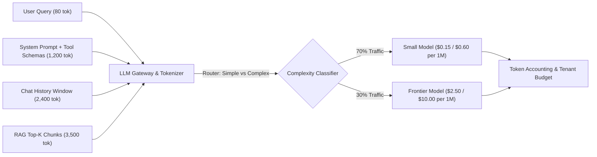
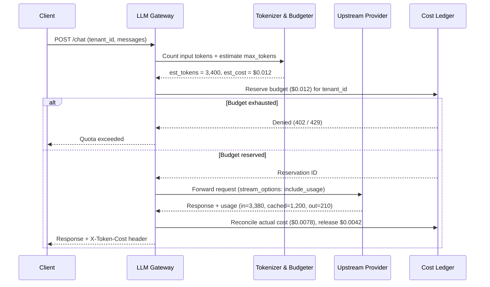
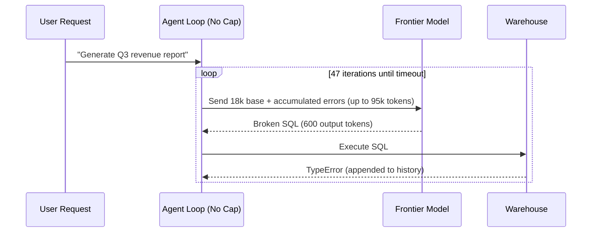

# LLM Token Usage & Cost Estimation: Pricing Math and Cost Reduction

> **Prerequisites:** [Lesson 15: Tenant-Aware RAG](../15-tenant-aware-rag/README.md).  
> **Estimated Reading Time:** 24–28 minutes  
> **Target Audience:** Backend and AI platform engineers building production LLM features, FinOps leads, and candidates asked "how do you estimate and control LLM costs at scale?"  
> **Free PDF Notes:** [Download SD-S-016.pdf](https://backendroadmap.com/notes/system-design/SD-S-016.pdf)

> [!NOTE]
> **In one line:** LLM APIs bill per **input token** and **output token** (where output tokens typically cost 3x–5x more than input tokens), and multi-turn chat, RAG context stuffing, and agentic tool loops cause token volume to grow **quadratically** with conversation depth unless bounded by budgets, model routing, and prompt compression.

> [!TIP]
> **The Golden Rule:** Estimate cost from **peak output tokens and conversation depth**, not single-turn average prompts. Model routing (cheap/fast model for classification and extraction, frontier model only for hard reasoning) plus strict `max_tokens` and context caps cut LLM spend by 60–85% with zero quality loss.

---

## 1. What LLM Token Cost Estimation Is, and What It Isn't

A team launches a customer support copilot using a frontier model at $2.50 per 1M input tokens and $10.00 per 1M output tokens. In staging, a single test query costs $0.004—practically free. In production, users have 12-turn conversations, RAG injects 6,000 tokens of retrieved docs per turn, and an agent retries failed tool calls three times. By day 14, the monthly run rate hits $180,000 instead of the projected $4,000.

| Term | Precise Meaning | Example |
| :--- | :--- | :--- |
| **Token** | A subword unit produced by a BPE/SentencePiece tokenizer (~4 characters or ~0.75 English words) | `"unbelievable"` = 3 tokens |
| **Input (prompt) tokens** | Everything sent to the model: system prompt, few-shot examples, RAG chunks, chat history, tool schemas, user query | 4,200 tokens per turn |
| **Output (completion) tokens** | Tokens generated by the model, including visible text, tool-call JSON, and hidden reasoning/thinking tokens | 450 tokens per turn |
| **Cached input tokens** | Repeated prompt prefix served from provider KV-cache at 50–90% discount | System prompt + static docs |
| **Reasoning / thinking tokens** | Internal chain-of-thought tokens billed as output tokens even when not returned to the user | 1,500 hidden tokens on o-series/thinking models |
| **Model routing** | Dispatching simple requests to small/cheap models and complex ones to frontier models | Haiku/Mini for triage, Sonnet/GPT-4o for synthesis |
| **Not** | Billing per HTTP request or per character | A 50-char prompt with 8,000-token RAG context bills for 8,000+ tokens |

### Why It Matters
1. Output tokens cost 3x–5x more per token than input tokens and dominate latency (each output token requires a sequential forward pass).
2. Unbounded chat history and multi-step agent loops turn linear traffic into quadratic token growth.
3. Interviewers test whether you can do back-of-the-envelope token math under pressure and name concrete levers (routing, caching, truncation, structured output) to bring unit economics into budget.

---

## 2. Anatomy: Where Tokens Come From and Where Cost Escalates



Every LLM call is a **composite payload**. Engineers routinely underestimate input size because they only count the user's message (`"Summarize my invoice"` = 5 tokens), forgetting that the gateway attaches a 900-token system prompt, 1,100 tokens of JSON tool definitions, 3,000 tokens of RAG chunks, and 2,000 tokens of prior turns.

| Cost Lever | Mechanism | Typical Savings | Trade-off |
| :--- | :--- | :--- | :--- |
| **Model tiering / routing** | Route 70–85% of classification, extraction, and simple Q&A to small models | 60–85% | Router latency (10–30 ms) and misroute risk |
| **Prompt / KV prefix caching** | Keep static system prompt + tools first so provider caches prefix | 50–90% on input | Requires stable prefix ordering and minimum length (e.g. 1,024 tokens) |
| **History sliding window + summary** | Keep last $k$ turns verbatim; summarize older turns | 40–70% in long chats | Slight loss of verbatim detail from early turns |
| **RAG chunk pruning / reranking** | Retrieve top-20, rerank to top-3 concise chunks | 50–75% input | Reranker compute cost (~$0.0001/query) |
| **Strict `max_tokens` + concise schema** | Cap completion length; use compact JSON keys | 20–45% output | Risk of truncated JSON if cap is too tight |
| **Batch API (async)** | Submit non-interactive jobs for 24h turnaround | 50% flat discount | Not suitable for real-time user requests |

> [!WARNING]
> **Hidden reasoning tokens kill naive budgets.** Reasoning models emit 500–5,000 internal thinking tokens before writing a 100-token answer. Every thinking token is billed at the **output token rate**. Always set `max_completion_tokens` (which bounds both reasoning and visible output) and track `reasoning_tokens` separately in telemetry.

---

## 3. Mathematical Model: Single-Turn, Multi-Turn, and Routing Cost

**Single-Request Cost.** Given input tokens $T_{\text{in}}$, cached input tokens $T_{\text{cache}}$, output tokens $T_{\text{out}}$ (including reasoning tokens), and per-million-token prices $P_{\text{in}}, P_{\text{cache}}, P_{\text{out}}$:

$$C_{\text{req}} = \frac{(T_{\text{in}} - T_{\text{cache}}) \cdot P_{\text{in}} + T_{\text{cache}} \cdot P_{\text{cache}} + T_{\text{out}} \cdot P_{\text{out}}}{10^6}$$

**Multi-Turn Conversation Cost (Quadratic Growth).** Without truncation, turn $n$ resends all previous prompts and completions. If each turn adds $\Delta$ new tokens (user + assistant) atop a fixed base prompt $B$ (system + RAG):

$$T_{\text{in, total}}(N) = \sum_{k=1}^{N} \big(B + (k-1)\Delta\big) = N \cdot B + \frac{N(N-1)}{2}\Delta$$

**Worked Numerical Example.**
Suppose $B = 2{,}000$ tokens (system + RAG), $\Delta = 600$ tokens per turn (150 user + 450 assistant), and a conversation runs $N = 10$ turns on a model priced at $P_{\text{in}} = \$2.50/\text{M}$ and $P_{\text{out}} = \$10.00/\text{M}$ (no caching):
- Total input tokens: $10 \times 2{,}000 + \frac{10 \times 9}{2} \times 600 = 20{,}000 + 27{,}000 = 47{,}000$ tokens.
- Total output tokens: $10 \times 450 = 4{,}500$ tokens.
- Cost per 10-turn session:
  $$C_{\text{session}} = \frac{47{,}000 \times 2.50 + 4{,}500 \times 10.00}{10^6} = \$0.1175 + \$0.0450 = \$0.1625$$
- At 100,000 sessions/day, daily spend is **$16,250/day ($487,500/month)**.

Now apply two controls:
1. **Prefix caching** on the 2,000-token base ($P_{\text{cache}} = \$0.25/\text{M}$, 90% discount) after turn 1, plus a **4-turn sliding window** capping history at $3 \times 600 = 1{,}800$ tokens.
2. **Model routing**: 75% of turns handled by a small model ($P_{\text{in}} = \$0.15/\text{M}, P_{\text{out}} = \$0.60/\text{M}$).

Blended monthly cost drops from **$487,500** to **~$91,000** (an **81% reduction**).

**Effective Blended Cost with Routing.** For routing fraction $f_{\text{small}}$ to the cheap tier:

$$C_{\text{blended}} = f_{\text{small}} \cdot C_{\text{small}} + (1 - f_{\text{small}}) \cdot C_{\text{frontier}} + C_{\text{router}}$$

---

## 4. Metrics & Percentiles

| Metric | Meaning | Alert when |
| :--- | :--- | :--- |
| **Cost per 1K requests** | Total LLM spend divided by request count | Exceeds unit-economics target by >15% |
| **Input / output token $p_{95}, p_{99}$** | Tail token counts per request | $p_{99}$ input approaches context limit or $p_{99}$ output hits `max_tokens` |
| **Output-to-input cost ratio** | Share of bill coming from output tokens | Output spend > 65% (signals verbose prompts or hidden reasoning bloat) |
| **Cache hit ratio (prompt prefix)** | `cached_tokens / total_input_tokens` | Drops below 50% on static-system-prompt workloads |
| **Tokens per task (agentic)** | Total tokens across all retries and tool loops for one user goal | > 2x baseline (indicates retry storms or infinite tool loops) |
| **Tenant burn rate ($/hr)** | Spend per tenant per hour | Exceeds tenant tier quota or anomaly threshold (3x 7-day average) |

### Worked Example (Support Copilot)
A SaaS company charges $29/seat/month and budgets at most $4.00/seat/month for AI inference (13.8% COGS). Each active user runs 25 sessions/month. Using the $0.1625/session unoptimized cost above, AI COGS alone would be $25 \times 0.1625 = \$4.06/\text{seat}$—already underwater before infra and support costs. After routing (75% small model), 4-turn history windowing, and prefix caching, cost per session drops to $0.030, yielding **$0.75/seat/month** (2.6% COGS) and healthy gross margin.

---

## 5. Compounding & Failure Modes

How token costs compound under real production behaviors (10,000 daily active users, 5 tasks/day):

| Scenario | Token Multiplier | Monthly Cost (Frontier) | Root Cause |
| :--- | :---: | :---: | :--- |
| **Baseline single-turn** | 1.0x | $18,750 | 1,500 in / 300 out per task |
| **+ Unbounded 12-turn chat** | 4.8x | $90,000 | Quadratic history growth ($N(N-1)/2$) |
| **+ RAG stuffing (top-15 chunks)** | 8.2x | $153,750 | 6,000 tokens of redundant context per turn |
| **+ Agent retry loop (3 retries on schema error)** | 21.5x | $403,125 | Malformed JSON triggers full-context retries |
| **+ Reasoning model without output cap** | 34.0x | $637,500 | 2,500 hidden reasoning tokens per step |

The **retry multiplier** is the deadliest failure mode in production: when a downstream JSON parser rejects a response and the orchestrator retries with the error appended to the prompt, each retry is *more expensive* than the original call.

---

## 6. Numbers Every Engineer Must Know

| Item | Typical | Implication |
| :--- | :---: | :--- |
| Characters per English token | ~4 chars (~0.75 words) | 1,000 words $\approx$ 1,333 tokens |
| Code / JSON token density | ~2.5–3.2 chars/token | JSON schemas and minified code cost 25–40% more tokens than prose |
| Output vs input price ratio | 3x–5x | Always optimize completion verbosity and `max_tokens` first |
| Small vs frontier model price | 15x–30x cheaper | Routing 70% of traffic saves >65% of total bill |
| Prompt prefix cache discount | 50%–90% on cached input | Put static instructions and tool definitions at byte 0 |
| Batch API discount | 50% off input & output | Use for evals, enrichment, and nightly summaries |
| Tokenizer variance across models | $\pm 15\%$ | Never use `len(text) / 4` for hard context truncation; use the target tokenizer |

---

## 7. Mechanism Deep Dive: Pre-Flight Budgeting & Post-Flight Reconciliation



| Question | Answer |
| :--- | :--- |
| **Why reserve before calling the LLM?** | Without pre-flight reservation, 50 concurrent requests from one tenant can all pass the balance check and overspend the quota by 50x. |
| **How do you count tokens in streaming mode?** | Set `stream_options: {"include_usage": true}` (OpenAI-compatible) or read the final `message_delta` event (Anthropic). If the client disconnects mid-stream, count emitted chunks locally as a fallback. |
| **Why reconcile after the call?** | Output length is unknown before generation; reserving `max_tokens` and refunding unused capacity prevents both overspend and permanent budget leaks. |
| **What if the tokenizer doesn't match the provider?** | Use `tiktoken` for OpenAI models and provider `count_tokens` APIs (or a +10% safety buffer) for non-OpenAI models. |

**When not to over-optimize token cost.** During early prototype validation (<$500/month spend), spending 3 weeks of engineering time building a custom ML router costs far more than the tokens saved. Start with `max_tokens` caps, a hard monthly spend alert, and simple rule-based routing.

---

## 8. Hierarchical Budgets & Design Rules

| Slice | Rule | Control |
| :--- | :--- | :--- |
| **System prompt & tools** | Keep static prefix first; cap under 1,500 tokens | Prefix caching + schema pruning |
| **Conversation history** | Cap at last $k$ turns or 2,000 tokens; summarize older turns | Sliding window token counter |
| **RAG context** | Rerank and cap retrieved context at 2,500–4,000 tokens | Token-aware chunk packer |
| **Completion output** | Always set `max_tokens` (and `max_completion_tokens` for reasoning) | Per-endpoint config |
| **Agentic loops** | Hard cap on steps (`max_steps <= 5`) and per-task token budget | Loop state machine |
| **Tenant quota** | Soft alert at 80%, hard cap or degrade-to-small-model at 100% | Redis atomic budget ledger |

---

## 9. Top Mitigations

1. **Enforce pre-flight token estimation and `max_tokens` caps** on every endpoint; never leave `max_tokens` unbounded.
2. **Implement tiered model routing**: use a fast classifier or heuristic (query length, tool count, intent) to send 70%+ of calls to small models.
3. **Structure prompts for prefix caching**: place static system instructions, few-shot examples, and tool schemas at the very beginning, and dynamic user/RAG data at the end.
4. **Bound conversation history** with a token-budgeted sliding window + rolling summary instead of sending raw full history.
5. **Compress and rerank RAG context** before generation; 3 high-precision chunks beat 15 noisy chunks on both cost and accuracy.
6. **Cap agentic retries and tool loops** with strict step and dollar budgets per trace ID.
7. **Track `usage` in a cost ledger** tagged by `tenant_id`, `feature`, `model`, and `prompt_version` so cost spikes are attributable within minutes.

---

## 10. Production Reference: SEV-1 Runaway Agent Loop ($42,000 in 6 Hours)

**Incident:** A B2B analytics SaaS deployed an autonomous SQL-fixing agent. When a customer's warehouse schema contained an unexpected column type, the SQL query failed, and the agent retried with the full 18,000-token schema + stack trace appended to history.



- **Root Cause:** No `max_steps` limit on the agent loop, no per-task token budget, and error tracebacks were appended raw to the prompt without truncation. A single user request consumed 2.8M input tokens ($7.00) before timing out, and the frontend auto-retried the failed HTTP request 3 times.
- **Fix:**
  1. Added `max_steps = 4` and a $0.25 per-task cost circuit breaker in the orchestrator.
  2. Deduplicated repeated error signatures (if the same SQL error occurs twice, abort immediately).
  3. Routed schema-lookup steps to a small model ($0.15/M) and reserved the frontier model only for final SQL synthesis.

---

## 11. Multi-Language Production Code Tabs

A production-shaped **LLM Cost Estimator & Model Router** with pre-flight budget reservation, multi-turn token projection, and actual-usage reconciliation.

````carousel
```go
// Go: thread-safe token cost estimator, prefix-cache calculator, and tenant budget ledger.
package main

import (
	"errors"
	"fmt"
	"sync"
)

type ModelPricing struct {
	Name           string
	InputPer1M     float64
	CachedInPer1M  float64
	OutputPer1M    float64
}

var (
	SmallModel    = ModelPricing{"gpt-4o-mini", 0.15, 0.075, 0.60}
	FrontierModel = ModelPricing{"gpt-4o", 2.50, 1.25, 10.00}
	ErrBudgetExceeded = errors.New("tenant token budget exceeded")
)

func EstimateCost(p ModelPricing, inputTok, cachedTok, outputTok int) float64 {
	uncached := max(0, inputTok-cachedTok)
	return (float64(uncached)*p.InputPer1M +
		float64(cachedTok)*p.CachedInPer1M +
		float64(outputTok)*p.OutputPer1M) / 1_000_000.0
}

type BudgetLedger struct {
	mu        sync.Mutex
	remaining map[string]float64
}

func NewBudgetLedger() *BudgetLedger {
	return &BudgetLedger{remaining: make(map[string]float64)}
}

func (b *BudgetLedger) SetLimit(tenant string, usd float64) {
	b.mu.Lock()
	defer b.mu.Unlock()
	b.remaining[tenant] = usd
}

// Reserve deducts worst-case cost before calling the LLM; Reconcile refunds the difference.
func (b *BudgetLedger) Reserve(tenant string, worstCaseUSD float64) error {
	b.mu.Lock()
	defer b.mu.Unlock()
	if b.remaining[tenant] < worstCaseUSD {
		return ErrBudgetExceeded
	}
	b.remaining[tenant] -= worstCaseUSD
	return nil
}

func (b *BudgetLedger) Reconcile(tenant string, reservedUSD, actualUSD float64) {
	b.mu.Lock()
	defer b.mu.Unlock()
	b.remaining[tenant] += (reservedUSD - actualUSD)
}

func main() {
	ledger := NewBudgetLedger()
	ledger.SetLimit("acme-corp", 1.00)

	reserved := EstimateCost(FrontierModel, 3500, 1200, 1000)
	if err := ledger.Reserve("acme-corp", reserved); err != nil {
		panic(err)
	}
	actual := EstimateCost(FrontierModel, 3420, 1200, 280)
	ledger.Reconcile("acme-corp", reserved, actual)
	fmt.Printf("Reserved: $%.5f | Actual: $%.5f | Remaining: $%.5f\n", reserved, actual, ledger.remaining["acme-corp"])
}
```
<!-- slide -->
```typescript
// TypeScript: LLM cost calculator, multi-turn quadratic projector, and model router.
export interface ModelPricing {
  name: string;
  inputPer1M: number;
  cachedInputPer1M: number;
  outputPer1M: number;
}

export const MODELS: Record<"small" | "frontier", ModelPricing> = {
  small: { name: "gpt-4o-mini", inputPer1M: 0.15, cachedInputPer1M: 0.075, outputPer1M: 0.60 },
  frontier: { name: "gpt-4o", inputPer1M: 2.50, cachedInputPer1M: 1.25, outputPer1M: 10.00 },
};

export function calculateCost(
  pricing: ModelPricing,
  inputTokens: number,
  cachedTokens: number,
  outputTokens: number
): number {
  const uncached = Math.max(0, inputTokens - cachedTokens);
  return (
    (uncached * pricing.inputPer1M +
      cachedTokens * pricing.cachedInputPer1M +
      outputTokens * pricing.outputPer1M) /
    1_000_000
  );
}

export function routeModel(query: string, requiresTools: boolean): ModelPricing {
  // Simple deterministic router: short queries without multi-step tools go to small tier.
  const isSimple = !requiresTools && query.length < 280 && !/analyze|compare|debug/i.test(query);
  return isSimple ? MODELS.small : MODELS.frontier;
}

export function projectMultiTurnCost(
  pricing: ModelPricing,
  turns: number,
  baseTokens: number,
  deltaPerTurn: number,
  outputPerTurn: number
): { totalInput: number; totalOutput: number; totalUsd: number } {
  const totalInput = turns * baseTokens + ((turns * (turns - 1)) / 2) * deltaPerTurn;
  const totalOutput = turns * outputPerTurn;
  return {
    totalInput,
    totalOutput,
    totalUsd: calculateCost(pricing, totalInput, 0, totalOutput),
  };
}
```
<!-- slide -->
```python
# Python: exact cost model, quadratic multi-turn simulator, and sliding-window optimizer.
from dataclasses import dataclass

@dataclass(frozen=True)
class ModelPricing:
    name: str
    input_per_1m: float
    cached_per_1m: float
    output_per_1m: float

SMALL = ModelPricing("gpt-4o-mini", 0.15, 0.075, 0.60)
FRONTIER = ModelPricing("gpt-4o", 2.50, 1.25, 10.00)

def compute_cost(p: ModelPricing, in_tok: int, cached_tok: int, out_tok: int) -> float:
    uncached = max(0, in_tok - cached_tok)
    return (uncached * p.input_per_1m + cached_tok * p.cached_per_1m + out_tok * p.output_per_1m) / 1_000_000

def simulate_session(
    turns: int = 10,
    base_tokens: int = 2000,
    delta_tokens: int = 600,
    out_tokens: int = 450,
    window_turns: int | None = None,
    cache_base_after_turn1: bool = False,
    pricing: ModelPricing = FRONTIER,
) -> dict:
    total_cost = 0.0
    total_in = total_out = 0
    for k in range(1, turns + 1):
        hist_turns = k - 1 if window_turns is None else min(k - 1, window_turns)
        in_tok = base_tokens + hist_turns * delta_tokens
        cached = base_tokens if (cache_base_after_turn1 and k > 1) else 0
        total_in += in_tok
        total_out += out_tokens
        total_cost += compute_cost(pricing, in_tok, cached, out_tokens)
    return {"total_in": total_in, "total_out": total_out, "cost_usd": round(total_cost, 4)}

if __name__ == "__main__":
    raw = simulate_session()
    opt = simulate_session(window_turns=3, cache_base_after_turn1=True)
    print("Unoptimized 10-turn:", raw)
    print("Windowed + Cached:  ", opt)
```
<!-- slide -->
```csharp
// C#: LLM token cost calculator and pre-flight tenant budget guard.
using System;
using System.Collections.Concurrent;

public sealed record ModelPricing(string Name, decimal InputPer1M, decimal CachedPer1M, decimal OutputPer1M);

public sealed class TokenCostGuard
{
    private readonly ConcurrentDictionary<string, decimal> _budgets = new();

    public static readonly ModelPricing Small = new("gpt-4o-mini", 0.15m, 0.075m, 0.60m);
    public static readonly ModelPricing Frontier = new("gpt-4o", 2.50m, 1.25m, 10.00m);

    public void SetBudget(string tenantId, decimal usd) => _budgets[tenantId] = usd;

    public static decimal EstimateUsd(ModelPricing p, int inputTokens, int cachedTokens, int outputTokens)
    {
        int uncached = Math.Max(0, inputTokens - cachedTokens);
        return (uncached * p.InputPer1M + cachedTokens * p.CachedPer1M + outputTokens * p.OutputPer1M) / 1_000_000m;
    }

    public bool TryReserve(string tenantId, decimal worstCaseUsd)
    {
        while (true)
        {
            if (!_budgets.TryGetValue(tenantId, out var current) || current < worstCaseUsd)
                return false;
            if (_budgets.TryUpdate(tenantId, current - worstCaseUsd, current))
                return true;
        }
    }

    public void Reconcile(string tenantId, decimal reservedUsd, decimal actualUsd)
        => _budgets.AddOrUpdate(tenantId, 0m, (_, cur) => cur + (reservedUsd - actualUsd));
}
```
````

---

## 12. Hands-On CLI Verification Workflows

Verify the quadratic vs. windowed-cached cost math locally using Python:

```bash
python -c '
from dataclasses import dataclass
def cost(in_t, cache_t, out_t, pin=2.50, pc=0.25, pout=10.00):
    return ((in_t - cache_t)*pin + cache_t*pc + out_t*pout) / 1e6

raw = sum(cost(2000 + (k-1)*600, 0, 450) for k in range(1, 11))
opt = sum(cost(2000 + min(k-1, 3)*600, 2000 if k > 1 else 0, 450) for k in range(1, 11))
print(f"Raw 10-turn: ${raw:.4f} | Window(3)+Cache: ${opt:.4f} | Savings: {(1 - opt/raw)*100:.1f}%")
'
```

Inspect exact token counts with `tiktoken` before sending requests:

```bash
python -c '
import tiktoken
enc = tiktoken.encoding_for_model("gpt-4o")
text = "Summarize the Q3 revenue variance across EMEA and APAC."
tokens = enc.encode(text)
print(f"Token count: {len(tokens)}, IDs: {tokens[:6]}...")
'
```

Query OpenAI-compatible usage directly from `curl` (including `stream_options` for streaming reconciliation):

```bash
curl -s https://api.openai.com/v1/chat/completions \
  -H "Authorization: Bearer $OPENAI_API_KEY" \
  -H "Content-Type: application/json" \
  -d '{
    "model": "gpt-4o-mini",
    "max_tokens": 150,
    "stream": true,
    "stream_options": {"include_usage": true},
    "messages": [{"role": "user", "content": "List 3 ways to reduce LLM costs."}]
  }' | tail -n 5
```

---

## 13. Common Mistakes to Avoid

1. **Estimating monthly cost from single-turn prompts** while ignoring multi-turn quadratic history growth.
2. **Using `len(text) / 4` as a hard limit**—JSON, non-English text, and code tokenize much more densely and can overflow context windows.
3. **Forgetting hidden reasoning/thinking tokens** when budgeting output spend on reasoning models.
4. **Putting dynamic timestamps or user IDs at the start of the system prompt**, which invalidates 100% of provider prompt prefix caching.
5. **Omitting `max_tokens`**, allowing runaway completions or adversarial prompts to burn maximum output tokens.
6. **Retrying malformed outputs with full conversation history** without a step or dollar circuit breaker.
7. **Sending every request to a frontier model** when 70%+ of classification, extraction, and routing tasks work identically on a small model.

---

## 14. Key Terms Glossary

| Key Term | Definition |
| :--- | :--- |
| **Token** | Subword unit used by an LLM's tokenizer (~4 English chars or ~0.75 words). |
| **Input / Prompt Tokens** | All tokens fed into the model (system, tools, history, RAG, user). |
| **Output / Completion Tokens** | Tokens generated by the model; typically priced 3x–5x higher than input. |
| **Reasoning Tokens** | Internal chain-of-thought tokens generated by reasoning models and billed as output. |
| **Prompt Prefix Caching** | Provider feature discounting repeated leading prompt tokens by 50–90%. |
| **Model Routing** | Dispatching requests across cheap and frontier models based on complexity. |
| **Sliding Window History** | Keeping only the last $k$ conversation turns to bound quadratic token growth. |
| **Pre-flight Reservation** | Deducting worst-case token cost before calling the LLM, then reconciling actual usage. |
| **Token-to-Char Ratio** | Average characters per token (~4 for English prose, ~2.5–3 for JSON/code). |
| **Unit Economics (AI COGS)** | LLM inference cost per active user or task relative to subscription revenue. |

---

## 15. System Design Interview Questions & Answers

### Basic Conceptual Questions

<details>
<summary><strong>Q1: Why are LLM output tokens priced 3x–5x higher than input tokens? [BASIC]</strong></summary>

**Answer:**
Input tokens are processed **in parallel** during the prefill phase, saturating GPU tensor cores efficiently. Output tokens are generated **autoregressively one token at a time** during the decode phase, which is memory-bandwidth bound (reading the full model weights and KV cache from GPU HBM for every single token). Because decode occupies GPU memory and bandwidth far longer per token, providers price output tokens 3x–5x higher.
</details>

<details>
<summary><strong>Q2: How do you estimate tokens from raw text, and when does the heuristic fail? [BASIC]</strong></summary>

**Answer:**
For English prose, 1 token is roughly 4 characters or 0.75 words (1,000 words $\approx$ 1,333 tokens). This heuristic fails on JSON schemas, source code, URLs, numbers, and non-Latin scripts (e.g., CJK or Hindi), where density can drop to 1–2.5 characters per token. Always use the model's actual tokenizer (`tiktoken` or provider `count_tokens`) before enforcing hard truncation.
</details>

<details>
<summary><strong>Q3: What is prompt prefix caching and how do you design prompts for it? [BASIC]</strong></summary>

**Answer:**
Providers cache the KV-cache tensors of repeated prompt prefixes (typically $\ge 1{,}024$ tokens) and discount cache hits by 50–90%. To maximize hit rate, structure prompts deterministically from **most static to most dynamic**: System Instructions $\rightarrow$ Tool Definitions $\rightarrow$ Few-Shot Examples $\rightarrow$ Tenant/RAG Context $\rightarrow$ Chat History $\rightarrow$ User Query. Never place timestamps or request IDs at the top.
</details>

<details>
<summary><strong>Q4: What is model routing and what savings does it achieve? [BASIC]</strong></summary>

**Answer:**
Model routing sends simple tasks (intent classification, PII detection, formatting, FAQ lookup) to a small, fast model (~$0.15/M input) and reserves frontier models (~$2.50/M input) for complex reasoning or synthesis. Routing 70–80% of traffic to small models typically cuts total LLM spend by 60–85% while also reducing median latency.
</details>

### Scenario-Based Architecture Questions

<details>
<summary><strong>Q5: Your chat app's LLM bill jumped 5x in a month despite flat DAU. What are the top suspects? [SCENARIO]</strong></summary>

**Answer:**
First check per-request `input_tokens` and `output_tokens` $p_{95}/p_{99}$. Common culprits: (1) Users having deeper multi-turn conversations (quadratic history growth), (2) RAG retrieving more or larger chunks, (3) A prompt change that broke prefix caching (e.g., injecting `current_time` at byte 0), or (4) An agentic retry loop firing multiple full-context calls on validation failures.
</details>

<details>
<summary><strong>Q6: Design a multi-tenant token billing and quota system for a SaaS AI product. [SCENARIO]</strong></summary>

**Answer:**
Place an LLM Gateway in front of providers. On each request: (1) Count input tokens and compute worst-case cost using `max_tokens`. (2) Atomically reserve that amount from the tenant's Redis budget ledger (`Lua` script or `DECRBYFLOAT`). (3) Call the provider with `include_usage: true`. (4) Reconcile actual cost and refund the unused reservation. Trigger soft alerts at 80% and either hard-block (402/429) or gracefully degrade to a small model at 100%.
</details>

<details>
<summary><strong>Q7: How do you estimate daily LLM cost for a RAG support bot with 50,000 DAU? [SCENARIO]</strong></summary>

**Answer:**
Break down per-session tokens: assume 4 queries/user/day = 200,000 requests/day. Each request has 1,000 system/tool tokens + 2,500 RAG tokens + 500 history/query tokens = 4,000 input tokens, and 350 output tokens. Daily volume = 800M input tokens + 70M output tokens. On a frontier model ($2.50/$10.00 per M): $(800 \times 2.50) + (70 \times 10.00) = \$2{,}000 + \$700 = \$2{,}700/\text{day}$ ($81k/month). With 75% small-model routing + 50% prefix cache hit rate, cost drops to ~$650/day ($19.5k/month).
</details>

<details>
<summary><strong>Q8: Your extraction pipeline processes 2M PDFs nightly and costs too much. How do you cut costs by 75%+? [SCENARIO]</strong></summary>

**Answer:**
Combine three levers: (1) **Batch API** (50% flat discount since nightly jobs tolerate 24h SLA), (2) **Small model** for structured extraction instead of a frontier model (10x–15x cheaper), and (3) **Compact JSON schema** + stripping boilerplate headers/footers before tokenization (20–30% fewer tokens). Combined, this easily reduces cost by 90%+.
</details>

### Advanced & Tricky Interview Questions

<details>
<summary><strong>Q9: A client disconnects mid-stream during SSE generation. Who pays for the tokens? [TRICKY]</strong></summary>

**Answer:**
You still pay the upstream provider for all input tokens (prefill already ran) and every output token generated up until the upstream socket closes. Because the final `usage` SSE chunk may never arrive if you abort early, your gateway must count streamed output chunks locally and reconcile the tenant's budget ledger on connection close—while also propagating the cancellation to the upstream HTTP request immediately to stop further decode spend.
</details>

<details>
<summary><strong>Q10: Why can a reasoning model cost 10x more than expected even when `max_tokens` is set to 200? [TRICKY]</strong></summary>

**Answer:**
Some reasoning APIs distinguish between visible output tokens and internal `reasoning_tokens`. If you cap only visible text or don't set `max_completion_tokens` / `reasoning_effort`, the model may emit 3,000 internal thinking tokens before producing 150 visible tokens—all billed at the output rate. Always bound total completion tokens and tune `reasoning_effort` per task.
</details>

<details>
<summary><strong>Q11: How can aggressive prompt compression or truncation actually *increase* total token cost? [TRICKY]</strong></summary>

**Answer:**
If over-aggressive truncation strips critical instructions, tool schemas, or RAG facts, the model produces invalid JSON or wrong answers—triggering **automated retries**, **clarification turns**, or **fallback escalations** to a frontier model. One retry doubles the input cost and adds another output generation, wiping out a 20% prompt-compression saving.
</details>

<details>
<summary><strong>Q12: How do you attribute costs accurately when multiple microservices share one provider API key? [TRICKY]</strong></summary>

**Answer:**
Never let services call provider APIs directly with a shared key. Route all traffic through a central **LLM Gateway** that requires `X-Tenant-Id`, `X-Feature`, and `X-Trace-Id` headers (or issues scoped virtual keys per service). The gateway logs every response's `usage` object to a time-series/analytical store (ClickHouse/BigQuery) for real-time per-tenant and per-feature cost attribution.
</details>

---

## 16. One-Page Master Cheat Sheet

```
+---------------------------------------------------------------------------------------------------------+
|                  LLM TOKEN USAGE & COST ESTIMATION — MASTER CHEAT SHEET                                 |
+---------------------------------------------------------------------------------------------------------+
| 1. PRICING MATH: Cost = [(In - Cached)*P_in + Cached*P_cache + Out*P_out] / 10^6                        |
|    Output tokens cost 3x-5x input (memory-bandwidth bound decode). Reasoning tokens bill as output!      |
+---------------------------------------------------------------------------------------------------------+
| 2. QUADRATIC CHAT GROWTH: N turns = N*Base + [N(N-1)/2]*Delta. Bound with sliding window + summary.     |
+---------------------------------------------------------------------------------------------------------+
| 3. TOP COST LEVERS:                                                                                     |
|    - Model Routing (70-85% small model) -> 60-85% savings                                               |
|    - Prefix Caching (static prompt first) -> 50-90% input savings                                       |
|    - RAG Reranking + Pruning -> 50-75% input savings                                                    |
|    - Batch API (24h async SLA) -> 50% flat discount                                                     |
+---------------------------------------------------------------------------------------------------------+
| 4. PRODUCTION GUARDS: Pre-flight reservation + post-flight reconciliation; max_tokens on every call;    |
|    max_steps <= 5 on agent loops; propagate client disconnects to upstream immediately.                 |
+---------------------------------------------------------------------------------------------------------+
| 5. NUMBERS: ~4 chars/token (English), ~2.5-3 chars/token (JSON/code). Never guess with len/4 for caps.  |
+---------------------------------------------------------------------------------------------------------+
```

---

## Further Reading & Sources

- OpenAI API Documentation, [Managing Costs, Token Counting (`tiktoken`), and Prompt Caching](https://platform.openai.com/docs/guides/prompt-caching).
- Anthropic Documentation, [Prompt Caching and Token Counting](https://docs.anthropic.com/en/docs/build-with-claude/prompt-caching).
- Chip Huyen, *AI Engineering* (O'Reilly), Chapter 9: "Inference Optimization and Cost Reduction".
- Google Cloud Architecture Center, [Generative AI Cost Optimization Best Practices](https://cloud.google.com/architecture/ai-ml).

---

## Free PDF Notes

[SD-S-016.pdf](https://backendroadmap.com/notes/system-design/SD-S-016.pdf)

---

## Next

Continue with [Lesson 17: Rate Limits & Quotas for LLM APIs: TPM, Backoff and Load Spreading](../17-rate-limits-quotas-for-llm-apis/README.md).
