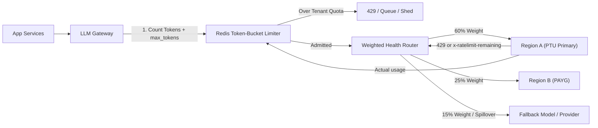
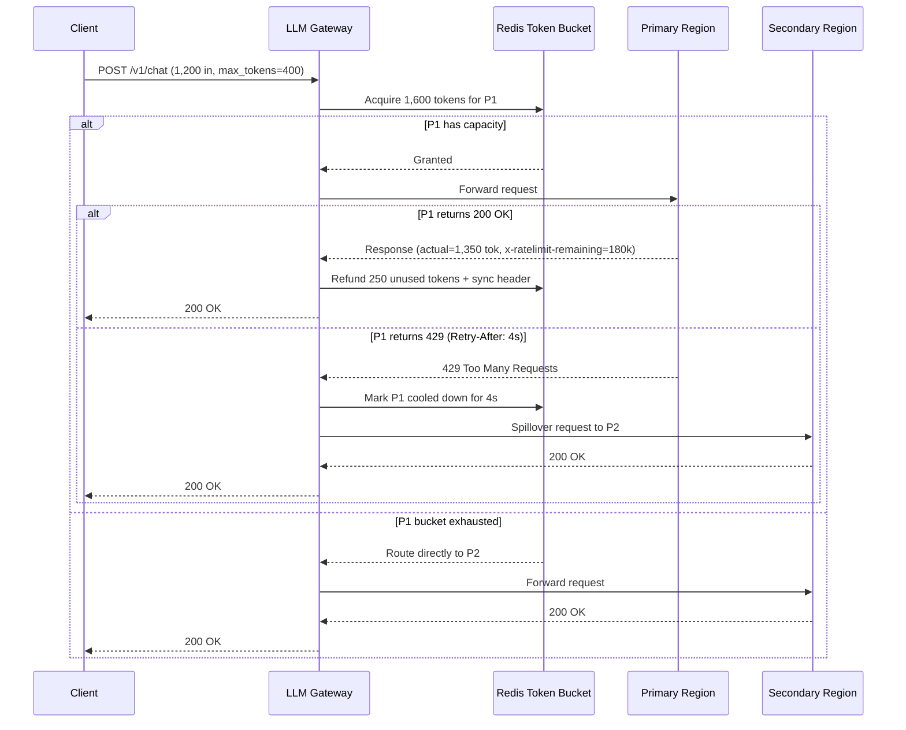
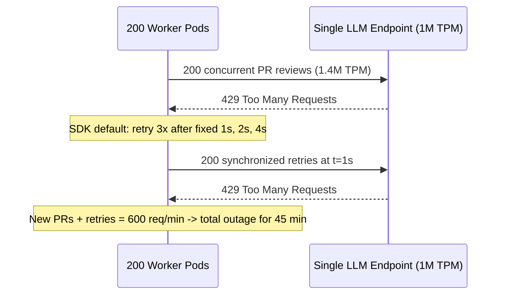

# Rate Limits & Quotas for LLM APIs: TPM, Backoff and Load Spreading

> **Prerequisites:** [Lesson 16: LLM Token Usage & Cost Estimation](../16-llm-token-usage-cost-estimation/README.md).  
> **Estimated Reading Time:** 24–28 minutes  
> **Target Audience:** Backend and platform engineers integrating external or self-hosted LLM APIs, and candidates asked "how do you handle 429s, TPM limits, and multi-region LLM failover?"  
> **Free PDF Notes:** [Download SD-S-017.pdf](https://backendroadmap.com/notes/system-design/SD-S-017.pdf)

> [!NOTE]
> **In one line:** Unlike traditional REST APIs that only limit **requests per minute (RPM)**, LLM APIs enforce **two-dimensional rate limits (RPM + Tokens Per Minute, TPM)**—often split into **Input TPM (ITPM)** and **Output TPM (OTPM)**—requiring **token-aware admission control**, **exponential backoff with full jitter**, and **multi-endpoint load spreading** to avoid cascading `429` storms.

> [!TIP]
> **The Golden Rule:** Never retry an LLM `429` immediately or in a synchronized loop. Pre-estimate tokens in your gateway, pace requests with a **token-bucket limiter** using `max_tokens` reservation + post-flight refund, and spread load across multiple regional deployments or providers.

---

## 1. What LLM Rate Limiting Is, and What It Isn't

A team scales their AI summarization service from 50 to 500 concurrent users. Their RPM is only 600 (well under their 5,000 RPM tier), yet 40% of requests suddenly fail with `HTTP 429 Too Many Requests`. Why? Each summarization prompt is 8,000 tokens, consuming $600 \times 8{,}000 = 4.8\text{M TPM}$ against a 2M TPM ceiling. Worse, their SDK's default retry loop fires all failed requests back at the exact same second, keeping the bucket permanently exhausted.

| Term | Precise Meaning | Example |
| :--- | :--- | :--- |
| **RPM (Requests Per Minute)** | Maximum number of HTTP API calls allowed per minute | 5,000 RPM |
| **TPM (Tokens Per Minute)** | Maximum combined (or input+output) tokens processed per minute | 2,000,000 TPM |
| **ITPM / OTPM** | Separate quotas for Input TPM and Output TPM (common on Anthropic/Bedrock) | 400k ITPM, 80k OTPM |
| **TPD / RPD** | Daily token or request quotas (common on free/batch tiers) | 10M TPD |
| **Token-bucket reservation** | Deducting `input_tokens + max_tokens` at admission, then refunding unused `max_tokens` | Prevents 100-request burst overshoots |
| **Full jitter backoff** | Sleeping `random(0, min(cap, base * 2^attempt))` to desynchronize retries | Breaks thundering herds |
| **Load spreading (PTU + PAYG)** | Distributing traffic across multiple regions, accounts, or Provisioned Throughput + Pay-As-You-Go | `eastus` + `swedencentral` + `westus` |
| **Not** | Standard fixed-window HTTP rate limiting | Counting requests alone ignores 100x payload variance |

### Why It Matters
1. A single 100k-token RAG request consumes the same TPM budget as 200 small 500-token requests—traditional RPM limiters are blind to this.
2. Providers reserve `input_tokens + max_tokens` against your TPM bucket *at request start*, so setting `max_tokens=16384` when you only need `300` starves your throughput by 50x.
3. Multi-region deployment routing and graceful degradation (fallback models) are standard expectations in senior GenAI system design interviews.

---

## 2. Anatomy: Token-Aware Gateway & Multi-Region Load Spreading



A production LLM gateway sits between application services and upstream providers. Instead of letting 40 microservices hit one provider key blindly, the gateway:
1. Inspects `x-ratelimit-remaining-tokens`, `x-ratelimit-remaining-requests`, and `retry-after` headers on every response.
2. Maintains per-deployment health and remaining capacity in Redis.
3. Spills excess traffic from Provisioned Throughput Units (PTU) to Pay-As-You-Go (PAYG) regions or a secondary fallback model before returning `429` to users.

| Strategy | How It Works | Best For | Limitation |
| :--- | :--- | :--- | :--- |
| **Token-aware pacing** | Smooth bursts into steady token flow using `max_tokens` reservation | Preventing `429` bursts | Adds queuing delay during spikes |
| **Multi-region load spreading** | Round-robin / least-used across 3–5 cloud regions (each has its own TPM) | Increasing aggregate TPM 3x–5x | Cross-region latency (+20–60 ms) & data residency rules |
| **PTU + PAYG spillover** | Keep baseline on reserved PTU; overflow spikes to PAYG | Predictable baseline + spiky peaks | Requires careful PTU utilization sizing |
| **Model fallback** | Route `429` on `gpt-4o` to `claude-3-5-sonnet` or `gpt-4o-mini` | High availability | Prompt/schema subtle differences across models |
| **Priority shedding** | Interactive chat gets priority; batch/evals pause on `429` | Mixed interactive + background workloads | Requires priority metadata on every call |

> [!WARNING]
> **Setting `max_tokens` too high silently destroys your TPM capacity.** Providers like OpenAI and Azure OpenAI deduct `prompt_tokens + max_tokens` from your TPM bucket *before* generation begins. If your average output is 250 tokens but you leave `max_tokens=4096`, your effective throughput drops by up to **8x** during bursts.

---

## 3. Mathematical Model: Effective TPM, Reservation Waste & Backoff

**Effective Request Rate under Two-Dimensional Limits.** Given $\text{RPM}_{\max}$ and $\text{TPM}_{\max}$, and average reserved tokens per request $\bar{T}_{\text{res}} = \bar{T}_{\text{in}} + T_{\max\_\text{out}}$:

$$\text{RPM}_{\text{eff}} = \min\!\left(\text{RPM}_{\max},\; \frac{\text{TPM}_{\max}}{\bar{T}_{\text{res}}}\right)$$

**Worked Numerical Example.**
Suppose your deployment has $\text{RPM}_{\max} = 5{,}000$ and $\text{TPM}_{\max} = 1{,}000{,}000$.
- Average input $\bar{T}_{\text{in}} = 1{,}500$ tokens, actual average output $\bar{T}_{\text{out}} = 300$ tokens.
- **Case A (Sloppy `max_tokens = 4,096`):** $\bar{T}_{\text{res}} = 1{,}500 + 4{,}096 = 5{,}596$ tokens.
  $$\text{RPM}_{\text{eff}} = \min\!\left(5{,}000,\; \frac{1{,}000{,}000}{5{,}596}\right) = 178.7\text{ req/min} \approx 2.98\text{ req/s}$$
- **Case B (Tight `max_tokens = 500` + post-flight refund):** Initial admission reserves $2{,}000$ tokens, and actual consumption reconciles to $1{,}800$ tokens:
  $$\text{RPM}_{\text{eff}} = \min\!\left(5{,}000,\; \frac{1{,}000{,}000}{1{,}800}\right) = 555.6\text{ req/min} \approx 9.26\text{ req/s}$$

Tightening `max_tokens` and reconciling actual usage **tripled effective concurrency** without paying a cent more.

**Exponential Backoff with Full Jitter.** For attempt $a \in \{0, 1, \dots, A_{\max}\}$, base delay $b$, and cap $C$:

$$t_{\text{sleep}}(a) = \text{Uniform}\!\big(0,\; \min(C,\; b \cdot 2^a)\big)$$

If `Retry-After` header $R$ is present from the provider, enforce $t_{\text{sleep}} = \max(R + \text{Uniform}(0, 0.5),\, t_{\text{sleep}}(a))$ so you never hit the endpoint before the provider's window resets.

---

## 4. Metrics & Percentiles

| Metric | Meaning | Alert when |
| :--- | :--- | :--- |
| **Upstream `429` rate** | Percentage of provider calls returning `HTTP 429` | > 1% sustained over 2 minutes |
| **TPM utilization %** | `consumed_tokens_per_min / tpm_limit` | > 80% (time to request quota increase or add region) |
| **Admission queue wait $p_{95}$** | Time requests spend waiting in gateway token bucket | > 500 ms for interactive endpoints |
| **Retry amplification factor** | `total_upstream_attempts / unique_user_requests` | > 1.15 (indicates retry storm) |
| **Fallback activation rate** | % of requests routed to secondary region or model | > 5% (primary region degraded or saturated) |
| **Reservation waste ratio** | `(max_tokens - actual_output_tokens) / max_tokens` | > 70% (tighten `max_tokens` per endpoint) |

### Worked Example (Multi-Region Sizing)
An enterprise copilot expects a peak of **30 requests/sec** (1,800 RPM), with average 2,500 input + 500 output = 3,000 tokens/request. Peak demand is $1{,}800 \times 3{,}000 = 5.4\text{M TPM}$. A single Azure OpenAI region caps PAYG at 2M TPM. By spreading load across **4 regions** (2M TPM each = 8M TPM total), average utilization at peak is $5.4 / 8.0 = 67.5\%$, leaving 32.5% headroom for single-region failover.

---

## 5. Compounding & Failure Modes

Simulated 60-second burst (120 req/s arriving for 10 seconds against a 500k TPM / 30 req/s ceiling, 1,000 tokens/req):

| Retry & Limiting Strategy | Upstream Calls | Successes | Failed (`429`) | $p_{99}$ Latency | Outcome |
| :--- | :---: | :---: | :---: | :---: | :--- |
| **No limiter + immediate retry (3x)** | 4,800 | 1,620 | 3,180 | 14.2 s | **Retry storm**: 4x amplification keeps bucket at 0 |
| **Fixed exponential backoff (no jitter)** | 3,450 | 2,100 | 1,350 | 18.5 s | **Synchronized waves** hit every 1s, 2s, 4s |
| **Full jitter + `Retry-After` + token bucket** | 2,650 | 2,650 | 0 (queued) | 6.8 s | **Zero dropped requests**, smooth drain |
| **Token bucket + 3-region spillover** | 2,650 | 2,650 | 0 | 1.1 s | **Zero `429`s**, interactive SLO preserved |

Without jitter, synchronized retries create **harmonic spikes** that repeatedly exhaust the refill window.

---

## 6. Numbers Every Engineer Must Know

| Item | Typical | Implication |
| :--- | :---: | :--- |
| Rate-limit refill granularity | 10 ms – 1 s (sliding/leaky bucket) | Micro-bursts within 1 second can trigger `429` even if 1-min average is below TPM |
| Standard `Retry-After` on `429` | 1 s – 20 s | Always honor `Retry-After` before retrying |
| Max retry attempts (interactive) | 2 – 3 attempts | More than 3 retries breaches interactive UX timeouts (10–15 s) |
| PTU vs PAYG | PTU = reserved capacity; PAYG = shared | Use PTU for steady baseline, PAYG for burst spillover |
| Cross-region failover overhead | +20 – 80 ms RTT | Negligible compared to 1,500 ms LLM decode time |
| Token-bucket safety margin | Target $\le 80\%$ of nominal TPM | Leaves 20% headroom for estimation error and OTPM spikes |

---

## 7. Protocol Deep Dive: Provider Headers & Token-Bucket Admission



| Header | Meaning | Gateway Action |
| :--- | :--- | :--- |
| **`retry-after`** / **`retry-after-ms`** | Exact seconds/ms to wait before retrying this deployment | Put deployment into cooldown in Redis; route elsewhere immediately |
| **`x-ratelimit-remaining-tokens`** | Remaining TPM in current window | Sync local/Redis bucket estimate to prevent drift |
| **`x-ratelimit-remaining-requests`** | Remaining RPM in current window | Trigger spillover when `< 10%` remaining |
| **`x-ratelimit-reset-tokens`** | Duration until token bucket refills | Pace queued background jobs until reset |

**When not to use complex multi-provider routing.** If your app relies on provider-specific features (e.g., OpenAI Assistants API, strict structured outputs with specific grammar support, or provider-side prompt caching), falling back to a different model family mid-stream can break JSON schemas. In those cases, spread load across **multiple regions/accounts of the same model** rather than cross-vendor fallback.

---

## 8. Hierarchical Budgets & Design Rules

| Slice | Rule | Control |
| :--- | :--- | :--- |
| **Per-endpoint `max_tokens`** | Set tight upper bound based on $p_{99}$ output | Avoid 4096/16384 defaults |
| **Gateway admission** | Dual token bucket (RPM + TPM) in Redis | Atomic Lua script |
| **Retry policy** | Exponential backoff + full jitter + `Retry-After` | Max 2–3 retries for sync; 8+ for async |
| **Retryable status codes** | Retry `429`, `500`, `502`, `503`, `529`; never retry `400`, `401`, `403` | Error classifier |
| **Priority lanes** | Interactive chat > async jobs > evals/backfills | Separate token-bucket reserves (e.g., 70/20/10) |
| **Circuit breaker** | Open region/endpoint for `Retry-After` or 30s on consecutive `429`s | Health-aware weighted router |

---

## 9. Top Mitigations

1. **Enforce token-bucket admission control** (both RPM and TPM) in a central LLM gateway rather than letting services hit providers uncoordinated.
2. **Tighten `max_tokens`** to realistic task bounds and refund unused tokens post-flight.
3. **Always use exponential backoff with full jitter** and honor `Retry-After` headers.
4. **Spread load across multiple regions/deployments**—most cloud providers grant independent TPM quotas per region.
5. **Isolate priority lanes**: reserve 70% of TPM for real-time user traffic and pause batch/eval workers whenever interactive `429`s appear.
6. **Configure PTU + PAYG spillover** for predictable enterprise workloads with spiky peaks.
7. **Never retry non-idempotent side-effecting tool calls** blindly; only retry the pure LLM inference call.

---

## 10. Production Reference: SEV-1 Retry Storm During Traffic Spike

**Incident:** A developer-tools company launched a code-review bot. At 9:00 AM UTC (Monday morning PR rush), traffic hit 110% of their single-region 1M TPM quota.



- **Root Cause:** (1) 200 worker pods had no shared rate limiter; (2) `max_tokens` was left at `8192`, inflating TPM reservations by 10x; (3) the HTTP client used fixed-delay retries without jitter, creating a self-inflicted DoS that kept the 1-minute sliding window permanently full even after the PR spike subsided.
- **Fix:**
  1. Deployed a Redis-backed distributed token bucket in the LLM gateway with `max_tokens=800` and post-flight reconciliation.
  2. Switched to exponential backoff with full jitter + `Retry-After` cooldowns.
  3. Added 3 regional deployments (`us-east`, `us-west`, `eu-west`) behind a health-aware router, tripling aggregate TPM.

---

## 11. Multi-Language Production Code Tabs

A production-shaped **Dual-Dimension (RPM + TPM) Token-Bucket Limiter & Full-Jitter Retry Client**.

````carousel
```go
// Go: token-bucket limiter (TPM + RPM) with reservation/refund and full-jitter retry.
package main

import (
	"context"
	"errors"
	"math"
	"math/rand/v2"
	"sync"
	"time"
)

type DualLimiter struct {
	mu          sync.Mutex
	tpmCap      float64
	rpmCap      float64
	tokens      float64
	reqs        float64
	lastRefill  time.Time
}

func NewDualLimiter(tpm, rpm float64) *DualLimiter {
	return &DualLimiter{
		tpmCap: tpm, rpmCap: rpm,
		tokens: tpm, reqs: rpm,
		lastRefill: time.Now(),
	}
}

func (l *DualLimiter) refill() {
	now := time.Now()
	mins := now.Sub(l.lastRefill).Minutes()
	l.tokens = min(l.tpmCap, l.tokens+mins*l.tpmCap)
	l.reqs = min(l.rpmCap, l.reqs+mins*l.rpmCap)
	l.lastRefill = now
}

func (l *DualLimiter) TryAcquire(reservedTokens int) bool {
	l.mu.Lock()
	defer l.mu.Unlock()
	l.refill()
	if l.reqs < 1 || l.tokens < float64(reservedTokens) {
		return false
	}
	l.reqs -= 1
	l.tokens -= float64(reservedTokens)
	return true
}

func (l *DualLimiter) Refund(unusedTokens int) {
	l.mu.Lock()
	defer l.mu.Unlock()
	l.tokens = min(l.tpmCap, l.tokens+float64(max(0, unusedTokens)))
}

func CallWithJitter(ctx context.Context, maxRetries int, fn func() (retryAfter time.Duration, err error)) error {
	base, capDelay := 250*time.Millisecond, 10*time.Second
	for attempt := 0; attempt <= maxRetries; attempt++ {
		retryAfter, err := fn()
		if err == nil {
			return nil
		}
		if attempt == maxRetries {
			return err
		}
		exp := float64(base) * math.Pow(2, float64(attempt))
		maxSleep := min(float64(capDelay), exp)
		sleep := time.Duration(rand.Float64() * maxSleep)
		if retryAfter > sleep {
			sleep = retryAfter + time.Duration(rand.IntN(300))*time.Millisecond
		}
		select {
		case <-time.After(sleep):
		case <-ctx.Done():
			return ctx.Err()
		}
	}
	return errors.New("unreachable")
}
```
<!-- slide -->
```typescript
// TypeScript: multi-region LLM router with cooldowns and full-jitter exponential backoff.
export interface EndpointState {
  id: string;
  weight: number;
  cooldownUntilMs: number;
}

export class MultiRegionRouter {
  constructor(private endpoints: EndpointState[]) {}

  pickEndpoint(now = Date.now()): EndpointState | null {
    const healthy = this.endpoints.filter((e) => e.cooldownUntilMs <= now);
    if (healthy.length === 0) return null;
    const totalWeight = healthy.reduce((acc, e) => acc + e.weight, 0);
    let r = Math.random() * totalWeight;
    for (const ep of healthy) {
      r -= ep.weight;
      if (r <= 0) return ep;
    }
    return healthy[0];
  }

  markRateLimited(id: string, retryAfterSec = 5): void {
    const ep = this.endpoints.find((e) => e.id === id);
    if (ep) ep.cooldownUntilMs = Date.now() + retryAfterSec * 1000;
  }
}

export async function withFullJitterRetry<T>(
  fn: () => Promise<T>,
  maxAttempts = 4,
  baseMs = 250,
  capMs = 8000
): Promise<T> {
  for (let attempt = 0; attempt < maxAttempts; attempt++) {
    try {
      return await fn();
    } catch (err: any) {
      if (attempt === maxAttempts - 1) throw err;
      const exp = Math.min(capMs, baseMs * 2 ** attempt);
      const jitterMs = Math.random() * exp;
      const retryAfterMs = (err?.retryAfterSec ?? 0) * 1000;
      await new Promise((r) => setTimeout(r, Math.max(jitterMs, retryAfterMs)));
    }
  }
  throw new Error("Exhausted retries");
}
```
<!-- slide -->
```python
# Python: simulation comparing immediate retry vs full-jitter + token-bucket pacing.
import random
from dataclasses import dataclass

@dataclass
class TokenBucket:
    tpm_limit: float
    tokens: float

    def step_refill(self, dt_sec: float) -> None:
        self.tokens = min(self.tpm_limit, self.tokens + (self.tpm_limit / 60.0) * dt_sec)

    def try_consume(self, amt: float) -> bool:
        if self.tokens >= amt:
            self.tokens -= amt
            return True
        return False

def full_jitter_delay(attempt: int, base: float = 0.25, cap: float = 10.0, retry_after: float = 0.0) -> float:
    exp = min(cap, base * (2 ** attempt))
    return max(retry_after, random.uniform(0.0, exp))

def simulate_effective_rpm(rpm_limit: int, tpm_limit: int, avg_in: int, max_tokens: int) -> float:
    reserved = avg_in + max_tokens
    return min(rpm_limit, tpm_limit / reserved)

if __name__ == "__main__":
    print("Sloppy max_tokens=4096 -> eff RPM:", round(simulate_effective_rpm(5000, 1_000_000, 1500, 4096), 1))
    print("Tight  max_tokens=500  -> eff RPM:", round(simulate_effective_rpm(5000, 1_000_000, 1500, 500), 1))
    print("Sample jitter delays (attempts 0..3):", [round(full_jitter_delay(a), 3) for a in range(4)])
```
<!-- slide -->
```csharp
// C#: dual RPM/TPM token bucket with reservation refund and full-jitter retry helper.
using System;
using System.Threading;
using System.Threading.Tasks;

public sealed class LlmRateLimiter
{
    private readonly object _lock = new();
    private readonly double _tpmCap;
    private readonly double _rpmCap;
    private double _tokens;
    private double _reqs;
    private DateTime _lastRefill = DateTime.UtcNow;

    public LlmRateLimiter(double tpmCap, double rpmCap)
    {
        _tpmCap = tpmCap;
        _rpmCap = rpmCap;
        _tokens = tpmCap;
        _reqs = rpmCap;
    }

    public bool TryAcquire(int reservedTokens)
    {
        lock (_lock)
        {
            var now = DateTime.UtcNow;
            var mins = (now - _lastRefill).TotalMinutes;
            _tokens = Math.Min(_tpmCap, _tokens + mins * _tpmCap);
            _reqs = Math.Min(_rpmCap, _reqs + mins * _rpmCap);
            _lastRefill = now;

            if (_reqs < 1 || _tokens < reservedTokens) return false;
            _reqs -= 1;
            _tokens -= reservedTokens;
            return true;
        }
    }

    public void Refund(int unusedTokens)
    {
        lock (_lock)
        {
            _tokens = Math.Min(_tpmCap, _tokens + Math.Max(0, unusedTokens));
        }
    }

    public static TimeSpan FullJitterDelay(int attempt, double baseSec = 0.25, double capSec = 10.0)
    {
        double maxDelay = Math.Min(capSec, baseSec * Math.Pow(2, attempt));
        return TimeSpan.FromSeconds(Random.Shared.NextDouble() * maxDelay);
    }
}
```
````

---

## 12. Hands-On CLI Verification Workflows

Inspect live rate-limit headers returned by an OpenAI-compatible API:

```bash
curl -s -D - -o /dev/null https://api.openai.com/v1/chat/completions \
  -H "Authorization: Bearer $OPENAI_API_KEY" \
  -H "Content-Type: application/json" \
  -d '{"model":"gpt-4o-mini","max_tokens":16,"messages":[{"role":"user","content":"hi"}]}' \
  | grep -iE "x-ratelimit|retry-after|HTTP/"
```

Verify effective RPM math under sloppy vs. tight `max_tokens` reservations:

```bash
python -c '
for max_tok in (4096, 1024, 500):
    eff_rpm = min(5000, 1_000_000 / (1500 + max_tok))
    print(f"max_tokens={max_tok:4d} -> effective RPM={eff_rpm:6.1f} ({eff_rpm/60:.2f} req/s)")
'
```

Test Redis atomic token-bucket check (simulated via `redis-cli` eval):

```bash
redis-cli EVAL "
  local cap = tonumber(ARGV[1])
  local cost = tonumber(ARGV[2])
  local cur = tonumber(redis.call('GET', KEYS[1]) or cap)
  if cur < cost then return 0 end
  redis.call('SET', KEYS[1], cur - cost, 'EX', 60)
  return cur - cost
" 1 "tpm:tenant-42" 1000000 1800
```

---

## 13. Common Mistakes to Avoid

1. **Limiting only by RPM** while ignoring 10x–100x prompt size variance across requests.
2. **Retrying `429` with fixed delays or no jitter**, causing synchronized thundering-herd retry storms.
3. **Leaving `max_tokens` at model maximums (4096/16384)**, which reserves phantom TPM and throttles concurrency.
4. **Ignoring `Retry-After` headers** and hammering an already-throttled deployment.
5. **Sharing one TPM bucket across interactive chat and nightly batch jobs** without priority lanes.
6. **Retrying `400 Bad Request` or `401 Unauthorized`** alongside `429`/`503`.
7. **Relying on a single cloud region** when multi-region deployments multiply available TPM linearly.

---

## 14. Key Terms Glossary

| Key Term | Definition |
| :--- | :--- |
| **RPM (Requests Per Minute)** | Maximum API requests allowed per minute. |
| **TPM (Tokens Per Minute)** | Maximum tokens processed per minute (input + output, or split). |
| **ITPM / OTPM** | Independent rate-limit buckets for Input TPM and Output TPM. |
| **Token Bucket** | Rate-limiting algorithm allowing controlled bursts up to bucket capacity with steady refill. |
| **Pre-flight Reservation** | Deducting `input + max_tokens` before calling the provider, then refunding unused output tokens. |
| **Full Jitter Backoff** | Sleeping a random duration in `[0, min(cap, base * 2^attempt)]` to desynchronize retries. |
| **Retry Amplification** | Ratio of total upstream calls to unique user requests; >1.15 signals a retry storm. |
| **Load Spreading** | Distributing inference requests across multiple regions, accounts, or providers. |
| **PTU (Provisioned Throughput)** | Dedicated reserved inference capacity billed hourly, paired with PAYG spillover. |
| **Priority Lane** | Partitioned quota ensuring interactive requests preempt background batch jobs. |

---

## 15. System Design Interview Questions & Answers

### Basic Conceptual Questions

<details>
<summary><strong>Q1: Why is RPM insufficient for rate-limiting LLM APIs? [BASIC]</strong></summary>

**Answer:**
Because LLM request cost and compute vary by 100x+ depending on prompt and completion length. A 50-token classification call and a 50,000-token RAG summarization call both count as 1 RPM, but the latter consumes 1,000x more GPU memory and compute. Providers therefore enforce **TPM (Tokens Per Minute)**—and often separate **ITPM/OTPM**—alongside RPM.
</details>

<details>
<summary><strong>Q2: What is exponential backoff with full jitter, and why does jitter matter? [BASIC]</strong></summary>

**Answer:**
Exponential backoff doubles the wait ceiling after each failure (`base * 2^attempt`), and **full jitter** picks a random sleep between `0` and that ceiling. Without jitter, 500 clients that fail at $t=0$ all retry together at $t=1\text{s}$, $t=2\text{s}$, and $t=4\text{s}$, creating synchronized waves that keep the provider's bucket permanently exhausted.
</details>

<details>
<summary><strong>Q3: How does `max_tokens` affect your effective TPM throughput? [BASIC]</strong></summary>

**Answer:**
Providers reserve `input_tokens + max_tokens` from your TPM quota at the start of the request because they don't know how long the output will be. If you set `max_tokens=4096` for a task that averages 200 output tokens, you lock up 20x more output capacity than needed, slashing your achievable RPM.
</details>

<details>
<summary><strong>Q4: Which HTTP status codes should an LLM client retry vs. fail fast on? [BASIC]</strong></summary>

**Answer:**
Retry transient capacity/server errors: `429` (rate limit), `500`, `502`, `503`, `504`, and `529` (overloaded), as well as network timeouts. Fail fast on client errors: `400` (bad schema/context length exceeded), `401`/`403` (auth), and `404` (invalid model).
</details>

### Scenario-Based Architecture Questions

<details>
<summary><strong>Q5: You have 1M TPM in `us-east` and need 3.5M TPM for a product launch. What do you do? [SCENARIO]</strong></summary>

**Answer:**
Deploy the same model across **4–5 independent regions** (e.g., `us-east`, `us-west`, `eu-west`, `swedencentral`)—each region typically has an independent TPM quota—and place a health-aware weighted router in your LLM Gateway. When any region returns `429`, honor its `Retry-After` cooldown in Redis and spill traffic to healthy regions. Target $\le 75\%$ aggregate utilization so losing one region doesn't cause cascading `429`s.
</details>

<details>
<summary><strong>Q6: Interactive chat users are getting `429`s whenever your nightly batch enrichment runs. How do you fix this? [SCENARIO]</strong></summary>

**Answer:**
Separate them into **priority lanes** in the LLM Gateway (or move batch to a dedicated deployment / Batch API). Reserve 75–80% of TPM exclusively for interactive traffic. Batch workers acquire tokens only from the remaining 20% pool—and automatically pause/back off whenever interactive `429` rate exceeds 0.5%.
</details>

<details>
<summary><strong>Q7: How do you implement distributed TPM rate limiting across 30 stateless API pods? [SCENARIO]</strong></summary>

**Answer:**
Use a **centralized Redis token bucket** (via atomic Lua script) keyed by `(deployment_id, priority_lane)`. Before calling the LLM, the pod reserves `estimated_input + max_tokens` from Redis. After receiving the response, it refunds `max_tokens - actual_output` and syncs `x-ratelimit-remaining-tokens` periodically. To avoid a Redis round-trip per chunk, pods can also lease small local token batches (e.g., 20k tokens at a time) under very high QPS.
</details>

<details>
<summary><strong>Q8: Should you fall back from GPT-4o to Claude or a small model on `429`? What are the risks? [SCENARIO]</strong></summary>

**Answer:**
Cross-model fallback is great for availability, but carries two risks: (1) **Prompt/schema drift**—tool-calling syntax, JSON strictness, and system prompt adherence differ slightly across vendors; and (2) **Quality regression**—falling back to a tiny model on complex reasoning may produce wrong answers. Mitigate by testing prompts against the fallback model in CI, and preferring **same-model multi-region failover** first before cross-model fallback.
</details>

### Advanced & Tricky Interview Questions

<details>
<summary><strong>Q9: Why can you still get `429`s when your 1-minute TPM average is only 40% of your limit? [TRICKY]</strong></summary>

**Answer:**
Rate limiters enforce **sub-minute refill windows** (e.g., 1-second or 100-ms leaky buckets). If 400k tokens arrive in a single 500-ms burst against a 1M TPM limit (which is only 16.7k tokens/sec), you exceed the instantaneous burst capacity and get `429` even though the 60-second average is 40%. You must smooth bursts with a **client-side pacer/queue** in addition to respecting the 1-minute ceiling.
</details>

<details>
<summary><strong>Q10: How do you handle `Retry-After` when a provider returns a 30-second cooldown during an interactive user request? [TRICKY]</strong></summary>

**Answer:**
Never block an interactive HTTP request for 30 seconds on a single deployment. Instead, treat `Retry-After: 30` as a **deployment-level circuit-breaker signal**: mark Region A in cooldown for 30s in Redis and **immediately fail over** the current request to Region B or a fallback model within the user's 2-second latency budget.
</details>

<details>
<summary><strong>Q11: How do cached input tokens interact with TPM limits? [TRICKY]</strong></summary>

**Answer:**
On several providers (e.g., Anthropic), **cache-read input tokens** either do not count toward ITPM or count at a heavily reduced rate, effectively multiplying your usable TPM by 3x–5x on high-cache-hit workloads. However, **cache-write tokens** still count fully. Your gateway's token-bucket reservation should account for whether a request hits a warm prefix cache.
</details>

<details>
<summary><strong>Q12: What happens if you retry a streaming LLM request after 40 tokens were already sent to the client? [TRICKY]</strong></summary>

**Answer:**
If tokens were already flushed to the client over SSE, you cannot transparently retry from scratch without producing garbled duplicate text. Either: (1) Only retry **before the first byte/token** arrives (when `429` happens), or (2) If a mid-stream failure occurs, send an explicit SSE `error` event (or resume with the partial completion as assistant prefill if supported) so the client can cleanly replace or continue the message.
</details>

---

## 16. One-Page Master Cheat Sheet

```
+---------------------------------------------------------------------------------------------------------+
|                  RATE LIMITS & QUOTAS FOR LLM APIs — MASTER CHEAT SHEET                                 |
+---------------------------------------------------------------------------------------------------------+
| 1. TWO-DIMENSIONAL LIMITS: RPM + TPM (often split into ITPM & OTPM).                                    |
|    Effective RPM = min(RPM_max, TPM_max / (avg_input + max_tokens)). Tighten max_tokens!                |
+---------------------------------------------------------------------------------------------------------+
| 2. ADMISSION CONTROL: Redis dual token-bucket (reserve input + max_tokens -> refund unused post-flight).|
|    Watch sub-second micro-bursts: 1M TPM = only 16.7k tokens/sec steady state.                          |
+---------------------------------------------------------------------------------------------------------+
| 3. RETRY DISCIPLINE: Exponential backoff + FULL JITTER: sleep = Uniform(0, min(cap, base * 2^attempt)). |
|    Honor Retry-After as a region cooldown signal; fail over immediately for interactive traffic.        |
+---------------------------------------------------------------------------------------------------------+
| 4. LOAD SPREADING: Multi-region deployments (3-5 regions) multiply TPM linearly.                        |
|    Use PTU for baseline + PAYG spillover for peaks. Isolate interactive vs batch in priority lanes.     |
+---------------------------------------------------------------------------------------------------------+
```

---

## Further Reading & Sources

- OpenAI Platform Documentation, [Rate Limits, TPM/RPM, and Error Codes](https://platform.openai.com/docs/guides/rate-limits).
- Anthropic Documentation, [Rate Limits and ITPM/OTPM Quotas](https://docs.anthropic.com/en/api/rate-limits).
- Marc Brooker (AWS), [Exponential Backoff And Jitter](https://aws.amazon.com/blogs/architecture/exponential-backoff-and-jitter/).
- Microsoft Azure Architecture Center, [Manage Azure OpenAI Service Quota and Load Balancing](https://learn.microsoft.com/en-us/azure/ai-services/openai/how-to/quota).

---

## Free PDF Notes

[SD-S-017.pdf](https://backendroadmap.com/notes/system-design/SD-S-017.pdf)

---

## Next

Continue with [Lesson 18: Streaming LLM Responses: SSE, FastAPI StreamingResponse & Cancellation](../18-streaming-llm-responses/README.md).
