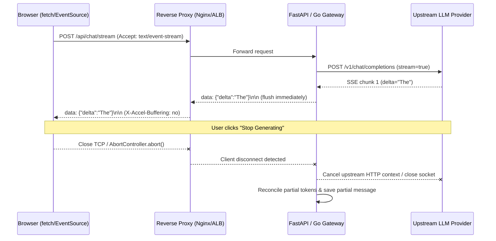
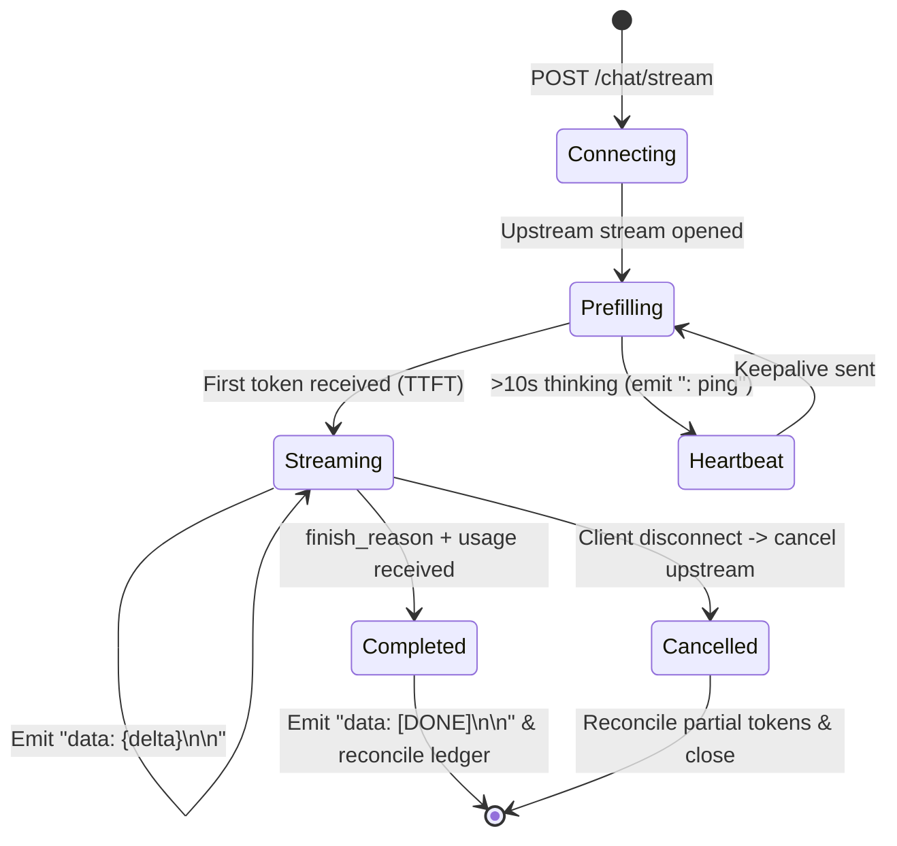
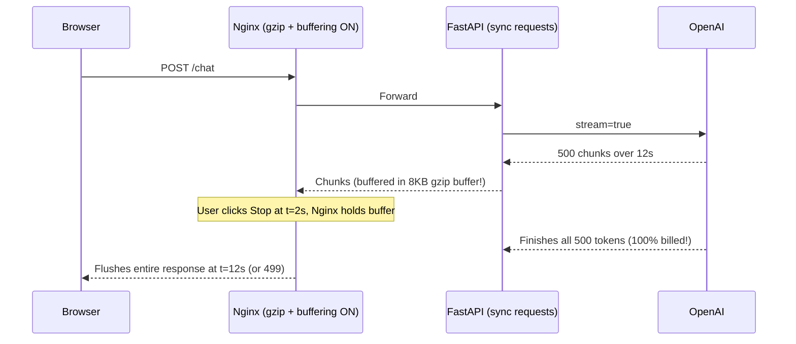

# Streaming LLM Responses: SSE, FastAPI StreamingResponse & Cancellation

> **Prerequisites:** [Lesson 17: Rate Limits & Quotas for LLM APIs](../17-rate-limits-quotas-for-llm-apis/README.md).  
> **Estimated Reading Time:** 24–28 minutes  
> **Target Audience:** Backend and full-stack engineers building real-time AI chat/copilot APIs, and candidates asked "how do you stream LLM tokens to clients and handle disconnects/buffering?"  
> **Free PDF Notes:** [Download SD-S-018.pdf](https://backendroadmap.com/notes/system-design/SD-S-018.pdf)

> [!NOTE]
> **In one line:** Streaming LLM responses over **Server-Sent Events (SSE)** decouples **Time to First Token (TTFT)** from total generation time—dropping perceived wait from 15 seconds to ~400 ms—provided your gateway disables **reverse-proxy buffering**, sends **keepalive heartbeats**, and propagates **client cancellation** upstream to stop burning GPU tokens.

> [!TIP]
> **The Golden Rule:** Streaming is not just `stream=True` on the SDK. You must disable buffering at every hop (`X-Accel-Buffering: no`, `Cache-Control: no-cache`), propagate `AbortSignal` / `context.Context` / `is_disconnected()` to close the upstream LLM socket immediately on user cancel, and reconcile token usage from the final SSE event.

---

## 1. What LLM Streaming Is, and What It Isn't

A 600-token LLM response takes ~12 seconds to generate at 50 tokens/sec. If your backend waits for the complete JSON response before replying, users stare at a blank spinner for 12 seconds, API Gateways (like AWS ALB or CloudFront) may hit 30-second timeouts on longer answers, and `p99` latency spikes to 25+ seconds. With SSE streaming, the user sees the first word in ~400 ms and reads at 50 tokens/sec—faster than human reading speed (~4–6 tokens/sec).

| Term | Precise Meaning | Example |
| :--- | :--- | :--- |
| **SSE (Server-Sent Events)** | Unidirectional HTTP/1.1 or HTTP/2 stream with `Content-Type: text/event-stream` | `data: {"delta":"Hello"}\n\n` |
| **TTFT (Time to First Token)** | Latency from request arrival until the first generated token reaches the client | 350–600 ms |
| **TPOT / ITL (Time Per Output Token)** | Average time between consecutive generated tokens during decode | 15–30 ms/token (33–66 tok/s) |
| **E2E Generation Time** | `TTFT + (N_out - 1) * TPOT` | $400\text{ ms} + 499 \times 20\text{ ms} = 10.38\text{ s}$ |
| **Proxy buffering** | Nginx/Envoy/CDN holding response bytes until a 4–8 KB buffer fills | Breaks streaming; delivers all tokens in one burst |
| **Cancellation propagation** | Closing the upstream provider HTTP stream the instant the browser closes SSE | Stops wasted decode billing & GPU slots |
| **Not** | Making the LLM compute faster | Total generation time is unchanged; *perceived* latency drops 20x |

### Why It Matters
1. **Perceived latency:** Human reading speed is ~250–300 words/min (~5–6 tokens/sec); streaming at 40+ tokens/sec feels instantaneous once TTFT passes.
2. **Timeout avoidance:** Streaming keeps the HTTP connection active with incremental bytes and heartbeats, avoiding 30–60s idle gateway timeouts.
3. **Cost & GPU protection:** When a user clicks "Stop generating" or navigates away, propagating cancellation saves 50–90% of remaining output tokens.

---

## 2. Anatomy: End-to-End SSE Streaming & Cancellation Path



| Transport | Direction | Firewall / Proxy Friendly | Reconnection | Best For |
| :--- | :--- | :---: | :--- | :--- |
| **SSE (`text/event-stream`)** | Server $\rightarrow$ Client (HTTP) | Yes (standard HTTP/2) | Built-in `Last-Event-ID` | LLM text/tool-call streaming |
| **WebSockets** | Bidirectional (WS upgrade) | Sometimes blocked / stateful LB | Manual | Voice/realtime audio + interruptible duplex |
| **gRPC Server Streaming** | Server $\rightarrow$ Client (HTTP/2) | Internal microservices | Manual | Gateway-to-model-worker internal hops |
| **Chunked NDJSON** | Server $\rightarrow$ Client (HTTP) | Yes | Manual | CLI tools & backend-to-backend streams |

> [!WARNING]
> **Reverse-proxy buffering is the #1 streaming bug in production.** Nginx defaults to `proxy_buffering on` (waiting for 4–8 KB before flushing to the client). A 500-token LLM response is only ~2 KB! Without `X-Accel-Buffering: no` (and disabling gzip compression on `text/event-stream`), Nginx buffers the entire response and flushes it all at once when the stream ends—completely defeating streaming.

---

## 3. Mathematical Model: TTFT, TPOT, and Cancellation Savings

**Perceived vs. Total Latency.** Given prefill time $T_{\text{prefill}}$, network/gateway overhead $T_{\text{net}}$, output token count $N_{\text{out}}$, and decode time per token $\text{TPOT}$:

$$\text{TTFT} = T_{\text{net}} + T_{\text{prefill}}, \qquad T_{\text{total}} = \text{TTFT} + (N_{\text{out}} - 1) \cdot \text{TPOT}$$

**Concurrency & Open Connections (Little's Law).** Streaming holds HTTP connections open for $T_{\text{total}}$ instead of returning immediately. At arrival rate $\lambda$ req/s:

$$L_{\text{concurrent}} = \lambda \cdot T_{\text{total}}$$

**Worked Numerical Example.**
Suppose $\lambda = 80\text{ req/s}$, $\text{TTFT} = 0.45\text{ s}$, $N_{\text{out}} = 500\text{ tokens}$, and $\text{TPOT} = 0.020\text{ s}$ (50 tok/s):
- Total stream duration: $T_{\text{total}} = 0.45 + 499 \times 0.020 = 10.43\text{ s}$.
- Concurrent open SSE connections at steady state:
  $$L_{\text{concurrent}} = 80 \times 10.43 = 834.4 \approx 835\text{ open connections}$$
- If a synchronous thread-per-request server has 200 worker threads, it **crashes/stalls** at 20 req/s. An async event-loop server (FastAPI/uvicorn, Go `net/http`, Node) handles 835 idle-waiting sockets with <50 MB RAM.

**Cancellation Token Savings.** If 12% of users abort at an average progress fraction $f = 0.30$ (after 150 of 500 tokens), propagating cancellation saves $0.12 \times (1 - 0.30) = 8.4\%$ of total output token spend—and frees $8.4\%$ of GPU decode slots.

---

## 4. Metrics & Percentiles

| Metric | Meaning | Alert when |
| :--- | :--- | :--- |
| **TTFT $p_{50}, p_{95}, p_{99}$** | Time from HTTP request to first SSE `data:` frame | $p_{95} > 1.5\text{ s}$ (prefill queue saturated or cold KV cache) |
| **TPOT / ITL $p_{95}$** | Inter-token latency during streaming | $p_{95} > 60\text{ ms}$ (stuttering UI; GPU decode batch overloaded) |
| **Stream error / premature close %** | Streams ending without `[DONE]` or `finish_reason` | > 2% (proxy timeout or upstream reset) |
| **Client-cancelled stream %** | Streams aborted by user disconnect | Sudden spike > 20% (bad prompt quality or slow TTFT) |
| **Active SSE connections** | Current open streaming sockets per pod | > 70% of pod `ulimit`/connection cap |
| **Idle gap > 15s** | Time between consecutive chunks without heartbeat | > 0 (risks ALB/CDN idle timeout kill) |

### Worked Example (Nginx + ALB Timeout)
An engineering team deploys FastAPI `StreamingResponse` behind AWS ALB (60s idle timeout) and Nginx. A reasoning model takes 22 seconds of thinking before emitting its first visible token. Without heartbeats, if thinking takes 62 seconds, ALB returns `504 Gateway Timeout`. Sending an SSE comment `: keepalive\n\n` every **10 seconds** resets the idle timer on ALB/Nginx/browsers while remaining invisible to `EventSource` parsers.

---

## 5. Compounding & Failure Modes

How streaming architectures behave under scale (100 req/s, 10s average stream = 1,000 concurrent connections):

| Configuration | Worker / Proxy Behavior | Result |
| :--- | :--- | :--- |
| **Sync Gunicorn (16 workers)** | Each stream blocks 1 worker for 10s; max 1.6 req/s | **98.4% requests fail/timeout** in queue |
| **Async FastAPI + Nginx default buffering** | 1,000 connections handled, but Nginx buffers 4 KB | **User waits 10s, then sees entire wall of text** |
| **Async FastAPI + `X-Accel-Buffering: no` (no cancel)** | User sees 400 ms TTFT; 15% disconnect early, server finishes | **15% wasted output tokens & GPU decode** |
| **Async FastAPI + unbuffered + cancel + heartbeat** | Immediate TTFT, clean abort on disconnect, 10s keepalive | **Optimal UX, zero wasted decode, no idle timeouts** |

---

## 6. Numbers Every Engineer Must Know

| Item | Typical | Implication |
| :--- | :---: | :--- |
| Human reading speed | 4–6 tokens/sec (~250 wpm) | Any TPOT $\le 50\text{ ms}$ (20+ tok/s) feels fluid |
| Target interactive TTFT | $\le 500\text{ ms}$ ($p_{50}$), $\le 1.5\text{ s}$ ($p_{95}$) | Above 2s, users abandon or double-click |
| SSE heartbeat interval | 10–15 seconds | Safely under AWS ALB/Cloudflare 60–100s idle timeouts |
| HTTP/1.1 browser connection limit | **6 connections per domain** | Use HTTP/2 (multiplexes 100+ streams on 1 TCP connection) |
| Memory per open async SSE stream | ~20–60 KB | 10,000 concurrent streams $\approx$ 200–600 MB RAM |
| Nginx `proxy_read_timeout` default | 60 seconds | Increase to 300s for long-running reasoning streams |

---

## 7. Protocol Deep Dive: SSE Wire Format & FastAPI `StreamingResponse`



**Standard SSE Frame Format:**
```text
event: token
id: 42
data: {"delta": "Hello", "index": 0}

: keepalive

event: usage
data: {"input_tokens": 120, "output_tokens": 48}

data: [DONE]
```

| Question | Answer |
| :--- | :--- |
| **Why `POST` with `fetch()` instead of browser `EventSource`?** | Native `EventSource` only supports `GET` and cannot send custom `Authorization` headers or large JSON message histories in a request body. Production apps use `fetch()` + `ReadableStream` (or `@microsoft/fetch-event-source`). |
| **How do you prevent proxy buffering?** | Set response headers: `Content-Type: text/event-stream`, `Cache-Control: no-cache, no-transform`, `Connection: keep-alive`, and `X-Accel-Buffering: no`. |
| **How does FastAPI detect client disconnect?** | Either poll `await request.is_disconnected()` inside the async generator loop, or rely on ASGI `http.disconnect` cancellation while wrapping upstream calls in `try ... finally` to close the `httpx` stream. |
| **What if you stream structured JSON?** | Stream raw tokens for UI display, or use a **streaming partial-JSON parser** (`partialjson` / `jiter`) to render UI cards incrementally as fields arrive. |

**When not to use streaming.**
1. **Non-interactive batch pipelines** (ETL, nightly classification): streaming adds framing overhead without any UX benefit.
2. **Strict post-generation guardrails** (e.g., PII redaction or compliance classifiers that must inspect the *entire* output before showing a single word): buffer internally or stream with a small lookahead window (e.g., sentence-level buffering).

---

## 8. Hierarchical Budgets & Design Rules

| Slice | Rule | Control |
| :--- | :--- | :--- |
| **Headers** | `text/event-stream`, `no-cache, no-transform`, `X-Accel-Buffering: no` | Gateway middleware |
| **Transport** | Require HTTP/2 between browser, CDN, and origin | Avoid 6-conn HTTP/1.1 exhaustion |
| **Heartbeats** | Emit `: ping\n\n` every 10s when upstream is silent | `asyncio.wait_for` / `select` timer |
| **Cancellation** | Tie upstream `httpx`/`http.Request` context to client socket | `try/finally` close + ledger reconcile |
| **Error handling** | Never swallow mid-stream errors silently; emit `event: error` | Client displays clean retry CTA |
| **Usage tracking** | Pass `stream_options: {"include_usage": true}` | Fallback to local token count on abort |

---

## 9. Top Mitigations

1. **Disable buffering at every proxy layer** (`X-Accel-Buffering: no`, disable gzip/brotli on `text/event-stream`).
2. **Use async I/O servers** (FastAPI/uvicorn, Go `net/http`, Node) — never sync thread-per-request workers for 10-second streams.
3. **Propagate client disconnects immediately** to the upstream provider HTTP request so GPU decode stops at once.
4. **Send periodic SSE keepalive comments** (`: keepalive\n\n` every 10s) to survive ALB/CDN idle timeouts during slow prefill or tool calls.
5. **Serve over HTTP/2** so multiple browser tabs or concurrent chat widgets don't hit the 6-connection HTTP/1.1 per-domain cap.
6. **Emit explicit `event: error` frames** if the upstream fails mid-stream (since HTTP status `200 OK` was already sent).
7. **Token-smooth or sentence-buffer** only when needed (e.g., TTS audio synthesis or PII redaction); otherwise flush chunks immediately.

---

## 10. Production Reference: SEV-1 "Frozen UI" & Runaway Decode After Launch

**Incident:** A SaaS launched streaming chat using FastAPI + Nginx + AWS ALB. Users reported two issues: (1) responses froze for 15 seconds and appeared all at once, and (2) clicking "Stop" in the UI still billed the full 2,000-token completion.



- **Root Cause:** (1) Nginx had `gzip on` and `proxy_buffering on`, holding the 2 KB SSE payload until EOF; (2) FastAPI's generator didn't pass `request.is_disconnected()` or cancel the `httpx` stream on `GeneratorExit`/`CancelledError`.
- **Fix:**
  1. Added `X-Accel-Buffering: no` and `Cache-Control: no-cache, no-transform` headers in FastAPI `StreamingResponse` (bypassing Nginx buffering and gzip).
  2. Wrapped the `httpx.AsyncClient.stream()` in `async with` + an `asyncio` disconnect watcher task that cancels the upstream request within <50 ms of client abort.

---

## 11. Multi-Language Production Code Tabs

Production-shaped **SSE Streaming Proxy with Unbuffered Headers, Keepalive Heartbeats, and Client Cancellation Propagation**.

````carousel
```go
// Go: SSE streaming handler with Flusher, 10s heartbeat, and upstream context cancellation.
package main

import (
	"bufio"
	"context"
	"fmt"
	"net/http"
	"strings"
	"time"
)

func streamLLMHandler(w http.ResponseWriter, r *http.Request) {
	flusher, ok := w.(http.Flusher)
	if !ok {
		http.Error(w, "streaming unsupported", http.StatusInternalServerError)
		return
	}

	// Disable proxy buffering and caching at every hop.
	w.Header().Set("Content-Type", "text/event-stream")
	w.Header().Set("Cache-Control", "no-cache, no-transform")
	w.Header().Set("Connection", "keep-alive")
	w.Header().Set("X-Accel-Buffering", "no")

	// Tie upstream request lifetime directly to client disconnect (r.Context()).
	ctx, cancel := context.WithTimeout(r.Context(), 120*time.Second)
	defer cancel()

	upstreamReq, _ := http.NewRequestWithContext(ctx, http.MethodPost, "https://api.openai.com/v1/chat/completions", strings.NewReader(`{"model":"gpt-4o-mini","stream":true}`))
	resp, err := http.DefaultClient.Do(upstreamReq)
	if err != nil {
		fmt.Fprintf(w, "event: error\ndata: %q\n\n", err.Error())
		flusher.Flush()
		return
	}
	defer resp.Body.Close()

	lines := make(chan string)
	go func() {
		defer close(lines)
		scanner := bufio.NewScanner(resp.Body)
		for scanner.Scan() {
			lines <- scanner.Text()
		}
	}()

	heartbeat := time.NewTicker(10 * time.Second)
	defer heartbeat.Stop()

	for {
		select {
		case <-ctx.Done():
			return // Client disconnected; defer cancel() aborts upstream socket immediately.
		case <-heartbeat.C:
			fmt.Fprint(w, ": keepalive\n\n")
			flusher.Flush()
		case line, open := <-lines:
			if !open {
				return
			}
			if strings.HasPrefix(line, "data: ") {
				fmt.Fprintf(w, "%s\n\n", line)
				flusher.Flush()
			}
		}
	}
}
```
<!-- slide -->
```typescript
// TypeScript (Node / Web Streams): SSE proxy with AbortController cancellation and heartbeat.
export async function streamLlmResponse(req: Request): Promise<Response> {
  const upstreamAbort = new AbortController();
  // Propagate client abort immediately to upstream LLM fetch.
  req.signal.addEventListener("abort", () => upstreamAbort.abort(), { once: true });

  const encoder = new TextEncoder();
  const stream = new ReadableStream({
    async start(controller) {
      const ping = setInterval(() => {
        controller.enqueue(encoder.encode(": keepalive\n\n"));
      }, 10_000);

      try {
        const upstream = await fetch("https://api.openai.com/v1/chat/completions", {
          method: "POST",
          signal: upstreamAbort.signal,
          headers: { "Content-Type": "application/json" },
          body: JSON.stringify({ model: "gpt-4o-mini", stream: true }),
        });

        const reader = upstream.body!.getReader();
        while (true) {
          const { done, value } = await reader.read();
          if (done) break;
          controller.enqueue(value);
        }
      } catch (err: any) {
        if (err?.name !== "AbortError") {
          controller.enqueue(encoder.encode(`event: error\ndata: ${JSON.stringify({ message: err.message })}\n\n`));
        }
      } finally {
        clearInterval(ping);
        controller.close();
      }
    },
    cancel() {
      upstreamAbort.abort();
    },
  });

  return new Response(stream, {
    headers: {
      "Content-Type": "text/event-stream",
      "Cache-Control": "no-cache, no-transform",
      "X-Accel-Buffering": "no",
    },
  });
}
```
<!-- slide -->
```python
# Python (FastAPI): StreamingResponse with disconnect detection, upstream cancel, and usage tracking.
import asyncio
import json
from fastapi import FastAPI, Request
from fastapi.responses import StreamingResponse
import httpx

app = FastAPI()

@app.post("/v1/chat/stream")
async def chat_stream(request: Request):
    async def event_generator():
        client_tokens = 0
        async with httpx.AsyncClient(timeout=httpx.Timeout(connect=5.0, read=60.0, write=10.0, pool=5.0)) as client:
            async with client.stream(
                "POST",
                "https://api.openai.com/v1/chat/completions",
                json={"model": "gpt-4o-mini", "stream": True, "stream_options": {"include_usage": True}, "messages": []},
            ) as upstream:
                try:
                    async for line in upstream.aiter_lines():
                        if await request.is_disconnected():
                            break  # Exiting `async with` closes upstream socket immediately!
                        if not line or not line.startswith("data: "):
                            continue
                        payload = line[6:]
                        if payload == "[DONE]":
                            yield "data: [DONE]\n\n"
                            break
                        client_tokens += 1
                        yield f"data: {payload}\n\n"
                except asyncio.CancelledError:
                    raise
                except Exception as exc:
                    yield f"event: error\ndata: {json.dumps({'error': str(exc)})}\n\n"
                finally:
                    # Reconcile `client_tokens` if stream aborted before final usage frame.
                    pass

    return StreamingResponse(
        event_generator(),
        media_type="text/event-stream",
        headers={
            "Cache-Control": "no-cache, no-transform",
            "Connection": "keep-alive",
            "X-Accel-Buffering": "no",
        },
    )
```
<!-- slide -->
```csharp
// C# (ASP.NET Core): Minimal API SSE endpoint with CancellationToken propagation and flush.
using System;
using System.IO;
using System.Net.Http;
using System.Threading;
using Microsoft.AspNetCore.Builder;
using Microsoft.AspNetCore.Http;

var app = WebApplication.Create();

app.MapPost("/v1/chat/stream", async (HttpContext ctx, IHttpClientFactory httpFactory, CancellationToken ct) =>
{
    ctx.Response.Headers.ContentType = "text/event-stream";
    ctx.Response.Headers.CacheControl = "no-cache, no-transform";
    ctx.Response.Headers["X-Accel-Buffering"] = "no";

    using var client = httpFactory.CreateClient();
    using var req = new HttpRequestMessage(HttpMethod.Post, "https://api.openai.com/v1/chat/completions");
    // HttpCompletionOption.ResponseHeadersRead starts streaming immediately without buffering body.
    using var resp = await client.SendAsync(req, HttpCompletionOption.ResponseHeadersRead, ct);
    await using var stream = await resp.Content.ReadAsStreamAsync(ct);
    using var reader = new StreamReader(stream);

    while (!ct.IsCancellationRequested)
    {
        var line = await reader.ReadLineAsync(ct);
        if (line is null) break;
        if (line.StartsWith("data: ", StringComparison.Ordinal))
        {
            await ctx.Response.WriteAsync($"{line}\n\n", ct);
            await ctx.Response.Body.FlushAsync(ct);
        }
    }
});
```
````

---

## 12. Hands-On CLI Verification Workflows

Test unbuffered SSE streaming and measure **TTFT** vs **total time** directly with `curl -N` (`--no-buffer`):

```bash
curl -N -s -w "\nTTFT_or_starttransfer=%{time_starttransfer}s Total=%{time_total}s\n" \
  https://api.openai.com/v1/chat/completions \
  -H "Authorization: Bearer $OPENAI_API_KEY" \
  -H "Content-Type: application/json" \
  -d '{"model":"gpt-4o-mini","stream":true,"max_tokens":60,"messages":[{"role":"user","content":"Count 1 to 10."}]}'
```

Verify that your Nginx/ALB proxy is **not** buffering `text/event-stream` by checking headers:

```bash
curl -I -N https://your-api.example.com/v1/chat/stream | grep -iE "content-type|cache-control|x-accel-buffering|content-encoding"
```

Simulate an early client abort after 1 second and confirm the server cancels cleanly:

```bash
timeout 1.0s curl -N -s https://your-api.example.com/v1/chat/stream \
  -H "Content-Type: application/json" -d '{"prompt":"Write a 1000-word essay"}'
```

---

## 13. Common Mistakes to Avoid

1. **Forgetting `X-Accel-Buffering: no`** and gzip exclusion, causing Nginx/Envoy to buffer the whole response.
2. **Ignoring client disconnects**, leaving the upstream LLM generating 1,000+ unviewed tokens after the user clicks Stop.
3. **Running SSE on synchronous thread-pool workers** (e.g., Flask/Gunicorn sync), exhausting workers under modest concurrency.
4. **Using native `EventSource` in the browser** for `POST` chat endpoints (it only supports `GET` and no custom auth headers).
5. **Omitting keepalive heartbeats**, causing AWS ALB or Cloudflare to drop slow reasoning/tool-call streams at 60s.
6. **Failing to send `event: error` mid-stream**, leaving the client hanging forever because HTTP `200 OK` was already committed.
7. **Serving SSE over HTTP/1.1**, hitting the browser's 6-connection-per-origin limit when users open multiple tabs.

---

## 14. Key Terms Glossary

| Key Term | Definition |
| :--- | :--- |
| **SSE (Server-Sent Events)** | HTTP streaming protocol (`text/event-stream`) for server-to-client push events. |
| **TTFT (Time to First Token)** | Elapsed time from request send until the first generated token arrives. |
| **TPOT / ITL** | Time Per Output Token / Inter-Token Latency between consecutive streamed tokens. |
| **Proxy Buffering** | Intermediate proxy holding response chunks until a buffer threshold is reached. |
| **`X-Accel-Buffering: no`** | Response header instructing Nginx-compatible proxies to flush chunks immediately. |
| **Cancellation Propagation** | Aborting the upstream LLM HTTP stream immediately when the downstream client disconnects. |
| **Keepalive Heartbeat** | Periodic SSE comment (`: ping\n\n`) resetting idle timeouts without triggering client `onmessage`. |
| **HTTP/2 Multiplexing** | Sharing one TCP connection across 100+ concurrent streams, avoiding HTTP/1.1's 6-conn cap. |
| **Partial JSON Parsing** | Incrementally parsing incomplete JSON streams to render structured UI elements live. |
| **`stream_options.include_usage`** | API flag requesting final token accounting in the last SSE frame. |

---

## 15. System Design Interview Questions & Answers

### Basic Conceptual Questions

<details>
<summary><strong>Q1: Why use SSE instead of WebSockets for LLM token streaming? [BASIC]</strong></summary>

**Answer:**
LLM generation is **unidirectional** (server $\rightarrow$ client) per request. SSE runs over standard HTTP/1.1 or HTTP/2, works seamlessly with load balancers, CDNs, and corporate firewalls, requires no WebSocket upgrade/stateful sticky sessions, and has built-in framing. WebSockets are only warranted for bidirectional real-time audio/voice where the user interrupts the model mid-sentence over the same socket.
</details>

<details>
<summary><strong>Q2: What is the difference between TTFT and TPOT? [BASIC]</strong></summary>

**Answer:**
**TTFT (Time to First Token)** is dominated by network RTT + prompt prefill time (processing all input tokens in parallel). **TPOT (Time Per Output Token)** is the decode interval between consecutive output tokens (memory-bandwidth bound). Total latency is $\text{TTFT} + (N_{\text{out}} - 1) \cdot \text{TPOT}$. Users judge responsiveness primarily by TTFT ($\le 500\text{ ms}$) and smoothness by TPOT ($\le 30\text{ ms}$).
</details>

<details>
<summary><strong>Q3: Why do tokens sometimes appear all at once in production even when `stream=True`? [BASIC]</strong></summary>

**Answer:**
Because a reverse proxy (Nginx, Envoy, Cloudflare) or compression middleware (gzip/brotli) is buffering the response until a 4–8 KB buffer fills or the stream closes. Fix it by setting `X-Accel-Buffering: no`, `Cache-Control: no-cache, no-transform`, and disabling compression for `text/event-stream`.
</details>

<details>
<summary><strong>Q4: Why can't you use the browser's built-in `EventSource` API for most LLM chat endpoints? [BASIC]</strong></summary>

**Answer:**
`EventSource` only supports `GET` requests and does not allow custom headers like `Authorization: Bearer <token>` or a JSON body containing conversation history. Production web apps use `fetch()` with `ReadableStream` (or `@microsoft/fetch-event-source`) to `POST` the payload and read SSE frames incrementally.
</details>

### Scenario-Based Architecture Questions

<details>
<summary><strong>Q5: A user clicks "Stop Generating" 1 second into a 1,500-token response. How do you ensure you stop paying for the remaining 1,400 tokens? [SCENARIO]</strong></summary>

**Answer:**
The browser calls `AbortController.abort()` on the `fetch()` stream, closing the client connection. Your backend gateway detects the disconnect (`r.Context().Done()` in Go, `request.is_disconnected()` / ASGI cancel in FastAPI) and **immediately cancels the upstream `httpx`/`http.Client` request**, closing the TCP socket to the LLM provider. Providers stop decoding as soon as the client socket closes, saving the remaining output tokens.
</details>

<details>
<summary><strong>Q6: Your reasoning model thinks for 70 seconds before emitting its first token, and AWS ALB returns 504. How do you fix it? [SCENARIO]</strong></summary>

**Answer:**
AWS ALB's default idle timeout is 60 seconds. Run an async timer in your SSE generator that emits an SSE comment frame (`: keepalive\n\n`) every **10 seconds** whenever no token has arrived from the upstream provider. SSE comments are ignored by standard SSE parsers, keep the TCP connection active through ALB/Nginx/browsers, and prevent `504` timeouts.
</details>

<details>
<summary><strong>Q7: How do you handle 5,000 concurrent streaming users in FastAPI without running out of workers? [SCENARIO]</strong></summary>

**Answer:**
Use async I/O (`uvicorn` with `httpx.AsyncClient` and `StreamingResponse` async generators) so each open stream only consumes ~30 KB of heap and 1 event-loop file descriptor instead of an OS thread. Across 4 pods with 4 uvicorn workers each, 5,000 concurrent connections is ~312 connections per worker—well within Linux `ulimit` and event-loop capacity. Also enforce HTTP/2 at the edge.
</details>

<details>
<summary><strong>Q8: How do you persist the assistant's message and reconcile token billing when streaming? [SCENARIO]</strong></summary>

**Answer:**
Buffer the streamed delta chunks in memory inside the gateway's generator. When the stream finishes (`[DONE]` or `finish_reason`), persist the complete message to the database and reconcile billing from the final `usage` event (`stream_options: {"include_usage": true}`). If the client disconnects early, persist the partial message (marked `status: cancelled`) in the `finally` block and estimate/count emitted tokens locally for billing.
</details>

### Advanced & Tricky Interview Questions

<details>
<summary><strong>Q9: Once HTTP `200 OK` and the first 20 tokens are sent, the upstream LLM crashes. How do you communicate failure to the client? [TRICKY]</strong></summary>

**Answer:**
You cannot change the HTTP status code to `500` after headers and body chunks have already been flushed. Instead, catch the upstream exception in the stream generator, emit an explicit structured SSE error event (`event: error\ndata: {"code":"upstream_failed","retryable":true}\n\n`), and close the stream cleanly. The frontend listens for `event: error` and renders an inline "Generation interrupted — Retry" button.
</details>

<details>
<summary><strong>Q10: You need to run a PII redaction guardrail on LLM output, but still want streaming UX. How do you reconcile these? [TRICKY]</strong></summary>

**Answer:**
Use a **sliding-window / sentence-level buffer** in the gateway. Hold back the last $k$ tokens (e.g., 15–25 tokens or up to the current word/sentence boundary) so regex/NER PII detectors can inspect complete entities like SSNs or emails before flushing safe text downstream. This adds only ~200–400 ms to TTFT while preserving streaming UX and zero PII leakage.
</details>

<details>
<summary><strong>Q11: Why does HTTP/1.1 break a web app that opens multiple streaming LLM panels simultaneously? [TRICKY]</strong></summary>

**Answer:**
Browsers enforce a strict limit of **6 concurrent TCP connections per domain** over HTTP/1.1. If a user opens 6 tabs or 6 parallel streaming widgets, the 7th request (including normal API calls like `/auth` or `/save`) stalls in the browser queue until a stream finishes. Enabling **HTTP/2** multiplexes 100+ concurrent SSE streams over a single TCP connection.
</details>

<details>
<summary><strong>Q12: How do you stream structured JSON (e.g., UI cards + summary) without breaking `JSON.parse()` on the frontend? [TRICKY]</strong></summary>

**Answer:**
Either: (1) Use **NDJSON / line-delimited JSON** where each complete object is flushed on a newline, or (2) Use a **streaming partial-JSON parser** on the frontend/backend that auto-closes open braces/quotes on each chunk so the UI can progressively render fields (title first, then bullet points) as they stream in.
</details>

---

## 16. One-Page Master Cheat Sheet

```
+---------------------------------------------------------------------------------------------------------+
|                  STREAMING LLM RESPONSES (SSE & CANCELLATION) — MASTER CHEAT SHEET                      |
+---------------------------------------------------------------------------------------------------------+
| 1. LATENCY: TTFT = Net + Prefill (~400 ms). Total = TTFT + (N_out - 1) * TPOT (~20 ms/tok).             |
|    Concurrency = arrival_rate * Total_duration (Little's Law) -> MUST use async I/O, not sync threads.  |
+---------------------------------------------------------------------------------------------------------+
| 2. REQUIRED HEADERS: Content-Type: text/event-stream | Cache-Control: no-cache, no-transform            |
|                      X-Accel-Buffering: no (prevents Nginx/Envoy buffering & gzip stall).               |
+---------------------------------------------------------------------------------------------------------+
| 3. RESILIENCE: Send `: keepalive\n\n` every 10s (beats 60s ALB timeout). Use HTTP/2 (avoids 6-conn cap). |
|    On mid-stream failure after HTTP 200, emit `event: error\ndata: {...}\n\n`.                          |
+---------------------------------------------------------------------------------------------------------+
| 4. CANCELLATION: Propagate client abort (AbortSignal / r.Context() / is_disconnected()) to upstream     |
|    HTTP socket immediately; reconcile partial tokens & save partial message in `finally`.               |
+---------------------------------------------------------------------------------------------------------+
```

---

## Further Reading & Sources

- MDN Web Docs, [Using Server-Sent Events (SSE)](https://developer.mozilla.org/en-US/docs/Web/API/Server-sent_events/Using_server-sent_events).
- FastAPI Documentation, [StreamingResponse and Custom Responses](https://fastapi.tiangolo.com/advanced/custom-response/#streamingresponse).
- OpenAI Platform Documentation, [Streaming Chat Completions & `stream_options`](https://platform.openai.com/docs/api-reference/chat/create).
- Cloudflare Blog, [HTTP/2 Multiplexing and Server-Sent Events at Scale](https://blog.cloudflare.com/).

---

## Free PDF Notes

[SD-S-018.pdf](https://backendroadmap.com/notes/system-design/SD-S-018.pdf)

---

## Next

Continue with [Lesson 19: Asynchronous LLM Inference: Job Queues, Priority Lanes & Batch APIs](../19-asynchronous-llm-inference/README.md).
