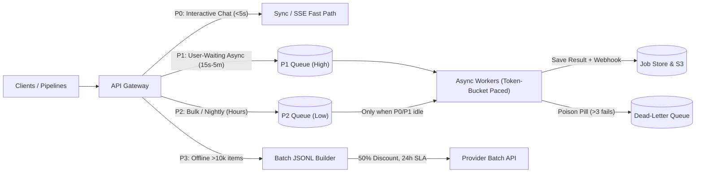
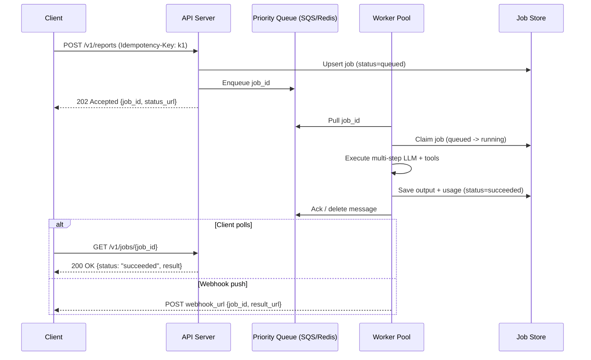
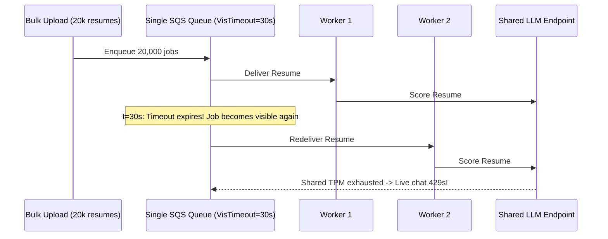

# Asynchronous LLM Inference: Job Queues, Priority Lanes & Batch APIs

> **Prerequisites:** [Lesson 18: Streaming LLM Responses](../18-streaming-llm-responses/README.md).  
> **Estimated Reading Time:** 24–28 minutes  
> **Target Audience:** Backend and ML platform engineers building document pipelines, deep-research agents, and bulk enrichment systems, and candidates asked "when and how do you move LLM calls off the synchronous HTTP path?"  
> **Free PDF Notes:** [Download SD-S-019.pdf](https://backendroadmap.com/notes/system-design/SD-S-019.pdf)

> [!NOTE]
> **In one line:** Move slow, multi-step, or bulk LLM workloads off the synchronous HTTP request path onto **durable job queues with priority lanes** (`202 Accepted` + status polling/webhooks) for 10s–10m tasks, and onto **provider Batch APIs** (JSONL upload, 24h SLA, **50% cost discount**) for offline workloads.

> [!TIP]
> **The Golden Rule:** If an LLM task takes >15 seconds, involves multi-agent loops, or runs in bulk (thousands of documents), never hold an HTTP request open. Return `202 Accepted` with a `job_id`, enqueue into a **priority-partitioned queue** with idempotent workers, and reserve synchronous TPM strictly for interactive chat.

---

## 1. What Asynchronous LLM Inference Is, and What It Isn't

A legal-tech platform lets users upload 50-page contracts for clause extraction, risk scoring, and redline generation. Running 8 sequential LLM calls per contract takes 45–90 seconds. Over synchronous HTTP, users hit 60-second ALB timeouts, browser refreshes trigger duplicate $0.40 runs, and a morning upload spike of 500 contracts saturates the company's TPM quota—taking down live chat for everyone else.

| Term | Precise Meaning | Example |
| :--- | :--- | :--- |
| **`202 Accepted` + Job Queue** | API validates input, enqueues a durable job, and returns `job_id` in <50 ms | Document analysis, deep research |
| **Priority Lanes** | Separate queues/token-pools (`P0` interactive, `P1` async user-facing, `P2` bulk) | User waiting in UI vs nightly backfill |
| **Batch API** | Provider-managed offline JSONL endpoint with 24h turnaround and 50% discount | Nightly evals, 1M product descriptions |
| **Idempotent Worker** | Consumer using `idempotency_key` + state transitions so retries don't double-bill | `INSERT ... ON CONFLICT DO NOTHING` |
| **Dead-Letter Queue (DLQ)** | Queue holding jobs that failed after max retries (e.g. context overflow, bad PDF) | Poison-pill 500-page corrupted PDF |
| **Completion Notification** | Webhook, WebSocket, or SSE status channel notifying the client when `job_id` finishes | `POST /webhooks/job-done` |
| **Not** | Fire-and-forget `asyncio.create_task()` in an API pod | Pod restarts/OOMs silently drop in-memory tasks |

### Why It Matters
1. **Load leveling & TPM protection:** Queues absorb 10x upload spikes and feed LLM workers at a steady rate within TPM limits.
2. **50% unit-cost reduction:** Batch APIs cut token spend in half for any workload that tolerates a 1–24 hour SLA.
3. **Fault isolation:** If an upstream provider has a 5-minute outage, queued jobs wait and retry cleanly instead of failing user requests.

---

## 2. Anatomy: Three-Lane Async Inference Architecture



| Pattern | Turnaround SLA | Cost | Complexity | Best For |
| :--- | :--- | :--- | :--- | :--- |
| **Sync / SSE Streaming** | < 15 seconds | 100% (PAYG/PTU) | Low | Live chat, autocomplete, inline edits |
| **Job Queue (P1 Interactive Async)** | 15s – 5 minutes | 100% | Medium | Deep research, multi-doc RAG, code gen |
| **Job Queue (P2 Throttled Bulk)** | 5 min – 2 hours | 100% (spare TPM) | Medium | Webhook enrichment, CRM sync |
| **Provider Batch API** | Up to 24 hours | **50% off** | Medium | Evals, embeddings backfill, nightly summaries |

> [!WARNING]
> **Never use in-process background tasks (`BackgroundTasks` / `go func()`) for paid LLM jobs.** When Kubernetes scales down a pod or deploys a new release (`SIGTERM`), every in-flight background task is killed mid-inference—losing user work without a retry or DLQ entry. Always persist jobs in a durable broker (SQS, RabbitMQ, Kafka, or Postgres `SKIP LOCKED`) before returning `202 Accepted`.

---

## 3. Mathematical Model: Queue Drain, Headroom, and Batch ROI

**Queue Backlog & Drain Time.** Suppose a burst of $M$ async jobs arrives, each requiring $\bar{T}$ tokens, and workers are paced at a safe spare TPM budget $\text{TPM}_{\text{spare}} = \text{TPM}_{\max} - \text{TPM}_{\text{P0}}$:

$$\mu_{\text{jobs/min}} = \frac{\text{TPM}_{\text{spare}}}{\bar{T}}, \qquad T_{\text{drain}} = \frac{M}{\mu_{\text{jobs/min}}} = \frac{M \cdot \bar{T}}{\text{TPM}_{\text{spare}}}$$

**Worked Numerical Example.**
Your deployment has $\text{TPM}_{\max} = 2{,}000{,}000$ TPM. During business hours, interactive chat (`P0`) consumes $1{,}200{,}000$ TPM, leaving $\text{TPM}_{\text{spare}} = 800{,}000$ TPM for async workers (`P1`).
- A customer uploads $M = 1{,}500$ contracts, each averaging $\bar{T} = 16{,}000$ tokens (input + output).
- Worker throughput: $\mu = 800{,}000 / 16{,}000 = 50\text{ contracts/min}$.
- Drain time: $T_{\text{drain}} = 1{,}500 / 50 = 30\text{ minutes}$—with **zero impact** on `P0` chat latency.

**Batch API Cost & TPM Advantage.** Batch APIs have **separate, much higher quota pools** (often 10x–50x your real-time TPM) and cost **50% less**:
- Real-time cost for 100M input + 20M output tokens on GPT-4o ($2.50 / $10.00): $250 + $200 = \$450$.
- Batch API cost (50% off): **$225**—and $0$ of your real-time `P0` TPM is consumed.

---

## 4. Metrics & Percentiles

| Metric | Meaning | Alert when |
| :--- | :--- | :--- |
| **Queue depth & oldest message age** | Waiting jobs and time since oldest job was enqueued | `P1` age $> 2\text{ min}$; `P2` age $> 2\text{ hours}$ |
| **Worker TPM consumption vs cap** | Tokens/min used by async workers | Exceeds allocated lane ceiling (risks `P0` starvation) |
| **Job end-to-end duration $p_{95}$** | Enqueue time $\rightarrow$ final result persisted | Exceeds product SLA (e.g., > 3 min for `P1`) |
| **DLQ arrival rate** | Jobs failing permanently after max retries | > 0.5% of total jobs (prompt bug or bad input) |
| **Duplicate execution rate** | Same `idempotency_key` processed twice | > 0 (check visibility timeout vs job duration!) |
| **Batch job failure / expiry rate** | Batch API lines failing or timing out at 24h | > 1% of batch lines |

### Worked Example (Visibility Timeout Bug)
An SQS queue has a default `VisibilityTimeout` of **30 seconds**, but an async multi-step agent job takes **75 seconds** to finish. At $t=30\text{s}$, SQS assumes the worker crashed and redelivers the same job to Worker B. Both workers run the 75-second LLM chain, doubling the token bill. **Fix:** Set `VisibilityTimeout` $\ge 3\times$ $p_{99}$ job duration (or heartbeat-extend visibility every 20s) and guard state transitions with an atomic `UPDATE jobs SET status='running' WHERE id=$1 AND status='queued'`.

---

## 5. Compounding & Failure Modes

Comparison of handling 5,000 bulk enrichment jobs (10k tokens each = 50M tokens) alongside live interactive traffic (1M TPM total quota):

| Architecture | Interactive `P0` `429` Rate | Bulk Completion Time | Wasted Tokens (Retries/Dups) | Bulk Cost |
| :--- | :---: | :---: | :---: | :---: |
| **Synchronous HTTP loop** | 48% (outage) | Fails at 60s timeouts | +35% | $270+ |
| **Single unpaced queue** | 22% (`P0` starved) | 55 min | +12% | $224 |
| **Priority lanes (`P1`/`P2` paced at 40% TPM)** | **0%** | 125 min | <1% | $200 |
| **Provider Batch API (JSONL)** | **0%** | 3–12 hours | 0% | **$100 (50% off)** |

---

## 6. Numbers Every Engineer Must Know

| Item | Typical | Implication |
| :--- | :---: | :--- |
| HTTP Gateway / ALB timeout | 30–60 seconds | Any LLM task $>15\text{s}$ belongs on an async job queue |
| Provider Batch API discount | **50% flat** | Use for all non-interactive workloads tolerating <24h SLA |
| Batch API file size / line limits | ~100–200 MB or 50,000 requests/file | Shard larger jobs into multiple batch files |
| Queue `VisibilityTimeout` | $\ge 3\times$ $p_{99}$ job runtime (or heartbeat) | Prevents duplicate LLM execution on slow jobs |
| Worker concurrency formula | `TPM_lane / (avg_tokens_per_job * jobs_per_min)` | Bound worker pool size so workers don't thrash `429`s |
| Job status polling interval | 1s $\rightarrow$ 2s $\rightarrow$ 5s exponential backoff | Or push via WebSocket/SSE/webhook to avoid polling load |

---

## 7. Mechanism Deep Dive: `202 Accepted`, Polling vs Webhooks, and Batch API Lifecycle



| Question | Answer |
| :--- | :--- |
| **How does the Batch API workflow differ?** | (1) Build a `.jsonl` file where each line has `custom_id`, `method`, `url`, and `body`. (2) Upload via Files API. (3) Create Batch job. (4) Poll batch status or receive webhook. (5) Download output `.jsonl` and error `.jsonl`, matching rows by `custom_id`. |
| **How do you show progress on a 60-second async job?** | Workers publish step events (`"Extracting clauses 3/10"`) to Redis Pub/Sub; the client subscribes to `GET /v1/jobs/{id}/events` (SSE) or polls `progress_pct` in the job record. |
| **What goes into the DLQ?** | Jobs exceeding `max_retries` (e.g., 3) due to `context_length_exceeded`, unparseable corrupted files, or persistent `400` errors. Alert on DLQ depth and provide a replay script after fixing the bug. |

**When not to use asynchronous inference.**
1. **Interactive user expectations (<5–10 seconds):** Users typing in a chat box expect immediate SSE streaming, not a "we'll email you when ready" spinner.
2. **Simple single-call tasks under 500 tokens:** Queueing adds operational overhead (broker, worker, polling) where direct SSE streaming is simpler and faster.

---

## 8. Hierarchical Budgets & Design Rules

| Slice | Rule | Control |
| :--- | :--- | :--- |
| **Admission** | Validate payload + token size *before* returning `202` | Reject >context-limit synchronously (`400`) |
| **Idempotency** | Require `Idempotency-Key` on `POST` job creation | Deduplicate double-clicks & client retries |
| **Priority lanes** | Separate `P0` (sync), `P1` (async UI), `P2` (bulk) | Strict TPM quota allocation per lane |
| **Worker lease** | Heartbeat visibility extension or `VisibilityTimeout >= 3x p99` | Atomic DB claim (`queued -> running`) |
| **Retries & DLQ** | Retry transient `429/5xx`; route `400`/poison pills to DLQ | Max 3–5 attempts with jitter |
| **Batch sharding** | Split >50k items into ~10k-line JSONL shards | Parallelize upload & partial failure recovery |

---

## 9. Top Mitigations

1. **Return `202 Accepted` with a durable `job_id`** for any LLM workflow exceeding 15 seconds.
2. **Isolate interactive `P0` from async `P1`/`P2` traffic** using separate queues and TPM token buckets.
3. **Use the Provider Batch API** for all offline evals, backfills, and nightly pipelines to capture the 50% discount and separate quota pool.
4. **Make workers strictly idempotent** using atomic DB state transitions (`queued -> running -> succeeded`) and `Idempotency-Key`s.
5. **Size `VisibilityTimeout` $\ge 3\times$ $p_{99}$ job duration** (or renew leases) so slow LLM jobs aren't redelivered mid-flight.
6. **Route poison pills to a DLQ** after 3–5 retries instead of letting one malformed PDF block the queue forever.
7. **Store large inputs/outputs in object storage (S3/GCS)** and pass only the pointer (`s3://...`) in queue messages to stay under 256 KB broker limits.

---

## 10. Production Reference: SEV-1 Duplicate Billing & Queue Starvation

**Incident:** A recruiting platform launched an async AI resume-scoring pipeline. During a bulk upload of 20,000 resumes, two failures hit simultaneously: (1) live candidate chat returned `429`s for 40 minutes, and (2) 3,200 resumes were scored and billed **3 times each**.



- **Root Cause:** (1) Async workers shared the exact same provider deployment and TPM bucket as live chat; (2) SQS `VisibilityTimeout` was 30s while average LLM scoring took 48s, causing continuous redelivery and duplicate inference.
- **Fix:**
  1. Moved bulk resume scoring to the **Batch API** (50% cheaper, zero shared TPM with live chat).
  2. For urgent `P1` async jobs, raised SQS `VisibilityTimeout` to 300s, added an atomic DB claim (`WHERE status = 'queued'`), and capped `P1` workers at 30% of total TPM.

---

## 11. Multi-Language Production Code Tabs

Production-shaped **Async LLM Job Enqueue (`202 Accepted`), Idempotent Worker Claim, and Batch JSONL Generator**.

````carousel
```go
// Go: 202 Accepted job enqueue + idempotent worker claim with priority lane pacing.
package main

import (
	"crypto/sha256"
	"encoding/hex"
	"encoding/json"
	"net/http"
	"sync"
)

type JobStatus string

const (
	StatusQueued    JobStatus = "queued"
	StatusRunning   JobStatus = "running"
	StatusSucceeded JobStatus = "succeeded"
)

type Job struct {
	ID             string    `json:"id"`
	IdempotencyKey string    `json:"idempotency_key"`
	Priority       string    `json:"priority"` // "P1" or "P2"
	Prompt         string    `json:"prompt"`
	Status         JobStatus `json:"status"`
	Result         string    `json:"result,omitempty"`
}

type JobStore struct {
	mu   sync.Mutex
	jobs map[string]*Job
	keys map[string]string
}

func NewJobStore() *JobStore {
	return &JobStore{jobs: make(map[string]*Job), keys: make(map[string]string)}
}

// EnqueueIdempotent deduplicates repeated client submissions with the same Idempotency-Key.
func (s *JobStore) EnqueueIdempotent(idemKey, priority, prompt string) (*Job, bool) {
	s.mu.Lock()
	defer s.mu.Unlock()
	if existingID, ok := s.keys[idemKey]; ok {
		return s.jobs[existingID], false
	}
	sum := sha256.Sum256([]byte(idemKey + prompt))
	id := hex.EncodeToString(sum[:8])
	job := &Job{ID: id, IdempotencyKey: idemKey, Priority: priority, Prompt: prompt, Status: StatusQueued}
	s.jobs[id] = job
	s.keys[idemKey] = id
	return job, true
}

// TryClaim atomically transitions queued -> running so redelivered queue messages never double-bill.
func (s *JobStore) TryClaim(jobID string) bool {
	s.mu.Lock()
	defer s.mu.Unlock()
	j, ok := s.jobs[jobID]
	if !ok || j.Status != StatusQueued {
		return false
	}
	j.Status = StatusRunning
	return true
}

func submitJobHandler(store *JobStore, queue chan<- string) http.HandlerFunc {
	return func(w http.ResponseWriter, r *http.Request) {
		idemKey := r.Header.Get("Idempotency-Key")
		job, created := store.EnqueueIdempotent(idemKey, "P1", "Analyze contract")
		if created {
			queue <- job.ID
		}
		w.Header().Set("Content-Type", "application/json")
		w.WriteHeader(http.StatusAccepted) // 202 Accepted
		_ = json.NewEncoder(w).Encode(map[string]any{
			"job_id":     job.ID,
			"status":     job.Status,
			"status_url": "/v1/jobs/" + job.ID,
		})
	}
}
```
<!-- slide -->
```typescript
// TypeScript: Async job queue producer (202 Accepted) + OpenAI Batch JSONL builder.
export interface BatchRequestItem {
  customId: string;
  model: string;
  systemPrompt: string;
  userPrompt: string;
  maxTokens?: number;
}

export function buildBatchJsonl(items: BatchRequestItem[]): string {
  return items
    .map((item) =>
      JSON.stringify({
        custom_id: item.customId,
        method: "POST",
        url: "/v1/chat/completions",
        body: {
          model: item.model,
          max_tokens: item.maxTokens ?? 500,
          messages: [
            { role: "system", content: item.systemPrompt },
            { role: "user", content: item.userPrompt },
          ],
        },
      })
    )
    .join("\n");
}

export async function pollJobWithBackoff<T>(
  fetchStatus: () => Promise<{ status: "queued" | "running" | "succeeded" | "failed"; result?: T }>,
  maxWaitMs = 120_000
): Promise<T> {
  const start = Date.now();
  let delayMs = 1000;
  while (Date.now() - start < maxWaitMs) {
    const res = await fetchStatus();
    if (res.status === "succeeded") return res.result!;
    if (res.status === "failed") throw new Error("Async LLM job failed");
    await new Promise((r) => setTimeout(r, delayMs));
    delayMs = Math.min(8000, delayMs * 1.5);
  }
  throw new Error("Polling timeout exceeded");
}
```
<!-- slide -->
```python
# Python: Priority-lane worker simulation + Batch API JSONL generator.
import heapq
import json
from dataclasses import dataclass, field

@dataclass(order=True)
class AsyncLlmJob:
    priority: int  # 0 = P0/P1 high, 1 = P2 bulk
    seq: int
    job_id: str = field(compare=False)
    est_tokens: int = field(compare=False)

def generate_batch_jsonl(records: list[dict], model: str = "gpt-4o-mini") -> str:
    lines = []
    for rec in records:
        payload = {
            "custom_id": rec["id"],
            "method": "POST",
            "url": "/v1/chat/completions",
            "body": {
                "model": model,
                "max_tokens": 300,
                "messages": [{"role": "user", "content": rec["prompt"]}],
            },
        }
        lines.append(json.dumps(payload))
    return "\n".join(lines)

def simulate_priority_drain(p1_count=50, p2_count=200, spare_tpm=600_000, tok_per_job=12_000):
    pq: list[AsyncLlmJob] = []
    seq = 0
    for i in range(p2_count):
        heapq.heappush(pq, AsyncLlmJob(1, seq, f"p2-{i}", tok_per_job))
        seq += 1
    for i in range(p1_count):
        heapq.heappush(pq, AsyncLlmJob(0, seq, f"p1-{i}", tok_per_job))
        seq += 1

    jobs_per_min = spare_tpm // tok_per_job
    minute = 0
    p1_done_at = None
    while pq:
        minute += 1
        for _ in range(min(jobs_per_min, len(pq))):
            job = heapq.heappop(pq)
            if job.priority == 0:
                p1_done_at = minute
    return {"jobs_per_min": jobs_per_min, "p1_all_done_min": p1_done_at, "all_done_min": minute}

if __name__ == "__main__":
    print(simulate_priority_drain())
```
<!-- slide -->
```csharp
// C#: Priority-lane async LLM queue using .NET PriorityQueue + idempotent claim guard.
using System;
using System.Collections.Concurrent;
using System.Collections.Generic;
using System.Threading;
using System.Threading.Tasks;

public sealed record LlmJob(string JobId, int Priority, string Prompt);

public sealed class PriorityLlmQueue
{
    private readonly PriorityQueue<LlmJob, int> _pq = new();
    private readonly ConcurrentDictionary<string, string> _status = new();
    private readonly SemaphoreSlim _signal = new(0);
    private readonly object _lock = new();

    public bool TryEnqueue(LlmJob job)
    {
        if (!_status.TryAdd(job.JobId, "queued")) return false; // Idempotent dedup
        lock (_lock) _pq.Enqueue(job, job.Priority);
        _signal.Release();
        return true;
    }

    public async Task<LlmJob?> DequeueAndClaimAsync(CancellationToken ct)
    {
        await _signal.WaitAsync(ct);
        LlmJob? job;
        lock (_lock) _pq.TryDequeue(out job, out _);
        if (job is null) return null;
        return _status.TryUpdate(job.JobId, "running", "queued") ? job : null;
    }
}
```
````

---

## 12. Hands-On CLI Verification Workflows

Generate a valid Batch API JSONL file and submit it via `curl` (OpenAI-compatible Batch API):

```bash
python -c '
import json
with open("batch.jsonl", "w") as f:
    for i in range(3):
        f.write(json.dumps({
            "custom_id": f"doc-{i}",
            "method": "POST",
            "url": "/v1/chat/completions",
            "body": {"model": "gpt-4o-mini", "max_tokens": 100, "messages": [{"role": "user", "content": f"Summarize item {i}"}]}
        }) + "\n")
print("Wrote batch.jsonl")
'
```

Upload the file and create the batch job:

```bash
FILE_ID=$(curl -s https://api.openai.com/v1/files \
  -H "Authorization: Bearer $OPENAI_API_KEY" \
  -F purpose="batch" -F file="@batch.jsonl" | python -c "import sys,json; print(json.load(sys.stdin)['id'])")

curl -s https://api.openai.com/v1/batches \
  -H "Authorization: Bearer $OPENAI_API_KEY" \
  -H "Content-Type: application/json" \
  -d "{\"input_file_id\": \"$FILE_ID\", \"endpoint\": \"/v1/chat/completions\", \"completion_window\": \"24h\"}"
```

Inspect SQS queue depth and DLQ count for async LLM workers:

```bash
aws sqs get-queue-attributes \
  --queue-url "$LLM_P1_QUEUE_URL" \
  --attribute-names ApproximateNumberOfMessages ApproximateNumberOfMessagesNotVisible
```

---

## 13. Common Mistakes to Avoid

1. **Running slow LLM tasks in-process (`BackgroundTasks`)** instead of a durable queue, losing jobs on deploy or OOM.
2. **Setting SQS/queue `VisibilityTimeout` shorter than $p_{99}$ LLM job duration**, causing duplicate execution and double billing.
3. **Sharing one TPM bucket between live chat and async batch workers**, causing batch spikes to take down interactive users.
4. **Paying 100% real-time rates for offline workloads** instead of using the 50%-discounted Batch API.
5. **Skipping `Idempotency-Key` on job submission**, allowing network retries or double-clicks to enqueue duplicate expensive jobs.
6. **Putting massive 5 MB documents directly inside queue messages** instead of storing them in S3/GCS and passing a pointer.
7. **Omitting a Dead-Letter Queue**, letting one malformed input retry infinitely and waste TPM.

---

## 14. Key Terms Glossary

| Key Term | Definition |
| :--- | :--- |
| **`202 Accepted`** | HTTP status indicating a job was durably accepted for asynchronous processing. |
| **Priority Lane** | Partitioned queue + TPM quota ensuring interactive/urgent jobs preempt bulk work. |
| **Batch API** | Provider endpoint accepting `.jsonl` files for 24h offline completion at 50% cost. |
| **Visibility Timeout** | Duration a queue hides an in-flight message before assuming the worker died and redelivering. |
| **Idempotency Key** | Client-supplied key preventing duplicate job creation on retries. |
| **Atomic Claim** | DB state transition (`queued -> running`) guaranteeing at-most-once execution per job. |
| **Dead-Letter Queue (DLQ)** | Queue for poison-pill jobs that exceed max retry attempts. |
| **Backpressure** | Rejecting or throttling new async submissions when queue depth/age exceeds SLOs. |
| **Webhook / Push** | Server-to-server callback notifying the caller when an async job completes. |
| **JSONL (JSON Lines)** | Newline-delimited JSON format used by LLM Batch APIs. |

---

## 15. System Design Interview Questions & Answers

### Basic Conceptual Questions

<details>
<summary><strong>Q1: When should an LLM call be asynchronous instead of synchronous/streaming? [BASIC]</strong></summary>

**Answer:**
Move an LLM call to an async job queue when: (1) latency exceeds ~15 seconds (e.g., multi-step agent loops, large-doc analysis, deep research) risking HTTP/ALB timeouts; (2) the workload is bulk/offline (thousands of items); or (3) the user doesn't need the result immediately in the current UI view.
</details>

<details>
<summary><strong>Q2: What HTTP pattern should an async LLM endpoint implement? [BASIC]</strong></summary>

**Answer:**
Validate the request and token bounds synchronously, persist the job record and enqueue it durably, then return **`202 Accepted`** with `{job_id, status_url}` and a `Location` header. Clients either poll `GET /jobs/{id}` with exponential backoff, listen to a job-specific SSE/WebSocket channel, or receive a webhook callback.
</details>

<details>
<summary><strong>Q3: What are the benefits of Provider Batch APIs compared to self-managed worker queues? [BASIC]</strong></summary>

**Answer:**
Provider Batch APIs offer a **50% flat price discount** on both input and output tokens, use a **separate high-capacity quota pool** (so they never eat into your real-time TPM), and eliminate worker scaling/retry code. The trade-off is a **24-hour SLA** (though often completing in 1–6 hours) and no streaming.
</details>

<details>
<summary><strong>Q4: Why is `BackgroundTasks` (FastAPI) or a goroutine unsafe for durable LLM jobs? [BASIC]</strong></summary>

**Answer:**
In-memory background tasks live only in the API pod's RAM. During a rolling deploy, autoscaler scale-down, or OOM kill, those tasks vanish without completing, retrying, or entering a DLQ. Durable queues (SQS, Kafka, RabbitMQ, or Postgres `FOR UPDATE SKIP LOCKED`) survive pod restarts.
</details>

### Scenario-Based Architecture Questions

<details>
<summary><strong>Q5: Users upload 1,000-page PDFs for summarization (~90s each). Design the async pipeline. [SCENARIO]</strong></summary>

**Answer:**
(1) Client uploads PDF directly to S3 via pre-signed URL. (2) `POST /summarize` validates file metadata, creates a `jobs` row with `Idempotency-Key`, pushes `{job_id, s3_uri}` to a `P1` SQS queue, and returns `202 Accepted`. (3) Workers pull jobs with `VisibilityTimeout = 300s`, claim atomically in Postgres, run map-reduce chunk summarization paced by a Redis TPM limiter, write results to S3/DB, and push completion via WebSocket/webhook. (4) Failed jobs after 3 tries go to a DLQ.
</details>

<details>
<summary><strong>Q6: How do you prevent nightly bulk jobs from degrading live chat latency? [SCENARIO]</strong></summary>

**Answer:**
Use **priority lanes**: (1) Route bulk jobs to a separate `P2` queue or the Batch API. (2) In the LLM Gateway's Redis token bucket, reserve 70–80% of TPM exclusively for `P0` interactive chat. (3) `P2` workers only acquire tokens from the remaining pool and automatically pause whenever `P0` `429` rate or queue wait rises.
</details>

<details>
<summary><strong>Q7: An async worker takes 75 seconds to run, and SQS redelivers the job at 30 seconds, causing double LLM billing. How do you fix it? [SCENARIO]</strong></summary>

**Answer:**
Two fixes together: (1) Set `VisibilityTimeout` $\ge 3\times$ $p_{99}$ job duration (e.g., 300s) and/or have workers send periodic `ChangeMessageVisibility` heartbeats while running. (2) Enforce an **atomic DB claim** (`UPDATE jobs SET status='running' WHERE id=$1 AND status='queued'`) so even if a message is redelivered, the second worker sees `0 rows affected` and immediately deletes the duplicate message.
</details>

<details>
<summary><strong>Q8: How do you design a nightly evaluation pipeline for 200,000 prompt test cases? [SCENARIO]</strong></summary>

**Answer:**
Shard the 200,000 test cases into 4 JSONL files of 50,000 lines each (staying within Batch API per-file limits), tagged with deterministic `custom_id`s (`suite_v3_case_000142`). Submit all 4 to the Provider Batch API (50% cheaper, zero real-time TPM impact). Poll batch completion, download output + error JSONLs, and aggregate pass/fail metrics into your eval dashboard.
</details>

### Advanced & Tricky Interview Questions

<details>
<summary><strong>Q9: A worker crashes *after* calling the LLM and receiving the response, but *before* committing the result to Postgres. What happens? [TRICKY]</strong></summary>

**Answer:**
The queue redelivers the job after `VisibilityTimeout` expires, and the new worker will re-run the LLM call—paying twice—unless you **checkpoint intermediate steps** in S3/Redis (especially in multi-step agent workflows). Checkpointing each step's output keyed by `(job_id, step_index)` lets a restarted worker resume from step 4 instead of re-running steps 1–3.
</details>

<details>
<summary><strong>Q10: How do you support "Cancel Job" for an async LLM task that is already running on a worker? [TRICKY]</strong></summary>

**Answer:**
When `DELETE /v1/jobs/{id}` is called, mark `status = 'cancelling'` in DB and publish `cancel:{job_id}` on Redis Pub/Sub. Workers subscribe to cancellation events (or check a Redis key between agent steps) and abort their `context.Context` / `httpx` stream immediately—stopping further LLM calls and transitioning the job to `cancelled`.
</details>

<details>
<summary><strong>Q11: Why might a Batch API job still have partial failures, and how do you handle them? [TRICKY]</strong></summary>

**Answer:**
Individual lines in a batch JSONL can fail due to `context_length_exceeded`, content-policy filters, or malformed JSON. The Batch API writes successful rows to `output_file_id` and failed rows to `error_file_id`. Your post-processor must parse **both** files, join by `custom_id`, fix/truncate or route failed items to a fallback/DLQ, and never assume 100% of a completed batch succeeded.
</details>

<details>
<summary><strong>Q12: How do you estimate and enforce queue backpressure so `P1` async SLA (2 minutes) isn't silently breached during a 10x spike? [TRICKY]</strong></summary>

**Answer:**
Track `estimated_drain_seconds = (queue_depth * avg_tokens_per_job) / (spare_tpm / 60)`. When `estimated_drain_seconds` exceeds the `P1` SLA (e.g., 120s), the API gateway either: (1) triggers horizontal spillover to a secondary region/PAYG pool, (2) sheds `P2` bulk traffic to 0, or (3) returns `503 Service Unavailable` with `Retry-After` to new `P1` submissions with an explicit UI message ("High demand — try again in 2 minutes").
</details>

---

## 16. One-Page Master Cheat Sheet

```
+---------------------------------------------------------------------------------------------------------+
|                  ASYNCHRONOUS LLM INFERENCE — MASTER CHEAT SHEET                                        |
+---------------------------------------------------------------------------------------------------------+
| 1. WHEN TO GO ASYNC: Latency > 15s (beats 30-60s ALB timeout), multi-step agents, or bulk pipelines.    |
|    API Pattern: Validate -> Persist + Enqueue durably -> Return 202 Accepted {job_id, status_url}.      |
+---------------------------------------------------------------------------------------------------------+
| 2. PRIORITY LANES: P0 (Interactive Sync) > P1 (User-Waiting Async) > P2 (Bulk) > P3 (Batch API).        |
|    Drain Time = (Jobs * Avg_Tokens) / Spare_TPM. Never let P2 starve P0!                                |
+---------------------------------------------------------------------------------------------------------+
| 3. BATCH API: Upload .jsonl -> 24h SLA -> 50% flat discount + separate quota pool.                      |
|    Shard at <= 50k lines/file; parse BOTH output_file_id and error_file_id by custom_id.                |
+---------------------------------------------------------------------------------------------------------+
| 4. WORKER SAFETY: VisibilityTimeout >= 3x p99 runtime + atomic DB claim (queued -> running) + DLQ.      |
|    Store large payloads in S3/GCS, pass pointers in queue messages; checkpoint multi-step agents.       |
+---------------------------------------------------------------------------------------------------------+
```

---

## Further Reading & Sources

- OpenAI Platform Documentation, [Batch API Guide (50% Discount & 24h SLA)](https://platform.openai.com/docs/guides/batch).
- Anthropic Documentation, [Message Batches API](https://docs.anthropic.com/en/docs/build-with-claude/message-batches).
- AWS Architecture Center, [Asynchronous Request-Reply Pattern](https://learn.microsoft.com/en-us/azure/architecture/patterns/async-request-reply).
- Martin Kleppmann, *Designing Data-Intensive Applications*, Chapter 11: "Stream Processing & Durable Queues".

---

## Free PDF Notes

[SD-S-019.pdf](https://backendroadmap.com/notes/system-design/SD-S-019.pdf)

---

## Next

Continue with [Lesson 20: LLM Caching: Exact Response Cache, Prompt Caching & KV Cache Reuse](../20-llm-caching/README.md).
