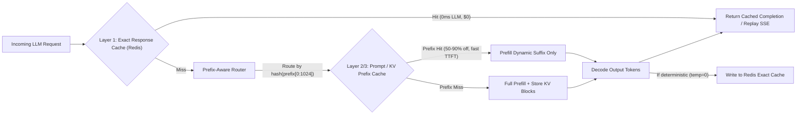
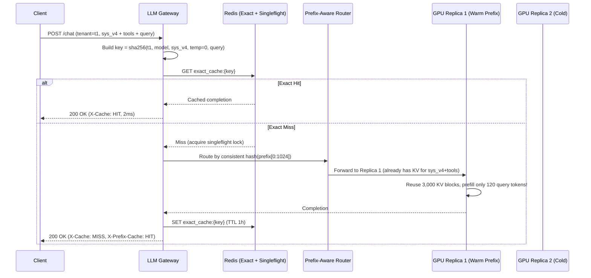
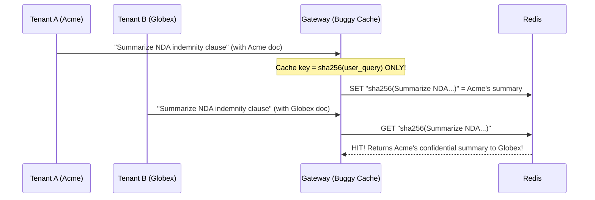

# LLM Caching: Exact Response Cache, Prompt Caching & KV Cache Reuse

> **Prerequisites:** [Lesson 19: Asynchronous LLM Inference](../19-asynchronous-llm-inference/README.md).  
> **Estimated Reading Time:** 24–28 minutes  
> **Target Audience:** Backend and AI infra engineers optimizing TTFT and token spend, and candidates asked "how does caching work across the LLM stack?"  
> **Free PDF Notes:** [Download SD-S-020.pdf](https://backendroadmap.com/notes/system-design/SD-S-020.pdf)

> [!NOTE]
> **In one line:** LLM caching operates at **three distinct layers**: (1) **Exact Response Caching** (skipping the LLM entirely for identical canonicalized requests in Redis), (2) **Provider Prompt Caching** (discounting repeated prompt prefixes by 50–90% and cutting TTFT), and (3) **Inference-Engine KV Cache Reuse** (PagedAttention / RadixAttention prefix sharing across requests on self-hosted GPUs).

> [!TIP]
> **The Golden Rule:** Always key exact caches by `(tenant_id, model, prompt_version, temperature, canonical_messages)`—never by raw prompt text alone—and structure every prompt **static-first, dynamic-last** so prompt/KV prefix caches hit at 70–95%.

---

## 1. What LLM Caching Is, and What It Isn't

A support-triage service sends 200,000 requests/day to an LLM. Every single request begins with the same 2,400-token system prompt + policy manual + tool schemas, followed by a 100-token user ticket. Furthermore, 18% of tickets ask identical canonical FAQs (`"How do I reset MFA?"`). Without caching, the system recomputes the exact same 2,400-token attention KV tensors 200,000 times a day and regenerates identical FAQ answers 36,000 times.

| Term | Precise Meaning | Example |
| :--- | :--- | :--- |
| **Exact Response Cache** | Key-value store (Redis) returning a stored completion for an identical request hash | SHA-256 of `(tenant, model, temp, messages)` |
| **Prompt / Prefix Caching** | Provider-side caching of KV tensors for repeated leading prompt tokens ($\ge 1{,}024$ tok) | 50–90% input cost discount + 2x–4x faster TTFT |
| **KV Cache (Key-Value Cache)** | GPU HBM tensors storing attention Keys/Values of past tokens so prefill isn't recomputed | `2 * layers * kv_heads * head_dim * seq_len * 2B` |
| **KV Cache Reuse (RadixAttention / APC)** | Self-hosted engine (vLLM/SGLang) sharing KV blocks across requests with common prefixes | Multi-turn chat + shared system prompts |
| **Prefix-Aware Routing** | Load balancer routing requests with the same prefix hash to the same GPU replica | Boosts KV cache hit rate from 25% to 85% |
| **Cache Stampede** | 100 concurrent identical misses hitting the LLM simultaneously before cache populates | Mitigated with singleflight / Redis lock |
| **Not** | Semantic / embedding-similarity caching (covered in Lesson 21) | Exact & prefix caches have 0% false-hit risk |

### Why It Matters
1. **Cost & TTFT:** Exact caching eliminates 100% of LLM cost and drops latency from 2,000 ms to <5 ms; prompt/KV caching cuts prefill compute and input token cost by 50–90%.
2. **GPU Throughput:** Reusing KV blocks frees GPU tensor cores from redundant prefill, increasing max concurrent requests per GPU by 2x–3x.
3. **Zero Hallucination Risk (vs Semantic Cache):** Exact and prefix caches are **mathematically exact**—no similarity threshold tuning or false-hit risk.

---

## 2. Anatomy: The Three Layers of LLM Caching



| Layer | Where It Lives | What It Saves | Typical Hit Rate | Caveats |
| :--- | :--- | :--- | :---: | :--- |
| **1. Exact Response Cache** | App / Gateway (Redis) | **100%** input + output cost & latency | 10–35% (FAQs, classifications) | Only safe when `temperature == 0` (or low) and tenant-scoped |
| **2. Provider Prompt Cache** | OpenAI / Anthropic / Gemini | **50–90%** input cost + 50–80% TTFT | 60–95% (static system + tools) | Minimum prefix (e.g. 1,024 tokens); 5–10 min TTL |
| **3. Self-Hosted KV Reuse** | vLLM (APC) / SGLang (Radix) | GPU prefill FLOPs & HBM bandwidth | 70–95% with sticky routing | Requires prefix-aware LB; evicts under HBM pressure |

> [!WARNING]
> **Cross-tenant data leakage via shared cache keys is a SEV-0 security bug.** Never key an exact response cache solely on `sha256(prompt)`. If Tenant A's RAG chunks or PII are in the prompt—or if Tenant A's user asks `"What is our Q3 revenue?"` and the system prompt injects tenant context—omitting `tenant_id` (and `rbac_scope`) from the cache key leaks Tenant A's confidential answer to Tenant B.

---

## 3. Mathematical Model: Blended Savings & KV Memory Footprint

**Blended Cost with Layer 1 (Exact) + Layer 2 (Prompt Prefix) Caching.**
Let $h_{\text{exact}}$ be the exact cache hit rate, $h_{\text{prefix}}$ be the prefix cache hit rate on misses, $f_{\text{prefix}}$ be the fraction of input tokens in the static prefix, and $d_{\text{cache}}$ be the provider discount on cached tokens (e.g., $d_{\text{cache}} = 0.90$ for 90% off):

$$C_{\text{eff}} = (1 - h_{\text{exact}}) \cdot \Big[ \big(1 - h_{\text{prefix}} \cdot f_{\text{prefix}} \cdot d_{\text{cache}}\big) C_{\text{in}} + C_{\text{out}} \Big]$$

**Worked Numerical Example.**
Suppose uncached per-request cost is $C_{\text{in}} = \$0.010$ (4,000 input tokens at $2.50/M) and $C_{\text{out}} = \$0.004$ (400 output tokens at $10.00/M), totaling **$0.014/req**.
Now enable:
- Exact cache hit rate $h_{\text{exact}} = 20\%$ ($0.20$).
- Static prefix is $f_{\text{prefix}} = 75\%$ of input (3,000 of 4,000 tokens), hitting at $h_{\text{prefix}} = 85\%$ with a $d_{\text{cache}} = 90\%$ discount:
  $$C_{\text{eff}} = (1 - 0.20) \cdot \Big[(1 - 0.85 \times 0.75 \times 0.90) \times 0.010 + 0.004\Big]$$
  $$C_{\text{eff}} = 0.80 \cdot \big[0.42625 \times 0.010 + 0.004\big] = 0.80 \times 0.00826 = \$0.00661/\text{req}$$
Total cost drops from **$0.0140** to **$0.0066** (**52.8% reduction**), and TTFT on prefix hits drops by ~65%.

**KV Cache Memory per Token (Self-Hosted Sizing).** For a transformer with $L$ layers, $H_{\text{kv}}$ GQA key-value heads, head dimension $D$, and $B$ bytes per element (2 bytes for FP16/BF16):

$$\text{KV}_{\text{bytes/token}} = 2 \cdot L \cdot H_{\text{kv}} \cdot D \cdot B$$

For Llama-3-70B ($L=80, H_{\text{kv}}=8\text{ GQA}, D=128, B=2$):
$$\text{KV}_{\text{bytes/token}} = 2 \times 80 \times 8 \times 128 \times 2 = 327{,}680\text{ bytes} = 320\text{ KB/token}$$
A 4,000-token prefix consumes $4{,}000 \times 320\text{ KB} = 1.28\text{ GB}$ of GPU HBM—which is why **sharing** that 1.28 GB prefix block across 100 concurrent requests via PagedAttention/RadixAttention saves **126.7 GB** of HBM.

---

## 4. Metrics & Percentiles

| Metric | Meaning | Alert when |
| :--- | :--- | :--- |
| **Exact cache hit ratio** | `exact_hits / total_eligible_requests` | Drops >10% suddenly (prompt template or key bug) |
| **Prompt prefix cache hit ratio** | `cached_tokens / total_input_tokens` | < 50% on static-system-prompt workloads |
| **KV cache HBM utilization & eviction rate** | % of GPU KV blocks occupied / evicted per sec | Evictions spike (prefix thrashing; need sticky routing or more HBM) |
| **TTFT $p_{50}$ (cache hit vs miss)** | Latency comparison proving prefix cache works | Hit TTFT $\approx$ Miss TTFT (prefix cache not triggering!) |
| **Cache stampede / duplicate inflight** | Concurrent identical misses hitting upstream | > 1% of misses (add `singleflight` coalescing) |
| **Cache key cardinality / Redis memory** | Memory growth of exact response cache | Approaching `maxmemory` eviction limit |

### Worked Example (Silent Prefix Cache Break)
A team notices their Anthropic/OpenAI input bill doubled overnight while traffic stayed flat. Checking `cached_tokens / total_input_tokens` reveals the prefix hit ratio fell from **88% to 0%**. Root cause: a developer added `"Today's date is 2026-11-25T08:14:22Z"` (with seconds!) at line 1 of the system prompt, changing byte 0 on every request. Moving the date to the end of the user message (and rounding to day-level if needed) immediately restored the 88% hit rate.

---

## 5. Compounding & Failure Modes

Simulated 100,000-request workload (3,000-token system/tools + 1,000-token dynamic query/RAG, 20% duplicate queries) across 8 self-hosted GPU replicas:

| Caching & Routing Configuration | Exact Hit % | Prefix/KV Hit % | Avg TTFT | GPU Prefill Compute | Cost / Latency Outcome |
| :--- | :---: | :---: | :---: | :---: | :--- |
| **No caching** | 0% | 0% | 680 ms | 100% | Baseline (saturated at 40 QPS) |
| **Exact Redis cache only** | 20% | 0% | 545 ms | 80% | Saves 20%; misses still do full prefill |
| **Exact + Random LB + vLLM APC** | 20% | 18% | 460 ms | 69% | **Prefix thrashes** across 8 replicas |
| **Exact + Prefix-Aware LB + vLLM APC** | 20% | **92%** | **185 ms** | **26%** | **3.8x prefill reduction, 3.7x faster TTFT** |

Without **prefix-aware routing**, each request lands on a random GPU replica, forcing all 8 replicas to recompute and store redundant KV prefixes.

---

## 6. Numbers Every Engineer Must Know

| Item | Typical | Implication |
| :--- | :---: | :--- |
| Minimum prefix for provider prompt cache | **1,024 tokens** (128-token increments) | Prompts $<1{,}024$ tokens get 0% provider prefix cache hits |
| Provider prompt cache TTL | **5–10 minutes** (in-memory, extended on hit) | Low-QPS endpoints (<1 req/5 min) lose warm prefix cache |
| Provider prompt cache discount | **50%–90%** on cached input tokens | Output tokens are never discounted by prefix caching |
| Exact cache latency (Redis) | **1–3 ms** | 500x–1,000x faster than LLM generation |
| KV cache size (Llama-3-70B, BF16) | **~320 KB / token** | 32k context = ~10.2 GB HBM per unshared sequence |
| Singleflight coalescing | 1 upstream call per $N$ identical misses | Prevents cache stampedes on viral/repeated queries |

---

## 7. Mechanism Deep Dive: Prompt Layout & Prefix-Aware Routing



**Canonical Prompt Ordering Rule (Static $\rightarrow$ Dynamic):**
1. `[0 .. K]` **System instructions** (static across all tenants/requests)
2. `[K .. M]` **Tool / function JSON schemas** (sorted deterministically by tool name)
3. `[M .. P]` **Few-shot examples** or **shared tenant knowledge base**
4. `[P .. Q]` **Conversation history** (append-only; earlier turns remain cacheable!)
5. `[Q .. End]` **Dynamic timestamps, RAG chunks, current user query**

| Question | Answer |
| :--- | :--- |
| **Why sort JSON tool keys & tool lists deterministically?** | Python/Go map iteration order can randomize JSON keys across deploys, shifting tokens at byte 200 and invalidating the entire 3,000-token prefix cache. |
| **How do you replay an exact cache hit on a streaming SSE endpoint?** | Store the final completion text in Redis; on cache hit, chunk it into 10–20 character SSE `data:` frames over 50 ms (or emit in one frame) so the frontend SSE parser works identically. |
| **When should you NOT use an exact response cache?** | (1) `temperature > 0` where users expect creative diversity; (2) Queries depending on real-time external state (`"What is my current order status?"`); (3) Unbounded PII/user-specific prompts with near-zero repeat rate (wastes Redis RAM). |

---

## 8. Hierarchical Budgets & Design Rules

| Slice | Rule | Control |
| :--- | :--- | :--- |
| **Exact cache key** | Include `tenant_id`, `model`, `prompt_version`, `temp`, `tools_hash`, `messages` | Never omit tenant or version |
| **Determinism guard** | Only cache exact responses when `temperature <= 0.1` | Skip cache for creative/random tasks |
| **Stampede protection** | Coalesce concurrent identical misses | `singleflight` / Redis distributed lock |
| **Prompt layout** | Strict static-first, dynamic-last ordering | CI lint check for dynamic vars in prefix |
| **Invalidation** | Bump `prompt_version` / `model_version` in key | Zero-downtime instant cache busting |
| **Self-hosted LB** | Consistent hash on first 1,024 tokens of prompt | Fallback to least-loaded if GPU queue > threshold |

---

## 9. Top Mitigations

1. **Include `tenant_id` and `rbac_scope` in every exact cache key** to make cross-tenant cache poisoning impossible.
2. **Order prompts static-first, dynamic-last** and keep static prefixes $\ge 1{,}024$ tokens so provider prompt caching triggers reliably.
3. **Include `prompt_version` and `model` in the cache key** so prompt/model rollouts automatically invalidate stale responses.
4. **Add `singleflight` coalescing** on exact cache misses to prevent thundering herds from calling the LLM 50 times for the same viral query.
5. **Sort tool schemas and JSON keys deterministically** before serialization so prefix hashes remain stable across restarts.
6. **Use prefix-aware consistent hashing** in front of self-hosted vLLM/SGLang replicas so KV blocks stay warm without duplicating across every GPU.
7. **Monitor `cached_tokens / input_tokens` daily** and alert if a prompt deploy drops prefix hit rate below 50%.

---

## 10. Production Reference: SEV-1 Cross-Tenant Leak & Prefix Cache Wipeout

**Incident:** A B2B legal SaaS added Redis exact caching to cut LLM spend. Two weeks later, a customer reported seeing another company's contract clause in an AI summary. Simultaneously, a prompt tweak caused their OpenAI bill to jump 3x.



- **Root Cause:** (1) The developer hashed only `user_query` instead of `(tenant_id, model, prompt_version, full_canonical_messages)`; (2) A separate PR injected `request_id` at the top of the system prompt for tracing, wiping out 100% of provider prompt prefix caching.
- **Fix:**
  1. Flushed Redis immediately and changed the cache key to `sha256(tenant_id + model + prompt_version + temp + canonical_json(messages))`.
  2. Moved `request_id` to HTTP headers (`X-Request-Id`) and enforced a CI unit test asserting that the first 1,500 tokens of every prompt template are byte-identical across requests.

---

## 11. Multi-Language Production Code Tabs

Production-shaped **Tenant-Safe Exact Cache Key Builder, Singleflight Coalescer, and Deterministic Prefix Normalizer**.

````carousel
```go
// Go: tenant-safe canonical cache key + singleflight stampede protection.
package main

import (
	"crypto/sha256"
	"encoding/hex"
	"encoding/json"
	"fmt"
	"sync"

	"golang.org/x/sync/singleflight"
)

type Message struct {
	Role    string `json:"role"`
	Content string `json:"content"`
}

type CacheKeyInput struct {
	TenantID      string    `json:"tenant_id"`
	Model         string    `json:"model"`
	PromptVersion string    `json:"prompt_version"`
	Temperature   float64   `json:"temperature"`
	Messages      []Message `json:"messages"`
}

func BuildExactCacheKey(in CacheKeyInput) string {
	// json.Marshal on structs preserves deterministic field order.
	raw, _ := json.Marshal(in)
	sum := sha256.Sum256(raw)
	return "llm:v1:" + in.TenantID + ":" + hex.EncodeToString(sum[:])
}

type CachedLLM struct {
	mu    sync.RWMutex
	store map[string]string
	sf    singleflight.Group
}

func (c *CachedLLM) Complete(in CacheKeyInput, callUpstream func() (string, error)) (string, bool, error) {
	if in.Temperature > 0.1 {
		res, err := callUpstream()
		return res, false, err
	}
	key := BuildExactCacheKey(in)

	c.mu.RLock()
	val, hit := c.store[key]
	c.mu.RUnlock()
	if hit {
		return val, true, nil
	}

	// Coalesce concurrent identical misses so upstream LLM is called only once.
	v, err, _ := c.sf.Do(key, func() (any, error) {
		res, err := callUpstream()
		if err != nil {
			return "", err
		}
		c.mu.Lock()
		c.store[key] = res
		c.mu.Unlock()
		return res, nil
	})
	if err != nil {
		return "", false, err
	}
	return fmt.Sprint(v), false, nil
}
```
<!-- slide -->
```typescript
// TypeScript: tenant-scoped exact cache key, prefix hash for sticky routing, and inflight dedup.
import { createHash } from "crypto";

export interface LlmRequest {
  tenantId: string;
  model: string;
  promptVersion: string;
  temperature: number;
  messages: Array<{ role: string; content: string }>;
}

export function buildExactCacheKey(req: LlmRequest): string {
  const canonical = JSON.stringify({
    tenantId: req.tenantId,
    model: req.model,
    promptVersion: req.promptVersion,
    temperature: req.temperature,
    messages: req.messages,
  });
  const digest = createHash("sha256").update(canonical).digest("hex");
  return `llm:exact:${req.tenantId}:${digest}`;
}

export function getPrefixRoutingKey(systemPrompt: string): string {
  // Hash first ~4000 chars (~1000 tokens) for consistent-hash sticky GPU routing.
  return createHash("sha256").update(systemPrompt.slice(0, 4000)).digest("hex").slice(0, 16);
}

export class ExactCacheClient {
  private cache = new Map<string, string>();
  private inflight = new Map<string, Promise<string>>();

  async getOrCompute(req: LlmRequest, upstream: () => Promise<string>): Promise<{ text: string; hit: boolean }> {
    if (req.temperature > 0.1) return { text: await upstream(), hit: false };
    const key = buildExactCacheKey(req);
    const cached = this.cache.get(key);
    if (cached !== undefined) return { text: cached, hit: true };

    let pending = this.inflight.get(key);
    if (!pending) {
      pending = upstream().finally(() => this.inflight.delete(key));
      this.inflight.set(key, pending);
    }
    const text = await pending;
    this.cache.set(key, text);
    return { text, hit: false };
  }
}
```
<!-- slide -->
```python
# Python: canonical exact cache key, deterministic prompt builder, and blended cost calculator.
import hashlib
import json

def build_exact_cache_key(
    tenant_id: str,
    model: str,
    prompt_version: str,
    temperature: float,
    messages: list[dict],
) -> str:
    # sort_keys=True prevents dict key ordering from busting the cache.
    canonical = json.dumps(
        {
            "tenant_id": tenant_id,
            "model": model,
            "prompt_version": prompt_version,
            "temperature": temperature,
            "messages": messages,
        },
        sort_keys=True,
        separators=(",", ":"),
    )
    digest = hashlib.sha256(canonical.encode("utf-8")).hexdigest()
    return f"llm:exact:{tenant_id}:{digest}"

def kv_bytes_per_token(layers: int, kv_heads: int, head_dim: int, dtype_bytes: int = 2) -> int:
    return 2 * layers * kv_heads * head_dim * dtype_bytes

def blended_cost_per_req(
    c_in: float, c_out: float, h_exact: float, h_prefix: float, f_prefix: float, discount: float = 0.90
) -> float:
    return (1.0 - h_exact) * ((1.0 - h_prefix * f_prefix * discount) * c_in + c_out)

if __name__ == "__main__":
    kv_per_tok = kv_bytes_per_token(layers=80, kv_heads=8, head_dim=128)
    print(f"Llama-3-70B KV per token: {kv_per_tok // 1024} KB (4k prefix = {4000 * kv_per_tok / 1e9:.2f} GB)")
    eff = blended_cost_per_req(0.010, 0.004, h_exact=0.20, h_prefix=0.85, f_prefix=0.75)
    print(f"Blended cost: ${eff:.5f} vs uncached $0.01400 ({(1 - eff/0.014)*100:.1f}% savings)")
```
<!-- slide -->
```csharp
// C#: tenant-scoped exact cache key + async singleflight coalescing via Lazy<Task>.
using System;
using System.Collections.Concurrent;
using System.Security.Cryptography;
using System.Text;
using System.Text.Json;
using System.Threading.Tasks;

public sealed record LlmCacheRequest(string TenantId, string Model, string PromptVersion, double Temperature, object Messages);

public sealed class LlmExactCache
{
    private readonly ConcurrentDictionary<string, string> _store = new();
    private readonly ConcurrentDictionary<string, Lazy<Task<string>>> _inflight = new();

    public static string ComputeKey(LlmCacheRequest req)
    {
        var json = JsonSerializer.Serialize(req);
        var hash = SHA256.HashData(Encoding.UTF8.GetBytes(json));
        return $"llm:exact:{req.TenantId}:{Convert.ToHexString(hash).ToLowerInvariant()}";
    }

    public async Task<(string Text, bool Hit)> GetOrAddAsync(LlmCacheRequest req, Func<Task<string>> upstream)
    {
        if (req.Temperature > 0.1) return (await upstream(), false);
        var key = ComputeKey(req);
        if (_store.TryGetValue(key, out var cached)) return (cached, true);

        var lazy = _inflight.GetOrAdd(key, _ => new Lazy<Task<string>>(upstream));
        try
        {
            var result = await lazy.Value;
            _store[key] = result;
            return (result, false);
        }
        finally
        {
            _inflight.TryRemove(key, out _);
        }
    }
}
```
````

---

## 12. Hands-On CLI Verification Workflows

Verify provider prompt-cache hits (`cached_tokens`) by sending two consecutive requests with a $\ge 1{,}024$-token static prefix:

```bash
python -c '
import os, json, urllib.request
static_prefix = "You are a concise backend architect. " + ("Rule: always cite trade-offs. " * 200)
for i in (1, 2):
    body = json.dumps({
        "model": "gpt-4o-mini",
        "max_tokens": 50,
        "messages": [{"role": "system", "content": static_prefix}, {"role": "user", "content": "Explain Redis TTL."}]
    }).encode()
    req = urllib.request.Request("https://api.openai.com/v1/chat/completions", data=body,
        headers={"Authorization": f"Bearer {os.environ[\"OPENAI_API_KEY\"]}", "Content-Type": "application/json"})
    with urllib.request.urlopen(req) as resp:
        usage = json.loads(resp.read())["usage"]
        print(f"Call {i}: prompt={usage[\"prompt_tokens\"]}, cached={usage.get(\"prompt_tokens_details\",{}).get(\"cached_tokens\",0)}")
'
```

Inspect Redis exact-cache memory and hit/miss stats:

```bash
redis-cli INFO stats | grep -E "keyspace_hits|keyspace_misses"
redis-cli --scan --pattern "llm:exact:*" | head -n 10
```

Launch self-hosted vLLM with **Automatic Prefix Caching (APC)** enabled:

```bash
vllm serve meta-llama/Meta-Llama-3.1-8B-Instruct \
  --enable-prefix-caching \
  --gpu-memory-utilization 0.90
```

---

## 13. Common Mistakes to Avoid

1. **Omitting `tenant_id` or `rbac_scope` from exact cache keys**, causing cross-tenant data leaks.
2. **Putting timestamps, `request_id`, or random UUIDs at the start of the system prompt**, wiping out 100% of prefix caching.
3. **Expecting provider prompt caching on prompts under 1,024 tokens** (most providers require $\ge 1{,}024$ tokens).
4. **Caching `temperature > 0` responses in an exact cache**, breaking creative/sampling diversity.
5. **Forgetting `prompt_version` and `model` in cache keys**, serving stale responses after prompt or model upgrades.
6. **Using round-robin load balancing in front of self-hosted vLLM/SGLang replicas**, thrashing KV prefix caches across GPUs.
7. **Skipping `singleflight` coalescing**, letting 50 concurrent identical requests stampede the LLM on a cold cache.

---

## 14. Key Terms Glossary

| Key Term | Definition |
| :--- | :--- |
| **Exact Response Cache** | Key-value cache (Redis) storing full completions for identical canonicalized requests. |
| **Prompt / Prefix Caching** | Provider feature reusing KV tensors for repeated prompt prefixes ($\ge 1{,}024$ tokens) at 50–90% off. |
| **KV Cache** | GPU memory storing attention Key/Value tensors for prior tokens to avoid recomputing prefill. |
| **PagedAttention / APC** | vLLM's virtualized KV block manager enabling zero-copy prefix sharing across requests. |
| **RadixAttention** | SGLang's radix-tree KV cache indexing for arbitrary multi-turn and tree-structured prefix reuse. |
| **Prefix-Aware Routing** | Consistent-hash load balancing that sends requests with matching prefixes to the same GPU replica. |
| **Cache Stampede** | Multiple concurrent cache misses triggering redundant upstream LLM calls simultaneously. |
| **Singleflight** | Concurrency pattern coalescing duplicate in-flight misses into one upstream call. |
| **Cache Poisoning / Leak** | Serving one tenant's confidential response to another due to an under-specified cache key. |
| **Canonicalization** | Normalizing whitespace and deterministically sorting JSON keys before hashing. |

---

## 15. System Design Interview Questions & Answers

### Basic Conceptual Questions

<details>
<summary><strong>Q1: What is the difference between Exact Response Caching and Prompt/Prefix Caching? [BASIC]</strong></summary>

**Answer:**
**Exact Response Caching** lives in your application/gateway (e.g., Redis) and skips the LLM entirely when the *entire* request matches a previous one (saving 100% cost and dropping latency to ~2 ms). **Prompt/Prefix Caching** lives inside the LLM provider or GPU engine (vLLM/SGLang) and reuses the **KV-cache tensors** of a shared leading prefix (e.g., system prompt + tools), discounting input cost by 50–90% and speeding up TTFT even when the user's question at the end is completely new.
</details>

<details>
<summary><strong>Q2: What fields must be included in an LLM exact cache key? [BASIC]</strong></summary>

**Answer:**
At minimum: `(tenant_id, rbac_scope, model, prompt_version, temperature, tools_hash, canonical_messages)`. Omitting `tenant_id` causes cross-tenant data leaks; omitting `prompt_version` or `model` serves stale answers after deployments; omitting `tools_hash` returns wrong tool-call formats.
</details>

<details>
<summary><strong>Q3: How do you structure a prompt to maximize provider prompt caching? [BASIC]</strong></summary>

**Answer:**
Order components strictly from **most static to most dynamic**: (1) System instructions, (2) Deterministically sorted tool JSON schemas, (3) Few-shot examples / static KB, (4) Append-only conversation history, (5) Dynamic timestamps, RAG chunks, and the current user message. Keep the static prefix $\ge 1{,}024$ tokens.
</details>

<details>
<summary><strong>Q4: Why does KV cache reuse matter on self-hosted LLMs like vLLM or SGLang? [BASIC]</strong></summary>

**Answer:**
Without KV reuse, every request recomputes attention Keys and Values for the 3,000-token system prompt from scratch (compute-bound prefill) and allocates redundant HBM (~320 KB/token on 70B models). With vLLM Automatic Prefix Caching (APC) or SGLang RadixAttention, all requests share the same physical KV memory pages, cutting prefill latency and HBM usage by 3x–5x.
</details>

### Scenario-Based Architecture Questions

<details>
<summary><strong>Q5: Your prompt cache hit rate suddenly dropped from 85% to 0% after a release. How do you debug it? [SCENARIO]</strong></summary>

**Answer:**
Prefix caches require an **exact token-for-token match** from byte 0. Check the diff of the rendered prompt sent to the provider: common culprits are (1) injecting `datetime.now()` or `trace_id` at the top of the system prompt, (2) non-deterministic Python `set` or dict key ordering in tool schemas, or (3) a whitespace/template change in the first 1,024 tokens.
</details>

<details>
<summary><strong>Q6: You run 16 vLLM GPU replicas behind a round-robin load balancer, and KV cache hit rate is only 15%. Why, and how do you fix it? [SCENARIO]</strong></summary>

**Answer:**
Round-robin sprays requests with the same tenant/system prefix across all 16 replicas, so each replica misses 15/16 of the time and evicts cold prefixes. Replace round-robin with **prefix-aware consistent hashing** (hashing the first 1,024 tokens or `tenant_id + system_version`), with a bounded-load fallback so a hot prefix spills to a second replica only when a GPU's queue depth exceeds a threshold.
</details>

<details>
<summary><strong>Q7: How do you support exact caching on an SSE streaming endpoint without breaking the frontend? [SCENARIO]</strong></summary>

**Answer:**
On an exact cache miss, stream chunks to the client while accumulating the full response in the gateway, then store the complete response in Redis upon `[DONE]`. On an exact cache hit, read the stored text from Redis and emit it as valid SSE `data:` frames (either in a few rapid chunks or one chunk followed by `data: [DONE]\n\n`) with `X-Cache: HIT`.
</details>

<details>
<summary><strong>Q8: A sudden news event causes 500 users to ask the exact same question in 2 seconds. How do you protect the LLM? [SCENARIO]</strong></summary>

**Answer:**
Use **singleflight request coalescing** (in-process `singleflight` or a Redis distributed lock + Pub/Sub) keyed by the exact cache key. The first miss calls the upstream LLM; the other 499 identical requests await that single in-flight result and all receive the cached response once it finishes—reducing upstream calls from 500 to 1.
</details>

### Advanced & Tricky Interview Questions

<details>
<summary><strong>Q9: In multi-turn chat, how does append-only history interact with prompt prefix caching? [TRICKY]</strong></summary>

**Answer:**
In an append-only conversation, Turn $k$'s entire prompt `[System + Turn 1..k-1]` is an **exact prefix** of Turn $k+1$'s prompt! Thus every subsequent turn hits the prefix cache on all prior turns and only pays full prefill for the newest message. However, if you use a **sliding window** that drops Turn 1 on Turn 5, the byte-0 prefix shifts and invalidates the cache—so either drop in blocks (e.g., summarize every 5 turns) or keep a stable prefix anchor.
</details>

<details>
<summary><strong>Q10: Why can an exact response cache still return stale or wrong answers even when `temperature = 0`? [TRICKY]</strong></summary>

**Answer:**
Two reasons: (1) **External world state changes**—queries like `"Summarize today's open incidents"` or RAG queries where underlying documents were updated in the vector DB will return stale cached answers unless you include a `rag_doc_hashes` or short TTL in the key; (2) **Provider floating-point non-determinism**—even at `temperature=0`, MoE routing batching can vary slightly, though cached outputs remain valid.
</details>

<details>
<summary><strong>Q11: How do you size GPU HBM for KV cache reuse on a self-hosted cluster? [TRICKY]</strong></summary>

**Answer:**
Compute $\text{KV}_{\text{bytes/token}} = 2 \cdot L \cdot H_{\text{kv}} \cdot D \cdot B$ (e.g., 320 KB/token for Llama-3-70B BF16). Subtract model weights from total HBM (e.g., on 4x80GB H100 = 320 GB total, 70B BF16 weights take ~140 GB, leaving ~160 GB for KV cache = ~500,000 tokens). Size active shared prefixes + concurrent decode sequences to stay below 80% of KV capacity to avoid prefix thrashing.
</details>

<details>
<summary><strong>Q12: When should you layer Semantic Caching (Lesson 21) on top of Exact + Prefix Caching? [TRICKY]</strong></summary>

**Answer:**
Only after maximizing Exact and Prefix Caching, and only on **high-repetition, low-risk queries** (e.g., public FAQ bots) where slightly rephrased questions (`"reset password"` vs `"forgot my password"`) can safely share an answer. Exact + Prefix caching have **0% false-hit risk**, whereas semantic caching introduces embedding latency and false-positive risk.
</details>

---

## 16. One-Page Master Cheat Sheet

```
+---------------------------------------------------------------------------------------------------------+
|                  LLM CACHING (EXACT, PROMPT & KV REUSE) — MASTER CHEAT SHEET                            |
+---------------------------------------------------------------------------------------------------------+
| 1. THREE LAYERS:                                                                                        |
|    - L1 Exact Response (Redis): 100% savings, ~2ms. Key = (tenant, model, ver, temp<=0.1, messages).   |
|    - L2 Prompt Prefix (Provider): 50-90% input off, 2-4x TTFT. Needs >=1,024 static tokens at byte 0.   |
|    - L3 KV Reuse (vLLM APC / SGLang Radix): Shares HBM KV blocks across requests via sticky routing.    |
+---------------------------------------------------------------------------------------------------------+
| 2. PROMPT ORDERING: System -> Sorted Tools -> Few-Shot -> Append-Only History -> Dynamic RAG/Time/Query.|
|    Never put timestamps or request_ids at byte 0!                                                       |
+---------------------------------------------------------------------------------------------------------+
| 3. KV SIZING: KV_bytes/tok = 2 * layers * kv_heads * head_dim * dtype_bytes (~320 KB/tok on Llama-70B). |
+---------------------------------------------------------------------------------------------------------+
| 4. SAFETY: Always scope exact keys by tenant_id + rbac_scope; use singleflight to stop stampedes;       |
|    use prefix-aware consistent hashing in front of self-hosted GPU replicas.                            |
+---------------------------------------------------------------------------------------------------------+
```

---

## Further Reading & Sources

- OpenAI Platform Documentation, [Prompt Caching Guide](https://platform.openai.com/docs/guides/prompt-caching).
- Anthropic Documentation, [Prompt Caching with Claude](https://docs.anthropic.com/en/docs/build-with-claude/prompt-caching).
- Kwon et al. (UC Berkeley), *Efficient Memory Management for Large Language Model Serving with PagedAttention* (SOSP 2023, vLLM).
- Zheng et al., *SGLang: Efficient Execution of Structured Language Model Programs (RadixAttention)* (2024).

---

## Free PDF Notes

[SD-S-020.pdf](https://backendroadmap.com/notes/system-design/SD-S-020.pdf)

---

## Next

Continue with [Lesson 21: Semantic Caching for LLMs: Thresholds, False Hits & Tenant Scope](../21-semantic-caching-for-llms/README.md).
