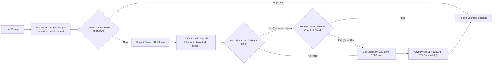
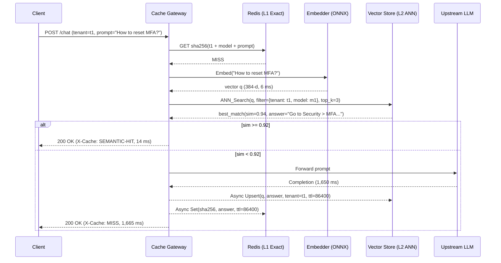
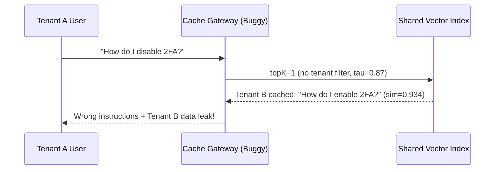

# Semantic Caching for LLMs: Thresholds, False Hits & Tenant Scope

> **Prerequisites:** [Lesson 20: LLM Caching](../20-llm-caching/README.md) · [Track: AI and GenAI System Design](../README.md).  
> **Estimated Reading Time:** 24–28 minutes  
> **Target Audience:** Backend and AI platform engineers designing low-latency, cost-efficient LLM serving layers, and candidates asked "how do you cache natural-language prompts that are phrased differently?"  
> **Free PDF Notes:** [Download SD-S-021.pdf](https://backendroadmap.com/notes/system-design/SD-S-021.pdf)

> [!NOTE]
> **In one line:** Semantic caching embeds incoming prompts into dense vectors and serves a cached LLM response when the nearest stored prompt exceeds a cosine-similarity threshold $\tau$. You gain **15–40% additional cache hits** over exact-match hashing and cut $p_{99}$ latency from **2,500 ms to ~25 ms**; you pay with **false hits** (semantically close but factually opposite queries), **embedding overhead**, and **tenant/PII isolation risks**.

> [!TIP]
> **The Golden Rule:** Never share a global semantic cache across tenants, and never tune the similarity threshold $\tau$ by gut feel—always run a labeled evaluation set of paraphrase pairs vs. near-miss adversarial pairs ("reset password" vs. "delete account") to pick $\tau$ on the precision-recall curve.

---

## 1. What Semantic Caching Is, and What It Isn't

Exact-match LLM caching hashes the normalized prompt string (`sha256(system + user)`). If User A asks `"How do I rotate my API key?"` and User B asks `"Steps to rotate an API key"`, exact-match caching misses 100% of the time because the bytes differ. Semantic caching embeds both prompts into a vector space (e.g., 384-d or 1536-d) where paraphrases cluster together, then performs an Approximate Nearest Neighbor (ANN) search to reuse the cached completion.

| Term | Precise Meaning | Example |
| :--- | :--- | :--- |
| **Semantic cache** | Vector-indexed key-value store matching prompts by embedding similarity $\ge \tau$ | `"rotate API key"` hits `"how to cycle my API token"` at $\cos(\theta) = 0.94$ |
| **Exact-match cache** | Hash-indexed cache requiring identical normalized text | `sha256(prompt)` in Redis |
| **Similarity threshold ($\tau$)** | Minimum cosine similarity (or max L2 distance) to accept a cache hit | $\tau = 0.92$ for FAQ bots; $\tau = 0.97$ for medical/legal |
| **False hit (False Positive)** | Returning a cached answer for a *different* intent because vectors are close | `"cancel my subscription"` matches `"renew my subscription"` |
| **False miss (False Negative)** | Failing to hit a valid paraphrase because $\tau$ is too strict | `"cost of Pro?"` misses `"Pro tier pricing"` at $\tau = 0.98$ |
| **Tenant scope** | Partitioning the vector index by `tenant_id`, `role`, and `model_version` | Tenant A never sees Tenant B's cached answers |
| **L1 / L2 cache hierarchy** | Exact-match Redis (L1, <2 ms) in front of Vector ANN cache (L2, ~15–25 ms) | Short-circuit exact repeats before paying embedding cost |
| **Not** | A replacement for RAG, prompt-prefix KV caching, or fine-tuning | Semantic cache stores *final outputs*, not KV tensors or documents |

### Why It Matters
1. In customer support, internal search, and coding assistants, 25–45% of queries are paraphrases of recent questions—exact hashing misses them entirely.
2. Every false hit in production is a silent correctness bug: the user receives a confident, fluent, *wrong* answer with no LLM call in the trace.
3. Unscoped semantic caches are a classic cross-tenant data leak vector in multi-tenant SaaS AI platforms.

---

## 2. Anatomy: Exact Match + Semantic Cache Pipeline



A production semantic cache sits **after** authentication/tenant resolution and **before** the LLM provider call. Putting L1 exact-match Redis in front of L2 vector search avoids paying the embedding model latency and compute cost for identical repeats (such as health checks, UI retries, or suggested-prompt clicks).

| Dimension | Exact-Match Cache (L1) | Semantic Cache (L2) |
| :--- | :--- | :--- |
| **Lookup key** | `SHA-256(model, temp, normalized_prompt)` | Dense vector $\mathbf{v} \in \mathbb{R}^d$ + metadata filter |
| **Lookup latency** | 0.5–2 ms | 12–30 ms (embedding + HNSW search) |
| **False hit risk** | Zero (byte-identical) | Non-zero; governed by $\tau$ and embedding quality |
| **Hit rate (FAQ/Support)** | 10–18% | 30–55% (combined L1 + L2) |
| **Memory per entry** | ~1–4 KB | ~4–10 KB (1536-d float32 = 6 KB + HNSW graph edges) |

> [!WARNING]
> **Negation & Entity Blindness in Embeddings:** Dense embedding models optimize for topical similarity, not logical polarity or entity identity. `"What is the refund policy for US customers?"` and `"What is the refund policy for EU customers?"` often score $\cos(\theta) > 0.95$. Never cache entity-sensitive or time-sensitive queries without extracting entities/filters into the cache key metadata!

---

## 3. Mathematical Model: Thresholds, Cost Savings & Latency

**Cosine Similarity.** For normalized query vector $\mathbf{q}$ and cached vector $\mathbf{c}_i$ (with $\|\mathbf{q}\|_2 = \|\mathbf{c}_i\|_2 = 1$):

$$\text{sim}(\mathbf{q}, \mathbf{c}_i) = \mathbf{q} \cdot \mathbf{c}_i = \sum_{k=1}^{d} q_k c_{i,k}, \qquad \text{Hit} \iff \max_{i \in \mathcal{S}_{\text{tenant}}} \text{sim}(\mathbf{q}, \mathbf{c}_i) \ge \tau$$

**Effective Latency.** Let $h_1$ be the L1 exact hit rate, $h_2$ be the L2 semantic hit rate (on L1 misses), $t_{\text{L1}}$ be L1 lookup time, $t_{\text{emb}}$ be embedding + ANN time, and $t_{\text{LLM}}$ be upstream LLM latency:

$$\mathbb{E}[T] = t_{\text{L1}} + (1 - h_1) t_{\text{emb}} + (1 - h_1)(1 - h_2) t_{\text{LLM}}$$

**Cost Savings & False-Hit Penalty.** Let $C_{\text{LLM}}$ be the cost per LLM call, $C_{\text{emb}}$ be embedding + vector lookup cost per L1 miss, and $p_{\text{fp}}(\tau)$ be the false-hit probability at threshold $\tau$, with $C_{\text{fp}}$ as the business/support cost of a wrong answer:

$$\text{Net Savings per Request} = \big(h_1 + (1 - h_1) h_2(\tau)\big) C_{\text{LLM}} - (1 - h_1) C_{\text{emb}} - (1 - h_1) h_2(\tau) p_{\text{fp}}(\tau) C_{\text{fp}}$$

### Worked Numerical Example
Suppose $t_{\text{L1}} = 1.5\text{ ms}$, $t_{\text{emb}} = 18\text{ ms}$, $t_{\text{LLM}} = 1{,}800\text{ ms}$, $h_1 = 0.15$, and $h_2 = 0.35$ (at $\tau = 0.92$):
- **Effective miss rate:** $(1 - 0.15)(1 - 0.35) = 0.85 \times 0.65 = 0.5525$ (44.75% total cache hit rate).
- **Expected latency:** $1.5 + 0.85(18) + 0.5525(1{,}800) = 1.5 + 15.3 + 994.5 = \mathbf{1{,}011.3\text{ ms}}$ (a 43.8% latency reduction).
- **Cost:** With $C_{\text{LLM}} = \$0.012$ and $C_{\text{emb}} = \$0.00004$, gross savings per 1M requests = $447{,}500 \times \$0.012 - 850{,}000 \times \$0.00004 = \$5{,}370 - \$34 = \mathbf{\$5{,}336/\text{1M requests}}$.
- If $\tau$ is lowered to $0.85$, $h_2$ rises to $0.50$, but if $p_{\text{fp}}$ jumps from $0.5\%$ to $4\%$ with $C_{\text{fp}} = \$0.50$ (a support ticket), the false-hit penalty is $0.85 \times 0.50 \times 0.04 \times \$0.50 = \$0.0085/\text{req}$ — wiping out 100% of the LLM savings!

---

## 4. Metrics & Percentiles

| Metric | Meaning | Alert when |
| :--- | :--- | :--- |
| **L1 / L2 Hit Ratio** | Fraction served by exact (L1) and semantic (L2) cache | L2 hit ratio drops >10% (embedding drift or TTL too short) |
| **False Hit Rate (FHR)** | Audited % of semantic hits that answered the wrong intent | > 1.0% on sampled human/LLM-judge evals |
| **Embedding + ANN $p_{99}$** | Tail latency of embedding inference + vector search | > 50 ms (check CPU/GPU saturation or HNSW `efSearch`) |
| **Cache Bypass Rate** | % of requests skipping cache (`temperature > 0.2`, tools, PII) | Unexpected spike (breaks cost projections) |
| **Cross-Tenant Leakage Count** | Hits where `result.tenant_id != request.tenant_id` | **> 0 (Immediate SEV-1 page)** |
| **Vector Index Memory / Evictions** | RAM used by HNSW graph + vectors and LRU eviction rate | > 80% RAM or high churn evicting hot entries |

### Worked Example (Threshold Tuning)
An enterprise SaaS helpdesk evaluates 1,000 query pairs (500 true paraphrases, 500 near-miss adversarial pairs like `"upgrade to Enterprise"` vs. `"downgrade from Enterprise"`):
- At $\tau = 0.88$: Recall = 91%, False Hit Rate = 6.2% (unacceptable).
- At $\tau = 0.93$: Recall = 74%, False Hit Rate = 0.8% (sweet spot).
- At $\tau = 0.97$: Recall = 38%, False Hit Rate = 0.0% (leaves 36% of valid hits on the table).

---

## 5. Compounding & Failure Modes

Semantic caches degrade along three compounding axes at scale:

1. **Multi-Turn Context Collapse:** If you embed only the last user message (`"How much does it cost?"`), `"it"` refers to completely different products across conversations. Caching on the last turn alone causes massive false hits across sessions.
2. **Pre-Filter vs. Post-Filter HNSW Starvation:** In multi-tenant vector indexes (e.g., Qdrant, pgvector, Redis Vector), if you search `topK=5` globally and *post-filter* by `tenant_id`, a small tenant's vectors get crowded out by a noisy neighbor, dropping their hit rate to 0%. You must use **pre-filtering** (or per-tenant collections/partitions).
3. **Model & Prompt Drift Poisoning:** Upgrading the system prompt or switching from `gpt-4o-mini` to `gpt-4o` without including `prompt_version` and `model_id` in the cache scope serves stale, lower-quality answers for days until TTL expires.

---

## 6. Numbers Every Engineer Must Know

| Item | Typical | Implication |
| :--- | :--- | :--- |
| **Local ONNX embedding (`bge-small-en-v1.5`, 384-d)** | 4–10 ms on CPU | Fast enough to run in-process or as a sidecar without GPU |
| **Remote embedding API (`text-embedding-3-small`, 1536-d)** | 25–60 ms + network | Adds tail latency; cache L1 exact matches first |
| **HNSW vector search (1M vectors, 384-d)** | 2–8 ms at $p_{99}$ | Sub-10 ms lookup; RAM $\approx 1.5\text{ GB}$ (with graph overhead) |
| **1M vectors memory (1536-d float32 + HNSW)** | ~7.5–9 GB RAM | Use `int8` scalar quantization (4x smaller, <1% recall loss) |
| **Cosine similarity sweet spot ($\tau$)** | 0.91 – 0.95 | Depends heavily on embedding model; never hardcode across models |
| **Default TTL for FAQ / Docs** | 24h – 7d | Shorten to 5–60 min for pricing, inventory, or live status |

---

## 7. Protocol / Mechanism Deep Dive



| Question | Answer |
| :--- | :--- |
| **When NOT to use semantic caching?** | High-entropy creative writing (`temperature > 0.3`), tool-calling/agentic loops with stateful side effects, queries with real-time user data (account balances), or strict compliance workloads where any false hit is unacceptable. |
| **How to handle multi-turn conversations?** | Either skip semantic caching when `messages.length > 1`, or summarize/rewrite the standalone query first (though rewriting adds an LLM call, eroding savings). |
| **How to prevent PII leakage?** | Run PII redaction/scrubbing *before* cache lookup and write, and **never** cache responses that contain user-specific tokens, names, or emails. |

---

## 8. Hierarchical Budgets & Design Rules

| Slice | Rule | Control |
| :--- | :--- | :--- |
| **Latency budget** | Cache lookup (L1 + Embed + L2) must stay < 35 ms $p_{99}$ | Local ONNX embedder + `int8` HNSW in RAM |
| **Tenant isolation** | Zero cross-tenant hits | Mandatory `tenant_id` pre-filter or per-tenant index namespace |
| **Correctness / Polarity** | Guard against negation & entity swaps | Extract entities/verbs or run lightweight NLI cross-encoder on `[0.88, 0.95]` gray zone |
| **Freshness** | Bound staleness by domain volatility | Tiered TTLs + `prompt_version` & `kb_version` in metadata filter |
| **Memory** | Cap vector store RAM growth | Scalar quantization (`int8`) + LRU/LFU eviction + max entries per tenant |

---

## 9. Top Mitigations

1. **Two-tier L1 + L2 caching:** Always check SHA-256 exact match in Redis before invoking the embedding model.
2. **Gray-zone verification:** For similarity scores in `[0.88, 0.95]`, run a fast cross-encoder or regex/entity-match check (e.g., verifying numbers, dates, and negation words `"not"`, `"cancel"`, `"delete"` match).
3. **Mandatory scope tuple:** Key every entry by `(tenant_id, user_role, model_id, prompt_version, temperature_bucket)`.
4. **Skip caching on non-deterministic or tool requests:** Bypass when `temperature > 0.2`, `tools` are present, or `Cache-Control: no-store` is set.
5. **Versioned invalidation:** Include `kb_hash` or `system_prompt_hash` in the metadata filter so doc updates instantly invalidate stale cached answers without bulk deletes.
6. **Shadow-mode threshold calibration:** Log semantic hits in shadow mode for 48 hours and audit 200 sampled pairs with an LLM-as-a-judge before enabling cache serving.

---

## 10. Production Reference / War Story

**Incident (SEV-1): Cross-Tenant & Polarity False Hits in a Support Copilot**
A B2B SaaS company deployed a shared Redis Vector semantic cache at $\tau = 0.87$ using `text-embedding-ada-002` to cut OpenAI costs by 40%. Within 4 hours, two incidents occurred:
1. Tenant A asked `"What is our custom SLA penalty clause?"` and received Tenant B's confidential contract terms because `tenant_id` was post-filtered after `topK=1` (or omitted on the fallback path).
2. A user asking `"How do I enable 2FA?"` received cached instructions for `"How do I disable 2FA?"` (cosine similarity = `0.934`).



**Root Cause:** Global unpartitioned vector index + overly permissive $\tau = 0.87$ without polarity/entity validation.  
**Fix:** Enforced mandatory `tenant_id` pre-filtering at the vector DB layer, raised $\tau$ to `0.94`, added a negation/verb-mismatch guard (`enable` vs. `disable`), and excluded queries containing account-specific nouns.

---

## 11. Multi-Language Production Code Tabs

````carousel
```go
// Go: Scoped two-tier (L1 exact + L2 semantic) cache with cosine similarity and negation guard.
package semcache

import (
	"crypto/sha256"
	"encoding/hex"
	"math"
	"strings"
	"sync"
	"time"
)

type Scope struct {
	TenantID      string
	ModelID       string
	PromptVersion string
}

type Entry struct {
	Scope     Scope
	Prompt    string
	Vector    []float64
	Response  string
	ExpiresAt time.Time
}

type SemanticCache struct {
	mu        sync.RWMutex
	threshold float64
	l1        map[string]Entry
	l2        map[string][]Entry // partitioned by tenant+model+version
	embedFn   func(string) []float64
}

func New(threshold float64, embedFn func(string) []float64) *SemanticCache {
	return &SemanticCache{
		threshold: threshold,
		l1:        make(map[string]Entry),
		l2:        make(map[string][]Entry),
		embedFn:   embedFn,
	}
}

func scopeKey(s Scope) string {
	return s.TenantID + "|" + s.ModelID + "|" + s.PromptVersion
}

func exactKey(s Scope, prompt string) string {
	h := sha256.Sum256([]byte(scopeKey(s) + "|" + strings.TrimSpace(strings.ToLower(prompt))))
	return hex.EncodeToString(h[:])
}

func cosine(a, b []float64) float64 {
	var dot, na, nb float64
	for i := range a {
		dot += a[i] * b[i]
		na += a[i] * a[i]
		nb += b[i] * b[i]
	}
	if na == 0 || nb == 0 {
		return 0
	}
	return dot / (math.Sqrt(na) * math.Sqrt(nb))
}

func polarityMismatch(a, b string) bool {
	negWords := []string{"not", "never", "disable", "cancel", "delete", "remove"}
	la, lb := " "+strings.ToLower(a)+" ", " "+strings.ToLower(b)+" "
	for _, w := range negWords {
		if strings.Contains(la, " "+w+" ") != strings.Contains(lb, " "+w+" ") {
			return true
		}
	}
	return false
}

func (c *SemanticCache) Get(s Scope, prompt string) (string, string, bool) {
	now := time.Now()
	ek := exactKey(s, prompt)

	c.mu.RLock()
	if e, ok := c.l1[ek]; ok && now.Before(e.ExpiresAt) {
		c.mu.RUnlock()
		return e.Response, "L1-EXACT", true
	}
	c.mu.RUnlock()

	qVec := c.embedFn(prompt)
	sk := scopeKey(s)

	c.mu.RLock()
	defer c.mu.RUnlock()
	bestSim := -1.0
	var best *Entry
	for i := range c.l2[sk] {
		e := &c.l2[sk][i]
		if now.After(e.ExpiresAt) {
			continue
		}
		sim := cosine(qVec, e.Vector)
		if sim > bestSim {
			bestSim = sim
			best = e
		}
	}
	if best != nil && bestSim >= c.threshold && !polarityMismatch(prompt, best.Prompt) {
		return best.Response, "L2-SEMANTIC", true
	}
	return "", "MISS", false
}

func (c *SemanticCache) Set(s Scope, prompt, response string, ttl time.Duration) {
	entry := Entry{
		Scope:     s,
		Prompt:    prompt,
		Vector:    c.embedFn(prompt),
		Response:  response,
		ExpiresAt: time.Now().Add(ttl),
	}
	c.mu.Lock()
	defer c.mu.Unlock()
	c.l1[exactKey(s, prompt)] = entry
	sk := scopeKey(s)
	c.l2[sk] = append(c.l2[sk], entry)
}
```
<!-- slide -->
```typescript
// TypeScript: Tenant-scoped L1 + L2 semantic cache with polarity guard.
import { createHash } from "crypto";

export interface CacheScope {
  tenantId: string;
  modelId: string;
  promptVersion: string;
}

interface CacheEntry {
  prompt: string;
  vector: number[];
  response: string;
  expiresAt: number;
}

const NEGATION_TOKENS = new Set(["not", "never", "disable", "cancel", "delete", "remove"]);

function cosineSimilarity(a: number[], b: number[]): number {
  let dot = 0, na = 0, nb = 0;
  for (let i = 0; i < a.length; i++) {
    dot += a[i] * b[i];
    na += a[i] * a[i];
    nb += b[i] * b[i];
  }
  return na === 0 || nb === 0 ? 0 : dot / (Math.sqrt(na) * Math.sqrt(nb));
}

function hasPolarityMismatch(a: string, b: string): boolean {
  const wordsA = new Set(a.toLowerCase().split(/\W+/));
  const wordsB = new Set(b.toLowerCase().split(/\W+/));
  for (const token of NEGATION_TOKENS) {
    if (wordsA.has(token) !== wordsB.has(token)) return true;
  }
  return false;
}

export class SemanticCache {
  private l1 = new Map<string, CacheEntry>();
  private l2 = new Map<string, CacheEntry[]>();

  constructor(
    private threshold: number,
    private embedFn: (text: string) => Promise<number[]>
  ) {}

  private scopeKey(s: CacheScope): string {
    return `${s.tenantId}|${s.modelId}|${s.promptVersion}`;
  }

  private exactKey(s: CacheScope, prompt: string): string {
    const raw = `${this.scopeKey(s)}|${prompt.trim().toLowerCase()}`;
    return createHash("sha256").update(raw).digest("hex");
  }

  async get(s: CacheScope, prompt: string): Promise<{ hit: boolean; source: string; response?: string; sim?: number }> {
    const now = Date.now();
    const ek = this.exactKey(s, prompt);
    const l1Hit = this.l1.get(ek);
    if (l1Hit && l1Hit.expiresAt > now) {
      return { hit: true, source: "L1-EXACT", response: l1Hit.response, sim: 1.0 };
    }

    const qVec = await this.embedFn(prompt);
    const entries = this.l2.get(this.scopeKey(s)) ?? [];
    let best: CacheEntry | null = null;
    let bestSim = -1;

    for (const entry of entries) {
      if (entry.expiresAt <= now) continue;
      const sim = cosineSimilarity(qVec, entry.vector);
      if (sim > bestSim) {
        bestSim = sim;
        best = entry;
      }
    }

    if (best && bestSim >= this.threshold && !hasPolarityMismatch(prompt, best.prompt)) {
      return { hit: true, source: "L2-SEMANTIC", response: best.response, sim: bestSim };
    }
    return { hit: false, source: "MISS", sim: bestSim };
  }

  async set(s: CacheScope, prompt: string, response: string, ttlMs: number): Promise<void> {
    const entry: CacheEntry = {
      prompt,
      vector: await this.embedFn(prompt),
      response,
      expiresAt: Date.now() + ttlMs,
    };
    this.l1.set(this.exactKey(s, prompt), entry);
    const sk = this.scopeKey(s);
    const bucket = this.l2.get(sk) ?? [];
    bucket.push(entry);
    this.l2.set(sk, bucket);
  }
}
```
<!-- slide -->
```python
# Python: Stdlib semantic cache + threshold precision/recall evaluator.
import hashlib
import math
import time
from dataclasses import dataclass
from typing import Callable

NEGATIONS = {"not", "never", "disable", "cancel", "delete", "remove"}

@dataclass(frozen=True)
class Scope:
    tenant_id: str
    model_id: str
    prompt_version: str

@dataclass
class CacheEntry:
    prompt: str
    vector: list[float]
    response: str
    expires_at: float

def cosine(a: list[float], b: list[float]) -> float:
    dot = sum(x * y for x, y in zip(a, b))
    na = math.sqrt(sum(x * x for x in a))
    nb = math.sqrt(sum(y * y for y in b))
    return 0.0 if na == 0 or nb == 0 else dot / (na * nb)

def polarity_mismatch(a: str, b: str) -> bool:
    wa, wb = set(a.lower().split()), set(b.lower().split())
    return any((w in wa) != (w in wb) for w in NEGATIONS)

class SemanticCache:
    def __init__(self, threshold: float, embed_fn: Callable[[str], list[float]]):
        self.threshold = threshold
        self.embed_fn = embed_fn
        self.l1: dict[str, CacheEntry] = {}
        self.l2: dict[Scope, list[CacheEntry]] = {}

    def _exact_key(self, scope: Scope, prompt: str) -> str:
        raw = f"{scope.tenant_id}|{scope.model_id}|{scope.prompt_version}|{prompt.strip().lower()}"
        return hashlib.sha256(raw.encode()).hexdigest()

    def get(self, scope: Scope, prompt: str) -> tuple[str | None, str, float]:
        now = time.time()
        ek = self._exact_key(scope, prompt)
        if ek in self.l1 and self.l1[ek].expires_at > now:
            return self.l1[ek].response, "L1-EXACT", 1.0

        q_vec = self.embed_fn(prompt)
        best_sim, best_entry = -1.0, None
        for entry in self.l2.get(scope, []):
            if entry.expires_at <= now:
                continue
            sim = cosine(q_vec, entry.vector)
            if sim > best_sim:
                best_sim, best_entry = sim, entry

        if best_entry and best_sim >= self.threshold and not polarity_mismatch(prompt, best_entry.prompt):
            return best_entry.response, "L2-SEMANTIC", best_sim
        return None, "MISS", best_sim

    def set(self, scope: Scope, prompt: str, response: str, ttl_s: float = 3600.0) -> None:
        entry = CacheEntry(prompt, self.embed_fn(prompt), response, time.time() + ttl_s)
        self.l1[self._exact_key(scope, prompt)] = entry
        self.l2.setdefault(scope, []).append(entry)
```
<!-- slide -->
```csharp
// C#: Thread-safe tenant-scoped L1 + L2 semantic cache.
using System.Collections.Concurrent;
using System.Security.Cryptography;
using System.Text;

public sealed record CacheScope(string TenantId, string ModelId, string PromptVersion);

public sealed class SemanticCache
{
    private sealed record Entry(string Prompt, double[] Vector, string Response, DateTimeOffset ExpiresAt);
    private static readonly string[] Negations = ["not", "never", "disable", "cancel", "delete", "remove"];

    private readonly double _threshold;
    private readonly Func<string, double[]> _embedFn;
    private readonly ConcurrentDictionary<string, Entry> _l1 = new();
    private readonly ConcurrentDictionary<CacheScope, List<Entry>> _l2 = new();

    public SemanticCache(double threshold, Func<string, double[]> embedFn)
    {
        _threshold = threshold;
        _embedFn = embedFn;
    }

    private static string ExactKey(CacheScope s, string prompt)
    {
        var raw = $"{s.TenantId}|{s.ModelId}|{s.PromptVersion}|{prompt.Trim().ToLowerInvariant()}";
        return Convert.ToHexString(SHA256.HashData(Encoding.UTF8.GetBytes(raw)));
    }

    private static double Cosine(double[] a, double[] b)
    {
        double dot = 0, na = 0, nb = 0;
        for (int i = 0; i < a.Length; i++) { dot += a[i] * b[i]; na += a[i] * a[i]; nb += b[i] * b[i]; }
        return (na == 0 || nb == 0) ? 0 : dot / (Math.Sqrt(na) * Math.Sqrt(nb));
    }

    private static bool PolarityMismatch(string a, string b)
    {
        var wa = a.ToLowerInvariant().Split(' ', StringSplitOptions.RemoveEmptyEntries).ToHashSet();
        var wb = b.ToLowerInvariant().Split(' ', StringSplitOptions.RemoveEmptyEntries).ToHashSet();
        return Negations.Any(n => wa.Contains(n) != wb.Contains(n));
    }

    public (bool Hit, string Source, string? Response) Get(CacheScope scope, string prompt)
    {
        var now = DateTimeOffset.UtcNow;
        if (_l1.TryGetValue(ExactKey(scope, prompt), out var l1Entry) && l1Entry.ExpiresAt > now)
            return (true, "L1-EXACT", l1Entry.Response);

        var qVec = _embedFn(prompt);
        if (!_l2.TryGetValue(scope, out var bucket)) return (false, "MISS", null);

        Entry? best = null;
        double bestSim = -1;
        lock (bucket)
        {
            foreach (var e in bucket.Where(x => x.ExpiresAt > now))
            {
                var sim = Cosine(qVec, e.Vector);
                if (sim > bestSim) { bestSim = sim; best = e; }
            }
        }
        if (best is not null && bestSim >= _threshold && !PolarityMismatch(prompt, best.Prompt))
            return (true, "L2-SEMANTIC", best.Response);
        return (false, "MISS", null);
    }

    public void Set(CacheScope scope, string prompt, string response, TimeSpan ttl)
    {
        var entry = new Entry(prompt, _embedFn(prompt), response, DateTimeOffset.UtcNow.Add(ttl));
        _l1[ExactKey(scope, prompt)] = entry;
        var bucket = _l2.GetOrAdd(scope, _ => new List<Entry>());
        lock (bucket) { bucket.Add(entry); }
    }
}
```
````

---

## 12. Hands-On CLI Verification Workflows

Test threshold sensitivity and tenant isolation locally with Python:

```bash
python -c '
from math import sqrt
def cos(a, b): return sum(x*y for x,y in zip(a,b)) / (sqrt(sum(x*x for x in a))*sqrt(sum(y*y for y in b)))
# Simulate paraphrase vs near-miss adversarial pair
q_paraphrase = [0.81, 0.58, 0.05]
c_stored     = [0.80, 0.59, 0.04]
q_adversarial= [0.76, 0.62, 0.19]
print("Paraphrase sim:", round(cos(q_paraphrase, c_stored), 4))
print("Adversarial sim:", round(cos(q_adversarial, c_stored), 4))
'
```

Inspect a Redis Stack vector index in production:

```bash
# Check vector index info, doc count, and memory usage
redis-cli FT.INFO idx:semcache

# Verify pre-filtered tenant query returns only scoped documents
redis-cli FT.SEARCH idx:semcache "(@tenant_id:{t_acme} @model:{gpt4o})=>[KNN 3 @vec $BLOB AS score]" \
  PARAMS 2 BLOB "\x00..." SORTBY score ASC DIALECT 2
```

---

## 13. Common Mistakes to Avoid

1. **Using a global vector index without `tenant_id` pre-filtering** (cross-tenant PII leaks).
2. **Post-filtering `topK` results by tenant** (noisy-neighbor starvation drops hit rates to zero).
3. **Ignoring negation/polarity** (`"enable"` vs. `"disable"`, `"with"` vs. `"without"`).
4. **Caching multi-turn queries using only the last user message** (pronouns like `"it"` lose context).
5. **Omitting `model_id` and `prompt_version` from the scope** (serves stale responses after upgrades).
6. **Hardcoding $\tau = 0.90$ across different embedding models** (cosine distributions vary wildly by model).
7. **Running semantic lookup before L1 exact-match Redis** (wastes 15–30 ms embedding identical repeats).

---

## 14. Key Terms Glossary

| Key Term | Definition |
| :--- | :--- |
| **Semantic Cache** | Vector-indexed cache that reuses LLM outputs for paraphrased prompts exceeding similarity $\tau$. |
| **Cosine Similarity** | Dot product of unit-normalized embedding vectors, ranging from -1 to 1. |
| **Threshold ($\tau$)** | Minimum similarity score required to serve a cached response. |
| **False Hit** | Serving a cached response for a query with a different intent or polarity. |
| **Pre-Filtering** | Applying metadata filters (`tenant_id`, `model`) *during* ANN graph traversal rather than after. |
| **HNSW** | Hierarchical Navigable Small World graph, the standard in-memory ANN index for sub-10 ms search. |
| **Scalar Quantization** | Compressing `float32` vectors to `int8` to cut RAM 4x with <1% recall loss. |
| **Polarity Guard** | Lightweight check ensuring negation/action verbs match before accepting a semantic hit. |
| **L1 / L2 Cache** | Exact-match hash cache (L1) layered in front of a vector semantic cache (L2). |
| **Gray Zone** | Similarity band (e.g., 0.88–0.95) where a secondary cross-encoder or rule check prevents false hits. |

---

## 15. System Design Interview Questions & Answers

### Basic Conceptual Questions

<details>
<summary><strong>Q1: How does semantic caching differ from exact-match LLM caching? [BASIC]</strong></summary>

**Answer:**
Exact-match caching hashes the normalized prompt string (`SHA-256`) and only hits on byte-identical text. Semantic caching embeds the prompt into a dense vector and uses ANN search to match *paraphrases* whose cosine similarity is $\ge \tau$, boosting hit rates by 15–40% at the cost of embedding latency and false-hit risk.
</details>

<details>
<summary><strong>Q2: Why put an L1 exact-match cache in front of an L2 semantic cache? [BASIC]</strong></summary>

**Answer:**
L1 Redis takes ~1 ms and zero embedding compute. Identical repeats (page refreshes, retries, suggested prompts) hit L1 immediately, saving the 10–30 ms embedding + ANN lookup and reducing load on the vector store.
</details>

<details>
<summary><strong>Q3: What is a false hit and why is it dangerous? [BASIC]</strong></summary>

**Answer:**
A false hit occurs when two prompts have high embedding similarity ($\ge \tau$) but different meanings—e.g., `"How do I cancel my plan?"` vs. `"How do I renew my plan?"`. It is dangerous because the user receives a fluent, confident, *wrong* answer with zero upstream LLM visibility.
</details>

<details>
<summary><strong>Q4: What fields must be in the semantic cache scope? [BASIC]</strong></summary>

**Answer:**
At minimum: `tenant_id`, `user_role` (if RBAC applies), `model_id`, `prompt_version` (or `system_prompt_hash`), and `temperature_bucket`. Without these, you risk cross-tenant leaks or serving stale outputs after prompt/model changes.
</details>

### Scenario-Based Architecture Questions

<details>
<summary><strong>Q5: Your support bot has 1M cached Q&As across 500 tenants. A small tenant gets 0% cache hits even on exact paraphrases. Why? [SCENARIO]</strong></summary>

**Answer:**
You are likely doing **post-filtering**: querying `topK=5` globally in HNSW and then filtering `WHERE tenant_id = 'small_tenant'`. If the top 5 global matches belong to large tenants, the post-filter returns 0 results. Fix it by using **pre-filtering** in the vector DB or partitioning into per-tenant namespaces.
</details>

<details>
<summary><strong>Q6: How do you choose the similarity threshold $\tau$ for a new domain? [SCENARIO]</strong></summary>

**Answer:**
Build a labeled evaluation set of ~500 true paraphrase pairs and ~500 near-miss adversarial pairs (negations, entity swaps, opposite verbs). Plot the precision-recall curve across $\tau \in [0.85, 0.98]$ and pick the lowest $\tau$ whose false-hit rate stays below your domain's error budget (e.g., <1% for support, <0.1% for fintech).
</details>

<details>
<summary><strong>Q7: How do you prevent semantic cache poisoning in a multi-turn chat application? [SCENARIO]</strong></summary>

**Answer:**
Either bypass semantic caching when `messages.length > 1` (since pronouns like `"it"` depend on prior turns), or only cache the **rewritten standalone query** produced by a query-contextualizer—while factoring the rewriter's latency and cost into your ROI math.
</details>

<details>
<summary><strong>Q8: Your knowledge base updates every hour. How do you avoid serving stale cached answers? [SCENARIO]</strong></summary>

**Answer:**
Include `kb_version` or `doc_etag` in the cache metadata filter and set a bounded TTL (e.g., 1 hour). When docs update, increment `kb_version`—all old entries instantly stop matching without expensive bulk vector deletions, and expire naturally via TTL.
</details>

### Advanced & Tricky Interview Questions

<details>
<summary><strong>Q9: Embeddings are 1536-d float32 and RAM costs are exploding at 10M entries. How do you shrink memory 4–8x? [TRICKY]</strong></summary>

**Answer:**
First, switch to a smaller Matryoshka or 384-d model (4x reduction). Second, enable **scalar quantization (`int8`)** in the vector store (another 4x reduction with <1% recall loss). Third, enforce per-tenant LRU eviction and skip caching one-off long-tail prompts (e.g., only cache prompts > 15 chars or seen twice).
</details>

<details>
<summary><strong>Q10: How do you handle the "gray zone" where cosine similarity is between 0.88 and 0.94? [TRICKY]</strong></summary>

**Answer:**
Use a **two-stage verifier**: ANN retrieval returns the top candidate in ~5 ms; if `sim` is in `[0.88, 0.94]`, run a fast cross-encoder (or NLI/polarity + entity-extraction check) in ~15 ms to confirm semantic equivalence. This recovers valid paraphrases without accepting negation/entity false hits.
</details>

<details>
<summary><strong>Q11: A customer asks "What is my current account balance?" Why must this never hit a semantic cache? [TRICKY]</strong></summary>

**Answer:**
It is both **user-private** and **real-time stateful**. Even if scoped by `user_id`, the balance changes independently of the prompt. Run an intent classifier or entity/temporal detector (`"my"`, `"current"`, `"today"`, tool-use triggers) to set `cacheable = false` before lookup.
</details>

<details>
<summary><strong>Q12: Why does switching embedding models require flushing the entire semantic cache? [TRICKY]</strong></summary>

**Answer:**
Vector spaces from different embedding models (or even different versions of the same model) are **not aligned**—the dot product between a `bge-small` vector and a `text-embedding-3` vector is mathematically meaningless. Always include `embedding_model_id` in the index namespace/filter.
</details>

---

## 16. One-Page Master Cheat Sheet

```
+---------------------------------------------------------------------------------------------------------+
|                    SEMANTIC CACHING FOR LLMS — MASTER CHEAT SHEET                                       |
+---------------------------------------------------------------------------------------------------------+
| 1. PIPELINE: Normalize -> Scope (tenant, model, version) -> L1 Exact (Redis) -> L2 Embed + ANN Search.  |
+---------------------------------------------------------------------------------------------------------+
| 2. MATH: E[T] = t_L1 + (1-h1)*t_emb + (1-h1)*(1-h2)*t_LLM.  False hits can wipe out 100% of savings!    |
+---------------------------------------------------------------------------------------------------------+
| 3. THRESHOLD (tau): Tune on paraphrase vs. adversarial pairs. Typical: 0.91-0.95 (never guess).         |
+---------------------------------------------------------------------------------------------------------+
| 4. ISOLATION: Pre-filter by (tenant_id, role, model_id, prompt_version). Never post-filter HNSW.        |
+---------------------------------------------------------------------------------------------------------+
| 5. TRAPS: Negation blindness ("enable" vs "disable") · Multi-turn pronouns ("it") · Stale KB docs.      |
+---------------------------------------------------------------------------------------------------------+
| 6. SCALE: Use 384-d + int8 scalar quantization (4-16x less RAM); skip cache on temp > 0.2 or tools.     |
+---------------------------------------------------------------------------------------------------------+
```

---

## Further Reading & Sources

- Redis Documentation, [Semantic Caching for LLMs with Redis Vector Similarity](https://redis.io/docs/latest/develop/ai/redisvl/user_guide/llmcache/).
- Bang, F. (2023), *GPTCache: An Open-Source Semantic Cache for LLM Applications Enabling Faster Answers and Lower Costs* (ACL / Zilliz).
- Qdrant Documentation, [Filterable HNSW: Why Pre-Filtering Matters in Multi-Tenant Vector Search](https://qdrant.tech/articles/filtrable-hnsw/).
- OpenAI / Anthropic Prompt Caching vs. Semantic Caching architecture guides.

---

## Free PDF Notes

[SD-S-021.pdf](https://backendroadmap.com/notes/system-design/SD-S-021.pdf)

---

## Next

Continue with [Lesson 22: LLM Model Routing: Routers, Cascades & Fallbacks to Cut Cost 50%](../22-llm-model-routing/README.md).
