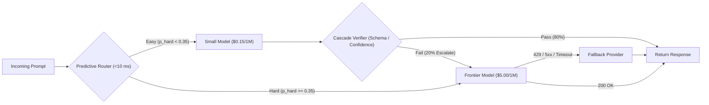
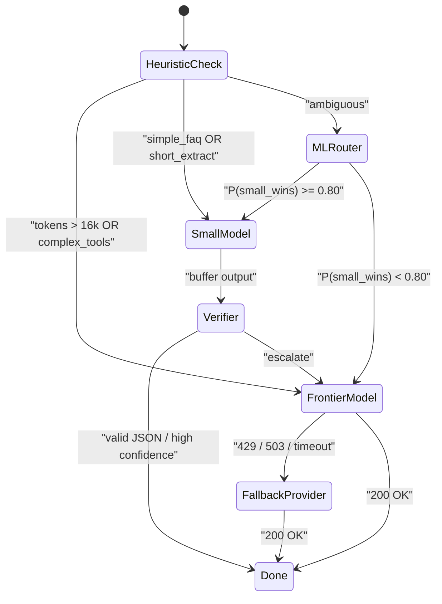
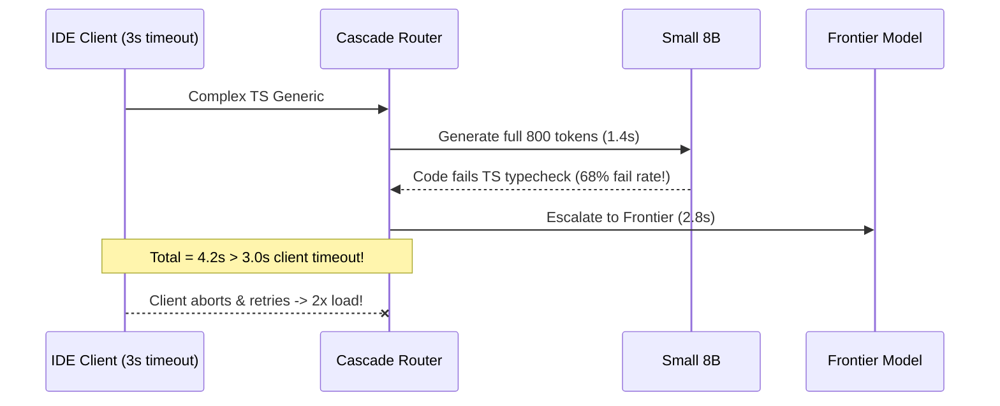

# LLM Model Routing: Routers, Cascades & Fallbacks to Cut Cost 50%

> **Prerequisites:** [Lesson 21: Semantic Caching for LLMs](../21-semantic-caching-for-llms/README.md) · [Track: AI and GenAI System Design](../README.md).  
> **Estimated Reading Time:** 24–28 minutes  
> **Target Audience:** AI platform engineers optimizing inference unit economics and tail latency, and candidates asked "how do you serve LLM traffic without paying frontier-model prices for every query?"  
> **Free PDF Notes:** [Download SD-S-022.pdf](https://backendroadmap.com/notes/system-design/SD-S-022.pdf)

> [!NOTE]
> **In one line:** Model routing sends easy queries to cheap, fast models (e.g., 8B/mini) and reserves expensive frontier models for hard reasoning. You gain **40–70% cost reduction** and **2–4x faster median latency**; you pay with **router misclassification risk**, **cascade tail-latency spikes**, and **evaluation drift**.

> [!TIP]
> **The Golden Rule:** Start with a **predictive router** (a tiny <10 ms classifier) for latency-sensitive chat, and use **cascading** (try small model first, escalate on low confidence) only for async/batch or high-accuracy workflows where paying 2x latency on escalated requests is acceptable.

---

## 1. What LLM Model Routing Is, and What It Isn't

Sending `"Summarize this 3-sentence email"` to a $15/1M-token frontier reasoning model is like hiring a principal architect to change a lightbulb. In real production traffic, **60–80% of prompts** (classification, extraction, simple Q&A, translation) are solved equally well by a small model that costs **10–30x less** and runs **3x faster**. Model routing dynamically selects the cheapest model that meets the quality bar for each request.

| Term | Precise Meaning | Example |
| :--- | :--- | :--- |
| **Predictive Router** | Classifies prompt difficulty *before* calling an LLM and picks one model | BERT/DeBERTa router sends `"Hi"` to 8B, `"Prove P!=NP"` to frontier |
| **Model Cascade** | Calls the cheap model first; escalates to a strong model if confidence is low | Try `gpt-4o-mini`; if `logprob` or verifier fails, call `claude-3.5-sonnet` |
| **Fallback Chain** | Ordered backup models triggered on HTTP 429/5xx or timeout (resilience, not cost) | Primary `us-east` -> Fallback `eu-west` -> Secondary provider |
| **Heuristic / Rule Router** | Deterministic routing based on token count, regex, or endpoint | `tokens > 32k` -> long-context model; `has_tools` -> tool-tuned model |
| **Learned Router (Matrix/MLP)** | Trained on `(prompt, model_A_score, model_B_score)` preference datasets | RouteLLM / FrugalGPT style win-rate predictor |
| **Escalation Rate ($\alpha$)** | Fraction of cascade requests that fail the cheap check and hit the frontier model | $\alpha = 0.25$ means 25% pay *both* models' latency & cost |
| **Not** | Load balancing identical replicas of the same model | Routing chooses *which model tier*, not which GPU pod |

### Why It Matters
1. Frontier models cost 10x–30x more per token than small models; routing is the single highest-leverage cost optimization in GenAI.
2. Small models also have 2x–4x higher tokens/sec throughput, dramatically improving Time-to-First-Token (TTFT) for simple queries.
3. Interviewers expect you to distinguish **cost routing**, **cascading**, and **availability fallbacks**—and compute the exact break-even math for cascades.

---

## 2. Anatomy: Predictive Router vs. Cascade vs. Fallback



| Pattern | Calls per Request | Latency Impact | Best Used For |
| :--- | :--- | :--- | :--- |
| **Rule / Heuristic** | 1 | ~0 ms overhead | Context-length routing, JSON-mode, endpoint tiering |
| **Predictive Router** | 1 | +5–15 ms (classifier) | Real-time interactive chat, streaming UX |
| **Cascade** | 1 or 2 | +100% small-model latency on escalations | Structured extraction, code gen with unit-test verifier, batch |
| **Fallback Chain** | 1 (healthy) / 2+ (outage) | Only during provider degradation | SLA/availability protection (429 rate limits, 503s) |

> [!WARNING]
> **Cascades Can't Stream Blindly:** If you start streaming tokens from the small model directly to the user's UI, you cannot "un-stream" them when the verifier decides to escalate! Cascades require buffering the small model's output before emitting—which destroys Time-to-First-Token (TTFT) on escalated requests.

---

## 3. Mathematical Model: Cost & Latency of Routing vs. Cascading

Let $C_S, T_S$ be the cost and latency of the small model, and $C_L, T_L$ be the cost and latency of the large (frontier) model.

**Predictive Router.** Suppose fraction $p$ of traffic is routed to the small model, $(1-p)$ to the large model, with router overhead $t_r$:

$$\mathbb{E}[C_{\text{router}}] = p\,C_S + (1 - p)\,C_L, \qquad \mathbb{E}[T_{\text{router}}] = t_r + p\,T_S + (1 - p)\,T_L$$

**Cascade.** Every request pays the small model first, and fraction $\alpha$ (escalation rate) *also* pays the large model:

$$\mathbb{E}[C_{\text{cascade}}] = C_S + \alpha\,C_L, \qquad \mathbb{E}[T_{\text{cascade}}] = T_S + \alpha\,T_L$$

**Cascade Break-Even Condition.** Cascading is cheaper than always calling the large model only when:

$$C_S + \alpha\,C_L < C_L \implies \alpha < 1 - \frac{C_S}{C_L}$$

### Worked Numerical Example
Suppose $C_S = \$0.001$ (`mini`), $C_L = \$0.020$ (`frontier`), $T_S = 400\text{ ms}$, $T_L = 1{,}800\text{ ms}$, and $t_r = 8\text{ ms}$:
- **Baseline (100% Frontier):** Cost = **\$20.00 / 1K reqs**, Latency = **1,800 ms**.
- **Predictive Router ($p = 0.65$ easy):**
  - Cost = $0.65(0.001) + 0.35(0.020) = 0.00065 + 0.00700 = \mathbf{\$7.65 / 1K\text{ reqs}}$ (**61.75% savings**).
  - Latency = $8 + 0.65(400) + 0.35(1{,}800) = 8 + 260 + 630 = \mathbf{898\text{ ms}}$ (**50.1% faster**).
- **Cascade ($\alpha = 0.30$ escalation):**
  - Cost = $0.001 + 0.30(0.020) = \mathbf{\$7.00 / 1K\text{ reqs}}$ (**65% savings**).
  - Mean Latency = $400 + 0.30(1{,}800) = \mathbf{940\text{ ms}}$, **but** $p_{95}/p_{99}$ latency for escalated requests is $400 + 1{,}800 = \mathbf{2{,}200\text{ ms}}$ (worse than never routing at all!).

---

## 4. Metrics & Percentiles

| Metric | Meaning | Alert when |
| :--- | :--- | :--- |
| **Small-Model Route Share ($p$)** | % of traffic served by cheap tier | Drops suddenly (router miscalibration) or hits 100% (router broken) |
| **Cascade Escalation Rate ($\alpha$)** | % of cascade calls escalated to frontier | $\alpha > 0.50$ (paying double latency for diminishing savings) |
| **Quality Win-Rate vs. Frontier** | % of routed responses rated $\ge$ frontier by LLM-judge | Drops > 2% below baseline SLO |
| **Router Inference $p_{99}$** | Time spent in the router classifier itself | > 20 ms |
| **Fallback Trigger Rate** | % of requests hitting secondary provider due to 429/5xx | > 1% sustained (primary provider quota or outage) |
| **Cost per Successful Task** | Total LLM spend divided by tasks passing verification | Rises despite high small-model share (retry/escalation loop) |

### Worked Example (Quality vs. Cost Frontier)
An engineering team evaluates a learned router across threshold $t \in [0.1, 0.9]$ on 2,000 production prompts:
- $t = 0.20$: 30% small model, 99.4% frontier quality, **28% cost cut**.
- $t = 0.45$: 65% small model, 97.8% frontier quality, **61% cost cut** (production target).
- $t = 0.80$: 90% small model, 84.0% frontier quality, **85% cost cut** (unacceptable quality collapse).

---

## 5. Compounding & Failure Modes

1. **Confidence Miscalibration (Dunning-Kruger LLMs):** Small models are notoriously overconfident when hallucinating. Relying on self-reported `"Are you sure? (1-10)"` or raw `max_logprob` alone misses confident hallucinations; structural verifiers (JSON schema, regex, AST/unit tests, NLI) are far more reliable.
2. **Router Feedback Loop Poisoning:** If you train your router only on user thumbs-down clicks, hard queries that the small model answered *plausibly wrong* never get flagged, causing silent quality rot.
3. **Fallback Cascade Amplification:** If Provider A returns 429 (rate limit) and your fallback immediately retries Provider B *without* jitter or circuit breaking, a traffic spike can exhaust both providers' quotas simultaneously.

---

## 6. Numbers Every Engineer Must Know

| Item | Typical | Implication |
| :--- | :--- | :--- |
| **Small vs. Frontier price ratio** | 10x – 30x | Routing 60% of traffic to small saves ~55% total spend |
| **Classifier router latency (DeBERTa/MiniLM)** | 5 – 15 ms on CPU | Negligible vs. 500–2,000 ms LLM inference |
| **Keyword / token-length heuristic router** | < 0.5 ms | Always run cheap deterministic rules *before* ML router |
| **Cascade escalation break-even ($\alpha$)** | $\sim 90\text{–}95\%$ (cost), $\sim 30\%$ (latency) | Latency budget, not cost, usually limits cascades |
| **Circuit breaker open window** | 15 – 60 s | Stop hammering a 429/5xx primary before trying fallback |

---

## 7. Protocol / Mechanism Deep Dive



| Question | Answer |
| :--- | :--- |
| **When NOT to use model routing?** | Low-volume apps (<\$200/mo spend), uniform high-complexity tasks (every prompt is multi-file code refactoring), or strict regulatory pipelines requiring a single audited model. |
| **How to route streaming responses?** | Use a **predictive router** before opening the stream. Never cascade after streaming begins. |
| **How to build a cascade verifier without an LLM?** | JSON Schema / Pydantic validation, Python `ast.parse`, SQL `EXPLAIN`, citation-grounding regex, or length/refusal checks (`"I cannot"`). |

---

## 8. Hierarchical Budgets & Design Rules

| Slice | Rule | Control |
| :--- | :--- | :--- |
| **Router overhead** | Keep routing decision < 15 ms $p_{99}$ | Tier 1: deterministic rules (<0.5 ms); Tier 2: quantized ONNX classifier (<12 ms) |
| **Cost cap** | Escalation rate $\alpha < 0.35$ for cascades | Demote prompts that always escalate directly to predictive Frontier route |
| **Availability** | Zero single-provider outages | Per-provider circuit breaker + jittered fallback chain |
| **Quality SLO** | Maintain $\ge 97\%$ of all-frontier benchmark score | Weekly 1% shadow traffic sent to *both* small and frontier for offline judge scoring |
| **Context safety** | Never route `prompt_tokens > small_ctx_limit` | Hard token-count gate in Tier 1 rules |

---

## 9. Top Mitigations

1. **Two-stage routing:** Run zero-cost heuristics (token count, tool count, endpoint SLA tier) before invoking the ML classifier.
2. **Shadow-traffic calibration:** Mirror 1–2% of small-model requests asynchronously to the frontier model and score with an LLM-as-a-judge to detect quality drift.
3. **Deterministic verifiers for cascades:** Only cascade when you have an objective check (JSON schema, code compiler, unit test, SQL syntax)—never rely solely on `"confidence"` strings.
4. **Per-provider circuit breakers:** Trip to the fallback model for 30s on 5 consecutive 429/5xx errors instead of paying timeout latency on every request.
5. **Pin `seed` / `model_snapshot`:** Prevent silent provider model updates from invalidating your router's calibrated thresholds.
6. **Budget-aware routing:** Dynamically tighten the router threshold (send more to small) when a tenant approaches 90% of their monthly token budget.

---

## 10. Production Reference / War Story

**Incident (SEV-2): Cascade Latency Storm During Code-Gen Peak**
A developer-assistant platform used a cascade (`Llama-3-8B` -> `Claude-3.5-Sonnet`) triggered whenever `8B` produced code that failed a linter check. During a busy Monday morning, users pasted complex TypeScript generics that `8B` failed 68% of the time. Because `8B` had to finish generating ~800 tokens (1.4s) *before* the linter ran and escalated to `Sonnet` (2.8s), $p_{95}$ latency spiked from 2.9s to 4.4s, triggering client timeouts and user retries—doubling total GPU/API load.



**Root Cause:** High escalation rate ($\alpha = 0.68$) on a buffered cascade without a pre-filter or escalation cap.  
**Fix:** Added a Tier-1 predictive classifier that detected multi-file/generic TypeScript prompts and routed them directly to the Frontier model ($\alpha$ dropped to 14%), and enforced a hard 2.5s cascade budget.

---

## 11. Multi-Language Production Code Tabs

````carousel
```go
// Go: Hybrid Predictive Router + Cascade Verifier + Fallback Chain.
package router

import (
	"context"
	"encoding/json"
	"errors"
	"strings"
)

type Tier string

const (
	TierSmall    Tier = "small-8b"
	TierFrontier Tier = "frontier"
	TierFallback Tier = "fallback-frontier"
)

type LLMClient interface {
	Complete(ctx context.Context, model Tier, prompt string) (string, error)
}

type Router struct {
	client       LLMClient
	maxSmallToks int
}

func NewRouter(client LLMClient, maxSmallToks int) *Router {
	return &Router{client: client, maxSmallToks: maxSmallToks}
}

// PredictTier applies fast heuristics + complexity scoring before calling an LLM.
func (r *Router) PredictTier(prompt string, requireJSON bool) Tier {
	approxTokens := len(prompt) / 4
	if approxTokens > r.maxSmallToks {
		return TierFrontier
	}
	lower := strings.ToLower(prompt)
	hardSignals := []string{"prove", "refactor", "architecture", "sql", "security audit"}
	for _, sig := range hardSignals {
		if strings.Contains(lower, sig) {
			return TierFrontier
		}
	}
	return TierSmall
}

func (r *Router) RouteAndComplete(ctx context.Context, prompt string, requireJSON bool) (string, Tier, error) {
	tier := r.PredictTier(prompt, requireJSON)

	if tier == TierSmall {
		resp, err := r.client.Complete(ctx, TierSmall, prompt)
		if err == nil && (!requireJSON || json.Valid([]byte(resp))) {
			return resp, TierSmall, nil
		}
		// Cascade to frontier if small model failed or produced invalid JSON
		tier = TierFrontier
	}

	resp, err := r.client.Complete(ctx, tier, prompt)
	if err == nil {
		return resp, tier, nil
	}
	// Availability fallback on provider failure
	respFB, errFB := r.client.Complete(ctx, TierFallback, prompt)
	if errFB != nil {
		return "", TierFallback, errors.Join(err, errFB)
	}
	return respFB, TierFallback, nil
}
```
<!-- slide -->
```typescript
// TypeScript: Predictive router with cascade JSON verification and fallback.
export type ModelTier = "small" | "frontier" | "fallback";

export interface CompletionResult {
  text: string;
  tierUsed: ModelTier;
  escalated: boolean;
}

export interface Provider {
  complete(tier: ModelTier, prompt: string): Promise<string>;
}

export class ModelRouter {
  constructor(private provider: Provider, private maxSmallTokens = 2000) {}

  predictTier(prompt: string): ModelTier {
    if (prompt.length / 4 > this.maxSmallTokens) return "frontier";
    const hardPattern = /\b(prove|refactor|architecture|vulnerability|multi-step)\b/i;
    return hardPattern.test(prompt) ? "frontier" : "small";
  }

  private isValidResponse(text: string, requireJson: boolean): boolean {
    if (!text || text.trim().length < 2) return false;
    if (!requireJson) return true;
    try {
      JSON.parse(text);
      return true;
    } catch {
      return false;
    }
  }

  async generate(prompt: string, requireJson = false): Promise<CompletionResult> {
    const predicted = this.predictTier(prompt);
    if (predicted === "small") {
      try {
        const smallOut = await this.provider.complete("small", prompt);
        if (this.isValidResponse(smallOut, requireJson)) {
          return { text: smallOut, tierUsed: "small", escalated: false };
        }
      } catch {
        // Fall through to frontier cascade
      }
    }

    try {
      const frontierOut = await this.provider.complete("frontier", prompt);
      return { text: frontierOut, tierUsed: "frontier", escalated: predicted === "small" };
    } catch {
      const fallbackOut = await this.provider.complete("fallback", prompt);
      return { text: fallbackOut, tierUsed: "fallback", escalated: true };
    }
  }
}
```
<!-- slide -->
```python
# Python: Cost & latency simulator for predictive routing vs cascading (stdlib only).
import json
from dataclasses import dataclass

@dataclass
class ModelSpec:
    name: str
    cost_per_call: float
    latency_ms: float

def simulate_predictive_router(n: int, p_easy: float, small: ModelSpec, large: ModelSpec, router_ms: float = 8.0):
    n_small = int(n * p_easy)
    n_large = n - n_small
    total_cost = n_small * small.cost_per_call + n_large * large.cost_per_call
    avg_latency = router_ms + p_easy * small.latency_ms + (1 - p_easy) * large.latency_ms
    return {"total_cost": round(total_cost, 4), "avg_latency_ms": round(avg_latency, 1)}

def simulate_cascade(n: int, escalation_rate: float, small: ModelSpec, large: ModelSpec):
    n_esc = int(n * escalation_rate)
    total_cost = n * small.cost_per_call + n_esc * large.cost_per_call
    avg_latency = small.latency_ms + escalation_rate * large.latency_ms
    p99_escalated_ms = small.latency_ms + large.latency_ms
    return {
        "total_cost": round(total_cost, 4),
        "avg_latency_ms": round(avg_latency, 1),
        "escalated_latency_ms": round(p99_escalated_ms, 1),
    }

def verify_json_or_escalate(raw_output: str) -> bool:
    try:
        json.loads(raw_output)
        return True
    except json.JSONDecodeError:
        return False
```
<!-- slide -->
```csharp
// C#: Model router with heuristic prediction, cascade verification, and fallback.
using System.Text.Json;
using System.Text.RegularExpressions;

public enum ModelTier { Small, Frontier, Fallback }

public interface ILlmProvider
{
    Task<string> CompleteAsync(ModelTier tier, string prompt, CancellationToken ct);
}

public sealed partial class ModelRouter
{
    private readonly ILlmProvider _provider;
    private readonly int _maxSmallTokens;

    [GeneratedRegex(@"\b(prove|refactor|architecture|security|multi-step)\b", RegexOptions.IgnoreCase)]
    private static partial Regex HardSignalRegex();

    public ModelRouter(ILlmProvider provider, int maxSmallTokens = 2000)
    {
        _provider = provider;
        _maxSmallTokens = maxSmallTokens;
    }

    public ModelTier PredictTier(string prompt) =>
        (prompt.Length / 4 > _maxSmallTokens || HardSignalRegex().IsMatch(prompt))
            ? ModelTier.Frontier
            : ModelTier.Small;

    private static bool IsValidJson(string s)
    {
        try { using var _ = JsonDocument.Parse(s); return true; }
        catch { return false; }
    }

    public async Task<(string Text, ModelTier Tier)> GenerateAsync(string prompt, bool requireJson, CancellationToken ct)
    {
        if (PredictTier(prompt) == ModelTier.Small)
        {
            try
            {
                var small = await _provider.CompleteAsync(ModelTier.Small, prompt, ct);
                if (!requireJson || IsValidJson(small))
                    return (small, ModelTier.Small);
            }
            catch { /* Escalate to frontier */ }
        }

        try
        {
            var frontier = await _provider.CompleteAsync(ModelTier.Frontier, prompt, ct);
            return (frontier, ModelTier.Frontier);
        }
        catch
        {
            var fallback = await _provider.CompleteAsync(ModelTier.Fallback, prompt, ct);
            return (fallback, ModelTier.Fallback);
        }
    }
}
```
````

---

## 12. Hands-On CLI Verification Workflows

Run the Python cost/latency comparison from Section 11:

```bash
python -c '
c_s, t_s = 0.001, 400
c_l, t_l = 0.020, 1800
n = 1000
print("All Frontier:", {"cost": n*c_l, "lat": t_l})
print("Router (65% small):", {"cost": round(n*(0.65*c_s+0.35*c_l), 2), "lat": 8+0.65*t_s+0.35*t_l})
print("Cascade (30% esc):", {"cost": round(n*(c_s+0.30*c_l), 2), "lat": t_s+0.30*t_l, "p99_esc": t_s+t_l})
'
```

Test LiteLLM / OpenAI-compatible router fallback locally:

```bash
# Verify primary vs fallback routing via curl with custom model group
curl -s http://localhost:4000/v1/chat/completions \
  -H "Authorization: Bearer $API_KEY" \
  -H "Content-Type: application/json" \
  -d '{"model": "smart-router", "messages": [{"role": "user", "content": "Say ok"}]}' | jq '.model, .usage'
```

---

## 13. Common Mistakes to Avoid

1. **Confusing availability fallbacks with cost routing** (fallbacks only fire on errors; routers fire on every request).
2. **Streaming from a small model inside a cascade** (you cannot retract streamed tokens when escalating).
3. **Trusting small-model self-reported confidence scores** (hallucinations often have high token logprobs).
4. **Ignoring cascade tail latency** (escalated requests pay $T_S + T_L$, blowing up $p_{95}/p_{99}$ SLOs).
5. **Never shadowing traffic to the frontier model** (router quality silently degrades as user prompts evolve).
6. **Routing without context-length checks** (sending a 24K-token prompt to an 8K-context small model causes 400 errors).
7. **Retrying 429s on the same provider instead of failing over** (amplifies rate-limit storms).

---

## 14. Key Terms Glossary

| Key Term | Definition |
| :--- | :--- |
| **Predictive Router** | Classifier or heuristic that selects a model tier *before* any LLM call. |
| **Model Cascade** | Sequential execution: try cheap model first, escalate to frontier if verification fails. |
| **Fallback Chain** | Backup model list used when the primary returns 429, 5xx, or times out. |
| **Escalation Rate ($\alpha$)** | Fraction of cascade requests that must be re-run on the frontier model. |
| **Break-Even Condition** | Maximum escalation rate $\alpha < 1 - C_S/C_L$ where cascading still saves money. |
| **LLM-as-a-Judge** | Using a strong model offline to score routed vs. frontier responses for calibration. |
| **Shadow Traffic** | Asynchronously mirroring a small % of requests to a frontier model for quality auditing. |
| **Circuit Breaker** | State machine that stops sending traffic to a failing provider for a cooldown window. |
| **TTFT** | Time-to-First-Token, the primary perceived latency metric for streaming chat. |
| **Quality-Cost Frontier** | Pareto curve trading off win-rate against frontier vs. average cost per 1M tokens. |

---

## 15. System Design Interview Questions & Answers

### Basic Conceptual Questions

<details>
<summary><strong>Q1: What is the difference between a predictive router, a cascade, and a fallback? [BASIC]</strong></summary>

**Answer:**
A **predictive router** chooses one model upfront using prompt features or a classifier. A **cascade** calls a cheap model first and escalates to a strong model only if a verifier fails. A **fallback** is for reliability—switching to a backup model/region when the primary returns 429/5xx or times out.
</details>

<details>
<summary><strong>Q2: Why can't you stream tokens directly to the user in a model cascade? [BASIC]</strong></summary>

**Answer:**
Once tokens are flushed over SSE/WebSocket to the client, they cannot be unsent if the verifier rejects the small model's answer and escalates to the frontier model. Cascades must buffer the small model's output first, which increases TTFT.
</details>

<details>
<summary><strong>Q3: What is the cost break-even point for a 2-tier cascade? [BASIC]</strong></summary>

**Answer:**
Because every request pays $C_S$ and $\alpha$ fraction pays $C_L$, the expected cost $C_S + \alpha C_L < C_L$ holds only when $\alpha < 1 - C_S/C_L$. If $C_S$ is 1/20th of $C_L$, cascading saves money as long as $\alpha < 95\%$, though latency usually becomes unacceptable long before that.
</details>

<details>
<summary><strong>Q4: What signals can a cheap Tier-1 heuristic router use in <1 ms? [BASIC]</strong></summary>

**Answer:**
Input token count (context window fit), presence of `tools`/function schemas, `response_format: json_schema`, tenant SLA tier (free vs. enterprise), and simple keyword/regex complexity indicators.
</details>

### Scenario-Based Architecture Questions

<details>
<summary><strong>Q5: You need to cut LLM costs by 50% on a real-time streaming chat app with a 600 ms TTFT SLO. Router or cascade? [SCENARIO]</strong></summary>

**Answer:**
Use a **predictive router** (Tier-1 heuristics + a fast <10 ms quantized DeBERTa/MiniLM classifier). A cascade would buffer the small model's full response (400–1,000 ms) before streaming, violating the 600 ms TTFT SLO on escalated requests.
</details>

<details>
<summary><strong>Q6: You are building an automated SQL-generation pipeline. How do you design a cascade verifier? [SCENARIO]</strong></summary>

**Answer:**
Run the small model first, then execute a deterministic, zero-LLM verifier: parse the SQL AST and run `EXPLAIN` (or dry-run against the schema catalog). Only if syntax or column resolution fails do you escalate to the frontier model.
</details>

<details>
<summary><strong>Q7: Your small model gets 80% of traffic, but users complain quality dropped. How do you diagnose and fix it? [SCENARIO]</strong></summary>

**Answer:**
Enable **1–2% shadow traffic** sending small-model prompts asynchronously to the frontier model and scoring pairs with an LLM-as-a-judge. Identify which prompt clusters have high regret (e.g., multi-hop reasoning or negation), retrain/adjust the router threshold $t$, and promote those clusters to the frontier route.
</details>

<details>
<summary><strong>Q8: Primary provider OpenAI starts returning 429s at peak traffic. How should your fallback behave? [SCENARIO]</strong></summary>

**Answer:**
Use a **circuit breaker** with a sliding error-rate window. Once 429s exceed e.g. 5% over 10s, trip the circuit for 30s and route new requests directly to the secondary provider (e.g., Azure OpenAI or Anthropic with adapted prompt) instead of wasting a retry round-trip per request.
</details>

### Advanced & Tricky Interview Questions

<details>
<summary><strong>Q9: Why does raw token logprob from a small model fail as a cascade trigger? [TRICKY]</strong></summary>

**Answer:**
RLHF-tuned small models are poorly calibrated: they assign high probability to fluent hallucinations and boilerplate refusals. Moreover, high entropy on valid synonyms (e.g., `"start"` vs. `"begin"`) triggers false escalations. Structural or task-specific verifiers outperform raw logprobs.
</details>

<details>
<summary><strong>Q10: How do you train a learned router (like RouteLLM) without hand-labeling 100K prompts? [TRICKY]</strong></summary>

**Answer:**
Use **arena/preference data** (e.g., Chatbot Arena) plus your own **shadow-mode logs** scored by an LLM-as-a-judge. Train a binary or matrix-factorization classifier predicting $P(\text{small model wins or ties frontier} \mid \text{prompt})$ and tune the decision threshold to trace the cost-quality Pareto curve.
</details>

<details>
<summary><strong>Q11: A cascade has $\alpha = 0.20$ and saves 75% cost, yet your $p_{99}$ latency SLO is failing. Why? [TRICKY]</strong></summary>

**Answer:**
Because 20% of requests pay $T_S + T_L$, **all** of $p_{80}$ through $p_{99}$ consists of escalated requests! Thus $p_{99}$ is dominated by $T_S + T_L$ (plus verifier time). Fix by replacing the cascade with a predictive router for latency-sensitive paths, or running small + frontier speculatively only for critical VIP requests.
</details>

<details>
<summary><strong>Q12: How does model routing interact with prompt-prefix KV caching? [TRICKY]</strong></summary>

**Answer:**
Splitting traffic across 5 models fragments your prefix KV cache 5 ways and reduces cache hit rates on long system prompts. Keep the number of routed tiers small (typically 2: `small` and `frontier`) so each tier stays warm in provider prefix caches.
</details>

---

## 16. One-Page Master Cheat Sheet

```
+---------------------------------------------------------------------------------------------------------+
|                    LLM MODEL ROUTING — MASTER CHEAT SHEET                                               |
+---------------------------------------------------------------------------------------------------------+
| 1. PREDICTIVE ROUTER: Classifier (<10 ms) picks 1 model upfront. Best for streaming & low TTFT.         |
|    Cost = p*C_S + (1-p)*C_L.                                                                            |
+---------------------------------------------------------------------------------------------------------+
| 2. CASCADE: Try small -> verify -> escalate on fail. Cost = C_S + alpha*C_L (break-even: alpha < 1-Cs/Cl)|
|    TRAP: Escalated requests pay T_S + T_L (breaks p99) and cannot stream before verification!           |
+---------------------------------------------------------------------------------------------------------+
| 3. FALLBACK: Reliability only (429/5xx/timeout). Use circuit breakers so you don't pay timeout twice.   |
+---------------------------------------------------------------------------------------------------------+
| 4. TIERED RULES FIRST: Check token count, tools, JSON schema (<0.5 ms) before running ML classifier.    |
+---------------------------------------------------------------------------------------------------------+
| 5. CALIBRATION: Mirror 1-2% shadow traffic to frontier + LLM-judge to catch silent quality rot.         |
+---------------------------------------------------------------------------------------------------------+
```

---

## Further Reading & Sources

- Ong et al. (2024), *RouteLLM: Learning to Route LLMs with Preference Data* (LMSYS / UC Berkeley).
- Chen et al. (2023), *FrugalGPT: How to Use Large Language Models While Reducing Cost and Improving Performance* (Stanford).
- LiteLLM Documentation, [Routing, Fallbacks & Load Balancing](https://docs.litellm.ai/docs/routing).
- Martian / OpenRouter architecture notes on dynamic model routing.

---

## Free PDF Notes

[SD-S-022.pdf](https://backendroadmap.com/notes/system-design/SD-S-022.pdf)

---

## Next

Continue with [Lesson 23: Model-Provider Abstraction: Avoid LLM Vendor Lock-In with Adapters](../23-model-provider-abstraction/README.md).
