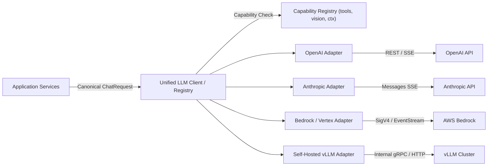
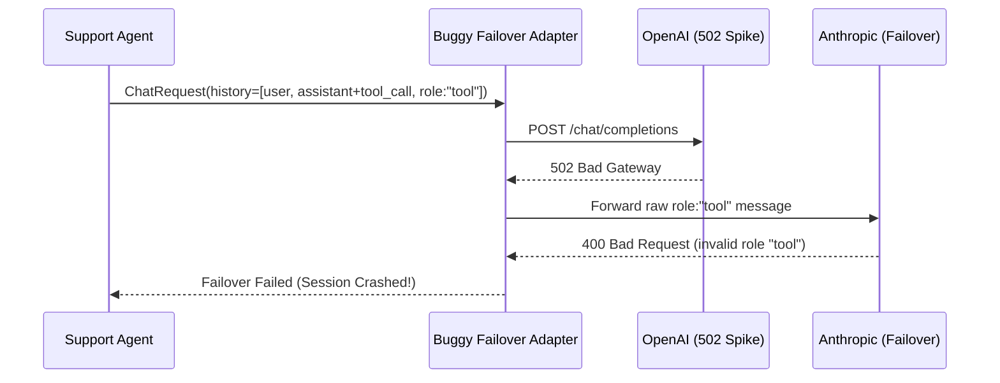

# Model-Provider Abstraction: Avoid LLM Vendor Lock-In with Adapters

> **Prerequisites:** [Lesson 22: LLM Model Routing](../22-llm-model-routing/README.md) · [Track: AI and GenAI System Design](../README.md).  
> **Estimated Reading Time:** 22–26 minutes  
> **Target Audience:** Backend architects building multi-provider GenAI platforms, and candidates asked "how do you switch LLM vendors or run multi-cloud fallbacks without rewriting application code?"  
> **Free PDF Notes:** [Download SD-S-023.pdf](https://backendroadmap.com/notes/system-design/SD-S-023.pdf)

> [!NOTE]
> **In one line:** A model-provider abstraction layer puts a canonical request/response interface (adapter pattern) between your product code and upstream LLM APIs (OpenAI, Anthropic, Bedrock, Vertex, vLLM). You gain **zero-rewrite vendor portability**, **cross-provider failover**, and **centralized telemetry**; you pay with **lowest-common-denominator feature friction** and **subtle behavioral drift** across models.

> [!TIP]
> **The Golden Rule:** Abstract the **wire protocol** (messages, tool schemas, streaming events, usage tokens, errors), not the **prompts**. Never assume a prompt tuned for Claude works identically on GPT or Llama without re-evaluation.

---

## 1. What Model-Provider Abstraction Is, and What It Isn't

Every LLM vendor speaks a slightly different dialect. OpenAI uses `system` messages inside `messages[]` and `choices[0].delta.tool_calls`; Anthropic puts `system` at the top level and streams `content_block_delta` events; AWS Bedrock wraps payloads in SigV4-signed vendor envelopes; self-hosted vLLM speaks OpenAI-compatible HTTP but has different error codes and `usage` fields. Hardcoding the OpenAI SDK inside 40 microservices means a rate-limit outage or 40% price hike turns into a multi-sprint rewrite.

| Term | Precise Meaning | Example |
| :--- | :--- | :--- |
| **Canonical Schema** | Internal, vendor-neutral request/response/stream contract owned by your platform | `ChatRequest`, `ChatResponse`, `StreamChunk` |
| **Provider Adapter** | Translates Canonical Schema <-> Vendor API + maps vendor errors to canonical errors | `AnthropicAdapter`, `BedrockAdapter`, `OpenAIAdapter` |
| **Capability Negotiation** | Metadata declaring what a model supports (tools, JSON schema, vision, max tokens) | Reject `response_format` or degrade to prompt-based JSON if unsupported |
| **Error Taxonomy** | Mapping diverse HTTP/SDK errors into uniform retry/failover categories | `RateLimitError`, `ContextLengthError`, `TransientError` |
| **Streaming Normalizer** | Converts vendor SSE event formats into a single unified event stream | `TextDelta`, `ToolCallDelta`, `UsageFinal` |
| **Prompt Portability Myth** | Believing identical prompts produce identical quality across vendors | XML tags work best on Claude; Markdown/JSON schemas vary by model |
| **Not** | A full AI Gateway (rate limits, billing, PII) | Abstraction is the *adapter layer*; the Gateway (Lesson 24) builds policies on top |

### Why It Matters
1. Multi-provider failover (e.g., OpenAI -> Azure OpenAI -> Anthropic) is impossible if your app code is coupled to vendor-specific SDK types.
2. Pricing and frontier benchmarks flip every 3–6 months; adapters let you A/B test a new model with a config flag instead of a code deploy.
3. Interviewers test whether you recognize **leaky abstractions** (prompt caching headers, reasoning/thinking tokens, tool-calling quirks) rather than blindly saying "just use an interface."

---

## 2. Anatomy: Canonical Interface & Provider Adapters



| Concern | Naive SDK Coupling | Canonical Adapter Layer |
| :--- | :--- | :--- |
| **Swapping vendor** | Rewrite 30+ call sites & stream parsers | Change `model: "anthropic/claude-3.5-sonnet"` in config |
| **Token & cost tracking** | Parse 4 different `usage` JSON shapes everywhere | Normalized `Usage{InputTokens, OutputTokens, CachedTokens}` |
| **Error handling** | Vendor-specific retry logic per service | Uniform `Retryable` vs. `Terminal` error taxonomy |
| **Vendor-only features** | Used directly | Exposed via `provider_options` escape hatch or capability flags |

> [!WARNING]
> **Beware the Lowest-Common-Denominator Trap:** If your canonical interface strips away vendor-specific superpowers—like Anthropic's `cache_control` breakpoints, OpenAI's `strict: true` structured outputs, or Gemini's 1M-token context caching—you lose 50–80% cost/accuracy optimizations. Always provide a typed `ProviderExtensions` escape hatch alongside the canonical contract.

---

## 3. Mathematical Model: Migration Cost & Availability Gain

**Multi-Provider Availability.** If your app depends on a single provider with availability $A_1 = 99.9\%$ (8.76 hours downtime/year), an outage takes you down. With an abstraction layer supporting automatic failover across $k$ independent providers (e.g., OpenAI, Anthropic, Bedrock):

$$A_{\text{total}} = 1 - \prod_{i=1}^{k} (1 - A_i)$$

**Adapter Overhead.** Serialization/translation adds latency $t_{\text{adapt}}$ (typically <0.5 ms in-process or 2–5 ms via a sidecar) vs. upstream inference latency $T_{\text{LLM}}$:

$$\text{Overhead Ratio} = \frac{t_{\text{adapt}}}{T_{\text{LLM}}}$$

**Switching Cost Amortized.** Let $N_{\text{svc}}$ be the number of services calling LLMs, $C_{\text{rewrite}}$ be the engineering cost to rewrite one service for a new SDK, and $C_{\text{adapter}}$ be the upfront cost to build/maintain the abstraction:

$$\text{Break-Even Migrations} = \frac{C_{\text{adapter}}}{N_{\text{svc}} \cdot C_{\text{rewrite}}}$$

### Worked Numerical Example
- **Availability:** Suppose OpenAI ($A_1 = 0.999$) and Anthropic ($A_2 = 0.999$) fail independently. Failover availability = $1 - (0.001)(0.001) = \mathbf{99.9999\%}$ (reducing expected annual downtime from **8.76 hours** to **31.5 seconds**). Even with correlated cloud outages (say 10% shared risk), downtime drops by >10x.
- **Latency Overhead:** In-process Go/Rust/TS adapter translation takes $t_{\text{adapt}} = 0.3\text{ ms}$ on a $T_{\text{LLM}} = 1{,}200\text{ ms}$ call: $\frac{0.3}{1200} = \mathbf{0.025\%}$ overhead.
- **Engineering ROI:** Building a clean adapter costs $C_{\text{adapter}} = 3$ eng-weeks. Rewriting $N_{\text{svc}} = 12$ services at $C_{\text{rewrite}} = 0.5$ eng-weeks each costs $6$ eng-weeks *per migration*—so the adapter pays for itself on the **very first** vendor migration or failover requirement.

---

## 4. Metrics & Percentiles

| Metric | Meaning | Alert when |
| :--- | :--- | :--- |
| **Adapter Translation $p_{99}$** | Time to map canonical <-> vendor payload | > 5 ms (check regex/JSON schema compilation) |
| **Schema / Mapping Error Rate** | Requests failing translation before hitting vendor | > 0.01% (breaking vendor API change or bad capability rule) |
| **Unmapped Vendor Error Rate** | Upstream errors falling into `UnknownError` bucket | > 0.1% (vendor added new status/error code) |
| **Stream Chunk Drop / Desync** | Malformed SSE frames or lost tool-call deltas | > 0 (parser bug on partial UTF-8 or split JSON chunks) |
| **Prompt-Fallback Regret** | Quality drop when failing over from Vendor A to Vendor B | > 5% drop on golden eval suite |

### Worked Example (SSE Tool-Call Normalization)
OpenAI streams tool arguments across multiple `delta.tool_calls[0].function.arguments` fragments, whereas Anthropic emits `content_block_start` followed by `input_json_delta` and `content_block_stop`. Your streaming normalizer buffers partial tool JSON by `tool_call_index` and emits canonical `ToolCallDelta` events—ensuring downstream agents parse tool calls identically regardless of provider.

---

## 5. Compounding & Failure Modes

1. **Silent Parameter Truncation:** Passing `top_k=40` to OpenAI (which doesn't support `top_k`) or `temperature=1.5` to Anthropic (which caps at `1.0`) causes 400 Bad Request errors unless the adapter clamps or validates against the Capability Registry.
2. **Tool-Call ID & Turn-Ordering Mismatches:** Anthropic requires strict alternating `user` / `assistant` roles and `tool_result` blocks inside a `user` message; OpenAI uses `role: "tool"`. Naive adapters crash on multi-turn tool histories when failing over mid-conversation!
3. **Token Counting & Billing Drift:** Different tokenizers (`cl100k_base` vs. Claude's tokenizer vs. Llama SentencePiece) produce 10–25% different token counts for the same string—especially on code and non-English text.

---

## 6. Numbers Every Engineer Must Know

| Item | Typical | Implication |
| :--- | :--- | :--- |
| **In-process adapter overhead** | 0.1 – 0.5 ms | Effectively zero compared to network + GPU time |
| **Tokenizer variance across vendors** | ±10% – 25% | Never rely on one tokenizer for hard context-limit enforcement across models |
| **Vendor API breaking/deprecation cadence** | Every 6 – 12 months | Version adapters (`openai_responses_v1`, `anthropic_messages_v2023`) |
| **Common providers to support** | 2 – 4 | Usually 1 primary SaaS, 1 cloud-hosted (Bedrock/Vertex), 1 self-hosted (vLLM) |
| **Tool-calling schema divergence** | High | Always normalize JSON Schema (`additionalProperties`, `$defs` stripping) |

---

## 7. Protocol / Mechanism Deep Dive

```mermaid
sequenceDiagram
    participant App as Service
    participant Reg as Capability Registry
    participant Ad as Anthropic Adapter
    participant API as Anthropic Messages API

    App->>Reg: Validate(ChatRequest{model, tools, json_schema})
    Reg-->>App: OK (supports tools=true, native_json=false)
    App->>Ad: Translate(ChatRequest)
    Note over Ad: Extract system msg to top-level; convert role:tool to tool_result
    Ad->>API: POST /v1/messages (stream=true)
    API-->>Ad: event: content_block_delta (input_json_delta)
    Ad-->>App: Canonical StreamChunk{Type: ToolDelta}
    API-->>Ad: event: message_delta (usage: {input, output})
    Ad-->>App: Canonical StreamChunk{Type: Usage, Input: 410, Output: 92}
```

| Question | Answer |
| :--- | :--- |
| **When NOT to build your own abstraction?** | When you use a single provider for an early-stage MVP, or when an existing battle-tested proxy/SDK (LiteLLM, Vercel AI SDK, OpenRouter) already covers your exact languages and compliance needs. |
| **Library vs. Out-of-Process Proxy?** | **Library** gives <0.5 ms overhead and strong compile-time types; **Proxy** (Gateway) centralizes keys, quotas, and polyglot teams. Many orgs use a lightweight SDK wrapping a central AI Gateway. |
| **How to handle unsupported capabilities (e.g., `seed` or `logprobs`)?** | Define a strictness mode per request: `Strict` (fail fast if unsupported) vs. `BestEffort` (drop unsupported optional params and log a warning). |

---

## 8. Hierarchical Budgets & Design Rules

| Slice | Rule | Control |
| :--- | :--- | :--- |
| **Interface boundary** | Zero vendor SDK imports outside `/adapters/*` | Lint/arch-test rule failing CI if `openai` or `anthropic` is imported in domain code |
| **Error normalization** | Every vendor error maps to 1 of 6 canonical types | `RateLimit`, `Auth`, `InvalidInput`, `ContextExceeded`, `ContentFilter`, `Transient` |
| **Prompt management** | Store prompt templates *per model family* | Versioned prompt registry keyed by `(prompt_name, model_family)` |
| **Schema compatibility** | Strip unsupported JSON Schema keywords before sending | Recursive schema sanitizer (e.g., `format`, `default`, `$schema` for strict mode) |
| **Testing** | Contract tests + recorded HTTP cassettes (VCR) | Replay real vendor SSE payloads in CI on every adapter change |

---

## 9. Top Mitigations

1. **Enforce strict architectural boundaries:** Only the adapter package may import vendor SDKs; application code only sees canonical types.
2. **Maintain a Capability Matrix:** Store `{max_context, supports_tools, supports_json_schema, supports_streaming_usage, max_temperature}` per model ID.
3. **Normalize conversation history cleanly:** Handle `system` extraction and `tool` -> `tool_result` role merging deterministically so mid-conversation failover works.
4. **Separate prompt templates from adapters:** Keep model-specific prompt phrasing (e.g., XML vs. Markdown) in a prompt registry rather than hiding it inside the adapter.
5. **Provide a `ProviderExtensions` escape hatch:** Allow passing vendor-specific features (`anthropic.cache_control`, `openai.reasoning_effort`) without polluting the core interface.
6. **Build a VCR/Replay test suite:** Record real streaming SSE responses from each vendor to catch subtle parser regressions.

---

## 10. Production Reference / War Story

**Incident (SEV-2): Mid-Conversation Failover Crash on Tool Calls**
A customer-support agent used OpenAI `gpt-4o` as primary and Anthropic `claude-3.5-sonnet` as failover. During an OpenAI 502 spike, a user was on turn 4 of a multi-step refund workflow (which contained two `role: "tool"` messages in the history). The failover adapter forwarded the OpenAI-shaped message array to Anthropic, which rejected every request with `400 Bad Request: messages.2.role: unexpected value "tool"`—causing the fallback to fail 100% of active tool-using sessions.



**Root Cause:** The adapter only translated the *latest* user prompt and passed historical `role: "tool"` messages unadapted, violating Anthropic's alternating-role and `tool_result` contract.  
**Fix:** Normalized the entire `messages[]` array into canonical `Message{Role, Parts[]}` (with `ToolCallPart` and `ToolResultPart`), and tested multi-turn tool failover with recorded VCR fixtures.

---

## 11. Multi-Language Production Code Tabs

````carousel
```go
// Go: Canonical LLM Adapter interface with OpenAI & Anthropic adapters + normalized errors.
package llmadapter

import (
	"context"
	"errors"
)

type Role string

const (
	RoleSystem    Role = "system"
	RoleUser      Role = "user"
	RoleAssistant Role = "assistant"
	RoleTool      Role = "tool"
)

type Message struct {
	Role       Role
	Content    string
	ToolCallID string
}

type ChatRequest struct {
	Model       string
	Messages    []Message
	Temperature float64
	MaxTokens   int
	Extensions  map[string]any // escape hatch for vendor-specific options
}

type Usage struct {
	InputTokens  int
	OutputTokens int
	CachedTokens int
}

type ChatResponse struct {
	Content string
	Usage   Usage
	Vendor  string
}

var (
	ErrRateLimited    = errors.New("llm: rate limited")
	ErrContextLength  = errors.New("llm: context length exceeded")
	ErrTransient      = errors.New("llm: transient upstream error")
)

type ProviderAdapter interface {
	Name() string
	Complete(ctx context.Context, req ChatRequest) (ChatResponse, error)
}

type AnthropicAdapter struct {
	maxTemp float64
}

func NewAnthropicAdapter() *AnthropicAdapter { return &AnthropicAdapter{maxTemp: 1.0} }
func (a *AnthropicAdapter) Name() string     { return "anthropic" }

func (a *AnthropicAdapter) Complete(ctx context.Context, req ChatRequest) (ChatResponse, error) {
	// 1. Extract system prompts to top-level field; clamp temperature to [0, 1]
	temp := min(req.Temperature, a.maxTemp)
	_ = temp
	var systemPrompts []string
	var turns []Message
	for _, m := range req.Messages {
		if m.Role == RoleSystem {
			systemPrompts = append(systemPrompts, m.Content)
		} else {
			// Normalize RoleTool -> RoleUser with tool_result block in real HTTP payload
			turns = append(turns, m)
		}
	}
	// 2. Execute HTTP POST /v1/messages and map HTTP 429 -> ErrRateLimited, 5xx -> ErrTransient
	return ChatResponse{
		Content: "normalized response",
		Usage:   Usage{InputTokens: 120, OutputTokens: 45},
		Vendor:  a.Name(),
	}, nil
}
```
<!-- slide -->
```typescript
// TypeScript: Canonical LLM contract, capability registry, and provider adapters.
export type Role = "system" | "user" | "assistant" | "tool";

export interface CanonicalMessage {
  role: Role;
  content: string;
  toolCallId?: string;
}

export interface CanonicalRequest {
  model: string;
  messages: CanonicalMessage[];
  temperature?: number;
  maxTokens?: number;
  requireJsonSchema?: boolean;
  providerExtensions?: Record<string, unknown>;
}

export interface CanonicalResponse {
  content: string;
  usage: { inputTokens: number; outputTokens: number; cachedTokens: number };
  provider: string;
}

export class CanonicalError extends Error {
  constructor(
    public readonly kind: "RATE_LIMIT" | "CONTEXT_EXCEEDED" | "TRANSIENT" | "INVALID_INPUT",
    message: string
  ) {
    super(message);
  }
}

export interface ModelCapabilities {
  maxContext: number;
  maxTemperature: number;
  supportsJsonSchema: boolean;
}

export interface ProviderAdapter {
  readonly name: string;
  capabilities(model: string): ModelCapabilities;
  complete(req: CanonicalRequest): Promise<CanonicalResponse>;
}

export class UnifiedLLMClient {
  private adapters = new Map<string, ProviderAdapter>();

  register(prefix: string, adapter: ProviderAdapter): void {
    this.adapters.set(prefix, adapter);
  }

  async complete(req: CanonicalRequest): Promise<CanonicalResponse> {
    const [prefix] = req.model.split("/");
    const adapter = this.adapters.get(prefix);
    if (!adapter) throw new CanonicalError("INVALID_INPUT", `Unknown provider prefix: ${prefix}`);

    const caps = adapter.capabilities(req.model);
    if (req.requireJsonSchema && !caps.supportsJsonSchema) {
      throw new CanonicalError("INVALID_INPUT", `${req.model} does not support native JSON schema`);
    }
    const normalizedReq: CanonicalRequest = {
      ...req,
      temperature: Math.min(req.temperature ?? 0.2, caps.maxTemperature),
    };
    return adapter.complete(normalizedReq);
  }
}
```
<!-- slide -->
```python
# Python: Canonical adapter registry with capability validation & Anthropic role normalization.
from dataclasses import dataclass, field
from typing import Protocol, Any

@dataclass
class Message:
    role: str  # "system" | "user" | "assistant" | "tool"
    content: str
    tool_call_id: str | None = None

@dataclass
class ChatRequest:
    model: str
    messages: list[Message]
    temperature: float = 0.2
    require_json_schema: bool = False
    extensions: dict[str, Any] = field(default_factory=dict)

@dataclass
class ChatResponse:
    content: str
    input_tokens: int
    output_tokens: int
    provider: str

class LLMError(Exception):
    def __init__(self, kind: str, msg: str):
        super().__init__(msg)
        self.kind = kind  # RATE_LIMIT | CONTEXT_EXCEEDED | TRANSIENT | INVALID

class ProviderAdapter(Protocol):
    name: str
    def complete(self, req: ChatRequest) -> ChatResponse: ...

class AnthropicAdapter:
    name = "anthropic"

    def to_vendor_payload(self, req: ChatRequest) -> dict[str, Any]:
        system = "\n".join(m.content for m in req.messages if m.role == "system")
        messages = []
        for m in req.messages:
            if m.role == "system":
                continue
            if m.role == "tool":
                messages.append({
                    "role": "user",
                    "content": [{"type": "tool_result", "tool_use_id": m.tool_call_id, "content": m.content}],
                })
            else:
                messages.append({"role": m.role, "content": m.content})
        return {
            "model": req.model.split("/", 1)[-1],
            "system": system,
            "messages": messages,
            "temperature": min(req.temperature, 1.0),
        }

    def complete(self, req: ChatRequest) -> ChatResponse:
        _payload = self.to_vendor_payload(req)
        return ChatResponse(content="ok", input_tokens=100, output_tokens=20, provider=self.name)
```
<!-- slide -->
```csharp
// C#: Canonical LLM abstraction with capability clamping and normalized error taxonomy.
public enum CanonicalErrorKind { RateLimit, ContextExceeded, Transient, InvalidInput }

public sealed class CanonicalLlmException(CanonicalErrorKind kind, string message) : Exception(message)
{
    public CanonicalErrorKind Kind { get; } = kind;
}

public sealed record CanonicalMessage(string Role, string Content, string? ToolCallId = null);

public sealed record CanonicalRequest(
    string Model,
    IReadOnlyList<CanonicalMessage> Messages,
    double Temperature = 0.2,
    bool RequireJsonSchema = false);

public sealed record CanonicalResponse(string Content, int InputTokens, int OutputTokens, string Provider);

public interface IProviderAdapter
{
    string Name { get; }
    double MaxTemperature { get; }
    bool SupportsJsonSchema { get; }
    Task<CanonicalResponse> CompleteAsync(CanonicalRequest req, CancellationToken ct);
}

public sealed class LlmClientRegistry
{
    private readonly Dictionary<string, IProviderAdapter> _adapters = new();

    public void Register(string prefix, IProviderAdapter adapter) => _adapters[prefix] = adapter;

    public async Task<CanonicalResponse> CompleteAsync(CanonicalRequest req, CancellationToken ct)
    {
        var prefix = req.Model.Split('/')[0];
        if (!_adapters.TryGetValue(prefix, out var adapter))
            throw new CanonicalLlmException(CanonicalErrorKind.InvalidInput, $"Unknown provider: {prefix}");

        if (req.RequireJsonSchema && !adapter.SupportsJsonSchema)
            throw new CanonicalLlmException(CanonicalErrorKind.InvalidInput, "JSON schema unsupported");

        var clamped = req with { Temperature = Math.Min(req.Temperature, adapter.MaxTemperature) };
        return await adapter.CompleteAsync(clamped, ct);
    }
}
```
````

---

## 12. Hands-On CLI Verification Workflows

Verify vendor payload translation and error mapping locally with Python:

```bash
python -c '
# Verify OpenAI-shaped history converts cleanly to Anthropic alternating-role payload
msgs = [
    {"role": "system", "content": "Be concise."},
    {"role": "user", "content": "Check order 42"},
    {"role": "tool", "tool_call_id": "tc_1", "content": "{\"status\":\"shipped\"}"},
]
system = "\n".join(m["content"] for m in msgs if m["role"] == "system")
converted = [
    {"role": "user", "content": [{"type": "tool_result", "tool_use_id": m["tool_call_id"], "content": m["content"]}]}
    if m["role"] == "tool" else m
    for m in msgs if m["role"] != "system"
]
print({"system": system, "messages": converted})
'
```

Verify OpenAI-compatible self-hosted vLLM vs. OpenAI cloud via `curl`:

```bash
# Same canonical JSON body works against both OpenAI and local vLLM
for URL in "http://localhost:8000/v1/chat/completions" "https://api.openai.com/v1/chat/completions"; do
  echo "Testing $URL"
  curl -s -o /dev/null -w "%{http_code} %{time_total}s\n" "$URL" \
    -H "Content-Type: application/json" \
    -d '{"model":"gpt-4o-mini","messages":[{"role":"user","content":"ping"}],"max_tokens":5}'
done
```

---

## 13. Common Mistakes to Avoid

1. **Building a lowest-common-denominator interface** that blocks vendor-specific features like prompt caching or strict JSON schemas.
2. **Translating only the last message** and forgetting multi-turn `role: "tool"` history during failover.
3. **Assuming prompts are 100% portable** across model families without running golden-set evals.
4. **Leaking vendor SDK exceptions** (`openai.RateLimitError`) directly into business logic.
5. **Ignoring temperature/parameter bounds** (`temp=1.4` works on OpenAI, 400s on Anthropic).
6. **Using one tokenizer for all providers** to enforce context-window limits.
7. **Forgetting to normalize streaming `usage` events** (some providers emit usage only in the final SSE frame when `stream_options: {include_usage: true}` is set).

---

## 14. Key Terms Glossary

| Key Term | Definition |
| :--- | :--- |
| **Provider Adapter** | Component translating a canonical LLM contract to/from a specific vendor's wire protocol. |
| **Canonical Schema** | Vendor-neutral internal data model for messages, tools, streaming chunks, and usage. |
| **Capability Registry** | Metadata store describing each model's supported features and parameter bounds. |
| **Error Taxonomy** | Normalized error categories (`RateLimit`, `ContextExceeded`, `Transient`) decoupled from HTTP/SDK types. |
| **Leaky Abstraction** | When vendor differences (prompting style, tool formats, caching) bleed through the interface. |
| **Escape Hatch (`Extensions`)** | Typed/keyed pass-through field for vendor-specific optimizations like `cache_control`. |
| **VCR / Cassette Testing** | Replaying recorded vendor HTTP/SSE responses in CI to test adapters deterministically. |
| **Streaming Normalizer** | State machine converting vendor SSE chunks into uniform `TextDelta` / `ToolDelta` events. |
| **Prompt Registry** | Versioned store of prompt templates tuned per model family. |
| **OpenAI-Compatible API** | De facto HTTP wire convention adopted by vLLM, Ollama, Groq, and Together for drop-in clients. |

---

## 15. System Design Interview Questions & Answers

### Basic Conceptual Questions

<details>
<summary><strong>Q1: Why use a model-provider abstraction instead of calling the OpenAI SDK directly? [BASIC]</strong></summary>

**Answer:**
Direct SDK calls couple business logic to one vendor's types, error classes, and streaming format. An adapter layer lets you swap models, fail over across vendors during outages, and centralize token/cost telemetry without rewriting application services.
</details>

<details>
<summary><strong>Q2: What is the difference between a provider abstraction and an AI Gateway? [BASIC]</strong></summary>

**Answer:**
The **provider abstraction** is the adapter/translation layer normalizing vendor APIs into one canonical contract. The **AI Gateway** is the centralized network proxy that enforces cross-cutting policies (quotas, auth, PII redaction, routing, caching, cost attribution) on top of those adapters.
</details>

<details>
<summary><strong>Q3: What belongs in a canonical `ChatResponse`? [BASIC]</strong></summary>

**Answer:**
Normalized `content`, structured `tool_calls`, `finish_reason` (`stop`, `length`, `tool_calls`, `content_filter`), `usage` (`input_tokens`, `output_tokens`, `cached_tokens`), `model_used`, `provider`, and `request_id` for tracing.
</details>

<details>
<summary><strong>Q4: What is a Capability Registry and why is it needed? [BASIC]</strong></summary>

**Answer:**
It is a per-model metadata table (`max_context`, `supports_tools`, `supports_json_schema`, `max_temperature`). It prevents 400 errors by validating or clamping requests before they hit a vendor that lacks a feature.
</details>

### Scenario-Based Architecture Questions

<details>
<summary><strong>Q5: Your company uses OpenAI, Anthropic, and self-hosted vLLM. How do you structure the client architecture? [SCENARIO]</strong></summary>

**Answer:**
Define a canonical interface (`ChatRequest`, `ChatResponse`, `StreamEvent`) in a shared internal SDK or AI Gateway. Implement three adapters (`OpenAIAdapter`, `AnthropicAdapter`, `VLLMAdapter`) behind a registry keyed by `provider/model`, enforce CI lint rules banning direct vendor imports, and normalize all errors into a 6-class taxonomy.
</details>

<details>
<summary><strong>Q6: You want to use Anthropic's prompt caching (`cache_control`), which OpenAI doesn't have. How do you expose it cleanly? [SCENARIO]</strong></summary>

**Answer:**
Add an optional `ProviderExtensions` (or `cache_hints`) field to the canonical `Message`/`Request`. The Anthropic adapter maps `cache_hints` to `cache_control: {"type": "ephemeral"}`, while the OpenAI adapter safely ignores it (or relies on OpenAI's automatic prefix caching).
</details>

<details>
<summary><strong>Q7: Mid-conversation failover from OpenAI to Anthropic fails on requests with tool history. Why and how do you fix it? [SCENARIO]</strong></summary>

**Answer:**
OpenAI uses `role: "tool"` messages, whereas Anthropic requires `tool_result` blocks inside a `role: "user"` message and strict alternating user/assistant turns. Fix it by representing tool calls and results as canonical `MessagePart`s and having each adapter serialize the full history into its vendor's turn rules.
</details>

<details>
<summary><strong>Q8: How do you test provider adapters without spending thousands on live API calls in CI? [SCENARIO]</strong></summary>

**Answer:**
Use **VCR/cassette contract tests**: record real HTTP/SSE responses (including edge cases like split UTF-8 characters, multi-chunk tool JSON, and 429 headers) once, and replay them against the adapters in CI. Run a tiny live canary suite nightly against sandbox keys to catch silent vendor schema drift.
</details>

### Advanced & Tricky Interview Questions

<details>
<summary><strong>Q9: Why does "write once, run on any LLM" fail in practice even with a perfect adapter? [TRICKY]</strong></summary>

**Answer:**
Because **prompts are not portable**: models differ in instruction hierarchy, XML vs. Markdown sensitivity, refusal thresholds, and JSON adherence. The adapter solves *wire portability*, not *behavioral equivalence*—you still need model-family prompt variants and automated evals.
</details>

<details>
<summary><strong>Q10: How do you handle streaming `usage` tokens when providers emit them differently? [TRICKY]</strong></summary>

**Answer:**
Anthropic emits input tokens in `message_start` and output tokens in `message_delta`; OpenAI omits usage in streams unless `stream_options: {include_usage: true}` is sent (and then emits it in a final chunk with empty `choices`). Your streaming normalizer must accumulate usage across stream lifecycle events and emit a single canonical `UsageEvent` at stream close.
</details>

<details>
<summary><strong>Q11: A vendor silently updates a model alias (e.g., `gpt-4o`) and breaks your downstream JSON parser. How does your abstraction layer protect you? [TRICKY]</strong></summary>

**Answer:**
First, pin immutable snapshot IDs (e.g., `gpt-4o-2024-08-06`) in the model registry rather than floating aliases. Second, log `system_fingerprint` / `model_version` returned by the vendor in every canonical response so regressions are immediately traceable.
</details>

<details>
<summary><strong>Q12: Should tool/function JSON schemas be passed raw to every provider? [TRICKY]</strong></summary>

**Answer:**
No. Providers support different subsets of JSON Schema (e.g., OpenAI `strict: true` requires `additionalProperties: false` and all properties in `required`, while Gemini rejects `$schema` and `default` keys). Include a per-adapter schema sanitizer in the translation step.
</details>

---

## 16. One-Page Master Cheat Sheet

```
+---------------------------------------------------------------------------------------------------------+
|                    MODEL-PROVIDER ABSTRACTION — MASTER CHEAT SHEET                                      |
+---------------------------------------------------------------------------------------------------------+
| 1. GOAL: Abstract the WIRE PROTOCOL (messages, tools, SSE streams, usage, errors), NOT the prompts.     |
+---------------------------------------------------------------------------------------------------------+
| 2. COMPONENTS: Canonical Schema -> Capability Registry -> Vendor Adapters -> Error Taxonomy.            |
+---------------------------------------------------------------------------------------------------------+
| 3. AVAILABILITY: 2 independent 99.9% providers with failover = 99.9999% (8.76h -> 31.5s downtime/yr).   |
+---------------------------------------------------------------------------------------------------------+
| 4. ESCAPE HATCH: Always include ProviderExtensions so you don't lose prompt caching or strict schemas.  |
+---------------------------------------------------------------------------------------------------------+
| 5. TRAPS: Multi-turn role:tool history · Streaming usage lifecycles · JSON Schema dialect differences.  |
+---------------------------------------------------------------------------------------------------------+
| 6. TESTING: VCR/cassette replay of real SSE chunks in CI + pinned immutable model snapshot IDs.         |
+---------------------------------------------------------------------------------------------------------+
```

---

## Further Reading & Sources

- OpenAI API Reference & Anthropic Messages API Specification (wire protocol & SSE streaming specs).
- LiteLLM / OpenRouter / Vercel AI SDK architecture documentation on unified provider interfaces.
- Gregor Hohpe & Bobby Woolf, *Enterprise Integration Patterns* (Canonical Data Model & Channel Adapter patterns).

---

## Free PDF Notes

[SD-S-023.pdf](https://backendroadmap.com/notes/system-design/SD-S-023.pdf)

---

## Next

Continue with [Lesson 24: AI Gateway Architecture: Quotas, Routing, PII & Cost Attribution](../24-ai-gateway-architecture/README.md).
