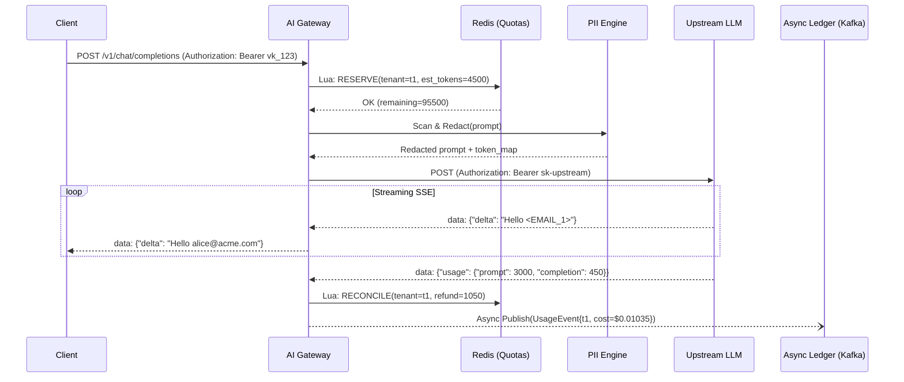
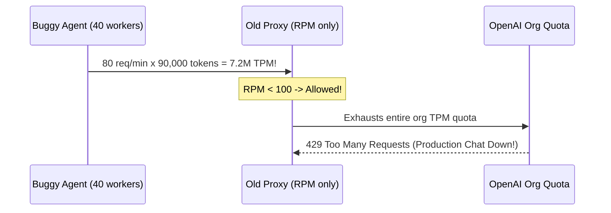

# AI Gateway Architecture: Quotas, Routing, PII & Cost Attribution

> **Prerequisites:** [Lesson 23: Model-Provider Abstraction](../23-model-provider-abstraction/README.md) · [Track: AI and GenAI System Design](../README.md).  
> **Estimated Reading Time:** 25–28 minutes  
> **Target Audience:** Staff/Principal engineers designing centralized GenAI control planes, and candidates asked "design an enterprise AI Gateway for 50 internal teams and 1,000 B2B tenants."  
> **Free PDF Notes:** [Download SD-S-024.pdf](https://backendroadmap.com/notes/system-design/SD-S-024.pdf)

> [!NOTE]
> **In one line:** An AI Gateway is a specialized reverse proxy sitting between all applications and LLM providers that enforces **token-based rate limits & budgets**, **PII/prompt-injection guardrails**, **semantic caching**, **model routing/failover**, and **per-tenant cost attribution**. You gain **governance, security, and unit-economics visibility**; you pay with **a central hop** that must be ultra-low-latency, streaming-native, and highly available.

> [!TIP]
> **The Golden Rule:** Traditional API gateways rate-limit by **requests per second (RPS)**; an AI Gateway must rate-limit by **tokens per minute (TPM)** and **dollars per day**, using an **estimate-reserve-reconcile** flow so streaming responses cannot bypass quotas.

---

## 1. What an AI Gateway Is, and What It Isn't

In a growing company, 15 teams embed OpenAI/Anthropic API keys into their own services. Soon, nobody knows which team spent $40,000 last weekend, a rogue loop exhausts the company-wide TPM quota and takes down production checkout chat, and an engineer accidentally sends customer SSNs to an external LLM. An AI Gateway centralizes all LLM egress behind a single **data plane** (streaming proxy) and **control plane** (keys, quotas, routing, telemetry).

| Term | Precise Meaning | Example |
| :--- | :--- | :--- |
| **AI Gateway** | L7 proxy tailored for LLM traffic (SSE streaming, tokens, prompts, providers) | LiteLLM Proxy, Kong AI Gateway, Envoy AI Gateway, Portkey |
| **Virtual Key** | Internal scoped credential mapped to team/tenant budgets & allowed models | `vk_team_billing_01` (never exposes raw `sk-ant-...` upstream key) |
| **TPM / RPM Quotas** | Dual rate limits on Requests/Min *and* Tokens/Min (input + output) | 100 RPM and 150,000 TPM per tenant |
| **PII Redaction** | Detecting and masking sensitive entities before leaving the VPC | Replace `4111-...` with `<CREDIT_CARD_1>` and re-hydrate on response |
| **Cost Attribution** | Tagging every call's exact token cost to `tenant_id`, `team`, `feature` | Chargeback ledger: `support-bot` = $1,420/mo |
| **Estimate-Reserve-Reconcile** | Pre-deduct estimated tokens before streaming; reconcile actual `usage` at EOF | Prevents 50 concurrent 100K-token streams from blowing a 1M TPM cap |
| **Not** | A generic NGINX/Envoy HTTP proxy | Standard proxies don't parse SSE token chunks, count tokens, or redact PII |

### Why It Matters
1. Upstream LLM providers enforce **TPM** and **RPM** limits globally per org key—without a central gateway, one noisy team starves everyone else.
2. Security and compliance (SOC 2, GDPR, HIPAA) require a single audit choke point for PII scrubbing and prompt/response logging.
3. "Design an AI Gateway" is one of the most frequent senior/staff GenAI system design interview questions.

---

## 2. Anatomy: Data Plane vs. Control Plane

```mermaid
flowchart LR
    App["App Services (Virtual Keys)"] --> Auth["1. Auth & Virtual Key Lookup"]
    Auth --> Quota["2. Redis Token Bucket (TPM Reserve)"]
    Quota --> PII["3. PII & Guardrail Scanner (<10 ms)"]
    PII --> Cache["4. L1/L2 Semantic Cache"]
    Cache -- "Hit" --> Resp["SSE / JSON Response"]
    Cache -- "Miss" --> Route["5. Model Router & Circuit Breaker"]
    Route --> Adapt["6. Provider Adapter (Inject Upstream Key)"]
    Adapt --> LLM["Upstream LLM (OpenAI / Bedrock / vLLM)"]
    LLM -->|"Stream Chunks + Usage"| Reconcile["7. Reconcile TPM & Emit Async Cost Event"]
    Reconcile --> Resp
    Reconcile --> Kafka[("Kafka / ClickHouse Ledger")]
```



| Capability | Standard API Gateway (Kong/NGINX) | AI Gateway |
| :--- | :--- | :--- |
| **Rate limiting unit** | Requests / sec (RPS) | **Tokens / min (TPM)** + **Dollars / day** |
| **Payload inspection** | Headers / small JSON | **Prompt text, tool schemas, SSE token chunks** |
| **Caching** | URL + Header exact cache | **Prompt exact + Semantic vector cache** |
| **Key management** | Pass-through or mTLS | **Virtual keys** -> rotated upstream provider keys |
| **Failover** | Same-service replicas | **Cross-vendor** (OpenAI -> Bedrock -> Anthropic) |

> [!WARNING]
> **Never Buffer Full Responses for Logging or Billing:** Writing synchronous DB/Kafka inserts or buffering the entire LLM response before forwarding chunks to the client destroys Time-to-First-Token (TTFT). Stream SSE chunks immediately, count tokens on the fly, and emit billing/audit logs **asynchronously** after stream completion.

---

## 3. Mathematical Model: Gateway Overhead, Token Buckets & Cost Attribution

**Gateway Latency Budget.** Total Time-to-First-Token (TTFT) with gateway overhead $t_{\text{gw}}$:

$$\text{TTFT}_{\text{total}} = t_{\text{auth}} + t_{\text{quota}} + t_{\text{PII}} + t_{\text{route}} + \text{TTFT}_{\text{upstream}}$$

**Estimate-Reserve-Reconcile Quota Math.** Before forwarding a request with input tokens $T_{\text{in}}$ and `max_tokens` $T_{\text{max}}$, the gateway reserves:

$$T_{\text{reserve}} = T_{\text{in}} + \min(T_{\text{max}}, T_{\text{default\_out}})$$

When the stream finishes with actual usage $(T_{\text{in}}, T_{\text{out}})$, it refunds the delta:

$$\Delta T = T_{\text{reserve}} - (T_{\text{in}} + T_{\text{out}})$$

**Cost Attribution Formula.** With input price $P_{\text{in}}$, cached-input price $P_{\text{cache}}$, and output price $P_{\text{out}}$ (per 1M tokens):

$$C_{\text{req}} = \frac{(T_{\text{in}} - T_{\text{cached}}) P_{\text{in}} + T_{\text{cached}} P_{\text{cache}} + T_{\text{out}} P_{\text{out}}}{10^6}$$

### Worked Numerical Example
Suppose a gateway enforces a **100,000 TPM** quota for Tenant A:
- **Latency:** $t_{\text{auth}} = 0.5\text{ ms}$, $t_{\text{quota}} = 1.5\text{ ms}$ (Redis Lua), $t_{\text{PII}} = 6\text{ ms}$ (local NER/regex), $t_{\text{route}} = 1\text{ ms}$ $\implies t_{\text{gw}} = \mathbf{9\text{ ms}}$ on a 650 ms upstream TTFT (**1.38% overhead**).
- **Reserve/Reconcile:** A request arrives with $T_{\text{in}} = 3{,}000$ tokens and `max_tokens = 2{,}000`. The gateway atomically deducts $T_{\text{reserve}} = 5{,}000$ tokens from Redis. The model streams only $T_{\text{out}} = 450$ tokens. At EOF, the gateway credits back $\Delta T = 5{,}000 - 3{,}450 = \mathbf{1{,}550}$ tokens.
- **Cost:** On `claude-3.5-sonnet` ($P_{\text{in}} = \$3.00$, $P_{\text{cache}} = \$0.30$, $P_{\text{out}} = \$15.00$ per 1M), with $2{,}000$ cached tokens:
  $$C_{\text{req}} = \frac{1{,}000(3.00) + 2{,}000(0.30) + 450(15.00)}{10^6} = \frac{3{,}000 + 600 + 6{,}750}{10^6} = \mathbf{\$0.01035}$$

---

## 4. Metrics & Percentiles

| Metric | Meaning | Alert when |
| :--- | :--- | :--- |
| **Gateway Overhead $p_{99}$** | Time added by gateway before upstream call | > 25 ms (check PII scanner or Redis latency) |
| **TTFT $p_{95}$ / $p_{99}$** | End-to-end Time-to-First-Token seen by clients | Exceeds product SLO (e.g., > 1,200 ms) |
| **Quota Rejection Rate (429)** | Requests blocked by tenant TPM/dollar caps | Sudden spike on enterprise tier |
| **PII Redaction Trigger Rate** | % of prompts containing detected PII | Spike indicates upstream app stopped sanitizing |
| **Billing Reconciliation Lag** | Delay between stream EOF and ledger write | > 60 seconds (Kafka consumer lag) |
| **Gateway Availability** | % of non-5xx responses from gateway itself | < 99.99% (gateway is a critical single choke point) |

### Worked Example (Noisy Neighbor Isolation)
A B2B platform shares a 2M TPM OpenAI enterprise quota across 200 tenants. Tenant X launches a buggy batch script sending 500 concurrent 4K-token prompts. Because the AI Gateway enforces a **50K TPM per-tenant cap** in Redis, Tenant X gets `429 Too Many Requests` with `Retry-After: 12` while the other 199 tenants experience zero degradation.

---

## 5. Compounding & Failure Modes

1. **Redis Quota Check as a Single Point of Failure:** If Redis is unreachable, failing *closed* takes down 100% of AI traffic; failing *open* risks blowing upstream spend. Solution: local in-memory token-bucket fallback with degraded per-pod limits when Redis is down.
2. **PII Re-Hydration Collisions & Streaming:** If you replace `"John Doe"` with `<PERSON_1>` before sending to the LLM, and the LLM streams `<PERS` then `ON_1>`, a naive chunk-by-chunk string replacer misses `<PERSON_1>` and leaks the placeholder to the user! You must use a small sliding-window buffer on `<...>` tokens during streaming re-hydration.
3. **Aborted Streams Losing Usage Accounting:** If a client disconnects mid-stream (TCP RST), upstream providers may not send the final `usage` SSE frame. The gateway must estimate output tokens from the chunks already forwarded and reconcile the ledger.

---

## 6. Numbers Every Engineer Must Know

| Item | Typical | Implication |
| :--- | :--- | :--- |
| **Gateway proxy overhead budget** | 5 – 20 ms | Must stay negligible vs. 300–1,500 ms TTFT |
| **Redis Lua TPM check** | 0.8 – 2.0 ms | Atomic check-and-reserve in 1 network round trip |
| **Regex + local NER PII scan** | 3 – 12 ms | Run regex first (<0.5 ms); NER only on unredacted text |
| **Async telemetry batch size** | 100 – 1,000 events/s | Never write per-request rows synchronously to Postgres |
| **Virtual key cache TTL** | 30 – 60 s | Cache virtual-key metadata in gateway RAM; invalidate via pub/sub |

---

## 7. Protocol / Mechanism Deep Dive



| Question | Answer |
| :--- | :--- |
| **When NOT to deploy a central AI Gateway?** | Single-team prototype with <\$500/mo spend, or ultra-low-latency internal GPU pipelines where an extra network hop is unacceptable (use an in-process SDK instead). |
| **How to avoid becoming a bottleneck for streaming?** | Use non-blocking async I/O (Go, Rust/Pingora, Envoy, Node/Fastify), zero-copy SSE forwarding where possible, and keep gateway replicas stateless behind an L7 load balancer. |
| **How to handle PII re-hydration safely?** | Store the `placeholder -> original` map *only in request-scoped memory* (never persist it to disk/logs), and hold a tiny trailing buffer if a chunk ends with `<`. |

---

## 8. Hierarchical Budgets & Design Rules

| Slice | Rule | Control |
| :--- | :--- | :--- |
| **Latency** | Gateway p99 overhead < 20 ms | In-memory key cache + single-RTT Redis Lua + fast regex/ONNX PII |
| **Security** | Zero upstream keys in app code or logs | Virtual keys in apps; KMS/Vault-injected upstream keys in gateway |
| **Quotas** | Prevent runaway loops & noisy neighbors | Per-tenant RPM, TPM, and daily/monthly hard dollar caps |
| **Availability** | Gateway must outlive Redis or any single LLM | Fail-open-to-local-cap on Redis outage; cross-provider circuit breakers |
| **Observability** | 100% cost & trace attribution | Propagate `X-Request-Id` / `traceparent` + async ClickHouse usage ledger |

---

## 9. Top Mitigations

1. **Estimate-Reserve-Reconcile in Redis Lua:** Atomic token reservation prevents concurrent streaming bursts from overshooting TPM limits.
2. **Sliding-window streaming re-hydration:** Buffer up to 16 chars only when an open `<` placeholder prefix is detected at a chunk boundary.
3. **Count output tokens on client abort:** Use `tiktoken`/character-ratio fallback if the client closes the SSE connection before the final `usage` event arrives.
4. **Tiered PII scanning:** Run fast regexes (SSN, credit cards, API keys) in <0.5 ms; invoke heavier NER models only for regulated endpoints.
5. **Dual-layer rate-limit fallback:** Keep a local per-pod token bucket as an automatic fallback if Redis times out (>10 ms).
6. **Asynchronous cost & audit pipeline:** Push usage events to Kafka/SQS/ClickHouse in a background worker—never on the hot response path.

---

## 10. Production Reference / War Story

**Incident (SEV-1): Runaway Agent Loop + Missing TPM Reserve Drained $18K in 2 Hours**
An internal engineering team deployed an autonomous PR-review agent behind a basic HTTP proxy that only enforced **RPM** (100 req/min) and billed asynchronously *after* responses completed. A bug caused the agent to retry a 90K-token repo context 80 times per minute across 40 workers. Because RPM was under the limit and post-hoc billing lagged by 5 minutes, the loop burned $18,000 in frontier tokens and triggered an org-wide OpenAI 429 outage for customer-facing apps.



**Root Cause:** Rate limiting by RPM instead of TPM, no per-virtual-key dollar cap, and no pre-request token reservation.  
**Fix:** Implemented Estimate-Reserve-Reconcile TPM quotas + hard daily dollar caps per virtual key, isolating each team's blast radius.

---

## 11. Multi-Language Production Code Tabs

````carousel
```go
// Go: AI Gateway core middleware (Virtual Key auth, TPM Reserve/Reconcile, PII Redact, Cost Attribution).
package aigateway

import (
	"errors"
	"regexp"
	"strings"
	"sync"
)

type TenantQuota struct {
	mu           sync.Mutex
	TPMRemaining int
	DailyBudget  float64
	SpentToday   float64
}

type Gateway struct {
	quotas map[string]*TenantQuota
}

var (
	emailRe = regexp.MustCompile(`[a-zA-Z0-9._%+\-]+@[a-zA-Z0-9.\-]+\.[a-zA-Z]{2,}`)
	ssnRe   = regexp.MustCompile(`\b\d{3}-\d{2}-\d{4}\b`)
)

func RedactPII(input string) (string, map[string]string) {
	placeholders := make(map[string]string)
	idx := 0
	redact := func(re *regexp.Regexp, tag, s string) string {
		return re.ReplaceAllStringFunc(s, func(match string) string {
			idx++
			key := "<" + tag + "_" + string(rune('0'+idx)) + ">"
			placeholders[key] = match
			return key
		})
	}
	out := redact(emailRe, "EMAIL", input)
	out = redact(ssnRe, "SSN", out)
	return out, placeholders
}

func RehydratePII(output string, placeholders map[string]string) string {
	for k, v := range placeholders {
		output = strings.ReplaceAll(output, k, v)
	}
	return output
}

func (g *Gateway) Reserve(tenantID string, estTokens int) error {
	q, ok := g.quotas[tenantID]
	if !ok {
		return errors.New("unknown tenant")
	}
	q.mu.Lock()
	defer q.mu.Unlock()
	if q.SpentToday >= q.DailyBudget {
		return errors.New("daily dollar budget exceeded")
	}
	if q.TPMRemaining < estTokens {
		return errors.New("429: TPM quota exceeded")
	}
	q.TPMRemaining -= estTokens
	return nil
}

func (g *Gateway) Reconcile(tenantID string, reserved, actualIn, actualOut int, priceInPer1M, priceOutPer1M float64) float64 {
	q := g.quotas[tenantID]
	cost := (float64(actualIn)*priceInPer1M + float64(actualOut)*priceOutPer1M) / 1_000_000.0
	q.mu.Lock()
	defer q.mu.Unlock()
	q.TPMRemaining += reserved - (actualIn + actualOut)
	q.SpentToday += cost
	return cost
}
```
<!-- slide -->
```typescript
// TypeScript: Estimate-Reserve-Reconcile AI Gateway with streaming PII re-hydration.
export interface TenantState {
  tpmRemaining: number;
  dailyBudgetUsd: number;
  spentUsd: number;
}

export class AiGateway {
  private tenants = new Map<string, TenantState>();

  registerTenant(id: string, tpm: number, dailyBudgetUsd: number): void {
    this.tenants.set(id, { tpmRemaining: tpm, dailyBudgetUsd, spentUsd: 0 });
  }

  reserve(tenantId: string, estTokens: number): void {
    const t = this.tenants.get(tenantId);
    if (!t) throw new Error("401: Invalid virtual key");
    if (t.spentUsd >= t.dailyBudgetUsd) throw new Error("402: Daily budget exceeded");
    if (t.tpmRemaining < estTokens) throw new Error("429: TPM limit exceeded");
    t.tpmRemaining -= estTokens;
  }

  reconcile(
    tenantId: string,
    reserved: number,
    actualIn: number,
    actualOut: number,
    inPer1M: number,
    outPer1M: number
  ): number {
    const t = this.tenants.get(tenantId)!;
    t.tpmRemaining += reserved - (actualIn + actualOut);
    const cost = (actualIn * inPer1M + actualOut * outPer1M) / 1_000_000;
    t.spentUsd += cost;
    return cost;
  }

  redactPii(text: string): { redacted: string; map: Map<string, string> } {
    const map = new Map<string, string>();
    let count = 0;
    const redacted = text.replace(/[a-zA-Z0-9._%+-]+@[a-zA-Z0-9.-]+\.[a-zA-Z]{2,}/g, (m) => {
      const token = `<EMAIL_${++count}>`;
      map.set(token, m);
      return token;
    });
    return { redacted, map };
  }
}
```
<!-- slide -->
```python
# Python: AI Gateway quota reservation, PII redaction, and cost attribution (stdlib only).
import re
from dataclasses import dataclass

EMAIL_RE = re.compile(r"[a-zA-Z0-9._%+-]+@[a-zA-Z0-9.-]+\.[a-zA-Z]{2,}")
SSN_RE = re.compile(r"\b\d{3}-\d{2}-\d{4}\b")

@dataclass
class TenantLedger:
    tpm_remaining: int
    daily_budget_usd: float
    spent_usd: float = 0.0

class AiGateway:
    def __init__(self):
        self.tenants: dict[str, TenantLedger] = {}

    def redact_pii(self, text: str) -> tuple[str, dict[str, str]]:
        mapping: dict[str, str] = {}
        idx = 0
        def sub(pattern: re.Pattern[str], tag: str, s: str) -> str:
            nonlocal idx
            def repl(m: re.Match[str]) -> str:
                nonlocal idx
                idx += 1
                tok = f"<{tag}_{idx}>"
                mapping[tok] = m.group(0)
                return tok
            return pattern.sub(repl, s)
        return sub(SSN_RE, "SSN", sub(EMAIL_RE, "EMAIL", text)), mapping

    def rehydrate(self, text: str, mapping: dict[str, str]) -> str:
        for tok, orig in mapping.items():
            text = text.replace(tok, orig)
        return text

    def reserve(self, tenant_id: str, est_tokens: int) -> None:
        t = self.tenants[tenant_id]
        if t.spent_usd >= t.daily_budget_usd:
            raise RuntimeError("402: Daily budget exceeded")
        if t.tpm_remaining < est_tokens:
            raise RuntimeError("429: TPM quota exceeded")
        t.tpm_remaining -= est_tokens

    def reconcile(self, tenant_id: str, reserved: int, in_tok: int, out_tok: int,
                  p_in: float = 3.0, p_out: float = 15.0) -> float:
        t = self.tenants[tenant_id]
        t.tpm_remaining += reserved - (in_tok + out_tok)
        cost = (in_tok * p_in + out_tok * p_out) / 1_000_000
        t.spent_usd += cost
        return cost
```
<!-- slide -->
```csharp
// C#: Thread-safe AI Gateway quota manager and PII redactor.
using System.Collections.Concurrent;
using System.Text.RegularExpressions;

public sealed partial class AiGateway
{
    private sealed class TenantState(int tpm, decimal budget)
    {
        public readonly object Lock = new();
        public int TpmRemaining = tpm;
        public decimal DailyBudget = budget;
        public decimal SpentToday;
    }

    private readonly ConcurrentDictionary<string, TenantState> _tenants = new();

    [GeneratedRegex(@"[a-zA-Z0-9._%+-]+@[a-zA-Z0-9.-]+\.[a-zA-Z]{2,}")]
    private static partial Regex EmailRegex();

    public void RegisterTenant(string id, int tpm, decimal dailyBudget) =>
        _tenants[id] = new TenantState(tpm, dailyBudget);

    public (string Redacted, Dictionary<string, string> Map) RedactPii(string text)
    {
        var map = new Dictionary<string, string>();
        int idx = 0;
        var redacted = EmailRegex().Replace(text, m =>
        {
            var token = $"<EMAIL_{++idx}>";
            map[token] = m.Value;
            return token;
        });
        return (redacted, map);
    }

    public bool TryReserve(string tenantId, int estTokens, out string error)
    {
        error = string.Empty;
        if (!_tenants.TryGetValue(tenantId, out var t)) { error = "401: Invalid key"; return false; }
        lock (t.Lock)
        {
            if (t.SpentToday >= t.DailyBudget) { error = "402: Budget exceeded"; return false; }
            if (t.TpmRemaining < estTokens) { error = "429: TPM exceeded"; return false; }
            t.TpmRemaining -= estTokens;
            return true;
        }
    }

    public decimal Reconcile(string tenantId, int reserved, int inTok, int outTok, decimal pIn, decimal pOut)
    {
        var t = _tenants[tenantId];
        var cost = (inTok * pIn + outTok * pOut) / 1_000_000m;
        lock (t.Lock)
        {
            t.TpmRemaining += reserved - (inTok + outTok);
            t.SpentToday += cost;
        }
        return cost;
    }
}
```
````

---

## 12. Hands-On CLI Verification Workflows

Verify Estimate-Reserve-Reconcile and cost attribution math locally:

```bash
python -c '
tpm = 100_000
reserved = 3000 + 2000
tpm -= reserved
actual_in, actual_out = 3000, 450
tpm += reserved - (actual_in + actual_out)
cost = ((3000-2000)*3.0 + 2000*0.30 + 450*15.0) / 1e6
print({"tpm_remaining": tpm, "cost_usd": round(cost, 6)})
'
```

Verify Redis Lua atomic TPM check and LiteLLM/Kong gateway headers:

```bash
# Inspect gateway response headers (virtual key, cost, cache status, upstream latency)
curl -i -s http://localhost:4000/v1/chat/completions \
  -H "Authorization: Bearer vk_team_support_01" \
  -H "Content-Type: application/json" \
  -d '{"model":"gpt-4o-mini","messages":[{"role":"user","content":"Hello"}]}' | grep -iE "x-litellm|x-ratelimit|x-cache"
```

---

## 13. Common Mistakes to Avoid

1. **Rate-limiting only by RPM instead of TPM + daily dollars** (one 100K-token prompt costs 1,000x a short prompt).
2. **Updating quotas only *after* streaming finishes** (allows concurrent bursts to blow past limits).
3. **Buffering the entire LLM response in the gateway** before forwarding SSE chunks (destroys TTFT).
4. **Distributing raw upstream provider keys** to individual microservices (impossible to revoke or attribute).
5. **Writing synchronous billing rows to Postgres on every request** (turns the DB into a latency/availability bottleneck).
6. **Failing closed without a local fallback when Redis blips** (turns a 2-second Redis hiccup into a total AI outage).
7. **Persisting unredacted PII maps in gateway debug logs** (defeats the entire purpose of PII redaction).

---

## 14. Key Terms Glossary

| Key Term | Definition |
| :--- | :--- |
| **AI Gateway** | L7 proxy managing auth, TPM quotas, PII guardrails, caching, routing, and billing for LLMs. |
| **Virtual Key** | Gateway-issued credential scoped to a team/tenant's budget and allowed models. |
| **TPM / RPM** | Tokens Per Minute / Requests Per Minute rate-limit dimensions. |
| **Estimate-Reserve-Reconcile** | Pre-deducting estimated tokens before streaming and refunding the unused delta at EOF. |
| **PII Redaction / Re-hydration** | Masking sensitive entities outbound and restoring them in-memory on the inbound stream. |
| **Cost Attribution** | Mapping exact token usage and pricing tiers to `tenant_id`, `team`, or `feature`. |
| **Data Plane vs. Control Plane** | Hot-path streaming proxy vs. async config, key rotation, and billing aggregation. |
| **Prompt Injection Guardrail** | Classifier/heuristic scanning inbound prompts for jailbreak or data-exfiltration patterns. |
| **Chargeback Ledger** | Append-only store (ClickHouse/BigQuery) tracking per-tenant GenAI spend. |
| **Noisy Neighbor** | One tenant exhausting shared upstream TPM quotas and starving other tenants. |

---

## 15. System Design Interview Questions & Answers

### Basic Conceptual Questions

<details>
<summary><strong>Q1: Why isn't a standard API Gateway (like NGINX or AWS API Gateway) enough for LLM traffic? [BASIC]</strong></summary>

**Answer:**
Standard gateways rate-limit by RPS and bytes, not **tokens per minute (TPM)** or **dollars**. They don't parse SSE token streams to extract `usage`, can't run PII redaction/re-hydration, don't support semantic caching, and can't translate schemas across OpenAI, Anthropic, and Bedrock.
</details>

<details>
<summary><strong>Q2: What are virtual keys and why use them? [BASIC]</strong></summary>

**Answer:**
Virtual keys are internal API keys issued by the AI Gateway to apps/teams. Each virtual key maps to a budget, TPM limit, and allowed model list. Upstream vendor keys (`sk-...`) stay isolated inside the gateway, enabling instant key rotation and per-team cost attribution.
</details>

<details>
<summary><strong>Q3: How do you enforce a TPM quota on streaming LLM responses? [BASIC]</strong></summary>

**Answer:**
Use **Estimate-Reserve-Reconcile**: count input tokens + `max_tokens` (capped) and atomically deduct from Redis via a Lua script *before* calling the provider. When the stream finishes, reconcile using the actual `usage` tokens and credit back any unused reservation.
</details>

<details>
<summary><strong>Q4: Why must cost attribution and audit logging be asynchronous? [BASIC]</strong></summary>

**Answer:**
Writing synchronously to Postgres or an analytics DB on the hot path adds tail latency and couples AI availability to the billing DB. Emit usage events to a buffered channel / Kafka topic after the stream finishes.
</details>

### Scenario-Based Architecture Questions

<details>
<summary><strong>Q5: Design an AI Gateway for 50 internal teams sharing 3 upstream LLM vendors. What are the core components? [SCENARIO]</strong></summary>

**Answer:**
Stateless async data-plane proxies behind an L7 load balancer, backed by: (1) an in-memory cached Virtual Key & Policy store, (2) Redis cluster with Lua scripts for RPM/TPM/dollar quotas, (3) an optional PII + L1/L2 semantic cache module, (4) a router + provider adapter layer with circuit breakers, and (5) a Kafka -> ClickHouse async ledger for chargeback.
</details>

<details>
<summary><strong>Q6: A single B2B tenant's batch job is causing 429s for all other tenants on your shared OpenAI key. How do you stop it? [SCENARIO]</strong></summary>

**Answer:**
Enforce hierarchical TPM quotas at the gateway: per-tenant TPM caps (e.g., 5% of org quota per tenant unless enterprise-reserved) plus priority lanes (`interactive` vs. `batch`) so batch jobs are shed with 429s before interactive user traffic is impacted.
</details>

<details>
<summary><strong>Q7: Legal requires that customer emails and SSNs never leave your VPC to external LLMs, but the UI must still display them. How? [SCENARIO]</strong></summary>

**Answer:**
Run a PII scanner in the gateway's outbound path that replaces entities with deterministic placeholders (`<EMAIL_1>`, `<SSN_1>`) and keeps the mapping *only in request-scoped RAM*. On the inbound SSE stream, re-hydrate placeholders back to original values using a tiny trailing buffer for split `<...>` tags.
</details>

<details>
<summary><strong>Q8: Your gateway's Redis cluster goes down for 90 seconds. Should the gateway fail open or closed? [SCENARIO]</strong></summary>

**Answer:**
Fail **open with degraded local limits**: each gateway pod falls back to an in-memory token bucket (e.g., `global_limit / num_pods`) so legitimate traffic continues flowing, while blocking runaway loops and emitting an immediate Redis-down page.
</details>

### Advanced & Tricky Interview Questions

<details>
<summary><strong>Q9: How do you handle PII re-hydration when an LLM streams `<EMAIL_1>` split across two SSE chunks? [TRICKY]</strong></summary>

**Answer:**
Maintain a tiny per-stream lookahead buffer (e.g., max 16 bytes). Whenever a chunk contains an unclosed `<` near the end, hold back from `<` until either `>` arrives (then check the placeholder map and replace) or the buffer exceeds max placeholder length (flush raw). This adds 0 ms on normal text and prevents leaking `<EMAIL_` to the UI.
</details>

<details>
<summary><strong>Q10: A client cancels an SSE stream halfway through a 2,000-token generation. How do you bill accurately? [TRICKY]</strong></summary>

**Answer:**
Upstream providers often stop sending SSE frames on client abort before emitting the final `usage` object. Count output tokens incrementally in the gateway as chunks pass through (using fast token estimation or `tiktoken` in a background worker) so aborted streams are still reconciled against the tenant's TPM and dollar ledger.
</details>

<details>
<summary><strong>Q11: How do you prevent the AI Gateway itself from adding >20 ms to TTFT at 10,000 RPS? [TRICKY]</strong></summary>

**Answer:**
Keep the hot path zero-blocking: cache virtual-key configs and routing rules in local RAM (refreshed via pub/sub), combine RPM+TPM+budget checks into a single Redis Lua script (1 RTT, ~1.5 ms), run regex PII checks before heavier NER, and use a high-concurrency runtime (Go/Rust/Envoy) with HTTP/2 connection pooling to upstream providers.
</details>

<details>
<summary><strong>Q12: How do you reconcile gateway cost attribution with the actual monthly invoice from OpenAI/Anthropic? [TRICKY]</strong></summary>

**Answer:**
Store `(model_snapshot, input_tokens, cached_tokens, output_tokens, pricing_version)` in the ClickHouse ledger rather than only a pre-computed dollar float. Run a daily reconciliation job comparing gateway-summed tokens against the provider's Usage API to catch unbilled aborted streams or pricing-table staleness.
</details>

---

## 16. One-Page Master Cheat Sheet

```
+---------------------------------------------------------------------------------------------------------+
|                    AI GATEWAY ARCHITECTURE — MASTER CHEAT SHEET                                         |
+---------------------------------------------------------------------------------------------------------+
| 1. HOT PATH: Virtual Key -> Redis TPM Reserve -> PII Redact -> Cache -> Route/Adapt -> Stream -> Reconcile|
+---------------------------------------------------------------------------------------------------------+
| 2. QUOTAS: Rate-limit by TPM + Daily Dollars (not just RPS) using Estimate-Reserve-Reconcile in Lua.    |
+---------------------------------------------------------------------------------------------------------+
| 3. STREAMING: Never buffer full responses! Stream SSE immediately; buffer only <...> for PII re-hydrate.|
+---------------------------------------------------------------------------------------------------------+
| 4. SECURITY: Virtual keys in apps; upstream keys in Vault/Gateway. Never log unredacted PII maps.       |
+---------------------------------------------------------------------------------------------------------+
| 5. BILLING: Emit usage events asynchronously to Kafka/ClickHouse; estimate tokens on client aborts.     |
+---------------------------------------------------------------------------------------------------------+
| 6. RESILIENCE: Cache policies in pod RAM; fall back to local per-pod token buckets if Redis blips.      |
+---------------------------------------------------------------------------------------------------------+
```

---

## Further Reading & Sources

- LiteLLM Proxy Documentation, [Virtual Keys, Budgets & Rate Limiting](https://docs.litellm.ai/docs/proxy/virtual_keys).
- Envoy AI Gateway & Kong AI Gateway architectural whitepapers.
- OWASP Top 10 for LLM Applications (Sensitive Information Disclosure & Excessive Agency).
- Martin Kleppmann, *Designing Data-Intensive Applications* (stream processing & async ledgers).

---

## Free PDF Notes

[SD-S-024.pdf](https://backendroadmap.com/notes/system-design/SD-S-024.pdf)

---

## Next

Continue with [Lesson 25: Self-Hosted LLM Serving & Autoscaling: vLLM, GPUs, KEDA and Cold Starts](../25-self-hosted-llm-serving-autoscaling/README.md).
