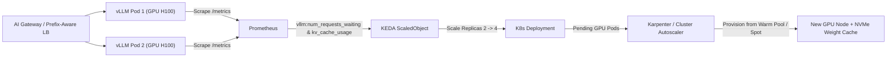
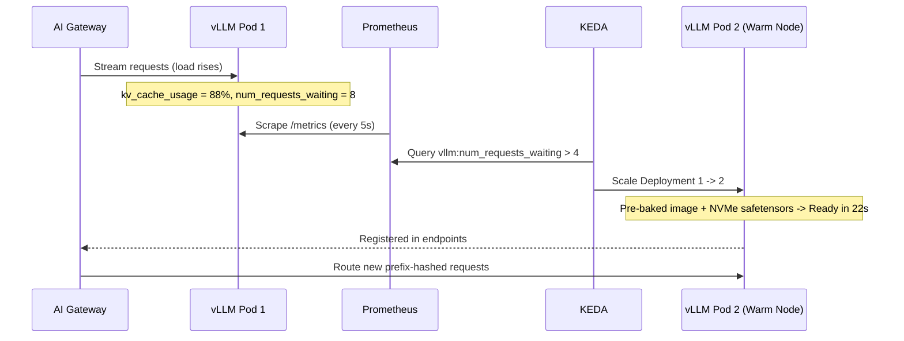
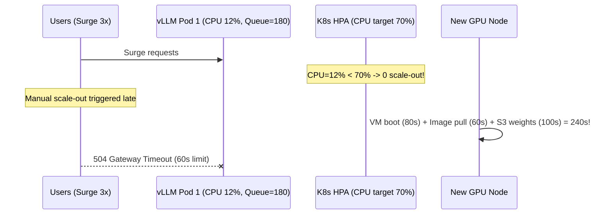

# Self-Hosted LLM Serving & Autoscaling: vLLM, GPUs, KEDA and Cold Starts

> **Prerequisites:** [Lesson 24: AI Gateway Architecture](../24-ai-gateway-architecture/README.md) · [Track: AI and GenAI System Design](../README.md).  
> **Estimated Reading Time:** 25–28 minutes  
> **Target Audience:** Infrastructure and ML platform engineers running self-hosted open-weights models (Llama, Qwen, Mistral) on Kubernetes, and candidates asked "how do you autoscale GPU LLM pods without 5-minute cold starts?"  
> **Free PDF Notes:** [Download SD-S-025.pdf](https://backendroadmap.com/notes/system-design/SD-S-025.pdf)

> [!NOTE]
> **In one line:** Self-hosted LLM serving runs inference engines like **vLLM** or **TGI/SGLang** on GPU nodes, scaling replicas with **KEDA** on engine-level metrics (`vllm:num_requests_waiting`, KV-cache utilization) rather than CPU/GPU %. You gain **50–80% lower cost at high utilization**, **data residency**, and **no external rate limits**; you pay with **30–300 second GPU cold starts**, **VRAM capacity ceilings**, and **idle GPU burn**.

> [!TIP]
> **The Golden Rule:** Never autoscale LLM pods on CPU or raw `nvidia_smi` GPU utilization—continuous batching keeps GPU compute near 90% even with 1 request, and CPU sits near 5%. Scale on **queued requests** (`num_requests_waiting`) and **KV-cache saturation**, and always pair autoscaling with **warm standby or fast weight-streaming** to survive cold starts.

---

## 1. What Self-Hosted LLM Serving & Autoscaling Is, and What It Isn't

Using OpenAI/Anthropic APIs is effortless at low volume, but at 500M+ tokens/day—or when strict VPC data residency or custom fine-tunes are required—teams deploy open-weights models (`Llama-3-70B`, `Qwen-2.5-32B`) on Kubernetes GPU nodes using **vLLM**. Unlike stateless Go/Node microservices that boot in 500 ms, a 70B-parameter model is **~140 GB in FP16** (or ~40 GB in FP8/AWQ), requiring multi-GPU nodes, 30–180 seconds to load weights into VRAM, and careful autoscaling so traffic spikes don't queue into timeouts.

| Term | Precise Meaning | Example |
| :--- | :--- | :--- |
| **vLLM / SGLang** | High-throughput LLM serving engines using PagedAttention & continuous batching | Serves 100+ concurrent streams on 1x H100 |
| **KEDA** | Kubernetes Event-driven Autoscaler scaling pods on Prometheus/queue metrics | Scale `vllm` Deployment when `num_requests_waiting > 5` |
| **Cold Start** | Total time from scale-out trigger to first token served by the new pod | Node spin-up (90s) + image pull (40s) + weight load (45s) = 175s |
| **KV-Cache Saturation** | % of allocated GPU VRAM blocks currently holding active attention keys/values | At 95%+, vLLM preempts/swaps requests and queues new arrivals |
| **Warm Pool / Buffer** | Pre-provisioned idle GPU nodes (or `minReplicas >= 1`) absorbing spikes | Eliminates 90s cloud VM provisioning delay |
| **Prefix-Aware Routing** | Routing requests sharing a system prompt to the same vLLM pod | Preserves automatic KV-cache prefix hits across replicas |
| **Not** | Standard Kubernetes HPA on CPU/Memory | CPU stays <15% and VRAM is pre-allocated at 90% on boot! |

### Why It Matters
1. A single H100 node costs ~$2.50–$4.00/GPU-hour; over-provisioning for peak wastes tens of thousands/month, while under-provisioning triggers 3-minute cold-start outages.
2. Standard K8s HPA fails completely on vLLM because vLLM pre-allocates 90% of GPU VRAM at startup—making memory utilization look flat at 90% whether idle or overloaded.
3. Interviewers love testing whether you know *what metrics to scale on* and *how to crush GPU cold starts*.

---

## 2. Anatomy: K8s + vLLM + KEDA Autoscaling Loop



| Metric for HPA/KEDA | Why It Works or Fails | Verdict |
| :--- | :--- | :--- |
| **CPU Utilization** | Tokenization/HTTP is lightweight; GPU does the work | **Fails** (stays ~5–15%) |
| **GPU VRAM %** | vLLM pre-allocates 90% of VRAM on startup (`gpu_memory_utilization=0.9`) | **Fails** (always 90%) |
| **GPU Compute %** | Continuous batching saturates tensor cores even at moderate load | **Noisy** (doesn't show queue depth) |
| **`vllm:num_requests_waiting`** | Direct count of requests blocked waiting for KV-cache/scheduler slot | **Best primary signal** |
| **`vllm:gpu_cache_usage_perc`** | Actual fraction of KV-cache blocks occupied by active sequences | **Best leading indicator** |

> [!WARNING]
> **Round-Robin Load Balancing Destroys Prefix Caching:** If you put a naive round-robin load balancer in front of 8 vLLM pods, every pod sees only 1/8th of the traffic for a shared 4K-token system prompt, cutting prefix KV-cache hit rates and increasing TTFT. Use **consistent-hashing / prefix-aware routing** (based on the first 256–512 tokens) in your AI Gateway!

---

## 3. Mathematical Model: GPU Sizing, Throughput & Cold-Start Queueing

**VRAM Capacity Budget.** A model with $P$ billion parameters at $B$ bytes/param (FP16 = 2B, FP8/INT8 = 1B, INT4 = 0.5B) plus activation/CUDA overhead $M_{\text{overhead}}$ leaves $M_{\text{KV}}$ for KV-cache:

$$M_{\text{KV}} = N_{\text{GPU}} \cdot M_{\text{VRAM}} - P \cdot B - M_{\text{overhead}}$$

**Break-Even vs. External API.** With GPU hourly cost $C_{\text{GPU}}$ ($/hr), sustained throughput $R_{\text{tok/s}}$ (tokens/sec), and utilization $u \in (0, 1]$:

$$\text{Cost per 1M tokens} = \frac{C_{\text{GPU}}}{3{,}600 \cdot u \cdot R_{\text{tok/s}}} \times 10^6$$

**Cold-Start Backlog.** If traffic jumps from $\lambda_0$ to $\lambda_{\text{spike}} > \mu_{\text{curr}}$ while new GPU pods take $T_{\text{cold}}$ seconds to become ready, the queue grows to:

$$Q_{\text{peak}} = (\lambda_{\text{spike}} - \mu_{\text{curr}}) \cdot T_{\text{cold}}$$

### Worked Numerical Example
Suppose we serve **Llama-3-70B in FP8** ($P = 70\text{B}, B = 1\text{ byte}$) on **2x H100 (80 GB each = 160 GB VRAM)**:
- **VRAM for KV Cache:** $M_{\text{KV}} = 160 - 70(1) - 8\text{ (CUDA/activations)} = \mathbf{82\text{ GB}}$.
- **Cost per 1M Tokens:** At $C_{\text{GPU}} = \$6.50/\text{hr}$ for 2x H100, sustained output throughput $R_{\text{tok/s}} = 2{,}200\text{ tok/s}$, and average utilization $u = 0.45$:
  $$\text{Cost/1M} = \frac{6.50}{3{,}600 \times 0.45 \times 2{,}200} \times 10^6 = \frac{6.50}{3{,}564{,}000} \times 10^6 = \mathbf{\$1.82 / 1\text{M tokens}}$$
  (vs. ~\$5–\$15/1M for comparable frontier APIs—**but** if utilization drops to $u = 0.08$ overnight, cost jumps to **\$10.26/1M**!).
- **Cold-Start Impact:** If 1 pod handles $\mu = 20\text{ req/s}$ and traffic spikes to $30\text{ req/s}$ with $T_{\text{cold}} = 150\text{ s}$, $Q_{\text{peak}} = (30 - 20) \times 150 = \mathbf{1{,}500\text{ queued requests}}$—which will time out before the new pod ever boots! Reducing $T_{\text{cold}}$ to $25\text{ s}$ cuts $Q_{\text{peak}}$ by 6x (to 250).

---

## 4. Metrics & Percentiles

| Metric | Meaning | Alert when |
| :--- | :--- | :--- |
| **`vllm:num_requests_waiting`** | Requests queued waiting for GPU/KV slot | > 5 sustained for 30s (trigger KEDA scale-out) |
| **`vllm:gpu_cache_usage_perc`** | % of KV-cache blocks currently in use | > 85% (preemption/swapping imminent; scale out early) |
| **TTFT $p_{95}$ / $p_{99}$** | Time-to-First-Token (prefill + queue wait) | > 800 ms (queueing delay or long-prompt prefill blocking) |
| **TPOT (Time Per Output Token)** | Inter-token latency during decode phase | > 40 ms (<25 tok/s feels sluggish to users) |
| **Pod Cold-Start Time $p_{95}$** | Scale-out trigger -> `/health` ready | > 60 s (image/weight download too slow) |
| **GPU Cost per 1M Tokens** | Cluster GPU spend / served tokens | Exceeds cloud API equivalent (under-utilized cluster) |

### Worked Example (Cold-Start Breakdown)
A team measures a 195-second cold start for a 70B FP8 pod:
- Cloud GPU VM provisioning: **85s** -> Fixed with a **warm node pool / Karpenter consolidation buffer** (**0s**).
- Pulling 18 GB CUDA + vLLM Docker image: **50s** -> Fixed by **pre-baking the image onto the node AMI/disk** (**2s**).
- Downloading 70 GB weights from S3 + loading into GPU: **60s** -> Fixed by **local NVMe RAID-0 cache + Run:ai Model Streamer / safetensors parallel load** (**18s**).
- **Total Cold Start:** **195s -> 20s** (nearly **10x faster**).

---

## 5. Compounding & Failure Modes

1. **Prefill-Decode Interference (Chunked Prefill Missing):** A single 32K-token RAG prompt entering the prefill phase monopolizes the GPU for 1.5 seconds, stalling TPOT for 40 other streaming users on the same pod. Always enable **chunked prefill** (`--enable-chunked-prefill`) or **prefill-decode disaggregation** at high scale.
2. **Scale-Down Oscillation (Thrashing):** GPU pods take 20–180s to boot. If KEDA's `cooldownPeriod` is too short (e.g., 30s), a brief lull kills a pod right before the next wave arrives, causing perpetual cold-start storms. Set `cooldownPeriod: 300`–`600s` and scale down conservatively.
3. **KV-Cache Preemption Death Spiral:** When `gpu_cache_usage_perc` hits 100%, vLLM evicts/recomputes KV blocks for running requests, burning extra GPU cycles and dropping throughput right when load is highest.

---

## 6. Numbers Every Engineer Must Know

| Item | Typical | Implication |
| :--- | :--- | :--- |
| **Model weight size (FP16 / FP8)** | 2 bytes / 1 byte per param | 70B FP8 = ~70 GB VRAM (fits 1x H200 or 2x H100-80GB) |
| **Cold start (unoptimized cloud GPU)** | 120 – 300 s | Unusable for reactive autoscaling without warm pools |
| **Cold start (pre-baked AMI + NVMe)** | 15 – 35 s | Fast enough for KEDA reactive scaling with a small buffer |
| **S3 -> NVMe vs. NVMe -> GPU speed** | ~1–3 GB/s vs. ~12–25 GB/s | Never download 70 GB from S3 on every pod boot; cache on host NVMe |
| **KEDA scale-down cooldown** | 300 – 600 s | Prevents thrashing expensive GPU pods |
| **Self-hosted break-even utilization** | ~30 – 40% | Below 30% avg utilization, serverless APIs are usually cheaper |

---

## 7. Protocol / Mechanism Deep Dive



| Question | Answer |
| :--- | :--- |
| **When NOT to self-host LLMs?** | Low/spiky traffic (<30% GPU utilization), teams without Kubernetes/GPU ops expertise, or when you strictly need frontier-class reasoning (`o3`/`Claude Opus`) that open weights can't match. |
| **How to handle traffic spikes faster than a 25s cold start?** | Hybrid **cloud burst / spillover**: route excess queued requests (when `waiting > threshold` or pod TTFT > SLO) to a serverless API fallback (Together, Fireworks, Bedrock) while KEDA boots new GPU pods. |
| **Tensor Parallelism (TP) vs. Pipeline Parallelism (PP)?** | Use **TP** (`tp=2` or `tp=4` over NVLink) within a single node to minimize latency; avoid cross-node PP for online serving due to network latency. |

---

## 8. Hierarchical Budgets & Design Rules

| Slice | Rule | Control |
| :--- | :--- | :--- |
| **Autoscaling signal** | Scale on queue depth & KV-cache, never CPU/VRAM | KEDA `ScaledObject` on `vllm:num_requests_waiting` + `gpu_cache_usage_perc` |
| **Cold-start budget** | < 30s pod ready time | Pre-baked container AMI + local NVMe model cache + fast tensor streaming |
| **Spike absorption** | Zero dropped requests during scale-out | 10–20% headroom (`scale at 75% KV`) + AI Gateway spillover to cloud API |
| **Scale-down stability** | Prevent GPU pod thrashing | `cooldownPeriod: 300s`, `stabilizationWindowSeconds: 300` |
| **Routing** | Maximize prefix KV-cache reuse | Prefix-aware consistent hashing in gateway/envoy |

---

## 9. Top Mitigations

1. **Scale on `num_requests_waiting` and `gpu_cache_usage_perc`:** Set KEDA targets low enough (e.g., `waiting > 3` or `kv_cache > 75%`) so scale-out starts *before* preemption begins.
2. **Pre-bake images and cache weights on host NVMe:** Store safetensors on DaemonSet-managed NVMe or regional FSx/Lustre so pods never pull 70 GB over the internet.
3. **Hybrid cloud spillover:** Configure the AI Gateway to overflow requests to a serverless open-weights provider (Fireworks/Together/Bedrock) whenever local queue wait exceeds 500 ms.
4. **Enable chunked prefill:** Prevent long-context RAG prompts from blocking decode TPOT for active streaming users.
5. **Use FP8/AWQ quantization:** Halves VRAM footprint (e.g., 70B fits on 1x H200 or 2x H100 with huge KV cache) and doubles memory-bandwidth decode speed with <1% quality loss.
6. **Asymmetric scale-up / scale-down:** Scale up aggressively (e.g., +2 pods immediately), scale down slowly (1 pod every 5 minutes).

---

## 10. Production Reference / War Story

**Incident (SEV-1): 4-Minute Cold-Start Cascade & HPA Blindness**
A legal-tech startup migrated their 32B RAG summarizer from a cloud API to self-hosted vLLM on EKS with standard Kubernetes HPA configured at `targetCPUUtilization: 70%`. During a morning traffic surge, queue wait times hit 45 seconds, yet HPA refused to scale because vLLM's CPU usage stayed at **12%**. When an engineer manually added 4 replicas, Karpenter provisioned fresh GPU nodes that took **240 seconds** to pull a 16 GB PyTorch image and download 64 GB of weights from S3—causing 100% of queued requests to time out at the 60s gateway limit.



**Root Cause:** Scaling on CPU instead of vLLM queue depth, plus unoptimized 240s cold starts without cloud spillover.  
**Fix:** Replaced CPU HPA with KEDA scaling on `vllm:num_requests_waiting > 3`, pre-baked images + cached weights on NVMe (cutting cold start to 24s), and added AI Gateway spillover to Bedrock during scale-out windows.

---

## 11. Multi-Language Production Code Tabs

````carousel
```go
// Go: Prefix-aware consistent-hash router + cloud spillover when local vLLM queue saturates.
package llmserving

import (
	"crypto/sha256"
	"encoding/binary"
	"sync/atomic"
)

type Replica struct {
	URL            string
	WaitingReqs    atomic.Int64
	KVCachePercent atomic.Int64 // 0..100
}

type ServingRouter struct {
	replicas     []*Replica
	maxWaitQueue int64
	spilloverURL string
}

func NewServingRouter(urls []string, maxWait int64, spilloverURL string) *ServingRouter {
	reps := make([]*Replica, len(urls))
	for i, u := range urls {
		reps[i] = &Replica{URL: u}
	}
	return &ServingRouter{replicas: reps, maxWaitQueue: maxWait, spilloverURL: spilloverURL}
}

// PickTarget hashes the system prompt prefix for KV-cache locality, spilling over if saturated.
func (r *ServingRouter) PickTarget(promptPrefix string) (targetURL string, isSpillover bool) {
	if len(r.replicas) == 0 {
		return r.spilloverURL, true
	}
	sum := sha256.Sum256([]byte(promptPrefix))
	idx := int(binary.BigEndian.Uint64(sum[:8]) % uint64(len(r.replicas)))

	primary := r.replicas[idx]
	if primary.WaitingReqs.Load() < r.maxWaitQueue && primary.KVCachePercent.Load() < 85 {
		return primary.URL, false
	}
	// Try least-loaded local replica before spilling over to serverless API
	for _, rep := range r.replicas {
		if rep.WaitingReqs.Load() < r.maxWaitQueue && rep.KVCachePercent.Load() < 85 {
			return rep.URL, false
		}
	}
	return r.spilloverURL, true
}
```
<!-- slide -->
```typescript
// TypeScript: KEDA-style autoscaler & cloud spillover controller for self-hosted vLLM.
export interface PodMetrics {
  id: string;
  waitingRequests: number;
  kvCacheUsagePct: number; // 0..100
}

export interface ScaleDecision {
  desiredReplicas: number;
  spilloverToCloud: boolean;
  reason: string;
}

export function evaluateAutoscaling(
  pods: PodMetrics[],
  minReplicas: number,
  maxReplicas: number,
  targetWaitingPerPod = 4
): ScaleDecision {
  if (pods.length === 0) {
    return { desiredReplicas: minReplicas, spilloverToCloud: true, reason: "cold-start" };
  }

  const totalWaiting = pods.reduce((acc, p) => acc + p.waitingRequests, 0);
  const maxKv = Math.max(...pods.map((p) => p.kvCacheUsagePct));

  let desired = Math.ceil(totalWaiting / targetWaitingPerPod) + pods.length;
  if (maxKv > 85) desired = Math.max(desired, pods.length + 1);
  if (totalWaiting === 0 && maxKv < 40) desired = pods.length - 1; // gentle scale-down

  desired = Math.max(minReplicas, Math.min(maxReplicas, desired));
  const spillover = pods.every((p) => p.waitingRequests >= targetWaitingPerPod || p.kvCacheUsagePct >= 90);

  return {
    desiredReplicas: desired,
    spilloverToCloud: spillover,
    reason: spillover ? "local-saturated-spillover" : "normal",
  };
}
```
<!-- slide -->
```python
# Python: GPU VRAM sizing, $/1M token calculator, and cold-start queue simulator (stdlib only).
def estimate_gpu_economics(
    params_b: float = 70.0,
    bytes_per_param: float = 1.0,  # FP8
    num_gpus: int = 2,
    vram_per_gpu_gb: float = 80.0,
    gpu_hourly_usd: float = 6.50,
    throughput_tok_s: float = 2200.0,
    avg_utilization: float = 0.45,
) -> dict:
    total_vram = num_gpus * vram_per_gpu_gb
    weights_gb = params_b * bytes_per_param
    kv_cache_gb = total_vram - weights_gb - 8.0  # ~8 GB CUDA/activations
    cost_per_1m = (gpu_hourly_usd / (3600 * avg_utilization * throughput_tok_s)) * 1_000_000
    return {
        "kv_cache_gb": round(kv_cache_gb, 1),
        "cost_per_1m_tokens_usd": round(cost_per_1m, 2),
    }

def cold_start_peak_queue(spike_rps: float, current_cap_rps: float, cold_start_s: float) -> float:
    return max(0.0, (spike_rps - current_cap_rps) * cold_start_s)
```
<!-- slide -->
```csharp
// C#: Prefix-consistent vLLM endpoint selector with saturation spillover.
using System.Security.Cryptography;
using System.Text;

public sealed record VllmPod(string Url, int WaitingRequests, double KvCachePct);

public sealed class SelfHostedRouter(string spilloverUrl, int maxWaiting = 4, double maxKvPct = 85.0)
{
    public (string TargetUrl, bool IsSpillover) SelectEndpoint(IReadOnlyList<VllmPod> pods, string prefix)
    {
        if (pods.Count == 0) return (spilloverUrl, true);

        var hash = SHA256.HashData(Encoding.UTF8.GetBytes(prefix));
        int idx = (int)(BitConverter.ToUInt32(hash, 0) % (uint)pods.Count);

        var primary = pods[idx];
        if (primary.WaitingRequests < maxWaiting && primary.KvCachePct < maxKvPct)
            return (primary.Url, false);

        var fallbackLocal = pods.FirstOrDefault(p => p.WaitingRequests < maxWaiting && p.KvCachePct < maxKvPct);
        return fallbackLocal is not null ? (fallbackLocal.Url, false) : (spilloverUrl, true);
    }
}
```
````

---

## 12. Hands-On CLI Verification Workflows

Run the Python GPU sizing & cold-start math locally:

```bash
python -c '
# 70B FP8 on 2x H100 (80GB) at $6.50/hr, 2200 tok/s, 45% utilization
kv_gb = 160 - 70*1 - 8
cost_1m = (6.50 / (3600 * 0.45 * 2200)) * 1e6
peak_q_150s = (30 - 20) * 150
peak_q_25s  = (30 - 20) * 25
print({"kv_cache_gb": kv_gb, "cost_per_1m": round(cost_1m, 2), "q_150s": peak_q_150s, "q_25s": peak_q_25s})
'
```

Inspect live vLLM Prometheus metrics and KEDA `ScaledObject` in Kubernetes:

```bash
# Scrape vLLM engine queue & KV-cache saturation directly from a pod
curl -s http://localhost:8000/metrics | grep -E "vllm:(num_requests_waiting|gpu_cache_usage_perc)"

# Check KEDA ScaledObject status & HPA current/desired replicas
kubectl get scaledobject vllm-llama70b-scaler -n ai-serving -o wide
kubectl describe hpa keda-hpa-vllm-llama70b-scaler -n ai-serving
```

---

## 13. Common Mistakes to Avoid

1. **Autoscaling GPU pods on CPU or VRAM %** (CPU stays <15% and vLLM pre-allocates 90% VRAM at boot).
2. **Downloading 70 GB model weights from S3/HuggingFace on every pod cold start** (adds 60–120s per scale-out).
3. **Using round-robin load balancing across vLLM replicas** (shatters prefix KV-cache hit rates).
4. **Setting KEDA `cooldownPeriod` too low (e.g., 30s)** (causes expensive GPU scale-down/scale-up thrashing).
5. **Ignoring cloud-API spillover** during the 20–150s window while new GPU pods boot.
6. **Running long RAG prefills without `--enable-chunked-prefill`** (stalls decode TPOT for concurrent users).
7. **Self-hosting at <25% average GPU utilization** without spot/scheduled scaling (usually more expensive than serverless APIs).

---

## 14. Key Terms Glossary

| Key Term | Definition |
| :--- | :--- |
| **vLLM** | High-throughput open-source LLM inference engine using PagedAttention and continuous batching. |
| **KEDA** | Kubernetes Event-driven Autoscaler that scales deployments from Prometheus, Kafka, or queue metrics. |
| **Cold Start** | Latency from scale-out trigger to a new GPU pod passing readiness and serving its first token. |
| **KV-Cache** | GPU VRAM storing past token Key/Value attention tensors to avoid recomputing them per decode step. |
| **TTFT / TPOT** | Time-to-First-Token (prefill + queue wait) / Time-Per-Output-Token (decode speed). |
| **Chunked Prefill** | Splitting long prompt prefills into smaller chunks interleaved with decode steps to protect TPOT. |
| **Prefix-Aware Routing** | Consistent-hashing requests by prompt prefix so repeated system prompts hit the same pod's KV cache. |
| **Cloud Spillover** | Temporarily routing overflow requests to a serverless LLM API while local GPU pods boot. |
| **FP8 / AWQ** | 8-bit floating-point or 4-bit activation-aware quantization to shrink VRAM and boost decode speed. |
| **Warm Node Pool** | Pre-provisioned idle GPU nodes (or low-priority placeholder pods) eliminating cloud VM spin-up time. |

---

## 15. System Design Interview Questions & Answers

### Basic Conceptual Questions

<details>
<summary><strong>Q1: Why does standard Kubernetes HPA (CPU/Memory) fail for vLLM? [BASIC]</strong></summary>

**Answer:**
vLLM offloads matrix math to the GPU (leaving CPU near 5–15%) and pre-allocates ~90% of GPU VRAM at startup for its KV-cache block pool. Thus both CPU and memory metrics look completely flat regardless of whether the pod is idle or drowning in queued requests.
</details>

<details>
<summary><strong>Q2: What metrics should you pass to KEDA to autoscale vLLM? [BASIC]</strong></summary>

**Answer:**
Scale on **`vllm:num_requests_waiting`** (direct queue backlog) and **`vllm:gpu_cache_usage_perc`** (leading indicator of KV-cache saturation, e.g., scale out at >75–85% before preemption begins).
</details>

<details>
<summary><strong>Q3: What are the three phases of a GPU LLM pod cold start? [BASIC]</strong></summary>

**Answer:**
(1) Cloud GPU node provisioning (60–120s), (2) pulling the large CUDA/PyTorch container image (30–60s), and (3) downloading/loading tens of gigabytes of model weights into GPU VRAM (20–120s).
</details>

<details>
<summary><strong>Q4: When is self-hosting cheaper than calling OpenAI/Anthropic APIs? [BASIC]</strong></summary>

**Answer:**
When sustained GPU utilization exceeds ~30–40% (typical break-even), or when you have high-volume predictable workloads, strict VPC data residency requirements, or custom fine-tuned models.
</details>

### Scenario-Based Architecture Questions

<details>
<summary><strong>Q5: Your 70B FP8 pod takes 3 minutes to cold-start and traffic spikes 2x every morning at 9 AM. How do you prevent timeouts? [SCENARIO]</strong></summary>

**Answer:**
Combine three layers: (1) **Scheduled pre-warming** (KEDA cron trigger scaling up at 8:55 AM), (2) **cold-start reduction** (warm node pool + pre-baked AMI + local NVMe weight cache, cutting boot to ~20s), and (3) **AI Gateway spillover** routing overflow traffic to a serverless API while new pods finish booting.
</details>

<details>
<summary><strong>Q6: You run 8 replicas of vLLM behind a standard Kubernetes Service, but TTFT is 2x worse than in single-pod benchmarks. Why? [SCENARIO]</strong></summary>

**Answer:**
Kubernetes `kube-proxy` distributes connections randomly/round-robin, fragmenting your shared system-prompt prefix cache across 8 pods. Switch to **prefix-aware consistent-hash routing** in Envoy/AI Gateway so requests with the same system prompt land on the same pod.
</details>

<details>
<summary><strong>Q7: Streaming users report stuttering (high TPOT) whenever another user submits a 20K-token document summary. How do you fix it? [SCENARIO]</strong></summary>

**Answer:**
Long prompt prefills are compute-bound and block the GPU scheduler for hundreds of milliseconds. Enable **`--enable-chunked-prefill`** in vLLM so large prefills are split into chunks and interleaved with decode steps—or separate prefill and decode onto dedicated pod pools (**disaggregated serving**).
</details>

<details>
<summary><strong>Q8: How do you scale down GPU pods at night without thrashing? [SCENARIO]</strong></summary>

**Answer:**
Use asymmetric scaling policies in KEDA/HPA: aggressive scale-up (`+2 pods` per 30s) and conservative scale-down (`cooldownPeriod: 300–600s`, `stabilizationWindowSeconds: 300`, max 1 pod removed per window), keeping `minReplicas >= 1` for interactive endpoints.
</details>

### Advanced & Tricky Interview Questions

<details>
<summary><strong>Q9: Why does GPU Compute % (`DCGM_FI_DEV_GPU_UTIL`) mislead autoscalers? [TRICKY]</strong></summary>

**Answer:**
`GPU_UTIL` only measures the fraction of time *at least one* CUDA kernel is running—not how saturated tensor cores or memory bandwidth are, nor how many requests are waiting. A single request decoding or a small batch can report 90% `GPU_UTIL`, triggering premature scale-outs when plenty of KV-cache capacity remains.
</details>

<details>
<summary><strong>Q10: How can you load a 70 GB model from disk into GPU VRAM in <15 seconds? [TRICKY]</strong></summary>

**Answer:**
Use **safetensors** memory-mapped/parallel loading (`Run:ai Model Streamer` or `tensorizer`) from local NVMe RAID-0 (7–14 GB/s) directly into pinned host/GPU memory, bypassing Python `pickle` deserialization and S3 network bottlenecks.
</details>

<details>
<summary><strong>Q11: What happens when `vllm:gpu_cache_usage_perc` hits 100% under load? [TRICKY]</strong></summary>

**Answer:**
vLLM cannot allocate new KV blocks for active decode sequences, so it **preempts** lower-priority running requests (either swapping their KV cache to CPU RAM or evicting and recomputing it later). This wastes GPU bandwidth and triggers a throughput collapse—which is why KEDA must scale out at ~75–85% KV usage.
</details>

<details>
<summary><strong>Q12: How do you run multiple fine-tuned LoRA adapters on a single autoscaled vLLM deployment without 10x the GPUs? [TRICKY]</strong></summary>

**Answer:**
Use **multi-LoRA serving** in vLLM (`--enable-lora`): keep one shared quantized base model in VRAM and dynamically load tiny (50–200 MB) LoRA adapter weights per request into a bounded LRU adapter cache, multiplexing dozens of tenants onto the same GPU pool.
</details>

---

## 16. One-Page Master Cheat Sheet

```
+---------------------------------------------------------------------------------------------------------+
|                    SELF-HOSTED LLM SERVING & AUTOSCALING — MASTER CHEAT SHEET                           |
+---------------------------------------------------------------------------------------------------------+
| 1. SCALING SIGNALS: Scale KEDA on vllm:num_requests_waiting + gpu_cache_usage_perc (NEVER CPU/VRAM %).  |
+---------------------------------------------------------------------------------------------------------+
| 2. COLD STARTS: Node (85s) + Image (50s) + Weights (60s) = 195s -> Cut to ~20s via Warm Pool +          |
|    Pre-baked AMI + Local NVMe safetensors streaming.                                                    |
+---------------------------------------------------------------------------------------------------------+
| 3. SPIKE PROTECTION: Scheduled cron pre-warming + AI Gateway spillover to serverless API during boot.   |
+---------------------------------------------------------------------------------------------------------+
| 4. ROUTING & SCHEDULING: Prefix-aware consistent hashing (KV locality) + --enable-chunked-prefill.      |
+---------------------------------------------------------------------------------------------------------+
| 5. ECONOMICS: Cost/1M = (GPU_$/hr / (3600 * util * tok/s)) * 1e6. Need >30-40% util to beat APIs.       |
+---------------------------------------------------------------------------------------------------------+
| 6. STABILITY: Asymmetric scale-up/down (cooldownPeriod 300-600s); FP8/AWQ halves VRAM & boosts decode.  |
+---------------------------------------------------------------------------------------------------------+
```

---

## Further Reading & Sources

- Kwon et al. (2023), *Efficient Memory Management for Large Language Model Serving with PagedAttention* (SOSP '23, vLLM).
- vLLM Documentation, [Production Metrics, Chunked Prefill & Disaggregated Serving](https://docs.vllm.ai/).
- KEDA Documentation, [Prometheus Scaler & Kubernetes Autoscaling](https://keda.sh/docs/).
- Kubernetes / Karpenter GPU Node Provisioning & Warm Pool patterns.

---

## Free PDF Notes

[SD-S-025.pdf](https://backendroadmap.com/notes/system-design/SD-S-025.pdf)

---

## Next

Continue with [Lesson 26: GPU Utilization for LLMs: Continuous Batching, KV Cache & PagedAttention](../26-gpu-utilization-for-llms/README.md).
