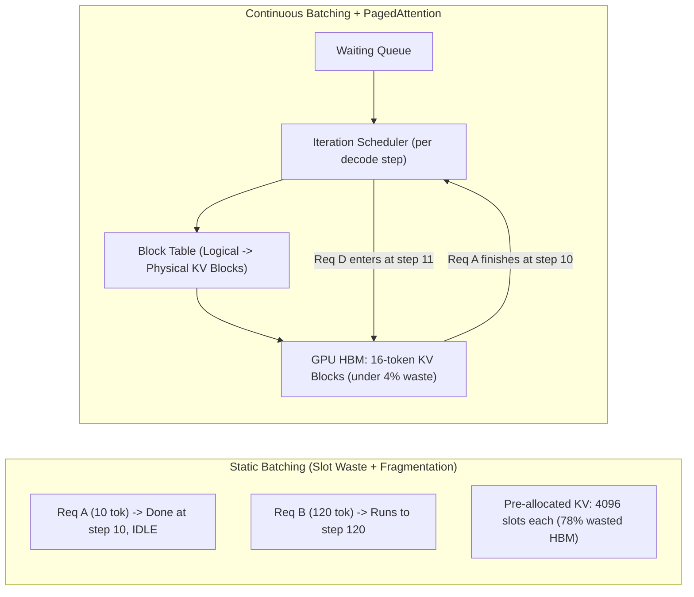
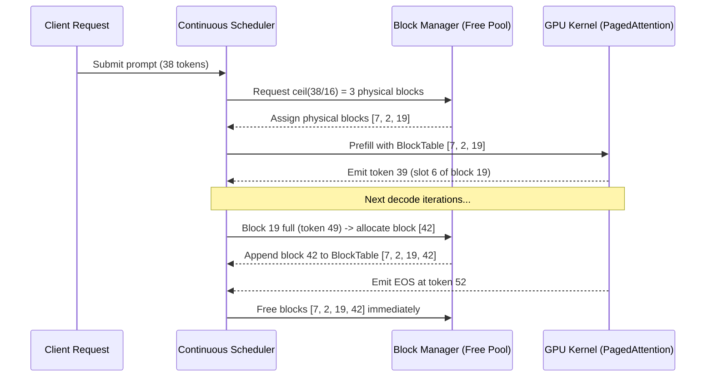
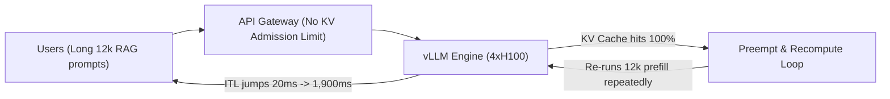

# GPU Utilization for LLMs: Continuous Batching, KV Cache & PagedAttention

> **Prerequisites:** [Lesson 25: Self-Hosted LLM Serving & Autoscaling](../25-self-hosted-llm-serving-autoscaling/README.md).  
> **Estimated Reading Time:** 25–28 minutes  
> **Target Audience:** ML platform engineers, backend architects sizing GPU clusters, and candidates asked "how do vLLM and TGI achieve 10x higher LLM throughput on the same GPU?"  
> **Free PDF Notes:** [Download SD-S-026.pdf](https://backendroadmap.com/notes/system-design/SD-S-026.pdf)

> [!NOTE]
> **In one line:** Autoregressive LLM decode is **memory-bandwidth bound**, not compute bound—an H100 spends 95%+ of its time streaming model weights and KV caches from HBM when batch size is 1. **Continuous batching** eliminates head-of-line idle time between requests, and **PagedAttention** eliminates 60–80% KV-cache memory fragmentation so you can pack 5–10x more concurrent sequences onto the same GPU.

> [!TIP]
> **The Golden Rule:** Never judge LLM serving efficiency by raw GPU compute utilization (`nvidia-smi` SM occupancy) alone. Track **KV-cache utilization**, **effective batch size during decode**, and **cost per million output tokens**; memory capacity and HBM bandwidth—not TFLOPS—set your decode throughput ceiling.

---

## 1. What GPU Utilization for LLMs Is, and What It Isn't

You deploy Llama-3-70B on an 8×H100 node (640 GB total HBM3). With a naive HuggingFace `generate()` loop serving one request at a time, `nvidia-smi` shows 92% GPU utilization, yet the cluster only produces 45 tokens/sec total—costing over $40 per million tokens. Adding static batching helps slightly, until one 2,048-token request stalls seven 64-token requests that already finished.

| Term | Precise Meaning | Example |
| :--- | :--- | :--- |
| **Prefill phase** | Parallel forward pass over all prompt tokens to compute initial KV states | 1,000 prompt tokens processed in 120 ms (compute-bound) |
| **Decode phase** | Sequential token-by-token generation reading full weights + KV cache each step | 1 token per 18 ms per step (memory-bandwidth-bound) |
| **Arithmetic intensity** | FLOPs performed per byte transferred from HBM to SRAM | Prefill: ~150+ FLOP/byte; Decode ($B=1$): ~1 FLOP/byte |
| **KV cache** | Stored Key and Value tensors for past tokens so attention avoids recomputation | 320 KB per token for Llama-3-70B (GQA) in FP16 |
| **Static batching** | Grouping $B$ requests and waiting until the longest sequence finishes before freeing slots | 7 short requests idle while 1 long request generates |
| **Continuous batching** | Iteration-level scheduling: finished sequences exit immediately and new ones join at the next step | Orca / vLLM / TensorRT-LLM scheduler |
| **PagedAttention** | Splitting each request's KV cache into fixed-size non-contiguous physical blocks via a block table | OS virtual memory paging applied to GPU HBM |
| **Not** | Just raising `batch_size` blindly or looking at `nvidia-smi` percentage | `nvidia-smi` reads 100% even when stalling on HBM bandwidth |

### Why It Matters
1. **Unit economics:** Moving from naive serving ($B=1$) to continuous batching + PagedAttention ($B=32\text{–}128$) cuts cost per generated token by **8–15×** on identical hardware.
2. **Memory wall:** Without paged KV management, pre-allocating `max_model_len` reserves gigabytes of dead HBM per request, capping concurrency long before compute saturates.
3. **Tail latency:** Static batching couples short requests to the slowest request in the batch, destroying $p_{99}$ time-to-last-token (TTLT) under mixed workloads.

---

## 2. Anatomy: Static Batching vs Continuous Batching + PagedAttention



In **static batching**, the engine waits for a batch of requests, pads them to the longest prompt, allocates contiguous KV buffers sized for `max_seq_len`, and cannot admit a new request until every sequence in the batch emits `EOS`.

In **continuous (iteration-level) batching**, the scheduler runs at every single forward pass (~15–40 ms). Any request that emits `EOS` immediately frees its KV blocks and leaves; a waiting request enters on the very next iteration. **PagedAttention** backs those sequences with fixed-size physical KV blocks (typically 16 tokens per block), eliminating both internal fragmentation (over-reservation) and external fragmentation (non-contiguous free gaps).

| Dimension | Static Batching (Contiguous KV) | Continuous Batching + PagedAttention |
| :--- | :--- | :--- |
| **Scheduling granularity** | Batch-level (waits for slowest sequence) | Iteration-level (every forward step) |
| **KV memory waste** | 60–80% (internal + external fragmentation) | <4% (at most 1 partial block per sequence) |
| **Prefix sharing** | Difficult; requires duplicating KV tensors | Copy-on-write block pointers (zero copy) |
| **Max concurrency (80 GB GPU)** | ~8–16 sequences | ~64–200+ sequences |
| **Preemption handling** | Drop or OOM | Swap KV blocks to CPU RAM or recompute |

> [!WARNING]
> **Mixing long prefills with active decodes stalls every streaming user.** In naive continuous batching, admitting a 16,000-token prefill into a decode step freezes all active decode streams for 500–1,500 ms (a visible "generation hitch"). Use **chunked prefill** or **prefill/decode disaggregation** to bound step time.

---

## 3. Mathematical Model: Roofline, KV Cache Footprint & Memory Bandwidth

**1. Roofline & Arithmetic Intensity.** On an NVIDIA H100 SXM (989 TFLOPS FP16 Tensor Core, $3.35\text{ TB/s}$ HBM3 bandwidth), the **ridge point**—where compute and memory bandwidth balance—is:

$$I_{\text{ridge}} = \frac{989 \times 10^{12}\text{ FLOP/s}}{3.35 \times 10^{12}\text{ B/s}} \approx 295\text{ FLOP/byte}$$

During **decode** of batch size $B$, each token requires reading all model weights $W_{\text{bytes}}$ (for a 70B FP16 model: $140\text{ GB}$) plus the KV cache, performing $\approx 2 \cdot P \cdot B$ FLOPs ($P = 70 \times 10^9$):

$$I_{\text{decode}}(B) \approx \frac{2 \cdot P \cdot B}{2 \cdot P + \text{KV}_{\text{bytes}}(B)} \approx B\text{ FLOP/byte}$$

At $B = 1$, $I_{\text{decode}} \approx 1\text{ FLOP/byte} \ll 295$—meaning **99.6% of Tensor Core compute sits idle** waiting on HBM reads! Increasing $B$ from $1$ to $64$ increases throughput nearly linearly because you amortize reading the 140 GB weights across 64 tokens per step.

**2. KV Cache Size per Token.** For a transformer with $L$ layers, $H_{\text{kv}}$ key-value heads, head dimension $d$, and $b$ bytes per element (2 for FP16/BF16, 1 for FP8):

$$\text{KV}_{\text{token}} = 2 \times L \times H_{\text{kv}} \times d \times b\text{ bytes}$$

**3. Worked Numerical Example (Llama-3-70B on 4×H100 80GB = 320 GB HBM).**
- Parameters: $L = 80$, $H_{\text{kv}} = 8$ (Grouped-Query Attention), $d = 128$, $b = 2$ (FP16).
- $\text{KV}_{\text{token}} = 2 \times 80 \times 8 \times 128 \times 2 = 327{,}680\text{ B} = 320\text{ KB/token}$.
- Model weights (FP16): $70\text{B} \times 2 = 140\text{ GB}$. Activation/CUDA overhead: $\approx 20\text{ GB}$.
- Available KV cache memory: $320 - 140 - 20 = 160\text{ GB}$.
- Total KV token capacity: $\frac{160 \times 10^9}{327{,}680} \approx 488{,}281\text{ tokens}$.
- With **contiguous pre-allocation** (`max_len = 8192`): $\text{KV}_{\text{req}} = 8192 \times 320\text{ KB} = 2.62\text{ GB/req} \implies \lfloor 160 / 2.62 \rfloor = \mathbf{61\text{ max requests}}$.
- With **PagedAttention** (average active sequence length 1,024 tokens): $\text{KV}_{\text{req}} = 1024 \times 320\text{ KB} = 327.7\text{ MB/req} \implies \lfloor 160{,}000 / 327.7 \rfloor = \mathbf{488\text{ concurrent requests}}$ (**8× higher concurrency**).

---

## 4. Metrics & Percentiles

| Metric | Meaning | Alert when |
| :--- | :--- | :--- |
| **KV-cache utilization (%)** | Percentage of allocated GPU KV blocks currently in use | >85% sustained (risk of preemption/swapping) |
| **Effective decode batch size** | Mean number of active sequences per decode step | Drops below target SLO knee (<16 on H100) |
| **Preemption / swap rate** | Sequences evicted from GPU HBM to CPU RAM or recomputed | >1% of requests (causes severe latency spikes) |
| **Inter-Token Latency (ITL) $p_{99}$** | Time between consecutive output tokens per stream | >50 ms (indicates prefill interference or HBM saturation) |
| **Tokens / sec / GPU** | Aggregate output throughput per accelerator | <60% of roofline benchmark for target batch size |
| **Prefix cache hit rate** | Percentage of prompt tokens served from cached KV blocks | Drops unexpectedly (bad prompt ordering / cache thrashing) |

### Worked Example (Mixed Chat + Summarization Workload)
A cluster runs Llama-3-8B (FP16, 16 GB weights) on a single A100 80 GB (~56 GB free for KV cache; $\text{KV}_{\text{token}} = 128\text{ KB}$ with GQA). At 40 req/s with average 1,500-token context, total active KV tokens sit around 60,000 (~7.7 GB, 13.7% KV utilization). Suddenly, a batch of 200 RAG summarization jobs arrives with 16,000-token contexts each: active KV demand spikes to $200 \times 16{,}000 \times 128\text{ KB} = 409.6\text{ GB}$, saturating the 56 GB pool. Without admission control, vLLM preempts active chat streams every second, driving ITL $p_{99}$ from 24 ms to 1,800 ms.

---

## 5. Compounding & Failure Modes

How GPU memory and step latency compound under continuous batching (modeled for Llama-3-70B on 4×H100):

| Scenario | Concurrency ($B$) | KV Cache Used | Step Latency (ITL) | Aggregate Output Throughput |
| :--- | :---: | :---: | :---: | :---: |
| **Naive $B=1$** | 1 | 0.3 GB (0.2%) | 11.2 ms | 89 tok/s |
| **Optimal Paged Batching** | 64 | 21.0 GB (13%) | 18.5 ms | 3,459 tok/s (**38.8×**) |
| **Near-Saturation** | 256 | 84.0 GB (52%) | 42.0 ms | 6,095 tok/s (**68.5×**) |
| **KV Exhaustion + Swapping** | 512 | 160 GB (100% + CPU swap) | 380 ms ($p_{99}$) | 1,100 tok/s (thrashing) |
| **Long Prefill Hitch (no chunking)** | 64 + 1×16k prefill | 26.2 GB | 640 ms spike | 160 ms/token stall for all 64 users |

Two non-linear cliffs dominate production:
1. **KV-Cache Thrashing Cliff:** Once KV block utilization hits 100%, the scheduler must preempt the newest sequence (swap to PCIe Gen5 CPU RAM at ~64 GB/s or discard and recompute). Because PCIe bandwidth is **50× slower** than HBM3 (3.35 TB/s), swapping even 10 sequences stalls the step loop.
2. **Prefill-Decode Interference:** Without chunked prefill, a single long prompt consumes 100% of Tensor Cores for hundreds of milliseconds, violating streaming ITL SLOs for every concurrent user.

---

## 6. Numbers Every Engineer Must Know

| Item | Typical | Implication |
| :--- | :---: | :--- |
| H100 80GB HBM3 bandwidth | 3.35 TB/s | Max ~24 tokens/s for 70B FP16 at $B=1$ (140 GB / 3.35 TB/s $\approx 42$ ms) |
| A100 80GB HBM2e bandwidth | 2.0 TB/s | Decode is ~1.7× slower than H100 at same batch size |
| PagedAttention block size | 16 tokens | Balances block-table lookup overhead vs <4% internal waste |
| KV cache per token (Llama-3-8B GQA) | 128 KB (FP16) | 100k tokens = 12.8 GB HBM |
| KV cache per token (Llama-3-70B GQA) | 320 KB (FP16) | 100k tokens = 32 GB HBM |
| FP8 KV-cache quantization | 50% memory reduction | Doubles max batch size with <0.3% perplexity impact |
| Automatic Prefix Caching (APC) savings | 40–85% TTFT reduction | Huge win for shared system prompts, few-shot examples, multi-turn chat |

---

## 7. Protocol / Mechanism Deep Dive: PagedAttention & Block Table Mapping



| Question | Answer |
| :--- | :--- |
| **How does PagedAttention read non-contiguous blocks?** | A custom CUDA kernel accepts a `block_table` tensor mapping each sequence's logical block index to physical HBM block IDs, gathering K/V vectors on the fly during attention. |
| **How does Prefix Caching work with blocks?** | Each full 16-token block is hashed by `(parent_block_hash, token_ids)`. Matching prefixes share the same physical block ID with reference counting (Copy-on-Write if diverged). |
| **What happens when physical blocks run out?** | The scheduler preempts the most recently arrived sequence—either **recomputing** its KV later (cheaper when compute is idle) or **swapping** blocks to CPU RAM. |
| **What is Chunked Prefill?** | Splitting a 16k-token prompt into 512-token chunks so each chunk rides alongside active decode steps, keeping step time bounded under ~50 ms. |

**When not to optimize for huge batches.** If your workload is strictly offline batch inference with zero latency SLO, use maximum batch size + FP8 without worrying about chunked prefill. Conversely, if you serve ultra-low-concurrency internal tools (<2 QPS), a simple quantized single-GPU server beats complex multi-node disaggregated serving.

---

## 8. Hierarchical Budgets & Design Rules

| Slice | Rule | Control |
| :--- | :--- | :--- |
| Memory reservation | Cap `gpu_memory_utilization` at 0.90–0.92 | Leave headroom for CUDA graphs & activations |
| Block size | Default 16 tokens (32 for very long contexts) | Engine config (`--block-size 16`) |
| Step latency | Enable `--enable-chunked-prefill` with `max_num_batched_tokens=2048` | Bounds decode ITL jitter |
| Prefix reuse | Enable Automatic Prefix Caching (`--enable-prefix-caching`) | Keep static system prompt *first* in prompt |
| KV quantization | Use FP8 KV cache (`--kv-cache-dtype fp8`) for memory-bound 70B+ models | Validate accuracy on eval suite |
| Admission control | Reject or queue at API gateway when KV usage > 88% | Prevents preemption thrashing |
| Disaggregation | Separate prefill and decode pools when prompts > 4k tokens & strict ITL SLO | Prefill nodes (compute) -> KV transfer -> Decode nodes (BW) |

---

## 9. Top Mitigations

1. **Always run a continuous-batching + PagedAttention engine** (vLLM, TensorRT-LLM, SGLang) instead of naive PyTorch/Transformers loops.
2. **Put static instructions and few-shot examples at the very start of the prompt** so Automatic Prefix Caching (RadixAttention / APC) reuses KV blocks across requests.
3. **Enable chunked prefill** (`max_num_batched_tokens`) so long prompts never freeze active streaming decode users.
4. **Quantize KV cache to FP8** to double concurrent sequence capacity on HBM-constrained GPUs.
5. **Enforce strict `max_tokens` and input token caps** at the gateway so a single runaway request cannot hog KV blocks.
6. **Monitor `num_preemptions_total` and `gpu_cache_usage_perc`**; scale out or shed load before hitting 95% KV utilization.
7. **Use CUDA Graphs for decode steps** to eliminate Python/CPU kernel-launch overhead at small-to-medium batch sizes.

---

## 10. Production Reference: SEV-1 KV-Cache Preemption Storm

During a product launch, a customer support copilot running Llama-3-70B on 4×H100 nodes experienced a sudden 20× spike in $p_{99}$ time-to-first-token (from 350 ms to 7.2 s) and stuttering streams.



- **Root Cause:** Marketing launched a "Summarize full ticket history" button sending 12,000-token prompts. With `max_num_seqs=256` and no KV-aware admission limit, vLLM admitted dozens of 12k prompts simultaneously. KV cache hit 100%, triggering continuous preemption in **recompute mode**—meaning evicted requests re-ran their 12k-token prefill multiple times, burning 80% of GPU compute on redundant work.
- **Fix:** (1) Enabled `--enable-chunked-prefill` with `max_num_batched_tokens=2048`; (2) enabled `--enable-prefix-caching` and moved the 2k-token system prompt to position 0; (3) switched KV cache to `--kv-cache-dtype fp8`; (4) added gateway-level concurrency/token-budget rate limiting when KV utilization exceeded 85%. Latency $p_{99}$ stabilized at 410 ms with 3.1× higher throughput.

---

## 11. Multi-Language Production Code Tabs

A minimal **Paged KV-Cache Block Allocator & Continuous Batching Simulator** demonstrating logical-to-physical block mapping, per-step token generation, and immediate slot reclamation on `EOS`.

````carousel
```go
// Go: PagedAttention-style KV Block Allocator & Continuous Batching step loop.
package main

import (
	"errors"
	"fmt"
)

const BlockSize = 16

type Sequence struct {
	ID         string
	Tokens     int
	MaxTokens  int
	BlockTable []int // maps logical block index -> physical GPU block ID
}

type BlockManager struct {
	freeBlocks []int
}

func NewBlockManager(totalBlocks int) *BlockManager {
	free := make([]int, totalBlocks)
	for i := 0; i < totalBlocks; i++ {
		free[i] = i
	}
	return &BlockManager{freeBlocks: free}
}

func (bm *BlockManager) Allocate(seq *Sequence) error {
	needed := (seq.Tokens + BlockSize - 1) / BlockSize
	for len(seq.BlockTable) < needed {
		if len(bm.freeBlocks) == 0 {
			return errors.New("kv cache OOM: preemption required")
		}
		last := len(bm.freeBlocks) - 1
		blk := bm.freeBlocks[last]
		bm.freeBlocks = bm.freeBlocks[:last]
		seq.BlockTable = append(seq.BlockTable, blk)
	}
	return nil
}

func (bm *BlockManager) Free(seq *Sequence) {
	bm.freeBlocks = append(bm.freeBlocks, seq.BlockTable...)
	seq.BlockTable = nil
}

func main() {
	bm := NewBlockManager(10)
	req := &Sequence{ID: "req-1", Tokens: 15, MaxTokens: 18}
	_ = bm.Allocate(req)
	fmt.Printf("Initial blocks: %v, free: %d\n", req.BlockTable, len(bm.freeBlocks))
	req.Tokens += 2 // crosses 16-token boundary -> allocates 2nd block
	_ = bm.Allocate(req)
	fmt.Printf("After 2 decode steps: %v, free: %d\n", req.BlockTable, len(bm.freeBlocks))
	bm.Free(req) // immediate reclamation on EOS
	fmt.Printf("After EOS free: %d\n", len(bm.freeBlocks))
}
```
<!-- slide -->
```typescript
// TypeScript: Paged KV Block Manager & Iteration-Level Scheduler.
const BLOCK_SIZE = 16;

interface Sequence {
  id: string;
  tokens: number;
  maxTokens: number;
  blockTable: number[];
}

export class PagedBlockManager {
  private freeBlocks: number[];

  constructor(totalBlocks: number) {
    this.freeBlocks = Array.from({ length: totalBlocks }, (_, i) => i);
  }

  allocateForStep(seq: Sequence): boolean {
    const neededBlocks = Math.ceil(seq.tokens / BLOCK_SIZE);
    while (seq.blockTable.length < neededBlocks) {
      const blk = this.freeBlocks.pop();
      if (blk === undefined) return false; // trigger preemption
      seq.blockTable.push(blk);
    }
    return true;
  }

  freeSequence(seq: Sequence): void {
    this.freeBlocks.push(...seq.blockTable);
    seq.blockTable = [];
  }

  get utilization(): number {
    return this.freeBlocks.length;
  }
}

export function stepScheduler(
  active: Sequence[],
  waiting: Sequence[],
  bm: PagedBlockManager
): Sequence[] {
  // 1. Admit waiting requests if blocks allow
  while (waiting.length > 0 && bm.allocateForStep(waiting[0])) {
    active.push(waiting.shift()!);
  }
  // 2. Run 1 decode step and free finished sequences immediately
  const nextActive: Sequence[] = [];
  for (const seq of active) {
    seq.tokens += 1;
    if (seq.tokens >= seq.maxTokens) {
      bm.freeSequence(seq);
    } else if (bm.allocateForStep(seq)) {
      nextActive.push(seq);
    } else {
      bm.freeSequence(seq); // preempt newest on OOM
      waiting.unshift(seq);
    }
  }
  return nextActive;
}
```
<!-- slide -->
```python
# Python: Roofline & KV-cache capacity calculator + Paged block allocator (stdlib only).
import math
from dataclasses import dataclass, field


def kv_bytes_per_token(layers: int, kv_heads: int, head_dim: int, dtype_bytes: int = 2) -> int:
    return 2 * layers * kv_heads * head_dim * dtype_bytes


def max_concurrent_sequences(
    total_hbm_gb: float,
    model_weights_gb: float,
    overhead_gb: float,
    kv_per_token_bytes: int,
    avg_seq_len: int,
) -> int:
    free_bytes = (total_hbm_gb - model_weights_gb - overhead_gb) * (1024**3)
    return int(free_bytes // (kv_per_token_bytes * avg_seq_len))


@dataclass
class PagedSequence:
    req_id: str
    tokens: int
    max_tokens: int
    block_table: list[int] = field(default_factory=list)


class BlockAllocator:
    def __init__(self, num_blocks: int, block_size: int = 16) -> None:
        self.free = list(range(num_blocks))
        self.block_size = block_size

    def ensure_blocks(self, seq: PagedSequence) -> bool:
        needed = math.ceil(seq.tokens / self.block_size)
        while len(seq.block_table) < needed:
            if not self.free:
                return False
            seq.block_table.append(self.free.pop())
        return True

    def release(self, seq: PagedSequence) -> None:
        self.free.extend(seq.block_table)
        seq.block_table.clear()


if __name__ == "__main__":
    kv_tok = kv_bytes_per_token(layers=80, kv_heads=8, head_dim=128, dtype_bytes=2)
    print(f"Llama-3-70B KV/token: {kv_tok / 1024:.1f} KB")
    print("Max seqs (4xH100 320GB, avg 1024 tok):",
          max_concurrent_sequences(320, 140, 20, kv_tok, 1024))
```
<!-- slide -->
```csharp
// C#: Paged KV-Cache Block Allocator with immediate EOS reclamation.
using System;
using System.Collections.Generic;

public sealed class SequenceState
{
    public string Id { get; init; } = "";
    public int Tokens { get; set; }
    public int MaxTokens { get; init; }
    public List<int> BlockTable { get; } = new();
}

public sealed class KvBlockManager
{
    private readonly Stack<int> _freeBlocks = new();
    private readonly int _blockSize;

    public KvBlockManager(int totalBlocks, int blockSize = 16)
    {
        _blockSize = blockSize;
        for (int i = totalBlocks - 1; i >= 0; i--) _freeBlocks.Push(i);
    }

    public bool TryAllocateStep(SequenceState seq)
    {
        int needed = (seq.Tokens + _blockSize - 1) / _blockSize;
        while (seq.BlockTable.Count < needed)
        {
            if (_freeBlocks.Count == 0) return false;
            seq.BlockTable.Add(_freeBlocks.Pop());
        }
        return true;
    }

    public void Free(SequenceState seq)
    {
        foreach (int blk in seq.BlockTable) _freeBlocks.Push(blk);
        seq.BlockTable.Clear();
    }

    public int FreeCount => _freeBlocks.Count;
}
```
````

---

## 12. Hands-On CLI Verification Workflows

```bash
# 1. Inspect GPU memory bandwidth, topology, and real-time HBM usage
nvidia-smi topo -m
nvidia-smi dmon -s mu -d 1

# 2. Launch vLLM with PagedAttention, Prefix Caching, Chunked Prefill & FP8 KV cache
python -m vllm.entrypoints.openai.api_server \
  --model meta-llama/Meta-Llama-3-70B-Instruct \
  --tensor-parallel-size 4 \
  --gpu-memory-utilization 0.90 \
  --kv-cache-dtype fp8 \
  --enable-prefix-caching \
  --enable-chunked-prefill \
  --max-num-batched-tokens 2048

# 3. Scrape live KV cache utilization and preemption rate from Prometheus /metrics
curl -s http://localhost:8000/metrics | grep -E "vllm:(gpu_cache_usage_perc|num_requests_running|num_preemptions_total)"

# 4. Run throughput & batching benchmark against the live server
python -m vllm.benchmarks.benchmark_serving \
  --backend vllm --model meta-llama/Meta-Llama-3-70B-Instruct \
  --num-prompts 500 --request-rate 15
```

---

## 13. Common Mistakes to Avoid

1. **Treating `nvidia-smi` GPU-Util 100% as "healthy."** A single-request decode loop saturates HBM bandwidth and reports 95%+ utilization while leaving 99% of Tensor Core FLOPS idle.
2. **Pre-allocating `max_model_len` KV buffers contiguously.** Wastes 60–80% of HBM and caps concurrency at a fraction of hardware capability.
3. **Placing dynamic user variables *before* the static system prompt.** Breaks Automatic Prefix Caching; always put static instructions first.
4. **Running long prefills without chunked prefill.** Causes 500 ms–2 s generation stalls for every active streaming user.
5. **Ignoring `num_preemptions_total`.** Silent swapping/recomputation destroys tail latency and burns compute.
6. **Using Multi-Head Attention (MHA) models without GQA/MQA at large context.** MHA KV caches are 4–8× larger than GQA, starving batch size.
7. **Setting `gpu_memory_utilization` to 0.99.** Leaves no room for PyTorch/CUDA graph workspace allocations, causing sudden OOM crashes under peak sequence lengths.

---

## 14. Key Terms Glossary

| Key Term | Definition |
| :--- | :--- |
| **Arithmetic Intensity** | Ratio of floating-point operations (FLOPs) to bytes transferred from GPU HBM. |
| **Prefill Phase** | Parallel processing of all input prompt tokens to populate the initial KV cache. |
| **Decode Phase** | Sequential, token-by-token generation phase bound by HBM memory bandwidth. |
| **KV Cache** | Cached Key and Value attention tensors for prior tokens to avoid $O(N^2)$ recomputation. |
| **Static Batching** | Grouping requests into fixed batches that wait for the longest sequence to finish. |
| **Continuous Batching** | Iteration-level scheduling where completed requests exit and new ones enter every step. |
| **PagedAttention** | Virtual-memory-style paging of KV caches into fixed-size non-contiguous physical blocks. |
| **Block Table** | Per-sequence mapping from logical KV blocks to physical GPU HBM block indices. |
| **Chunked Prefill** | Splitting long prompts into fixed token chunks interleaved with active decode steps. |
| **Automatic Prefix Caching** | Reusing physical KV blocks across requests that share an identical token prefix. |
| **GQA (Grouped-Query Attention)** | Sharing K/V heads across multiple Q heads to shrink KV cache size by 4–8×. |
| **Preemption** | Evicting an active sequence's KV blocks (via CPU swap or recomputation) when HBM fills. |

---

## 15. System Design Interview Questions & Answers

### Basic Conceptual Questions

<details>
<summary><strong>Q1: Why is LLM decode memory-bandwidth bound instead of compute bound? [BASIC]</strong></summary>

**Answer:**
Generating one token at batch size 1 requires reading the entire model's weights (e.g., 140 GB for 70B FP16) from HBM to SRAM while performing only ~2 FLOPs per parameter—an arithmetic intensity of ~1 FLOP/byte. Modern GPUs like the H100 have a roofline ridge point near ~295 FLOP/byte, so Tensor Cores sit 99% idle waiting on memory bandwidth.
</details>

<details>
<summary><strong>Q2: What problem does continuous batching solve over static batching? [BASIC]</strong></summary>

**Answer:**
Static batching holds all slots in a batch until the longest sequence emits `EOS`, leaving short requests idle and wasting GPU cycles. Continuous batching schedules at the *iteration* (single-token) level: finished sequences exit immediately and queued requests enter on the very next forward pass, often increasing throughput 3–5×.
</details>

<details>
<summary><strong>Q3: How does PagedAttention eliminate KV-cache memory waste? [BASIC]</strong></summary>

**Answer:**
Instead of pre-allocating a contiguous buffer of `max_seq_len` per request (which wastes 60–80% of HBM via internal and external fragmentation), PagedAttention divides the KV cache into small fixed-size physical blocks (e.g., 16 tokens) allocated on demand via a per-request block table—cutting waste to under 4%.
</details>

<details>
<summary><strong>Q4: Why does Grouped-Query Attention (GQA) matter for serving throughput? [BASIC]</strong></summary>

**Answer:**
GQA shares Key and Value heads across groups of Query heads (e.g., 8 KV heads for 64 Q heads in Llama-3-70B), shrinking the KV cache per token by 8×. Smaller KV caches allow 8× more concurrent sequences in the same HBM, directly boosting decode batch size and throughput.
</details>

### Scenario-Based Architecture Questions

<details>
<summary><strong>Q5: Your 4×H100 cluster serving a 70B model hits 100% KV utilization at 80 concurrent users. How do you double concurrency without adding GPUs? [SCENARIO]</strong></summary>

**Answer:**
1. Quantize the KV cache from FP16 to FP8 (`--kv-cache-dtype fp8`), immediately halving KV memory per token (doubling capacity to ~160 users).
2. Enable Automatic Prefix Caching so shared system prompts/RAG headers share physical KV blocks across users instead of duplicating them.
3. Quantize model weights from FP16 (140 GB) to FP8/AWQ INT4 (~70 GB or ~40 GB), freeing 70–100 GB of additional HBM for KV blocks.
</details>

<details>
<summary><strong>Q6: Streaming users report 1-second freezes whenever someone submits a 16k-token document. What is happening and how do you fix it? [SCENARIO]</strong></summary>

**Answer:**
A long prefill is running monolithically inside the continuous batching loop, monopolizing Tensor Cores for ~1 second and stalling all active decode steps. Fix it by enabling **chunked prefill** (e.g., `max_num_batched_tokens=2048`) or by adopting **prefill/decode disaggregation** so long prefills run on dedicated nodes and transfer KV caches to decode nodes.
</details>

<details>
<summary><strong>Q7: You have 1,000 requests/min sharing a 2,500-token system prompt + tools schema. How do you structure prompts and serving? [SCENARIO]</strong></summary>

**Answer:**
Place the immutable 2,500-token system prompt and tool definitions at the *exact beginning* of the prompt, put dynamic user/session data *after* it, and enable Automatic Prefix Caching (vLLM APC or SGLang RadixAttention). All 1,000 requests share the same physical KV blocks for the first 2,500 tokens, cutting prefill compute and KV memory dramatically.
</details>

<details>
<summary><strong>Q8: How do you size GPU memory for a target of 120 concurrent users at 2,048 average tokens on Llama-3-70B? [SCENARIO]</strong></summary>

**Answer:**
KV per token = $2 \times 80 \times 8 \times 128 \times 2 = 320\text{ KB}$ (FP16). Total KV needed = $120 \times 2{,}048 \times 320\text{ KB} \approx 78.6\text{ GB}$. Add FP16 weights (140 GB) + ~20 GB activation/CUDA graph overhead = ~239 GB total HBM. A 4×H100 80 GB node (320 GB) fits comfortably with ~81 GB headroom for bursts.
</details>

### Advanced & Tricky Interview Questions

<details>
<summary><strong>Q9: Why can increasing batch size actually *increase* cost or violate SLOs past a certain point? [TRICKY]</strong></summary>

**Answer:**
Once batch size crosses the roofline ridge point (or KV reads dominate weight reads), step latency (ITL) grows linearly with batch size because attention must read $B \times \text{KV}_{\text{seq}}$ bytes every step. Past that knee, ITL exceeds the streaming SLO (e.g., >50 ms/token) and KV exhaustion triggers expensive CPU swapping or recomputation.
</details>

<details>
<summary><strong>Q10: Swap vs Recompute during KV-cache preemption—when does each win? [TRICKY]</strong></summary>

**Answer:**
**Recompute** wins when sequences have short prompts or high PCIe contention, because recomputing a short prefill on Tensor Cores is faster than transferring gigabytes over PCIe Gen4/Gen5. **Swap** to CPU RAM wins for very long contexts (16k–128k tokens) where recomputing quadratic attention costs more time than PCIe transfer.
</details>

<details>
<summary><strong>Q11: Why is `nvidia-smi` GPU utilization misleading for LLM inference? [TRICKY]</strong></summary>

**Answer:**
`nvidia-smi` reports the fraction of time *at least one* CUDA kernel was active over the sampling window—not whether SMs or Tensor Cores were saturated. A memory-bandwidth-bound kernel waiting on HBM reads still registers as 95–100% "GPU-Util" even at batch size 1. Use Nsight Compute (SM throughput / HBM bandwidth %) and vLLM KV/batch metrics instead.
</details>

<details>
<summary><strong>Q12: How does Prefill/Decode Disaggregation work, and when is it worth the complexity? [TRICKY]</strong></summary>

**Answer:**
It splits the cluster into **Prefill instances** (compute-optimized, high tensor parallelism) and **Decode instances** (bandwidth-optimized, high batching). Prefill computes the initial KV cache and streams it over RDMA/NVLink to a Decode instance, completely eliminating prefill-decode interference. It pays off at high QPS with long prompts (>4k tokens) and strict TTFT + ITL SLAs.
</details>

---

## 16. One-Page Master Cheat Sheet

```
+---------------------------------------------------------------------------------------------------------+
|                    GPU UTILIZATION FOR LLMS — MASTER CHEAT SHEET                                        |
+---------------------------------------------------------------------------------------------------------+
| 1. TWO PHASES: Prefill = parallel, compute-bound (~150+ FLOP/B). Decode = sequential, HBM-BW bound.     |
|    At batch=1, decode intensity is ~1 FLOP/B vs H100 ridge ~295 FLOP/B (99% Tensor Cores idle).         |
+---------------------------------------------------------------------------------------------------------+
| 2. KV CACHE MATH: KV_tok = 2 * L * H_kv * d * dtype_bytes.                                              |
|    Llama-3-70B (GQA, FP16) = 320 KB/tok -> 100k tokens = 32 GB HBM. FP8 KV halves this.                 |
+---------------------------------------------------------------------------------------------------------+
| 3. CONTINUOUS BATCHING: Iteration-level scheduling; finished requests exit, new ones enter next step.   |
+---------------------------------------------------------------------------------------------------------+
| 4. PAGEDATTENTION: Splits KV into 16-token non-contiguous blocks via BlockTable.                        |
|    Cuts KV fragmentation from 60-80% to <4% and enables Copy-on-Write Prefix Caching.                    |
+---------------------------------------------------------------------------------------------------------+
| 5. PROTECT TAIL LATENCY: Enable chunked prefill (max_num_batched_tokens=2048), cap KV usage <88%,       |
|    and watch num_preemptions_total to prevent PCIe swap/recompute thrashing storms.                     |
+---------------------------------------------------------------------------------------------------------+
```

---

## Further Reading & Sources

- Kwon et al., [Efficient Memory Management for Large Language Model Serving with PagedAttention (vLLM / SOSP 2023)](https://arxiv.org/abs/2309.06180).
- Yu et al., [Orca: A Distributed Serving System for Transformer-Based Generative Models (OSDI 2022)](https://www.usenix.org/conference/osdi22/presentation/yu).
- Zhong et al., [DistServe: Disaggregating Prefill and Decoding for Goodput-optimized Large Language Model Serving (OSDI 2024)](https://arxiv.org/abs/2401.09670).
- NVIDIA, [TensorRT-LLM In-Flight Batching and Paged KV Cache Documentation](https://nvidia.github.io/TensorRT-LLM/).

---

## Free PDF Notes

[SD-S-026.pdf](https://backendroadmap.com/notes/system-design/SD-S-026.pdf)

---

## Next

Continue with [LLM Latency Optimization: TTFT, Quantisation & Speculative Decoding](../27-llm-latency-optimization/README.md).
