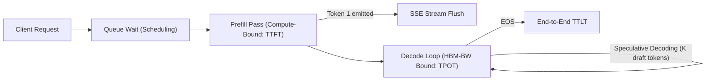
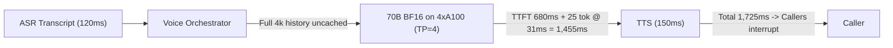

# LLM Latency Optimization: TTFT, Quantisation & Speculative Decoding

> **Prerequisites:** [Lesson 26: GPU Utilization for LLMs](../26-gpu-utilization-for-llms/README.md).  
> **Estimated Reading Time:** 24–28 minutes  
> **Target Audience:** AI/backend engineers optimizing streaming UX and voice/IDE copilots, and candidates asked "how do you cut LLM latency without destroying output quality?"  
> **Free PDF Notes:** [Download SD-S-027.pdf](https://backendroadmap.com/notes/system-design/SD-S-027.pdf)

> [!NOTE]
> **In one line:** End-to-end LLM latency has two distinct bottlenecks—**TTFT** (compute-bound prefill + queue wait) and **TPOT/ITL** (HBM-bandwidth-bound decode). **Weight/KV quantization** shrinks bytes transferred per token by 2–4×, **prefix caching** skips redundant prefill, and **speculative decoding** uses a fast draft model to verify 3–5 tokens in one target forward pass—cutting decode latency 2–3× with **zero** mathematical change to the output distribution.

> [!TIP]
> **The Golden Rule:** Always separate **TTFT** (Time To First Token) from **TPOT** (Time Per Output Token) before optimizing. Quantization and speculative decoding speed up *decode*; prefix caching, prompt trimming, and chunked prefill speed up *TTFT*.

---

## 1. What LLM Latency Optimization Is, and What It Isn't

A coding assistant feels sluggish: users wait 2.4 seconds before the first character appears, and then tokens trickle out at 18 tokens/sec—taking 13.5 seconds for a 200-token function. Simply buying a faster GPU cuts 30% off, but architectural optimizations—prefix caching, INT4/FP8 quantization, and speculative decoding—cut TTFT under 250 ms and push decode past 75 tokens/sec on the *same* hardware.

| Term | Precise Meaning | Example |
| :--- | :--- | :--- |
| **TTFT** | Time To First Token: queuing + prefill + 1st decode step | Target <300 ms for interactive chat/IDE |
| **TPOT / ITL** | Time Per Output Token / Inter-Token Latency | Target <25 ms/token (>40 tok/s) |
| **E2E Latency (TTLT)** | Total time from request send to final `EOS` token | $\text{TTFT} + (N_{\text{out}} - 1) \times \text{TPOT}$ |
| **Weight Quantization** | Storing model weights in lower precision (FP8, INT8, AWQ/GPTQ INT4) | 70B FP16 (140 GB) -> INT4 (35 GB) |
| **Speculative Decoding** | Draft model proposes $K$ tokens; target model verifies all $K+1$ in 1 parallel pass | Exact lossless sampling (Leviathan et al.) |
| **Prompt / Prefix Caching** | Reusing precomputed KV tensors for matching prompt prefixes | 3,000-token system prompt cached -> 4× faster TTFT |
| **Streaming (SSE)** | Flushing tokens to the client as they are decoded instead of buffering | Perceived latency drops from 10s to 0.3s |
| **Not** | Dropping to a tiny model blindly or disabling safety/reasoning | Lossless tricks exist before sacrificing intelligence |

### Why It Matters
1. **Perceived responsiveness:** Humans perceive <250 ms TTFT as "instant" and >40 tok/s as faster than reading speed; missing either makes an AI product feel broken.
2. **Agentic compounding:** Multi-step agents make 5–15 sequential LLM calls per user turn; saving 1 second per call saves 10+ seconds end-to-end.
3. **Hardware efficiency:** Cutting bytes read per step via FP8/INT4 lets a 70B model fit on 1–2 GPUs instead of 4–8, cutting both latency (less Tensor Parallel all-reduce) and cost.

---

## 2. Anatomy: Where Latency Lives in an LLM Request



Notice why **quantization** and **speculative decoding** target different parts of the hardware bottleneck:
- **Weight-only quantization (W4A16 / AWQ / GPTQ)** keeps activations in FP16 for accuracy while storing weights in INT4. Because decode is HBM-bandwidth bound, reading 4× fewer weight bytes speeds up decode by **2.5–3.5×**—and often lets you drop from 4 GPUs to 1–2 GPUs, eliminating cross-GPU NVLink/PCIe `AllReduce` latency.
- **Speculative decoding** exploits the fact that verifying $K$ candidate tokens in parallel has almost the *same* HBM latency as generating 1 token (weights are read once for all $K+1$ positions!).

| Technique | Primary Target | Typical Speedup | Quality Impact |
| :--- | :--- | :---: | :--- |
| **Prefix / KV Caching** | TTFT | 2–8× (long prompts) | **Zero** (exact KV reuse) |
| **FP8 (W8A8)** | TTFT + TPOT | 1.6–1.9× (Hopper/Ada) | Negligible (<0.2% benchmark drop) |
| **AWQ / GPTQ (W4A16)** | TPOT (decode) | 2.2–3.2× (low batch) | Very small (~0.5–1% perplexity) |
| **Speculative Decoding** | TPOT (decode) | 1.8–3.0× (low/med batch) | **Zero** (mathematically lossless) |
| **Semantic Response Cache** | TTFT + TTLT | 20–100× (cache hits) | Depends on similarity threshold |

> [!WARNING]
> **Speculative decoding loses its speedup at high batch sizes.** Verifying $K$ draft tokens per request multiplies compute by $(K+1) \times B$. Once $(K+1) \times B$ crosses the GPU's compute ridge point (~295 FLOP/byte on H100), verification becomes compute-bound and slows down the whole batch. Disable or throttle speculation when batch size $B > 32\text{–}64$.

---

## 3. Mathematical Model: End-to-End Latency & Speculative Acceptance

**1. End-to-End Latency Decomposition.**

$$T_{\text{E2E}} = T_{\text{queue}} + T_{\text{prefill}}(N_{\text{in}}) + (N_{\text{out}} - 1) \cdot T_{\text{decode}}(B)$$

Where $T_{\text{prefill}}$ scales roughly linearly (then quadratically at huge context) with uncached prompt tokens $N_{\text{in}}$, and $T_{\text{decode}}$ is bounded by bytes moved per step:

$$T_{\text{decode}} \approx \frac{W_{\text{bytes}} + B \cdot \text{KV}_{\text{bytes}}}{\text{BW}_{\text{HBM}}} + T_{\text{allreduce}}$$

**2. Speculative Decoding Expected Speedup.** Let a draft model generate $\gamma$ tokens, each with acceptance probability $\alpha \in (0, 1)$, and let $c = \frac{T_{\text{draft}}}{T_{\text{target}}}$ be the draft-to-target step latency ratio. The expected number of accepted tokens per verification step (including the bonus token) is:

$$E[\text{tokens}] = \frac{1 - \alpha^{\gamma + 1}}{1 - \alpha}$$

The net speedup factor over standard autoregressive decoding is:

$$S(\alpha, \gamma, c) = \frac{1 - \alpha^{\gamma + 1}}{(1 - \alpha)(\gamma \cdot c + 1)}$$

**3. Worked Numerical Example.**
Suppose a 70B target model takes $T_{\text{target}} = 30\text{ ms}$ per step, and a 1B draft model (or Eagle/Medusa head) takes $T_{\text{draft}} = 1.5\text{ ms}$ per token ($c = 0.05$). With $\gamma = 5$ speculative tokens and acceptance rate $\alpha = 0.80$ (typical for code/JSON/structured text):
- Expected tokens per cycle: $\frac{1 - 0.8^6}{1 - 0.8} = \frac{1 - 0.262}{0.2} = \mathbf{3.69\text{ tokens}}$.
- Cycle time: $5 \times 1.5\text{ ms} + 30\text{ ms} = \mathbf{37.5\text{ ms}}$.
- Effective TPOT: $\frac{37.5\text{ ms}}{3.69} = \mathbf{10.16\text{ ms/token}}$ (**98.4 tok/s** vs 33.3 tok/s baseline — a **2.95× speedup** with identical output distribution).

---

## 4. Metrics & Percentiles

| Metric | Meaning | Alert when |
| :--- | :--- | :--- |
| **TTFT $p_{50} / p_{99}$** | Time from HTTP request arrival to 1st SSE token | $p_{99} > 800\text{ ms}$ (interactive) or $>2\text{ s}$ (RAG) |
| **TPOT / ITL $p_{50} / p_{99}$** | Milliseconds between consecutive decoded tokens | $p_{50} > 40\text{ ms}$ or $p_{99} > 100\text{ ms}$ |
| **Acceptance rate ($\alpha$)** | Fraction of draft tokens accepted by target model | Drops below 0.55 (speculation hurts latency) |
| **Mean accepted tokens** | Average tokens emitted per target verification pass | <1.8 tokens/step (disable speculation) |
| **Quantization eval drift** | Accuracy delta (MMLU / HumanEval / domain eval) vs BF16 | >1.5% regression on critical tasks |
| **Prefix cache hit ratio** | Prompt tokens skipping prefill via cached KV blocks | <50% when sharing a fixed system prompt |

### Worked Example (IDE Code Autocomplete SLO)
An IDE copilot requires **TTFT $p_{95} < 250\text{ ms}$** and **120 tokens total in <1.2 s**.
- Baseline 70B FP16 on 4×A100: TTFT = 420 ms, TPOT = 36 ms $\implies T_{\text{E2E}} = 420 + 119 \times 36 = 4{,}704\text{ ms}$ (fails SLO by 4×).
- Optimized (FP8 W8A8 on 2×H100 + Prefix Caching + Speculative Decoding $\gamma=5, \alpha=0.82$): Prefix cache cuts TTFT to **110 ms**; FP8 + Eagle-2 speculation cuts effective TPOT to **7.5 ms** $\implies T_{\text{E2E}} = 110 + 119 \times 7.5 = \mathbf{1{,}002\text{ ms}}$ (passes SLO with 17% headroom).

---

## 5. Compounding & Failure Modes

| Optimization Stack (70B Model, 2k In / 256 Out) | TTFT ($p_{50}$) | TPOT ($p_{50}$) | E2E TTLT | Quality vs BF16 |
| :--- | :---: | :---: | :---: | :---: |
| **1. Baseline BF16 (4×A100)** | 520 ms | 35.0 ms | 9.48 s | Reference (100%) |
| **2. + Prefix Caching (80% prompt cached)** | 145 ms | 35.0 ms | 9.10 s | Exact (100%) |
| **3. + W4A16 AWQ (2×A100)** | 135 ms | 14.5 ms | 3.85 s | ~99.2% |
| **4. + FP8 W8A8 (2×H100)** | 85 ms | 16.0 ms | 4.18 s | ~99.8% |
| **5. + Speculative Decoding (Eagle/Draft)** | 85 ms | 6.2 ms | **1.67 s** | **Exact to step 4** |

**Failure modes when stacking optimizations:**
- **INT4 on reasoning/math-heavy prompts:** Aggressive W4A16 quantization can degrade multi-step arithmetic or JSON schema adherence if calibration data doesn't match production traffic.
- **Speculation under high concurrency:** At $B=64$, verifying $\gamma=5$ tokens runs a $384$-token batch every step, pushing H100s past the compute ridge point and *increasing* TPOT by 30–50%.
- **Over-aggressive semantic caching:** Returning a cached answer for a slightly different user query (e.g., `"cancel order #102"` matching `"cancel order #103"`) causes catastrophic correctness bugs.

---

## 6. Numbers Every Engineer Must Know

| Item | Typical | Implication |
| :--- | :---: | :--- |
| Human "instant" perception threshold | 100–250 ms | Target TTFT for autocomplete / voice |
| Human reading speed | ~5–8 tokens/sec | Streaming >15 tok/s feels smooth; >40 tok/s feels instantaneous |
| FP8 vs BF16 speedup (H100) | 1.6–1.9× | Virtually free on Hopper/Blackwell GPUs |
| INT4 (AWQ) vs FP16 memory | 0.28× (3.5× smaller) | Fits 70B (~38 GB) on a single 48 GB / 80 GB GPU |
| Speculative decoding sweet spot | $\gamma = 3\text{–}5$, $\alpha > 0.70$, $B \le 16$ | 2–3× decode speedup on code, RAG, and structured JSON |
| Multi-GPU Tensor Parallel AllReduce | ~20–40 µs/layer × 80 layers | 1.6–3.2 ms overhead *per token* across NVLink; worse over PCIe |
| Tokenization + HTTP/TLS overhead | 5–15 ms | Negligible for chat, significant for <100 ms voice pipelines |

---

## 7. Protocol / Mechanism Deep Dive: Lossless Speculative Decoding

```mermaid
sequenceDiagram
    participant D as Draft Model (1B / Eagle Head)
    participant T as Target Model (70B)
    participant S as Rejection Sampler
    D->>D: Autoregressively propose gamma=4 tokens [t1, t2, t3, t4]
    D->>T: Send [prefix + t1, t2, t3, t4] in 1 batch
    T->>T: Single parallel forward pass -> logits [p1, p2, p3, p4, p5]
    T->>S: Pass draft probs q1..q4 and target probs p1..p5
    S->>S: Accept ti if rand() < min(1, pi/qi)
    Note over S: Suppose t1, t2 accepted; t3 rejected
    S-->>D: Sample corrected t3' from norm(max(0, p3 - q3)) and discard t4
```

| Question | Answer |
| :--- | :--- |
| **Why is speculative decoding mathematically lossless?** | Rejection sampling accepts $t_i$ with probability $\min(1, p(t_i)/q(t_i))$ and resamples from $\text{norm}(\max(0, p - q))$ on rejection. The resulting marginal distribution equals $p(x)$ *exactly*—even at `temperature > 0`. |
| **What makes a good draft mechanism?** | **EAGLE / Medusa heads** (lightweight hidden-state predictors sharing the target's KV/embedding) or **N-gram / prompt lookup** (for RAG/code editing where tokens repeat verbatim from context). |
| **Why does W4A16 slow down at large batch sizes?** | At high $B$, decode shifts from memory-bound to compute-bound, and dequantizing INT4 weights to FP16 on CUDA cores adds instruction overhead. Use **FP8 (W8A8)** on H100s for high-concurrency serving. |

**When NOT to use speculative decoding:**
- High-concurrency serving ($B > 32$) where Tensor Cores are already compute-saturated.
- High-entropy creative writing (`temperature >= 1.0`) where draft acceptance $\alpha$ drops below 0.50.
- Memory-starved GPUs where loading a separate draft model steals KV-cache HBM.

---

## 8. Hierarchical Budgets & Design Rules

| Slice | Rule | Control |
| :--- | :--- | :--- |
| Latency budget | Track TTFT and TPOT separately in SLAs | Never average them into a single latency number |
| Hardware precision | Default to FP8 (W8A8) on H100/L40S; AWQ INT4 on A100/A10G low-batch | Run domain evals before shipping INT4 |
| Speculation gate | Enable speculative decoding only when active batch $B \le 16$ | Dynamic scheduler toggle or adaptive $\gamma$ |
| Prompt structure | Static system + tools + few-shot *first*; dynamic query *last* | Maximizes prefix cache hit rate |
| Output length | Constrain verbose outputs (`max_tokens`, concise prompt instructions) | A 2× shorter answer cuts E2E latency 2× for free |
| Routing | Route simple classification/extraction to an 8B model | Small model = 8× lower latency & cost |
| Streaming | Always stream SSE tokens for human-facing UX | Never block on full completion unless JSON-only batch |

---

## 9. Top Mitigations

1. **Stream every user-facing response via SSE/WebSockets** so perceived latency equals TTFT (~200 ms) instead of TTLT (~6 s).
2. **Use FP8 quantization on Hopper/Ada GPUs** for a nearly free 1.7× speedup across both prefill and decode.
3. **Use Prompt-Lookup or EAGLE speculative decoding** for code generation, RAG grounded answers, and structured JSON extraction.
4. **Trim unnecessary prompt & output tokens**—removing 1,000 boilerplate prompt tokens and instructing concise answers often beats hardware tuning.
5. **Deploy Prefix Caching** so multi-turn conversations and shared system prompts pay prefill cost only once.
6. **Eliminate cross-node Tensor Parallelism** whenever quantization lets the model fit on fewer GPUs (e.g., 70B INT4 on 1–2 GPUs instead of 4).
7. **Apply model routing (cascading):** handle 70% of simple intents on an 8B model (<150 ms E2E) and escalate only complex queries to 70B+.

---

## 10. Production Reference: Voice AI Agent Missing Its 600 ms Turnaround SLA

A real-time voice customer service agent had an end-to-end budget of **600 ms** (ASR 120 ms + LLM TTFT & first clause 280 ms + TTS 150 ms + network 50 ms). In production, $p_{95}$ LLM TTFT + first-sentence generation hit **1,450 ms**, causing awkward 1.5-second silences where callers thought the bot hung up.



- **Root Cause:** (1) Multi-turn voice transcripts appended timestamps at the *top* of the prompt, busting prefix caching on every turn (680 ms prefill); (2) 70B BF16 ran on 4×A100s with `TP=4`, paying cross-GPU AllReduce overhead on every token (31 ms/tok); (3) The orchestrator waited for the *entire* LLM response before sending text to TTS.
- **Fix:** (1) Moved immutable persona/tool instructions to position 0 (prefix cache hit = 88%, TTFT dropped to 95 ms); (2) Switched to 70B FP8 on 2×H100 + EAGLE-2 speculative decoding (TPOT dropped from 31 ms to 7 ms); (3) Streamed tokens into a sentence-boundary chunker feeding TTS immediately after the first clause (18 tokens $\times$ 7 ms = 126 ms). Total LLM contribution dropped from 1,455 ms to **221 ms**, hitting the 600 ms voice SLA.

---

## 11. Multi-Language Production Code Tabs

A **Speculative Decoding Rejection-Sampling Verifier & Latency Budget Estimator** showing how the target model accepts/rejects draft tokens without altering the output distribution, plus E2E latency budgeting.

````carousel
```go
// Go: Speculative Decoding Rejection Sampler + E2E Latency Budget Calculator.
package main

import (
	"fmt"
	"math"
	"math/rand"
)

type LatencyBudget struct {
	QueueMs       float64
	PrefillMs     float64
	TpotMs        float64
	OutputTokens  int
}

func (b LatencyBudget) E2EMs() float64 {
	return b.QueueMs + b.PrefillMs + float64(b.OutputTokens-1)*b.TpotMs
}

// VerifyDraft performs Leviathan et al. lossless rejection sampling for K draft tokens.
func VerifyDraft(draftProbs, targetProbs []float64, rng *rand.Rand) (accepted int, bonusProb float64) {
	for i := range draftProbs {
		ratio := targetProbs[i] / math.Max(draftProbs[i], 1e-12)
		if rng.Float64() < math.Min(1.0, ratio) {
			accepted++
		} else {
			// Resample corrected token from norm(max(0, target - draft))
			return accepted, math.Max(0, targetProbs[i]-draftProbs[i])
		}
	}
	return accepted, 1.0 // all K accepted + 1 bonus token from target
}

func main() {
	rng := rand.New(rand.NewSource(42))
	draft := []float64{0.6, 0.7, 0.5, 0.8}
	target := []float64{0.65, 0.68, 0.25, 0.75}
	acc, _ := VerifyDraft(draft, target, rng)
	budget := LatencyBudget{QueueMs: 12, PrefillMs: 95, TpotMs: 8.5, OutputTokens: 120}
	fmt.Printf("Accepted draft tokens: %d/%d | E2E: %.1f ms\n", acc, len(draft), budget.E2EMs())
}
```
<!-- slide -->
```typescript
// TypeScript: Streaming TTFT / TPOT Latency Tracker + Speculative Speedup Estimator.
export interface StreamMetrics {
  ttftMs: number;
  tpotMs: number;
  e2eMs: number;
  tokens: number;
}

export function estimateSpeculativeSpeedup(
  alpha: number, // draft acceptance rate (0..1)
  gamma: number, // draft tokens per step
  costRatio: number // T_draft / T_target
): number {
  const expectedTokens = (1 - Math.pow(alpha, gamma + 1)) / (1 - alpha);
  const stepCost = gamma * costRatio + 1;
  return expectedTokens / stepCost;
}

export async function measureSseStream(
  tokenStream: AsyncIterable<string>
): Promise<StreamMetrics> {
  const start = performance.now();
  let firstTokenAt = 0;
  let count = 0;

  for await (const _chunk of tokenStream) {
    if (count === 0) firstTokenAt = performance.now();
    count++;
  }

  const end = performance.now();
  const ttftMs = count > 0 ? firstTokenAt - start : end - start;
  const decodeMs = count > 1 ? end - firstTokenAt : 0;
  return {
    ttftMs,
    tpotMs: count > 1 ? decodeMs / (count - 1) : 0,
    e2eMs: end - start,
    tokens: count,
  };
}
```
<!-- slide -->
```python
# Python: Speculative decoding speedup & quantization memory/bandwidth model (stdlib only).
import random


def speculative_speedup(alpha: float, gamma: int, draft_to_target_ratio: float) -> tuple[float, float]:
    """Returns (expected_tokens_per_step, net_speedup_factor)."""
    expected_tokens = (1.0 - alpha ** (gamma + 1)) / (1.0 - alpha)
    speedup = expected_tokens / (gamma * draft_to_target_ratio + 1.0)
    return expected_tokens, speedup


def theoretical_tpot_ms(
    params_billions: float,
    weight_bytes: float,  # 2.0=FP16, 1.0=FP8, 0.5=INT4
    hbm_bw_tb_s: float,
    allreduce_ms: float = 0.0,
) -> float:
    """Memory-bandwidth lower bound for batch=1 decode step."""
    bytes_read = params_billions * 1e9 * weight_bytes
    bw_bytes_s = hbm_bw_tb_s * 1e12
    return (bytes_read / bw_bytes_s) * 1000.0 + allreduce_ms


def simulate_rejection_sampling(alpha: float = 0.8, gamma: int = 5, trials: int = 5000) -> float:
    total_emitted = 0
    for _ in range(trials):
        accepted = 0
        for _ in range(gamma):
            if random.random() < alpha:
                accepted += 1
            else:
                break
        total_emitted += accepted + 1  # always get 1 corrected/bonus token
    return total_emitted / trials


if __name__ == "__main__":
    exp_tok, sp = speculative_speedup(alpha=0.80, gamma=5, draft_to_target_ratio=0.05)
    print(f"Analytical E[tokens]={exp_tok:.2f}, Speedup={sp:.2f}x")
    print(f"Simulated E[tokens]={simulate_rejection_sampling():.2f}")
    print(f"70B FP16 on 4xH100 TPOT floor: {theoretical_tpot_ms(70, 2.0, 3.35 * 4, 2.0):.2f} ms")
    print(f"70B INT4 on 1xH100 TPOT floor: {theoretical_tpot_ms(70, 0.5, 3.35, 0.0):.2f} ms")
```
<!-- slide -->
```csharp
// C#: Streaming TTFT/TPOT Telemetry & Adaptive Speculation Gate.
using System;
using System.Diagnostics;

public sealed class LatencyTracker
{
    private readonly Stopwatch _sw = Stopwatch.StartNew();
    private double _firstTokenMs = -1;
    private int _tokens;

    public void OnTokenReceived()
    {
        if (_tokens == 0) _firstTokenMs = _sw.Elapsed.TotalMilliseconds;
        _tokens++;
    }

    public (double TtftMs, double TpotMs, double TotalMs) Finish()
    {
        _sw.Stop();
        double total = _sw.Elapsed.TotalMilliseconds;
        double ttft = _firstTokenMs >= 0 ? _firstTokenMs : total;
        double tpot = _tokens > 1 ? (total - ttft) / (_tokens - 1) : 0;
        return (ttft, tpot, total);
    }
}

public static class SpeculationPolicy
{
    // Disable speculative decoding when active batch crosses compute-bound threshold.
    public static int ChooseGamma(int activeBatchSize, double recentAcceptanceRate)
    {
        if (activeBatchSize > 24 || recentAcceptanceRate < 0.55) return 0;
        return recentAcceptanceRate >= 0.80 ? 5 : 3;
    }
}
```
````

---

## 12. Hands-On CLI Verification Workflows

```bash
# 1. Measure TTFT and TPOT percentiles with curl + python streaming timer
python -c "
import time, json, urllib.request
t0 = time.perf_counter(); first = None; n = 0
req = urllib.request.Request('http://localhost:8000/v1/chat/completions',
  data=json.dumps({'model':'llama-3-70b','messages':[{'role':'user','content':'Write quicksort in Go'}],'stream':True}).encode(),
  headers={'Content-Type':'application/json'})
with urllib.request.urlopen(req) as r:
  for line in r:
    if b'delta' in line:
      if first is None: first = time.perf_counter()
      n += 1
t1 = time.perf_counter()
print(f'TTFT={(first-t0)*1000:.1f}ms, TPOT={(t1-first)/max(n-1,1)*1000:.1f}ms, tokens={n}')
"

# 2. Launch vLLM with FP8 quantization + Speculative Decoding (draft model)
python -m vllm.entrypoints.openai.api_server \
  --model meta-llama/Meta-Llama-3-70B-Instruct \
  --quantization fp8 \
  --speculative-model meta-llama/Meta-Llama-3-8B-Instruct \
  --num-speculative-tokens 5 \
  --enable-prefix-caching

# 3. Inspect speculative acceptance rate and TTFT/TPOT histograms
curl -s http://localhost:8000/metrics | grep -E "vllm:(time_to_first_token|time_per_output_token|spec_decode_draft_acceptance_rate)"
```

---

## 13. Common Mistakes to Avoid

1. **Measuring only total request latency.** Hides whether the bottleneck is prefill/queuing (TTFT) or decode bandwidth (TPOT).
2. **Leaving speculative decoding on at high batch sizes.** Multiplies compute by $(\gamma+1)$ and degrades throughput once compute-bound.
3. **Shipping INT4 quantization without domain evals.** Perplexity looks fine while JSON tool-calling or math accuracy silently drops.
4. **Buffering the full response on the backend before returning to the user.** Throws away streaming UX and turns a 250 ms TTFT into a 6-second wait.
5. **Putting timestamps or `request_id` at the start of the system prompt.** Invalidates prefix caching on 100% of requests.
6. **Over-allocating Tensor Parallelism (`TP=8` when `TP=2` fits).** Adds cross-GPU `AllReduce` synchronization latency to every single token.
7. **Using semantic caching on stateful/personalized queries.** Risks leaking or serving stale/wrong actions across entities.

---

## 14. Key Terms Glossary

| Key Term | Definition |
| :--- | :--- |
| **TTFT** | Time To First Token: queuing + prefill + first decode step latency. |
| **TPOT / ITL** | Time Per Output Token / Inter-Token Latency between consecutive tokens. |
| **TTLT** | Time To Last Token: full end-to-end generation duration. |
| **Quantization (W8A8 / W4A16)** | Compressing weights (and optionally activations) to 8-bit or 4-bit formats. |
| **AWQ / GPTQ** | Activation-aware / Hessian-based 4-bit weight quantization preserving salient weights. |
| **FP8** | 8-bit floating point natively accelerated by NVIDIA Hopper/Ada/Blackwell Tensor Cores. |
| **Speculative Decoding** | Draft-then-verify decoding that emits multiple tokens per target pass losslessly. |
| **Acceptance Rate ($\alpha$)** | Probability that a draft token passes the target model's rejection criterion. |
| **EAGLE / Medusa** | Lightweight draft heads attached directly to the target model's hidden states. |
| **Prefix Caching** | Reusing KV-cache blocks for identical leading prompt tokens across requests. |
| **Model Cascading** | Routing simple queries to fast small models and escalating hard ones to large models. |

---

## 15. System Design Interview Questions & Answers

### Basic Conceptual Questions

<details>
<summary><strong>Q1: What is the difference between TTFT and TPOT, and which hardware resource bounds each? [BASIC]</strong></summary>

**Answer:**
**TTFT** (Time To First Token) is dominated by queuing and the **prefill** phase, which processes all prompt tokens in parallel and is **compute-bound (TFLOPS)**. **TPOT** (Time Per Output Token) is the **decode** phase generating one token at a time, which is **memory-bandwidth-bound (HBM TB/s)**.
</details>

<details>
<summary><strong>Q2: How does weight quantization (e.g., FP16 to INT4) speed up LLM inference? [BASIC]</strong></summary>

**Answer:**
Since decode is HBM-bandwidth bound, shrinking model weights by 4× (e.g., 140 GB to ~35 GB) cuts the bytes transferred from HBM to SRAM per token by ~4×, giving a 2.5–3.5× decode speedup. It also allows the model to fit on fewer GPUs, removing multi-GPU AllReduce communication overhead.
</details>

<details>
<summary><strong>Q3: Explain speculative decoding in 30 seconds. [BASIC]</strong></summary>

**Answer:**
A tiny, fast draft model (or head) proposes $\gamma$ candidate tokens autoregressively. The large target model then scores all $\gamma$ tokens in a *single* parallel forward pass—which costs roughly the same time as generating 1 token—and uses rejection sampling to accept matching tokens, guaranteeing the exact same output distribution as the target model alone.
</details>

<details>
<summary><strong>Q4: Why does streaming (SSE) matter if it doesn't reduce total compute? [BASIC]</strong></summary>

**Answer:**
Streaming decouples *perceived* latency (TTFT, ~200 ms) from *total* generation time (TTLT, 5–10 s). As long as TPOT is faster than human reading speed (~40–50 ms/tok), the user reads continuously with almost zero perceived wait.
</details>

### Scenario-Based Architecture Questions

<details>
<summary><strong>Q5: Your RAG pipeline has 6,000-token prompts and TTFT is 1.8 seconds. Output is only 80 tokens. How do you fix TTFT? [SCENARIO]</strong></summary>

**Answer:**
The bottleneck is prefill, not decode. (1) Place the static system prompt and instructions first and enable **Prefix Caching**; (2) reorder or compress retrieved chunks (rerank top-3 instead of stuffing top-15); (3) use **FP8** on Hopper GPUs for 1.8× faster Tensor Core prefill; (4) separate prefill from decode pools if long prefills are queuing behind each other.
</details>

<details>
<summary><strong>Q6: You enabled speculative decoding in production, and $p_{99}$ latency got *worse* during peak traffic. Why? [SCENARIO]</strong></summary>

**Answer:**
During peak traffic, the continuous batching engine runs large batches ($B=48\text{–}64$). Verifying $\gamma=5$ draft tokens per request turns each step into a $300+$-token forward pass, saturating Tensor Core compute and slowing every step down. Gate speculative decoding off when active batch size exceeds ~16–24.
</details>

<details>
<summary><strong>Q7: You need to run Llama-3-70B for an internal code-editing tool with 1–5 concurrent users at <12 ms/token. What stack do you pick? [SCENARIO]</strong></summary>

**Answer:**
At low concurrency ($B \le 5$), prioritize HBM bandwidth and eliminate multi-GPU communication: quantize 70B with **AWQ INT4** (~38 GB) on a single H100 80 GB (no NVLink AllReduce) and enable **Prompt-Lookup / EAGLE speculative decoding** ($\alpha > 0.85$ on code edits). You'll easily exceed 100+ tok/s (<10 ms/tok).
</details>

<details>
<summary><strong>Q8: How do you design a voice AI pipeline with a strict 500 ms response budget? [SCENARIO]</strong></summary>

**Answer:**
Stream end-to-end: (1) stream ASR partial transcripts; (2) use a fast 8B/FP8 model or speculative-decoded 70B with prefix caching so TTFT <100 ms; (3) pipe LLM tokens through a clause/sentence splitter directly into streaming TTS so audio starts playing after the first 10–15 tokens rather than waiting for full completion.
</details>

### Advanced & Tricky Interview Questions

<details>
<summary><strong>Q9: Why does speculative decoding guarantee the *exact* same output distribution even at temperature > 0? [TRICKY]</strong></summary>

**Answer:**
If draft probability is $q(x)$ and target probability is $p(x)$, rejection sampling accepts $x$ with probability $\min(1, p(x)/q(x))$. When rejected, it resamples from the normalized residual distribution $\text{norm}(\max(0, p(x) - q(x)))$. Summing the probability of accepting $x$ plus the probability of rejecting-and-resampling $x$ algebraically equals $p(x)$ for every token in the vocabulary.
</details>

<details>
<summary><strong>Q10: Compare W4A16 (AWQ) vs W8A8 (FP8) on an H100 across batch sizes 1 and 64. [TRICKY]</strong></summary>

**Answer:**
At $B=1$ (memory-bandwidth bound), W4A16 wins because it reads half as many weight bytes as FP8. At $B=64$ (compute-bound), W8A8 FP8 wins decisively because H100 has native FP8 Tensor Cores (2× FP16 TFLOPS), whereas W4A16 must dequantize INT4 to FP16 on CUDA cores and run at slower FP16 Tensor Core speed.
</details>

<details>
<summary><strong>Q11: What is Prompt-Lookup Decoding (PLD) and when does it beat a neural draft model? [TRICKY]</strong></summary>

**Answer:**
Prompt-Lookup Decoding skips a neural draft model entirely and matches n-grams from the input prompt as candidate continuations. In document editing, RAG citation, and code refactoring—where large spans of output are copied from the prompt—PLD achieves 2–4× speedup with zero extra VRAM and zero draft-model overhead.
</details>

<details>
<summary><strong>Q12: How does Tensor Parallelism (TP) affect TTFT vs TPOT? [TRICKY]</strong></summary>

**Answer:**
Higher TP (e.g., `TP=4` vs `TP=1`) splits both compute and HBM reads across 4 GPUs, cutting **TTFT** nearly linearly. However, every transformer layer requires 2 `AllReduce` barriers per step (~80–160 barriers per token). At low batch sizes, network latency across those barriers can eat into TPOT gains—especially over PCIe instead of NVLink.
</details>

---

## 16. One-Page Master Cheat Sheet

```
+---------------------------------------------------------------------------------------------------------+
|                    LLM LATENCY OPTIMIZATION — MASTER CHEAT SHEET                                        |
+---------------------------------------------------------------------------------------------------------+
| 1. DECOMPOSE: E2E = T_queue + T_prefill (TTFT, compute-bound) + (N_out - 1) * TPOT (HBM-BW bound).      |
+---------------------------------------------------------------------------------------------------------+
| 2. CUT TTFT: Prefix caching (static prompt FIRST) · FP8 prefill · Trim context · Chunked prefill.       |
+---------------------------------------------------------------------------------------------------------+
| 3. CUT TPOT:                                                                                            |
|    - W4A16 (AWQ/GPTQ): best at low batch (B <= 8), shrinks weights 3.5x, fewer GPUs = less AllReduce.   |
|    - W8A8 (FP8): best at med/high batch on H100/Ada (native FP8 Tensor Cores, ~1.8x faster).            |
|    - Speculative Decoding: lossless 2-3x speedup when alpha > 0.70 and batch B <= 16-24.                |
+---------------------------------------------------------------------------------------------------------+
| 4. UX & ROUTING: Always SSE stream · Model cascade (8B for easy, 70B for hard) · Bound max_tokens.      |
+---------------------------------------------------------------------------------------------------------+
```

---

## Further Reading & Sources

- Leviathan et al., [Fast Inference from Transformers via Speculative Decoding (ICML 2023)](https://arxiv.org/abs/2211.17192).
- Li et al., [EAGLE: Speculative Sampling Requires Rethinking Feature Uncertainty (ICML 2024)](https://arxiv.org/abs/2401.15077).
- Lin et al., [AWQ: Activation-aware Weight Quantization for LLM Compression and Acceleration (MLSys 2024)](https://arxiv.org/abs/2306.00978).
- NVIDIA, [TensorRT-LLM Quantization and Speculative Decoding Guides](https://nvidia.github.io/TensorRT-LLM/).

---

## Free PDF Notes

[SD-S-027.pdf](https://backendroadmap.com/notes/system-design/SD-S-027.pdf)

---

## Next

Continue with [Agentic Workflows: ReAct Loops, Planning, Limits & Workflow vs Agent](../28-agentic-workflows/README.md).
