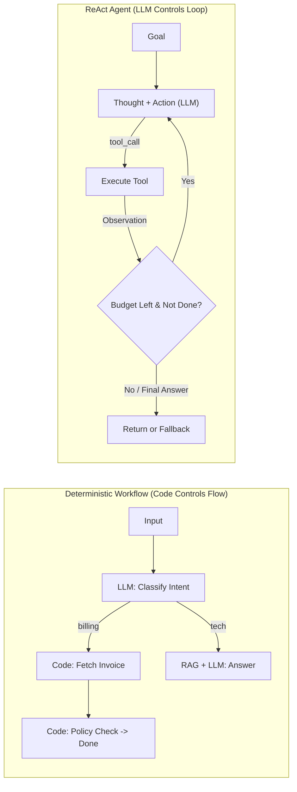
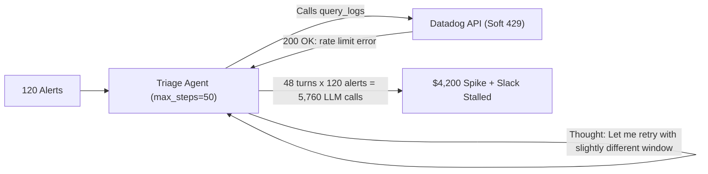

# Agentic Workflows: ReAct Loops, Planning, Limits & Workflow vs Agent

> **Prerequisites:** [Lesson 27: LLM Latency Optimization](../27-llm-latency-optimization/README.md).  
> **Estimated Reading Time:** 24–28 minutes  
> **Target Audience:** Backend and AI engineers designing reliable LLM-powered systems, and candidates asked "when should you build a deterministic workflow vs an autonomous ReAct agent?"  
> **Free PDF Notes:** [Download SD-S-028.pdf](https://backendroadmap.com/notes/system-design/SD-S-028.pdf)

> [!NOTE]
> **In one line:** A **workflow** orchestrates LLMs and tools along code-defined paths (predictable, cheap, high reliability), while an **agent** lets the LLM dynamically choose its own next step in a **ReAct loop** (`Thought -> Action -> Observation`). Because per-step errors compound exponentially ($p^N$), production systems default to deterministic workflows and reserve autonomous loops for open-ended tasks—always wrapped in hard step, token, and wall-clock budgets.

> [!TIP]
> **The Golden Rule:** Use the simplest control flow that solves the problem: **single LLM call -> deterministic workflow (DAG) -> bounded ReAct agent**. Never give an LLM control over routing or loop termination when an `if/else` or state machine in code can decide faster, cheaper, and deterministically.

---

## 1. What Agentic Workflows Are, and What They Aren't

You need to build an automated customer refund system. A junior engineer puts GPT-4o in an open-ended `while True` loop with 15 database and Stripe tools and tells it: *"Handle the user's refund request."* In testing it looks magical; in production it loops 12 times on a vague error, burns $0.85 in tokens per ticket, and occasionally calls `issue_refund` twice. Replacing the open loop with a 4-step **workflow** (classify -> lookup policy -> verify eligibility -> execute) cuts cost 10× and eliminates infinite loops.

| Term | Precise Meaning | Example |
| :--- | :--- | :--- |
| **Workflow** | Orchestration where LLMs and tools follow developer-defined code paths (DAG/state machine) | Classify -> Route -> Extract -> Validate -> Respond |
| **Agent** | System where the LLM dynamically directs its own control flow, tool selection, and stop condition | Open-ended debugging or deep research assistant |
| **ReAct loop** | **Rea**soning + **Act**ing cycle: `Thought -> Action (tool call) -> Observation -> ... -> Answer` | Search docs -> read error -> run test -> patch code |
| **Plan-and-Execute** | Pattern where a planner LLM emits a multi-step DAG first, then workers execute each step | Reduces expensive frontier-model calls per step |
| **Reflection / Evaluator** | Loop where a critic LLM (or deterministic test/linter) scores output and triggers revision | Code generation -> run `pytest` -> fix failing assertion |
| **Hard termination limit** | Explicit cap on iterations (`max_steps`), tokens, cost, or wall-clock seconds | `max_steps = 8`, `budget_usd = 0.25`, `timeout = 45s` |
| **Not** | Putting an LLM inside `while True:` with 30 tools and hoping it converges | Unbounded loops fail catastrophically in production |

### Why It Matters
1. **Compounding error math:** A 95% accurate step across a 10-step autonomous loop succeeds only $0.95^{10} = 59.9\%$ of the time—unacceptable for core business transactions.
2. **Latency & cost explosion:** Every iteration of a ReAct loop re-sends the *entire* growing conversation history, turning token cost quadratic $O(N^2)$ in step count.
3. **Interview signal:** Strong candidates explicitly distinguish **workflows** (reliability, auditability, bounded cost) from **agents** (flexibility for unpredictable paths) and design hybrid guardrails.

---

## 2. Anatomy: Deterministic Workflow vs Autonomous ReAct Agent



| Dimension | Deterministic Workflow | Autonomous ReAct Agent |
| :--- | :--- | :--- |
| **Control flow owner** | Application code (DAG / state machine) | The LLM at each iteration |
| **Predictability & testing** | High; unit-testable per node | Low; non-deterministic trajectories |
| **Token cost scaling** | Linear $O(K)$ in fixed steps | Quadratic $O(N^2)$ as context grows per turn |
| **Latency** | Bounded sum of fixed stages | Unbounded ($N \times (\text{LLM} + \text{Tool})$) |
| **Best suited for** | Refunds, ETL, support triage, KYC checks | Coding assistants, incident RCA, open research |
| **Failure mode** | Rigid on novel edge cases | Infinite retry loops, goal drift, budget overrun |

> [!WARNING]
> **Unbounded ReAct loops turn transient tool errors into billing incidents.** If a tool returns `"503 Service Unavailable"` or `"No results found"` and the agent lacks a retry limit or error-specific exit rule, the LLM will stubbornly re-call the same tool with slightly rephrased arguments until your API bill or timeout explodes.

---

## 3. Mathematical Model: Compounding Reliability & Quadratic Token Cost

**1. Compounding Step Reliability.** If each step in a trajectory has independent success probability $p$ (tool selection + argument schema + reasoning), the probability of an $N$-step run succeeding end-to-end without self-correction is:

$$P(\text{success}) = p^N$$

**2. Quadratic Context Cost in ReAct.** Let initial prompt size be $C_0$ tokens, and each iteration append $d$ tokens (Thought + Action + Tool Observation). Over $N$ iterations, total **input** tokens billed across the run follow an arithmetic series:

$$T_{\text{in}}(N) = \sum_{k=0}^{N-1} (C_0 + k \cdot d) = N \cdot C_0 + \frac{N(N-1)}{2} \cdot d$$

**3. Worked Numerical Example.**
Suppose an agent starts with $C_0 = 2{,}000$ tokens (system prompt + tool schemas), and each tool step adds $d = 1{,}200$ tokens (reasoning + JSON + tool output), with per-step accuracy $p = 0.94$.
- **At $N = 3$ steps (tight workflow):**
  - Reliability: $0.94^3 = \mathbf{83.1\%}$.
  - Input tokens: $3(2000) + \frac{3 \times 2}{2}(1200) = 6000 + 3600 = \mathbf{9{,}600\text{ tokens}}$.
- **At $N = 12$ steps (unconstrained agent):**
  - Reliability: $0.94^{12} = \mathbf{47.6\%}$ (worse than a coin flip without verification!).
  - Input tokens: $12(2000) + \frac{12 \times 11}{2}(1200) = 24{,}000 + 79{,}200 = \mathbf{103{,}200\text{ tokens}}$ (**10.75× more tokens** for 4× more steps!).

---

## 4. Metrics & Percentiles

| Metric | Meaning | Alert when |
| :--- | :--- | :--- |
| **Task Completion Rate (TCR)** | Fraction of runs passing deterministic end-state assertions | Drops below SLO (e.g., <90% for workflows) |
| **Steps per run ($p_{50} / p_{99}$)** | Number of LLM iterations per user task | $p_{99}$ hits `max_steps` cap >5% of runs |
| **Loop / repetition rate** | Runs calling the exact same `(tool, args)` twice consecutively | >2% (indicates stuck agent) |
| **Cost per completed task** | Total LLM + tool API spend divided by *successful* runs | Spikes >2× baseline |
| **Wall-clock latency $p_{95}$** | Total duration including LLM calls and tool I/O | Exceeds user-facing timeout (e.g., >30 s interactive) |
| **Escalation / fallback rate** | Runs hitting `max_steps` and handing off to human or safe default | Rising trend after prompt or tool changes |

### Worked Example (Support Triage Agent)
A support agent averages 3.2 steps ($0.018/run) on normal days. After a backend inventory API starts returning empty `[]` instead of `404` for archived SKUs, the agent interprets `[]` as "try another search query" and loops until `max_steps=15`. Within an hour, $p_{95}$ steps jump from 5 to 15, $p_{95}$ latency jumps from 4.1 s to 29 s, and daily LLM spend triples—even though Task Completion Rate dropped by 18%. Adding a duplicate-call detector + explicit `"NOT_FOUND"` tool status stops the loop at step 2.

---

## 5. Compounding & Failure Modes

| Pattern | Steps ($N$) | Step Accuracy ($p$) | E2E Success ($p^N$) | Total Input Tokens | $p_{95}$ Latency |
| :--- | :---: | :---: | :---: | :---: | :---: |
| **Single-Shot + Code** | 1 | 96% | **96.0%** | 2,000 | 0.9 s |
| **3-Step Workflow (DAG)** | 3 | 96% | **88.5%** | 9,600 | 3.2 s |
| **Bounded ReAct + Verifier** | 5 (avg) | 94% (+retry) | **~91.0%** | 22,000 | 6.8 s |
| **Unbounded ReAct (No Verifier)** | 12 | 92% | **36.8%** | 103,200 | 24.5 s |

Key failure modes in agentic loops:
1. **Spinning / Repeat-Call Loops:** Calling `search("foo")` repeatedly with identical or cosmetically altered arguments.
2. **Context Rot / Goal Drift:** After 8+ tool outputs (e.g., 20k tokens of logs), the LLM forgets the original user constraint and optimizes for a side detail.
3. **Premature Termination:** The LLM hallucinates `"I have updated the record"` without actually emitting a tool call, or stops after a partial success.
4. **Cascading Bad Plans:** In Plan-and-Execute, if Step 1 produces a flawed plan, Steps 2–6 waste tokens executing nonsense unless the plan is re-evaluated.

---

## 6. Numbers Every Engineer Must Know

| Item | Typical | Implication |
| :--- | :---: | :--- |
| Max steps for interactive UX | 3–6 steps | Beyond 6 steps, latency exceeds 10–15 s unless async |
| Max steps for background coding/research | 15–30 steps | Must run asynchronously with progress streaming |
| Per-step LLM + tool overhead | 0.8–3.0 seconds | 10 steps = 8–30 seconds minimum wall clock |
| Context growth per tool observation | 500–3,000 tokens | Truncate/summarize large tool outputs before appending |
| Tool schema token overhead | 100–250 tokens / tool | 20 tools = 3,000+ tokens on *every single iteration* |
| Repeat-call loop threshold | 2 identical calls | Break immediately or inject a "try a different approach" hint |

---

## 7. Protocol / Mechanism Deep Dive: ReAct Loop with Guardrails

```mermaid
sequenceDiagram
    participant U as User / Caller
    participant O as Orchestrator (Code)
    participant L as LLM
    participant T as Tool Runner
    U->>O: Submit goal + budget (max_steps=6, max_usd=0.10)
    loop While step < max_steps and cost < max_usd
        O->>L: Send messages + tool schemas
        L-->>O: Thought + tool_call(name, args) OR final_answer
        alt Final Answer
            O-->>U: Return verified response
        else Duplicate (name, args) detected
            O->>O: Inject error observation ("Already tried; pick another path")
        else Execute Tool
            O->>T: Run tool with timeout
            T-->>O: Observation (truncated to 1500 tokens)
            O->>O: Append observation + update token/cost ledger
        end
    end
    O-->>U: Graceful fallback (partial summary + human handoff)
```

| Question | Answer |
| :--- | :--- |
| **Where does the loop live?** | In *application code* (the orchestrator), never inside a single prompt. Code enforces budgets, timeouts, and duplicate detection. |
| **How does Plan-and-Execute differ from ReAct?** | Plan-and-Execute asks a strong model once to emit a structured step list, then executes steps sequentially/in parallel (often with a cheaper model), replanning only on failure. |
| **How do you prevent tool outputs from blowing up context?** | Cap every tool observation (e.g., max 1,500 tokens), store the full raw payload in an artifact store/ID, and pass a summary + reference ID to the LLM. |
| **What is the Evaluator-Optimizer pattern?** | One LLM (or deterministic test suite) checks the generator's output against criteria; if it fails, feedback is fed back for up to $K$ revisions (e.g., 2–3). |

**When NOT to use an autonomous agent:**
- When the sequence of steps is known in advance (use a **workflow** or plain code).
- When per-request latency must stay under 1–2 seconds (use a single LLM call + parallel tool prefetch).
- When mistakes carry high financial/compliance risk without deterministic verification.

---

## 8. Hierarchical Budgets & Design Rules

| Slice | Rule | Control |
| :--- | :--- | :--- |
| Architecture choice | Default to Workflow; upgrade to Agent only if branching is open-ended | Design review gate |
| Loop bounds | Always set `max_steps`, `max_tokens`, `max_cost_usd`, and `wall_timeout_s` | Enforced in orchestrator code |
| Tool count | Expose $\le 8\text{–}12$ focused tools per agent step | Dynamic tool filtering per state |
| Observation size | Truncate/summarize tool outputs to $\le 1{,}500$ tokens | Middleware before appending to history |
| Loop detection | Hash `(tool_name, canonical_args)`; block >2 identical calls | Circuit breaker in loop |
| Verification | Prefer deterministic verifiers (SQL EXPLAIN, JSON schema, unit tests) | Evaluator step before final return |
| Graceful exit | Always return a structured partial result on budget exhaustion | Never crash with raw stack trace |

---

## 9. Top Mitigations

1. **Replace open-ended agents with state-machine workflows** wherever business rules are known (e.g., LangGraph / Temporal / plain async code).
2. **Enforce 4-dimensional budgets** (`max_steps`, `max_total_tokens`, `max_cost_usd`, `timeout_seconds`) in the outer orchestrator loop.
3. **Add duplicate tool-call detection** so identical calls short-circuit with an explicit hint rather than burning iterations.
4. **Truncate and summarize large tool outputs** (e.g., 50 KB API JSON -> top 10 relevant fields) to prevent quadratic token bloat and context rot.
5. **Parallelize independent tool calls**—modern LLMs can emit 3 `tool_call`s in one turn; execute them concurrently with `asyncio.gather` / `errgroup`.
6. **Use deterministic evaluators** (compilers, linters, schema validators, policy engines) inside reflection loops instead of relying solely on "LLM-as-a-judge" to spot its own bugs.
7. **Enable prefix caching on the ReAct loop**—because ReAct appends to the conversation each turn, turns $2..N$ hit 70–90% of the KV cache from turn $N-1$.

---

## 10. Production Reference: SEV-1 Infinite ReAct Loop During Vendor Outage

An internal DevOps triage agent was wired to Slack to investigate alerts using Datadog, PagerDuty, and GitHub tools with `max_steps=50` and no duplicate-call guard. During a Datadog API degradation (returning `HTTP 429` wrapped as `200 OK {"error": "rate limit"}`), the agent treated the message as a transient tool glitch and retried `query_logs` 48 times per alert across 120 concurrent alerts.



- **Root Cause:** (1) `max_steps=50` was far too high for triage; (2) the tool wrapper returned the 429 error as plain text rather than a structured `FATAL_RATE_LIMIT` / circuit-broken error; (3) no duplicate-tool or per-run dollar budget existed.
- **Fix:** (1) Converted triage into a 3-step deterministic workflow (fetch alert metadata + recent deploys in parallel -> single LLM root-cause synthesis -> optional bounded 3-step follow-up); (2) added a circuit breaker on tool errors and duplicate `(tool, args)` hashing; (3) capped `max_steps=6` and `max_cost_usd=0.15` per alert. Spend dropped 94% and mean triage time fell from 42 s to 4.5 s.

---

## 11. Multi-Language Production Code Tabs

A **Bounded ReAct Orchestrator** with `max_steps`, `max_tokens`, `timeout`, duplicate-call detection, and parallel tool execution.

````carousel
```go
// Go: Bounded ReAct Loop with step budget, timeout, and duplicate tool-call guard.
package main

import (
	"context"
	"crypto/sha256"
	"encoding/json"
	"fmt"
	"time"
)

type ToolCall struct {
	Name string
	Args map[string]any
}

type StepResult struct {
	FinalAnswer string
	Calls       []ToolCall
	TokensUsed  int
}

func callHash(tc ToolCall) string {
	b, _ := json.Marshal(tc)
	return fmt.Sprintf("%x", sha256.Sum256(b))
}

func RunBoundedAgent(
	ctx context.Context,
	maxSteps int,
	maxTokens int,
	stepLLM func(ctx context.Context, history []string) (StepResult, error),
	runTool func(ctx context.Context, tc ToolCall) string,
) (string, error) {
	ctx, cancel := context.WithTimeout(ctx, 30*time.Second)
	defer cancel()

	history := []string{}
	seenCalls := map[string]int{}
	totalTokens := 0

	for step := 1; step <= maxSteps; step++ {
		res, err := stepLLM(ctx, history)
		if err != nil {
			return "", err
		}
		totalTokens += res.TokensUsed
		if res.FinalAnswer != "" {
			return res.FinalAnswer, nil
		}
		if totalTokens >= maxTokens {
			return "Stopped: token budget exhausted. Returning partial findings.", nil
		}
		for _, tc := range res.Calls {
			h := callHash(tc)
			seenCalls[h]++
			if seenCalls[h] > 2 {
				history = append(history, fmt.Sprintf("SYSTEM: Blocked duplicate call %s; choose a different action.", tc.Name))
				continue
			}
			obs := runTool(ctx, tc)
			if len(obs) > 2000 {
				obs = obs[:2000] + "...[truncated]"
			}
			history = append(history, fmt.Sprintf("Observation(%s): %s", tc.Name, obs))
		}
	}
	return "Stopped: max_steps reached without final answer.", nil
}
```
<!-- slide -->
```typescript
// TypeScript: Bounded ReAct Loop with parallel tool execution and budget enforcement.
interface ToolCall {
  name: string;
  args: Record<string, unknown>;
}

interface AgentBudget {
  maxSteps: number;
  maxTokens: number;
  timeoutMs: number;
}

export async function runBoundedAgent(
  goal: string,
  budget: AgentBudget,
  llmStep: (history: string[]) => Promise<{ answer?: string; calls: ToolCall[]; tokens: number }>,
  execTool: (call: ToolCall) => Promise<string>
): Promise<string> {
  const history: string[] = [`Goal: ${goal}`];
  const seen = new Map<string, number>();
  const deadline = Date.now() + budget.timeoutMs;
  let tokensUsed = 0;

  for (let step = 0; step < budget.maxSteps; step++) {
    if (Date.now() > deadline || tokensUsed >= budget.maxTokens) {
      return "Budget exhausted: returning safe fallback.";
    }

    const res = await llmStep(history);
    tokensUsed += res.tokens;
    if (res.answer) return res.answer;

    // Execute independent tool calls in parallel with duplicate guard
    const observations = await Promise.all(
      res.calls.map(async (tc) => {
        const key = `${tc.name}:${JSON.stringify(tc.args)}`;
        const count = (seen.get(key) ?? 0) + 1;
        seen.set(key, count);
        if (count > 2) {
          return `Blocked duplicate tool call ${tc.name}; try another strategy.`;
        }
        const out = await execTool(tc);
        return out.slice(0, 1500); // cap observation size
      })
    );
    history.push(...observations);
  }
  return "Max steps reached: escalating to human.";
}
```
<!-- slide -->
```python
# Python: Bounded ReAct Orchestrator + Compounding Reliability / Cost Calculator (stdlib only).
import json
import time
from dataclasses import dataclass, field


@dataclass
class Budget:
    max_steps: int = 6
    max_tokens: int = 24_000
    timeout_s: float = 20.0


@dataclass
class AgentState:
    history: list[str] = field(default_factory=list)
    seen_calls: dict[str, int] = field(default_factory=dict)
    tokens_used: int = 0


def compounding_metrics(steps: int, step_acc: float, c0: int = 2000, d: int = 1200) -> tuple[float, int]:
    """Returns (e2e_success_prob, quadratic_input_tokens)."""
    prob = step_acc ** steps
    tokens = steps * c0 + (steps * (steps - 1) // 2) * d
    return prob, tokens


def run_react(goal: str, budget: Budget, llm_fn, tool_fn) -> str:
    state = AgentState(history=[f"Goal: {goal}"])
    start = time.monotonic()

    for _ in range(budget.max_steps):
        if time.monotonic() - start > budget.timeout_s or state.tokens_used >= budget.max_tokens:
            return "FALLBACK: Budget exceeded."

        reply = llm_fn(state.history)
        state.tokens_used += reply.get("tokens", 0)
        if "final_answer" in reply:
            return reply["final_answer"]

        for call in reply.get("tool_calls", []):
            sig = f"{call['name']}:{json.dumps(call['args'], sort_keys=True)}"
            state.seen_calls[sig] = state.seen_calls.get(sig, 0) + 1
            if state.seen_calls[sig] > 2:
                state.history.append(f"SYSTEM: Duplicate call {call['name']} blocked.")
                continue
            obs = str(tool_fn(call["name"], call["args"]))[:1500]
            state.history.append(f"Observation({call['name']}): {obs}")

    return "FALLBACK: Max steps reached."


if __name__ == "__main__":
    for n in (3, 6, 12):
        p, tok = compounding_metrics(n, 0.94)
        print(f"Steps={n:2d} | P(success)={p:.1%} | InputTokens={tok:,}")
```
<!-- slide -->
```csharp
// C#: Bounded ReAct Orchestrator with CancellationToken timeout & duplicate-call guard.
using System;
using System.Collections.Generic;
using System.Text.Json;
using System.Threading;
using System.Threading.Tasks;

public record ToolCall(string Name, Dictionary<string, object> Args);
public record LlmStep(string? FinalAnswer, List<ToolCall> Calls, int Tokens);

public sealed class BoundedAgentRunner
{
    public async Task<string> RunAsync(
        string goal,
        int maxSteps,
        int maxTokens,
        TimeSpan timeout,
        Func<List<string>, CancellationToken, Task<LlmStep>> llmStep,
        Func<ToolCall, CancellationToken, Task<string>> execTool)
    {
        using var cts = new CancellationTokenSource(timeout);
        var history = new List<string> { $"Goal: {goal}" };
        var seen = new Dictionary<string, int>();
        int tokens = 0;

        for (int step = 0; step < maxSteps; step++)
        {
            if (tokens >= maxTokens || cts.IsCancellationRequested)
                return "Fallback: budget or timeout reached.";

            var res = await llmStep(history, cts.Token);
            tokens += res.Tokens;
            if (!string.IsNullOrEmpty(res.FinalAnswer)) return res.FinalAnswer;

            foreach (var tc in res.Calls)
            {
                string key = $"{tc.Name}:{JsonSerializer.Serialize(tc.Args)}";
                seen[key] = seen.GetValueOrDefault(key) + 1;
                if (seen[key] > 2)
                {
                    history.Add($"Blocked duplicate call to {tc.Name}.");
                    continue;
                }
                string obs = await execTool(tc, cts.Token);
                history.Add($"Observation: {(obs.Length > 1500 ? obs[..1500] : obs)}");
            }
        }
        return "Fallback: max_steps exhausted.";
    }
}
```
````

---

## 12. Hands-On CLI Verification Workflows

```bash
# 1. Simulate compounding reliability & quadratic token cost across step counts
python -c "
for n in [1, 3, 5, 8, 12]:
    p = 0.94 ** n
    tok = n * 2000 + (n * (n - 1) // 2) * 1200
    print(f'N={n:2d} steps | E2E success={p:5.1%} | Input tokens={tok:,}')
"

# 2. Verify structured JSON / tool-call output from a local OpenAI-compatible server
curl -s http://localhost:8000/v1/chat/completions \
  -H "Content-Type: application/json" \
  -d '{
    "model": "llama-3-70b",
    "messages": [{"role": "user", "content": "Check status of order 1234"}],
    "tools": [{"type": "function", "function": {"name": "get_order", "parameters": {"type": "object", "properties": {"id": {"type": "string"}}, "required": ["id"]}}}]
  }' | python -m json.tool
```

---

## 13. Common Mistakes to Avoid

1. **Building an agent when a 3-step workflow works.** Adds non-determinism, latency, and 5× token cost for zero gain.
2. **Omitting `max_steps`, `max_tokens`, and `timeout` caps.** Guarantees runaway billing loops when a tool behaves unexpectedly.
3. **Dumping raw 20 KB API responses into the agent's context.** Causes quadratic cost explosion and context rot.
4. **Exposing 30+ tools on every turn.** Confuses tool selection and burns thousands of prompt tokens per iteration.
5. **Running sequential tool calls when the LLM emits 3 independent calls.** Use parallel execution (`Promise.all` / `asyncio.gather` / `errgroup`).
6. **Relying solely on the LLM to verify its own work.** Use deterministic checks (schemas, compilers, unit tests, policy rules) whenever possible.
7. **Swallowing tool errors silently.** Return clear, actionable error codes (`NOT_FOUND`, `RATE_LIMITED_FATAL`) so the agent knows whether to retry or stop.

---

## 14. Key Terms Glossary

| Key Term | Definition |
| :--- | :--- |
| **Workflow** | Code-orchestrated sequence or DAG of LLM calls and deterministic tools. |
| **Agent** | System where the LLM dynamically chooses tools, arguments, and termination. |
| **ReAct** | Reasoning + Acting loop alternating `Thought`, `Action`, and `Observation`. |
| **Plan-and-Execute** | Splitting high-level planning (once) from step-by-step execution. |
| **Reflection / Evaluator** | Iterative critique-and-revise loop scored by a verifier or critic model. |
| **Context Rot** | Degradation in LLM instruction-following as long tool histories accumulate. |
| **Compounding Error** | Exponential drop in end-to-end reliability ($p^N$) as step count $N$ grows. |
| **Duplicate-Call Guard** | Circuit breaker blocking repeated identical `(tool, args)` invocations. |
| **Observation Truncation** | Capping/summarizing tool outputs before appending to agent history. |
| **Tool Filtering** | Dynamically exposing only state-relevant tools to keep schemas compact. |

---

## 15. System Design Interview Questions & Answers

### Basic Conceptual Questions

<details>
<summary><strong>Q1: What is the core architectural difference between a workflow and an agent? [BASIC]</strong></summary>

**Answer:**
In a **workflow**, application code defines the control flow (DAG/state machine) and LLMs act as bounded processing nodes. In an **agent**, the LLM itself controls the loop—deciding which tool to call next, with what arguments, and when to stop.
</details>

<details>
<summary><strong>Q2: How does a ReAct loop work? [BASIC]</strong></summary>

**Answer:**
ReAct alternates **Reasoning** (`Thought`: what do I know and need next?) and **Acting** (`Action`: emit a structured tool call), followed by the orchestrator executing the tool and feeding back the **Observation**. This repeats until the LLM emits a final answer or hits a budget limit.
</details>

<details>
<summary><strong>Q3: Why do token costs grow quadratically in a multi-step ReAct loop? [BASIC]</strong></summary>

**Answer:**
Because LLMs are stateless, every new step must re-send the entire conversation history (system prompt + all prior thoughts, tool calls, and observations). Adding $d$ tokens per step over $N$ steps bills $\approx \frac{1}{2} N^2 d$ input tokens.
</details>

<details>
<summary><strong>Q4: What hard limits must every production agent enforce? [BASIC]</strong></summary>

**Answer:**
Four budgets enforced in orchestrator code: `max_steps` (iterations), `max_total_tokens` / `max_cost_usd`, `wall_clock_timeout`, and a duplicate `(tool, args)` circuit breaker.
</details>

### Scenario-Based Architecture Questions

<details>
<summary><strong>Q5: Design an automated customer support refund system. Workflow or Agent? [SCENARIO]</strong></summary>

**Answer:**
**Deterministic Workflow** (state machine). Flow: (1) LLM classifies intent & extracts order ID; (2) deterministic code fetches order & refund policy; (3) deterministic policy engine checks eligibility (days since purchase, amount threshold); (4) if eligible, execute refund idempotently; else escalate or explain. No open ReAct loop is needed, guaranteeing 100% policy compliance and bounded latency.
</details>

<details>
<summary><strong>Q6: Your coding agent reads a 5,000-line log file and then forgets the user's original constraint. Why and how do you fix it? [SCENARIO]</strong></summary>

**Answer:**
This is **context rot** / lost-in-the-middle degradation. Fix it by: (1) truncating or map-reduce summarizing tool outputs to <1,500 tokens before appending; (2) storing full logs in a scratchpad/artifact ID so the agent can `grep` specific lines; (3) keeping the original goal pinned in the system/final reminder message.
</details>

<details>
<summary><strong>Q7: How do you speed up a ReAct research agent that currently takes 25 seconds across 8 sequential tool calls? [SCENARIO]</strong></summary>

**Answer:**
(1) Enable parallel tool calling so independent searches run concurrently; (2) convert predictable initial steps (e.g., fetching user profile + recent docs) into a parallel prefetch before the loop; (3) use Plan-and-Execute with a fast 8B model for extraction steps; (4) enable prefix caching so turns $2..8$ skip prefilling prior turns.
</details>

<details>
<summary><strong>Q8: An agent keeps calling `search_kb` with slightly different queries 10 times when no doc exists. How do you stop it? [SCENARIO]</strong></summary>

**Answer:**
(1) Return a clear semantic signal from the tool (`"NO_MATCHES_FOUND: do not retry with synonyms unless you have a new entity"`); (2) track per-tool call counts (`max_calls_per_tool = 3` per run) in the orchestrator; (3) cap `max_steps = 6` with a graceful `"I couldn't find..."` fallback.
</details>

### Advanced & Tricky Interview Questions

<details>
<summary><strong>Q9: Why does $p^N$ compounding matter, and how can Reflection beat $p^N$? [TRICKY]</strong></summary>

**Answer:**
Without verification, 10 steps at 95% accuracy yield $0.95^{10} = 59.9\%$. **Reflection with a deterministic verifier** (like a unit test, SQL parser, or schema validator) turns a failure into a retry opportunity: if each step fails with probability $1-p$ and gets 1 retry with independent catch probability, failure drops toward $(1-p)^2$ per step—raising 10-step reliability from 60% to >97%.
</details>

<details>
<summary><strong>Q10: Compare ReAct vs Plan-and-Execute for a 10-step data analysis task. [TRICKY]</strong></summary>

**Answer:**
ReAct calls the heavy reasoning model 10 times with growing context ($O(N^2)$). **Plan-and-Execute** calls the reasoning model *once* to produce a 10-step DAG, executes independent steps in parallel with a cheap/fast model, and only invokes the planner again if a step fails—cutting cost 3–5× and latency 2–4×.
</details>

<details>
<summary><strong>Q11: How do you test and regression-gate a non-deterministic agent in CI/CD? [TRICKY]</strong></summary>

**Answer:**
Combine: (1) **Mocked tool replay** (deterministic unit tests for orchestrator budgets, loop guards, and error handling); (2) **Trajectory evals** on 100+ golden tasks measuring Task Completion Rate (final DB/state assertion, not just text similarity), mean steps, and cost; (3) run each eval task $k=3$ times (`pass@1` and `pass^3`) to catch flaky non-determinism before deploy.
</details>

<details>
<summary><strong>Q12: When you have 40 tools, how do you prevent tool-schema bloat from killing accuracy and latency? [TRICKY]</strong></summary>

**Answer:**
Never dump all 40 schemas into the prompt. Use **dynamic tool retrieval / state-scoped toolsets**: embed the user's goal to retrieve the top 5–8 relevant tools (or expose only tools valid in the current state-machine node), and keep tool descriptions crisp and non-overlapping.
</details>

---

## 16. One-Page Master Cheat Sheet

```
+---------------------------------------------------------------------------------------------------------+
|                    AGENTIC WORKFLOWS — MASTER CHEAT SHEET                                               |
+---------------------------------------------------------------------------------------------------------+
| 1. SPECTRUM: Single Call -> Deterministic Workflow (DAG/State Machine) -> Plan-and-Execute -> ReAct.    |
|    Default to Workflows; use Agents only when the path cannot be known in advance.                      |
+---------------------------------------------------------------------------------------------------------+
| 2. MATH: Reliability = p^N (94% ^ 12 = 47.6%). ReAct input tokens = N*C0 + N(N-1)/2 * d (Quadratic!).   |
+---------------------------------------------------------------------------------------------------------+
| 3. MANDATORY GUARDRAILS: max_steps (4-8 interactive) · max_tokens/USD · wall_timeout · dup-call guard.  |
+---------------------------------------------------------------------------------------------------------+
| 4. PERFORMANCE: Parallelize independent tool calls · Truncate observations <=1500 tok · Prefix cache.   |
+---------------------------------------------------------------------------------------------------------+
| 5. RELIABILITY: Deterministic verifiers (schemas, tests, policy rules) beat LLM self-critique.          |
+---------------------------------------------------------------------------------------------------------+
```

---

## Further Reading & Sources

- Anthropic Engineering, [Building Effective Agents](https://www.anthropic.com/engineering/building-effective-agents).
- Yao et al., [ReAct: Synergizing Reasoning and Acting in Language Models (ICLR 2023)](https://arxiv.org/abs/2210.03629).
- Shinn et al., [Reflexion: Language Agents with Verbal Reinforcement Learning (NeurIPS 2023)](https://arxiv.org/abs/2303.11366).
- Wang et al., [Plan-and-Solve Prompting (ACL 2023)](https://arxiv.org/abs/2305.04091).

---

## Free PDF Notes

[SD-S-028.pdf](https://backendroadmap.com/notes/system-design/SD-S-028.pdf)

---

## Next

Continue with [Safe LLM Tool Calling: Schemas, Validation, Sandboxing & MCP](../29-safe-llm-tool-calling/README.md).
