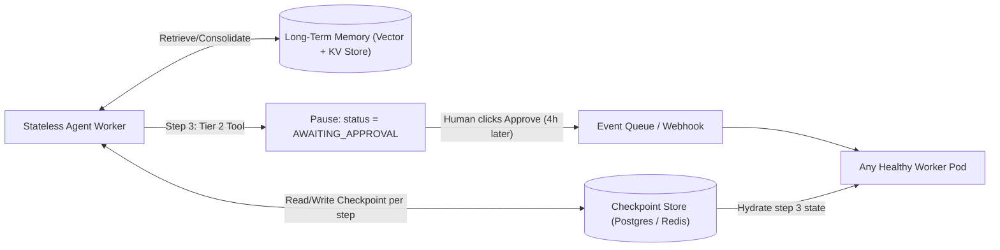
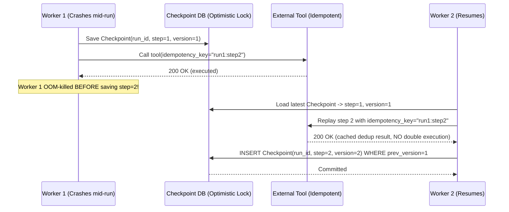
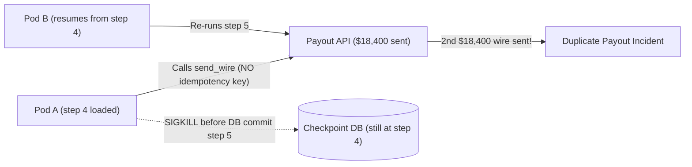

# Agent State and Memory: Checkpointing, Long-Term Memory & Resumable Runs

> **Prerequisites:** [Lesson 29: Safe LLM Tool Calling](../29-safe-llm-tool-calling/README.md).  
> **Estimated Reading Time:** 25–28 minutes  
> **Target Audience:** Distributed systems and AI engineers building long-running agents, and candidates asked "how do you make an AI agent survive crashes, pause for human approval, and remember user preferences across weeks?"  
> **Free PDF Notes:** [Download SD-S-030.pdf](https://backendroadmap.com/notes/system-design/SD-S-030.pdf)

> [!NOTE]
> **In one line:** Production agents separate **short-term execution state** (checkpointed at every step boundary so runs are resumable across crashes, deploys, and human-in-the-loop pauses) from **long-term memory** (cross-session semantic, episodic, and procedural facts stored externally and retrieved selectively—never dumped raw into the context window).

> [!TIP]
> **The Golden Rule:** Treat an agent run like a **durable workflow** (such as Temporal or a checkpointed state machine): persist state after every LLM or tool step with an idempotency key, release compute during human waits, and compact/summarize history before context length degrades accuracy.

---

## 1. What Agent State and Memory Are, and What They Aren't

An AI coding or research agent runs for 14 steps over 3 minutes, pauses for a user to approve a pull request, and then resumes 4 hours later—potentially on a completely different Kubernetes pod after a rolling deploy. If state lived only in Python RAM, a single pod restart wipes out 14 steps of progress and leaves half-executed side effects. Conversely, if you naively save every past conversation into one giant prompt, the context window overflows and token bills skyrocket.

| Term | Precise Meaning | Example |
| :--- | :--- | :--- |
| **Short-term working state** | Current run's messages, tool results, step counter, and variables | Scratchpad for `run_id = "run_982"` |
| **Checkpointing** | Atomically persisting a snapshot of working state after each step/node | Postgres row `(run_id, step_seq, state_json)` |
| **Resumable run (Time-travel)** | Rehydrating from the latest (or prior) checkpoint after a crash or HITL pause | Resume after 6-hour human approval without re-running steps 1–4 |
| **Semantic memory** | Long-term facts & user preferences stored in a DB/vector index | `"User prefers Python 3.12 and concise answers"` |
| **Episodic memory** | Records of past completed runs and outcomes | `"Last week we debugged OOM in checkout-svc"` |
| **Procedural memory** | Learned rules, prompt refinements, or verified workflows | `"Always run pytest -q before opening PR"` |
| **Context compaction** | Summarizing or pruning older turns to fit token budgets | Rolling summary + last $K$ raw turns |
| **Not** | Keeping an unbounded `messages[]` list in process memory | Breaks on pod restarts, horizontal scaling, and token limits |

### Why It Matters
1. **Crash & deploy resilience:** Long-running agents outlive HTTP requests and pod lifecycles; checkpointing guarantees zero lost work and clean horizontal scaling across stateless workers.
2. **Async Human-in-the-Loop (HITL):** Pausing for human approval can take minutes or days; checkpointing lets you free worker memory/connections immediately and resume on webhook arrival.
3. **Personalization without token bloat:** External long-term memory retrieves only the 3–5 relevant facts per turn instead of stuffing 100k tokens of old chat logs.

---

## 2. Anatomy: Checkpointed Execution + Tiered Memory Architecture



Notice the clean separation of concerns:
- **Checkpoint Store (Hot Durable State):** Keyed by `(tenant_id, thread_id, run_id, step_seq)`. Uses optimistic concurrency (`version` / `step_seq` unique constraint) so two workers never corrupt the same run simultaneously.
- **Long-Term Memory (Cross-Session Knowledge):** Keyed by `(tenant_id, user_id)` with explicit namespace isolation. Updated asynchronously at session end (or via explicit `save_memory` tool) with conflict resolution (`upsert` / `invalidate` stale facts) so contradictions don't pile up.

| Memory Type | Scope | Storage Engine | Retention & Eviction |
| :--- | :--- | :--- | :--- |
| **In-Context Working Buffer** | Active LLM call | GPU KV cache / prompt | Sliding window + rolling summary |
| **Step Checkpoint** | Single `run_id` | Postgres / DynamoDB / Redis | TTL 7–30 days after completion |
| **Semantic / User Profile** | Cross-session per `user_id` | Postgres + `pgvector` / KV | Upsert on contradiction; GDPR delete |
| **Episodic Run History** | Cross-session past tasks | Vector + metadata index | Decay by recency $\times$ relevance |

> [!WARNING]
> **Checkpointing without tool idempotency causes duplicate side effects on replay.** If a worker crashes *after* calling `charge_card()` but *before* committing checkpoint `step=4`, resuming from `step=3` will re-execute `charge_card()`. Always pair checkpointing with deterministic `idempotency_key = hash(run_id, step_seq, tool_name)`!

---

## 3. Mathematical Model: Checkpoint Write Amplification & Context Compaction

**1. Checkpoint Storage & Write Amplification.** Let an uncompacted conversation grow by $d$ bytes per step over $N$ steps from base state $S_0$. Storing a **full snapshot** at every step writes:

$$W_{\text{full}}(N) = \sum_{k=1}^{N} (S_0 + k \cdot d) = N \cdot S_0 + \frac{N(N+1)}{2} \cdot d$$

By contrast, storing **incremental delta checkpoints** (appending only the new message/state diff $\Delta_k$ per step, with periodic full snapshots every $M$ steps) reduces write volume to linear $O(N)$:

$$W_{\text{delta}}(N) \approx N \cdot d + \left\lfloor \frac{N}{M} \right\rfloor (S_0 + N_{\text{avg}} \cdot d)$$

**2. Token Savings via Rolling Compaction.** Suppose a 20-step agent adds $d = 1{,}000$ tokens/step ($S_0 = 2{,}000$).
- **Uncompacted:** Step 20 sends $2{,}000 + 19 \times 1{,}000 = 21{,}000$ input tokens. Total input across 20 steps = $20(2000) + \frac{20 \times 19}{2}(1000) = \mathbf{230{,}000\text{ tokens}}$.
- **Compacted (summarize turns older than last 4 into a 600-token rolling summary):** Peak context caps at $2{,}000 + 600 + 4{,}000 = 6{,}600$ tokens. Total input across 20 steps drops to $\mathbf{\approx 118{,}000\text{ tokens}}$ (**49% cost reduction** + avoids context rot).

**3. Worked Checkpoint Size Example.**
With $S_0 = 8\text{ KB}$, $d = 4\text{ KB/step}$, $N = 30$ steps:
- Full snapshot per step: $30(8) + \frac{30 \times 31}{2}(4) = 240 + 1{,}860 = \mathbf{2{,}100\text{ KB}}$ written per run.
- Delta checkpoint per step: $30 \times 4\text{ KB} = \mathbf{120\text{ KB}}$ written per run (**17.5× less DB write I/O**).

---

## 4. Metrics & Percentiles

| Metric | Meaning | Alert when |
| :--- | :--- | :--- |
| **Checkpoint write latency $p_{99}$** | Time to persist step state before advancing | >50 ms (slows every agent step) |
| **Checkpoint payload size $p_{99}$** | Serialized state size per step | >256 KB (move large tool blobs to S3/object store) |
| **Resume success rate** | Crashed or HITL-paused runs completing cleanly on resume | <99.9% (indicates serialization/schema drift) |
| **Optimistic lock conflicts** | Concurrent resume attempts colliding on `step_seq` | >0.5% (missing distributed lock or duplicate webhook) |
| **Memory retrieval precision** | Fraction of retrieved long-term memories judged relevant | <70% (noisy memory poisoning prompts) |
| **Context compaction ratio** | Tokens saved vs raw history per long run | Track alongside Task Completion Rate to catch over-summarization |

### Worked Example (Long-Running Document Review Agent)
A legal-review agent processes 50-page contracts across 18 steps. Initially, it stored full extracted PDF text (400 KB) inside the Postgres JSONB checkpoint row at every step: $18 \times 400\text{ KB} = 7.2\text{ MB}$ written per run, causing Postgres WAL bloat and $p_{99}$ checkpoint latency of 380 ms. Refactoring to **claim-check storage** (storing the 400 KB PDF once in S3 and keeping only `s3://...` URI + delta messages in Postgres) shrank each checkpoint to 3 KB and dropped $p_{99}$ write latency to 6 ms.

---

## 5. Compounding & Failure Modes

| Failure Mode | Mechanism | Impact |
| :--- | :--- | :--- |
| **Split-Brain Concurrent Resume** | Two webhooks/retries resume the same `run_id` simultaneously | Duplicate LLM calls, corrupted state, double tool execution |
| **Serialization / Schema Drift** | Code deploy changes `AgentState` struct while old runs are paused | Deserialization crash when a 2-day-old HITL run resumes |
| **Memory Poisoning / Stale Facts** | Contradictory memories (`"lives in NYC"` + `"lives in London"`) retrieved together | Agent oscillates or uses outdated preferences |
| **Blob Bloat in Checkpoint DB** | Storing raw 500 KB HTML/PDF payloads inside checkpoint JSON | DB IOPS saturation, slow hydration |
| **Lossy Compaction** | Aggressive summarization drops a critical ID, constraint, or file path | Agent forgets exact constraint and hallucinates |

---

## 6. Numbers Every Engineer Must Know

| Item | Typical | Implication |
| :--- | :---: | :--- |
| Postgres JSONB checkpoint write | 2–10 ms | Negligible vs 1,000 ms LLM call |
| Max inline checkpoint payload | $\le 64\text{ KB}$ | Offload larger artifacts to S3/GCS (claim-check pattern) |
| Recent raw turns kept before compaction | 4–8 turns | Preserves exact recent tool args/IDs while summarizing older turns |
| Long-term memory retrieval budget | Top 3–5 facts (<500 tokens) | Prevents memory clutter from distracting the model |
| HITL pause TTL | 24–72 hours | Expire stale approvals cleanly and notify user |
| Memory consolidation timing | Async post-turn / end-of-session | Never block user-facing response latency on memory extraction |

---

## 7. Protocol / Mechanism Deep Dive: Checkpointing, Crash Recovery & Optimistic Locking



| Question | Answer |
| :--- | :--- |
| **How do you prevent two workers from resuming the same run?** | Use **optimistic concurrency control** (`UNIQUE(run_id, step_seq)` or `UPDATE ... WHERE version = expected_version`) or a short-lived lease lock in Redis/Postgres. |
| **How do you handle code deploys while HITL runs are paused?** | Version your checkpoint schema (`schema_version: 2`) with backward-compatible defaults or pin long-running workflows to the worker version that started them. |
| **When should you extract long-term memories?** | **Asynchronously** in a background job after the turn/session completes—extracting atomic facts, deduplicating against existing memories, and resolving contradictions (`ADD`, `UPDATE`, `DELETE`). |
| **How do you avoid losing critical IDs during context compaction?** | Keep a structured **pinned state** object (e.g., `active_order_id`, `constraints[]`) outside the free-text summary so compaction never erases exact identifiers. |

**When NOT to use heavy durable checkpointing:**
- Single-turn stateless Q&A or simple 1-call classification endpoints (<2 s total). In-memory execution is simpler and has zero DB overhead; just log the final trace asynchronously.

---

## 8. Hierarchical Budgets & Design Rules

| Slice | Rule | Control |
| :--- | :--- | :--- |
| State durability | Checkpoint after *every* LLM or tool step for multi-step/async runs | Transactional DB write with `(run_id, step_seq)` |
| Concurrency safety | Enforce optimistic lock (`expected_version`) on every state transition | Reject stale/duplicate worker writes |
| Side-effect safety | Pass `idempotency_key = hash(run_id, step_seq, tool)` to all tools | Safe replay after crash before checkpoint commit |
| Payload hygiene | Keep checkpoint rows <64 KB; store large blobs in S3/GCS | Claim-check URI references in state |
| Context compaction | Compact history once working tokens > 60% of budget | Keep pinned structured state + last $K$ raw turns |
| Long-term memory | Namespace by `(tenant_id, user_id)`; update async with conflict resolution | Support `DELETE /memory` for GDPR/privacy |
| Schema evolution | Include `schema_version` in every checkpoint envelope | Upcasters for backward compatibility |

---

## 9. Top Mitigations

1. **Persist state at every step boundary** using `(run_id, step_seq)` with optimistic locking so any stateless worker can resume any run.
2. **Pair checkpointing with tool idempotency keys** so crash-recovery replays never double-charge or double-mutate.
3. **Use the claim-check pattern** for large tool outputs (save raw JSON/PDF to S3, store only the URI + summary in checkpoint state).
4. **Separate pinned structured state from conversational history** so context compaction never summarizes away `order_id` or `user_constraints`.
5. **Run long-term memory extraction asynchronously** after the response streams, using an `ADD / UPDATE / DELETE` reconciliation step to prevent stale contradictions.
6. **Version checkpoint schemas** (`schema_version`) and test replay compatibility in CI before deploying breaking state changes.
7. **Set explicit TTLs** on paused HITL runs and expired checkpoints so stale state doesn't accumulate forever.

---

## 10. Production Reference: Duplicate Payouts on Agent Crash-Recovery

A B2B procurement agent used LangGraph-style checkpointing over Postgres to process multi-step vendor invoices. During a Kubernetes node drain, Pod A was terminated right after calling `payout_api.send_wire()` at step 5, milliseconds before writing checkpoint `step=5`. Pod B picked up the queue message, loaded checkpoint `step=4`, and re-ran step 5—sending a duplicate $18,400 wire transfer.



- **Root Cause:** Checkpointing only makes the *orchestrator* durable; without an idempotency key on the *external side effect*, "at-least-once" step execution caused "at-least-once" money movement.
- **Fix:** (1) Generated deterministic `idempotency_key = sha256(f"{run_id}:{step_seq}:send_wire")` *before* invoking any mutating tool; (2) enforced Tier 2 HITL approval on wires >$1,000; (3) persisted an intent record (`PENDING_TOOL`) in Postgres *before* calling the external API so Pod B could inspect/reconcile status instead of blindly retrying.

---

## 11. Multi-Language Production Code Tabs

A **Resumable Checkpointed Agent Store with Optimistic Locking & Context Compaction** demonstrating crash-safe step persistence and deterministic idempotency keys.

````carousel
```go
// Go: Optimistically-locked Checkpoint Store & Context Compactor for Resumable Agents.
package main

import (
	"crypto/sha256"
	"errors"
	"fmt"
	"sync"
)

var ErrVersionConflict = errors.New("optimistic lock conflict: stale checkpoint version")

type AgentCheckpoint struct {
	RunID         string
	StepSeq       int
	Status        string // RUNNING | AWAITING_HITL | COMPLETED
	PinnedState   map[string]string
	Summary       string
	RecentTurns   []string
}

type CheckpointStore struct {
	mu   sync.Mutex
	data map[string]AgentCheckpoint
}

func NewCheckpointStore() *CheckpointStore {
	return &CheckpointStore{data: make(map[string]AgentCheckpoint)}
}

func (s *CheckpointStore) Save(cp AgentCheckpoint, expectedPrevSeq int) error {
	s.mu.Lock()
	defer s.mu.Unlock()
	cur, exists := s.data[cp.RunID]
	if exists && cur.StepSeq != expectedPrevSeq {
		return ErrVersionConflict
	}
	// Compact older turns while preserving PinnedState
	if len(cp.RecentTurns) > 4 {
		cp.Summary += " | Compacted: " + cp.RecentTurns[0]
		cp.RecentTurns = cp.RecentTurns[1:]
	}
	s.data[cp.RunID] = cp
	return nil
}

func ToolIdempotencyKey(runID string, stepSeq int, tool string) string {
	sum := sha256.Sum256([]byte(fmt.Sprintf("%s:%d:%s", runID, stepSeq, tool)))
	return fmt.Sprintf("%x", sum[:12])
}

func main() {
	store := NewCheckpointStore()
	_ = store.Save(AgentCheckpoint{RunID: "run-1", StepSeq: 1, Status: "AWAITING_HITL", PinnedState: map[string]string{"order": "ord-9"}}, 0)
	fmt.Println("Idempotency key for step 2:", ToolIdempotencyKey("run-1", 2, "refund"))
}
```
<!-- slide -->
```typescript
// TypeScript: Resumable Agent Checkpointer with Optimistic Locking & Compaction.
export interface AgentCheckpoint {
  runId: string;
  stepSeq: number;
  status: "RUNNING" | "AWAITING_HITL" | "COMPLETED";
  pinned: Record<string, string>;
  summary: string;
  recentTurns: string[];
}

export class InMemoryCheckpointStore {
  private store = new Map<string, AgentCheckpoint>();

  save(next: AgentCheckpoint, expectedPrevSeq: number): void {
    const current = this.store.get(next.runId);
    if (current && current.stepSeq !== expectedPrevSeq) {
      throw new Error(`Optimistic lock conflict on ${next.runId}`);
    }
    // Keep last 4 raw turns; compact older ones into rolling summary
    let { summary, recentTurns } = next;
    if (recentTurns.length > 4) {
      const evicted = recentTurns.slice(0, recentTurns.length - 4);
      summary = `${summary} | ${evicted.join("; ")}`.trim();
      recentTurns = recentTurns.slice(-4);
    }
    this.store.set(next.runId, { ...next, summary, recentTurns });
  }

  load(runId: string): AgentCheckpoint | undefined {
    return this.store.get(runId);
  }
}
```
<!-- slide -->
```python
# Python: Durable Checkpointer + Context Compactor + Long-Term Memory Upsert (stdlib only).
import hashlib
import sqlite3
import json
from dataclasses import dataclass, asdict


@dataclass
class AgentState:
    run_id: str
    step_seq: int
    status: str
    pinned: dict[str, str]
    summary: str
    recent_turns: list[str]


class SQLiteCheckpointer:
    def __init__(self, path: str = ":memory:") -> None:
        self.conn = sqlite3.connect(path)
        self.conn.execute(
            "CREATE TABLE IF NOT EXISTS checkpoints "
            "(run_id TEXT PRIMARY KEY, step_seq INT, payload TEXT)"
        )

    def save(self, state: AgentState, expected_prev_seq: int) -> None:
        if len(state.recent_turns) > 4:
            evicted = state.recent_turns[:-4]
            state.summary = (state.summary + " | " + "; ".join(evicted)).strip(" |")
            state.recent_turns = state.recent_turns[-4:]

        payload = json.dumps(asdict(state))
        if expected_prev_seq == 0:
            self.conn.execute(
                "INSERT INTO checkpoints (run_id, step_seq, payload) VALUES (?, ?, ?)",
                (state.run_id, state.step_seq, payload),
            )
        else:
            cur = self.conn.execute(
                "UPDATE checkpoints SET step_seq = ?, payload = ? "
                "WHERE run_id = ? AND step_seq = ?",
                (state.step_seq, payload, state.run_id, expected_prev_seq),
            )
            if cur.rowcount != 1:
                raise RuntimeError("Optimistic lock conflict: concurrent resume detected")
        self.conn.commit()

    def load(self, run_id: str) -> AgentState | None:
        row = self.conn.execute(
            "SELECT payload FROM checkpoints WHERE run_id = ?", (run_id,)
        ).fetchone()
        return AgentState(**json.loads(row[0])) if row else None


def deterministic_idempotency_key(run_id: str, step_seq: int, tool: str) -> str:
    return hashlib.sha256(f"{run_id}:{step_seq}:{tool}".encode()).hexdigest()[:24]


if __name__ == "__main__":
    cp = SQLiteCheckpointer()
    s1 = AgentState("run-42", 1, "AWAITING_HITL", {"order_id": "ord-7"}, "", ["User asked for refund"])
    cp.save(s1, expected_prev_seq=0)
    loaded = cp.load("run-42")
    print("Resumed:", loaded, "| Key:", deterministic_idempotency_key("run-42", 2, "refund"))
```
<!-- slide -->
```csharp
// C#: Optimistically-Locked Agent Checkpointer with Context Compaction.
using System;
using System.Collections.Generic;
using System.Security.Cryptography;
using System.Text;

public sealed record AgentCheckpoint(
    string RunId,
    int StepSeq,
    string Status,
    Dictionary<string, string> Pinned,
    string Summary,
    List<string> RecentTurns);

public sealed class CheckpointStore
{
    private readonly Dictionary<string, AgentCheckpoint> _db = new();

    public void Save(AgentCheckpoint next, int expectedPrevSeq)
    {
        if (_db.TryGetValue(next.RunId, out var cur) && cur.StepSeq != expectedPrevSeq)
            throw new InvalidOperationException($"Version conflict for {next.RunId}");

        var turns = new List<string>(next.RecentTurns);
        string summary = next.Summary;
        if (turns.Count > 4)
        {
            summary = string.IsNullOrEmpty(summary) ? turns[0] : $"{summary} | {turns[0]}";
            turns.RemoveAt(0);
        }
        _db[next.RunId] = next with { Summary = summary, RecentTurns = turns };
    }

    public static string IdempotencyKey(string runId, int stepSeq, string tool)
    {
        byte[] hash = SHA256.HashData(Encoding.UTF8.GetBytes($"{runId}:{stepSeq}:{tool}"));
        return Convert.ToHexString(hash)[..24];
    }
}
```
````

---

## 12. Hands-On CLI Verification Workflows

```bash
# 1. Verify full-snapshot vs delta-checkpoint write amplification in Python
python -c "
S0, d, N = 8, 4, 30
full = N * S0 + (N * (N + 1) // 2) * d
delta = N * d
print(f'30-step run | Full snapshots: {full} KB | Delta checkpoints: {delta} KB ({full/delta:.1f}x reduction)')
"

# 2. Inspect Postgres checkpoint table bloat & index usage (example schema check)
psql "$DATABASE_URL" -c "
SELECT relname, pg_size_pretty(pg_total_relation_size(relid)) AS total_size
FROM pg_catalog.pg_statio_user_tables
WHERE relname = 'agent_checkpoints';
"
```

---

## 13. Common Mistakes to Avoid

1. **Keeping agent state only in process RAM.** Any pod restart, OOM, or autoscaling event destroys multi-step progress.
2. **Resuming without optimistic locking.** Two retries or webhooks running the same `run_id` concurrently corrupt state and double-call tools.
3. **Checkpointing without tool idempotency keys.** Crash recovery before checkpoint commit re-executes external side effects.
4. **Storing megabyte PDFs or HTML dumps inside Postgres JSONB checkpoints.** Blows up WAL and slows every step; use S3 claim-check URIs.
5. **Dumping raw long-term memory into every prompt.** Pollutes context and hurts accuracy; retrieve top 3–5 relevant facts.
6. **Appending memories without contradiction resolution.** `"User lives in Berlin"` and `"User lives in Tokyo"` sitting side-by-side confuses the model.
7. **Summarizing away exact IDs during compaction.** Always keep a separate `pinned` structured dictionary for IDs, amounts, and hard constraints.

---

## 14. Key Terms Glossary

| Key Term | Definition |
| :--- | :--- |
| **Short-Term Working State** | Per-run conversation, tool observations, and variables needed for active execution. |
| **Checkpointing** | Persisting execution state at each step boundary so runs survive crashes and pauses. |
| **Resumable Run** | Rehydrating an agent from its last committed checkpoint on any stateless worker. |
| **Optimistic Locking** | Conditional write (`WHERE step_seq = expected`) preventing split-brain concurrent updates. |
| **Claim-Check Pattern** | Storing large payloads in object storage (S3) and keeping only the URI in checkpoint state. |
| **Context Compaction** | Summarizing older turns while keeping recent raw turns and pinned structured fields. |
| **Semantic Memory** | Long-term facts, preferences, and entity knowledge persisted across sessions. |
| **Episodic Memory** | Indexed summaries of past agent runs and their outcomes. |
| **Procedural Memory** | Learned instructions, playbooks, or tool-use heuristics refined over time. |
| **Memory Consolidation** | Async post-session extraction that deduplicates and resolves conflicting facts. |

---

## 15. System Design Interview Questions & Answers

### Basic Conceptual Questions

<details>
<summary><strong>Q1: What is the difference between agent state (checkpointing) and long-term memory? [BASIC]</strong></summary>

**Answer:**
**Checkpointing (short-term state)** persists the exact execution snapshot of a *single* in-flight `run_id` at each step so it can survive crashes or pause for human approval. **Long-term memory** persists distilled facts, preferences, and past episodes *across* separate sessions for a `user_id` or `tenant_id`.
</details>

<details>
<summary><strong>Q2: Why do production agents need resumable runs? [BASIC]</strong></summary>

**Answer:**
Multi-step agents often run for minutes or pause for hours/days awaiting human-in-the-loop (HITL) approval. Resumable runs decouple execution from a single HTTP request or pod lifecycle, letting workers release compute during waits and recover cleanly from crashes.
</details>

<details>
<summary><strong>Q3: Explain semantic, episodic, and procedural memory in AI agents. [BASIC]</strong></summary>

**Answer:**
**Semantic** = facts & preferences (`"prefers Go"`). **Episodic** = past experiences (`"last Tuesday's deploy failed due to X"`). **Procedural** = learned rules/skills (`"always run linter before commit"`).
</details>

<details>
<summary><strong>Q4: What is context compaction and why is it needed? [BASIC]</strong></summary>

**Answer:**
Context compaction summarizes older conversation turns into a compact running summary while preserving the last $K$ raw turns and pinned structured state. It bounds token cost (preventing quadratic $O(N^2)$ growth) and prevents context rot in long runs.
</details>

### Scenario-Based Architecture Questions

<details>
<summary><strong>Q5: Your agent pauses for human approval for 6 hours, then resumes. Walk through the architecture. [SCENARIO]</strong></summary>

**Answer:**
At the Tier 2 tool gate, the worker saves a checkpoint with `status = AWAITING_HITL` and an `approval_token` (with TTL) to Postgres, emits a notification (Slack/email/UI), and exits—freeing all RAM/GPU resources. When the user clicks Approve, an authenticated endpoint validates the token, enqueues a resume job with `run_id`, and any stateless worker hydrates the checkpoint and continues from that exact step.
</details>

<details>
<summary><strong>Q6: A worker crashes right after calling `create_invoice()` but before saving the checkpoint. How do you prevent a duplicate invoice on resume? [SCENARIO]</strong></summary>

**Answer:**
Generate a deterministic `idempotency_key = sha256(run_id, step_seq, tool_name)` and pass it to `create_invoice()`, or record a `PENDING_TOOL` intent row before the external call. When a new worker resumes from the prior checkpoint and replays the step, the downstream API (or intent log) deduplicates the call and returns the original invoice.
</details>

<details>
<summary><strong>Q7: Users complain the agent remembers outdated preferences (e.g., an old job title). How do you design memory updates? [SCENARIO]</strong></summary>

**Answer:**
Run an async **memory consolidation** pipeline after each session: retrieve existing memories for the user, compare against newly extracted facts, and emit explicit `ADD`, `UPDATE` (superseding the old fact with a timestamp), or `DELETE` operations instead of blindly appending duplicate vector embeddings.
</details>

<details>
<summary><strong>Q8: Your checkpoint Postgres DB is growing at 50 GB/day. How do you fix it? [SCENARIO]</strong></summary>

**Answer:**
(1) Apply the **claim-check pattern**: move large tool payloads (HTML, PDFs, large JSON) to S3/GCS with lifecycle rules and store only URIs in Postgres; (2) switch from full-state snapshots per step to **delta checkpoints**; (3) add a retention TTL (e.g., archive/delete completed run checkpoints after 14 days).
</details>

### Advanced & Tricky Interview Questions

<details>
<summary><strong>Q9: How do you prevent two workers from resuming the same `run_id` simultaneously? [TRICKY]</strong></summary>

**Answer:**
Enforce **optimistic concurrency control** (`UPDATE checkpoints SET step_seq = :next ... WHERE run_id = :id AND step_seq = :expected`) or acquire a distributed lease lock on `run_id` before executing the next step. If `rowcount == 0`, the losing worker aborts cleanly without emitting duplicate side effects.
</details>

<details>
<summary><strong>Q10: You deploy a new version of your agent code with a changed `AgentState` schema while 500 HITL runs are paused. What happens? [TRICKY]</strong></summary>

**Answer:**
Without versioning, deserializing old checkpoints crashes the new workers. Fix it by embedding `schema_version` in every checkpoint and writing pure **upcaster functions** (`v1 -> v2`) on load—or routing paused runs by version tag to workers running the matching release until they drain.
</details>

<details>
<summary><strong>Q11: Why is "dumping all memories into the system prompt" worse than selective retrieval, even with 1M-token context windows? [TRICKY]</strong></summary>

**Answer:**
(1) **Cost & TTFT:** Prefilling 200k tokens on every turn increases TTFT and cost by 50–100×; (2) **Attention dilution:** Irrelevant or contradictory memories degrade instruction adherence ("lost in the middle"); (3) **Privacy:** Scoped retrieval lets you enforce per-document/per-tenant ACLs dynamically.
</details>

<details>
<summary><strong>Q12: How does "time-travel debugging" work with agent checkpoints? [TRICKY]</strong></summary>

**Answer:**
Because every `(run_id, step_seq)` is stored as an immutable checkpoint (or append-only event log), engineers can fork a production failure at `step_seq = 6`, swap in a fixed prompt or tool mock, and replay from step 6 forward—dramatically accelerating root-cause analysis without re-running steps 1–5.
</details>

---

## 16. One-Page Master Cheat Sheet

```
+---------------------------------------------------------------------------------------------------------+
|                    AGENT STATE & MEMORY — MASTER CHEAT SHEET                                            |
+---------------------------------------------------------------------------------------------------------+
| 1. TWO LAYERS:                                                                                          |
|    - Short-Term State (Checkpointing): per-run_id snapshots/deltas at every step boundary.              |
|    - Long-Term Memory: cross-session Semantic, Episodic, Procedural facts (retrieved selectively).      |
+---------------------------------------------------------------------------------------------------------+
| 2. RESUMABILITY: Save (run_id, step_seq) with optimistic locking -> release worker on HITL pause ->     |
|    any stateless pod resumes on webhook/retry. Pair with idempotency_key = hash(run_id, step, tool).    |
+---------------------------------------------------------------------------------------------------------+
| 3. SCALE & COST: Delta checkpoints + S3 Claim-Check (<64KB DB rows) + Rolling Compaction (keep pinned   |
|    structured IDs + last 4-8 raw turns).                                                                |
+---------------------------------------------------------------------------------------------------------+
| 4. MEMORY HYGIENE: Extract async post-turn · Resolve contradictions (ADD/UPDATE/DELETE) · Tenant-scope. |
+---------------------------------------------------------------------------------------------------------+
```

---

## Further Reading & Sources

- LangChain / LangGraph, [Persistence, Checkpointing & Long-Term Memory Architecture](https://langchain-ai.github.io/langgraph/concepts/persistence/).
- Temporal.io, [Durable Execution for AI Agents](https://temporal.io/use-cases/ai).
- Packer et al., [MemGPT: Towards LLMs as Operating Systems (2023)](https://arxiv.org/abs/2310.08560).
- Hohpe & Woolf, *Enterprise Integration Patterns*, "Claim Check" pattern.

---

## Free PDF Notes

[SD-S-030.pdf](https://backendroadmap.com/notes/system-design/SD-S-030.pdf)

---

## Next

Continue with [Multi-Agent Orchestration: Supervisors, Handoffs & When It Pays](../31-multi-agent-orchestration/README.md).
