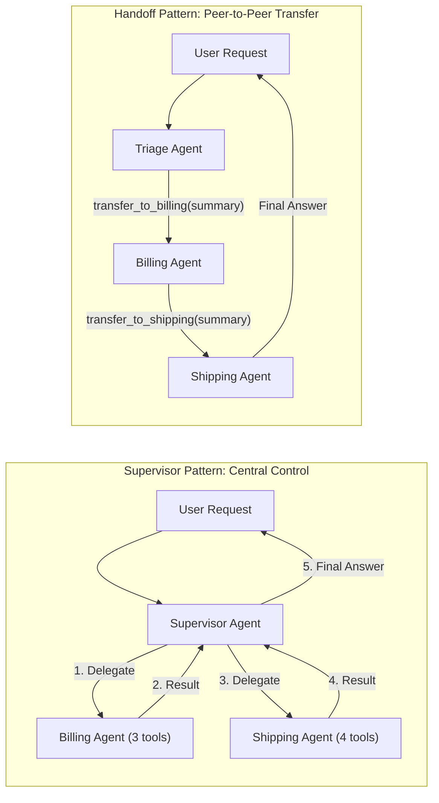
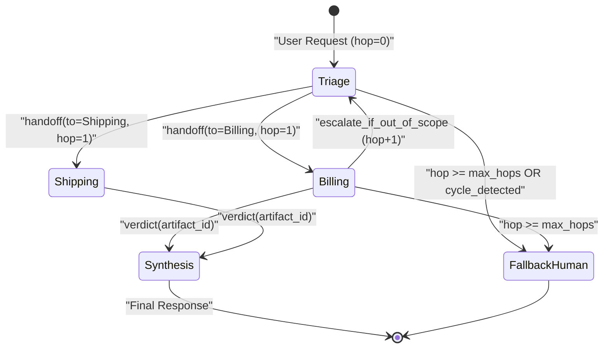
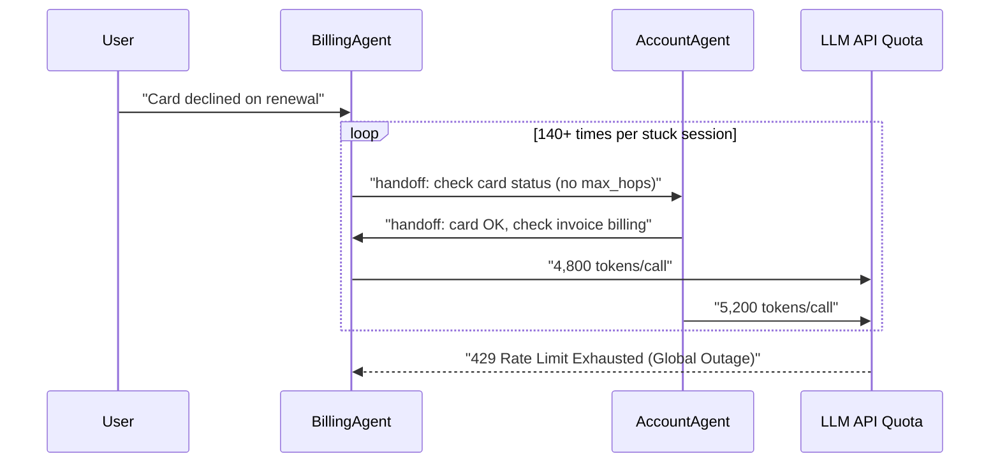

# Multi-Agent Orchestration: Supervisors, Handoffs & When It Pays

> **Prerequisites:** [Lesson 30: Agent State and Memory](../30-agent-state-and-memory/README.md).  
> **Estimated Reading Time:** 24–28 minutes  
> **Target Audience:** Staff/Senior backend and AI platform engineers designing agentic workflows, and candidates asked "should we split this into multiple agents or keep a single agent?"  
> **Free PDF Notes:** [Download SD-S-031.pdf](https://backendroadmap.com/notes/system-design/SD-S-031.pdf)

> [!NOTE]
> **In one line:** Multi-agent orchestration splits a complex task across specialized LLM agents—via a central **supervisor**, peer-to-peer **handoffs**, or parallel **scatter-gather**—to bound per-agent context and tool count. You gain modularity and isolated permissions; you pay with **compounding failure rates, $2\times$–$10\times$ token amplification, higher $p_{99}$ latency, and distributed debugging**.

> [!TIP]
> **The Golden Rule:** Start with a **single agent** (or a deterministic workflow DAG with LLM steps). Only introduce multiple agents when a single agent demonstrably fails due to **tool overload (>15–20 tools)**, **conflicting system instructions**, **strict security/permission boundaries**, or **parallelizable sub-tasks**.

---

## 1. What Multi-Agent Orchestration Is, and What It Isn't

A support automation system starts as one agent with 4 tools: `lookup_order`, `issue_refund`, `search_kb`, and `send_email`. Six months later, the product team adds 28 more tools across billing, shipping, fraud, CRM, and Jira. Suddenly, the LLM picks the wrong tool 14% of the time, system prompts exceed 12,000 tokens of contradictory rules, and a refund prompt injection can trick the same agent into querying internal HR docs. Splitting into a **Triage Supervisor** + **Billing Agent** + **Shipping Agent** + **KB Agent** solves tool overload and isolates permissions—but introduces network hops, handoff bugs, and latency.

| Term | Precise Meaning | Example |
| :--- | :--- | :--- |
| **Single-agent loop** | One LLM + one system prompt + one tool registry in a ReAct loop | Customer bot with 6 read-only tools |
| **Supervisor (Router)** | A central coordinator LLM that delegates sub-tasks and synthesizes results | Planner splits request into Billing + Shipping |
| **Handoff (Swarm)** | Peer-to-peer control transfer where Agent A passes conversation + state to Agent B | Triage hands off to Fraud Specialist |
| **Scatter-gather (Map-Reduce)** | Fanning out independent sub-tasks to worker agents in parallel, then merging | Deep-research agent querying 5 sources at once |
| **Deterministic workflow (DAG)** | Code-defined control flow calling LLMs at specific nodes | Extract -> Classify -> Draft -> Validate |
| **Hop budget** | Hard upper bound on agent-to-agent transitions per request | `max_hops = 6` to prevent infinite loops |
| **Not** | A way to make an LLM smarter for free, or a substitute for good APIs | Bad tools stay bad across 5 agents |

### Why It Matters
1. **Tool selection degrades non-linearly:** Beyond ~15–20 tools in a single JSON schema payload, function-calling accuracy drops and schema tokens dominate the context window.
2. **Reliability compounds downward:** Every extra agent-to-agent handoff multiplies end-to-end failure probability and tail latency.
3. **Interviewers test restraint:** Senior candidates are expected to argue *against* multi-agent orchestration when a deterministic workflow or single agent is cheaper, faster, and more reliable.

---

## 2. Anatomy: Supervisor vs Peer-to-Peer Handoffs



In the **Supervisor** pattern, the coordinator owns the global plan and never lets workers talk directly to the user. In the **Handoff (Swarm)** pattern, control transfers completely from one agent to the next via a special tool call (e.g., `transfer_to_billing`), reducing round-trips back to a central router at the cost of harder global termination control.

| Dimension | Single Agent | Supervisor (Hierarchical) | Peer-to-Peer Handoff | Scatter-Gather (Parallel) |
| :--- | :--- | :--- | :--- | :--- |
| **Control flow** | Loop until done | Hub-and-spoke | State machine / graph | Fan-out / fan-in |
| **LLM calls per task** | $1$–$5$ | $2k + 1$ (router + workers) | $k + m$ (workers + tools) | $1 + \text{workers} + 1$ |
| **Latency profile** | Lowest | Highest (serial round-trips) | Medium (no return hop) | Bounded by slowest worker |
| **Permission isolation** | Weak (all tools in one context) | Strong (least-privilege workers) | Strong | Strong |
| **Loop / cycle risk** | Tool loop only | Low (supervisor tracks steps) | High (A -> B -> A ping-pong) | None (acyclic) |

> [!WARNING]
> **The #1 Multi-Agent Trap: Passing Raw Full History on Every Handoff.** If Agent A passes 12,000 tokens of raw tool outputs to Agent B, and Agent B passes 18,000 tokens to Agent C, your input token cost scales quadratically ($O(k^2)$) and Agent C suffers from "lost-in-the-middle" distraction. Always pass a **typed, bounded handoff summary** plus artifact IDs.

---

## 3. Mathematical Model: Compounding Error, Latency, and Token Amplification

**End-to-End Success Probability.** If a multi-agent workflow requires $k$ sequential agent steps (routing, handoffs, synthesis), each succeeding with probability $p_i$, and no automated recovery exists between steps:

$$P(\text{success}) = \prod_{i=1}^{k} p_i \approx p^k$$

With $p = 0.92$ per agent step across $k = 5$ sequential hops, end-to-end reliability collapses to $0.92^5 = 0.659$ (**65.9%**). Even with $p = 0.97$ over $8$ hops, reliability is $0.97^8 = 0.784$ (**78.4%**).

**Latency.** In a serial supervisor architecture with $k$ worker invocations, each worker takes $t_w$ and the supervisor takes $t_s$ per routing decision plus $t_{\text{synth}}$ at the end:

$$T_{\text{serial}} = (k + 1)\,t_s + \sum_{i=1}^{k} t_{w,i} \qquad T_{\text{parallel}} = t_{\text{plan}} + \max_{i=1..k}(t_{w,i}) + t_{\text{synth}}$$

**Token Amplification Factor (TAF).** Let $C_{\text{base}}$ be the tokens consumed by a single-agent baseline. In a $k$-hop handoff that naively forwards growing history $H_0 + i \cdot \Delta H$ plus system prompt $S$ at each hop:

$$C_{\text{naive}} = \sum_{i=0}^{k-1} \left(S + H_0 + i\,\Delta H + O\right) = k(S + H_0 + O) + \frac{k(k-1)}{2}\,\Delta H$$

### Worked Numerical Example
Compare a **single-agent** baseline vs a **4-hop serial supervisor** vs a **4-worker parallel scatter-gather** for a complex account audit:
- Suppose $t_s = 1.1\text{ s}$, each worker $t_{w,i} = 2.4\text{ s}$, $S = 1,500$ tokens, $H_0 = 800$ tokens, $\Delta H = 1,200$ tokens/hop, $O = 400$ tokens/hop.
- **Serial Supervisor Latency:** $(4 + 1)(1.1) + 4(2.4) = 5.5 + 9.6 = \mathbf{15.1\text{ s}}$.
- **Parallel Scatter-Gather Latency:** $1.1 + \max(2.4) + 1.1 = \mathbf{4.6\text{ s}}$ ($3.28\times$ faster).
- **Naive History Forwarding Cost:** $4(1500 + 800 + 400) + \frac{4 \times 3}{2}(1200) = 10,800 + 7,200 = \mathbf{18,000\text{ tokens}}$ per request, versus $\mathbf{4,100\text{ tokens}}$ for a single agent ($4.39\times$ Token Amplification).

---

## 4. Metrics & Percentiles

| Metric | Meaning | Alert when |
| :--- | :--- | :--- |
| **Hops per task ($p_{50} / p_{95}$)** | Agent transitions per completed user request | $p_{95}$ approaches `max_hops` |
| **Token Amplification Factor** | Total multi-agent tokens / single-turn baseline | $> 5\times$ without quality gain |
| **Handoff loop / cycle rate** | Requests hitting `max_hops` or revisiting same agent | $> 0.5\%$ of traffic |
| **Tool-selection accuracy** | % of invocations picking the right specialist/tool | $< 95\%$ on eval suite |
| **End-to-end $p_{99}$ latency** | Wall-clock time from request to final token | Exceeds UX SLO (e.g., $> 12\text{ s}$) |
| **Cost per resolved task** | Total USD across all LLM + tool calls / solved tasks | Trending upward week-over-week |

### Worked Example (Support Triage)
A customer asks: *"My package arrived damaged, and I was double-charged."* A **Supervisor** plans two independent sub-tasks: `ShippingAgent.create_damage_claim()` and `BillingAgent.check_duplicate_charge()`. Both execute in parallel in $2.2\text{ s}$ (instead of $4.4\text{ s}$ serial), returning compact JSON verdicts (180 tokens each) rather than raw API dumps (4,000 tokens). The Supervisor synthesizes one cohesive response in $0.9\text{ s}$. Total latency: $3.9\text{ s}$; total hops: $2$; cost: $\$0.014$.

---

## 5. Compounding & Failure Modes

How do multi-agent systems degrade at scale? Consider a 10,000-request production trace across three topologies when per-step LLM instruction-following reliability is $p = 0.94$ and each hop adds $1.8\text{ s}$:

| Topology | Hops ($k$) | Success Rate ($p^k$) | $p_{95}$ Latency | Token Cost / Req | Primary Failure Mode |
| :--- | :--- | :--- | :--- | :--- | :--- |
| **Single Agent (8 tools)** | $1$–$2$ | **91.2%** | $3.4\text{ s}$ | $\$0.008$ | Wrong tool arg on edge cases |
| **Supervisor + 3 Workers (Parallel)** | $3$ | **83.1%** | $5.8\text{ s}$ | $\$0.022$ | Supervisor mis-merges conflicting worker outputs |
| **Unbounded Peer Handoff (Swarm)** | $4$–$9$ | **68.5%** | $18.6\text{ s}$ | $\$0.064$ | Ping-pong loops and context telephone-game drift |

The **telephone-game effect** occurs when Agent A summarizes a user's constraint ("refund only if under $50"), Agent B paraphrases it ("check refund eligibility"), and Agent C issues a $200 refund because the constraint was dropped during handoff compaction.

---

## 6. Numbers Every Engineer Must Know

| Item | Typical | Implication |
| :--- | :--- | :--- |
| **Max tools per single agent** | $12$–$18$ tools | Beyond 20 tools, function-call accuracy drops sharply; split or use dynamic tool retrieval |
| **Supervisor routing overhead** | $400$–$1,200\text{ ms}$ / hop | Serial supervisor chains feel sluggish after 3–4 hops |
| **Recommended `max_hops`** | $5$–$8$ hops | Hard ceiling stops infinite ping-pong loops and runaway bills |
| **Token amplification (multi-agent)** | $2.5\times$–$8\times$ | Budget TPM/RPM quotas and cost-per-ticket accordingly |
| **Handoff summary budget** | $250$–$600$ tokens | Keeps $O(k)$ context growth instead of $O(k^2)$ history bloat |
| **Per-agent timeout** | $10$–$30\text{ s}$ | Prevents one hung worker from holding the entire orchestrator |

---

## 7. Protocol / Mechanism Deep Dive



Every handoff between agents must obey a **typed Handoff Envelope**—never raw unstructured chat history:
1. **`trace_id` & `hop_count`**: Incremented monotonically; rejected if `hop_count >= max_hops`.
2. **`visited_agents`**: Set/list of `(agent_id, intent_hash)` to detect immediate `A -> B -> A` ping-pong cycles.
3. **`immutable_constraints`**: Original user constraints (e.g., currency, tenant ID, max refund limit) pinned so downstream agents cannot drop them.
4. **`handoff_summary` + `artifact_refs`**: Compact summary ($\le 500$ tokens) plus pointers to large payloads stored in Redis/S3.

| Question | Answer |
| :--- | :--- |
| **When should you NOT use multi-agent orchestration?** | When a single agent with $<12$ tools solves the task at $>95\%$ accuracy, or when the flow is fixed (use a deterministic DAG/state machine instead of an LLM router). |
| **How do you prevent conflicting writes from parallel workers?** | Give workers **read-only** or **scoped-intent** tools; have the Supervisor or a deterministic commit step execute state-mutating writes with idempotency keys. |
| **Supervisor vs Handoff: which is easier to debug?** | Supervisor. Every decision passes through one coordinator log; peer handoffs require distributed trace stitching across autonomous agents. |

---

## 8. Hierarchical Budgets & Design Rules

| Slice | Rule | Control |
| :--- | :--- | :--- |
| **Hop Budget** | Hard cap on transitions per request | `max_hops = 6`; transition to deterministic fallback on breach |
| **Token & Cost Budget** | Global token counter shared across all agents | Abort and return partial summary if `total_tokens > 25,000` |
| **Tool Scope** | Least-privilege toolsets per agent | Billing Agent has zero access to Shipping or Admin tools |
| **Cycle Guard** | Prevent `A -> B -> A` infinite loops | Track `(agent, tool_or_intent)` history; block repeat handoffs |
| **Context Compaction** | Bound handoff payload size | Strip raw tool JSON; pass typed schema + S3/Redis artifact IDs |
| **Wall-Clock SLA** | Per-worker + global request deadlines | `context.WithTimeout` / `AbortController` per worker ($15\text{ s}$) and global ($45\text{ s}$) |

---

## 9. Top Mitigations

1. **Enforce `max_hops` and `token_budget` at the orchestrator runtime**, never in the LLM prompt (prompts are suggestions; code counters are guarantees).
2. **Pin `immutable_constraints` in every agent's system envelope** to eliminate the telephone-game drift across handoffs.
3. **Use deterministic routing before LLM routing:** If regex/classifier/API metadata already identifies the domain (e.g., `/billing` endpoint), skip the Supervisor LLM call completely.
4. **Parallelize independent sub-tasks** with `Promise.all` / `errgroup` / `asyncio.gather` so latency is $\max(t_i)$ rather than $\sum t_i$.
5. **Store large tool outputs out-of-band** (Redis/S3) and pass `artifact_id` + 3-line summary between agents.
6. **Detect ping-pong cycles** by rejecting a handoff to an agent already visited for the same sub-goal.
7. **Isolate mutations:** Workers propose structured actions; a single verified commit layer (or HITL gate) executes irreversible writes.

---

## 10. Production Reference / War Story

**Incident (SEV-1): The $42,000 Billing-Support Ping-Pong Loop.**  
A fintech support platform launched two peer-handoff agents: **BillingAgent** and **AccountAgent**. A user asked: *"Why was my card declined on my subscription renewal?"*



**Root Cause:** Neither agent had a `max_hops` counter or cycle detector, and the user's request sat on the boundary between "card status" (Account) and "invoice retry" (Billing). Over 3 hours, 310 concurrent sessions entered infinite `Billing <-> Account` loops, burning **1.4 billion tokens ($42,000)** and exhausting the organization's global TPM quota, taking down all unrelated AI features.

**Fix:** Added an orchestrator-level `HandoffGuard` enforcing `max_hops = 5`, a `visited_agents` cycle check, a per-request `$0.25` token budget, and dedicated TPM quota pools per service.

---

## 11. Multi-Language Production Code Tabs

````carousel
```go
// Go: Bounded Multi-Agent Orchestrator with hop budget, cycle detection, and token cap.
package orchestrator

import (
	"context"
	"errors"
	"fmt"
)

var (
	ErrMaxHops     = errors.New("max hops exceeded")
	ErrCycle       = errors.New("handoff cycle detected")
	ErrTokenBudget = errors.New("token budget exceeded")
)

type HandoffEnvelope struct {
	TraceID       string
	CurrentAgent  string
	Summary       string
	Constraints   []string
	HopCount      int
	MaxHops       int
	TokensUsed    int
	MaxTokens     int
	VisitedAgents map[string]bool
}

type AgentResult struct {
	Done       bool
	Reply      string
	NextAgent  string
	NewSummary string
	TokensUsed int
}

type Agent interface {
	Name() string
	Run(ctx context.Context, env HandoffEnvelope) (AgentResult, error)
}

func RunOrchestration(ctx context.Context, agents map[string]Agent, env HandoffEnvelope) (string, error) {
	if env.VisitedAgents == nil {
		env.VisitedAgents = make(map[string]bool)
	}
	for {
		if env.HopCount >= env.MaxHops {
			return "", fmt.Errorf("%w: %d", ErrMaxHops, env.HopCount)
		}
		if env.VisitedAgents[env.CurrentAgent] {
			return "", fmt.Errorf("%w: %s", ErrCycle, env.CurrentAgent)
		}
		agent, ok := agents[env.CurrentAgent]
		if !ok {
			return "", fmt.Errorf("unknown agent: %s", env.CurrentAgent)
		}
		env.VisitedAgents[env.CurrentAgent] = true

		res, err := agent.Run(ctx, env)
		if err != nil {
			return "", err
		}
		env.TokensUsed += res.TokensUsed
		if env.TokensUsed > env.MaxTokens {
			return "", fmt.Errorf("%w: %d > %d", ErrTokenBudget, env.TokensUsed, env.MaxTokens)
		}
		if res.Done {
			return res.Reply, nil
		}
		env.CurrentAgent = res.NextAgent
		env.Summary = res.NewSummary
		env.HopCount++
	}
}
```
<!-- slide -->
```typescript
// TypeScript: Bounded Supervisor / Handoff Orchestrator with parallel scatter-gather helper.
export interface HandoffEnvelope {
  traceId: string;
  currentAgent: string;
  summary: string;
  immutableConstraints: readonly string[];
  hopCount: number;
  maxHops: number;
  tokensUsed: number;
  maxTokens: number;
  visited: Set<string>;
}

export interface AgentResult {
  done: boolean;
  reply?: string;
  nextAgent?: string;
  newSummary?: string;
  tokensUsed: number;
}

export type AgentFn = (env: HandoffEnvelope, signal: AbortSignal) => Promise<AgentResult>;

export async function runOrchestration(
  agents: Record<string, AgentFn>,
  env: HandoffEnvelope,
  timeoutMs = 30_000
): Promise<string> {
  const controller = new AbortController();
  const timer = setTimeout(() => controller.abort(), timeoutMs);

  try {
    while (true) {
      if (env.hopCount >= env.maxHops) {
        throw new Error(`MaxHopsExceeded: ${env.hopCount}`);
      }
      if (env.visited.has(env.currentAgent)) {
        throw new Error(`CycleDetected: already visited ${env.currentAgent}`);
      }
      const agent = agents[env.currentAgent];
      if (!agent) throw new Error(`UnknownAgent: ${env.currentAgent}`);

      env.visited.add(env.currentAgent);
      const res = await agent(env, controller.signal);
      env.tokensUsed += res.tokensUsed;

      if (env.tokensUsed > env.maxTokens) {
        throw new Error(`TokenBudgetExceeded: ${env.tokensUsed}`);
      }
      if (res.done) return res.reply ?? "";
      if (!res.nextAgent) throw new Error("Agent did not finish or specify nextAgent");

      env.currentAgent = res.nextAgent;
      env.summary = res.newSummary ?? env.summary;
      env.hopCount += 1;
    }
  } finally {
    clearTimeout(timer);
  }
}
```
<!-- slide -->
```python
# Python: Bounded Multi-Agent Orchestrator with immutable constraints and cycle guard.
from dataclasses import dataclass, field
from typing import Callable, Dict, List, Optional, Set


@dataclass
class HandoffEnvelope:
    trace_id: str
    current_agent: str
    summary: str
    immutable_constraints: tuple[str, ...]
    hop_count: int = 0
    max_hops: int = 6
    tokens_used: int = 0
    max_tokens: int = 20_000
    visited: Set[str] = field(default_factory=set)


@dataclass
class AgentResult:
    done: bool
    tokens_used: int
    reply: Optional[str] = None
    next_agent: Optional[str] = None
    new_summary: Optional[str] = None


def run_orchestration(
    agents: Dict[str, Callable[[HandoffEnvelope], AgentResult]],
    env: HandoffEnvelope,
) -> str:
    while True:
        if env.hop_count >= env.max_hops:
            raise RuntimeError(f"Max hops exceeded ({env.max_hops})")
        if env.current_agent in env.visited:
            raise RuntimeError(f"Cycle detected at agent '{env.current_agent}'")
        if env.current_agent not in agents:
            raise KeyError(f"Unknown agent '{env.current_agent}'")

        env.visited.add(env.current_agent)
        res = agents[env.current_agent](env)
        env.tokens_used += res.tokens_used

        if env.tokens_used > env.max_tokens:
            raise RuntimeError(f"Token budget exceeded: {env.tokens_used} > {env.max_tokens}")
        if res.done:
            return res.reply or ""
        if not res.next_agent:
            raise ValueError("Non-terminal agent result must specify next_agent")

        env.current_agent = res.next_agent
        if res.new_summary:
            env.summary = res.new_summary
        env.hop_count += 1
```
<!-- slide -->
```csharp
// C#: Bounded Multi-Agent Orchestrator with CancellationToken and hop/token guards.
using System;
using System.Collections.Generic;
using System.Threading;
using System.Threading.Tasks;

public sealed record HandoffEnvelope(
    string TraceId,
    string CurrentAgent,
    string Summary,
    IReadOnlyList<string> ImmutableConstraints,
    int MaxHops = 6,
    int MaxTokens = 20_000)
{
    public int HopCount { get; set; }
    public int TokensUsed { get; set; }
    public HashSet<string> Visited { get; } = new();
}

public sealed record AgentResult(
    bool Done,
    int TokensUsed,
    string? Reply = null,
    string? NextAgent = null,
    string? NewSummary = null);

public static class Orchestrator
{
    public static async Task<string> RunAsync(
        IReadOnlyDictionary<string, Func<HandoffEnvelope, CancellationToken, Task<AgentResult>>> agents,
        HandoffEnvelope env,
        CancellationToken ct)
    {
        while (true)
        {
            ct.ThrowIfCancellationRequested();
            if (env.HopCount >= env.MaxHops)
                throw new InvalidOperationException($"Max hops exceeded: {env.MaxHops}");
            if (!env.Visited.Add(env.CurrentAgent))
                throw new InvalidOperationException($"Cycle detected at agent {env.CurrentAgent}");
            if (!agents.TryGetValue(env.CurrentAgent, out var agent))
                throw new KeyNotFoundException($"Unknown agent: {env.CurrentAgent}");

            var res = await agent(env, ct);
            env.TokensUsed += res.TokensUsed;
            if (env.TokensUsed > env.MaxTokens)
                throw new InvalidOperationException($"Token budget exceeded: {env.TokensUsed}");

            if (res.Done) return res.Reply ?? string.Empty;
            if (string.IsNullOrEmpty(res.NextAgent))
                throw new InvalidOperationException("NextAgent required when Done=false.");

            env = env with
            {
                CurrentAgent = res.NextAgent,
                Summary = res.NewSummary ?? env.Summary
            };
            env.HopCount++;
        }
    }
}
```
````

---

## 12. Hands-On CLI Verification Workflows

```bash
# 1. Simulate compounding reliability and latency across k hops in Python
python3 -c '
p = 0.94
for k in [1, 2, 3, 5, 8]:
    print(f"hops={k}: success_prob={p**k:.3f}, serial_latency_s={1.1*(k+1)+2.4*k:.1f}s")
'

# 2. Verify your orchestrator rejects cycles and max_hops in CI
python3 -c '
visited = set()
route = ["triage", "billing", "account", "billing"]
for hop, agent in enumerate(route):
    assert hop < 6, "max_hops breached"
    if agent in visited:
        print(f"PASS: cycle caught at hop={hop}, agent={agent}")
        break
    visited.add(agent)
'

# 3. Inspect OpenTelemetry multi-agent trace spans for hop count and token amplification
curl -s "http://localhost:16686/api/traces?service=agent-orchestrator&limit=5" | \
  jq '.data[].spans | {span_count: length, agents: [.[] | .operationName]}'
```

---

## 13. Common Mistakes to Avoid

1. **Using multi-agent orchestration when a single agent with 6 tools works better.**
2. **Omitting `max_hops` and `visited_agents`**, inviting infinite ping-pong loops.
3. **Passing raw full chat + tool history between agents**, causing $O(k^2)$ token bloat.
4. **Serializing independent sub-tasks** instead of fanning out in parallel.
5. **Dropping original user constraints** during handoff summarization (telephone-game bug).
6. **Giving every worker write/mutate permissions** instead of centralizing writes.
7. **Using an LLM Supervisor for deterministic routing** that a 5-line `if/else` or classifier handles in $2\text{ ms}$.
8. **Sharing no `trace_id` across agents**, making failures impossible to diagnose.

---

## 14. Key Terms Glossary

| Key Term | Definition |
| :--- | :--- |
| **Multi-agent orchestration** | Coordinating multiple specialized LLM agents to complete a composite task. |
| **Supervisor pattern** | Central coordinator agent that plans, delegates to workers, and synthesizes. |
| **Handoff (Swarm)** | Peer-to-peer transfer of control and state from one agent to another. |
| **Scatter-gather** | Parallel fan-out to independent worker agents followed by a merge step. |
| **Hop budget (`max_hops`)** | Hard limit on agent-to-agent transitions per request. |
| **Token Amplification Factor** | Ratio of multi-agent total tokens to a single-turn baseline. |
| **Cycle / ping-pong loop** | Two or more agents repeatedly handing the same task back and forth. |
| **Telephone-game drift** | Loss or distortion of constraints across sequential handoff summaries. |
| **Handoff envelope** | Typed schema carrying trace ID, constraints, summary, and artifact refs. |
| **Deterministic DAG** | Code-defined workflow graph where LLM calls sit inside fixed control edges. |

---

## 15. System Design Interview Questions & Answers

### Basic Conceptual Questions

<details>
<summary><strong>Q1: What is the difference between the Supervisor pattern and peer-to-peer Handoffs? [BASIC]</strong></summary>

**Answer:**
In a **Supervisor** pattern, a central coordinator routes every sub-task, receives all worker outputs, and synthesizes the final response—giving strong global control at the cost of extra routing round-trips. In **Handoffs**, Agent A transfers control directly to Agent B via a tool call; it saves a return hop to a router, but requires explicit cycle detection and hop budgets to guarantee termination.
</details>

<details>
<summary><strong>Q2: When does multi-agent orchestration actually pay off over a single agent? [BASIC]</strong></summary>

**Answer:**
When a single agent suffers from **tool overload** (>15–20 tools degrading selection accuracy), **conflicting system instructions** across domains, **strict security/permission boundaries** (e.g., HR tools isolated from public support), or **parallelizable sub-tasks** where scatter-gather cuts wall-clock latency.
</details>

<details>
<summary><strong>Q3: Why does reliability drop in multi-agent chains? [BASIC]</strong></summary>

**Answer:**
Sequential agent hops multiply failure probabilities ($p^k$). Even if each agent succeeds 94% of the time, a 5-hop chain succeeds only $0.94^5 = 73.4\%$ of the time unless retries, deterministic validation, or fallback paths exist between hops.
</details>

<details>
<summary><strong>Q4: What is Token Amplification Factor? [BASIC]</strong></summary>

**Answer:**
The ratio of total input + output tokens consumed across all agents in an orchestrated run divided by a single-agent baseline. Naive history forwarding drives $2.5\times$–$8\times$ amplification.
</details>

### Scenario-Based Architecture Questions

<details>
<summary><strong>Q5: A user asks a question that requires checking both Billing and Shipping. How do you avoid 2x latency? [SCENARIO]</strong></summary>

**Answer:**
Use **parallel scatter-gather**: the Supervisor emits both sub-tasks in a single structured plan, executes `BillingAgent` and `ShippingAgent` concurrently (`errgroup` / `Promise.all`), and merges their compact JSON verdicts. Latency becomes $\max(t_{\text{billing}}, t_{\text{shipping}})$ plus synthesis, rather than their sum.
</details>

<details>
<summary><strong>Q6: Two agents keep bouncing a ticket back and forth until rate limits fire. How do you fix it? [SCENARIO]</strong></summary>

**Answer:**
Enforce three runtime controls outside the LLM prompt: (1) a monotonic `hop_count` capped at `max_hops` (e.g., 5–6), (2) a `visited_agents` set/cycle guard that blocks revisiting an agent for the same sub-goal, and (3) a deterministic fallback to a human review queue or safe apology message when either guard triggers.
</details>

<details>
<summary><strong>Q7: Your Billing Agent keeps dropping a user's "$50 max refund" constraint after a Triage handoff. Why, and how do you fix it? [SCENARIO]</strong></summary>

**Answer:**
That is **telephone-game drift** from lossy free-text summarization. Fix it by separating `immutable_constraints` (structured fields extracted once and pinned into every downstream agent's envelope) from the mutable `handoff_summary`, and enforcing the $50 limit deterministically in the `issue_refund` tool code.
</details>

<details>
<summary><strong>Q8: Your single agent has 35 tools and accuracy is 78%. Should you immediately build 5 agents? [SCENARIO]</strong></summary>

**Answer:**
Not necessarily. First try **dynamic tool retrieval** (semantic search over tool descriptions to inject only the top 5–8 relevant tools per turn) or a **deterministic router** (intent classifier -> scoped single agent). Only build a full multi-agent orchestrator if tasks genuinely span multiple domains within the same user turn.
</details>

### Advanced & Tricky Interview Questions

<details>
<summary><strong>Q9: How do you handle partial failure when 1 of 3 parallel worker agents times out? [TRICKY]</strong></summary>

**Answer:**
Treat workers with **graceful degradation**: attach per-worker timeouts ($15\text{ s}$), return a typed `WorkerUnavailable` status to the Supervisor, and either answer with the 2 succeeded workers (explicitly disclosing the missing part) or retry only the failed worker with an idempotency key—never discard the 2 completed results.
</details>

<details>
<summary><strong>Q10: How do you prevent parallel worker agents from making conflicting database mutations? [TRICKY]</strong></summary>

**Answer:**
Make worker agents **read/propose-only**—they return structured action proposals (`RefundProposal`, `CancelOrderProposal`) rather than executing writes directly. A single deterministic commit phase (or Supervisor + policy engine) validates invariants across all proposals and executes writes sequentially with idempotency keys.
</details>

<details>
<summary><strong>Q11: Why is passing raw conversation history $O(k^2)$ in token cost, and how do you make it $O(k)$? [TRICKY]</strong></summary>

**Answer:**
If each hop appends $\Delta H$ tokens of tool output and passes the entire accumulated history to the next agent, the $i$-th agent reads $H_0 + i\,\Delta H$, summing to $\frac{k(k-1)}{2}\Delta H$. Make it $O(k)$ by storing raw tool outputs in Redis/S3 by `artifact_id` and passing only a fixed-size ($\le 500$-token) typed handoff summary plus `immutable_constraints`.
</details>

<details>
<summary><strong>Q12: How do you test and regression-gate a multi-agent orchestrator in CI? [TRICKY]</strong></summary>

**Answer:**
Test at two layers: (1) **Deterministic unit tests** with mocked agent responses verifying `max_hops`, cycle detection, token budget enforcement, and timeout handling; (2) **Trajectory evaluations** on golden multi-domain scenarios measuring final answer accuracy, tool-call sequence validity, hop count $p_{95}$, and token amplification against thresholds.
</details>

---

## 16. One-Page Master Cheat Sheet

```
+---------------------------------------------------------------------------------------------------------+
|                  MULTI-AGENT ORCHESTRATION — MASTER CHEAT SHEET                                         |
+---------------------------------------------------------------------------------------------------------+
| 1. START SIMPLE: Single agent (<15 tools) or deterministic DAG first. Split only on tool overload,      |
|    conflicting instructions, permission boundaries, or parallelizable sub-tasks.                        |
+---------------------------------------------------------------------------------------------------------+
| 2. TOPOLOGIES:                                                                                          |
|    - Supervisor (hub-and-spoke): strong control, higher serial latency (k+1 router calls).              |
|    - Handoff (peer-to-peer): fewer hops, high ping-pong cycle risk.                                     |
|    - Scatter-gather (parallel): latency = max(t_i) + synth; ideal for independent reads.                |
+---------------------------------------------------------------------------------------------------------+
| 3. MATH: P(success) = p^k (0.92^5 = 65.9%). Naive history = O(k^2) tokens; typed summary = O(k).        |
+---------------------------------------------------------------------------------------------------------+
| 4. RUNTIME GUARDS (IN CODE, NOT PROMPTS): max_hops (5-8) · visited_agents cycle check · token budget   |
|    · per-worker timeout (15s) · pinned immutable_constraints · artifact_id for large payloads.          |
+---------------------------------------------------------------------------------------------------------+
| 5. MUTATIONS: Workers read/propose; a single verified commit layer writes with idempotency keys.         |
+---------------------------------------------------------------------------------------------------------+
```

---

## Further Reading & Sources

- Anthropic, [Building Effective Agents](https://www.anthropic.com/research/building-effective-agents) (workflows vs autonomous agents, orchestrator-workers).
- LangGraph Documentation, [Multi-Agent Systems: Supervisor & Swarm Architectures](https://langchain-ai.github.io/langgraph/concepts/multi_agent/).
- Microsoft Azure Architecture Center, [AI Agent Orchestration Patterns](https://learn.microsoft.com/en-us/azure/architecture/ai-ml/guide/ai-agent-design-patterns).
- Chip Huyen, *AI Engineering* (O'Reilly), Chapter 6: "Agents".

---

## Free PDF Notes

[SD-S-031.pdf](https://backendroadmap.com/notes/system-design/SD-S-031.pdf)

---

## Next

Continue with [Human-in-the-Loop AI: Approvals, Confidence Thresholds & Review Queues](../32-human-in-the-loop-ai/README.md).
