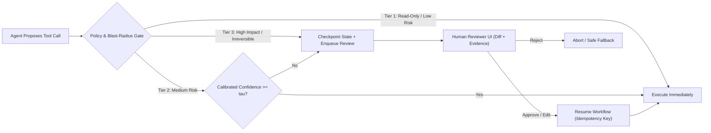
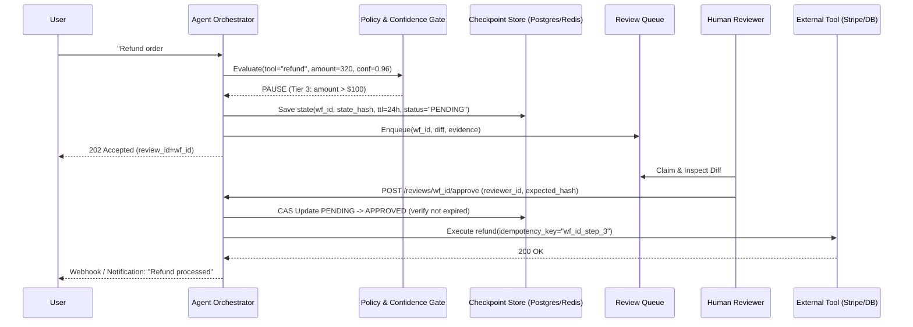
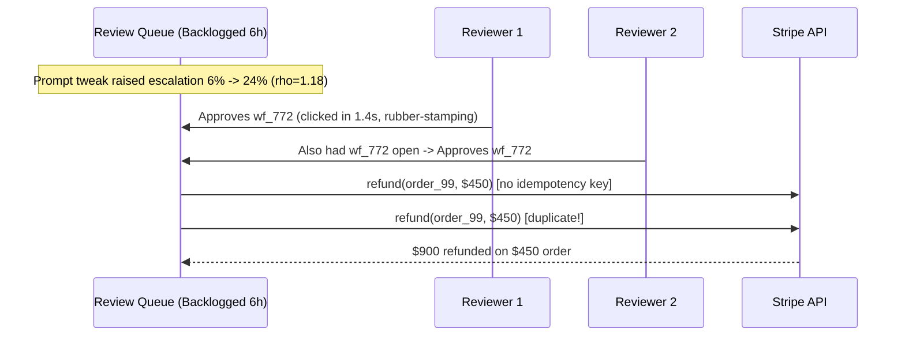

# Human-in-the-Loop AI: Approvals, Confidence Thresholds & Review Queues

> **Prerequisites:** [Lesson 31: Multi-Agent Orchestration](../31-multi-agent-orchestration/README.md).  
> **Estimated Reading Time:** 24–28 minutes  
> **Target Audience:** Staff/Senior backend engineers building AI workflows with financial, legal, or mutating actions, and candidates asked "how do you safely put an LLM in charge of real-world actions?"  
> **Free PDF Notes:** [Download SD-S-032.pdf](https://backendroadmap.com/notes/system-design/SD-S-032.pdf)

> [!NOTE]
> **In one line:** Human-in-the-Loop (HITL) AI gates high-risk or low-confidence AI decisions behind **explicit approval workflows**, **calibrated confidence thresholds**, and **durable review queues**. You gain bounded blast radius and auditability; you pay with **asynchronous latency, human staffing costs, queue backlogs, and reviewer alert fatigue**.

> [!TIP]
> **The Golden Rule:** Gate actions by **blast radius (reversibility $\times$ dollar/data impact)** first, and **calibrated confidence** second. Never hold an HTTP connection open waiting for a human—checkpoint the agent's state durably and resume asynchronously.

---

## 1. What Human-in-the-Loop AI Is, and What It Isn't

An AI expense agent processes 10,000 receipts a day. Auto-approving a $12 coffee receipt with a clear OCR match is safe; auto-executing a $48,000 wire transfer to a new vendor when the LLM is "uncertain" is an existential risk. Conversely, routing *all* 10,000 receipts to humans destroys the ROI of automation and causes reviewers to blindly click "Approve" (rubber-stamping). HITL is the control plane that decides **what runs autonomously**, **what pauses for human sign-off**, and **how the workflow resumes safely hours later**.

| Term | Precise Meaning | Example |
| :--- | :--- | :--- |
| **HITL (Pre-execution gate)** | Pausing an agent *before* a mutating tool executes until a human approves | Approve/Reject before `issue_refund($500)` |
| **Confidence threshold ($\tau$)** | Minimum calibrated score required for autonomous execution | Auto-approve if $p_{\text{cal}} \ge 0.92$, else queue |
| **Blast-radius policy** | Deterministic rules based on action reversibility and impact | All `DELETE` or `> $1,000` actions require approval |
| **Review queue** | Durable work queue (SQS/DB/Temporal) routing items to human operators | Fraud & Compliance Review Dashboard |
| **Durable checkpoint** | Serialized agent state saved while waiting hours/days for human input | LangGraph/Temporal workflow state ID |
| **Rubber-stamping** | Reviewers blindly approving items due to high volume or poor UI context | >98% approve rate in <2 seconds per item |
| **Not** | A synchronous `input()` prompt or a substitute for input/output guardrails | Blocking a REST call for 20 minutes fails UX |

### Why It Matters
1. **Irreversible actions need circuit breakers:** LLMs are probabilistic; databases and payment rails are unforgiving.
2. **Human capacity is a finite queue:** Without queueing math, a 5% escalation rate spike can create a 12-hour backlog.
3. **Every approval is training/eval data:** Human overrides (`Reject` or `Edit`) form the highest-signal golden dataset for improving prompts and fine-tuning.

---

## 2. Anatomy: Risk-Tiered Gate & Durable Review Queue



A production HITL architecture separates **deterministic policy checks** (dollar caps, PII export, production deploys) from **probabilistic confidence checks** (classification/extraction certainty). When an action pauses, the agent's memory and proposed tool arguments are persisted to a durable store, and the HTTP request returns `202 Accepted` with a `review_id`.

| Tier | Examples | Gate Rule | Execution Model |
| :--- | :--- | :--- | :--- |
| **Tier 1 (Low)** | Search KB, draft email, tag ticket | Auto-execute | Synchronous |
| **Tier 2 (Medium)** | Refund $\$20$–$\$250$, update CRM field | Auto if $p_{\text{cal}} \ge \tau$, else HITL | Sync or Async `202` |
| **Tier 3 (High)** | Refund $> \$250$, wire transfer, delete user | **Always HITL** (even if $p = 0.999$) | Async Durable Checkpoint |

> [!WARNING]
> **The #1 HITL Trap: Trusting Raw LLM Confidence ("I am 99% sure") or Uncalibrated Logprobs.** LLMs are notoriously overconfident on hallucinations. Never ask an LLM *"rate your confidence 1–10"* and trust it raw. Calibrate scores against a held-out validation set (temperature scaling / isotonic regression) and **always** enforce hard deterministic caps for Tier 3 actions.

---

## 3. Mathematical Model: Expected Cost Optimization & Queueing Capacity

**Optimal Confidence Threshold ($\tau$).** Suppose an AI classifier processes $N$ tasks/day. For a given threshold $\tau$:
- Fraction $A(\tau)$ is auto-executed with error rate $e_{\text{auto}}(\tau)$, each mistake costing $C_{\text{err}}$.
- Fraction $1 - A(\tau)$ is escalated to human review, costing $C_{\text{rev}}$ per review (with residual human error $e_{\text{hum}} \ll e_{\text{auto}}$).

$$\text{Total Cost}(\tau) = N \Big[ A(\tau) \cdot e_{\text{auto}}(\tau) \cdot C_{\text{err}} + \big(1 - A(\tau)\big) \cdot \big(C_{\text{rev}} + e_{\text{hum}}\,C_{\text{err}}\big) \Big]$$

The optimal $\tau^*$ sits where the marginal cost of one more mistake equals the marginal cost of one more human review.

**Review Queue Stability (Little's Law & Utilization).** Let total AI traffic be $\Lambda$ tasks/hour, escalation rate be $r = 1 - A(\tau)$, so review arrival rate is $\lambda = \Lambda \cdot r$. With $c$ human reviewers each handling $\mu$ reviews/hour:

$$\rho = \frac{\lambda}{c \cdot \mu} < 0.85, \qquad L = \lambda \cdot W$$

If $\rho \ge 1.0$, the review queue grows without bound and SLA breaches cascade.

### Worked Numerical Example
An AI invoice system processes $\Lambda = 2,000$ invoices/hour ($C_{\text{err}} = \$400$, $C_{\text{rev}} = \$1.50$, $e_{\text{hum}} = 0.002$).
- At $\tau = 0.85$: $A = 0.90$ (10% escalated $\implies \lambda = 200$/hr), $e_{\text{auto}} = 0.015$.
  - Hourly cost $= 2000 [0.90(0.015)(400) + 0.10(1.50 + 0.002 \times 400)] = 2000 [5.40 + 0.23] = \mathbf{\$11,260/\text{hr}}$.
- At $\tau = 0.94$: $A = 0.78$ (22% escalated $\implies \lambda = 440$/hr), $e_{\text{auto}} = 0.003$.
  - Hourly cost $= 2000 [0.78(0.003)(400) + 0.22(2.30)] = 2000 [0.936 + 0.506] = \mathbf{\$2,884/\text{hr}}$ (**74% cheaper**).
- **Staffing Check:** At $\tau = 0.94$, $\lambda = 440$/hr. If each reviewer handles $\mu = 30$ reviews/hr, minimum reviewers for $\rho \le 0.85$ is $c \ge \frac{440}{0.85 \times 30} = 17.25 \implies \mathbf{18\text{ reviewers}}$.

---

## 4. Metrics & Percentiles

| Metric | Meaning | Alert when |
| :--- | :--- | :--- |
| **Escalation rate ($r$)** | % of AI actions routed to human review | Spikes $> +50\%$ vs baseline (queue risk) or $> 30\%$ (fatigue) |
| **Queue wait time $p_{95}$** | Time from pause to human decision | Exceeds SLA (e.g., $> 15\text{ min}$ for live ops) |
| **Reviewer utilization ($\rho$)** | $\lambda / (c \cdot \mu)$ | $> 0.85$ sustained (queue instability) |
| **Human override rate** | % of escalated items rejected or edited | $< 2\%$ (rubber-stamping!) or $> 40\%$ (model drift) |
| **False-auto rate** | Auto-approved items later found erroneous | Exceeds risk budget (e.g., $> 0.5\%$) |
| **Expected Calibration Error (ECE)** | Gap between predicted confidence and true accuracy | $> 0.05$ after model/prompt update |

### Worked Example (Live Support Refund)
A customer requests a $\$180$ refund for a delayed flight. Policy allows auto-approval up to $\$100$ if $p_{\text{cal}} \ge 0.90$. Because $\$180 > \$100$, the **Policy Gate** triggers Tier 3 HITL. The orchestrator checkpoints `workflow_id=wf_981`, returns *"Your refund request is under specialist review (est. 10 min)"*, and pushes a structured card to the agent queue showing: (1) order metadata, (2) delay proof, (3) proposed tool call `refund(amount=180, currency="USD")`, and (4) **Approve / Edit / Reject** buttons.

---

## 5. Compounding & Failure Modes

| Failure Mode | Mechanism | Quantitative Impact |
| :--- | :--- | :--- |
| **Rubber-stamping (Alert Fatigue)** | Reviewers see 300+ low-signal items/shift without highlighted diffs | Review time drops $< 2\text{ s}$; human error rate spikes from $0.2\%$ to $18\%$ |
| **Queue Blowup ($\rho \to 1$)** | Prompt change drops confidence slightly, doubling escalation rate $5\% \to 10\%$ | With $c$ fixed, $\rho$ jumps $0.45 \to 0.90$; $p_{95}$ wait explodes $10\times$ |
| **Stale State on Resume** | Human approves 4 hours later, but the order was already refunded manually | Double-refund unless resume checks state version + idempotency key |
| **Uncalibrated Model Shift** | Model swap shifts logprobs; $\tau = 0.90$ now accepts 8% errors | False-auto losses spike $4\times$ before monthly audit catches it |

---

## 6. Numbers Every Engineer Must Know

| Item | Typical | Implication |
| :--- | :--- | :--- |
| **Target reviewer utilization ($\rho$)** | $0.70$–$0.85$ | Leave 15–30% headroom for traffic bursts and breaks |
| **Healthy human override rate** | $5\%$–$25\%$ | $<2\%$ signals rubber-stamping; $>40\%$ signals bad AI threshold |
| **Review UI context load** | $15$–$30\text{ s}$ / item | Show structured diff + evidence, never raw 5,000-token chat logs |
| **Checkpoint TTL (expiration)** | $24$–$72\text{ hours}$ | Auto-expire stale approvals so old actions don't fire days later |
| **Calibration audit cadence** | Weekly / per model deploy | Re-fit $\tau$ whenever model, prompt, or RAG corpus changes |
| **Tier 3 auto-approval limit** | $0\%$ | Irreversible high-blast-radius actions never bypass policy gates |

---

## 7. Protocol / Mechanism Deep Dive



Notice two critical distributed-systems guarantees in the resume path:
1. **Compare-And-Swap (CAS) on `status = PENDING` and `state_hash`**: Prevents two reviewers from approving the same item twice, and prevents approving an item whose underlying order mutated while waiting.
2. **Deterministic `idempotency_key` (`wf_id + step_id`)**: Guarantees at-most-once side effects if the resume worker crashes and retries.

| Question | Answer |
| :--- | :--- |
| **When should you NOT use synchronous HITL?** | Always avoid synchronous blocking for human review. Even "fast" reviews take 30–120 seconds, which exhausts HTTP worker pools and trips client/gateway timeouts. |
| **How do you prevent rubber-stamping?** | Inject synthetic "canary" trap items with known bugs into the queue to measure reviewer attentiveness, show concise diffs, and auto-approve genuinely trivial Tier 1 items. |
| **What if no human reviews within the TTL?** | Transition to `EXPIRED` and notify the user/requester to re-initiate; never auto-approve on timeout! |

---

## 8. Hierarchical Budgets & Design Rules

| Slice | Rule | Control |
| :--- | :--- | :--- |
| **Blast Radius** | Hard-coded monetary/scope caps | `amount > $100` or `action == "delete"` always triggers Tier 3 HITL |
| **Confidence Gate** | Calibrated probability threshold | `calibrated_prob < 0.92` triggers Tier 2 HITL |
| **Queue Capacity** | Bound utilization $\rho < 0.85$ | Shed low-priority reviews or raise auto-threshold only for Tier 1/2 if SLA breaches |
| **Idempotency** | One execution per approved checkpoint | Deterministic `idempotency_key = hash(wf_id, step_id)` |
| **Optimistic Concurrency** | Guard against stale state on resume | `UPDATE reviews SET status='APPROVED' WHERE id=$1 AND status='PENDING' AND expires_at > NOW()` |
| **Audit Trail** | Immutable compliance log | Store `(wf_id, model_version, prompt_hash, conf, reviewer_id, decision, timestamp)` |

---

## 9. Top Mitigations

1. **Separate deterministic Policy Gates from probabilistic Confidence Gates** so a prompt injection or hallucinated `0.99` confidence can never bypass a $\$100$ or `DELETE` limit.
2. **Calibrate confidence scores** on a labeled validation set (Platt/temperature scaling) instead of trusting raw LLM self-ratings.
3. **Design the Review UI around diffs, not chat transcripts:** Highlight exact `before -> after` parameters, dollar impact, and 1-click evidence links.
4. **Expire stale checkpoints (`ttl = 24h`)** and verify `state_hash` before executing on resume.
5. **Attach idempotency keys** to every resumed tool call so worker retries never double-charge or double-email.
6. **Monitor reviewer override rate and review duration** to catch rubber-stamping early.
7. **Feed every human `Edit` and `Reject` back into the eval dataset** to continuously raise calibrated accuracy and reduce escalation volume.

---

## 10. Production Reference / War Story

**Incident (SEV-1): The Rubber-Stamping & Stale-Approval Double-Refund.**  
An e-commerce company routed all AI-proposed refunds $> \$50$ to an internal support review queue, but lacked checkpoint expiration, CAS locking, and diff-focused UIs.



**Root Cause:** (1) A prompt update lowered model confidence, quadrupling escalations ($\rho = 1.18$) and creating a 6-hour backlog; (2) overwhelmed reviewers rubber-stamped items in $< 2\text{ s}$; (3) two reviewers claimed the same item without CAS status locking, and the resume executor lacked a Stripe idempotency key—causing 43 double-refunds before finance caught it.

**Fix:** Implemented atomic `UPDATE ... WHERE status='PENDING'` claim/approve locking, deterministic `wf_id + step_id` Stripe idempotency keys, 24-hour TTL expiration, and a CI gate blocking deploys that shift escalation rate $> +3\%$.

---

## 11. Multi-Language Production Code Tabs

````carousel
```go
// Go: Risk-tiered HITL Gate + Atomic Compare-And-Swap Resume.
package hitl

import (
	"context"
	"errors"
	"fmt"
	"sync"
	"time"
)

type Decision string

const (
	DecisionAutoExecute Decision = "AUTO_EXECUTE"
	DecisionRequireHITL Decision = "REQUIRE_HITL"
)

type ActionProposal struct {
	WorkflowID   string
	StepID       string
	ToolName     string
	AmountUSD    float64
	Irreversible bool
	CalibratedP  float64
}

func EvaluateGate(p ActionProposal, minConf float64, maxAutoUSD float64) Decision {
	// Deterministic blast-radius rules always run before confidence checks.
	if p.Irreversible || p.AmountUSD > maxAutoUSD {
		return DecisionRequireHITL
	}
	if p.CalibratedP < minConf {
		return DecisionRequireHITL
	}
	return DecisionAutoExecute
}

type ReviewItem struct {
	ID         string
	Proposal   ActionProposal
	Status     string // PENDING, APPROVED, REJECTED, EXPIRED
	ExpiresAt  time.Time
	ReviewerID string
}

type ReviewStore struct {
	mu    sync.Mutex
	items map[string]*ReviewItem
}

func (s *ReviewStore) ApproveAndClaim(ctx context.Context, id, reviewerID string, now time.Time) (ActionProposal, error) {
	s.mu.Lock()
	defer s.mu.Unlock()

	item, ok := s.items[id]
	if !ok {
		return ActionProposal{}, errors.New("review not found")
	}
	if now.After(item.ExpiresAt) {
		item.Status = "EXPIRED"
		return ActionProposal{}, errors.New("checkpoint expired")
	}
	// CAS guard: only PENDING items can transition to APPROVED.
	if item.Status != "PENDING" {
		return ActionProposal{}, fmt.Errorf("invalid state transition from %s", item.Status)
	}
	item.Status = "APPROVED"
	item.ReviewerID = reviewerID
	return item.Proposal, nil
}
```
<!-- slide -->
```typescript
// TypeScript: Policy + Confidence Gate with Durable Checkpoint & Idempotent Resume.
export type GateDecision = "AUTO_EXECUTE" | "REQUIRE_HITL";

export interface ActionProposal {
  workflowId: string;
  stepId: string;
  toolName: string;
  amountUsd: number;
  irreversible: boolean;
  calibratedConfidence: number;
}

export function evaluateHitlGate(
  proposal: ActionProposal,
  minConfidence = 0.92,
  maxAutoUsd = 100
): GateDecision {
  if (proposal.irreversible || proposal.amountUsd > maxAutoUsd) {
    return "REQUIRE_HITL";
  }
  if (proposal.calibratedConfidence < minConfidence) {
    return "REQUIRE_HITL";
  }
  return "AUTO_EXECUTE";
}

export interface Checkpoint {
  id: string;
  proposal: ActionProposal;
  status: "PENDING" | "APPROVED" | "REJECTED" | "EXPIRED";
  expiresAtMs: number;
}

export class InMemoryReviewQueue {
  private store = new Map<string, Checkpoint>();

  enqueue(proposal: ActionProposal, ttlMs = 86_400_000): string {
    const id = `${proposal.workflowId}:${proposal.stepId}`;
    this.store.set(id, {
      id,
      proposal,
      status: "PENDING",
      expiresAtMs: Date.now() + ttlMs,
    });
    return id;
  }

  approve(id: string): { proposal: ActionProposal; idempotencyKey: string } {
    const cp = this.store.get(id);
    if (!cp) throw new Error(`Checkpoint ${id} not found`);
    if (Date.now() > cp.expiresAtMs) {
      cp.status = "EXPIRED";
      throw new Error(`Checkpoint ${id} expired`);
    }
    if (cp.status !== "PENDING") {
      throw new Error(`Cannot approve checkpoint in status ${cp.status}`);
    }
    cp.status = "APPROVED";
    return { proposal: cp.proposal, idempotencyKey: `idem_${id}` };
  }
}
```
<!-- slide -->
```python
# Python: HITL Risk Gate, Queue Stability Check, and CAS Checkpoint Store.
from dataclasses import dataclass
from datetime import datetime, timedelta, timezone
from enum import Enum
from typing import Dict


class GateDecision(str, Enum):
    AUTO_EXECUTE = "AUTO_EXECUTE"
    REQUIRE_HITL = "REQUIRE_HITL"


@dataclass(frozen=True)
class ActionProposal:
    workflow_id: str
    step_id: str
    tool_name: str
    amount_usd: float
    irreversible: bool
    calibrated_confidence: float


def evaluate_hitl_gate(
    proposal: ActionProposal,
    min_confidence: float = 0.92,
    max_auto_usd: float = 100.0,
) -> GateDecision:
    if proposal.irreversible or proposal.amount_usd > max_auto_usd:
        return GateDecision.REQUIRE_HITL
    if proposal.calibrated_confidence < min_confidence:
        return GateDecision.REQUIRE_HITL
    return GateDecision.AUTO_EXECUTE


@dataclass
class Checkpoint:
    proposal: ActionProposal
    expires_at: datetime
    status: str = "PENDING"
    reviewer_id: str | None = None


class ReviewQueue:
    def __init__(self) -> None:
        self._items: Dict[str, Checkpoint] = {}

    def enqueue(self, proposal: ActionProposal, ttl_hours: int = 24) -> str:
        key = f"{proposal.workflow_id}:{proposal.step_id}"
        self._items[key] = Checkpoint(
            proposal=proposal,
            expires_at=datetime.now(timezone.utc) + timedelta(hours=ttl_hours),
        )
        return key

    def approve(self, key: str, reviewer_id: str) -> tuple[ActionProposal, str]:
        cp = self._items.get(key)
        if not cp:
            raise KeyError(f"Unknown checkpoint {key}")
        if datetime.now(timezone.utc) > cp.expires_at:
            cp.status = "EXPIRED"
            raise TimeoutError(f"Checkpoint {key} expired")
        if cp.status != "PENDING":
            raise RuntimeError(f"Checkpoint {key} already {cp.status}")
        cp.status = "APPROVED"
        cp.reviewer_id = reviewer_id
        return cp.proposal, f"idem_{key}"
```
<!-- slide -->
```csharp
// C#: Blast-Radius + Confidence HITL Gate with Optimistic Checkpoint Resume.
using System;
using System.Collections.Concurrent;

public enum GateDecision { AutoExecute, RequireHitl }

public sealed record ActionProposal(
    string WorkflowId,
    string StepId,
    string ToolName,
    decimal AmountUsd,
    bool Irreversible,
    double CalibratedConfidence);

public static class HitlGate
{
    public static GateDecision Evaluate(
        ActionProposal proposal,
        double minConfidence = 0.92,
        decimal maxAutoUsd = 100m)
    {
        if (proposal.Irreversible || proposal.AmountUsd > maxAutoUsd)
            return GateDecision.RequireHitl;
        if (proposal.CalibratedConfidence < minConfidence)
            return GateDecision.RequireHitl;
        return GateDecision.AutoExecute;
    }
}

public sealed class ReviewCheckpoint
{
    public required ActionProposal Proposal { get; init; }
    public required DateTimeOffset ExpiresAt { get; init; }
    public string Status { get; set; } = "PENDING";
    public readonly object SyncRoot = new();
}

public sealed class ReviewQueue
{
    private readonly ConcurrentDictionary<string, ReviewCheckpoint> _store = new();

    public string Enqueue(ActionProposal proposal, TimeSpan ttl)
    {
        var key = $"{proposal.WorkflowId}:{proposal.StepId}";
        _store[key] = new ReviewCheckpoint
        {
            Proposal = proposal,
            ExpiresAt = DateTimeOffset.UtcNow.Add(ttl)
        };
        return key;
    }

    public (ActionProposal Proposal, string IdempotencyKey) Approve(string key)
    {
        if (!_store.TryGetValue(key, out var cp))
            throw new KeyNotFoundException($"Checkpoint {key} not found");

        lock (cp.SyncRoot)
        {
            if (DateTimeOffset.UtcNow > cp.ExpiresAt)
            {
                cp.Status = "EXPIRED";
                throw new TimeoutException($"Checkpoint {key} expired");
            }
            if (cp.Status != "PENDING")
                throw new InvalidOperationException($"Checkpoint {key} is {cp.Status}");

            cp.Status = "APPROVED";
            return (cp.Proposal, $"idem_{key}");
        }
    }
}
```
````

---

## 12. Hands-On CLI Verification Workflows

```bash
# 1. Calculate minimum human reviewers needed for rho <= 0.85
python3 -c '
traffic_per_hr = 2000
escalation_rate = 0.18
reviews_per_hr_per_person = 30
lam = traffic_per_hr * escalation_rate
min_reviewers = lam / (0.85 * reviews_per_hr_per_person)
print(f"arrival_rate={lam}/hr, min_reviewers_for_85pct_util={min_reviewers:.2f}")
'

# 2. Verify Expected Calibration Error (ECE) on a sample prediction bin table
python3 -c '
bins = [(0.55, 0.52, 100), (0.75, 0.71, 200), (0.95, 0.89, 700)]
total = sum(n for _, _, n in bins)
ece = sum((n / total) * abs(acc - conf) for conf, acc, n in bins)
print(f"ECE = {ece:.4f} (alert if > 0.05)")
'

# 3. Inspect stale pending HITL checkpoints older than 24h in PostgreSQL
psql "$DATABASE_URL" -c "
SELECT status, COUNT(*), MAX(NOW() - created_at) AS oldest_age
FROM hitl_checkpoints
GROUP BY status;
"
```

---

## 13. Common Mistakes to Avoid

1. **Blocking an HTTP request synchronously** while waiting for human approval.
2. **Trusting raw LLM self-reported confidence** instead of calibrated scores + deterministic rules.
3. **Allowing high-confidence scores to bypass Tier 3 blast-radius limits** (e.g., `amount > $1,000`).
4. **Dumping raw 5,000-token chat logs into the review UI** instead of structured diffs, causing rubber-stamping.
5. **Omitting CAS status locking and idempotency keys on resume**, causing double-execution.
6. **Auto-approving on review timeout** instead of transitioning to `EXPIRED`.
7. **Ignoring reviewer utilization ($\rho$)** until the queue blows up after a prompt change.
8. **Throwing away human rejection/edit logs** instead of feeding them into eval datasets.

---

## 14. Key Terms Glossary

| Key Term | Definition |
| :--- | :--- |
| **Human-in-the-Loop (HITL)** | Architecture that pauses AI actions for human approval, editing, or rejection. |
| **Blast radius** | Combined impact and reversibility of a proposed tool action. |
| **Confidence threshold ($\tau$)** | Minimum calibrated score required for autonomous execution. |
| **Calibration (ECE)** | Alignment between predicted confidence and empirical accuracy. |
| **Durable checkpoint** | Persisted agent state allowing async pause and resume hours later. |
| **Review queue** | Prioritized work queue delivering diffs and evidence to human operators. |
| **Reviewer utilization ($\rho$)** | Ratio of review arrival rate to total human review capacity ($\lambda / c\mu$). |
| **Rubber-stamping** | Blindly approving items due to overload or poor UI signal. |
| **Compare-And-Swap (CAS)** | Atomic state transition ensuring a checkpoint is approved at most once. |
| **Idempotency key** | Unique token preventing duplicate side effects when resumed workers retry. |

---

## 15. System Design Interview Questions & Answers

### Basic Conceptual Questions

<details>
<summary><strong>Q1: Why not just put a human in the loop for every AI action? [BASIC]</strong></summary>

**Answer:**
Because human capacity is expensive and slow. Reviewing 100% of actions destroys latency and ROI, and causes **rubber-stamping** (alert fatigue), where reviewers blindly approve everything and error rates actually *increase*. Use risk tiers so only high-blast-radius or low-confidence actions hit humans.
</details>

<details>
<summary><strong>Q2: What is the difference between a policy gate and a confidence gate? [BASIC]</strong></summary>

**Answer:**
A **policy gate** is deterministic and based on blast radius (e.g., `amount > $100` or `DELETE` always requires approval regardless of confidence). A **confidence gate** is probabilistic and routes medium-risk actions to humans when calibrated model certainty falls below threshold $\tau$.
</details>

<details>
<summary><strong>Q3: Why must HITL workflows be asynchronous? [BASIC]</strong></summary>

**Answer:**
Human review takes seconds to hours, whereas HTTP/gRPC requests time out in 30–60 seconds and hold expensive server connections/threads. Checkpoint state durably, return `202 Accepted`, and resume via webhook or queue event.
</details>

<details>
<summary><strong>Q4: What happens if a checkpoint expires without human action? [BASIC]</strong></summary>

**Answer:**
It must transition to `EXPIRED` and abort safely—**never** auto-approve on timeout, which would let an attacker or outage bypass approval simply by flooding the queue.
</details>

### Scenario-Based Architecture Questions

<details>
<summary><strong>Q5: How do you pick the confidence threshold $\tau$ for an AI invoice system? [SCENARIO]</strong></summary>

**Answer:**
Model total expected cost $C(\tau) = N[A(\tau) e_{\text{auto}}(\tau) C_{\text{err}} + (1 - A(\tau)) C_{\text{rev}}]$ using a calibrated validation curve, then verify that the resulting escalation rate $\lambda = \Lambda(1 - A(\tau))$ keeps reviewer utilization $\rho = \lambda / (c\mu) < 0.85$.
</details>

<details>
<summary><strong>Q6: Reviewers are approving 99.5% of AI proposals in under 2 seconds, yet bad refunds are slipping through. What is happening and how do you fix it? [SCENARIO]</strong></summary>

**Answer:**
**Rubber-stamping** from alert fatigue. Fix it by: (1) raising auto-approval for genuinely safe low-risk items to cut noise, (2) redesigning the UI to highlight exact diffs and risk flags instead of raw transcripts, and (3) injecting synthetic canary trap items to measure reviewer accuracy.
</details>

<details>
<summary><strong>Q7: Two reviewers click "Approve" on the same queued refund, or a user cancels the order while the review is pending. How do you stay safe? [SCENARIO]</strong></summary>

**Answer:**
Use an atomic **Compare-And-Swap (CAS)** update (`WHERE status = 'PENDING' AND state_hash = $expected AND expires_at > NOW()`), and pass a deterministic `idempotency_key` (`wf_id + step_id`) to the payment API so retries never double-refund.
</details>

<details>
<summary><strong>Q8: A prompt update accidentally drops model confidence and doubles the escalation rate. How do you protect the review team? [SCENARIO]</strong></summary>

**Answer:**
Gate prompt/model deploys in CI against escalation-rate drift on a golden set; in production, monitor $\rho$ and queue age $p_{95}$, prioritize Tier 3 (high-value) items in a priority queue, and shed or defer Tier 1/2 items rather than starving critical reviews.
</details>

### Advanced & Tricky Interview Questions

<details>
<summary><strong>Q9: Why can't you just ask the LLM "rate your confidence 1–10" or use raw token logprobs? [TRICKY]</strong></summary>

**Answer:**
Verbalized confidence is poorly calibrated and biased toward 8–10/10 even on hallucinations. Raw token logprobs measure *surface phrasing certainty*, not *semantic correctness* (multiple valid phrasings split probability mass). You must calibrate scores on a held-out labeled dataset (temperature scaling / isotonic regression) and measure ECE.
</details>

<details>
<summary><strong>Q10: How do you handle "Approve with Edits" in an agentic loop? [TRICKY]</strong></summary>

**Answer:**
Treat the human edit as a **structured state patch** injected into the checkpoint before resuming: record both the AI's original proposal and the human's edited arguments in the audit log, re-run deterministic schema/policy validation on the edited payload, and execute with the same idempotency key.
</details>

<details>
<summary><strong>Q11: How do you design priority scheduling in a HITL review queue? [TRICKY]</strong></summary>

**Answer:**
Use multi-lane priority queues ordered by `(risk_tier, sla_deadline_remaining, dollar_value)` with **aging** so lower-tier items don't starve indefinitely. Never use pure FIFO when both $\$20$ low-risk and $\$50,000$ urgent items share a queue.
</details>

<details>
<summary><strong>Q12: How do you turn HITL operations into a compounding flywheel? [TRICKY]</strong></summary>

**Answer:**
Log every `(input, model_output, calibrated_conf, human_decision, human_edit)` tuple. Automatically promote `Reject` and `Edit` cases into regression eval datasets and DPO/SFT fine-tuning pipelines, steadily lowering $e_{\text{auto}}(\tau)$ and shrinking escalation volume over time.
</details>

---

## 16. One-Page Master Cheat Sheet

```
+---------------------------------------------------------------------------------------------------------+
|                    HUMAN-IN-THE-LOOP AI — MASTER CHEAT SHEET                                            |
+---------------------------------------------------------------------------------------------------------+
| 1. TWO GATES: Policy Gate (deterministic blast radius: irreversibility, $$ cap) ALWAYS runs before      |
|    Confidence Gate (calibrated score >= tau). Never trust raw LLM "I am 99% sure".                      |
+---------------------------------------------------------------------------------------------------------+
| 2. NEVER BLOCK SYNC: Checkpoint state durably -> return 202 Accepted -> enqueue diff -> resume async.   |
+---------------------------------------------------------------------------------------------------------+
| 3. RESUME SAFETY: Atomic CAS (status='PENDING' + state_hash) + TTL expiry (never auto-approve!) +       |
|    deterministic idempotency_key (wf_id + step_id).                                                     |
+---------------------------------------------------------------------------------------------------------+
| 4. QUEUE MATH: rho = (Lambda * escalation_rate) / (c * mu) < 0.85.                                      |
|    Optimal tau minimizes: AutoErrorRate*MistakeCost + EscalationRate*ReviewCost.                        |
+---------------------------------------------------------------------------------------------------------+
| 5. WATCH FOR: Rubber-stamping (override <2%, <2s/item) · Queue blowup (rho -> 1) · Uncalibrated ECE.    |
+---------------------------------------------------------------------------------------------------------+
```

---

## Further Reading & Sources

- Anthropic, [Building Effective Agents](https://www.anthropic.com/research/building-effective-agents) (human-in-the-loop checkpoints for high-stakes actions).
- Temporal Documentation, [Human-in-the-Loop Durable Execution Patterns](https://temporal.io/).
- Guo et al., *On Calibration of Modern Neural Networks* (ICML, Temperature Scaling & ECE).
- Chip Huyen, *AI Engineering* (O'Reilly), Chapter 9: "Inference Optimization & Human Feedback".

---

## Free PDF Notes

[SD-S-032.pdf](https://backendroadmap.com/notes/system-design/SD-S-032.pdf)

---

## Next

Continue with [LLM Guardrails: Moderation, PII, Jailbreaks & Output Checks](../33-llm-guardrails/README.md).
