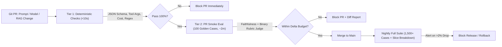
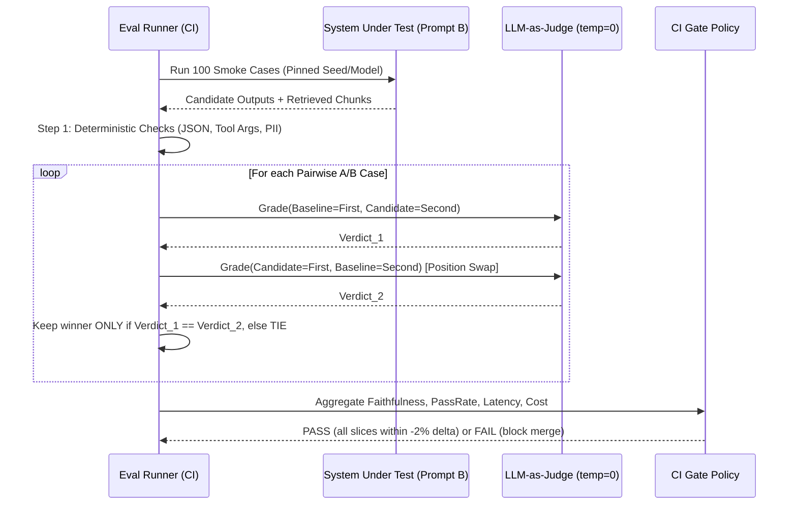
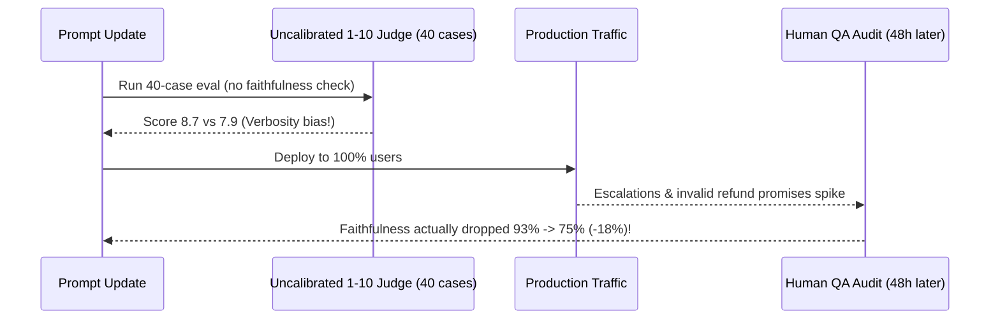

# LLM Evaluation Pipelines: LLM-as-Judge, Faithfulness & CI Gates

> **Prerequisites:** [Lesson 34: Prompt Injection & Data Leakage](../34-prompt-injection-data-leakage/README.md).  
> **Estimated Reading Time:** 25–28 minutes  
> **Target Audience:** Staff/Senior backend and AI platform engineers shipping continuous prompt/model updates, and candidates asked "how do you test an LLM system in CI/CD and prevent silent regressions?"  
> **Free PDF Notes:** [Download SD-S-035.pdf](https://backendroadmap.com/notes/system-design/SD-S-035.pdf)

> [!NOTE]
> **In one line:** An LLM evaluation pipeline replaces "vibes-based" prompt tweaking with a tiered automated harness—combining **deterministic assertions**, **RAG faithfulness/groundedness checks**, and **debiased LLM-as-Judge** scoring—gated by **statistical thresholds in CI/CD** and calibrated against human labels.

> [!TIP]
> **The Golden Rule:** Never run an LLM-as-Judge without **calibrating it against human ground truth** (Cohen's $\kappa \ge 0.7$), and never trust a 30-example eval set to catch a 3% regression—size your CI and nightly suites to the effect size you actually need to detect.

---

## 1. What LLM Evaluation Pipelines Are, and What They Aren't

A team updates two lines in a RAG system prompt to make answers "more concise." They test 10 queries by eye, everything looks great, and they deploy. Two days later, customer support tickets spike: the model stopped citing policy exceptions and began hallucinating refund eligibility on edge cases. Traditional `assert output == expected` unit tests fail because valid LLM phrasing varies infinitely—yet shipping without automated regression gates turns every prompt or model update into a blind production experiment.

| Term | Precise Meaning | Example |
| :--- | :--- | :--- |
| **Deterministic assertion** | Exact code check on structure, regex, tool args, or latency | Valid JSON schema + `tool == "refund"` |
| **RAG Triad** | Context Relevance, Faithfulness (groundedness), Answer Relevance | Decomposing answer into atomic claims vs retrieved chunks |
| **Faithfulness** | Fraction of generated claims directly supported by retrieved context | $4/5$ claims supported $= 0.80$ |
| **LLM-as-Judge** | Using a strong model with a strict rubric to grade another model's output | Grading helpfulness/correctness $1$–$5$ or Pass/Fail |
| **Position-swap debiasing** | Running pairwise A vs B and B vs A to cancel ordering bias | Only declare a winner if both orders agree |
| **CI Gate (Smoke vs Nightly)** | Fast blocking PR check vs deep statistical nightly suite | PR: 100 critical cases ($2\text{ min}$); Nightly: 1,500 cases |
| **Not** | A 100% deterministic pass/fail or a replacement for human review | Judges have bias and variance that must be measured |

### Why It Matters
1. **Prompts, models, and RAG indexes all drift:** Changing a chunk size or embedding model can silently break downstream prompt behavior.
2. **LLM-as-Judge has systematic biases:** Without position swapping and binary/anchored rubrics, judges reward verbose fluff and prefer their own model family.
3. **CI speed vs statistical power is a real trade-off:** Running 2,000 judge calls on every Git commit is too slow and expensive; you need a two-tier gate.

---

## 2. Anatomy: Two-Tier CI Gate & RAG Triad Architecture



The pipeline splits evaluation into **fast deterministic assertions** (free, zero variance), a **PR Smoke Suite** (100 high-signal/adversarial cases catching major breaks in ~2 minutes), and a **Nightly Statistical Suite** (1,500+ cases stratified by slice—billing, refunds, multi-hop, adversarial—to catch subtle 2–3% regressions).

| Eval Method | Speed / Cost | Variance | Best Used For |
| :--- | :--- | :--- | :--- |
| **Code / Schema Assertions** | $<10\text{ ms}$ / $\$0$ | Zero | JSON validity, tool selection, PII absence, latency/cost caps |
| **Embedding / NLI Scorer** | $20$–$50\text{ ms}$ / low | Low | Fast claim-level entailment & context similarity |
| **LLM-as-Judge (Binary / Anchored)** | $300$–$900\text{ ms}$ / medium | Medium | Faithfulness, policy compliance, reasoning correctness |
| **Pairwise A/B Judge (Swapped)** | $2\times$ judge cost | Low-Medium | Comparing Candidate Prompt vs Baseline Prompt |
| **Human Calibration** | Slow / high | Gold Standard | Validating judge agreement ($\kappa$) on 200–300 samples |

> [!WARNING]
> **The #1 Eval Trap: Asking an LLM Judge to Score "1 to 10" Without Anchors or Swapping.** Unanchored 1–10 scales produce noisy clusters around 7–9, and pairwise judges exhibit **position bias** (preferring whichever answer appears first 55–65% of the time) and **verbosity bias** (preferring longer answers even when padded with fluff). Use **binary Pass/Fail criteria** per rubric dimension and **swap A/B order** on pairwise comparisons.

---

## 3. Mathematical Model: Faithfulness, Judge Agreement, and Sample Size

**Faithfulness (Claim-Level Groundedness).** Decompose an LLM answer $A$ into $N_c$ atomic factual claims $\{c_1, \dots, c_{N_c}\}$ and verify each against the retrieved context $C$:

$$\text{Faithfulness}(A, C) = \frac{|\{c_i \in A : C \models c_i\}|}{N_c}$$

**Judge-Human Alignment (Cohen's Kappa $\kappa$).** Accuracy alone misleads when 90% of answers are `PASS`. Cohen's $\kappa$ adjusts observed agreement $p_o$ for chance agreement $p_e$:

$$\kappa = \frac{p_o - p_e}{1 - p_e}$$

Target $\kappa \ge 0.70$ before trusting an automated judge as a CI gate.

**Minimum Sample Size for CI Regression Detection.** To detect an accuracy drop of $\Delta$ (e.g., $90\% \to 87\%$, $\Delta = 0.03$) with 95% confidence ($z_{\alpha/2} = 1.96$) and 80% power ($z_\beta = 0.84$):

$$n \approx \frac{(z_{\alpha/2} + z_\beta)^2 \cdot 2\,p(1 - p)}{\Delta^2}$$

### Worked Numerical Example
1. **Faithfulness:** A RAG answer makes $N_c = 5$ claims; 4 are directly backed by retrieved chunks, 1 is an ungrounded assumption ("shipping is always free"). $\text{Faithfulness} = 4 / 5 = \mathbf{0.80}$.
2. **Cohen's $\kappa$:** On 200 human-labeled answers, Judge and Human agree on 178 ($p_o = 0.89$), while chance agreement is $p_e = 0.62$.
   $$\kappa = \frac{0.89 - 0.62}{1 - 0.62} = \frac{0.27}{0.38} = \mathbf{0.711}\quad (\text{passes } \ge 0.70\text{ calibration bar})$$
3. **Sample Size:** Baseline pass rate $p = 0.90$. To catch a $\Delta = 0.03$ (3%) regression:
   $$n \approx \frac{(1.96 + 0.84)^2 \cdot 2(0.90)(0.10)}{0.03^2} = \frac{7.84 \times 0.18}{0.0009} = \mathbf{1,568\text{ examples}}$$
   A 50-example PR smoke test only has statistical power to catch massive $\Delta \ge 17\%$ collapses—proving why you need **both** a fast PR smoke suite and a $1,500+$-example nightly suite!

---

## 4. Metrics & Percentiles

| Metric | Meaning | Alert when |
| :--- | :--- | :--- |
| **Faithfulness ($p_{10}$ / mean)** | Grounded claims / total claims in RAG output | Mean $< 0.90$ or any critical slice drops $> 2\%$ |
| **Context Recall** | % of ground-truth answer facts present in retrieved chunks | $< 0.85$ (retrieval/chunking bug, not LLM bug) |
| **Answer Relevance** | Does the response actually address the user's question? | $< 0.90$ |
| **Tool-Call Exact Match** | Correct tool name + valid argument schema | $< 0.98$ on deterministic suite |
| **Judge-Human $\kappa$** | Agreement between LLM judge and human experts | $< 0.70$ (re-write judge rubric/few-shots) |
| **Pairwise Tie / Swap-Flip Rate** | % of A/B pairs where Judge flips winner when swapped | $> 15\%$ (high position bias / noisy prompt) |

### Worked Example (Decomposing RAG Failures)
Overall RAG accuracy drops from 89% to 81% after an infrastructure change. Running the **RAG Triad** isolates the cause in minutes:
- **Context Recall** dropped from $0.92 \to 0.74$, while **Faithfulness** stayed at $0.94$.
- **Diagnosis:** The LLM is not hallucinating; the *retriever* (e.g., an embedding model or chunk-size change) stopped fetching the right documents. Without triad decomposition, engineers would waste days tweaking the generation prompt!

---

## 5. Compounding & Failure Modes

| Failure Mode | Mechanism | Impact |
| :--- | :--- | :--- |
| **Position Bias in A/B Judge** | Judge picks Option A ~60% of the time regardless of quality | False promotion of worse prompts unless A/B order is swapped |
| **Verbosity Bias** | Judge scores a 300-word padded answer higher than a crisp 60-word answer | Models get rewarded for rambling, raising token cost and latency |
| **Self-Preference Bias** | Using GPT-4o to judge GPT-4o vs Claude outputs | Judge systematically over-rates its own model family by 5–10% |
| **Golden Set Contamination** | Team optimizes prompts specifically for the same 80 static test questions | Eval hits 99% while production user satisfaction drops |

---

## 6. Numbers Every Engineer Must Know

| Item | Typical | Implication |
| :--- | :--- | :--- |
| **Judge temperature** | `0.0` (greedy) | Minimizes eval variance across CI runs |
| **PR smoke suite size** | $50$–$150$ cases | Runs in $1$–$3\text{ min}$; catches broken schemas, safety, and $>12\%$ drops |
| **Nightly / release suite size** | $1,000$–$2,000$ cases | Statistical power to catch $2\%$–$3\%$ regressions |
| **Minimum Judge-Human $\kappa$** | $\ge 0.70$ | Below 0.70, your CI gate is noisy guesswork |
| **Human calibration sample** | $200$–$300$ stratified items | Re-calibrate whenever the judge model or rubric changes |
| **CI eval cost per PR** | $\$0.20$–$\$2.00$ | Use small/fast judges or deterministic checks first to keep PRs cheap |

---

## 7. Protocol / Mechanism Deep Dive



| Question | Answer |
| :--- | :--- |
| **When should you NOT use LLM-as-Judge?** | Whenever a deterministic check works (JSON validity, exact tool name, numeric math calculation, regex PII check, SQL syntax/execution). Deterministic checks are faster, free, and 100% reproducible. |
| **How do you break self-preference bias?** | Use a **cross-family judge** (e.g., a different model family than the generator) or a panel of 2–3 smaller diverse judges (jury) calibrated against human labels. |
| **How do you prevent overfitting to the golden set?** | Keep a **held-out private test set** refreshed monthly from sampled production failures and HITL human rejections (Lesson 32), never exposed during prompt iteration. |

---

## 8. Hierarchical Budgets & Design Rules

| Slice | Rule | Control |
| :--- | :--- | :--- |
| **Deterministic First** | Assert schemas, types, tool names, and PII before calling any judge | Zero-cost fast fail in `< 10s` |
| **Judge Calibration** | $\kappa \ge 0.70$ vs human experts on 200-item calibration set | Gate judge prompt changes with the same rigor as app prompts |
| **Debiasing** | Position-swap all pairwise A/B comparisons; use binary/anchored rubrics | Discordant swapped pairs become `TIE` |
| **Reproducibility** | Pin judge model snapshot + `temperature=0` + rubric hash | Never use floating `-latest` aliases for CI judges |
| **Slice Reporting** | Never average away regressions across slices | Alert if *any* critical slice (e.g., `refunds` or `injection`) drops $> 2\%$ |
| **Cost & Latency Gate** | Track tokens/req and $p_{95}$ alongside quality | Fail PR if a prompt doubles token cost for $+0.5\%$ quality |

---

## 9. Top Mitigations

1. **Separate retrieval evals (Context Recall/Precision) from generation evals (Faithfulness/Relevance)** so you know whether to fix the vector DB or the prompt.
2. **Use binary or 3-point anchored rubrics** (`PASS`/`FAIL` with explicit criteria) instead of vague 1–10 scales.
3. **Always position-swap pairwise comparisons** `(A, B)` and `(B, A)`, marking flips as `TIE`.
4. **Pin exact judge model versions** (e.g., `gpt-4o-2024-08-06`, never `-latest`) and `temperature=0` so CI doesn't drift randomly.
5. **Stratify your eval suite by failure slice** (happy path, edge cases, multi-turn, adversarial injection, empty retrieval) so overall averages don't hide broken slices.
6. **Continuously mine production failures and HITL overrides** into a rotating held-out eval set to prevent overfitting.
7. **Gate on cost and latency alongside accuracy** so a prompt that triples context length doesn't silently blow up production bills.

---

## 10. Production Reference / War Story

**Incident (SEV-1): The "More Helpful" Prompt That Hallucinated 18% More Policy Exceptions.**  
An e-commerce support team swapped a prompt to sound warmer and tested it with an unanchored 1–10 LLM-as-Judge on 40 internal queries. The judge scored the new prompt **8.7/10 vs 7.9/10** for the old prompt, so they shipped it.



**Root Cause:** (1) The 1–10 judge rewarded **verbosity** (longer, friendlier answers) without checking **Faithfulness** against the retrieved policy chunks; (2) the 40-case eval set lacked edge-case policy exceptions; (3) no human calibration ($\kappa$) had ever been run on the judge.

**Fix:** Replaced the 1–10 judge with claim-level **Faithfulness** + binary policy-compliance rubrics calibrated to $\kappa = 0.78$ against QA reviewers, expanded the nightly suite to 1,500 stratified cases, and blocked deploys on any $>2\%$ Faithfulness drop.

---

## 11. Multi-Language Production Code Tabs

````carousel
```go
// Go: CI Eval Gate Runner with Deterministic Checks, Position-Swapped Judge, and Slice Thresholds.
package evals

import (
	"context"
	"encoding/json"
	"fmt"
)

type EvalCase struct {
	ID      string
	Slice   string
	Prompt  string
	Context string
}

type JudgeVerdict string

const (
	WinA JudgeVerdict = "A"
	WinB JudgeVerdict = "B"
	Tie  JudgeVerdict = "TIE"
)

type PairwiseJudge interface {
	Compare(ctx context.Context, prompt, first, second string) (JudgeVerdict, error)
}

// CompareDebiased runs (A,B) and (B,A) to eliminate LLM judge position bias.
func CompareDebiased(ctx context.Context, j PairwiseJudge, prompt, cand, base string) (JudgeVerdict, error) {
	v1, err := j.Compare(ctx, prompt, cand, base)
	if err != nil {
		return Tie, err
	}
	v2, err := j.Compare(ctx, prompt, base, cand)
	if err != nil {
		return Tie, err
	}
	// Candidate wins only if it wins in BOTH positions.
	if v1 == WinA && v2 == WinB {
		return WinA, nil // Candidate
	}
	if v1 == WinB && v2 == WinA {
		return WinB, nil // Baseline
	}
	return Tie, nil
}

// CheckDeterministicGate validates JSON schema & cost before expensive LLM judging.
func CheckDeterministicGate(rawJSON string, requiredKey string) bool {
	var parsed map[string]any
	if err := json.Unmarshal([]byte(rawJSON), &parsed); err != nil {
		return false
	}
	_, ok := parsed[requiredKey]
	return ok
}

func EnforceRegressionGate(sliceScores map[string]float64, minThreshold float64) error {
	for slice, score := range sliceScores {
		if score < minThreshold {
			return fmt.Errorf("CI gate failed: slice %q faithfulness %.3f < %.3f", slice, score, minThreshold)
		}
	}
	return nil
}
```
<!-- slide -->
```typescript
// TypeScript: Position-Swapped Pairwise Judge + Claim-Level Faithfulness CI Gate.
export type PairwiseOutcome = "CANDIDATE" | "BASELINE" | "TIE";

export interface EvalResult {
  caseId: string;
  slice: string;
  schemaValid: boolean;
  faithfulness: number; // supportedClaims / totalClaims
}

export async function compareDebiased(
  judgeFn: (first: string, second: string) => Promise<"FIRST" | "SECOND" | "TIE">,
  candidate: string,
  baseline: string
): Promise<PairwiseOutcome> {
  const [forward, backward] = await Promise.all([
    judgeFn(candidate, baseline),
    judgeFn(baseline, candidate),
  ]);
  if (forward === "FIRST" && backward === "SECOND") return "CANDIDATE";
  if (forward === "SECOND" && backward === "FIRST") return "BASELINE";
  return "TIE";
}

export function enforceCiGate(
  results: EvalResult[],
  minSchemaPass = 0.99,
  minSliceFaithfulness = 0.90
): void {
  const schemaPassRate =
    results.filter((r) => r.schemaValid).length / Math.max(1, results.length);
  if (schemaPassRate < minSchemaPass) {
    throw new Error(`Schema gate failed: ${(schemaPassRate * 100).toFixed(1)}%`);
  }

  const bySlice = new Map<string, number[]>();
  for (const r of results) {
    const arr = bySlice.get(r.slice) ?? [];
    arr.push(r.faithfulness);
    bySlice.set(r.slice, arr);
  }
  for (const [slice, scores] of bySlice) {
    const avg = scores.reduce((a, b) => a + b, 0) / scores.length;
    if (avg < minSliceFaithfulness) {
      throw new Error(`Slice '${slice}' faithfulness ${avg.toFixed(3)} < ${minSliceFaithfulness}`);
    }
  }
}
```
<!-- slide -->
```python
# Python: Faithfulness Calculator, Cohen's Kappa, Position-Swapped Judge & CI Gate.
from collections import defaultdict
from dataclasses import dataclass
from typing import Callable, Dict, List


@dataclass(frozen=True)
class EvalSample:
    case_id: str
    slice_name: str
    schema_valid: bool
    supported_claims: int
    total_claims: int

    @property
    def faithfulness(self) -> float:
        return self.supported_claims / self.total_claims if self.total_claims else 1.0


def cohens_kappa(y_human: List[int], y_judge: List[int]) -> float:
    n = len(y_human)
    if n == 0 or n != len(y_judge):
        raise ValueError("Label lists must be non-empty and equal length")
    po = sum(h == j for h, j in zip(y_human, y_judge)) / n
    p_h1 = sum(y_human) / n
    p_j1 = sum(y_judge) / n
    pe = (p_h1 * p_j1) + ((1 - p_h1) * (1 - p_j1))
    return (po - pe) / (1 - pe) if pe < 1.0 else 1.0


def debiased_pairwise(
    judge_fn: Callable[[str, str], str], candidate: str, baseline: str
) -> str:
    r1 = judge_fn(candidate, baseline)  # returns "FIRST", "SECOND", or "TIE"
    r2 = judge_fn(baseline, candidate)
    if r1 == "FIRST" and r2 == "SECOND":
        return "CANDIDATE"
    if r1 == "SECOND" and r2 == "FIRST":
        return "BASELINE"
    return "TIE"


def enforce_ci_gate(samples: List[EvalSample], min_faithfulness: float = 0.90) -> None:
    by_slice: Dict[str, List[float]] = defaultdict(list)
    for s in samples:
        if not s.schema_valid:
            raise AssertionError(f"Deterministic schema failure on {s.case_id}")
        by_slice[s.slice_name].append(s.faithfulness)

    for slice_name, scores in by_slice.items():
        mean_score = sum(scores) / len(scores)
        if mean_score < min_faithfulness:
            raise AssertionError(
                f"CI Gate Failed: slice={slice_name} faithfulness={mean_score:.3f} < {min_faithfulness}"
            )
```
<!-- slide -->
```csharp
// C#: Position-Swapped LLM-as-Judge & Stratified Slice Faithfulness CI Gate.
using System;
using System.Collections.Generic;
using System.Linq;
using System.Threading.Tasks;

public sealed record EvalRecord(
    string CaseId,
    string SliceName,
    bool SchemaValid,
    int SupportedClaims,
    int TotalClaims)
{
    public double Faithfulness => TotalClaims == 0 ? 1.0 : (double)SupportedClaims / TotalClaims;
}

public static class EvalGate
{
    public static async Task<string> CompareDebiasedAsync(
        Func<string, string, Task<string>> judgeAsync,
        string candidate,
        string baseline)
    {
        var r1 = await judgeAsync(candidate, baseline);
        var r2 = await judgeAsync(baseline, candidate);
        if (r1 == "FIRST" && r2 == "SECOND") return "CANDIDATE";
        if (r1 == "SECOND" && r2 == "FIRST") return "BASELINE";
        return "TIE";
    }

    public static void Enforce(IReadOnlyList<EvalRecord> records, double minFaithfulness = 0.90)
    {
        var invalid = records.FirstOrDefault(r => !r.SchemaValid);
        if (invalid is not null)
            throw new InvalidOperationException($"Schema failure on case {invalid.CaseId}");

        foreach (var group in records.GroupBy(r => r.SliceName))
        {
            var avg = group.Average(r => r.Faithfulness);
            if (avg < minFaithfulness)
                throw new InvalidOperationException(
                    $"CI Gate Failed: slice '{group.Key}' faithfulness {avg:F3} < {minFaithfulness:F3}");
        }
    }
}
```
````

---

## 12. Hands-On CLI Verification Workflows

```bash
# 1. Compute required eval sample size to detect a 3% regression (95% conf, 80% power)
python3 -c '
p, delta = 0.90, 0.03
n = ((1.96 + 0.84)**2 * 2 * p * (1 - p)) / (delta**2)
print(f"Minimum samples per arm to detect {delta*100:.0f}% delta: {int(n)+1}")
'

# 2. Compute Cohen kappa between Human QA labels and LLM-as-Judge verdicts
python3 -c '
human = [1, 1, 0, 1, 1, 0, 1, 0, 1, 1]
judge = [1, 1, 0, 1, 0, 0, 1, 0, 1, 1]
n = len(human)
po = sum(h == j for h, j in zip(human, judge)) / n
pe = (sum(human)/n)*(sum(judge)/n) + (1-sum(human)/n)*(1-sum(judge)/n)
kappa = (po - pe) / (1 - pe)
print(f"po={po:.2f}, pe={pe:.2f}, kappa={kappa:.3f} (target >= 0.70)")
'

# 3. Run a deterministic + faithfulness CI gate check in GitHub Actions
python3 -m pytest tests/evals/ --tb=short -q
```

---

## 13. Common Mistakes to Avoid

1. **Relying on "vibes" (manual spot-checking 10 examples)** before shipping prompt/model changes.
2. **Using an unanchored 1–10 LLM-as-Judge scale** without human $\kappa$ calibration.
3. **Running pairwise A/B judges in a single order** without position swapping.
4. **Using a 50-example eval set to detect a 2–3% regression** (underpowered statistics).
5. **Averaging scores globally** and missing a 20% regression on a critical slice like `refunds`.
6. **Using `-latest` model aliases or `temperature > 0`** for CI judges, causing random build flakes.
7. **Testing only generation** while ignoring Context Recall (retriever vs generator attribution).
8. **Never rotating or refreshing the golden dataset**, leading to overfitting.

---

## 14. Key Terms Glossary

| Key Term | Definition |
| :--- | :--- |
| **Deterministic assertion** | Exact code check (JSON schema, regex, tool args, latency/cost). |
| **RAG Triad** | Context Relevance, Faithfulness (groundedness), and Answer Relevance. |
| **Faithfulness** | Ratio of claims in the answer supported by the retrieved context. |
| **Context Recall** | Fraction of ground-truth answer facts present in retrieved chunks. |
| **LLM-as-Judge** | Using an LLM with a structured rubric to grade model outputs at scale. |
| **Cohen's Kappa ($\kappa$)** | Chance-corrected agreement metric between LLM judge and human labels. |
| **Position bias** | Judge preference for whichever response appears first in an A/B prompt. |
| **Position swapping** | Running `(A, B)` and `(B, A)` and requiring agreement to declare a winner. |
| **Verbosity bias** | Judge tendency to score longer responses higher regardless of accuracy. |
| **Slice stratification** | Evaluating metrics per domain/risk category rather than one global average. |

---

## 15. System Design Interview Questions & Answers

### Basic Conceptual Questions

<details>
<summary><strong>Q1: Why do traditional unit tests fail for LLM applications? [BASIC]</strong></summary>

**Answer:**
LLMs are stochastic and produce many semantically valid phrasings for the same answer, so exact string equality (`assert out == expected`) breaks constantly. You need deterministic assertions for structure/tools paired with semantic/rubric evals (faithfulness, relevance, LLM-as-Judge) for free-text quality.
</details>

<details>
<summary><strong>Q2: What is the RAG Triad? [BASIC]</strong></summary>

**Answer:**
Three metrics that isolate RAG failures: **Context Relevance** (did we retrieve useful chunks?), **Faithfulness / Groundedness** (did the LLM stick to the retrieved chunks without hallucinating?), and **Answer Relevance** (did the final answer actually address the user's question?).
</details>

<details>
<summary><strong>Q3: What is LLM-as-Judge, and why does it need calibration? [BASIC]</strong></summary>

**Answer:**
Using a strong LLM with an explicit rubric to score outputs automatically. It must be calibrated against human expert labels (targeting Cohen's $\kappa \ge 0.70$) because raw judges suffer from position bias, verbosity bias, and self-preference.
</details>

<details>
<summary><strong>Q4: Why separate PR smoke evals from nightly full evals? [BASIC]</strong></summary>

**Answer:**
Running 1,500+ LLM judge calls on every Git commit takes 20–40 minutes and slows down engineering velocity. A fast 100-case PR smoke suite + deterministic checks runs in ~2 minutes to catch broken schemas and major regressions, while the 1,500-case nightly suite catches subtle 2–3% statistical drifts.
</details>

### Scenario-Based Architecture Questions

<details>
<summary><strong>Q5: After changing chunk size from 512 to 256 tokens, overall RAG quality drops 9%. How do you diagnose why? [SCENARIO]</strong></summary>

**Answer:**
Inspect the RAG Triad by slice: if **Context Recall** dropped while **Faithfulness** stayed high, the retriever is missing needed facts (chunking split key context). If Context Recall stayed high but Faithfulness dropped, the generator is hallucinating or ignoring context.
</details>

<details>
<summary><strong>Q6: Your pairwise LLM-as-Judge says Prompt B beats Prompt A 62% of the time, but humans prefer Prompt A. What went wrong? [SCENARIO]</strong></summary>

**Answer:**
Likely **position bias** (if Prompt B was always shown first) or **verbosity bias** (Prompt B wrote longer, fluffier responses). Fix by position-swapping `(A, B)` and `(B, A)`, marking flips as `TIE`, and adding explicit conciseness/precision criteria to a binary rubric.
</details>

<details>
<summary><strong>Q7: How do you design a CI gate for an agent that calls external tools? [SCENARIO]</strong></summary>

**Answer:**
Separate **trajectory/tool checks** (deterministic assertions against mocked tools verifying the right tool was called with valid JSON args and within `max_hops`) from **final-answer quality checks** (faithfulness + rubric judge). Block PRs on any deterministic tool-schema regression.
</details>

<details>
<summary><strong>Q8: Your global eval pass rate is 91%, yet enterprise billing customers are complaining. Why? [SCENARIO]</strong></summary>

**Answer:**
Global averages hide **slice regressions**. A 95% pass rate on casual chat can mask a drop from 90% to 65% on `enterprise_billing`. Always stratify eval reports and enforce CI gate thresholds *per critical slice*.
</details>

### Advanced & Tricky Interview Questions

<details>
<summary><strong>Q9: How many test cases do you need to reliably detect a 3% accuracy regression? [TRICKY]</strong></summary>

**Answer:**
Using two-proportion power analysis ($p=0.90, \Delta=0.03$, 95% confidence, 80% power), you need $n \approx \frac{7.84 \times 2(0.90)(0.10)}{0.03^2} \approx \mathbf{1,568\text{ cases}}$ per arm. A 50-case eval set only detects massive $>17\%$ drops, which is why small smoke sets must be paired with large nightly suites.
</details>

<details>
<summary><strong>Q10: How do you prevent your team from overfitting prompts to the CI golden dataset? [TRICKY]</strong></summary>

**Answer:**
Maintain a **two-bucket dataset**: a visible dev/CI set for rapid iteration, and a **held-out blind test set** refreshed monthly from sampled production traces and HITL human rejections (Lesson 32) that engineers cannot inspect directly.
</details>

<details>
<summary><strong>Q11: How do you eliminate flakiness in CI evals caused by LLM non-determinism? [TRICKY]</strong></summary>

**Answer:**
Pin exact model snapshots (never `-latest`), set `temperature=0` and fixed `seed` where supported, use deterministic assertions wherever possible, and for borderline cases run `Pass@k` or majority-of-3 voting while tracking judge flip-rate.
</details>

<details>
<summary><strong>Q12: How do you evaluate an LLM system *without* ground-truth reference answers in production? [TRICKY]</strong></summary>

**Answer:**
Use **reference-free metrics** on sampled live traffic: deterministic schema/latency/PII checks on 100% of traffic, plus async NLI/LLM Faithfulness (checking answer claims against retrieved RAG chunks) and Answer Relevance on a 1–5% sample, correlated with implicit user signals (thumbs down, copy, retry, abandonment).
</details>

---

## 16. One-Page Master Cheat Sheet

```
+---------------------------------------------------------------------------------------------------------+
|                  LLM EVALUATION PIPELINES — MASTER CHEAT SHEET                                          |
+---------------------------------------------------------------------------------------------------------+
| 1. EVAL PYRAMID: Deterministic Code/Schema ($0, <10ms) -> RAG Triad (Context Recall + Faithfulness +   |
|    Answer Relevance) -> Debiased LLM-as-Judge -> Human Calibration (Cohen's kappa >= 0.70).             |
+---------------------------------------------------------------------------------------------------------+
| 2. DEBIASING JUDGES: Use binary/anchored rubrics (never raw 1-10) + position-swap (A,B) and (B,A)       |
|    (flips = TIE) + pin model version & temperature=0.                                                   |
+---------------------------------------------------------------------------------------------------------+
| 3. TWO-TIER CI: PR Smoke (~100 cases, 2 min, catches schema & >12% breaks) + Nightly Suite (~1,500+     |
|    cases, catches 2-3% statistical regressions).                                                        |
+---------------------------------------------------------------------------------------------------------+
| 4. SLICE STRATIFICATION: Never average away regressions; gate per critical slice (billing, safety).     |
+---------------------------------------------------------------------------------------------------------+
| 5. FLYWHEEL: Sample prod traces + HITL rejections -> refresh held-out golden set to avoid overfitting.  |
+---------------------------------------------------------------------------------------------------------+
```

---

## Further Reading & Sources

- Hamel Husain, [Your AI Product Needs Evals](https://hamel.dev/blog/posts/evals/).
- Zheng et al., *Judging LLM-as-a-Judge with MT-Bench and Chatbot Arena* (NeurIPS 2023: position, verbosity, and self-enhancement biases).
- Es et al., *RAGAS: Automated Evaluation of Retrieval Augmented Generation* (Faithfulness & Context Recall).
- Chip Huyen, *AI Engineering* (O'Reilly), Chapter 3 & 4: "Evaluation Methodology & Evaluate AI Systems".

---

## Free PDF Notes

[SD-S-035.pdf](https://backendroadmap.com/notes/system-design/SD-S-035.pdf)

---

## Next

Continue with [Observability for LLM Apps: Tracing, Tokens, Cost & OpenTelemetry GenAI](../36-observability-for-llm-apps/README.md).
