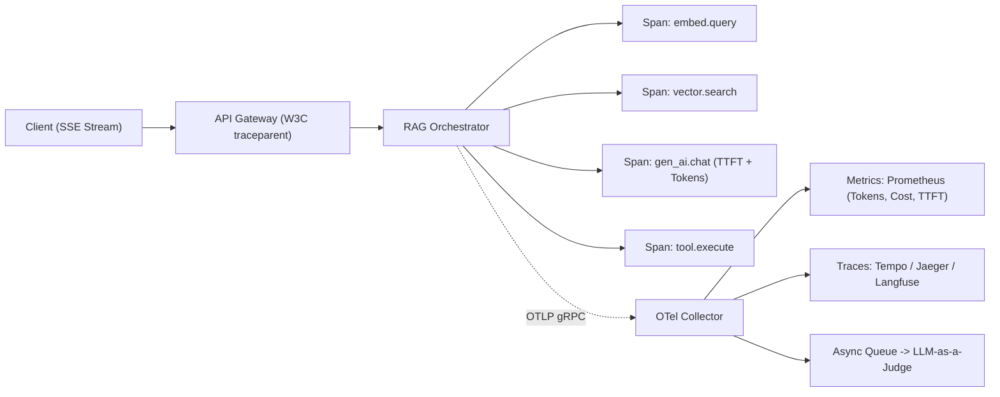
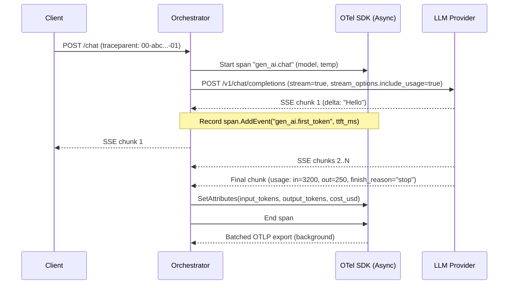
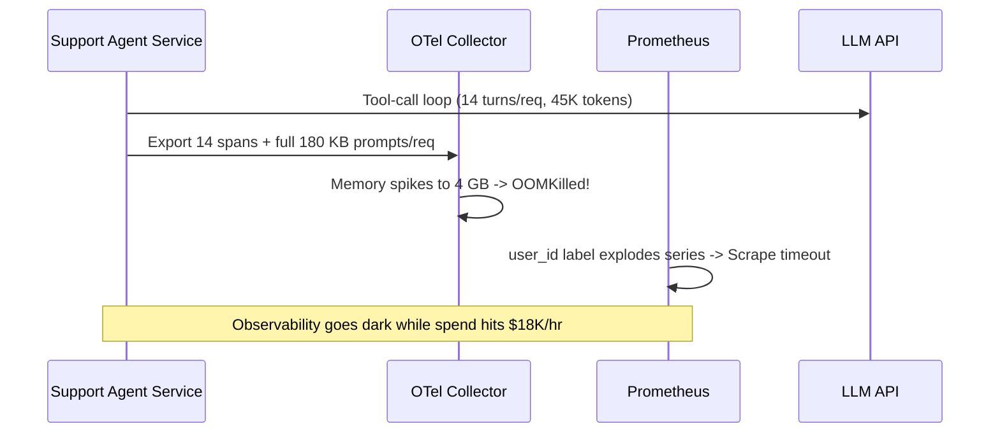

# Observability for LLM Apps: Tracing, Tokens, Cost & OpenTelemetry GenAI

> **Prerequisites:** [Lesson 35: LLM Evaluation Pipelines](../35-llm-evaluation-pipelines/README.md).  
> **Estimated Reading Time:** 24–28 minutes  
> **Target Audience:** Backend and AI platform engineers instrumenting production LLM pipelines, and candidates asked "how do you debug, monitor, and control costs in an LLM system?"  
> **Free PDF Notes:** [Download SD-S-036.pdf](https://backendroadmap.com/notes/system-design/SD-S-036.pdf)

> [!NOTE]
> **In one line:** LLM observability extends distributed tracing, metrics, and structured logging with **semantic telemetry**—tracking prompt/completion tokens, Time to First Token (TTFT), inter-token latency, retrieval quality, tool-call trees, and per-tenant dollar cost using **OpenTelemetry GenAI semantic conventions**.

> [!TIP]
> **The Golden Rule:** HTTP 200 OK does not mean your LLM succeeded. Instrument every span with `gen_ai.usage.input_tokens`, `gen_ai.usage.output_tokens`, `gen_ai.request.model`, and a `trace_id` propagated from the API gateway through retrieval, reranking, tool calls, and async evaluators.

---

## 1. What LLM Observability Is, and What It Isn't

In a traditional microservice, a `200 OK` in 120 ms with zero exceptions means the request succeeded. In a RAG or agentic LLM application, a `200 OK` can return a hallucinated answer, burn 45,000 tokens in a runaway tool-call loop, leak PII, or stall for 9 seconds before emitting the first token. Traditional APM (Application Performance Monitoring) sees a single slow `POST /v1/chat/completions` call and reports "healthy."

| Term | Precise Meaning | Example |
| :--- | :--- | :--- |
| **LLM Tracing** | Hierarchical span tree capturing retrieval, rerank, prompt render, LLM call, and tool execution | Root span `chat.request` -> `embed` -> `vector.search` -> `gen_ai.chat` |
| **Token Accounting** | Recording `input_tokens`, `output_tokens`, `cached_tokens`, and `reasoning_tokens` per span | 3,200 input + 450 output tokens billed at model-specific rates |
| **TTFT (Time to First Token)** | Elapsed time from request send to the first streamed SSE chunk | 380 ms (user-perceived responsiveness) |
| **TPOT / ITL** | Time Per Output Token / Inter-Token Latency across streamed chunks | 18 ms/token (~55 tokens/s reading speed) |
| **OTel GenAI Conventions** | Standardized OpenTelemetry attribute names (`gen_ai.*`) for vendor-neutral telemetry | `gen_ai.system = "openai"`, `gen_ai.request.model = "gpt-4o"` |
| **Prompt/Response Capture** | Opt-in, PII-scrubbed logging of prompt templates, variables, and completions | Stored in object storage, linked by `trace_id`, never raw in metrics |
| **Cost Attribution** | Mapping token usage + embedding + vector DB + reranker costs to `tenant_id` / `feature` | Tenant A spent $142.80 today on `support-copilot` |
| **Not** | Storing unredacted user prompts in Prometheus labels or running LLM-as-a-judge inline on 100% of traffic | High-cardinality metric explosion + doubled latency |

### Why It Matters
1. **Cost explosions are silent:** A prompt template bug or an agent retry loop can 10x your monthly inference bill in hours without triggering a single HTTP 5xx alert.
2. **Tail latency is multi-stage:** A 6-second response could be 400 ms embedding, 2.1 s vector search, 2.5 s TTFT, and 1.0 s streaming—without spans you optimize the wrong stage.
3. **Non-determinism requires replay:** When a user reports a bad answer, you need the exact `prompt_version`, retrieved chunk IDs, `temperature`, and `model` snapshot to reproduce and fix it.

---

## 2. Anatomy: End-to-End OTel GenAI Trace Pipeline



In production, telemetry splits into two planes:
1. **Synchronous hot path (zero-blocking):** The orchestrator emits OpenTelemetry spans into an in-memory ring buffer exported asynchronously via OTLP/gRPC to an **OTel Collector**. Prompt/completion payloads are scrubbed for PII before leaving the process or at the collector.
2. **Asynchronous evaluation & cost plane:** Traces are sampled (e.g., 100% of errors/high-cost traces, 5% of normal traffic) and pushed to an async worker running faithfulness/relevance evaluators (Lesson 35), writing scores back as OTel span events or trace annotations.

| Telemetry Signal | What Goes Here | Cardinality Rule |
| :--- | :--- | :--- |
| **Metrics** | Counters (`gen_ai.client.token.usage`), Histograms (`gen_ai.client.operation.duration`, `ttft_ms`), Cost ($) | Low cardinality only: `model`, `provider`, `feature`, `status` (never `user_id` or `trace_id`) |
| **Traces (Spans)** | Span hierarchy, `gen_ai.*` attributes, token counts, finish reason, `tenant_id` | High cardinality allowed; sampled at collector (tail-based sampling) |
| **Logs / Events** | Scrubbed prompt/completion bodies, retrieved doc IDs, guardrails triggers | Linked via `trace_id` and `span_id`; short TTL (7–30 days) |

> [!WARNING]
> **Never put `tenant_id`, `user_id`, or `prompt_hash` in Prometheus metric labels.** With 50,000 users and 4 models, a single histogram with 10 buckets creates $50{,}000 \times 4 \times 10 = 2{,}000{,}000$ active time series, OOM-killing Prometheus. Put high-cardinality IDs in **trace attributes** and aggregate cost via ClickHouse, BigQuery, or OTel spanmetrics.

---

## 3. Mathematical Model: Streaming Latency, Cost & Sampling Error

**Streaming Latency Decomposition.** Total end-to-end request duration $T_{\text{total}}$ for a RAG call generating $N_{\text{out}}$ tokens is:

$$T_{\text{total}} = T_{\text{retrieve}} + \text{TTFT} + (N_{\text{out}} - 1) \cdot \text{TPOT}$$

where $T_{\text{retrieve}}$ is embedding + vector search + reranking, $\text{TTFT}$ is prefill + network + first token, and $\text{TPOT}$ is average inter-token latency.

**Token Cost Model.** For a request with $N_{\text{in}}$ input tokens, $N_{\text{cached}}$ prompt-cached input tokens (discount factor $\alpha \in [0.1, 0.5]$), and $N_{\text{out}}$ output tokens at rates $c_{\text{in}}$ and $c_{\text{out}}$ (per 1M tokens):

$$\text{Cost} = \frac{(N_{\text{in}} - N_{\text{cached}}) \cdot c_{\text{in}} + N_{\text{cached}} \cdot \alpha \, c_{\text{in}} + N_{\text{out}} \cdot c_{\text{out}}}{10^6}$$

### Worked Numerical Example
Suppose a support copilot handles 500,000 requests/day using a frontier model ($c_{\text{in}} = \$2.50/\text{1M}$, $c_{\text{out}} = \$10.00/\text{1M}$, cached discount $\alpha = 0.50$).
- Average $T_{\text{retrieve}} = 180\text{ ms}$, $\text{TTFT} = 420\text{ ms}$, $\text{TPOT} = 18\text{ ms}$, $N_{\text{out}} = 250$ tokens:
  $$T_{\text{total}} = 180 + 420 + 249 \times 18 = 5{,}082\text{ ms} \approx 5.08\text{ s}$$
  Notice that **user-perceived wait** is only $180 + 420 = 600\text{ ms}$ because streaming starts at 0.6 s.
- Average $N_{\text{in}} = 4{,}000$ tokens, of which $N_{\text{cached}} = 2{,}500$ (system prompt + few-shot examples):
  $$\text{Cost}_{\text{req}} = \frac{(4000 - 2500)(2.50) + 2500(1.25) + 250(10.00)}{10^6} = \frac{3750 + 3125 + 2500}{10^6} = \$0.009375$$
- Daily cost across 500,000 requests: $500{,}000 \times \$0.009375 = \$4{,}687.50/\text{day}$ ($\approx \$140{,}625/\text{month}$). Without prompt caching, $N_{\text{cached}} = 0$ adds $\$1{,}562.50/\text{day}$ ($+\$46{,}875/\text{month}$).

---

## 4. Metrics & Percentiles

| Metric | Meaning | Alert when |
| :--- | :--- | :--- |
| **TTFT $p_{50} / p_{95} / p_{99}$** | Time to First Token for streamed responses | $p_{95} > 1.2\text{ s}$ or $p_{99} > 2.5\text{ s}$ |
| **TPOT $p_{95}$** | Inter-token generation speed | $> 40\text{ ms/token}$ (below ~25 tok/s reading speed) |
| **Token burn rate ($/min)** | Rolling dollar spend across all models & embeddings | $> 2\times$ baseline hourly forecast |
| **Input/Output token ratio** | $N_{\text{in}} / N_{\text{out}}$ per feature | Sudden drop (runaway generation) or spike (context bloat) |
| **Prompt cache hit rate** | $N_{\text{cached}} / N_{\text{in}}$ | Drops below 50% after prompt deployment |
| **`finish_reason = length` %** | Responses truncated by `max_tokens` | $> 2\%$ (indicates clipped answers or loops) |
| **Tool-call depth $p_{99}$** | Number of agent turns per user request | $> 6$ turns (runaway agent loop) |
| **Trace drop rate** | Spans dropped by OTel SDK/Collector due to queue full | $> 0.1\%$ |

### Worked Example: Detecting a Silent Regression
At 14:10 UTC, a prompt refactor accidentally moves a dynamic `timestamp` into the **first line** of the system prompt.
- HTTP 200 rate stays at 99.98%.
- Within 5 minutes, **Prompt Cache Hit Rate** drops from 68% to 0%, **TTFT $p_{95}$** jumps from 480 ms to 1,350 ms (prefill no longer cached), and **hourly token spend** jumps +34%. Because OTel GenAI metrics track `gen_ai.usage.cache_read_input_tokens` and `ttft_ms`, PagerDuty fires in 4 minutes instead of when the monthly invoice arrives.

---

## 5. Compounding & Failure Modes: Unbounded Agents & Streaming Blind Spots

1. **Multi-turn Agent Cost Compounding:** In an agent loop of $k$ turns, the entire conversation history is re-sent on every turn. If each turn adds $\Delta$ tokens to a base prompt $P_0$, total input tokens across $k$ turns grow **quadratically**:
   $$\sum_{i=0}^{k-1} (P_0 + i \Delta) = k P_0 + \frac{k(k-1)}{2}\Delta$$
   With $P_0 = 2{,}000$, $\Delta = 800$, a 2-turn request uses $4{,}800$ input tokens; a runaway 10-turn loop uses $20{,}000 + 36{,}000 = 56{,}000$ input tokens (**11.6x cost**).
2. **SSE Streaming Error Blindness:** HTTP status `200 OK` is sent *before* the first token. If the model crashes mid-stream at token 140, HTTP metrics still log `200`. You must emit a span status `ERROR` and increment `llm_stream_aborted_total` when the SSE stream closes without `[DONE]` or a valid `finish_reason`.
3. **Collector Memory Exhaustion:** Logging full 128K-token prompts inside every OTel span at 500 RPS generates $500 \times 500\text{ KB} = 250\text{ MB/s}$ of telemetry—enough to OOM an OTel Collector in seconds.

---

## 6. Numbers Every Engineer Must Know

| Item | Typical | Implication |
| :--- | :--- | :--- |
| **Chars per English token** | ~4 chars (~0.75 words) | Fast approximation for budget guards before exact tokenization |
| **Acceptable TTFT (interactive)** | 300–800 ms | Above 1.5 s, users perceive the UI as frozen |
| **Human reading speed** | 5–10 tokens/s (100–200 ms/tok) | Streaming at 30–60 tok/s feels instantaneous |
| **OTel SDK batch queue** | 2,048–8,192 spans | Must export async; never block the request thread |
| **Prompt/completion payload size** | 10 KB–500 KB per trace | Offload bodies to S3/GCS or sample; keep metrics lean |
| **Tail-based sampling rate** | 100% errors/slow, 1–5% OK | Captures every failure at 5% of storage cost |
| **Collector overhead** | < 1–2 ms CPU per span | Negligible compared to 400 ms+ LLM calls |

---

## 7. Protocol Deep Dive: OpenTelemetry GenAI & Streaming Span Lifecycle



Note the critical detail for streaming: many providers (OpenAI, vLLM, Anthropic) **do not** include token counts in chunks unless you pass `stream_options={"include_usage": true}` (or parse the final `message_delta` event). Without it, your observability pipeline loses token and cost visibility on every streamed request.

| Question | Answer |
| :--- | :--- |
| **When should we log raw prompts?** | Only in dev/staging or behind explicit PII redaction + tenant opt-in + short retention |
| **When NOT to use 100% trace retention?** | High-volume production (>100 RPS) where 99% of traces are healthy; use tail-based sampling |
| **Metrics vs Traces for cost?** | Metrics (`cost_usd_total` by `model, feature`) for real-time alerts; Traces/OLAP (ClickHouse) for per-tenant billing |

---

## 8. Hierarchical Budgets & Design Rules

| Slice | Rule | Control |
| :--- | :--- | :--- |
| **Telemetry latency budget** | < 2 ms per request | Async `BatchSpanProcessor` with `max_queue_size` and drop-on-full |
| **Metric cardinality** | < 10,000 active series per metric | Allowlist labels: `model`, `provider`, `feature`, `env`, `status` |
| **Payload storage** | < 10% of inference spend | Redact PII, compress payloads, tail-sample normal traces at 2–5% |
| **Cost attribution** | 100% of tokens mapped to a `feature` | Reject/tag untagged calls at the AI Gateway |
| **Stream integrity** | Zero silent mid-stream drops | Track `finish_reason` and `usage` on final chunk; alert on `incomplete` |

---

## 9. Top Mitigations

1. **Adopt OpenTelemetry GenAI semantic conventions (`gen_ai.*`)** so you can switch between Langfuse, Arize Phoenix, Datadog, or Grafana Tempo without rewriting instrumentation.
2. **Enforce an AI Gateway** (LiteLLM, Envoy AI Gateway, or internal proxy) that injects `traceparent`, normalizes token usage headers, and enforces per-tenant budgets centrally.
3. **Always request usage on streams** (`stream_options.include_usage = true`) and compute fallback token counts with `tiktoken` if a stream aborts mid-flight.
4. **Use tail-based sampling** in the OTel Collector: keep 100% of errors, high-latency ($>p_{95}$), high-token ($>10\text{K}$), and guardrail-flagged traces; sample healthy traces at 2–5%.
5. **Scrub PII before export** using regex + NER (Presidio) in the SDK processor or OTel Collector `transform` processor.
6. **Separate TTFT from TPOT** in dashboards—prefill bottlenecks (prompt too long, cold KV cache) require different fixes than decode bottlenecks (GPU memory bandwidth, `max_tokens`).
7. **Version every prompt and model snapshot** (`prompt.version`, `gen_ai.response.model` e.g. `gpt-4o-2024-08-06`) so quality regressions correlate directly to deploys.

---

## 10. Production Reference: SEV-1 Invisible Spend Spike & Collector OOM



**Root Cause:** A retryable tool error caused an agent to loop 14 turns per request. Full unredacted prompts were attached as span attributes, OOM-killing the OTel Collector, while `user_id` on Prometheus metrics stalled scrapes.
**Fix:**
1. Removed `user_id` from Prometheus labels (moved to trace attributes exported to ClickHouse).
2. Capped agent turns at 5 (`max_turns=5`) and enforced a per-trace token budget ($20{,}000$ tokens).
3. Configured OTel Collector `memory_limiter` + tail sampling + offloaded prompt bodies >4 KB to S3 with an S3 URI pointer on the span.

---

## 11. Multi-Language Production Code Tabs

````carousel
```go
// Go: OTel-style GenAI span wrapper tracking TTFT, TPOT, tokens, and cost.
package llmobs

import (
	"context"
	"fmt"
	"time"
)

type ModelPricing struct {
	InputPerMillion  float64
	OutputPerMillion float64
}

type GenAISpan struct {
	TraceID      string
	Model        string
	Feature      string
	StartTime    time.Time
	FirstTokenAt time.Time
	EndTime      time.Time
	InputTokens  int
	OutputTokens int
	FinishReason string
	CostUSD      float64
}

func CalculateCost(inTok, cachedTok, outTok int, p ModelPricing) float64 {
	uncached := inTok - cachedTok
	if uncached < 0 {
		uncached = 0
	}
	inCost := (float64(uncached)*p.InputPerMillion + float64(cachedTok)*p.InputPerMillion*0.5) / 1e6
	outCost := (float64(outTok) * p.OutputPerMillion) / 1e6
	return inCost + outCost
}

func TrackStreamedCall(ctx context.Context, traceID, model, feature string, pricing ModelPricing,
	streamFn func(onFirstToken func()) (inTok, cachedTok, outTok int, finish string, err error)) (*GenAISpan, error) {
	span := &GenAISpan{
		TraceID:   traceID,
		Model:     model,
		Feature:   feature,
		StartTime: time.Now(),
	}
	onFirst := func() {
		if span.FirstTokenAt.IsZero() {
			span.FirstTokenAt = time.Now()
		}
	}
	inTok, cachedTok, outTok, finish, err := streamFn(onFirst)
	span.EndTime = time.Now()
	span.InputTokens, span.OutputTokens, span.FinishReason = inTok, outTok, finish
	span.CostUSD = CalculateCost(inTok, cachedTok, outTok, pricing)

	ttftMs := span.FirstTokenAt.Sub(span.StartTime).Milliseconds()
	fmt.Printf("trace=%s model=%s ttft_ms=%d in=%d out=%d cost=$%.6f err=%v\n",
		span.TraceID, span.Model, ttftMs, inTok, outTok, span.CostUSD, err)
	return span, err
}
```
<!-- slide -->
```typescript
// TypeScript: GenAI telemetry decorator measuring TTFT, TPOT, and token cost.
export interface Pricing {
  inputPerMillion: number;
  outputPerMillion: number;
  cachedDiscount?: number; // e.g. 0.5
}

export interface GenAIMetrics {
  traceId: string;
  model: string;
  ttftMs: number;
  tpotMs: number;
  totalMs: number;
  inputTokens: number;
  outputTokens: number;
  costUsd: number;
  finishReason: string;
}

export function computeCostUsd(
  inputTokens: number,
  cachedTokens: number,
  outputTokens: number,
  pricing: Pricing
): number {
  const discount = pricing.cachedDiscount ?? 0.5;
  const uncached = Math.max(0, inputTokens - cachedTokens);
  const inCost = (uncached * pricing.inputPerMillion + cachedTokens * pricing.inputPerMillion * discount) / 1e6;
  const outCost = (outputTokens * pricing.outputPerMillion) / 1e6;
  return Number((inCost + outCost).toFixed(6));
}

export async function observeStream(
  traceId: string,
  model: string,
  pricing: Pricing,
  chunks: AsyncIterable<{ text?: string; usage?: { in: number; cached: number; out: number }; finishReason?: string }>
): Promise<GenAIMetrics> {
  const t0 = performance.now();
  let tFirst: number | null = null;
  let usage = { in: 0, cached: 0, out: 0 };
  let finishReason = "incomplete";

  for await (const chunk of chunks) {
    if (chunk.text && tFirst === null) tFirst = performance.now();
    if (chunk.usage) usage = chunk.usage;
    if (chunk.finishReason) finishReason = chunk.finishReason;
  }

  const tEnd = performance.now();
  const ttftMs = tFirst !== null ? tFirst - t0 : tEnd - t0;
  const tpotMs = usage.out > 1 && tFirst !== null ? (tEnd - tFirst) / (usage.out - 1) : 0;

  return {
    traceId,
    model,
    ttftMs: Math.round(ttftMs),
    tpotMs: Number(tpotMs.toFixed(2)),
    totalMs: Math.round(tEnd - t0),
    inputTokens: usage.in,
    outputTokens: usage.out,
    costUsd: computeCostUsd(usage.in, usage.cached, usage.out, pricing),
    finishReason,
  };
}
```
<!-- slide -->
```python
# Python: Stdlib OTel GenAI span recorder + cost/latency math verifier.
from dataclasses import dataclass, field
import time
from typing import Callable


@dataclass
class GenAISpan:
    trace_id: str
    model: str
    feature: str
    attrs: dict = field(default_factory=dict)

    def record_usage(self, in_tok: int, cached_tok: int, out_tok: int,
                     c_in: float = 2.50, c_out: float = 10.00, alpha: float = 0.50) -> float:
        uncached = max(0, in_tok - cached_tok)
        cost = ((uncached * c_in) + (cached_tok * alpha * c_in) + (out_tok * c_out)) / 1_000_000
        self.attrs.update({
            "gen_ai.request.model": self.model,
            "gen_ai.usage.input_tokens": in_tok,
            "gen_ai.usage.cache_read_input_tokens": cached_tok,
            "gen_ai.usage.output_tokens": out_tok,
            "gen_ai.cost_usd": round(cost, 6),
        })
        return cost


def simulate_rag_latency(t_retrieve_ms: float, ttft_ms: float, tpot_ms: float, n_out: int) -> dict:
    total_ms = t_retrieve_ms + ttft_ms + max(0, n_out - 1) * tpot_ms
    return {
        "perceived_wait_ms": round(t_retrieve_ms + ttft_ms, 2),
        "total_duration_ms": round(total_ms, 2),
    }


def agent_loop_tokens(p0: int, delta: int, turns: int) -> int:
    """Quadratic input token growth across multi-turn agent loops."""
    return turns * p0 + (turns * (turns - 1) // 2) * delta
```
<!-- slide -->
```csharp
// C#: OpenTelemetry ActivitySource wrapper for GenAI semantic conventions.
using System.Diagnostics;

public sealed record ModelRates(double InputPerMillion, double OutputPerMillion, double CacheDiscount = 0.5);

public static class GenAiTelemetry
{
    private static readonly ActivitySource Source = new("Company.GenAI.Orchestrator", "1.0.0");

    public static async Task<T> TraceLlmCallAsync<T>(
        string model,
        string feature,
        ModelRates rates,
        Func<Action, Task<(T Result, int InTok, int CachedTok, int OutTok, string FinishReason)>> executeAsync)
    {
        using var activity = Source.StartActivity("gen_ai.chat", ActivityKind.Client);
        var sw = Stopwatch.StartNew();
        long? ttftMs = null;

        activity?.SetTag("gen_ai.system", "openai");
        activity?.SetTag("gen_ai.request.model", model);
        activity?.SetTag("app.feature", feature);

        var (result, inTok, cachedTok, outTok, finish) = await executeAsync(() =>
        {
            ttftMs ??= sw.ElapsedMilliseconds;
        });

        double uncached = Math.Max(0, inTok - cachedTok);
        double costUsd = (uncached * rates.InputPerMillion + cachedTok * rates.InputPerMillion * rates.CacheDiscount + outTok * rates.OutputPerMillion) / 1e6;

        activity?.SetTag("gen_ai.usage.input_tokens", inTok);
        activity?.SetTag("gen_ai.usage.output_tokens", outTok);
        activity?.SetTag("gen_ai.response.finish_reasons", new[] { finish });
        activity?.SetTag("gen_ai.ttft_ms", ttftMs ?? sw.ElapsedMilliseconds);
        activity?.SetTag("gen_ai.cost_usd", Math.Round(costUsd, 6));

        return result;
    }
}
```
````

---

## 12. Hands-On CLI Verification Workflows

Verify the mathematical models from Section 3 and 5 in Python:

```bash
python -c "
span = {'in': 4000, 'cached': 2500, 'out': 250}
cost = ((4000-2500)*2.50 + 2500*0.5*2.50 + 250*10.0) / 1e6
total_ms = 180 + 420 + 249 * 18
loop_10 = 10*2000 + (10*9//2)*800
print(f'req_cost=\${cost:.6f} daily_500k=\${cost*500000:,.2f} total_ms={total_ms} agent_10_turns={loop_10}')
"
# Output: req_cost=$0.009375 daily_500k=$4,687.50 total_ms=5082 agent_10_turns=56000
```

Inspect live OpenTelemetry collector metrics & Prometheus series cardinality:

```bash
# Check OTel Collector health and dropped spans
curl -s http://localhost:8888/metrics | grep -E "otelcol_processor_dropped|otelcol_exporter_send_failed"

# Query Prometheus for top-10 highest-cardinality metrics (catch user_id label leaks)
curl -s "http://localhost:9090/api/v1/status/tsdb" | jq '.data.seriesCountByMetricName[:10]'

# Verify streaming usage headers from an OpenAI-compatible gateway
curl -sN https://api.openai.com/v1/chat/completions \
  -H "Authorization: Bearer $OPENAI_API_KEY" -H "Content-Type: application/json" \
  -d '{"model":"gpt-4o-mini","stream":true,"stream_options":{"include_usage":true},"messages":[{"role":"user","content":"ping"}]}' | tail -n 3
```

---

## 13. Common Mistakes to Avoid

1. **Treating HTTP 200 as success** when SSE streams abort mid-generation or models return hallucinated/truncated outputs.
2. **Putting `user_id`, `tenant_id`, or `prompt_hash` in Prometheus labels**, causing TSDB cardinality explosions.
3. **Omitting `stream_options.include_usage`**, leaving streamed requests with zero token/cost telemetry.
4. **Exporting OTel spans synchronously** on the request thread, adding tail latency or failing requests when the collector blips.
5. **Storing unredacted prompts in traces**, leaking PII/API keys to third-party observability SaaS vendors.
6. **Tracking only total latency**, hiding whether slowness is retrieval, TTFT (prefill), or TPOT (decode).
7. **Sampling traces at the head (head-based 5%)**, which drops 95% of rare failures and runaway agent loops.

---

## 14. Key Terms Glossary

| Key Term | Definition |
| :--- | :--- |
| **TTFT** | Time to First Token; latency from request start to first streamed token. |
| **TPOT / ITL** | Time Per Output Token / Inter-Token Latency between consecutive streamed tokens. |
| **OTel GenAI Conventions** | Standardized `gen_ai.*` OpenTelemetry span and metric attribute schema. |
| **Tail-Based Sampling** | Deciding whether to keep a trace *after* it finishes (keeping 100% of errors/slow traces). |
| **Prompt Caching** | Provider-side KV-cache reuse for repeated prefixes, billed at discounted input token rates. |
| **Cardinality Explosion** | Unbounded growth in metric time series caused by high-cardinality label values. |
| **Finish Reason** | Model metadata (`stop`, `length`, `tool_calls`, `content_filter`) indicating why generation stopped. |
| **AI Gateway** | Centralized proxy handling auth, routing, rate limits, and unified GenAI telemetry. |
| **Span Event** | Timestamped annotation inside a span (e.g., `gen_ai.first_token`). |
| **W3C `traceparent`** | Standard HTTP header propagating `trace_id` across services. |

---

## 15. System Design Interview Questions & Answers

### Basic Conceptual Questions

<details>
<summary><strong>Q1: Why isn't traditional APM (HTTP status + latency) enough for LLM apps? [BASIC]</strong></summary>

**Answer:**
Traditional APM treats a `200 OK` as healthy. LLM apps can return `200 OK` while hallucinating, truncating at `max_tokens`, burning 50K tokens in an agent loop, or failing mid-SSE stream. You need semantic telemetry: tokens, cost, TTFT, TPOT, `finish_reason`, retrieval scores, and prompt versions.
</details>

<details>
<summary><strong>Q2: What is the difference between TTFT and TPOT, and why track both? [BASIC]</strong></summary>

**Answer:**
TTFT (Time to First Token) measures prefill + network + queue time before the user sees anything; TPOT (Time Per Output Token) measures decode speed. High TTFT means your prompt is too long, cache hit rate dropped, or the queue is backed up. High TPOT means GPU memory bandwidth saturation or model overload.
</details>

<details>
<summary><strong>Q3: What are OpenTelemetry GenAI semantic conventions? [BASIC]</strong></summary>

**Answer:**
A standardized set of attribute and metric names (`gen_ai.system`, `gen_ai.request.model`, `gen_ai.usage.input_tokens`, `gen_ai.usage.output_tokens`) defined by OpenTelemetry so any backend (Langfuse, Datadog, Grafana Tempo) can parse LLM traces without vendor lock-in.
</details>

<details>
<summary><strong>Q4: Why shouldn't you run LLM-as-a-judge synchronously on every production request? [BASIC]</strong></summary>

**Answer:**
It doubles latency and token cost on the critical path. Instead, emit traces asynchronously and run LLM-as-a-judge offline on a sampled subset (e.g., 2–5% of traffic plus user-downvoted traces).
</details>

### Scenario-Based Architecture Questions

<details>
<summary><strong>Q5: Your monthly LLM bill tripled overnight, but HTTP RPS stayed flat. How do you investigate? [SCENARIO]</strong></summary>

**Answer:**
Check `gen_ai.usage.input_tokens` and `output_tokens` grouped by `feature` and `prompt.version`, plus `cache_read_input_tokens` and agent `turn_count` $p_{99}$. Common culprits: a prompt change broke prefix caching, a RAG change increased `top_k` from 5 to 25, or an agent entered a retry loop.
</details>

<details>
<summary><strong>Q6: How do you design per-tenant cost attribution for 100,000 customers without crashing Prometheus? [SCENARIO]</strong></summary>

**Answer:**
Never put `tenant_id` in Prometheus metric labels. Keep Prometheus labels low-cardinality (`model`, `feature`, `status`). Attach `tenant_id` as an OTel **trace attribute**, export spans to an OLAP store (ClickHouse or BigQuery) via the OTel Collector, and aggregate per-tenant spend there.
</details>

<details>
<summary><strong>Q7: Users complain the chatbot "hangs" for 4 seconds before answering. Where do you look? [SCENARIO]</strong></summary>

**Answer:**
Inspect the distributed trace waterfall: compare `embed.query`, `vector.search`, `rerank`, and `gen_ai.chat` TTFT. If `vector.search` is 300 ms and TTFT is 3.5 s, inspect `input_tokens` and prompt cache hit rate—likely an oversized context window or missed KV cache.
</details>

<details>
<summary><strong>Q8: How do you capture token usage when responses are streamed via SSE? [SCENARIO]</strong></summary>

**Answer:**
Pass `stream_options={"include_usage": true}` to the provider so the final SSE chunk carries exact `input_tokens` and `output_tokens`. On stream abort before the final chunk, fall back to a local tokenizer (`tiktoken`) to estimate consumed tokens and mark the span status `ERROR`.
</details>

### Advanced & Tricky Interview Questions

<details>
<summary><strong>Q9: How does head-based sampling fail for LLM observability, and how do you fix it? [TRICKY]</strong></summary>

**Answer:**
Head-based sampling (deciding at request start to keep 5%) drops 95% of rare hallucinations, high-cost loops, and mid-stream failures. Use **tail-based sampling** in the OTel Collector: buffer spans in memory until the trace completes, then keep 100% of traces with errors, latency $> p_{95}$, tokens $> 10\text{K}$, or guardrail triggers, and sample healthy traces at 2%.
</details>

<details>
<summary><strong>Q10: Why do multi-turn agent loops cause quadratic token cost growth? [TRICKY]</strong></summary>

**Answer:**
Each turn re-sends the entire prior context plus new tool outputs. Across $k$ turns with base prompt $P_0$ and turn delta $\Delta$, total input tokens are $k P_0 + \frac{k(k-1)}{2}\Delta$. At $k=10$, you pay for ~11.6x a 2-turn request. Mitigate with `max_turns`, context compaction, and per-trace token budgets.
</details>

<details>
<summary><strong>Q11: How do you log prompts for debugging without violating GDPR/HIPAA? [TRICKY]</strong></summary>

**Answer:**
Run PII redaction (Presidio/regex) in an in-process OTel SpanProcessor or Collector before export, store sensitive payloads in your own encrypted VPC bucket (S3/GCS) with a short TTL (7–30 days), and put only the scrubbed `payload_uri` and `trace_id` in external observability tools.
</details>

<details>
<summary><strong>Q12: Your OTel Collector OOMs during a traffic spike. What architectural changes prevent this? [TRICKY]</strong></summary>

**Answer:**
Enable the `memory_limiter` processor to shed spans before OOM, strip/offload large prompt bodies (>4 KB) to object storage before export, use bounded `BatchSpanProcessor` queues in services, and scale collectors horizontally behind a `trace_id`-aware load balancer (required for tail-based sampling).
</details>

---

## 16. One-Page Master Cheat Sheet

```
+---------------------------------------------------------------------------------------------------------+
|                    OBSERVABILITY FOR LLM APPS — MASTER CHEAT SHEET                                      |
+---------------------------------------------------------------------------------------------------------+
| 1. HTTP 200 != SUCCESS: Track TTFT, TPOT, input/output/cached tokens, finish_reason, cost_usd.          |
+---------------------------------------------------------------------------------------------------------+
| 2. LATENCY FORMULA: T_total = T_retrieve + TTFT + (N_out - 1) * TPOT. Perceived wait = T_retrieve+TTFT. |
+---------------------------------------------------------------------------------------------------------+
| 3. OTEL GENAI: Propagate W3C traceparent. Use gen_ai.* attributes. Always set stream include_usage=true.|
+---------------------------------------------------------------------------------------------------------+
| 4. CARDINALITY RULE: Never put user_id/tenant_id in Prometheus labels -> put in Traces -> ClickHouse.   |
+---------------------------------------------------------------------------------------------------------+
| 5. SAMPLING: Use Tail-Based Sampling (100% errors / high-cost / slow; 2-5% healthy traces).             |
+---------------------------------------------------------------------------------------------------------+
| 6. SECURITY & SAFETY: Redact PII before export; offload large prompt bodies; cap agent turns & tokens.  |
+---------------------------------------------------------------------------------------------------------+
```

---

## Further Reading & Sources

- OpenTelemetry Specification, [Semantic Conventions for Generative AI](https://opentelemetry.io/docs/specs/semconv/gen-ai/).
- Chip Huyen, *AI Engineering* (O'Reilly), Chapter 4 & 10 (Evaluation, Observability, and Latency/Cost).
- Google SRE Book, [Monitoring Distributed Systems](https://sre.google/sre-book/monitoring-distributed-systems/).
- Langfuse & Arize Phoenix Engineering Blogs on OpenTelemetry LLM Tracing and Tail-Based Sampling.

---

## Free PDF Notes

[SD-S-036.pdf](https://backendroadmap.com/notes/system-design/SD-S-036.pdf)

---

## Next

Continue with [Lesson 37: AI Reliability: Timeouts, Retries, Fallback Models, Circuit Breakers](../37-ai-reliability/README.md).
