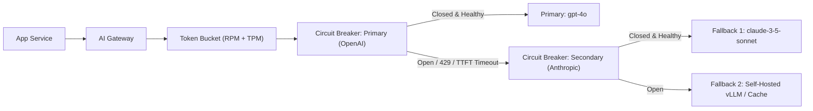
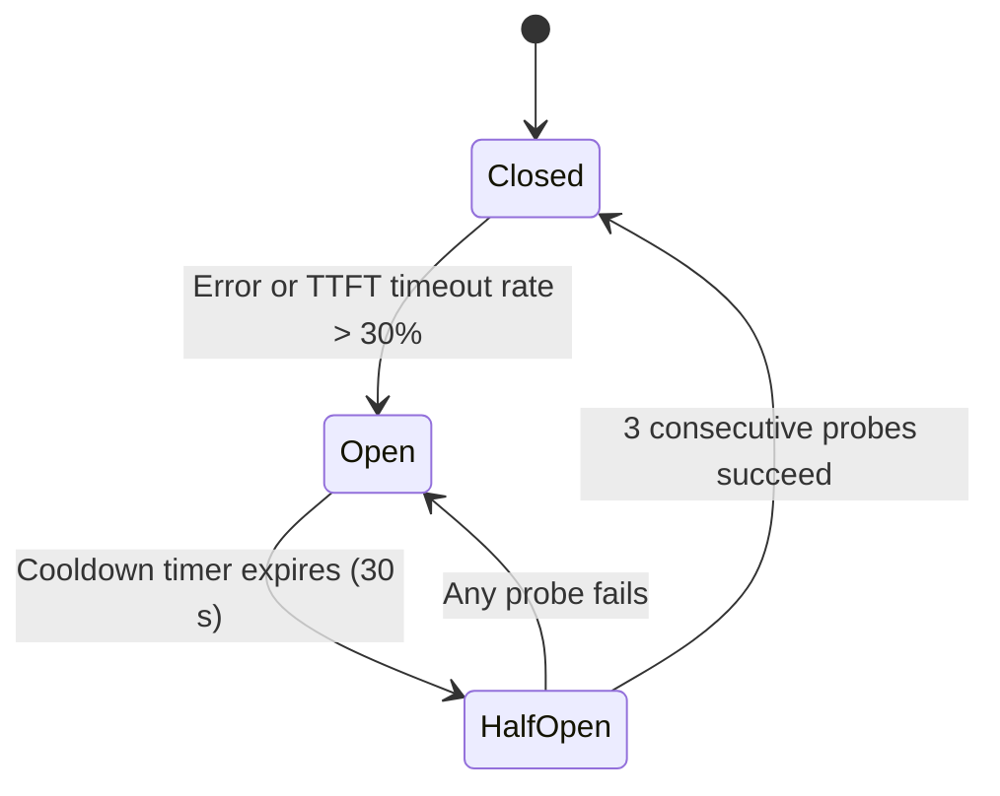
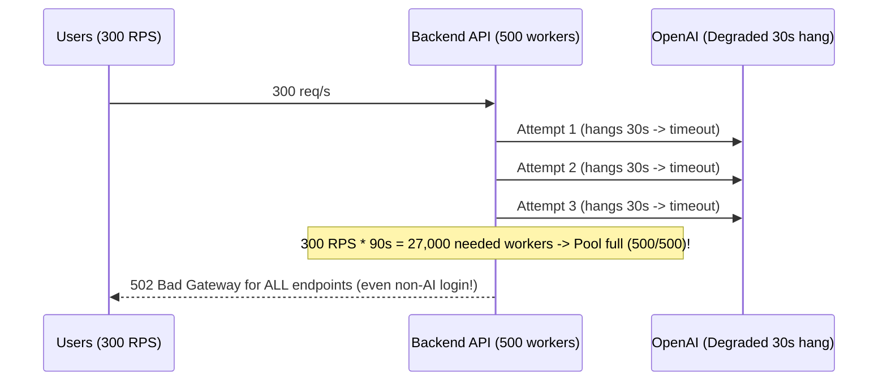

# AI Reliability: Timeouts, Retries, Fallback Models, Circuit Breakers

> **Prerequisites:** [Lesson 36: Observability for LLM Apps](../36-observability-for-llm-apps/README.md).  
> **Estimated Reading Time:** 24–28 minutes  
> **Target Audience:** Backend and AI platform engineers building resilient LLM gateways, and candidates asked "how do you keep an AI product up when OpenAI/Anthropic rate-limits or degrades?"  
> **Free PDF Notes:** [Download SD-S-037.pdf](https://backendroadmap.com/notes/system-design/SD-S-037.pdf)

> [!NOTE]
> **In one line:** LLM providers fail differently from databases—they have 5–60 s tails, strict **RPM/TPM rate limits (429)**, and silent quality degradation. Reliable AI systems pair **TTFT-aware timeouts** and **jittered retries** with **token-aware circuit breakers**, **hedged/fallback model routing**, and **graceful degradation**.

> [!TIP]
> **The Golden Rule:** Never retry a 30-second LLM timeout blindly with a 3-attempt synchronous loop—that turns a 30 s blip into a 90 s hang and exhausts your worker pool. Fail fast on TTFT, honor `Retry-After`, and fail over across providers or smaller models.

---

## 1. What AI Reliability Is, and What It Isn't

In classic microservices, a slow RPC times out at 200 ms and retries immediately. In GenAI, a valid streaming completion can legitimately take 15 seconds, while a stalled connection hangs for 60 seconds before returning `503`. Worse, LLM APIs enforce two orthogonal rate limits—**Requests Per Minute (RPM)** and **Tokens Per Minute (TPM)**—so a single 100K-token prompt can exhaust your quota for 200 normal users.

| Term | Precise Meaning | Example |
| :--- | :--- | :--- |
| **TTFT Timeout** | Failing fast if the first token does not arrive within $T_{\text{ttft}}$ | Abort at 3 s TTFT instead of waiting 60 s for total timeout |
| **Jittered Retry** | Retrying transient `429`/`5xx` with exponential backoff + random jitter | Wait $\text{rand}(0, \min(T_{\max}, T_0 \cdot 2^k))$ or `Retry-After` |
| **Circuit Breaker** | State machine (`Closed -> Open -> Half-Open`) that stops calling a failing provider | Open for 30 s when error rate $> 30\%$ over 20 calls |
| **Model Fallback** | Routing failed/tripped requests to a secondary provider or smaller model | `gpt-4o` (OpenAI) -> `claude-3-5-sonnet` (Anthropic) -> `gpt-4o-mini` |
| **Hedged Request** | Firing a backup request to a secondary provider if primary TTFT exceeds $p_{95}$ | Send to Provider B at 1.2 s; cancel loser on first token |
| **Semantic Cache Fallback** | Serving cached or deterministic template answers when all models are down | Return cached FAQ response or extractive RAG snippets |
| **Not** | Infinite retries, hardcoded single-provider SDK calls, or ignoring `429` TPM quotas | Causes retry storms and cascading thread-pool exhaustion |

### Why It Matters
1. **Upstream outages are routine:** Frontier LLM APIs experience regional brownouts, `429` bursts, and `529 Overloaded` events far more often than managed SQL databases.
2. **Thread-pool starvation:** Because LLM calls hold connections open for seconds, a degraded provider quickly saturates web workers unless timeouts and bulkheads isolate it.
3. **Cost vs. availability:** Naive hedging or retrying non-idempotent side-effecting tool calls doubles your bill and corrupts state.

---

## 2. Anatomy: Resilient AI Gateway Routing



An **AI Gateway** sits between your application services and external/internal model endpoints:
1. **Admission Control:** Checks per-tenant and global **TPM/RPM token buckets** before dispatching.
2. **Primary Execution:** Enforces a **TTFT timeout** (e.g., 3 s) and an **overall stream timeout** (e.g., 45 s).
3. **Fallback & Circuit Breaking:** If the primary circuit is `OPEN` or returns a non-retryable quota error, the gateway immediately routes to a secondary provider (translating prompt schemas) or degrades to a smaller, faster model.

| Failure Type | Retryable? | Action |
| :--- | :--- | :--- |
| **`400 Bad Request` / `401`** | No | Fix payload/auth; fail immediately |
| **`429 Rate Limit (RPM/TPM)`** | Conditional | Honor `Retry-After` if $< 2\text{ s}$; otherwise route immediately to fallback provider |
| **`500` / `502` / `503` / `529`** | Yes (bounded) | 1–2 jittered retries or immediate fallback if circuit is degraded |
| **TTFT Timeout ($>3\text{ s}$)** | Yes (via fallback) | Cancel primary stream; route to secondary provider |
| **Mid-stream disconnect** | Careful | Only retry if safe; if partial tokens already streamed to user, emit error/resume |

> [!WARNING]
> **Fallback models break prompt assumptions.** Switching from `gpt-4o` to `llama-3-70b` or `claude-3-5-sonnet` mid-incident can break JSON mode, tool-calling schemas, or system prompt formatting. Always maintain a **prompt compatibility test suite** (Lesson 35) for every configured fallback model.

---

## 3. Mathematical Model: Availability, Retry Storms & Hedging Cost

**Series vs. Parallel Availability.** If your app depends on a single LLM provider with availability $A_1 = 99.5\%$ (3.6 hours downtime/month), your AI feature availability is capped at $99.5\%$. With $k$ independent providers in a fallback chain ($A_1 = 99.5\%$, $A_2 = 99.5\%$):

$$A_{\text{chain}} = 1 - \prod_{i=1}^{k} (1 - A_i)$$

With two independent providers at $99.5\%$:
$$A_{\text{chain}} = 1 - (1 - 0.995)(1 - 0.995) = 1 - 0.000025 = 99.9975\%$$
Downtime drops from **3.6 hours/month** to **1.1 minutes/month**.

**Retry Amplification & Concurrency (Little's Law).** During an outage, if $N$ clients each retry $r$ times, load on the struggling provider multiplies by $(1 + r)$. Meanwhile, by Little's Law, active open connections $L = \lambda \cdot W$.
- Normal: $\lambda = 200\text{ req/s}$, average duration $W = 2.0\text{ s} \implies L = 400$ concurrent connections.
- Degraded (timeouts hit $W = 30\text{ s}$, 2 retries multiply $\lambda$ to $600\text{ req/s}$):
  $$L_{\text{degraded}} = 600 \times 30 = 18{,}000\text{ concurrent connections (45x spike!)}$$

**Hedged Request Cost Overhead.** If you hedge a request whenever primary TTFT exceeds threshold $\tau$ (e.g., the $p_{95}$ TTFT), fraction $p_{\text{hedge}} = 0.05$ of requests fire a second call. Assuming the loser is cancelled after prefill:
$$\text{Cost}_{\text{multiplier}} \approx 1 + p_{\text{hedge}} \cdot \frac{\text{Cost}_{\text{prefill}}}{\text{Cost}_{\text{total}}}$$
At $p_{\text{hedge}} = 0.05$, hedging adds **$< 5\%$ cost** while cutting $p_{99}$ TTFT dramatically.

---

## 4. Metrics & Percentiles

| Metric | Meaning | Alert when |
| :--- | :--- | :--- |
| **Circuit breaker state** | `0=Closed`, `1=Half-Open`, `2=Open` per provider | `Open` for $> 2\text{ min}$ |
| **Fallback invocation rate** | % of requests served by secondary/degraded model | $> 5\%$ sustained |
| **`429` Rate-limit ratio** | % of upstream calls rejected for RPM/TPM | $> 1\%$ (request quota increase or shed load) |
| **TTFT timeout rate** | % of streams aborted waiting for first token | $> 0.5\%$ |
| **Retry amplification factor** | $\text{Total upstream attempts} / \text{Client requests}$ | $> 1.15$ |
| **Token bucket wait time $p_{99}$** | Time spent queued in local rate limiter | $> 500\text{ ms}$ |

### Worked Example: Surviving a 15-Minute Provider Brownout
At 09:00 UTC, Provider A's US-East endpoint degrades: TTFT spikes from 450 ms to 12 s and 40% of calls return `503`.
- **Without circuit breakers:** Workers wait 30 s per attempt $\times$ 3 retries = 90 s. Active connections jump 45x; the API gateway OOMs in 90 seconds.
- **With TTFT timeout (3 s) + Circuit Breaker (opens at 30% error rate over 20 requests):** Within 4 seconds, the breaker trips `OPEN`. Subsequent traffic routes instantly to Provider B (`claude-3-5-sonnet`), keeping $p_{95}$ TTFT at 620 ms and availability at 99.98%. Every 30 s, a single probe (`Half-Open`) tests Provider A until it recovers.

---

## 5. Compounding & Failure Modes: Retry Storms & Bulkhead Collapse

1. **Correlated Provider Outages:** Routing `gpt-4o` on OpenAI to `gpt-4o` on Azure in the same region can still fail together during shared model weight rollouts or regional fiber cuts. True fallback requires **cross-provider** (OpenAI $\leftrightarrow$ Anthropic $\leftrightarrow$ self-hosted) or **cross-tier** (`gpt-4o` $\to$ `gpt-4o-mini`).
2. **Non-Idempotent Tool Retries:** If an agent executes `charge_credit_card()` and the subsequent LLM summarization call times out, retrying the *entire agent turn* charges the customer twice. Retries must wrap **only the stateless LLM call**, never side-effecting tool execution without idempotency keys.
3. **Token-Bucket Skew:** Standard HTTP rate limiters count *requests*, not *tokens*. A burst of 50 document-summarization calls (100K tokens each) can exhaust your 5M TPM quota in 1 second, starving 10,000 lightweight chat users unless you use **separate bulkheads/queues** per traffic class.

---

## 6. Numbers Every Engineer Must Know

| Item | Typical | Implication |
| :--- | :--- | :--- |
| **TTFT timeout** | 2–5 seconds | Fail fast before users abandon or workers pile up |
| **Total stream timeout** | 30–60 seconds | Upper bound for long generations |
| **Max retries (sync path)** | 1–2 (with jitter) | More than 2 retries on synchronous UX causes unacceptable latency |
| **Circuit breaker window** | 20–50 requests or 10 s | Fast enough to trip in seconds, large enough to ignore 1 blip |
| **Open-state cooldown** | 15–60 seconds | Prevents hammering a recovering provider |
| **Hedge trigger threshold** | $p_{95}$ TTFT (e.g., 1.2 s) | Bounds extra cost to $\le 5\%$ |
| **Provider RPM/TPM headroom** | Keep 25–30% buffer | Absorbs traffic bursts without hitting `429` |

---

## 7. Protocol Deep Dive: Circuit Breaker & Fallback State Machine



When the circuit is `Open`, the AI Gateway does **not** sleep or wait—it immediately evaluates the fallback chain:
1. **Tier 1 (Primary):** Frontier model on Provider A.
2. **Tier 2 (Cross-provider):** Equivalent frontier model on Provider B.
3. **Tier 3 (Smaller/Self-hosted):** Fast distilled model (e.g., `gpt-4o-mini` or local vLLM).
4. **Tier 4 (Graceful Degradation):** Semantic cache hit, extractive search results (top-3 RAG chunks without synthesis), or a polite `"AI assistant is temporarily busy"` response.

| Question | Answer |
| :--- | :--- |
| **When to use Hedged Requests?** | Ultra-low-latency interactive UX where $p_{99}$ TTFT matters more than a 5% token cost increase |
| **When NOT to use Hedged Requests?** | Batch pipelines, async agents, or tight TPM quotas (hedging consumes double TPM briefly) |
| **When to use Bulkheads?** | Always separate interactive chat from background batch summarization so batch never starves chat's TPM |

---

## 8. Hierarchical Budgets & Design Rules

| Slice | Rule | Control |
| :--- | :--- | :--- |
| **End-to-end UX timeout** | Interactive TTFT $< 3\text{ s}$ | Cancel primary at TTFT timeout and route to fallback |
| **Retry budget** | Max 10% extra load from retries | Token-bucket retry budget; disable retries when budget empty |
| **Bulkhead isolation** | Interactive vs. batch TPM split | Reserve 70% TPM for `priority=high`, 30% for `priority=batch` |
| **Fallback schema parity** | 100% tool/JSON compatibility | CI eval gate runs against both primary and fallback models |
| **Worker pool protection** | Bounded concurrency per provider | Semaphore / max in-flight requests per upstream endpoint |

---

## 9. Top Mitigations

1. **Split timeouts into `connect_timeout` (1 s), `ttft_timeout` (3 s), and `total_timeout` (45 s)** instead of one 60 s HTTP timeout.
2. **Use an AI Gateway with multi-provider fallback** and normalized request/response schemas.
3. **Implement token-aware rate limiting (TPM + RPM)** at the gateway, reserving headroom for interactive traffic via priority queues.
4. **Add exponential backoff with full jitter** (`random(0, cap)`) and always respect upstream `Retry-After` headers.
5. **Pair circuit breakers with semantic/extractive fallbacks** so a total LLM outage degrades to "search results only" instead of a 500 error page.
6. **Enforce retry budgets** (e.g., max 10% of total requests may be retries) to prevent retry storms during brownouts.
7. **Run Chaos / GameDay drills** monthly by injecting `429` and 10 s TTFT faults in staging to verify circuit breakers trip and fallback prompts parse cleanly.

---

## 10. Production Reference: SEV-1 Retry Storm Exhausting Worker Pool



**Root Cause:** The LLM client used a 30 s total timeout with 3 synchronous retries and shared the main web worker pool with authentication and billing endpoints.
**Fix:**
1. Isolated LLM calls behind an async AI Gateway with a dedicated bulkhead (max 200 in-flight connections).
2. Lowered TTFT timeout to 3 s, reduced retries to 1, and added a circuit breaker failing over to Anthropic `claude-3-5-sonnet`.
3. Non-AI endpoints remained 100% unaffected during the next upstream outage.

---

## 11. Multi-Language Production Code Tabs

````carousel
```go
// Go: Circuit breaker + TTFT-aware fallback router.
package aireliability

import (
	"context"
	"errors"
	"sync"
	"time"
)

type State int

const (
	Closed State = iota
	Open
	HalfOpen
)

type CircuitBreaker struct {
	mu          sync.Mutex
	state       State
	failures    int
	threshold   int
	cooldown    time.Duration
	lastFailure time.Time
}

func NewCircuitBreaker(threshold int, cooldown time.Duration) *CircuitBreaker {
	return &CircuitBreaker{threshold: threshold, cooldown: cooldown}
}

func (cb *CircuitBreaker) Allow() bool {
	cb.mu.Lock()
	defer cb.mu.Unlock()
	if cb.state == Open && time.Since(cb.lastFailure) > cb.cooldown {
		cb.state = HalfOpen
	}
	return cb.state != Open
}

func (cb *CircuitBreaker) Record(err error) {
	cb.mu.Lock()
	defer cb.mu.Unlock()
	if err == nil {
		cb.failures = 0
		cb.state = Closed
		return
	}
	cb.failures++
	cb.lastFailure = time.Now()
	if cb.failures >= cb.threshold || cb.state == HalfOpen {
		cb.state = Open
	}
}

func CallWithFallback(ctx context.Context, primaryCB, fallbackCB *CircuitBreaker,
	callPrimary, callFallback func(context.Context) (string, error)) (string, error) {
	if primaryCB.Allow() {
		tCtx, cancel := context.WithTimeout(ctx, 3*time.Second) // TTFT/fast-fail budget
		res, err := callPrimary(tCtx)
		cancel()
		primaryCB.Record(err)
		if err == nil {
			return res, nil
		}
	}
	if fallbackCB.Allow() {
		res, err := callFallback(ctx)
		fallbackCB.Record(err)
		if err == nil {
			return res, nil
		}
	}
	return "", errors.New("all model providers unavailable: degrade to cached/extractive response")
}
```
<!-- slide -->
```typescript
// TypeScript: Jittered retry + circuit breaker + provider fallback chain.
type ProviderFn = (signal: AbortSignal) => Promise<string>;

export class CircuitBreaker {
  private failures = 0;
  private openedAt = 0;

  constructor(private readonly threshold = 5, private readonly cooldownMs = 30_000) {}

  isOpen(): boolean {
    if (this.failures < this.threshold) return false;
    if (Date.now() - this.openedAt > this.cooldownMs) return false; // Half-open probe
    return true;
  }

  recordSuccess(): void {
    this.failures = 0;
  }

  recordFailure(): void {
    this.failures++;
    if (this.failures >= this.threshold) this.openedAt = Date.now();
  }
}

async function callWithTimeout(fn: ProviderFn, timeoutMs: number): Promise<string> {
  const ac = new AbortController();
  const timer = setTimeout(() => ac.abort(new Error("TTFT_TIMEOUT")), timeoutMs);
  try {
    return await fn(ac.signal);
  } finally {
    clearTimeout(timer);
  }
}

export async function routeWithFallback(
  providers: Array<{ name: string; cb: CircuitBreaker; call: ProviderFn }>,
  ttftTimeoutMs = 3000
): Promise<{ provider: string; output: string }> {
  for (const p of providers) {
    if (p.cb.isOpen()) continue;
    try {
      const output = await callWithTimeout(p.call, ttftTimeoutMs);
      p.cb.recordSuccess();
      return { provider: p.name, output };
    } catch {
      p.cb.recordFailure();
    }
  }
  return { provider: "degraded-cache", output: "AI summary temporarily unavailable; showing top search results." };
}
```
<!-- slide -->
```python
# Python: Token-aware rate limiter, jittered backoff, and availability math (stdlib).
import random
import time


def full_jitter_backoff(attempt: int, base_s: float = 0.2, cap_s: float = 4.0) -> float:
    """AWS-recommended full jitter: rand(0, min(cap, base * 2^attempt))."""
    ceiling = min(cap_s, base_s * (2 ** attempt))
    return random.uniform(0, ceiling)


def chain_availability(availabilities: list[float]) -> float:
    """Availability of a fallback chain: 1 - prod(1 - A_i)."""
    unavail = 1.0
    for a in availabilities:
        unavail *= (1.0 - a)
    return 1.0 - unavail


class TokenBucketTPM:
    """Token-Per-Minute admission controller to prevent 429 bursts."""
    def __init__(self, tpm_limit: int):
        self.capacity = float(tpm_limit)
        self.tokens = float(tpm_limit)
        self.rate_per_sec = tpm_limit / 60.0
        self.last = time.monotonic()

    def allow(self, estimated_tokens: int) -> bool:
        now = time.monotonic()
        self.tokens = min(self.capacity, self.tokens + (now - self.last) * self.rate_per_sec)
        self.last = now
        if self.tokens >= estimated_tokens:
            self.tokens -= estimated_tokens
            return True
        return False
```
<!-- slide -->
```csharp
// C#: Resilient LLM router with TTFT CancellationTokenSource and fallback chain.
public sealed class LlmCircuitBreaker(int threshold = 5, int cooldownSeconds = 30)
{
    private int _failures;
    private DateTimeOffset _openedAt;

    public bool Allow() =>
        _failures < threshold || (DateTimeOffset.UtcNow - _openedAt).TotalSeconds > cooldownSeconds;

    public void OnSuccess() => Interlocked.Exchange(ref _failures, 0);

    public void OnFailure()
    {
        if (Interlocked.Increment(ref _failures) >= threshold)
            _openedAt = DateTimeOffset.UtcNow;
    }
}

public static class ResilientAiClient
{
    public static async Task<string> ExecuteWithFallbackAsync(
        IEnumerable<(string Name, LlmCircuitBreaker Breaker, Func<CancellationToken, Task<string>> Call)> chain,
        TimeSpan ttftTimeout,
        CancellationToken outerCt)
    {
        foreach (var (name, breaker, call) in chain)
        {
            if (!breaker.Allow()) continue;
            using var cts = CancellationTokenSource.CreateLinkedTokenSource(outerCt);
            cts.CancelAfter(ttftTimeout);
            try
            {
                var result = await call(cts.Token);
                breaker.OnSuccess();
                return result;
            }
            catch (Exception) when (!outerCt.IsCancellationRequested)
            {
                breaker.OnFailure();
            }
        }
        return "Service degraded: returning cached/extractive results.";
    }
}
```
````

---

## 12. Hands-On CLI Verification Workflows

Verify availability math and Little's Law connection explosion in Python:

```bash
python -c "
a1 = 0.995
a_chain = 1 - (1 - 0.995)**2
conn_normal = 200 * 2.0
conn_storm = (200 * 3) * 30.0
print(f'single={a1:.4%} dual_chain={a_chain:.6%} normal_conn={conn_normal:.0f} storm_conn={conn_storm:.0f}')
"
# Output: single=99.5000% dual_chain=99.997500% normal_conn=400 storm_conn=18000
```

Test timeout/fallback behavior locally against a mock slow endpoint:

```bash
# Simulate a 5s stalled TTFT and verify curl fails fast at 2s (--max-time 2)
curl -w "status=%{http_code} time_total=%{time_total}s\n" --max-time 2 -s https://httpbin.org/delay/5

# Inspect LiteLLM / Envoy AI Gateway circuit-breaker or fallback metrics
curl -s http://localhost:4000/metrics | grep -E "litellm_deployment_state|llm_fallback_total|http_429"
```

---

## 13. Common Mistakes to Avoid

1. **Using a single 60 s HTTP timeout** instead of a fast 2–5 s TTFT timeout + separate total stream timeout.
2. **Retrying synchronously 3–5 times** on the request thread, amplifying outages into worker-pool exhaustion.
3. **Retrying without jitter**, causing thundering-herd spikes every backoff interval.
4. **Ignoring TPM (Tokens Per Minute)** and only rate-limiting by RPM.
5. **Routing fallback to the exact same model/region** (e.g., OpenAI US-East -> OpenAI US-East), failing on correlated incidents.
6. **Never testing fallback models against your JSON/tool-calling prompts**, leading to silent parse failures during an outage.
7. **Retrying non-idempotent agent turns** that execute external side effects (payments, emails) without idempotency keys.

---

## 14. Key Terms Glossary

| Key Term | Definition |
| :--- | :--- |
| **TTFT Timeout** | Fast timeout firing if the first streamed token does not arrive within $T_{\text{ttft}}$. |
| **Circuit Breaker** | State machine (`Closed`, `Open`, `Half-Open`) halting calls to a failing upstream. |
| **Full Jitter** | Randomizing backoff delay in $[0, \min(\text{cap}, \text{base} \cdot 2^k)]$ to prevent synchronized retries. |
| **TPM / RPM** | Tokens Per Minute / Requests Per Minute quotas enforced by LLM providers. |
| **Hedged Request** | Dispatching a duplicate request to a backup provider if the primary exceeds $p_{95}$ TTFT. |
| **Bulkhead** | Resource isolation (thread pool, semaphore, TPM quota) preventing one workload from starving another. |
| **Retry Budget** | Cap on the fraction of total traffic allowed to be retries (e.g., 10%). |
| **Graceful Degradation** | Falling back to a smaller model, semantic cache, or extractive search when LLMs fail. |
| **Retry Storm** | Cascading overload caused by clients aggressively retrying a degraded service. |
| **`Retry-After`** | HTTP response header specifying how long to wait before retrying a `429`/`503`. |

---

## 15. System Design Interview Questions & Answers

### Basic Conceptual Questions

<details>
<summary><strong>Q1: Why are LLM timeouts harder than database timeouts? [BASIC]</strong></summary>

**Answer:**
A database query takes 5–50 ms, so a 200 ms timeout is safe. A valid streamed LLM response can take 15–30 seconds total, yet a dead connection shouldn't hang for 30 seconds. You solve this by splitting into a **connect timeout** (1 s), a **TTFT timeout** (2–4 s), and a **total stream timeout** (45 s).
</details>

<details>
<summary><strong>Q2: What is the difference between RPM and TPM rate limits? [BASIC]</strong></summary>

**Answer:**
RPM limits the number of HTTP requests per minute; TPM limits total input + output tokens per minute. A few 100K-token batch requests can exhaust TPM and trigger `429` errors for hundreds of small interactive chat requests.
</details>

<details>
<summary><strong>Q3: How does a circuit breaker work for an LLM provider? [BASIC]</strong></summary>

**Answer:**
In `Closed`, requests flow normally. If error rate or TTFT timeout rate exceeds a threshold (e.g., 30% over 20 requests), it trips `Open` and immediately routes traffic to a fallback provider for a cooldown (e.g., 30 s). After cooldown, `Half-Open` sends a few probes; if they succeed, it closes.
</details>

<details>
<summary><strong>Q4: What is graceful degradation in an AI system? [BASIC]</strong></summary>

**Answer:**
When all LLM providers are unavailable or over budget, the system still serves value: returning a semantic cache hit, showing the top-5 retrieved RAG documents without LLM synthesis, or falling back to a fast rule-based classifier.
</details>

### Scenario-Based Architecture Questions

<details>
<summary><strong>Q5: Your primary LLM provider is returning 429s during a product launch. What do you do? [SCENARIO]</strong></summary>

**Answer:**
Honor `Retry-After` only if $< 2\text{ s}$; otherwise immediately route overflow traffic to a secondary provider (e.g., Anthropic or self-hosted vLLM) via the AI Gateway, shed low-priority batch jobs using TPM bulkheads, and serve semantic-cached answers for common launch FAQs.
</details>

<details>
<summary><strong>Q6: How do you achieve 99.99% availability if each LLM API only offers a 99.5% SLA? [SCENARIO]</strong></summary>

**Answer:**
Chain two independent providers with circuit breakers: $1 - (1 - 0.995)^2 = 99.9975\%$. Ensure prompts and tool schemas are tested in CI against both providers, and include a local/cached Tier-3 fallback for total internet/cloud-region isolation.
</details>

<details>
<summary><strong>Q7: A user reports their credit card was charged twice when the AI agent timed out. Why, and how do you fix it? [SCENARIO]</strong></summary>

**Answer:**
The orchestrator retried the entire agent turn after the final LLM summary timed out, re-invoking the `charge_card` tool. Fix by separating tool execution from LLM retries, requiring idempotency keys on all mutating tools, and never auto-retrying side-effecting steps.
</details>

<details>
<summary><strong>Q8: How do you protect your core web API from slowing down when the LLM provider hangs? [SCENARIO]</strong></summary>

**Answer:**
Isolate LLM calls behind a dedicated async AI Gateway or bounded semaphore (bulkhead) so slow LLM streams cannot exhaust the main web worker pool. Pair with a 3 s TTFT timeout and circuit breaker.
</details>

### Advanced & Tricky Interview Questions

<details>
<summary><strong>Q9: When does hedging hurt reliability, and how do you bound its damage? [TRICKY]</strong></summary>

**Answer:**
Hedging (firing a backup call at $p_{95}$ TTFT) doubles request load during a provider brownout, worsening `429` exhaustion. Bound it by: (1) triggering only above $p_{95}$ TTFT ($\le 5\%$ extra cost), (2) disabling hedging automatically when the retry/hedge budget exceeds 5% of traffic, and (3) cancelling the losing stream immediately.
</details>

<details>
<summary><strong>Q10: How do you handle a mid-stream failure after 80 tokens have already been sent to the user's browser? [TRICKY]</strong></summary>

**Answer:**
You cannot silently restart from token 0 without duplicating text. Either emit a structured SSE `error` event so the UI shows a "Retry" button, or—if the provider supports it—send the partial prefix as an assistant prefill to a fallback model to continue generation seamlessly.
</details>

<details>
<summary><strong>Q11: Why can exponential backoff without jitter cause a second outage? [TRICKY]</strong></summary>

**Answer:**
If 1,000 clients fail at $t=0$ and all back off deterministically for 1 s, 2 s, 4 s, they synchronize into a thundering herd that slams the recovering provider at the exact same millisecond. Full jitter (`random(0, cap)`) spreads the load uniformly.
</details>

<details>
<summary><strong>Q12: How do you prevent a single tenant's 128K-context batch job from causing 429s for everyone else? [TRICKY]</strong></summary>

**Answer:**
Implement **weighted TPM token buckets** and **priority bulkheads** at the AI Gateway: reserve 70% of global TPM for `priority=interactive` with per-tenant caps, and route `priority=batch` to a separate queue/deployment (or provider Batch API at 50% cost).
</details>

---

## 16. One-Page Master Cheat Sheet

```
+---------------------------------------------------------------------------------------------------------+
|                    AI RELIABILITY — MASTER CHEAT SHEET                                                  |
+---------------------------------------------------------------------------------------------------------+
| 1. TIMEOUTS: Split into connect (1s), TTFT (2-5s), total stream (45s). Never one 60s hang.              |
+---------------------------------------------------------------------------------------------------------+
| 2. AVAILABILITY: Dual independent providers: 1 - (1 - 0.995)^2 = 99.9975% (1.1 min/mo downtime).        |
+---------------------------------------------------------------------------------------------------------+
| 3. RETRIES: Max 1-2 sync retries with Full Jitter + Retry Budget (<=10%). Never retry side effects.     |
+---------------------------------------------------------------------------------------------------------+
| 4. CIRCUIT BREAKER: Closed -> Open (>30% errors/TTFT timeouts) -> Half-Open (probe after 30s).          |
+---------------------------------------------------------------------------------------------------------+
| 5. RATE LIMITS: Enforce both RPM and TPM token buckets; isolate interactive vs. batch with bulkheads.   |
+---------------------------------------------------------------------------------------------------------+
| 6. FALLBACKS: Cross-provider (OpenAI -> Anthropic -> Self-hosted) -> Semantic Cache / Extractive RAG.   |
+---------------------------------------------------------------------------------------------------------+
```

---

## Further Reading & Sources

- Marc Brooker (AWS Architecture Blog), [Timeouts, Retries, and Backoff with Jitter](https://aws.amazon.com/builders-library/timeouts-retries-and-backoff-with-jitter/).
- Google SRE Book, [Handling Overload](https://sre.google/sre-book/handling-overload/) (Retry Budgets & Cascading Failures).
- Microsoft Azure Architecture Center, [Circuit Breaker Pattern](https://learn.microsoft.com/en-us/azure/architecture/patterns/circuit-breaker).
- Jeffrey Dean & Luiz André Barroso, *The Tail at Scale* (Hedged Requests, *Communications of the ACM*).

---

## Free PDF Notes

[SD-S-037.pdf](https://backendroadmap.com/notes/system-design/SD-S-037.pdf)

---

## Next

Continue with [Lesson 38: Fine-Tuning vs RAG vs Prompting: When to Use Each (and LoRA Basics)](../38-fine-tuning-vs-rag-vs-prompting/README.md).
