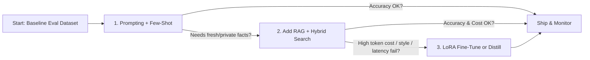
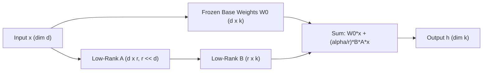
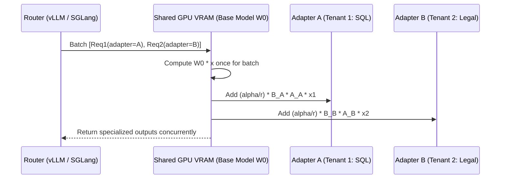
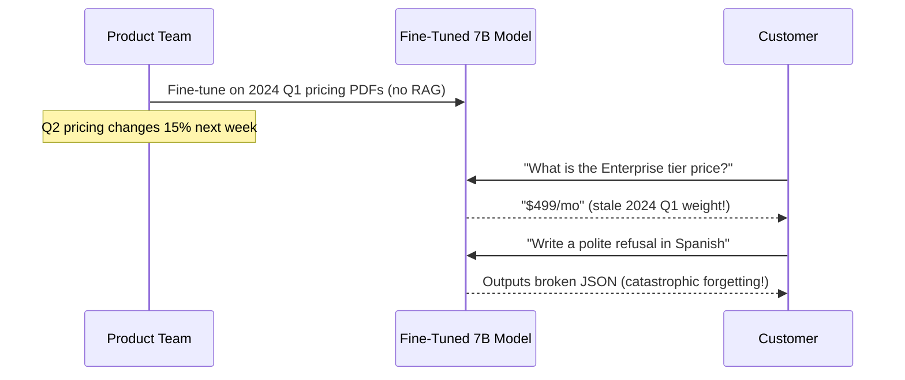

# Fine-Tuning vs RAG vs Prompting: When to Use Each (and LoRA Basics)

> **Prerequisites:** [Lesson 37: AI Reliability](../37-ai-reliability/README.md).  
> **Estimated Reading Time:** 24–28 minutes  
> **Target Audience:** Backend and ML system engineers deciding how to customize an LLM for domain tasks, and candidates asked "should we fine-tune a model or use RAG?"  
> **Free PDF Notes:** [Download SD-S-038.pdf](https://backendroadmap.com/notes/system-design/SD-S-038.pdf)

> [!NOTE]
> **In one line:** **Prompting** steers behavior with zero training; **RAG** injects fresh, verifiable, permissioned *knowledge* at inference time; **Fine-Tuning (and LoRA)** bakes *style, format, domain syntax, or low-latency task specialization* into model weights—and most production systems combine all three.

> [!TIP]
> **The Golden Rule:** Never fine-tune to teach an LLM *facts* that change (prices, policies, tickets)—use **RAG** for knowledge and **Fine-Tuning** for behavior, format, or distilling a 70B prompt into a fast, cheap 8B model. Always exhaust Prompting + Few-Shot + RAG before paying the MLOps tax of fine-tuning.

---

## 1. What Each Approach Is, and What It Isn't

Teams routinely jump straight to fine-tuning when an LLM hallucinates company policies, only to discover that fine-tuning doesn't stop hallucinations, cannot enforce per-user ACLs, and goes stale the next day. Conversely, teams stuffing 40-page style guides and 50 few-shot examples into every prompt pay massive TTFT and token bills that a 1-hour LoRA fine-tune would cut by 90%.

| Term | Precise Meaning | Example |
| :--- | :--- | :--- |
| **Prompt Engineering** | Optimizing system instructions, structure, and few-shot examples at inference time | 5-shot JSON extraction prompt on `gpt-4o` |
| **RAG (Retrieval-Augmented Generation)** | Fetching relevant chunks from an index at query time and placing them in context | Support bot citing live Confluence docs with user ACLs |
| **Full Fine-Tuning** | Updating 100% of a model's weights on labeled `(prompt, completion)` pairs | Pre-training / domain-adapting a 7B model on 10B medical tokens |
| **LoRA (Low-Rank Adaptation)** | Freezing base weights $W_0$ and training tiny rank-$r$ adapter matrices $BA$ | Adapting Llama-3-8B in 45 min on 1x A100 with <1% trainable params |
| **QLoRA** | Quantizing frozen base weights to 4-bit (NF4) while training FP16 LoRA adapters | Fine-tuning a 70B model on a single 48 GB GPU |
| **Model Distillation** | Fine-tuning a small student model (8B) on outputs generated by a frontier teacher (70B/405B) | Cutting inference cost 15x while keeping 97% accuracy |
| **Not** | Using fine-tuning as a database for mutable facts, or using RAG to fix broken tone/SQL syntax | Wrong axis of optimization |

### Why It Matters
1. **The #1 GenAI architecture question:** Interviewers test whether you know the difference between *knowledge injection* (RAG) and *behavioral adaptation* (Fine-Tuning).
2. **Unit economics:** Prompting a 4,000-token system prompt at 10M req/month costs orders of magnitude more than a distilled 8B LoRA model with a 200-token prompt.
3. **Governance & ACLs:** RAG enforces document-level permissions at query time; once data is baked into fine-tuned weights, you cannot "un-teach" it for a single unauthorized user.

---

## 2. Anatomy: The Decision Ladder & LoRA Adapter Architecture



And inside a **LoRA** linear layer during inference/training:



Instead of updating all $d \times k$ weights in $W_0$, LoRA freezes $W_0$ and learns two small matrices $A \in \mathbb{R}^{r \times d}$ and $B \in \mathbb{R}^{k \times r}$ where rank $r \in [8, 64] \ll d$. At inference time, you can either **merge** $W = W_0 + \frac{\alpha}{r}BA$ for zero latency overhead, or **hot-swap multiple LoRA adapters** (multi-tenant LoRA serving via vLLM/SGLang) on top of one shared base model in GPU VRAM.

| Dimension | Prompting | RAG | Fine-Tuning (LoRA) |
| :--- | :--- | :--- | :--- |
| **Setup time** | Hours | Days–Weeks | Weeks (data curation + evals) |
| **Freshness** | Instant (edit string) | Near real-time (index sync) | Stale until retrained |
| **Access control (ACLs)** | Prompt-level only | Per-document / per-user | None (weights are global) |
| **Hallucination control** | Weak–Moderate | Strong (grounded citations) | Weak for facts; strong for format |
| **Per-request token cost** | High (long instructions) | Medium–High (retrieved chunks) | Low (short prompt, no few-shots) |
| **Best for** | Prototyping, general reasoning | Dynamic/private knowledge, Q&A | Strict JSON, domain DSL/SQL, tone, latency/cost distillation |

> [!WARNING]
> **Garbage-in, garbage-out:** Fine-tuning on 50,000 noisy customer support logs teaches the model your worst agents' bad habits. Curating 1,000–5,000 high-signal, verified examples (or synthetic data filtered by a frontier teacher) beats 100,000 uncleaned rows every time.

---

## 3. Mathematical Model: LoRA Parameter Reduction & Break-Even Economics

**LoRA Parameter Reduction.** For a weight matrix $W_0 \in \mathbb{R}^{d \times k}$, full fine-tuning updates $d \cdot k$ parameters. LoRA updates only $r(d + k)$ parameters:

$$\text{Compression Ratio} = \frac{r(d + k)}{d \cdot k}$$

For a Llama-3-8B projection layer with $d = k = 4{,}096$ and rank $r = 16$:
- Full matrix: $4{,}096 \times 4{,}096 = 16{,}777{,}216$ parameters.
- LoRA ($r = 16$): $16 \times (4{,}096 + 4{,}096) = 131{,}072$ parameters (**0.78%** of full!).
- Optimizer states (AdamW stores 2 FP32 states = 8 bytes/param + 4 bytes grads + 2 bytes weights = ~14–16 bytes/param) shrink by **>100x**, letting you fine-tune on a single 24–80 GB GPU instead of an 8x H100 node.

**Break-Even Cost Model (Prompting Frontier vs. Distilled Self-Hosted/Fine-Tuned).**
Let $C_{\text{train}}$ be one-time fine-tuning + engineering cost, $c_{\text{prompt}}$ be per-request inference cost with a long frontier prompt, and $c_{\text{ft}}$ be per-request cost with a distilled/fine-tuned model:

$$N_{\text{break-even}} = \frac{C_{\text{train}}}{c_{\text{prompt}} - c_{\text{ft}}}$$

### Worked Numerical Example
Suppose a classification + JSON extraction pipeline runs **2,000,000 requests/month**:
- **Frontier + 3,000-token few-shot prompt** (`gpt-4o` at $\$2.50/\text{1M in}$, $\$10.00/\text{1M out}$, 200 out tokens):
  $$c_{\text{prompt}} = \frac{3000(2.50) + 200(10.00)}{10^6} = \$0.0095/\text{req} \implies \$19{,}000/\text{month}$$
- **Fine-tuned 8B LoRA** (prompt shrinks to 300 tokens; hosted/serverless at $\$0.20/\text{1M}$):
  $$c_{\text{ft}} = \frac{300(0.20) + 200(0.20)}{10^6} = \$0.0001/\text{req} \implies \$200/\text{month}$$
- If curation + LoRA training + eval engineering costs $C_{\text{train}} = \$15{,}000$:
  $$N_{\text{break-even}} = \frac{15{,}000}{0.0095 - 0.0001} \approx 1{,}595{,}745\text{ requests (< 1 month!)}$$
Below ~100K requests/month, prompting wins easily; above ~2M requests/month, distillation/LoRA pays for itself in weeks.

---

## 4. Metrics & Percentiles

| Metric | Meaning | Alert when |
| :--- | :--- | :--- |
| **Task accuracy / F1 / Pass@1** | Exact match or schema/eval pass rate on golden set | Drops below frontier baseline after fine-tune |
| **Catastrophic forgetting score** | Drop on general benchmarks (MMLU / instruction following) | $> 3\%$ regression on non-target tasks |
| **Format / JSON validity rate** | % of outputs passing strict schema validation | $< 99.5\%$ (fine-tuning should push this near 100%) |
| **TTFT $p_{95}$** | Prefill latency reduction from shorter prompts / smaller model | Exceeds interactive SLA ($> 500\text{ ms}$) |
| **RAG groundedness (faithfulness)** | % of claims supported by retrieved context (when combining RAG+FT) | $< 95\%$ |
| **Break-even ROI window** | Months to recover training + MLOps maintenance cost | $> 6\text{ months}$ (stick to prompting/RAG) |

### Worked Example: Combining RAG + LoRA (RA-FT)
An enterprise legal assistant used RAG with `gpt-4o` and a 2,500-token system prompt describing citation rules. It hit 91% citation accuracy at 1.4 s TTFT.
- The team generated 3,000 synthetic `(query, retrieved_chunks, ideal_cited_answer)` pairs using `gpt-4o`, filtered by an automated verifier.
- They trained a **LoRA adapter** ($r=16$) on `Llama-3.1-8B-Instruct` to internalize the citation format and refusal rules, while still retrieving live legal clauses via **RAG** at runtime.
- Result: Citation accuracy jumped to **96.5%**, prompt length dropped by 2,200 tokens, TTFT fell from **1,400 ms to 280 ms**, and monthly spend dropped 85%.

---

## 5. Compounding & Failure Modes: Catastrophic Forgetting & Stale Weights

1. **Catastrophic Forgetting:** Over-training a LoRA adapter (too many epochs or learning rate too high) makes the model hyper-focused on the training distribution and unable to handle edge-case conversational turns or refusals. Always mix 10–20% general instruction-following data into your fine-tuning dataset.
2. **Base-Model Upgrade Lock-In:** A LoRA adapter is mathematically tied to a specific base checkpoint (e.g., `Llama-3-8B-v1`). When `Llama-4` or a new `gpt-4o` snapshot ships, your adapter **cannot** be transferred—you must re-run the fine-tuning pipeline and re-evaluate.
3. **Training-Serving Skew in RAG + Fine-Tuning:** If you fine-tune a model assuming 5 clean RAG chunks, but production retrieval returns noisy chunks or empty results, the fine-tuned model may hallucinate confidently unless trained on negative/empty-retrieval examples.

---

## 6. Numbers Every Engineer Must Know

| Item | Typical | Implication |
| :--- | :--- | :--- |
| **Minimum examples for SFT/LoRA** | 500–2,000 high-quality pairs | Enough for format/style; 10K+ for complex domain reasoning |
| **LoRA rank $r$** | 8, 16, or 32 ($\alpha = 2r$) | Higher $r$ rarely helps unless dataset is huge/complex |
| **LoRA adapter file size (8B model)** | 40–160 MB | Tiny! Enables multi-tenant hot-swapping in VRAM |
| **QLoRA VRAM for 7B–8B model** | ~10–16 GB VRAM | Fits on a single consumer/cloud L4 or T4 GPU |
| **Training epochs (SFT)** | 1–3 epochs | $> 4$ epochs risks overfitting and catastrophic forgetting |
| **Prompting -> RAG -> FT effort** | 1x -> 5x -> 20x MLOps effort | Never skip steps on the decision ladder |

---

## 7. Mechanism Deep Dive: Multi-LoRA Serving & Merge vs. Unmerged



With **Multi-LoRA serving** (e.g., Punica / vLLM LoRA), a single GPU holds one copy of the 16 GB base model $W_0$ plus dozens of 80 MB LoRA adapters in VRAM, batching requests from different tenants/tasks together in the same forward pass.

| Question | Answer |
| :--- | :--- |
| **When to use Prompting?** | Always first. Prototypes, low volume (<100K req/mo), general reasoning, rapid iteration |
| **When to use RAG?** | Dynamic facts, private enterprise docs, citations required, per-user ACLs |
| **When to use Fine-Tuning (LoRA)?** | Strict output format/DSL, consistent tone, latency/cost distillation at scale (>1M req/mo) |
| **When NOT to fine-tune?** | To inject mutable facts, before building a golden eval set, or when prompting already meets SLA |

---

## 8. Hierarchical Budgets & Design Rules

| Slice | Rule | Control |
| :--- | :--- | :--- |
| **Decision gate** | Exhaust Prompting + RAG first | Require golden-set eval proof showing Prompt+RAG fails accuracy or unit economics |
| **Data quality** | 1,000 clean > 100,000 noisy | Deduplicate, filter by teacher/human eval, include 15% general replay data |
| **Adapter portability** | Automate retraining pipeline | Store dataset + config in Git/DVC so base-model upgrades re-train in 1 command |
| **RAG + FT resilience** | Train on imperfect retrieval | Include 10% "no relevant context -> say I don't know" examples |
| **Cost ROI** | Break-even $< 3\text{ months}$ | Model total MLOps + GPU hosting cost vs. frontier API spend |

---

## 9. Top Mitigations

1. **Build the golden eval set first** (Lesson 35) before writing a single line of fine-tuning code—otherwise you cannot measure if fine-tuning actually helped.
2. **Use synthetic distillation** (generate training pairs with a frontier teacher model, filter with deterministic validators) to bootstrap high-quality LoRA datasets cheaply.
3. **Combine RAG + LoRA (RA-FT)** when you need both fresh facts and strict domain behavior/citations.
4. **Keep LoRA rank small ($r=8$ or $16$) and epochs low (1–3)** with 10–20% general instruction data to prevent catastrophic forgetting.
5. **Use Multi-LoRA serving (vLLM)** instead of deploying separate GPU clusters per fine-tuned task.
6. **Version `(base_model_sha, dataset_hash, adapter_sha)`** so every regression can be rolled back or retrained cleanly.

---

## 10. Production Reference: Fine-Tuning Gone Wrong (Stale Facts & Forgetting)



**Root Cause:** The team fine-tuned a 7B model on static pricing facts without RAG and trained for 8 epochs on narrow Q&A pairs, destroying its general multilingual instruction-following capability.
**Fix:**
1. Moved all pricing/policy facts into a **RAG vector index** updated via webhook on CMS publish.
2. Reverted to base `Llama-3.1-8B-Instruct` with a 2-epoch LoRA ($r=16$) trained on **RAG-grounded citation format** + 20% general multilingual replay data.

---

## 11. Multi-Language Production Code Tabs

````carousel
```go
// Go: Decision router & break-even calculator for Prompting vs RAG vs Fine-Tuning.
package modelstrategy

import "fmt"

type Strategy string

const (
	StrategyPrompt   Strategy = "PROMPTING"
	StrategyRAG      Strategy = "RAG"
	StrategyLoRA     Strategy = "LORA_FINE_TUNE"
	StrategyRAGLoRA  Strategy = "RAG_PLUS_LORA"
)

type WorkloadProfile struct {
	NeedsFreshFacts   bool
	NeedsStrictFormat bool
	MonthlyRequests   int
	PromptTokensSaved int
}

func RecommendStrategy(w WorkloadProfile) Strategy {
	if w.NeedsFreshFacts && w.NeedsStrictFormat && w.MonthlyRequests >= 1_000_000 {
		return StrategyRAGLoRA
	}
	if w.NeedsFreshFacts {
		return StrategyRAG
	}
	if w.NeedsStrictFormat && w.MonthlyRequests >= 500_000 {
		return StrategyLoRA
	}
	return StrategyPrompt
}

func BreakEvenRequests(trainCostUSD, promptCostPerReq, ftCostPerReq float64) float64 {
	savings := promptCostPerReq - ftCostPerReq
	if savings <= 0 {
		return -1
	}
	return trainCostUSD / savings
}

func Example() {
	n := BreakEvenRequests(15000, 0.0095, 0.0001)
	fmt.Printf("Strategy=%s BreakEven=%.0f requests\n",
		RecommendStrategy(WorkloadProfile{NeedsFreshFacts: true, NeedsStrictFormat: true, MonthlyRequests: 2_000_000}), n)
}
```
<!-- slide -->
```typescript
// TypeScript: LoRA parameter calculator & Multi-LoRA request payload builder.
export interface LoraConfig {
  dModel: number;
  kOut: number;
  rank: number;
  alpha: number;
}

export function loraParameterStats(cfg: LoraConfig): {
  fullParams: number;
  loraParams: number;
  trainablePct: number;
} {
  const fullParams = cfg.dModel * cfg.kOut;
  const loraParams = cfg.rank * (cfg.dModel + cfg.kOut);
  return {
    fullParams,
    loraParams,
    trainablePct: Number(((loraParams / fullParams) * 100).toFixed(4)),
  };
}

// Multi-LoRA serving (vLLM OpenAI-compatible): route to adapter by model name.
export function buildMultiLoraRequest(tenantAdapter: string, query: string, retrievedContext: string) {
  return {
    model: tenantAdapter, // e.g. "sql-expert-lora-v3" loaded atop shared base model
    temperature: 0.0,
    messages: [
      { role: "system", content: "Answer using ONLY the provided context." },
      { role: "user", content: `Context:\n${retrievedContext}\n\nQuestion: ${query}` },
    ],
  };
}
```
<!-- slide -->
```python
# Python: LoRA math, break-even economics, and SFT JSONL dataset validator (stdlib).
import json


def lora_compression(d: int = 4096, k: int = 4096, r: int = 16) -> dict:
    full = d * k
    lora = r * (d + k)
    return {"full_params": full, "lora_params": lora, "ratio_pct": round(100 * lora / full, 4)}


def break_even_requests(train_cost: float, c_prompt: float, c_ft: float) -> int:
    return int(train_cost / (c_prompt - c_ft))


def validate_sft_jsonl(lines: list[str]) -> tuple[int, int]:
    """Validate OpenAI/Axolotl chat fine-tuning JSONL format before launching GPU job."""
    valid = invalid = 0
    for line in lines:
        try:
            row = json.loads(line)
            msgs = row["messages"]
            roles = [m["role"] for m in msgs]
            if "assistant" in roles and all(isinstance(m.get("content"), str) and m["content"] for m in msgs):
                valid += 1
            else:
                invalid += 1
        except (json.JSONDecodeError, KeyError, TypeError):
            invalid += 1
    return valid, invalid
```
<!-- slide -->
```csharp
// C#: Strategy selector and break-even ROI evaluator.
public enum CustomizationTier { Prompting, Rag, FineTuningLoRA, RagPlusLoRA }

public static class ModelCustomizationAdvisor
{
    public static CustomizationTier Choose(bool mutableFacts, bool strictAcl, bool highVolumeFormat, long monthlyReqs)
    {
        if ((mutableFacts || strictAcl) && highVolumeFormat && monthlyReqs >= 1_000_000)
            return CustomizationTier.RagPlusLoRA;
        if (mutableFacts || strictAcl)
            return CustomizationTier.Rag;
        if (highVolumeFormat && monthlyReqs >= 500_000)
            return CustomizationTier.FineTuningLoRA;
        return CustomizationTier.Prompting;
    }

    public static double BreakEvenMonths(double trainCostUsd, double monthlyPromptSpend, double monthlyFtSpend)
    {
        double monthlySavings = monthlyPromptSpend - monthlyFtSpend;
        return monthlySavings > 0 ? Math.Round(trainCostUsd / monthlySavings, 2) : double.PositiveInfinity;
    }
}
```
````

---

## 12. Hands-On CLI Verification Workflows

Verify LoRA parameter reduction and break-even math in Python:

```bash
python -c "
d, k, r = 4096, 4096, 16
full, lora = d*k, r*(d+k)
c_prompt = (3000*2.50 + 200*10.0) / 1e6
c_ft = (300*0.20 + 200*0.20) / 1e6
be = 15000 / (c_prompt - c_ft)
print(f'full={full:,} lora={lora:,} ({lora/full:.2%}) break_even={be:,.0f} reqs')
"
# Output: full=16,777,216 lora=131,072 (0.78%) break_even=1,595,745 reqs
```

Inspect LoRA adapter weights and serve Multi-LoRA in vLLM:

```bash
# Serve a base model with dynamic LoRA adapter hot-swapping
vllm serve meta-llama/Llama-3.1-8B-Instruct \
  --enable-lora \
  --max-lora-rank 32 \
  --lora-modules sql-v1=./adapters/sql-lora legal-v2=./adapters/legal-lora

# Query a specific LoRA adapter via the OpenAI-compatible endpoint
curl -s http://localhost:8000/v1/chat/completions \
  -H "Content-Type: application/json" \
  -d '{"model":"sql-v1","messages":[{"role":"user","content":"Top 5 users by spend"}]}'
```

---

## 13. Common Mistakes to Avoid

1. **Fine-tuning to memorize mutable facts** (pricing, inventory, docs) instead of using RAG.
2. **Fine-tuning before building an automated eval suite**, leaving you blind to regressions.
3. **Training on raw, uncurated production logs** instead of verified, high-signal examples.
4. **Ignoring catastrophic forgetting** by training for too many epochs without general replay data.
5. **Assuming LoRA adapters transfer across base model versions** (they are bound to exact checkpoint weights).
6. **Forgetting per-user ACLs**: if User A and User B have different permissions, you *must* use RAG with metadata filtering—never bake private data into shared weights.
7. **Skipping prompt caching and few-shot optimization** before jumping into GPU fine-tuning infrastructure.

---

## 14. Key Terms Glossary

| Key Term | Definition |
| :--- | :--- |
| **Prompt Engineering** | Steering model behavior via instructions and few-shot examples without changing weights. |
| **RAG** | Injecting retrieved external context into the prompt at inference time. |
| **Fine-Tuning (SFT)** | Supervised updating of model weights on curated `(input, output)` pairs. |
| **LoRA** | Low-Rank Adaptation; training small rank-$r$ matrices $BA$ while freezing base weights $W_0$. |
| **QLoRA** | LoRA applied over a 4-bit quantized base model to minimize training VRAM. |
| **Model Distillation** | Training a small student model to mimic a larger teacher model for lower latency/cost. |
| **Catastrophic Forgetting** | Loss of general model capabilities after narrow fine-tuning. |
| **Multi-LoRA Serving** | Serving multiple LoRA adapters concurrently atop one shared base model in GPU VRAM. |
| **RA-FT** | Retrieval-Augmented Fine-Tuning; training a model specifically to use retrieved RAG chunks well. |
| **Training-Serving Skew** | Mismatch between fine-tuning input distribution and live production inputs. |

---

## 15. System Design Interview Questions & Answers

### Basic Conceptual Questions

<details>
<summary><strong>Q1: When should you use RAG instead of fine-tuning? [BASIC]</strong></summary>

**Answer:**
Use **RAG** whenever the model needs fresh, mutable, or private knowledge (docs, prices, tickets), requires verifiable citations, or must enforce per-user access controls (ACLs). Fine-tuning cannot un-learn a fact for one user and goes stale immediately.
</details>

<details>
<summary><strong>Q2: When does fine-tuning beat prompting and RAG? [BASIC]</strong></summary>

**Answer:**
Fine-tuning wins when you need **consistent behavior, style, or strict format** (e.g., proprietary DSLs, complex JSON schemas, medical/legal tone) or **cost/latency distillation**—shrinking a 3,000-token frontier prompt into a fast 8B model at high request volume (>1M req/mo).
</details>

<details>
<summary><strong>Q3: How does LoRA work, and why is it so much cheaper than full fine-tuning? [BASIC]</strong></summary>

**Answer:**
LoRA freezes the base weights $W_0 \in \mathbb{R}^{d \times k}$ and injects two small trainable matrices $A \in \mathbb{R}^{r \times d}$ and $B \in \mathbb{R}^{k \times r}$ ($r \ll d$). For $d=k=4096, r=16$, trainable parameters drop to 0.78%, slashing optimizer VRAM by >100x and producing ~80 MB adapters.
</details>

<details>
<summary><strong>Q4: Can you combine RAG and fine-tuning? [BASIC]</strong></summary>

**Answer:**
Yes—**RA-FT (Retrieval-Augmented Fine-Tuning)** is common in production: RAG supplies live, permissioned facts at query time, while a LoRA-tuned model knows how to cite them strictly, follow domain rules, and refuse when context is missing.
</details>

### Scenario-Based Architecture Questions

<details>
<summary><strong>Q5: A startup wants to fine-tune Llama-3 on their 10,000 internal Confluence pages so employees can ask questions. What do you advise? [SCENARIO]</strong></summary>

**Answer:**
Do **not** fine-tune for knowledge Q&A. Confluence pages change daily, need citations, and have team-level permissions. Build a **RAG pipeline** with hybrid search, ACL metadata filtering, and prompt engineering first. Only consider LoRA later if citation formatting or internal jargon comprehension falls short.
</details>

<details>
<summary><strong>Q6: Your GPT-4o JSON-extraction pipeline costs $25,000/month at 3M requests/month with a 3,000-token few-shot prompt. How do you cut cost 10x? [SCENARIO]</strong></summary>

**Answer:**
Use **model distillation + LoRA**: sample 5,000 diverse production inputs, label them with `gpt-4o` (verified by your JSON schema validator), fine-tune a `Llama-3.1-8B` LoRA adapter, and serve it via vLLM. Prompt length drops from 3,000 to ~250 tokens and cost drops from ~$25K/mo to <$1K/mo, breaking even in weeks.
</details>

<details>
<summary><strong>Q7: You have 50 enterprise customers who each want custom tone/formatting, but you can't afford 50 GPU clusters. How do you serve them? [SCENARIO]</strong></summary>

**Answer:**
Use **Multi-LoRA serving** (vLLM / SGLang): host one shared 8B/70B base model in GPU VRAM and dynamically load 50 tiny (~80 MB) per-tenant LoRA adapters, batching requests across tenants in a single forward pass.
</details>

<details>
<summary><strong>Q8: After fine-tuning an 8B model for SQL generation, it scores 95% on SQL but starts failing basic safety refusals. What happened? [SCENARIO]</strong></summary>

**Answer:**
**Catastrophic forgetting** from over-training on a narrow SQL dataset. Fix by reducing epochs (1–3), lowering learning rate, and mixing 15–20% general instruction-following and safety-refusal examples into the fine-tuning dataset.
</details>

### Advanced & Tricky Interview Questions

<details>
<summary><strong>Q9: Why doesn't fine-tuning eliminate hallucinations? [TRICKY]</strong></summary>

**Answer:**
Fine-tuning adjusts statistical token probabilities—it does not give the model a lookup table or truth verifier. In fact, if you fine-tune on facts the model doesn't know well, it often becomes *more* confident in its hallucinations. Only **RAG grounding + abstention training + post-generation verification** reliably reduces factual hallucinations.
</details>

<details>
<summary><strong>Q10: Explain the latency trade-off of merged vs. unmerged LoRA adapters in production. [TRICKY]</strong></summary>

**Answer:**
Merging $W = W_0 + \frac{\alpha}{r}BA$ offline gives **zero** inference latency overhead, but requires a separate model copy in VRAM per adapter. Unmerged Multi-LoRA adds a tiny matmul overhead (~2–5% latency) to compute $BAx$ dynamically, but lets one GPU serve dozens of adapters simultaneously.
</details>

<details>
<summary><strong>Q11: What is training-serving skew in a RAG + Fine-Tuning system? [TRICKY]</strong></summary>

**Answer:**
If your LoRA training data always contains the single gold document, the model learns to blindly trust whatever is in the context. In production, retrieval returns noisy chunks, distractors, or empty results. You must include **hard-negative distractor chunks** and **empty-context refusal examples** in the fine-tuning set.
</details>

<details>
<summary><strong>Q12: How do you decide the break-even point for fine-tuning vs. frontier prompting? [TRICKY]</strong></summary>

**Answer:**
Compute $N_{\text{break-even}} = \frac{C_{\text{train}}}{c_{\text{prompt}} - c_{\text{ft}}}$, including hidden MLOps costs: data curation, eval maintenance, GPU hosting, and retraining whenever the base model upgrades. Below ~500K–1M requests/month, prompting + prompt caching is almost always cheaper on total cost of ownership (TCO).
</details>

---

## 16. One-Page Master Cheat Sheet

```
+---------------------------------------------------------------------------------------------------------+
|                    FINE-TUNING VS RAG VS PROMPTING — MASTER CHEAT SHEET                                 |
+---------------------------------------------------------------------------------------------------------+
| 1. DECISION LADDER: 1. Prompt + Few-Shot -> 2. Add RAG (facts/ACLs) -> 3. LoRA Fine-Tune (style/cost).  |
+---------------------------------------------------------------------------------------------------------+
| 2. CORE SPLIT: RAG = mutable/private KNOWLEDGE + citations. Fine-Tuning = BEHAVIOR, format, DSL, speed. |
+---------------------------------------------------------------------------------------------------------+
| 3. LORA MATH: Trainable = r(d+k) vs d*k. At d=k=4096, r=16 -> 0.78% params (~80 MB adapter).           |
+---------------------------------------------------------------------------------------------------------+
| 4. DISTILLATION ROI: Break-even N = C_train / (c_prompt - c_ft). Pays off at >1M req/mo.                |
+---------------------------------------------------------------------------------------------------------+
| 5. MULTI-LORA: One shared base model in VRAM + dozens of hot-swapped adapters for multi-tenant serving. |
+---------------------------------------------------------------------------------------------------------+
| 6. PITFALLS: Catastrophic forgetting (add 15% replay data), stale facts, missing ACLs, no golden eval.  |
+---------------------------------------------------------------------------------------------------------+
```

---

## Further Reading & Sources

- Edward J. Hu et al., [LoRA: Low-Rank Adaptation of Large Language Models](https://arxiv.org/abs/2106.09685) (ICLR 2022).
- Tim Dettmers et al., [QLoRA: Efficient Finetuning of Quantized LLMs](https://arxiv.org/abs/2305.14314).
- Tianjun Zhang et al. (UC Berkeley), [RAFT: Adapting Language Model to Domain Specific RAG](https://arxiv.org/abs/2403.10131).
- OpenAI Platform Docs, [Model Optimization: Prompting vs RAG vs Fine-Tuning](https://platform.openai.com/docs/guides/optimizing-llm-accuracy).

---

## Free PDF Notes

[SD-S-038.pdf](https://backendroadmap.com/notes/system-design/SD-S-038.pdf)

---

## Next

Continue with [Lesson 39: AI Data Privacy & Compliance: Retention, Regions & PII Redaction](../39-ai-data-privacy-compliance/README.md).
