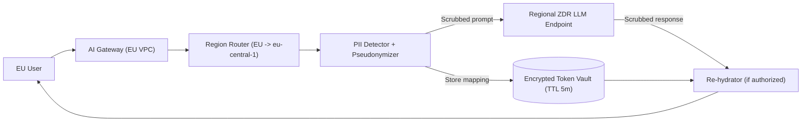
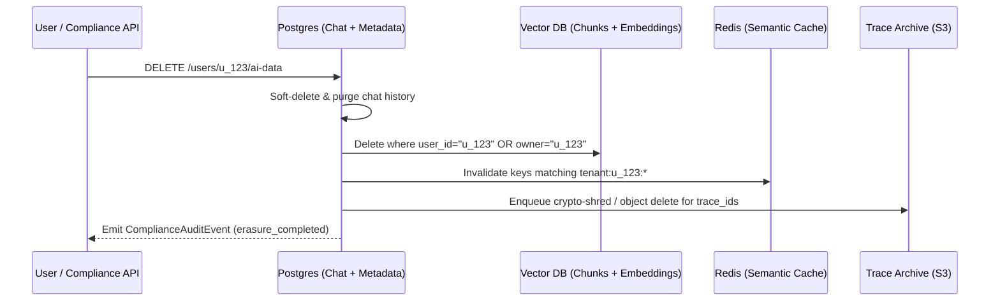
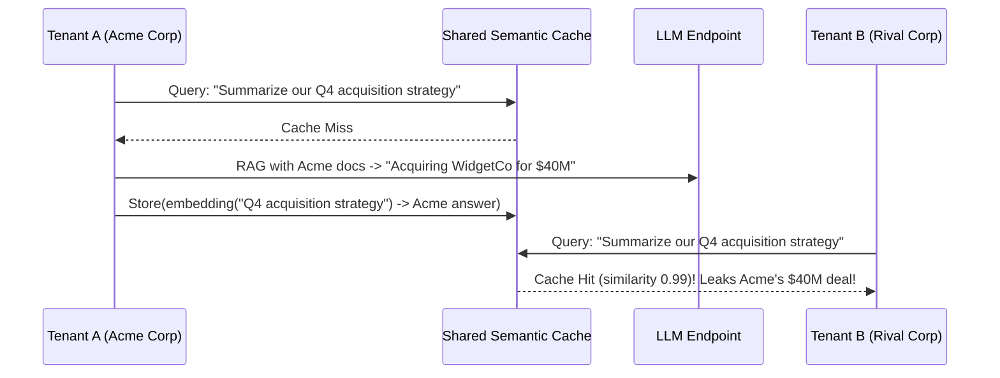

# AI Data Privacy & Compliance: Retention, Regions & PII Redaction

> **Prerequisites:** [Lesson 38: Fine-Tuning vs RAG vs Prompting](../38-fine-tuning-vs-rag-vs-prompting/README.md).  
> **Estimated Reading Time:** 24–28 minutes  
> **Target Audience:** Backend, security, and platform engineers shipping enterprise AI features, and candidates asked "how do you prevent an LLM app from leaking PII or violating GDPR/HIPAA?"  
> **Free PDF Notes:** [Download SD-S-039.pdf](https://backendroadmap.com/notes/system-design/SD-S-039.pdf)

> [!NOTE]
> **In one line:** Enterprise AI compliance rests on four controls: **zero-retention inference agreements (ZDR)** so prompts aren't logged or trained on, **data residency routing** (EU/US regional endpoints), **bidirectional PII redaction/pseudonymization** at the AI Gateway, and **permission-aware RAG** with tenant isolation.

> [!TIP]
> **The Golden Rule:** Once PII enters a third-party LLM log or a shared vector index without ACLs, you cannot reliably "delete" it on demand. Scrub PII *before* the prompt leaves your VPC, enforce ZDR contracts, and isolate every RAG query by `tenant_id` and `user_acl`.

---

## 1. What AI Data Privacy & Compliance Is, and What It Isn't

Consumer LLM APIs and enterprise LLM deployments have completely different data lifecycles. By default, free/consumer endpoints may retain prompts for 30 days for abuse monitoring or model training. In regulated industries (healthcare/HIPAA, finance/PCI-DSS, EU/GDPR), sending an unredacted SSN, patient record, or EU citizen's name to a US-hosted model with 30-day retention is an immediate compliance violation.

| Term | Precise Meaning | Example |
| :--- | :--- | :--- |
| **Zero Data Retention (ZDR)** | Provider contractually guarantees prompts/responses are processed in RAM only and never written to disk | Enterprise OpenAI/Anthropic ZDR or AWS Bedrock |
| **Data Residency (Regions)** | Pinning inference, embeddings, and vector storage to a specific legal jurisdiction | EU-only traffic routed exclusively to `eu-central-1` / Azure Sweden |
| **PII Redaction** | Irreversibly masking sensitive entities before inference | `"Call Jane Doe at 555-0199"` -> `"Call [PERSON] at [PHONE]"` |
| **Pseudonymization (Token Vault)** | Replacing PII with reversible tokens in a local vault, restoring them in the response | `"[PERSON_1]"` sent to LLM -> restored to `"Jane Doe"` for authorized user |
| **Tenant & ACL Isolation** | Enforcing per-tenant namespaces and per-user document permissions in RAG | Vector search pre-filter: `tenant_id == T AND role IN doc_acl` |
| **Right to Erasure (GDPR Art. 17)** | Deleting a user's embeddings, chat history, and semantic cache entries on request | Cascading delete across Postgres + Vector DB + Redis + S3 traces |
| **Not** | Assuming HTTPS encryption alone makes an LLM call GDPR/HIPAA compliant | Encryption in transit doesn't fix retention, training, or cross-border transfer |

### Why It Matters
1. **Enterprise deals stall on security:** Every B2B AI RFP asks three questions: *Do you train on our data? Where is it processed? How do you prevent cross-tenant leaks?*
2. **Vector DBs are sticky:** Unlike stateless LLM calls, RAG pipelines persist embeddings and chunks—if you forget GDPR deletion hooks or ACL filters, you leak data across users.
3. **Observability conflicts with privacy:** Logging full prompts for debugging (Lesson 36) directly collides with data minimization unless you redact before export.

---

## 2. Anatomy: Privacy-Preserving AI Gateway & Bidirectional Redaction



A **Privacy-Preserving AI Gateway** enforces compliance centrally so individual product teams cannot accidentally bypass it:
1. **Region Pinning:** Reads `tenant.region` (`EU`, `US`, `UK`) and routes to regional endpoints (e.g., AWS Bedrock `eu-central-1`, Azure OpenAI `francecentral`)—never falling back cross-region without explicit policy approval.
2. **Bidirectional PII Redaction / Pseudonymization:** Scans outbound prompts with fast regex + NER (e.g., Microsoft Presidio) to replace emails, SSNs, credit cards, and names with placeholders (`<PERSON_1>`, `<EMAIL_1>`). If the user needs the real name back in the answer, a short-lived encrypted **Token Vault** re-hydrates the response inside the VPC.
3. **ZDR + No-Training Headers:** Routes only to enterprise ZDR endpoints; disables provider-side prompt caching if cache isolation isn't guaranteed per tenant.

| Strategy | Reversible? | Utility Impact | Best For |
| :--- | :--- | :--- | :--- |
| **Hard Redaction (`[REDACTED]`)** | No | Can hurt reasoning if entities are needed | Analytics, support ticket summarization, observability logs |
| **Pseudonymization (`<PERSON_1>`)** | Yes (via Vault) | Minimal—LLM reasons over `<PERSON_1>` naturally | Legal/HR/CRM assistants where names must appear in final reply |
| **Private VPC Self-Hosting** | N/A (data never leaves) | Full utility; higher GPU ops cost | Classified data, strict air-gapped or zero-third-party policies |

> [!WARNING]
> **Never rely on LLM prompt instructions ("please ignore PII") for compliance.** An LLM cannot un-receive data already sent over the network, and prompt injection can exfiltrate raw context. Redaction and ACL filtering **must** happen deterministically *before* the prompt reaches the model.

---

## 3. Mathematical Model: Redaction Latency, Recall & Leakage Risk

**End-to-End Privacy Overhead.** Adding a local PII scanner + Token Vault lookup adds latency $T_{\text{redact}}$ and $T_{\text{rehydrate}}$:

$$T_{\text{total}} = T_{\text{redact}} + T_{\text{LLM}} + T_{\text{rehydrate}}$$

**Residual Leakage Probability.** Suppose a corpus has $N_{\text{pii}}$ sensitive entities per 1,000 requests, and your hybrid detector (Regex + NER) has recall $R_{\text{det}}$:

$$E[\text{Leaked Entities}] = N_{\text{pii}} \cdot (1 - R_{\text{det}})$$

### Worked Numerical Example
Suppose an enterprise support bot processes **100,000 requests/day**, with $N_{\text{pii}} = 25{,}000$ PII entities/day (SSNs, emails, names).
- **Regex-only** ($R_{\text{det}} = 0.72$, misses unstructured names/addresses):
  $$25{,}000 \times (1 - 0.72) = 7{,}000\text{ leaked entities/day}$$
- **Hybrid Regex + Distilled NER (e.g., Presidio/GLiNER)** ($R_{\text{det}} = 0.985$, $T_{\text{redact}} = 18\text{ ms}$ on CPU):
  $$25{,}000 \times (1 - 0.985) = 375\text{ residual entities/day}$$
- Pairing that with **ZDR (0-day retention)** and **Regional VPC endpoints** ensures those 375 residual entities are never written to disk, never used for training, and never cross legal borders—reducing regulatory exposure by orders of magnitude at only **18 ms** latency overhead ($\sim 3\%$ of a 600 ms TTFT).

---

## 4. Metrics & Percentiles

| Metric | Meaning | Alert when |
| :--- | :--- | :--- |
| **PII redaction latency $p_{95}$** | Time spent scanning + vaulting outbound prompts | $> 40\text{ ms}$ (CPU bottleneck in gateway) |
| **PII detection recall (eval set)** | % of synthetic/labeled PII caught before egress | $< 98\%$ on structured (SSN/CC) or $< 95\%$ on NER |
| **Cross-region fallback count** | Requests routed outside tenant's pinned region | $> 0$ (hard compliance violation!) |
| **ZDR endpoint compliance %** | % of external LLM calls hitting verified ZDR endpoints | $< 100\%$ in production |
| **GDPR erasure SLA** | Time from deletion request to purge across DB + Vector + Cache | $> 30\text{ days}$ (legal limit) or $> 24\text{ h}$ (internal SLO) |
| **ACL filter bypasses** | Vector queries executed without `tenant_id` / `acl` predicate | $> 0$ (critical P0 security bug) |

### Worked Example: Cross-Region Fallback Trap
An EU banking customer pins `region = "eu-central-1"`. During an Azure Sweden brownout, a naive reliability router (Lesson 37) fails over to `us-east-1` to keep availability at 99.99%.
- Availability stays green, **but** EU customer data just crossed into the US without Standard Contractual Clauses (SCCs) or customer consent—triggering a reportable GDPR breach.
- **Fix:** Region-pinning is a **hard constraint**, not a soft preference. Fallback chains must stay *within* the legal boundary (e.g., Azure Sweden $\to$ AWS Bedrock Frankfurt $\to$ EU self-hosted vLLM).

---

## 5. Compounding & Failure Modes: RAG Leakage & Semantic Cache Poisoning

1. **Cross-Tenant Semantic Cache Poisoning:** If you cache LLM answers by prompt embedding similarity *without* including `tenant_id` and `user_acl_hash` in the cache key, User B asking `"What is our Q4 M&A target?"` can receive User A's cached answer from a different company or clearance level.
2. **Embedding Inversion Attacks:** Even if you don't store raw text in a vector DB, dense embeddings can be partially inverted back into sensitive text. Always encrypt vector DB storage at rest, isolate by `tenant_id`, and cascade-delete vectors on GDPR erasure.
3. **Observability Log Leakage:** Your AI Gateway scrubs PII before calling OpenAI, **but** an earlier middleware already logged the raw HTTP body to Datadog/Splunk. Scrubbing must occur at the **earliest ingress** or via structured log redaction.

---

## 6. Numbers Every Engineer Must Know

| Item | Typical | Implication |
| :--- | :--- | :--- |
| **Default consumer API retention** | 30 days (abuse/training) | Unacceptable for PII/HIPAA; must enable Enterprise ZDR |
| **Regex + NER redaction latency** | 10–30 ms (CPU), 3–8 ms (ONNX) | Negligible compared to 400 ms+ LLM TTFT |
| **GDPR erasure deadline** | 30 days max | Automate cascading deletes across DB, Vector DB, Cache, S3 |
| **Token Vault TTL** | 60–300 seconds (in-memory Redis) | Automatically expires PII mappings right after stream finishes |
| **Prompt cache isolation** | Per-org/tenant key | Never share semantic caches across tenants or ACL roles |
| **Audit log retention** | 1–7 years (metadata only) | Log `who`, `when`, `model`, `policy_applied`—never raw PII |

---

## 7. Protocol Deep Dive: GDPR Right-to-Erasure & Permissioned RAG



For **Permissioned RAG**, **never** post-filter permissions in Python after retrieving top-5 chunks—if all top-5 chunks belong to unauthorized docs, the user gets 0 results even though 100 authorized docs existed. Always **pre-filter** inside the vector database query (`WHERE tenant_id = $1 AND acl && $user_groups`).

| Question | Answer |
| :--- | :--- |
| **When to use Pseudonymization vs Hard Redaction?** | Pseudonymization when the user needs names/IDs in the final answer; hard redaction for analytics/logging |
| **When NOT to use third-party SaaS LLMs?** | Air-gapped networks, classified workloads, or when vendor refuses ZDR / BAA (HIPAA) |
| **When to use Per-Tenant Vector Indexes vs Shared Index?** | Shared index with mandatory `tenant_id` pre-filter for 10K+ small tenants; dedicated index/DB for large regulated enterprises |

---

## 8. Hierarchical Budgets & Design Rules

| Slice | Rule | Control |
| :--- | :--- | :--- |
| **Data residency** | Hard regional boundary | Fallback router must only pick endpoints inside `tenant.allowed_regions` |
| **PII egress** | Zero raw structured PII | Deterministic regex + NER gate blocks/masks SSN, CC, keys, emails before egress |
| **RAG isolation** | Pre-filtered ACLs on every query | Vector DB client wrapper requires `tenant_id` + `acl_groups` as non-optional args |
| **Semantic cache** | Tenant + ACL scoped | Cache key = `hash(tenant_id, acl_hash, prompt_embedding)` |
| **Retention** | ZDR + short trace TTL | Enterprise ZDR on LLM API; 7–30 day TTL on scrubbed debug traces |

---

## 9. Top Mitigations

1. **Sign Enterprise ZDR & DPA/BAA agreements** before sending any production traffic to external LLM APIs.
2. **Enforce region-pinned routing at the AI Gateway**—never allow reliability fallbacks to cross GDPR/sovereign boundaries.
3. **Run bidirectional PII pseudonymization** (Regex + NER + short-TTL encrypted Token Vault) in-VPC before egress.
4. **Enforce mandatory `tenant_id` and `acl` pre-filtering** in your Vector DB wrapper so developers cannot write an unscoped query.
5. **Scope semantic caches by `(tenant_id, acl_hash)`** to prevent cross-user answer leakage.
6. **Automate GDPR deletion cascades** across chat DB, Vector DB, Redis cache, and S3 trace buckets—and test it quarterly.
7. **Scrub observability logs at ingress** so raw prompts never land in third-party APM/log SaaS.

---

## 10. Production Reference: SEV-1 Cross-Tenant Semantic Cache Leak



**Root Cause:** The team added a Redis semantic cache in front of their RAG orchestrator keyed only by `embedding(user_query)` to save 30% on LLM costs, forgetting `tenant_id` and `acl_hash`.
**Fix:**
1. Flushed the entire semantic cache immediately and rotated cache keys.
2. Partitioned the semantic cache by `tenant_id` and `user_acl_hash` (`cache_key = f"{tenant_id}:{acl_hash}"`), and disabled semantic caching entirely for queries containing PII or confidential doc tags.

---

## 11. Multi-Language Production Code Tabs

````carousel
```go
// Go: Region-pinned router + deterministic PII pseudonymizer with short-TTL vault.
package aiprivacy

import (
	"errors"
	"fmt"
	"regexp"
	"strings"
)

var (
	emailRe = regexp.MustCompile(`[a-zA-Z0-9._%+-]+@[a-zA-Z0-9.-]+\.[a-zA-Z]{2,}`)
	ssnRe   = regexp.MustCompile(`\b\d{3}-\d{2}-\d{4}\b`)
)

func SelectRegionalEndpoint(tenantRegion string, allowed map[string][]string) (string, error) {
	endpoints, ok := allowed[tenantRegion]
	if !ok || len(endpoints) == 0 {
		return "", fmt.Errorf("compliance block: no ZDR endpoint in region %s", tenantRegion)
	}
	return endpoints[0], nil // Never fall back outside tenantRegion
}

func Pseudonymize(text string) (scrubbed string, vault map[string]string) {
	vault = make(map[string]string)
	idx := 0
	replace := func(re *regexp.Regexp, label, in string) string {
		return re.ReplaceAllStringFunc(in, func(match string) string {
			idx++
			token := fmt.Sprintf("<%s_%d>", label, idx)
			vault[token] = match
			return token
		})
	}
	scrubbed = replace(ssnRe, "SSN", text)
	scrubbed = replace(emailRe, "EMAIL", scrubbed)
	return scrubbed, vault
}

func Rehydrate(response string, vault map[string]string, authorized bool) (string, error) {
	if !authorized {
		return "", errors.New("unauthorized to rehydrate PII")
	}
	out := response
	for token, original := range vault {
		out = strings.ReplaceAll(out, token, original)
	}
	return out, nil
}
```
<!-- slide -->
```typescript
// TypeScript: Tenant-isolated, ACL-scoped RAG query & semantic cache key builder.
import crypto from "node:crypto";

export interface SecurityContext {
  tenantId: string;
  userId: string;
  aclGroups: string[];
  region: "EU" | "US" | "UK";
}

export function buildScopedCacheKey(ctx: SecurityContext, normalizedQuery: string): string {
  const sortedAcls = [...ctx.aclGroups].sort().join(",");
  const aclHash = crypto.createHash("sha256").update(sortedAcls).digest("hex").slice(0, 12);
  const queryHash = crypto.createHash("sha256").update(normalizedQuery).digest("hex").slice(0, 16);
  // Prevents cross-tenant and cross-clearance cache poisoning
  return `ragcache:${ctx.region}:${ctx.tenantId}:${aclHash}:${queryHash}`;
}

export function buildVectorPreFilter(ctx: SecurityContext) {
  if (!ctx.tenantId || ctx.aclGroups.length === 0) {
    throw new Error("ComplianceViolation: tenantId and aclGroups are mandatory for RAG");
  }
  return {
    must: [
      { key: "tenant_id", match: { value: ctx.tenantId } },
      { key: "acl_groups", match: { any: ctx.aclGroups } },
    ],
  };
}
```
<!-- slide -->
```python
# Python: Bidirectional PII pseudonymizer + residual leakage estimator (stdlib).
import re

PATTERNS = {
    "SSN": re.compile(r"\b\d{3}-\d{2}-\d{4}\b"),
    "CC": re.compile(r"\b(?:\d[ -]*?){13,16}\b"),
    "EMAIL": re.compile(r"[a-zA-Z0-9._%+-]+@[a-zA-Z0-9.-]+\.[a-zA-Z]{2,}"),
}


def pseudonymize(text: str) -> tuple[str, dict[str, str]]:
    vault: dict[str, str] = {}
    counter = 0

    def _sub(label: str, s: str, pattern: re.Pattern) -> str:
        def repl(m: re.Match) -> str:
            nonlocal counter
            counter += 1
            tok = f"<{label}_{counter}>"
            vault[tok] = m.group(0)
            return tok
        return pattern.sub(repl, s)

    out = text
    for label, pat in PATTERNS.items():
        out = _sub(label, out, pat)
    return out, vault


def rehydrate(text: str, vault: dict[str, str]) -> str:
    for tok, val in vault.items():
        text = text.replace(tok, val)
    return text


def expected_leaks(n_pii: int, recall: float) -> float:
    return round(n_pii * (1.0 - recall), 2)
```
<!-- slide -->
```csharp
// C#: Compliance-enforced AI Gateway policy check (ZDR + Region + PII guard).
using System.Text.RegularExpressions;

public sealed record TenantPolicy(string TenantId, string PinnedRegion, bool RequireZdr);

public static partial class PrivacyGateway
{
    [GeneratedRegex(@"\b\d{3}-\d{2}-\d{4}\b")]
    private static partial Regex SsnRegex();

    [GeneratedRegex(@"[a-zA-Z0-9._%+-]+@[a-zA-Z0-9.-]+\.[a-zA-Z]{2,}")]
    private static partial Regex EmailRegex();

    public static string RouteEndpoint(TenantPolicy policy, IReadOnlyDictionary<string, (string Url, bool IsZdr)> catalog)
    {
        if (!catalog.TryGetValue(policy.PinnedRegion, out var ep))
            throw new InvalidOperationException($"No endpoint in pinned region {policy.PinnedRegion}");
        if (policy.RequireZdr && !ep.IsZdr)
            throw new InvalidOperationException($"Endpoint in {policy.PinnedRegion} lacks ZDR compliance");
        return ep.Url;
    }

    public static string RedactPii(string input)
    {
        var s = SsnRegex().Replace(input, "[REDACTED_SSN]");
        return EmailRegex().Replace(s, "[REDACTED_EMAIL]");
    }
}
```
````

---

## 12. Hands-On CLI Verification Workflows

Verify residual PII leakage math and pseudonymization round-trip in Python:

```bash
python -c "
n_pii = 25000
print('regex_only_leaks=', n_pii*(1-0.72), 'hybrid_ner_leaks=', n_pii*(1-0.985))
"
# Output: regex_only_leaks= 7000.0 hybrid_ner_leaks= 375.0
```

Verify regional endpoint pinning and GDPR deletion hooks via CLI:

```bash
# Verify AWS Bedrock endpoints are restricted to EU region via IAM / VPC endpoint policy
aws bedrock list-foundation-models --region eu-central-1 --query "modelSummaries[0].modelId"

# Verify Redis semantic cache keys include tenant_id prefix (never global keys)
redis-cli --scan --pattern "ragcache:*" | head -n 5

# Trigger and audit a GDPR user erasure job
curl -s -X DELETE https://api.internal/v1/compliance/erasure/u_123 \
  -H "Authorization: Bearer $ADMIN_TOKEN" | jq .
```

---

## 13. Common Mistakes to Avoid

1. **Relying on prompt instructions ("don't repeat PII")** instead of deterministic pre-egress redaction.
2. **Allowing reliability fallbacks to cross legal regions** (e.g., EU -> US) during an outage.
3. **Sharing a semantic cache across tenants or ACL levels**, causing instant data leaks.
4. **Post-filtering RAG permissions in app code** instead of pre-filtering inside the vector database.
5. **Forgetting to cascade GDPR deletions** to vector databases, semantic caches, and trace archives.
6. **Using regex-only PII detection**, which misses unstructured names, addresses, and medical conditions.
7. **Logging unredacted HTTP bodies in APM/Splunk** before the AI Gateway's redactor even runs.

---

## 14. Key Terms Glossary

| Key Term | Definition |
| :--- | :--- |
| **Zero Data Retention (ZDR)** | Contractual guarantee that an LLM provider never stores prompts/completions on disk or trains on them. |
| **Data Residency** | Restricting data processing and storage to approved geographic/legal jurisdictions (e.g., EU). |
| **PII Redaction** | Irreversibly masking sensitive attributes (`[REDACTED_SSN]`) before data leaves the VPC. |
| **Pseudonymization** | Replacing PII with reversible tokens (`<PERSON_1>`) backed by a short-TTL local Token Vault. |
| **Pre-Filtered RAG** | Applying `tenant_id` and `acl_groups` filters inside the vector search index before top-$k$ ranking. |
| **Semantic Cache Poisoning** | Leaking one tenant's cached LLM response to another tenant with a similar query. |
| **GDPR Art. 17 (Right to Erasure)** | Legal requirement to delete a user's personal data across all stores within 30 days. |
| **DPA / BAA** | Data Processing Addendum (GDPR) / Business Associate Agreement (HIPAA) required with vendors. |
| **Embedding Inversion** | Attack attempting to reconstruct original sensitive text from stored vector embeddings. |
| **Crypto-Shredding** | Deleting per-user encryption keys to render archived backups/traces unreadable. |

---

## 15. System Design Interview Questions & Answers

### Basic Conceptual Questions

<details>
<summary><strong>Q1: What is Zero Data Retention (ZDR), and why does it matter for LLM APIs? [BASIC]</strong></summary>

**Answer:**
ZDR is an enterprise agreement where the LLM provider processes prompts strictly in memory, never writes them to disk/logs, and never uses them for model training. Without ZDR, standard 30-day abuse-monitoring logs can violate GDPR, HIPAA, or customer NDAs.
</details>

<details>
<summary><strong>Q2: What is the difference between PII redaction and pseudonymization? [BASIC]</strong></summary>

**Answer:**
**Redaction** irreversibly replaces PII with `[REDACTED]`, which is safest for logs and analytics. **Pseudonymization** replaces PII with consistent tokens (`<PERSON_1>`) stored in a short-TTL encrypted Token Vault so the LLM can reason about relationships and the gateway can restore real names in the final response.
</details>

<details>
<summary><strong>Q3: Why must RAG permissions be pre-filtered rather than post-filtered? [BASIC]</strong></summary>

**Answer:**
If you fetch top-5 vector matches globally and post-filter in app code, all 5 might belong to unauthorized documents—returning 0 context to the user even when authorized documents exist. Pre-filtering (`tenant_id == T AND acl IN user_groups`) inside the vector DB guarantees top-$k$ authorized results and zero cross-tenant leakage.
</details>

<details>
<summary><strong>Q4: Does HTTPS encryption make an LLM call GDPR-compliant? [BASIC]</strong></summary>

**Answer:**
No. TLS only protects data in transit. GDPR requires lawful basis, **data residency** (staying in approved regions), **data minimization** (redacting unnecessary PII), **DPA/ZDR** contracts, and **Right to Erasure** across all persistent stores.
</details>

### Scenario-Based Architecture Questions

<details>
<summary><strong>Q5: Your EU healthcare app uses an LLM gateway with US fallback for reliability. Legal flags this as a blocker. How do you fix it? [SCENARIO]</strong></summary>

**Answer:**
Make **region pinning a hard constraint** in the AI Gateway. Remove US endpoints from the EU fallback chain; instead, fail over between EU-only endpoints (e.g., AWS Bedrock `eu-central-1` $\to$ Azure OpenAI `francecentral` $\to$ EU-hosted vLLM) with ZDR/BAA enabled on all of them.
</details>

<details>
<summary><strong>Q6: A user invokes GDPR "Right to be Forgotten." Which AI-specific stores must you purge? [SCENARIO]</strong></summary>

**Answer:**
Beyond the primary SQL database, you must purge: (1) all chunks and embeddings owned by the user in the **Vector DB**, (2) any **semantic cache** entries scoped to that user, (3) **observability trace payloads** (or crypto-shred their per-user encryption key), and (4) any **fine-tuning datasets** derived from their data.
</details>

<details>
<summary><strong>Q7: How do you add a semantic cache to a multi-tenant RAG app without leaking data between companies? [SCENARIO]</strong></summary>

**Answer:**
Include `region`, `tenant_id`, and a sorted hash of the user's `acl_groups` in the cache partition/key (`ragcache:{region}:{tenant_id}:{acl_hash}`), and disable caching for queries flagged as containing PII or restricted document tags.
</details>

<details>
<summary><strong>Q8: How do you measure and maintain PII redaction quality in production? [SCENARIO]</strong></summary>

**Answer:**
Use a layered detector (fast deterministic regex for SSN/CC/keys + distilled NER like Presidio/GLiNER for names/addresses), benchmark recall weekly on a synthetic PII test set (targeting $>98\%$ recall), and monitor $p_{95}$ redaction latency ($<40\text{ ms}$) at the AI Gateway.
</details>

### Advanced & Tricky Interview Questions

<details>
<summary><strong>Q9: How can an attacker extract private data from a RAG system even if you redact PII from user prompts? [TRICKY]</strong></summary>

**Answer:**
Via **indirect prompt injection** or **missing RAG ACLs**: if an attacker queries a shared vector index, the retrieved chunks themselves may contain unredacted PII from other users' documents, which the LLM then repeats in its answer. Both **outbound prompts** and **ingested RAG documents** must be ACL-isolated and PII-classified.
</details>

<details>
<summary><strong>Q10: Why is deleting a user's data from a fine-tuned model almost impossible, and what is the architectural workaround? [TRICKY]</strong></summary>

**Answer:**
User data baked into neural network weights cannot be cleanly surgical-removed without full retraining ("machine unlearning" is still impractical at scale). Workaround: **never** put user-specific PII into fine-tuning weights—keep user data strictly in **RAG** (where deletion is an instant `DELETE` query) and only fine-tune on anonymized/synthetic structural data.
</details>

<details>
<summary><strong>Q11: What is an embedding inversion attack, and how do you mitigate it? [TRICKY]</strong></summary>

**Answer:**
Research shows dense text embeddings can be inverted to reconstruct sensitive words/phrases. Mitigate by encrypting vector DB volumes at rest, isolating tenants with strict network/namespace boundaries, avoiding storing raw text alongside embeddings when unnecessary, and purging vectors on user deletion.
</details>

<details>
<summary><strong>Q12: How do you debug a production hallucination if your compliance policy forbids storing raw user prompts? [TRICKY]</strong></summary>

**Answer:**
Use **pseudonymized trace logging**: run PII redaction/pseudonymization *before* emitting OTel spans, log only the scrubbed prompt (`<PERSON_1>`), retrieved `doc_ids` (not full text), `prompt_version`, and `model_snapshot`. For critical enterprise escalations, require explicit customer opt-in for ephemeral, encrypted debug capture.
</details>

---

## 16. One-Page Master Cheat Sheet

```
+---------------------------------------------------------------------------------------------------------+
|                    AI DATA PRIVACY & COMPLIANCE — MASTER CHEAT SHEET                                    |
+---------------------------------------------------------------------------------------------------------+
| 1. FOUR PILLARS: ZDR (no disk/training) + Region Pinning + Bidirectional PII Redaction + ACL RAG.       |
+---------------------------------------------------------------------------------------------------------+
| 2. PII GATEWAY: Regex + NER (Presidio/GLiNER) -> 98.5%+ recall in ~18ms. Token Vault (short TTL) if     |
|    rehydration needed. Never rely on LLM prompt instructions to protect PII.                            |
+---------------------------------------------------------------------------------------------------------+
| 3. REGION PINNING: Hard constraint! Reliability fallbacks must stay inside the legal region (EU -> EU). |
+---------------------------------------------------------------------------------------------------------+
| 4. RAG & CACHE: Pre-filter vector DB by (tenant_id, acl_groups). Key semantic cache by tenant+acl_hash. |
+---------------------------------------------------------------------------------------------------------+
| 5. GDPR ERASURE: Cascade delete across SQL DB + Vector DB + Redis Cache + S3 Traces (never fine-tune    |
|    on user PII so you never have to un-learn weights).                                                  |
+---------------------------------------------------------------------------------------------------------+
```

---

## Further Reading & Sources

- OWASP, [Top 10 for Large Language Model Applications](https://owasp.org/www-project-top-10-for-large-language-model-applications/) (Sensitive Information Disclosure & Excessive Agency).
- Microsoft Presidio, [Data Protection and De-identification SDK](https://microsoft.github.io/presidio/).
- European Data Protection Board (EDPB), *Opinion on AI Models, Anonymisation, and GDPR Compliance*.
- NIST, [AI Risk Management Framework (AI RMF 1.0)](https://www.nist.gov/itl/ai-risk-management-framework).

---

## Free PDF Notes

[SD-S-039.pdf](https://backendroadmap.com/notes/system-design/SD-S-039.pdf)

---

## Next

Continue with [Track 21: System Design Interview Framework](../../21-interview-framework/README.md).
