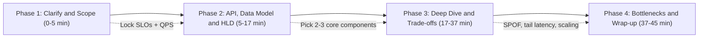
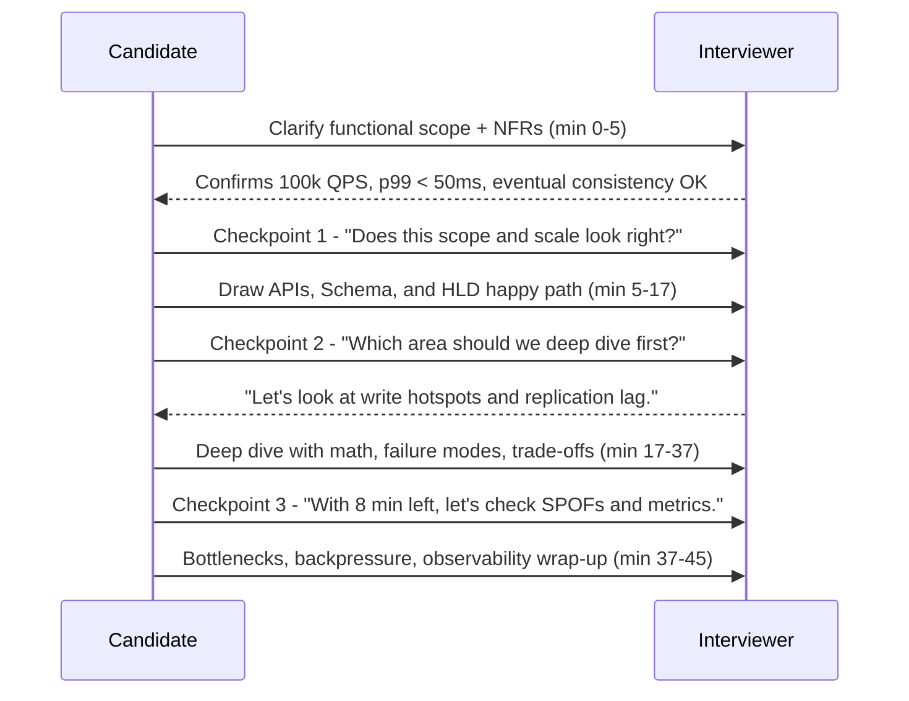
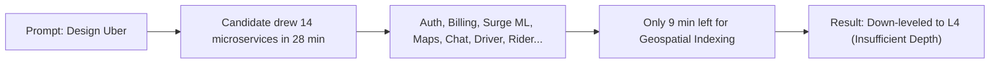

# System Design Interview Framework: How to Structure 45 Minutes

> **Prerequisites:** [Track 20, Lesson 39: AI Data Privacy & Compliance](../../20-ai-and-genai-system-design/39-ai-data-privacy-compliance/README.md) · [Track Overview](../README.md).  
> **Estimated Reading Time:** 24–28 minutes  
> **Target Audience:** Backend and full-stack engineers preparing for L4–L7 system design interviews, and staff engineers coaching candidates on time-boxed architecture communication.  
> **Free PDF Notes:** [Download SD-T-001.pdf](https://backendroadmap.com/notes/system-design/SD-T-001.pdf)

> [!NOTE]
> **In one line:** A 45-minute system design interview is not a knowledge trivia test; it is a **time-boxed engineering simulation** where you convert an ambiguous prompt into a scoped, quantified, and resilient architecture across four disciplined phases: **Clarify & Scope (5 min)**, **High-Level Design & APIs (12 min)**, **Deep Dive & Trade-offs (20 min)**, and **Bottlenecks & Wrap-Up (8 min)**.

> [!TIP]
> **The Golden Rule:** Never draw a single database or load balancer before minute 5. Spend the first 5 minutes locking down functional scope, non-functional SLOs, and scale—because designing the wrong system at high fidelity is an automatic no-hire.

---

## 1. What a System Design Interview Framework Is, and What It Isn't

When an interviewer says *"Design Twitter"* or *"Design a URL shortener"*, the prompt is intentionally underspecified. Candidates who immediately jump to drawing Kafka, Redis, and sharded PostgreSQL fail not because those components are bad, but because they never established whether the system serves 100 QPS or 100,000 QPS, whether reads or writes dominate, or what consistency model the product requires.

| Term | Precise Meaning | Example |
| :--- | :--- | :--- |
| **Time-boxed framework** | A repeatable phase allocation for a 45-minute session | 5 min scope, 12 min HLD, 20 min deep dive, 8 min wrap-up |
| **Signal density** | Ratio of rubric-relevant architectural decisions per minute | Justifying LSM-tree vs B-tree over reciting textbook definitions |
| **Candidate-driven pacing** | Taking ownership of transitions instead of waiting for prompts | "We have 20 minutes left; let's deep dive on fan-out." |
| **Vertical slice** | Tracing one end-to-end request before expanding to edge cases | `POST /shorten` -> hash -> DB -> `201` before analytics |
| **Trade-off matrix** | Explicitly comparing two viable options with pros, cons, and triggers | Push vs pull fan-out with celebrity threshold |
| **Not** | A rigid script you recite regardless of interviewer cues | Ignoring an interviewer who asks to skip capacity math |
| **Not** | Buzzword bingo (listing Kafka, K8s, Cassandra without justification) | Adding Redis when the entire dataset is 50 MB |

### Why It Matters
1. **Rubrics grade four dimensions:** Problem Exploration, High-Level Architecture, Deep-Dive Technical Rigor, and Trade-off/Failure Analysis. Without a time budget, candidates spend 25 minutes on HLD and get zero signal on deep dives or failure modes.
2. **Cognitive load management:** A structured framework frees working memory during a stressful interview so you can focus on distributed systems mechanics rather than wondering what to say next.
3. **Seniority differentiation:** Mid-level (L4) candidates wait to be guided; senior/staff (L5–L7) candidates drive the clock, surface constraints proactively, and pivot cleanly when the interviewer redirects.

---

## 2. Anatomy: The 45-Minute Execution Timeline



In a standard 45-minute loop, 3–5 minutes are consumed by introductions at the start and candidate Q&A at the end, leaving **40–45 minutes of active design time**.

| Phase | Time Window | Primary Deliverable | Exit Gate (Check before moving on) |
| :--- | :---: | :--- | :--- |
| **1. Clarify & Scope** | 0–5 min | 3–4 functional features, 3–4 NFRs, order-of-magnitude QPS/storage | Interviewer agrees on scope and scale |
| **2. API, Schema & HLD** | 5–17 min | Core endpoints, primary entities, end-to-end box-and-arrow diagram | Happy path write and read flows traced |
| **3. Deep Dive** | 17–37 min | Detailed design of 2–3 hard subsystems (e.g., sharding, caching, consensus) | Quantitative justification for every choice |
| **4. Bottlenecks & Wrap-up** | 37–45 min | SPOF elimination, backpressure, observability, future evolution | All NFRs from Phase 1 verified |

> [!WARNING]
> **The #1 Trap: The 25-Minute HLD.** Candidates often spend half the interview drawing every microservice, auth gateway, CDN, and analytics pipeline at a shallow level. By minute 30, there is no time left for the deep dive—and without deep-dive signal, interviewers cannot calibrate you at Senior (L5) or Staff (L6).

---

## 3. Mathematical Model: Time-Boxed Signal & Rubric Expected Value

We can model interview outcome as a weighted sum of rubric scores across the four phases, where each phase exhibits **diminishing marginal returns** beyond its optimal time allocation $t_i^*$:

$$S_{\text{total}} = \sum_{i=1}^{4} w_i \cdot \left(1 - e^{-\lambda_i t_i}\right), \qquad \sum_{i=1}^{4} t_i = T_{\text{total}} = 45\text{ min}$$

Where typical L5/L6 rubric weights are:
- $w_1 = 0.15$ (Requirements & Scope)
- $w_2 = 0.25$ (High-Level Design & APIs)
- $w_3 = 0.40$ (Deep Dive & Trade-offs)
- $w_4 = 0.20$ (Reliability, Scaling & Wrap-up)

### Worked Numerical Example
Compare two candidates with $\lambda_1 = 0.45, \lambda_2 = 0.20, \lambda_3 = 0.12, \lambda_4 = 0.25$:

1. **Disciplined Candidate ($t = [5, 12, 20, 8]$):**
   - $S_1 = 0.15(1 - e^{-0.45 \times 5}) = 0.15(0.895) = 0.134$
   - $S_2 = 0.25(1 - e^{-0.20 \times 12}) = 0.25(0.909) = 0.227$
   - $S_3 = 0.40(1 - e^{-0.12 \times 20}) = 0.40(0.909) = 0.364$
   - $S_4 = 0.20(1 - e^{-0.25 \times 8}) = 0.20(0.865) = 0.173$
   - **Total Score:** $S_{\text{total}} = 0.134 + 0.227 + 0.364 + 0.173 = \mathbf{0.898}$ (Strong Hire).

2. **Unstructured Candidate ($t = [2, 28, 12, 3]$ — rushes scope, lingers on HLD, runs out of time):**
   - $S_1 = 0.15(1 - e^{-0.90}) = 0.089$
   - $S_2 = 0.25(1 - e^{-5.60}) = 0.249$ (barely +0.022 gain for +16 extra minutes!)
   - $S_3 = 0.40(1 - e^{-1.44}) = 0.305$
   - $S_4 = 0.20(1 - e^{-0.75}) = 0.106$
   - **Total Score:** $S_{\text{total}} = 0.089 + 0.249 + 0.305 + 0.106 = \mathbf{0.749}$ (Lean No-Hire / Down-level).

Spending 16 extra minutes polishing the HLD yielded only $+0.022$ in Phase 2 while destroying $-0.149$ across Phases 1, 3, and 4.

---

## 4. Metrics & Percentiles (Interview Pacing Telemetry)

| Metric | Meaning | Alert / Pivot When |
| :--- | :--- | :--- |
| **Time to first box** | Minutes elapsed before drawing the first component | `< 3 min` (rushed scope) or `> 8 min` (over-clarified) |
| **HLD completion mark** | Wall-clock minute when happy-path HLD is finished | `> 18 min` (must cut peripheral boxes immediately) |
| **Deep-dive share** | Percentage of total time spent on 2–3 core components | `< 35%` (insufficient L5/L6 depth) |
| **Interviewer redirect count** | Times interviewer says "let's move on" or "what about X?" | `>= 2` (candidate is not reading the room) |
| **Unquantified claims** | Statements like "it's fast" or "it scales" without numbers | `> 0` (attach QPS, latency ms, or GB/day) |
| **Trade-off ratio** | Architectural choices paired with a rejected alternative | `< 80%` (looks like dogma, not engineering) |

### Worked Example ("Design a Distributed Rate Limiter")
- **00:00–05:00:** Clarify: API gateway rate limiter, 100k QPS, sliding window log vs token bucket, `< 2 ms` p99 overhead, fail-open on Redis outage.
- **05:00–16:00:** Define `AllowRequest(clientID, ruleID) -> (allowed, remaining, resetAt)`, draw Gateway -> Local Cache + Redis Cluster, trace happy path.
- **16:00–37:00:** Deep dive on (a) Redis Lua script atomicity vs race conditions, (b) hot-key mitigation with local token batching, (c) multi-region eventual consistency.
- **37:00–45:00:** Walk through Redis shard failure (fail-open circuit breaker), clock skew, and Prometheus metrics (`rate_limit_dropped_total`, `redis_eval_p99_ms`).

---

## 5. Compounding & Failure Modes: How Time Slippage Cascades

In a 45-minute interview, a 5-minute overrun in an early phase compounds because interviewers rarely extend the meeting past the top of the hour.

| Slippage Scenario | Phase 1 (min) | Phase 2 (min) | Phase 3 (min) | Phase 4 (min) | Resulting Failure Mode |
| :--- | :---: | :---: | :---: | :---: | :--- |
| **Baseline (On Track)** | 5 | 12 | 20 | 8 | Full rubric coverage; clear trade-offs and SPOF review |
| **Over-Estimated Capacity** | 12 | 15 | 15 | 3 | Rushed deep dive; zero time for failure modes |
| **Microservice Sprawl** | 4 | 26 | 13 | 2 | "Mile-wide, inch-deep" HLD; rejected for lack of depth |
| **Premature Optimization** | 2 | 10 | 30 (1 topic) | 3 | Deep on sharding, but missed caching, queues, and wrap-up |
| **Silent Whiteboarding** | 5 | 14 | 18 | 8 | Interviewer unsure *why* choices were made; weak hire signal |

A 7-minute overrun in Phase 1 (doing exact byte-by-byte capacity math for every metadata column) steals 7 minutes from Phase 3/4, turning a balanced Senior answer into an incomplete one.

---

## 6. Numbers Every Engineer Must Know (Interview Pacing & Scale Anchors)

| Item | Typical | Implication |
| :--- | :---: | :--- |
| Total active design time | 40–45 min | Subtract 5 min for intros and closing Q&A |
| Phase 1 budget | 4–6 min | Never exceed 7 min; use round powers of 10 |
| Phase 2 budget | 10–13 min | Draw 5–8 boxes max; skip auth/DNS/billing unless asked |
| Phase 3 budget | 18–22 min | Pick 2–3 components; ask interviewer which to prioritize |
| Phase 4 budget | 6–8 min | Reserve time to summarize bottlenecks and monitoring |
| Seconds in a day | $86{,}400 \approx 10^5$ | $10^8$ req/day $\approx 1{,}000$ QPS average |
| Peak-to-average ratio | $3\times$ to $10\times$ | Size queues and compute for peak, not daily average |
| Single-node DB QPS | $5\text{k–}15\text{k}$ reads, $1\text{k–}5\text{k}$ writes | Signals immediately when sharding/caching is needed |

---

## 7. Protocol Deep Dive: The Interviewer-Candidate Feedback Loop

A great system design interview is a **collaborative design review**, not a monologue. Use explicit **checkpoints** between phases to align with your interviewer.



| Checkpoint Question | Purpose |
| :--- | :--- |
| *"I'll scope this to X, Y, Z and defer analytics—does that match what you have in mind?"* | Prevents solving the wrong problem |
| *"Here is the end-to-end happy path. Should we deep dive into A (storage) or B (fan-out)?"* | Lets interviewer steer to the signal they need |
| *"We have 8 minutes left; I'll review failure modes and monitoring unless you want to inspect C."* | Demonstrates time awareness and seniority |

**When NOT to follow the strict 5/12/20/8 split:** If the interviewer explicitly says *"Let's skip capacity math and focus on the storage engine"* or *"This is a product-architecture round, spend more time on APIs and client sync"*, adapt immediately. The framework is a default compass, not a straitjacket.

---

## 8. Hierarchical Budgets & Design Rules

| Slice | Rule | Control |
| :--- | :--- | :--- |
| **Time budget** | 5 / 12 / 20 / 8 min across the 4 phases | Glance at clock at min 5, 17, 37 |
| **Scope discipline** | 3–4 core features + 3 NFRs | Explicitly list "Out of Scope" on the board |
| **HLD complexity** | 5–8 boxes for the happy path | Defer CDN, auth, logging until Phase 4 |
| **Narration** | Never stay silent for > 15 seconds | Think aloud: state problem -> options -> choice |
| **Trade-offs** | Every box needs a "why" and an alternative | Use `(Choice A vs Choice B)` verbal tags |
| **Quantification** | Attach numbers to every scaling claim | QPS, payload KB, p99 ms, storage TB/yr |
| **Failure handling** | Name 1 failure mode per critical component | Circuit breakers, DLQs, replication lag |

---

## 9. Top Mitigations (Recovering When an Interview Goes Off-Track)

1. **Cut scope mid-HLD:** If you hit minute 18 and are still drawing components, say *"To leave time for deep dives, I'll treat auth and notifications as black boxes and focus on the core data path."*
2. **Invite interviewer steering:** If you feel stuck between two deep-dive topics, ask *"Both the partitioning scheme and the cache invalidation strategy are interesting—which would you prefer to explore?"*
3. **Anchor with a concrete request:** Whenever an abstract discussion stalls, trace one concrete payload (e.g., `user_id=42` posting a 280-byte tweet) through every hop.
4. **Correct course openly:** If you realize at minute 22 that your Phase 2 schema cannot support a query, say *"Wait—this access pattern needs a composite key `(tenant_id, created_at)` instead; let's update the schema now."* Interviewers reward self-correction.
5. **Use round powers of 10:** Never spend 4 minutes multiplying $3.7 \times 86{,}400$. Round $86{,}400 \to 10^5$ and move on in 30 seconds.
6. **Summarize before closing:** In the final 2 minutes, map your final diagram back to the Phase 1 NFRs so the interviewer leaves with a cohesive mental picture.

---

## 10. Production Reference / War Story: The "Design Uber" Over-Scoping Post-Mortem

At a major tech company's calibration committee, a senior candidate (7 years of experience) was asked *"Design a ride-hailing backend like Uber."*



- **Root Cause:** The candidate treated the prompt as *"list every subsystem Uber has in production"* rather than scoping a 45-minute vertical slice (Driver Location Updates + Rider-Driver Matching). They spent 28 minutes on Phase 2 drawing 14 boxes, leaving only 9 minutes for geospatial indexing (Quadtree vs Geohash vs H3) and zero time for split-brain dispatch or driver disconnect handling.
- **The Fix:** A calibrated L6 candidate scopes Phase 1 to **two flows** (`updateLocation` + `requestRide`), finishes HLD by minute 15, and spends 22 minutes deep diving on H3 hexagonal indexing, write-heavy Redis geospatial vs in-memory shard ownership, and idempotent ride-matching locks.

---

## 11. Multi-Language Production Code Tabs

A lightweight **45-Minute Interview Timer & Phase Budget Tracker** you can run during mock interviews to enforce phase exit gates and detect time slippage automatically.

````carousel
```go
// Go: 45-minute interview phase budget tracker with slippage alerts.
package main

import (
	"fmt"
	"time"
)

type Phase struct {
	Name       string
	Budget     time.Duration
	ExitGate   string
}

func EvaluatePacing(elapsed []time.Duration) {
	phases := []Phase{
		{"1. Clarify & Scope", 5 * time.Minute, "3-4 FRs, 3-4 NFRs, QPS/storage"},
		{"2. API, Schema & HLD", 12 * time.Minute, "Happy path write/read traced"},
		{"3. Deep Dive", 20 * time.Minute, "2-3 components with trade-offs"},
		{"4. Bottlenecks & Wrap-up", 8 * time.Minute, "SPOFs, metrics, NFR check"},
	}

	var total time.Duration
	for i, p := range phases {
		used := elapsed[i]
		total += used
		delta := used - p.Budget
		status := "ON_TRACK"
		if delta > 2*time.Minute {
			status = "SLIPPAGE_ALERT"
		}
		fmt.Printf("[%s] %-24s used=%2.0fm budget=%2.0fm delta=%+3.0fm | Gate: %s\n",
			status, p.Name, used.Minutes(), p.Budget.Minutes(), delta.Minutes(), p.ExitGate)
	}
	fmt.Printf("Total elapsed: %.0fm / 45m\n", total.Minutes())
}

func main() {
	EvaluatePacing([]time.Duration{5 * time.Minute, 13 * time.Minute, 19 * time.Minute, 8 * time.Minute})
}
```
<!-- slide -->
```typescript
// TypeScript: Rubric score simulator comparing disciplined vs unstructured pacing.
interface PhaseSpec {
  name: string;
  weight: number;
  lambda: number;
  budgetMin: number;
}

const RUBRIC: PhaseSpec[] = [
  { name: "Clarify & Scope", weight: 0.15, lambda: 0.45, budgetMin: 5 },
  { name: "API & HLD", weight: 0.25, lambda: 0.20, budgetMin: 12 },
  { name: "Deep Dive", weight: 0.40, lambda: 0.12, budgetMin: 20 },
  { name: "Bottlenecks & Wrap-up", weight: 0.20, lambda: 0.25, budgetMin: 8 },
];

export function scoreInterview(minutesPerPhase: number[]): number {
  return RUBRIC.reduce((acc, phase, idx) => {
    const t = minutesPerPhase[idx] ?? 0;
    const score = phase.weight * (1 - Math.exp(-phase.lambda * t));
    return acc + score;
  }, 0);
}

console.log("Disciplined [5,12,20,8]:", scoreInterview([5, 12, 20, 8]).toFixed(3));
console.log("Over-HLD   [2,28,12,3]:", scoreInterview([2, 28, 12, 3]).toFixed(3));
```
<!-- slide -->
```python
# Python: Interview rubric diminishing-returns simulator (Section 3 model).
import math

RUBRIC = [
    ("Clarify & Scope", 0.15, 0.45, 5),
    ("API & HLD",       0.25, 0.20, 12),
    ("Deep Dive",       0.40, 0.12, 20),
    ("Wrap-up",         0.20, 0.25, 8),
]

def simulate_score(allocations: list[int]) -> dict:
    assert sum(allocations) <= 45, "Total time cannot exceed 45 minutes"
    breakdown = {}
    total = 0.0
    for (name, weight, lam, budget), t in zip(RUBRIC, allocations):
        s = weight * (1.0 - math.exp(-lam * t))
        breakdown[name] = round(s, 3)
        total += s
    return {"total_score": round(total, 3), "breakdown": breakdown}

if __name__ == "__main__":
    print("Disciplined:", simulate_score([5, 12, 20, 8]))
    print("Unstructured:", simulate_score([2, 28, 12, 3]))
```
<!-- slide -->
```csharp
// C#: Phase gate validator for mock interview coaching.
using System;
using System.Collections.Generic;

public sealed record PhaseBudget(string Name, int BudgetMinutes, int HardCapMinutes);

public static class InterviewPacer
{
    private static readonly PhaseBudget[] Phases =
    {
        new("1. Clarify & Scope", 5, 7),
        new("2. API, Schema & HLD", 12, 15),
        new("3. Deep Dive", 20, 24),
        new("4. Bottlenecks & Wrap-up", 8, 10),
    };

    public static void Check(IReadOnlyList<int> actualMinutes)
    {
        int cumulative = 0;
        for (int i = 0; i < Phases.Length; i++)
        {
            cumulative += actualMinutes[i];
            string flag = actualMinutes[i] > Phases[i].HardCapMinutes ? "CUT_SCOPE_NOW" : "OK";
            Console.WriteLine($"{Phases[i].Name,-25} used={actualMinutes[i],2}m (cum={cumulative,2}m) [{flag}]");
        }
    }
}
```
````

---

## 12. Hands-On CLI Verification Workflows

Run the Python rubric model directly in your terminal to test how different time allocations affect your expected interview score:

```bash
python3 -c '
import math
rubric = [(0.15, 0.45), (0.25, 0.20), (0.40, 0.12), (0.20, 0.25)]
score = lambda alloc: round(sum(w * (1 - math.exp(-l * t)) for (w, l), t in zip(rubric, alloc)), 3)
print("Balanced [5,12,20,8]:", score([5, 12, 20, 8]))
print("HLD-heavy [2,28,12,3]:", score([2, 28, 12, 3]))
print("No-wrapup [5,15,25,0]:", score([5, 15, 25, 0]))
'
```

Expected output:
```text
Balanced [5,12,20,8]: 0.898
HLD-heavy [2,28,12,3]: 0.749
No-wrapup [5,15,25,0]: 0.720
```

Notice how skipping Phase 4 completely (`[5,15,25,0]`) drops the score to `0.720`—even lower than the HLD-heavy failure—because you leave zero signal on failure modes, monitoring, and bottlenecks.

---

## 13. Common Mistakes to Avoid

1. **Jumping into boxes before minute 5** without clarifying read/write ratio, scale, or consistency.
2. **Spending 25+ minutes on the HLD**, leaving no time for the deep dive where L5/L6 differentiation happens.
3. **Treating the interview as a silent exam** instead of a collaborative design review with explicit checkpoints.
4. **Name-dropping technologies** ("we'll use Kafka and Cassandra") without explaining *why* or naming the trade-offs.
5. **Doing exact arithmetic** during capacity estimation instead of powers-of-10 rounding.
6. **Ignoring the interviewer's redirects** when they try to steer you toward their target subsystem.
7. **Forgetting failure modes and observability** at the end, making the design look fragile in production.

---

## 14. Key Terms Glossary

| Key Term | Definition |
| :--- | :--- |
| **Clarification phase** | First 5 minutes used to bound functional scope, NFRs, and order-of-magnitude scale. |
| **High-Level Design (HLD)** | End-to-end component diagram (5–8 boxes) showing the happy-path data flow. |
| **Deep dive** | Detailed engineering analysis of 2–3 core subsystems, data structures, and algorithms. |
| **Checkpoint** | Explicit pause where the candidate confirms alignment with the interviewer before advancing. |
| **Vertical slice** | Designing one core end-to-end flow completely before adding secondary features. |
| **Signal density** | Amount of rubric-relevant architectural reasoning delivered per minute. |
| **Trade-off matrix** | Structured comparison of two viable designs along latency, cost, consistency, and complexity. |
| **SPOF** | Single Point of Failure—any component whose crash halts the entire system. |
| **Tail latency ($p_{99}$)** | The 99th percentile response time; often drives caching and replication choices. |
| **Backpressure** | Mechanism to shed or slow incoming load when downstream capacity is saturated. |

---

## 15. System Design Interview Questions & Answers

### Basic Conceptual Questions

<details>
<summary><strong>Q1: Why should you spend 5 minutes clarifying requirements before drawing anything? [BASIC]</strong></summary>

**Answer:**
Because an underspecified prompt like "Design a notification system" can mean 100 emails/day or 100M push notifications/hour with strict ordering. Five minutes of clarification locks down functional scope, SLOs, and scale so you design the *right* system instead of over-engineering or missing the core constraint.
</details>

<details>
<summary><strong>Q2: What are the four phases of a 45-minute system design interview? [BASIC]</strong></summary>

**Answer:**
1. Clarify & Scope (0–5 min), 2. API, Data Model & High-Level Design (5–17 min), 3. Deep Dive & Trade-offs (17–37 min), and 4. Bottlenecks, Failure Modes & Wrap-Up (37–45 min).
</details>

<details>
<summary><strong>Q3: How many components should be in your initial High-Level Design diagram? [BASIC]</strong></summary>

**Answer:**
Five to eight core boxes covering the happy-path write and read flows (e.g., Client, API Gateway, Core Service, Cache, Primary DB, Async Queue/Worker). Defer peripheral systems like auth, billing, and analytics unless they are central to the prompt.
</details>

<details>
<summary><strong>Q4: What is the difference between a junior/mid-level and a senior/staff candidate in pacing? [BASIC]</strong></summary>

**Answer:**
Mid-level candidates wait for the interviewer to prompt every transition and often get stuck on HLD details. Senior/staff candidates own the clock, use explicit checkpoints, proactively surface trade-offs with numbers, and reserve 20+ minutes for deep dives and failure analysis.
</details>

### Scenario-Based Architecture Questions

<details>
<summary><strong>Q5: You are at minute 20 and haven't finished your High-Level Design. What do you do? [SCENARIO]</strong></summary>

**Answer:**
Stop expanding the HLD immediately. Explicitly tell the interviewer: *"To make sure we have enough time for a deep dive, I'll keep the rest of the peripheral services abstracted and trace just the core write/read path now—which subsystem should we dive into?"*
</details>

<details>
<summary><strong>Q6: The interviewer interrupts your capacity math and says "assume it's huge, let's move on." How do you respond? [SCENARIO]</strong></summary>

**Answer:**
Stop calculating immediately—never argue to finish your math. Acknowledge the signal (*"Got it, so we know single-node storage won't hold and we'll need horizontal partitioning"*), and transition straight into APIs and HLD.
</details>

<details>
<summary><strong>Q7: You realize at minute 25 that your database choice cannot handle the read QPS. Is it too late? [SCENARIO]</strong></summary>

**Answer:**
No—self-correction is a strong positive signal. State clearly: *"Given our 100k read QPS, a single primary DB will saturate; let's introduce a read-through Redis cache and read replicas, and adjust the consistency expectation."*
</details>
<details>
<summary><strong>Q8: How do you decide which 2–3 components to deep dive on in Phase 3? [SCENARIO]</strong></summary>

**Answer:**
Pick the components where the prompt's hardest NFR lives (e.g., fan-out for a social feed, geospatial indexing for ride-hailing, idempotency/double-spend prevention for payments), propose 2 options to the interviewer, and let them confirm the priority.
</details>

### Advanced & Tricky Interview Questions

<details>
<summary><strong>Q9: Why does spending 28 minutes on HLD hurt an L6/Staff candidate even if the diagram is accurate? [TRICKY]</strong></summary>

**Answer:**
Staff-level rubrics weight Deep-Dive Rigor and Trade-off/Failure Analysis heavily (~60% combined). A 28-minute HLD exhibits diminishing returns—every extra box adds negligible signal while starving the deep-dive phase of the time needed to prove mastery of distributed systems internals.
</details>

<details>
<summary><strong>Q10: How do you handle a prompt where the interviewer refuses to give numbers ("you tell me")? [TRICKY]</strong></summary>

**Answer:**
Propose reasonable, industry-standard assumptions anchored to a known product (e.g., *"Let's assume 10M DAU, 10 writes/user/day = 100M writes/day ≈ 1,000 QPS average, 3,000 QPS peak. Does that feel like the right ballpark?"*). Taking ownership of reasonable assumptions is a key senior signal.
</details>

<details>
<summary><strong>Q11: Should you draw microservices or a modular monolith in Phase 2? [TRICKY]</strong></summary>

**Answer:**
Start with clean logical service boundaries (2–4 core services) rather than 15 microservices. Over-splitting into microservices prematurely creates distributed transaction and network-hop headaches without demonstrating why the split is justified (independent scaling, fault isolation, or different storage engines).
</details>

<details>
<summary><strong>Q12: What should you cover in the final 5 minutes if you already discussed bottlenecks during the deep dive? [TRICKY]</strong></summary>

**Answer:**
Synthesize end-to-end operational readiness: Single Points of Failure (SPOFs), tail-latency amplification, observability (golden signals: latency, traffic, errors, saturation), graceful degradation/load shedding, and how the design evolves for $10\times$ future growth.
</details>

---

## 16. One-Page Master Cheat Sheet

```
+---------------------------------------------------------------------------------------------------------+
|                  SYSTEM DESIGN INTERVIEW FRAMEWORK (45 MIN) — MASTER CHEAT SHEET                        |
+---------------------------------------------------------------------------------------------------------+
| 1. PHASE 1: CLARIFY & SCOPE (0-5 min)                                                                   |
|    - 3-4 Functional Reqs (vertical slice) + 3-4 NFRs (latency, consistency, availability, durability)   |
|    - Round powers of 10: 86,400 s/day ~ 10^5 -> 100M req/day ~ 1,000 QPS avg (3-5x peak).               |
|    - CHECKPOINT: Confirm scope and scale with interviewer before drawing a single box.                  |
+---------------------------------------------------------------------------------------------------------+
| 2. PHASE 2: API, DATA MODEL & HLD (5-17 min)                                                            |
|    - Define 2-4 core endpoints + primary DB schema/access patterns.                                     |
|    - Draw 5-8 boxes max for the happy path; trace 1 write and 1 read end-to-end.                        |
|    - CHECKPOINT: "Which 2-3 areas should we deep dive first?"                                           |
+---------------------------------------------------------------------------------------------------------+
| 3. PHASE 3: DEEP DIVE & TRADE-OFFS (17-37 min)                                                          |
|    - ~45% of total time. Pick the hardest NFRs (sharding, caching, fan-out, consensus, backpressure).   |
|    - Always state: Problem -> Option A vs Option B -> Choice + Quantitative Justification.              |
+---------------------------------------------------------------------------------------------------------+
| 4. PHASE 4: BOTTLENECKS & WRAP-UP (37-45 min)                                                           |
|    - SPOFs, thundering herds, hot keys, replication lag, circuit breakers, DLQs, Golden Signals.        |
|    - Map final architecture back to Phase 1 NFRs.                                                       |
+---------------------------------------------------------------------------------------------------------+
```

---

## Further Reading & Sources

- Alex Xu, *System Design Interview — An Insider's Guide*, Volume 1, Chapter 3 ("A Framework for System Design Interviews").
- Martin Kleppmann, *Designing Data-Intensive Applications*, Chapter 1 ("Reliable, Scalable, and Maintainable Applications").
- Google SRE Book, [Service Level Objectives](https://sre.google/sre-book/service-level-objectives/) and [Monitoring Distributed Systems](https://sre.google/sre-book/monitoring-distributed-systems/).
- Meta / Google Engineering Career Rubrics (Public System Design Evaluation Guides).

---

## Free PDF Notes

[SD-T-001.pdf](https://backendroadmap.com/notes/system-design/SD-T-001.pdf)

---

## Next

Continue with [Lesson 02: Clarifying Requirements in System Design Interviews: What to Ask First](../02-clarifying-requirements-in-system-design-interviews/README.md).
