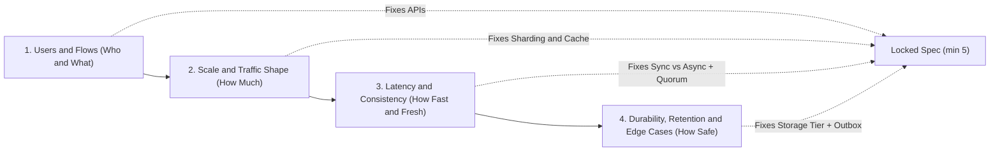
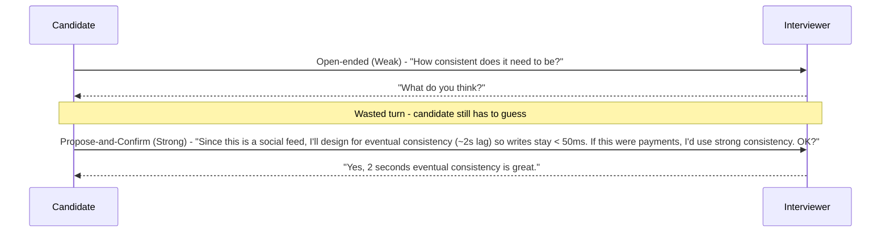
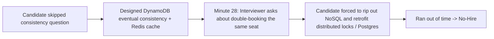

# Clarifying Requirements in System Design Interviews: What to Ask First

> **Prerequisites:** [Lesson 01: System Design Interview Framework](../01-system-design-interview-framework/README.md) · [Track Overview](../README.md).  
> **Estimated Reading Time:** 22–26 minutes  
> **Target Audience:** Candidates who freeze during the first 5 minutes of a system design interview or ask generic questions that yield zero architectural signal.  
> **Free PDF Notes:** [Download SD-T-002.pdf](https://backendroadmap.com/notes/system-design/SD-T-002.pdf)

> [!NOTE]
> **In one line:** Clarifying requirements is **not small talk**; it is **constraint discovery**. Every question you ask in the first 5 minutes must directly change a box, a database, a protocol, or a consistency guarantee in your upcoming architecture.

> [!TIP]
> **The Golden Rule:** Never ask a question whose answer doesn't change your design. Instead of *"What's the budget?"* or *"What language do we use?"*, ask *"Can a user tolerate 5 seconds of stale feed data, or do they need read-your-own-writes immediately?"*

---

## 1. What Requirement Clarification Is, and What It Isn't

When an interviewer opens with *"Design a chat application like Slack"*, there are 50 possible directions: 1:1 DMs vs 10,000-member channels, ephemeral messages vs 7-year compliance retention, end-to-end encryption vs server-side full-text search. Requirement clarification is the structured process of collapsing that 50-dimensional space into a concrete engineering contract in under 5 minutes.

| Term | Precise Meaning | Example |
| :--- | :--- | :--- |
| **High-leverage question** | A question whose answer selects between two distinct architectures | "10k-member channels or max 100?" (changes fan-out) |
| **Low-leverage question** | Trivia that has no impact on distributed architecture | "Dark mode? iOS or Android? What cloud?" |
| **Leading assumption** | Proposing a sensible default and asking for confirmation | "I'll assume UTF-8 text + small images, no video—OK?" |
| **Constraint discovery** | Uncovering hidden scale, latency, or compliance limits | "Must messages be searchable within 1 second?" |
| **Read/Write ratio** | Dominant traffic pattern that dictates caching and indexing | 100:1 reads -> cache-heavy; 1:10 -> LSM/write-optimized |
| **Not** | Interrogating the interviewer with a 20-item checklist | Asking 15 questions without synthesizing them |
| **Not** | Deferring every decision ("whatever you want") | Failing to propose defaults when the prompt is open |

### Why It Matters
1. **Architecture branches at minute 3:** Knowing whether a chat system has 100-user rooms or 100,000-user broadcast channels is the difference between simple fan-out-on-write and hybrid pub/sub partitioning.
2. **Demonstrates product & systems empathy:** Senior engineers connect user-facing product behavior (e.g., "offline sync on mobile") directly to backend primitives (e.g., sequence numbers and delta sync).
3. **Prevents wasted effort:** Locking down what is *out of scope* protects your 45-minute clock from feature creep.

---

## 2. Anatomy: The 4-Bucket Question Funnel



| Bucket | Core Questions to Ask | Architectural Decision It Unlocks |
| :--- | :--- | :--- |
| **1. Users & Core Flows** | Who are the actors? What are the top 3 actions? Mobile/Web? | API surface, client protocol (REST vs WebSocket vs gRPC) |
| **2. Scale & Traffic Shape** | DAU? Peak QPS? Read:write ratio? Average payload size? | Single DB vs sharded, SQL vs NoSQL, caching tier |
| **3. Latency & Consistency** | Target $p_{99}$? Read-your-own-writes? Eventual consistency OK? | Sync vs async, quorum ($R+W>N$), CDN/edge placement |
| **4. Durability & Retention** | Can we lose data on crash? Retention window? Compliance/GDPR? | Replication factor, WAL/outbox, cold archival (S3/Glacier) |

> [!WARNING]
> **The #1 Trap: The Checklist Interrogation.** Candidates who mechanically ask *"What's the DAU? What's the QPS? What's the latency? What's the availability?"* without explaining *why* they're asking sound scripted. Always tie your question to a concrete design fork: *"Are reads 100x writes? That'll tell us whether to optimize for read-through caching or write throughput."*

---

## 3. Mathematical Model: Information Gain per Question

Think of the design space as having $H_0 = \log_2(N)$ bits of architectural uncertainty across $N$ viable system topologies. Each question $q$ partitions the remaining designs into $k$ branches with probabilities $p_1, \dots, p_k$, yielding **Information Gain (IG)**:

$$IG(q) = H_{\text{before}} - \sum_{j=1}^{k} p_j H_{\text{after}, j}$$

With a strict 5-minute budget ($T_1 = 300\text{ s}$) and ~30 seconds per question-and-answer turn, you have **at most 8–10 turns**. Maximizing total clarity means maximizing **information gain per second**:

$$\text{Efficiency}(q) = \frac{IG(q)}{t_{\text{ask}} + t_{\text{answer}}}$$

### Worked Numerical Example
Suppose 16 equally likely architectures exist for *"Design a Notification System"* ($H_0 = \log_2(16) = 4.0\text{ bits}$):

1. **High-Leverage Question ($q_{\text{high}}$):** *"Do we need guaranteed at-least-once delivery with strict per-user ordering, or best-effort fan-out?"*
   - Splits the 16 designs cleanly into 2 groups of 8 ($p_1 = 0.5, p_2 = 0.5$):
   - $IG(q_{\text{high}}) = 4.0 - (0.5 \cdot 3.0 + 0.5 \cdot 3.0) = \mathbf{1.00\text{ bit}}$ in 25 seconds ($0.040\text{ bits/s}$).
2. **Low-Leverage Question ($q_{\text{low}}$):** *"Should the API return JSON or Protobuf?"*
   - Eliminates almost no backend topologies ($p_1 = 0.94, p_2 = 0.06$):
   - $IG(q_{\text{low}}) \approx \mathbf{0.33\text{ bits}}$ (and zero impact on storage, queueing, or consistency).

By asking 4 high-leverage questions (1 bit each), you eliminate $2^4 = 16\times$ ambiguity in 2 minutes, leaving 3 minutes to confirm scale numbers.

---

## 4. Metrics & Percentiles (Clarification Quality)

| Metric | Meaning | Alert When |
| :--- | :--- | :--- |
| **Questions asked** | Total clarifying questions in Phase 1 | `< 3` (blind guessing) or `> 10` (analysis paralysis) |
| **Design-fork ratio** | % of questions that change a component or protocol | `< 75%` (asking trivia instead of architecture drivers) |
| **Propose-vs-ask ratio** | % of constraints where you propose a sensible default | `< 50%` (forcing interviewer to invent everything) |
| **Clarification duration** | Wall-clock time spent before API/HLD | `> 6 min` (eating into Phase 2/3 budget) |
| **Late-stage surprises** | Major requirement discovered after minute 20 | `>= 1` (missed a core Bucket 1–4 question) |

### Worked Example ("Design a URL Shortener")
- **Q1 (Flow & Scale):** *"I'll focus on shortening a URL, redirecting, and basic click counts—skipping custom vanity analytics dashboards. Assuming 100M new URLs/month and a 100:1 read-to-write ratio, does that match?"* -> Locks 40 writes/s avg, 4,000 reads/s avg.
- **Q2 (Latency & Consistency):** *"For redirects, we want `< 20 ms` p99 globally, and if a newly created link takes 1–2 seconds to propagate to read replicas, is that acceptable?"* -> Unlocks Redis cache + CDN/edge + async replication.
- **Q3 (Durability & Retention):** *"Do short links expire after e.g. 5 years, or must they live forever without collisions?"* -> Unlocks key-generation strategy (KGS vs counter + Base62) and storage sizing.

Three turns, under 3 minutes, zero wasted words.

---

## 5. Compounding & Failure Modes: What Happens When You Skip a Bucket

| Skipped Bucket | Example Missed Question | Compounding Failure at Minute 25 |
| :--- | :--- | :--- |
| **Bucket 1 (Flows)** | Didn't ask if group chat supports 10k users | Designed 1:1 DB polling; collapses on broadcast fan-out |
| **Bucket 2 (Scale)** | Didn't ask read:write ratio (1000:1 vs 1:10) | Picked write-heavy Cassandra for a relational read-heavy catalog |
| **Bucket 3 (Consistency)** | Didn't ask if double-booking is tolerable | Used eventual consistency for seat reservations -> oversold inventory |
| **Bucket 4 (Durability)** | Didn't ask if losing 1 minute of metrics is OK | Added synchronous multi-AZ Raft writes for click-tracking -> 5x cost |

Every skipped bucket in minute 0–5 resurfaces as an expensive architectural rewrite in minute 25–35.

---

## 6. Numbers Every Engineer Must Know (Requirement Anchors)

| Item | Typical | Implication |
| :--- | :---: | :--- |
| Clarifying questions count | 4–6 targeted turns | Covers all 4 buckets in 3–5 minutes |
| Read:Write ratio (Social/Content) | 100:1 to 1,000:1 | Caching and read replicas dominate the design |
| Read:Write ratio (Telemetry/IoT) | 1:10 to 1:100 | Write buffering, batching, LSM-trees/time-series DBs |
| Interactive p99 latency target | 50–200 ms | Requires in-memory cache or regional edge |
| Strong consistency cost | +10 to +100 ms | Cross-AZ/region consensus (Raft/Paxos) hurts tail latency |
| Standard availability tiers | 99.9% (8.7h/yr) vs 99.99% (52m/yr) | 99.99% requires multi-AZ active-active + automated failover |

---

## 7. Protocol Deep Dive: The "Propose-and-Confirm" Turn Pattern

Instead of open-ended interrogations (*"How many users?"*), senior candidates use the **Propose-and-Confirm** protocol: state a concrete assumption, name the architectural consequence, and invite correction.



| Weak Question | Strong "Propose-and-Confirm" Upgrade |
| :--- | :--- |
| *"How big is the system?"* | *"Should we target ~10M DAU and ~10k peak QPS, or web-scale 100k+ QPS?"* |
| *"Do we need caching?"* | *"With a 100:1 read/write ratio and `< 50 ms` p99, I'll plan a Redis cache—sound right?"* |
| *"What about security?"* | *"I'll assume TLS at the edge and JWT auth are handled by the API gateway so we can focus on core storage—OK?"* |
| *"Should it be real-time?"* | *"Do users expect sub-second push via WebSockets, or is 30-second polling sufficient?"* |

**When NOT to propose defaults:** When the prompt touches regulated domains (payments, healthcare, legal compliance) where guessing wrong is risky—ask directly about durability (zero data loss / RPO=0) and auditability first.

---

## 8. Hierarchical Budgets & Design Rules

| Slice | Rule | Control |
| :--- | :--- | :--- |
| **Turn budget** | Max 6 clarifying turns in Phase 1 | Combine related questions into 1 turn |
| **Bucket coverage** | Hit all 4 buckets (Flows, Scale, SLOs, Durability) | Mental 4-finger checklist before drawing |
| **Defaulting** | Propose a concrete number on 80% of questions | "Let's assume X unless you prefer Y" |
| **Scope boundary** | Explicitly name 2–3 out-of-scope features | Write "Out of Scope:" in corner of whiteboard |
| **Non-functional lock** | Quantify latency, availability, and consistency | Never write "fast" or "scalable" without a number |
| **Traceability** | Every NFR must map to a Phase 2/3 component | Link `p99 < 20ms` -> Cache/CDN |

---

## 9. Top Mitigations (Fixing Common Clarification Traps)

1. **Bundle questions by bucket:** Instead of asking 10 rapid-fire questions, group them: *"First, on scope: are we doing X and Y? Second, on scale: is 10M DAU / 10k QPS the right target?"*
2. **Write the answers visibly:** Record the agreed FRs, NFRs, and scale numbers at the top-left of the board so you can reference them during Phase 3 and 4.
3. **Skip implementation trivia:** Never ask about CI/CD, programming languages, Kubernetes vs ECS, or CSS/UI details in Phase 1.
4. **Anchor consistency to user experience:** Translate CAP/PACELC jargon into product behavior (*"If Alice edits her post, must Bob see it within 100 ms or is 5 seconds fine?"*).
5. **Ask about data lifecycle early:** Knowing whether data is immutable/append-only (logs, tweets) vs heavily updated in-place (inventory, balances) completely changes your database choice.
6. **Handle "up to you" gracefully:** If the interviewer says *"you decide"*, state your choice confidently with a 1-sentence justification and move on immediately.

---

## 10. Production Reference / War Story: The Unasked Consistency Question

A candidate was asked *"Design an online ticket booking system like Ticketmaster."*



- **Root Cause:** The candidate never asked Bucket 3 (*"Can two users temporarily think they booked the same seat, or do we need strict serializable seat locking?"*). They assumed eventual consistency for speed, then had to redesign the entire storage and concurrency model at minute 28.
- **The Fix:** In minute 2, ask: *"For seat selection, we need strong consistency (no double-booking) during checkout, whereas event browsing can be eventually consistent via CDN/cache. Does that split work?"* That single question separates the read path (99% of traffic, cached) from the write path (1% of traffic, ACID).

---

## 11. Multi-Language Production Code Tabs

A **Requirement Clarification Decision Engine** showing how answers to the 4 buckets programmatically select architectural primitives (protocol, storage engine, consistency mode, and caching).

````carousel
```go
// Go: Maps 4-bucket clarification answers to architectural primitives.
package main

import "fmt"

type Requirements struct {
	ReadWriteRatio      int
	MaxP99Ms            int
	StrictConsistency   bool
	RealtimePush        bool
	ZeroDataLoss        bool
}

func RecommendArchitecture(r Requirements) {
	protocol := "REST/HTTP2"
	if r.RealtimePush {
		protocol = "WebSocket / gRPC-Stream"
	}
	storage := "PostgreSQL (ACID)"
	if !r.StrictConsistency && r.ReadWriteRatio < 1 {
		storage = "LSM/Wide-Column (Cassandra/DynamoDB)"
	}
	cache := "None (DB direct)"
	if r.ReadWriteRatio >= 10 && r.MaxP99Ms <= 50 {
		cache = "Redis Read-Through + Local L1"
	}
	durability := "Async Replication"
	if r.ZeroDataLoss {
		durability = "Sync Quorum + Transactional Outbox"
	}
	fmt.Printf("Protocol: %s | Storage: %s | Cache: %s | Durability: %s\n",
		protocol, storage, cache, durability)
}

func main() {
	RecommendArchitecture(Requirements{ReadWriteRatio: 100, MaxP99Ms: 20, StrictConsistency: true, ZeroDataLoss: true})
}
```
<!-- slide -->
```typescript
// TypeScript: Information-gain calculator for prioritizing clarifying questions.
function entropy(probs: number[]): number {
  return probs.reduce((h, p) => (p > 0 ? h - p * Math.log2(p) : h), 0);
}

export function infoGainPerSecond(
  beforeProbs: number[],
  branches: { weight: number; probs: number[] }[],
  turnSeconds: number
): number {
  const hBefore = entropy(beforeProbs);
  const hAfter = branches.reduce((acc, b) => acc + b.weight * entropy(b.probs), 0);
  return (hBefore - hAfter) / turnSeconds;
}

const highLeverage = infoGainPerSecond([0.25, 0.25, 0.25, 0.25], [
  { weight: 0.5, probs: [0.5, 0.5] },
  { weight: 0.5, probs: [0.5, 0.5] },
], 25);

const lowLeverage = infoGainPerSecond([0.25, 0.25, 0.25, 0.25], [
  { weight: 0.95, probs: [0.26, 0.26, 0.24, 0.24] },
  { weight: 0.05, probs: [1.0] },
], 25);

console.log({ highBitsPerSec: highLeverage.toFixed(4), lowBitsPerSec: lowLeverage.toFixed(4) });
```
<!-- slide -->
```python
# Python: Requirement-to-Architecture decision matrix (stdlib only).
from dataclasses import dataclass

@dataclass
class ClarifiedSpec:
    read_write_ratio: float
    p99_ms: int
    strong_consistency: bool
    realtime_push: bool
    zero_data_loss: bool

def derive_primitives(spec: ClarifiedSpec) -> dict[str, str]:
    return {
        "transport": "WebSockets" if spec.realtime_push else "HTTP/2 + REST/gRPC",
        "database": "Relational / NewSQL (ACID)" if spec.strong_consistency else "NoSQL / Wide-Column",
        "caching": "Redis + CDN" if spec.read_write_ratio >= 10 and spec.p99_ms < 50 else "Optional",
        "replication": "Sync Quorum (R+W>N)" if spec.zero_data_loss else "Async Read Replicas",
    }

if __name__ == "__main__":
    ticket_booking = ClarifiedSpec(100.0, 40, strong_consistency=True, realtime_push=False, zero_data_loss=True)
    telemetry_ingest = ClarifiedSpec(0.05, 500, strong_consistency=False, realtime_push=False, zero_data_loss=False)
    print("Ticketmaster:", derive_primitives(ticket_booking))
    print("IoT Metrics :", derive_primitives(telemetry_ingest))
```
<!-- slide -->
```csharp
// C#: Validates that all 4 clarification buckets are locked before Phase 2.
using System;

public sealed record ClarificationChecklist(
    bool FlowsLocked,
    bool ScaleAndRatioLocked,
    bool LatencyAndConsistencyLocked,
    bool DurabilityAndRetentionLocked)
{
    public bool ReadyForHld =>
        FlowsLocked && ScaleAndRatioLocked && LatencyAndConsistencyLocked && DurabilityAndRetentionLocked;

    public string MissingBucket() =>
        !FlowsLocked ? "Bucket 1: Users & Core Flows" :
        !ScaleAndRatioLocked ? "Bucket 2: Scale & Read/Write Ratio" :
        !LatencyAndConsistencyLocked ? "Bucket 3: Latency & Consistency" :
        !DurabilityAndRetentionLocked ? "Bucket 4: Durability & Retention" :
        "None - Proceed to Phase 2";
}
```
````

---

## 12. Hands-On CLI Verification Workflows

Test how two different sets of clarifying answers produce completely different architectures using the Python model:

```bash
python3 -c '
import math
def H(ps): return -sum(p * math.log2(p) for p in ps if p > 0)
h0 = H([1/16]*16)
ig_high = h0 - (0.5 * H([1/8]*8) + 0.5 * H([1/8]*8))
ig_low  = h0 - (0.94 * H([1/15]*15) + 0.06 * H([1.0]))
print(f"H0={h0:.2f} bits | High-leverage IG={ig_high:.2f} bits | Low-leverage IG={ig_low:.2f} bits")
'
```

Expected output:
```text
H0=4.00 bits | High-leverage IG=1.00 bits | Low-leverage IG=0.33 bits
```

---

## 13. Common Mistakes to Avoid

1. **Asking implementation trivia** (*"What language/framework/cloud provider?"*) instead of architectural drivers.
2. **Forgetting to ask the read-to-write ratio**, which determines whether you optimize for caches or write-ahead logs.
3. **Asking open-ended questions without proposing defaults**, forcing the interviewer to do the work.
4. **Skipping consistency requirements**, leading to catastrophic rewrites on booking, inventory, or payment prompts.
5. **Not writing the agreed requirements on the whiteboard**, causing you to forget your own SLOs in Phase 3.
6. **Over-clarifying past minute 6**, starving the High-Level Design and Deep Dive phases.
7. **Treating every feature in the prompt as equal**, instead of isolating the top 2–3 core flows.

---

## 14. Key Terms Glossary

| Key Term | Definition |
| :--- | :--- |
| **High-leverage question** | A question whose answer directly alters storage, transport, or consistency choices. |
| **Propose-and-confirm** | Stating a sensible default constraint and asking the interviewer to validate or adjust it. |
| **Read/Write ratio** | Ratio of read requests to write requests; primary driver of caching vs write-buffering. |
| **Constraint discovery** | Uncovering hidden scale, latency, or compliance boundaries in the first 5 minutes. |
| **Information gain** | Reduction in architectural uncertainty (in bits) achieved by a single clarifying question. |
| **Read-your-own-writes** | Consistency guarantee that a user immediately sees their own latest mutation. |
| **RPO (Recovery Point Objective)** | Maximum acceptable data loss (in time/transactions) during a failure. |
| **DAU / MAU** | Daily / Monthly Active Users; baseline input for traffic and storage estimation. |
| **Out-of-scope list** | Features explicitly deferred to protect the 45-minute interview budget. |
| **Traffic shape** | Whether load is steady, diurnal, or spiky (flash sales, celebrity posts). |

---

## 15. System Design Interview Questions & Answers

### Basic Conceptual Questions

<details>
<summary><strong>Q1: What are the 4 buckets of clarifying questions to ask first? [BASIC]</strong></summary>

**Answer:**
1. Users & Core Flows (who uses it, top 3 actions), 2. Scale & Traffic Shape (DAU, QPS, read:write ratio), 3. Latency & Consistency ($p_{99}$ target, strong vs eventual), and 4. Durability & Retention (zero data loss, TTL/archival).
</details>

<details>
<summary><strong>Q2: Give two examples of low-leverage questions you should avoid in Phase 1. [BASIC]</strong></summary>

**Answer:**
*"What programming language should the backend use?"* and *"Should we deploy on AWS or GCP?"* Neither changes the distributed systems architecture, data model, or scaling bottlenecks.
</details>

<details>
<summary><strong>Q3: Why is the "Propose-and-Confirm" style better than open-ended questions? [BASIC]</strong></summary>

**Answer:**
It demonstrates product judgment, saves turns, and prevents awkward *"what do you think?"* bounce-backs from the interviewer. You still give the interviewer full control to override your default.
</details>

<details>
<summary><strong>Q4: Why does the read-to-write ratio matter so much? [BASIC]</strong></summary>

**Answer:**
A 100:1 read-heavy system (URL shortener, catalog) benefits massively from CDNs, Redis caches, and read replicas. A 1:10 write-heavy system (IoT telemetry, chat ingestion) requires write-optimized storage (LSM-trees), batching, and partitioning.
</details>

### Scenario-Based Architecture Questions

<details>
<summary><strong>Q5: Prompt: "Design Instagram." What are your first 3 clarifying turns? [SCENARIO]</strong></summary>

**Answer:**
1. *Scope:* "I'll focus on photo upload, following users, and viewing the home feed—deferring Stories, Reels, and DMs. OK?" 2. *Scale:* "Let's target 50M DAU, 10M photo uploads/day, and a 100:1 read/write feed ratio." 3. *Freshness:* "Is eventual consistency of 2–5 seconds for new posts on followers' feeds acceptable?"
</details>

<details>
<summary><strong>Q6: Prompt: "Design a distributed task scheduler." Which requirement is most critical to clarify first? [SCENARIO]</strong></summary>

**Answer:**
Delivery/execution semantics and scale: *"Do we need at-least-once or exactly-once execution, what is the max acceptable scheduling jitter (100 ms vs 10 s), and are we scheduling 10k or 10M tasks/minute?"*
</details>

<details>
<summary><strong>Q7: The interviewer gives a vague answer: "Make it as fast and reliable as possible." How do you pin it down? [SCENARIO]</strong></summary>

**Answer:**
Translate vague adjectives into concrete SLOs and confirm: *"To balance cost and complexity, let's target `< 100 ms` p99 for reads, `99.99%` availability, and eventual consistency within 1 second—does that hit the right bar?"*
</details>

<details>
<summary><strong>Q8: You're designing a collaborative document editor. What Bucket 3 question changes the entire architecture? [SCENARIO]</strong></summary>

**Answer:**
*"How many concurrent editors can edit the same document simultaneously (e.g., 5–50 vs 5,000), and do we need sub-200 ms conflict resolution (CRDTs/OT) or simple pessimistic locking?"*
</details>

### Advanced & Tricky Interview Questions

<details>
<summary><strong>Q9: How do you discover "hidden" requirements the interviewer didn't mention in the prompt? [TRICKY]</strong></summary>

**Answer:**
Probe edge cases in Buckets 2 and 4: traffic spikes (celebrity/hot-key skew), multi-region presence (GDPR data residency or cross-region latency), and failure tolerance (can the system degrade gracefully, e.g., fail-open rate limiter or stale cache fallback?).
</details>

<details>
<summary><strong>Q10: Why is asking "Do we need multi-region?" dangerous if asked carelessly? [TRICKY]</strong></summary>

**Answer:**
If you ask it without context, the interviewer may say "sure, why not" and suddenly you've signed up for active-active cross-region conflict resolution in a 45-minute interview. Instead, propose: *"I'll design for multi-AZ high availability in one region first, and we can discuss multi-region active-active in Phase 4 if time permits—OK?"*
</details>

<details>
<summary><strong>Q11: What is the relationship between clarifying requirements and API design? [TRICKY]</strong></summary>

**Answer:**
Bucket 1 (Users & Core Flows) maps 1:1 to your public API endpoints, while Bucket 3 (Latency & Consistency) dictates API semantics—such as idempotency keys on `POST`, pagination cursors vs offsets, and `ETag`/versioning headers for optimistic concurrency.
</details>

<details>
<summary><strong>Q12: How do you handle an interviewer who intentionally changes a requirement at minute 25? [TRICKY]</strong></summary>

**Answer:**
Treat it as a realistic production pivot, not a trap. Identify *which* assumption broke (e.g., *"Ah, 10x write volume means single-primary Postgres saturates"*), state the minimal architectural delta (e.g., sharding or async queue buffering), and keep moving.
</details>

---

## 16. One-Page Master Cheat Sheet

```
+---------------------------------------------------------------------------------------------------------+
|               CLARIFYING REQUIREMENTS IN INTERVIEWS — MASTER CHEAT SHEET                                |
+---------------------------------------------------------------------------------------------------------+
| 1. GOLDEN RULE: Never ask a question whose answer doesn't change a box, DB, protocol, or SLO.           |
+---------------------------------------------------------------------------------------------------------+
| 2. THE 4-BUCKET FUNNEL (4-6 turns, < 5 minutes):                                                        |
|    - Bucket 1 (Flows):       Top 3 user actions, actors, client types -> defines APIs.                  |
|    - Bucket 2 (Scale):       DAU, QPS, Read:Write ratio, payload KB -> defines sharding & cache.        |
|    - Bucket 3 (SLOs):        p99 latency, availability %, consistency -> defines sync/async & quorum.   |
|    - Bucket 4 (Durability):  RPO=0 vs best-effort, retention, compliance -> defines replication & tier. |
+---------------------------------------------------------------------------------------------------------+
| 3. PROPOSE-AND-CONFIRM: State a sensible default + its consequence, then ask "Does that sound right?"   |
+---------------------------------------------------------------------------------------------------------+
| 4. AVOID: Language/cloud trivia, open-ended interrogations, skipping consistency, > 6 min in Phase 1.   |
+---------------------------------------------------------------------------------------------------------+
```

---

## Further Reading & Sources

- Alex Xu, *System Design Interview — An Insider's Guide*, Volume 1, Chapter 3 ("Step 1: Understand the Problem and Establish Design Scope").
- Martin Kleppmann, *Designing Data-Intensive Applications*, Chapter 1 (Describing Load & Performance) and Chapter 9 (Consistency and Consensus).
- Google SRE Book, [Embracing Risk](https://sre.google/sre-book/embracing-risk/) (Availability & Error Budgets).

---

## Free PDF Notes

[SD-T-002.pdf](https://backendroadmap.com/notes/system-design/SD-T-002.pdf)

---

## Next

Continue with [Lesson 03: Functional vs Non-Functional Requirements in System Design Interviews](../03-functional-vs-non-functional-requirements-in-system-design-i/README.md).
