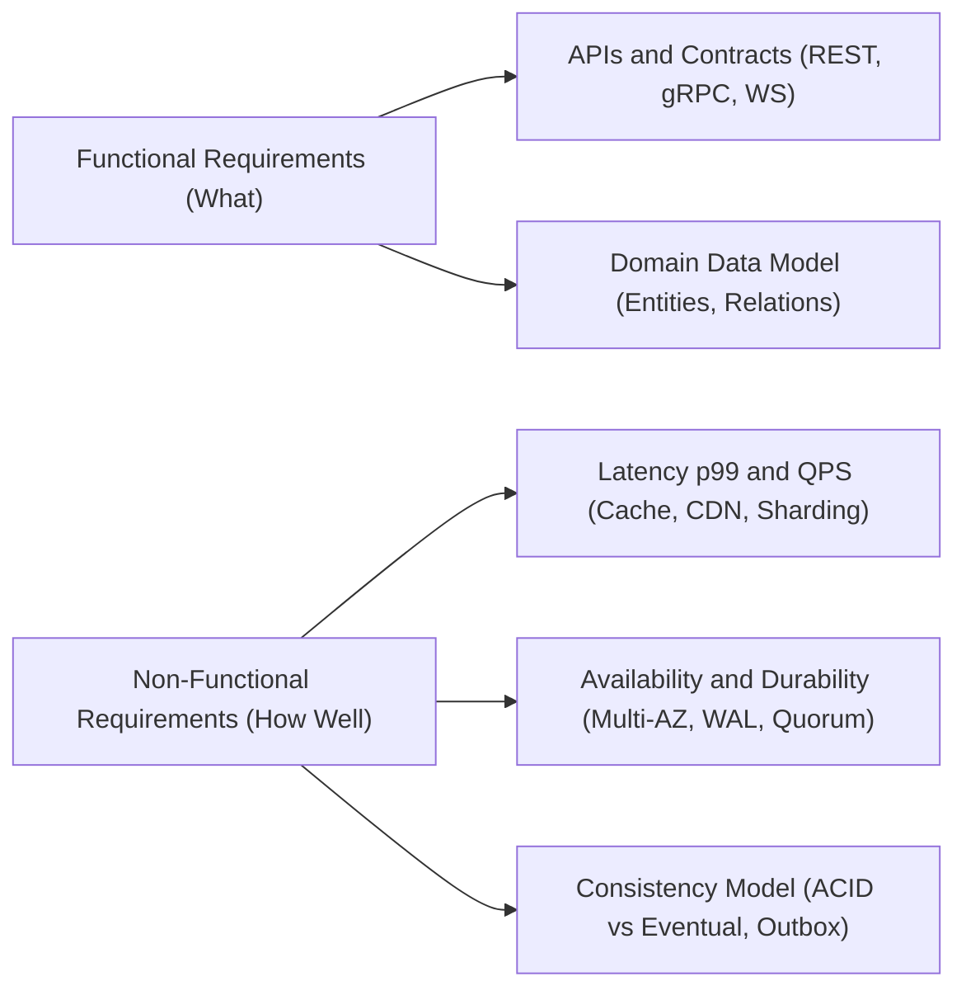
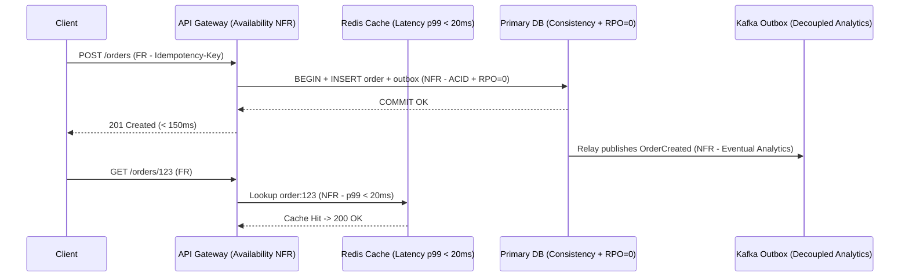
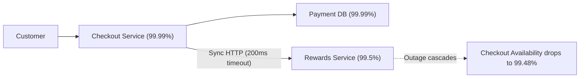

# Functional vs Non-Functional Requirements in System Design Interviews

> **Prerequisites:** [Lesson 02: Clarifying Requirements in System Design Interviews](../02-clarifying-requirements-in-system-design-interviews/README.md) · [Track Overview](../README.md).  
> **Estimated Reading Time:** 23–27 minutes  
> **Target Audience:** Backend engineers who know *what* features to build but struggle to translate vague quality goals ("fast", "reliable", "scalable") into concrete distributed systems primitives.  
> **Free PDF Notes:** [Download SD-T-003.pdf](https://backendroadmap.com/notes/system-design/SD-T-003.pdf)

> [!NOTE]
> **In one line:** **Functional Requirements (FRs)** define *what the system does* (endpoints, schemas, business rules); **Non-Functional Requirements (NFRs)** define *how well it behaves under load and failure* (latency $p_{99}$, availability, consistency, durability)—and **NFRs are what actually drive 80% of your distributed systems architecture**.

> [!TIP]
> **The Golden Rule:** Anyone can build a CRUD app that satisfies all Functional Requirements on a single server. You only need sharding, Redis, Kafka, Raft, or CDNs because of **Non-Functional Requirements**. Always trace every major infrastructure box back to a specific NFR.

---

## 1. What Functional vs Non-Functional Requirements Are, and What They Aren't

Suppose you are asked to design a **URL Shortener**.
- **FR:** `POST /shorten` takes a long URL and returns a 7-character short code; `GET /{code}` redirects to the long URL.
- **NFR:** Redirects must complete in `< 20 ms` at $p_{99}$, sustain `100,000 reads/sec`, maintain `99.99%` availability, and never lose a created link.

A single PostgreSQL instance on a laptop satisfies 100% of the FRs. Only the NFRs force you to introduce Redis caching, Base62 key generation, read replicas, and CDN/edge routing.

| Term | Precise Meaning | Example |
| :--- | :--- | :--- |
| **Functional Requirement (FR)** | A user-facing capability, API behavior, or state transition | "Users can upload a 10 MB image and share its URL" |
| **Non-Functional Requirement (NFR)** | A quantitative system quality constraint (SLO, scale, safety) | "$p_{99}$ upload ack `< 500 ms`; 99.999999999% durability" |
| **SLI (Service Level Indicator)** | The measured metric for an NFR | `http_request_duration_seconds{quantile="0.99"}` |
| **SLO (Service Level Objective)** | The target threshold for an SLI over a window | $p_{99} < 50\text{ ms}$ over a 30-day rolling window |
| **Error budget** | Allowed unreliability before freezing feature releases | $1 - 0.999 = 0.1\% \approx 43.2\text{ min/month}$ |
| **Not** | Listing "microservices" or "Kubernetes" as an NFR | Those are *implementation choices*, not requirements |
| **Not** | Qualitative adjectives ("high performance", "secure") | Unquantified adjectives cannot be engineered or tested |

### Why It Matters
1. **FRs shape APIs and schemas; NFRs shape topology:** FRs tell you the endpoints (`/orders`, `/feed`) and tables; NFRs tell you whether you need async queues, multi-region replication, or in-memory caches.
2. **Interviewers grade NFR-to-Architecture mapping:** Saying *"I'll add Kafka"* gets zero credit. Saying *"To meet our `< 50 ms` $p_{99}$ checkout NFR while ensuring zero lost emails, I'll decouple email via a transactional outbox and Kafka"* is an L5/L6 answer.
3. **NFRs conflict with each other:** Strong consistency fights low tail latency and high availability (CAP/PACELC). Naming that tension explicitly is the core of system design.

---

## 2. Anatomy: How FRs and NFRs Drive Different Layers



| NFR Category | Concrete Target Example | Primary Architectural Lever |
| :--- | :--- | :--- |
| **Latency** | $p_{99} < 20\text{ ms}$ reads | In-memory cache (Redis), CDN edge, read-local routing |
| **Throughput** | $100{,}000\text{ writes/s}$ | Horizontal sharding, LSM-tree storage, async batching |
| **Availability** | $99.99\%$ (`52.6 min/yr` downtime) | Multi-AZ active-active, health-checked LB, circuit breakers |
| **Consistency** | No double-spend / no double-booking | ACID transactions, optimistic locking (`version`), Raft/Paxos |
| **Durability** | RPO $= 0$ (zero data loss) | Sync replication (`ack=all`), WAL, transactional outbox |
| **Freshness** | Feed visible within $\le 5\text{ s}$ | Async fan-out workers, CDC streams, cache TTL bounds |

> [!WARNING]
> **The #1 Trap: Unquantified NFRs.** Writing *"High availability, low latency, scalable"* on the whiteboard is meaningless. If you don't attach numbers ($99.9\%$ vs $99.999\%$, $p_{99} < 50\text{ ms}$ vs $< 2\text{ s}$), you cannot justify whether you need single-region multi-AZ or global active-active multi-region.

---

## 3. Mathematical Model: Availability, Error Budgets & Latency Tail

**1. Serial vs Parallel Availability.**
If a synchronous request depends on $n$ sequential components with availabilities $a_1, \dots, a_n$, total availability is the **product**:

$$A_{\text{serial}} = \prod_{i=1}^{n} a_i$$

If a component is replicated $k$ times in **parallel** (active-active, any 1 healthy node suffices), unavailability multiplies:

$$A_{\text{parallel}} = 1 - \prod_{j=1}^{k} (1 - a_j)$$

**2. Error Budget.**
For an availability SLO $A$ over $T = 30\text{ days} = 43{,}200\text{ minutes}$:

$$\text{Downtime Budget} = (1 - A) \times 43{,}200\text{ min}$$

### Worked Numerical Example
Suppose checkout calls **API Gateway** ($99.99\%$), **Order Service** ($99.95\%$), and **Payment Provider** ($99.9\%$) synchronously:
1. **Serial Availability:**
   $$A_{\text{checkout}} = 0.9999 \times 0.9995 \times 0.9990 = \mathbf{0.99840} \quad (99.84\%)$$
   That allows $0.0016 \times 43{,}200 = \mathbf{69.1\text{ min/month}}$ of downtime—violating a $99.9\%$ (`43.2 min/month`) SLO!
2. **Adding Parallel Redundancy to Order Service ($k = 2$ nodes at $99.95\%$ each):**
   $$A_{\text{order,parallel}} = 1 - (1 - 0.9995)^2 = 1 - 0.0005^2 = \mathbf{0.99999975}$$
3. **Removing Synchronous Email ($99.5\%$) via Async Broker:**
   Had email been synchronous, $0.9984 \times 0.995 = 99.34\%$ (`285 min/month` downtime). Decoupling it via a message broker protects the checkout SLO.

---

## 4. Metrics & Percentiles (The NFR Dashboard)

| Metric | Meaning | Alert When |
| :--- | :--- | :--- |
| **$p_{50}$ (Median) Latency** | Typical user experience | Shifts > 20% after a deploy |
| **$p_{99}$ (Tail) Latency** | Worst 1% of requests (drives SLA) | Exceeds NFR target (e.g., `> 100 ms`) |
| **Error Budget Burn Rate** | Speed at which monthly downtime is consumed | `> 2x` sustained over 1 hour (page on-call) |
| **Replication Lag (ms / s)** | Freshness gap between primary and replica | Exceeds freshness NFR (e.g., `> 2 s`) |
| **Saturation (%)** | CPU, memory, disk IOPS, or connection pool usage | `> 75%` (tail latency spikes non-linearly above 80%) |
| **Durability Ack Failures** | Writes failing quorum / `fsync` | `> 0` on RPO=0 critical paths |

### Worked Example ("Design a Payment Ledger")
- **FRs:** `CreateCharge`, `RefundCharge`, `GetBalance`.
- **NFRs:**
  - *Consistency:* Strict serializability (no negative balance, no double-charge).
  - *Durability:* RPO $= 0$ (zero lost committed transactions).
  - *Availability:* $99.99\%$ (`4.32 min/month` budget).
  - *Latency:* $p_{99} < 300\text{ ms}$ for `CreateCharge`, $p_{99} < 20\text{ ms}$ for `GetBalance`.
- **Resulting Architecture:** PostgreSQL/Spanner with `idempotency_key` unique constraints + synchronous multi-AZ replication for writes; read-through cache invalidated on write for `GetBalance`.

---

## 5. Compounding & Failure Modes: The PACELC Trade-off Matrix

When you push one NFR to an extreme, others degrade non-linearly:

| NFR Extreme Pushed | What Degrades | Why It Compounds |
| :--- | :--- | :--- |
| **Strict Consistency + RPO=0** | Write latency ($p_{99}$) & Availability | Synchronous cross-AZ/region quorum waits on the slowest replica; partitions halt writes |
| **Ultra-Low Latency ($< 10\text{ ms}$)** | Freshness & Cost | Forces in-memory caching / edge replicas; introduces stale reads and invalidation storms |
| **99.999% Availability ("Five Nines")** | Operational Complexity & Cost | Requires active-active multi-region, automated chaos testing, and conflict resolution (CRDTs/LWW) |
| **Unbounded Fan-out Freshness** | Write Amplification & Queue Depth | Celebrity writes fan out to millions of timelines, saturating workers and delaying normal users |

A 10x jump in availability from `99.9%` (3 nines) to `99.99%` (4 nines) cuts allowed downtime from **8.76 hours/year** to **52.6 minutes/year**, often doubling infrastructure and operational complexity.

---

## 6. Numbers Every Engineer Must Know (NFR & SLO Anchors)

| Item | Typical | Implication |
| :--- | :---: | :--- |
| `99%` (Two nines) | 3.65 days/yr | Internal batch tools, dev environments |
| `99.9%` (Three nines) | 8.76 hours/yr | Standard B2B SaaS, internal APIs |
| `99.99%` (Four nines) | 52.6 min/yr | Consumer apps, e-commerce checkout, payments |
| `99.999%` (Five nines) | 5.26 min/yr | Telecom, core cloud DNS/auth, global payment rails |
| Same-AZ network RTT | 0.2–0.5 ms | Safe for synchronous microservice hops |
| Cross-AZ network RTT | 1–2 ms | Acceptable for synchronous quorum writes |
| Cross-region RTT (US-East <-> EU) | 70–100 ms | Prohibits synchronous cross-region ACID locks |
| L1/RAM read vs SSD vs HDD | 100 ns / 100 µs / 10 ms | Explains why $p_{99} < 10\text{ ms}$ requires RAM caching |

---

## 7. Protocol Deep Dive: Mapping FRs + NFRs to Architecture



| Question | Answer |
| :--- | :--- |
| **How do you handle conflicting NFRs?** | Split the read path and write path (CQRS-lite): strong consistency on writes, cached eventual consistency on reads |
| **Where does `Idempotency-Key` come from?** | From combining FR (`POST /orders`) with NFR (at-least-once network retries without double-charging) |
| **Why not put Kafka in front of `POST /orders`?** | If the user needs synchronous confirmation of payment/stock, async ingestion violates the UX FR |
| **When is eventual consistency NOT acceptable?** | Financial balances, seat/inventory locks, unique username/slug claims, and security ACL revocations |

**When NOT to over-engineer NFRs:** Do not design a `99.999%` multi-region active-active architecture for an internal HR tool or a 500-QPS CRUD service. Over-specifying NFRs wastes budget and introduces split-brain bugs.

---

## 8. Hierarchical Budgets & Design Rules

| Slice | Rule | Control |
| :--- | :--- | :--- |
| **FR list** | 3–5 core user actions max | Defer secondary features (admin, reporting) |
| **NFR list** | Quantify Latency, Availability, Consistency, Durability | Every NFR must have a number or formal model |
| **Tail latency** | Budget $p_{99}$ across hops ($T_{\text{total}} = \sum T_i$) | Never hide slow sync calls inside a fast endpoint |
| **Availability** | Remove non-critical sync dependencies from critical path | Async broker for email, push, analytics |
| **Consistency** | Default to eventual for reads/feeds; strong for money/locks | Document per-endpoint consistency |
| **Durability** | Match replication to RPO (sync for RPO=0, async for logs) | Explicit WAL / outbox on state transitions |

---

## 9. Top Mitigations (Avoiding FR/NFR Traps in Interviews)

1. **Always write FRs and NFRs side-by-side** at the top of your board so the interviewer sees the distinction immediately.
2. **Quantify every NFR**—replace *"fast"* with *"$p_{99} < 50\text{ ms}$"* and *"reliable"* with *"99.99% availability, RPO=0"*.
3. **Separate read NFRs from write NFRs** (e.g., feed reads: `< 50 ms`, eventual; feed writes: `< 500 ms`, durable).
4. **Tie every major component to an NFR** when you draw it (*"I'm adding Redis here specifically to hit our 20 ms p99 read NFR"*).
5. **Identify the #1 NFR conflict** early (e.g., *"Global low latency vs strong consistency"* -> solve with regional home shards or read-local/write-primary).
6. **Never confuse tools with NFRs:** *"Use Kafka"* is a solution; *"Zero lost events under 10x traffic spikes"* is the NFR.

---

## 10. Production Reference / War Story: The "99.99% Availability" Sync Dependency Trap

A backend team built a checkout service with a `99.99%` availability SLO (`4.32 min/month` downtime). To ship a new loyalty feature quickly, they added a synchronous HTTP call to the **Rewards Service** (`99.5%` availability) inside `POST /checkout`.



- **Root Cause:** Even though Rewards was a non-critical FR (*"award 10 points"*), calling it synchronously coupled Checkout's availability NFR to Rewards' `99.5%` availability ($0.9999 \times 0.9999 \times 0.995 = 99.48\%$, or **3.7 hours/month** of checkout downtime).
- **The Fix:** Reclassify Rewards as an **asynchronous eventual-consistency FR**: Checkout commits the order + `OrderCompleted` outbox row locally, returns `201 Created`, and a background worker awards points with retries and a DLQ. Checkout's availability immediately returned to `99.98%+`.

---

## 11. Multi-Language Production Code Tabs

An **SLO & Availability Budget Calculator** that computes composite serial/parallel availability, monthly error budget in minutes, and flags any synchronous dependency that violates the target SLO.

````carousel
```go
// Go: Composite availability & monthly error budget calculator.
package main

import "fmt"

type Dependency struct {
	Name         string
	Availability float64 // e.g. 0.9999
	Replicas     int     // parallel active-active instances
}

func EffectiveAvailability(d Dependency) float64 {
	unavail := 1.0 - d.Availability
	combinedUnavail := 1.0
	for i := 0; i < d.Replicas; i++ {
		combinedUnavail *= unavail
	}
	return 1.0 - combinedUnavail
}

func main() {
	deps := []Dependency{
		{"API Gateway", 0.9999, 2},
		{"Order Service", 0.9995, 2},
		{"Payment DB", 0.9999, 1},
		{"Sync Rewards (Bad)", 0.9950, 1},
	}
	total := 1.0
	for _, d := range deps {
		eff := EffectiveAvailability(d)
		total *= eff
		fmt.Printf("%-20s eff=%.6f\n", d.Name, eff)
	}
	budgetMin := (1.0 - total) * 43200.0
	fmt.Printf("Composite Availability: %.4f%% | Monthly Downtime: %.2f min\n", total*100, budgetMin)
}
```
<!-- slide -->
```typescript
// TypeScript: NFR validator checking serial availability against an SLO target.
interface ServiceNode {
  name: string;
  availability: number;
  parallelNodes?: number;
}

export function evaluateSlo(nodes: ServiceNode[], targetSlo: number) {
  const composite = nodes.reduce((acc, n) => {
    const k = n.parallelNodes ?? 1;
    const eff = 1 - Math.pow(1 - n.availability, k);
    return acc * eff;
  }, 1.0);

  const allowedDownMin = (1 - targetSlo) * 43200;
  const actualDownMin = (1 - composite) * 43200;
  return {
    compositePct: (composite * 100).toFixed(4) + "%",
    actualDownMin: Number(actualDownMin.toFixed(2)),
    allowedDownMin: Number(allowedDownMin.toFixed(2)),
    meetsSlo: composite >= targetSlo,
  };
}

console.log(evaluateSlo([
  { name: "Gateway", availability: 0.9999, parallelNodes: 2 },
  { name: "OrderDB", availability: 0.9999 },
  { name: "RewardsSync", availability: 0.995 },
], 0.999));
```
<!-- slide -->
```python
# Python: Serial/Parallel availability & error budget simulator (stdlib only).
def effective_avail(avail: float, replicas: int = 1) -> float:
    return 1.0 - ((1.0 - avail) ** replicas)

def system_slo_report(components: list[tuple[str, float, int]], target_slo: float = 0.999):
    total = 1.0
    for name, avail, replicas in components:
        eff = effective_avail(avail, replicas)
        total *= eff
    downtime_min = (1.0 - total) * 43200.0
    budget_min = (1.0 - target_slo) * 43200.0
    return {
        "availability_pct": round(total * 100, 4),
        "expected_downtime_min_per_mo": round(downtime_min, 2),
        "slo_budget_min_per_mo": round(budget_min, 2),
        "passes_slo": total >= target_slo,
    }

if __name__ == "__main__":
    with_sync_rewards = [("GW", 0.9999, 2), ("OrderDB", 0.9999, 1), ("Rewards", 0.995, 1)]
    async_rewards     = [("GW", 0.9999, 2), ("OrderDB", 0.9999, 1), ("Outbox", 0.9999, 1)]
    print("With Sync Rewards :", system_slo_report(with_sync_rewards, 0.999))
    print("With Async Outbox :", system_slo_report(async_rewards, 0.999))
```
<!-- slide -->
```csharp
// C#: Error budget and availability math for NFR verification.
using System;
using System.Collections.Generic;

public sealed record ComponentSlo(string Name, double Availability, int Replicas = 1);

public static class SloCalculator
{
    public static (double Composite, double MonthlyDowntimeMinutes) Evaluate(IEnumerable<ComponentSlo> chain)
    {
        double total = 1.0;
        foreach (var c in chain)
        {
            double eff = 1.0 - Math.Pow(1.0 - c.Availability, c.Replicas);
            total *= eff;
        }
        return (total, (1.0 - total) * 43200.0);
    }
}
```
````

---

## 12. Hands-On CLI Verification Workflows

Verify how a single `99.5%` synchronous dependency destroys a `99.9%` SLO using Python:

```bash
python3 -c '
def report(chain):
    a = 1.0
    for av, k in chain: a *= 1.0 - (1.0 - av)**k
    print(f"Availability={a*100:.4f}% | Downtime={(1-a)*43200:.2f} min/mo")

print("Sync Rewards :"); report([(0.9999, 2), (0.9999, 1), (0.995, 1)])
print("Async Outbox :"); report([(0.9999, 2), (0.9999, 1), (0.9999, 1)])
'
```

Expected output:
```text
Sync Rewards : Availability=99.4900% | Downtime=220.30 min/mo
Async Outbox : Availability=99.9800% | Downtime=8.64 min/mo
```

---

## 13. Common Mistakes to Avoid

1. **Writing vague NFRs** like "fast", "highly available", or "scalable" without concrete numbers.
2. **Listing technologies as NFRs** ("must use Kafka" is an implementation choice, not a requirement).
3. **Treating all endpoints as needing the same NFRs** (read paths and write paths almost always have different latency/consistency targets).
4. **Ignoring serial availability math**, accidentally coupling a `99.99%` critical path to a `99.5%` auxiliary service.
5. **Forgetting durability (RPO)** when specifying availability—a system can be 99.99% available while silently dropping 1% of writes if replication is misconfigured.
6. **Over-engineering NFRs** (e.g., global multi-region active-active for an internal tool) without checking if it's needed.
7. **Failing to map NFRs back to components** in Phase 2/3, leaving the interviewer wondering why you added a cache or queue.

---

## 14. Key Terms Glossary

| Key Term | Definition |
| :--- | :--- |
| **Functional Requirement (FR)** | Behavior, API, or feature the system must perform for users. |
| **Non-Functional Requirement (NFR)** | Quantitative quality attribute: latency, throughput, availability, consistency, durability. |
| **SLI** | Service Level Indicator—the actual measured metric (e.g., $p_{99}$ latency). |
| **SLO** | Service Level Objective—the target threshold for an SLI (e.g., $p_{99} < 50\text{ ms}$). |
| **SLA** | Service Level Agreement—a legal/financial contract with penalties if SLOs are breached. |
| **Error budget** | $1 - \text{SLO}$; allowable downtime/error window before halting risky changes. |
| **Tail latency ($p_{99}$)** | Latency threshold below which 99% of requests complete. |
| **Serial availability** | Product of availabilities ($\prod a_i$) for synchronous chained dependencies. |
| **PACELC** | Extension of CAP: if Partitioned, trade Availability vs Consistency; Else, trade Latency vs Consistency. |
| **RPO / RTO** | Recovery Point Objective (max data loss) / Recovery Time Objective (max recovery time). |

---

## 15. System Design Interview Questions & Answers

### Basic Conceptual Questions

<details>
<summary><strong>Q1: What is the difference between a Functional Requirement and a Non-Functional Requirement? [BASIC]</strong></summary>

**Answer:**
FRs specify *what* the system does (features, APIs, business rules, data stored). NFRs specify *how well* it operates under scale and failure (latency $p_{99}$, QPS, availability, consistency, durability, security).
</details>

<details>
<summary><strong>Q2: Which type of requirement drives distributed systems architecture more, and why? [BASIC]</strong></summary>

**Answer:**
Non-Functional Requirements. A single server with a local SQLite database can satisfy almost any FR at low scale; distributed patterns like caching, sharding, replication, and message queues exist solely to satisfy NFRs (latency, throughput, availability, durability).
</details>

<details>
<summary><strong>Q3: What is the difference between an SLI, an SLO, and an SLA? [BASIC]</strong></summary>

**Answer:**
An SLI is the measured metric (e.g., 99th percentile latency), an SLO is the internal reliability target (e.g., $p_{99} < 50\text{ ms}$ over 30 days), and an SLA is the external customer contract with financial/legal penalties if missed.
</details>

<details>
<summary><strong>Q4: Why should you never write "high availability" without a percentage? [BASIC]</strong></summary>

**Answer:**
Because `99.9%` (`8.76 h/yr` downtime) can be met with single-region multi-AZ and automated failover, whereas `99.999%` (`5.26 min/yr`) requires active-active multi-region routing and zero-downtime schema/code rollouts. The number dictates the architecture.
</details>

### Scenario-Based Architecture Questions

<details>
<summary><strong>Q5: Design a ride-hailing app. Name 3 FRs and 3 quantified NFRs. [SCENARIO]</strong></summary>

**Answer:**
*FRs:* 1. Drivers stream GPS location every 4s; 2. Riders request a ride and get matched; 3. Trip status updates in real time. *NFRs:* 1. Location ingestion sustains 250k writes/sec; 2. Match request $p_{99} < 2\text{ s}$; 3. Dispatch must never double-match the same driver (strong consistency on match state) with `99.99%` availability.
</details>

<details>
<summary><strong>Q6: Your checkout service has a 99.99% SLO, and it synchronously calls a 99.5% fraud ML service. What happens? [SCENARIO]</strong></summary>

**Answer:**
Serial availability drops to $\le 99.49\%$, burning ~220 minutes/month of downtime against a 4.3-minute budget. Mitigation: enforce a strict timeout (e.g., 150 ms) with a circuit breaker that falls back to rule-based heuristics (graceful degradation) so Checkout's SLO is preserved.
</details>

<details>
<summary><strong>Q7: For a social media feed, how do read NFRs and write NFRs differ? [SCENARIO]</strong></summary>

**Answer:**
Read NFRs prioritize ultra-low latency ($p_{99} < 50\text{ ms}$) and high availability (`99.99%`) while tolerating 2–5 seconds of eventual consistency. Write NFRs prioritize durability (`RPO=0`) and can tolerate slightly higher latency (`200–500 ms`) via async fan-out.
</details>

<details>
<summary><strong>Q8: How does an NFR like "data must be retained for 7 years for compliance" change your storage design? [SCENARIO]</strong></summary>

**Answer:**
Keeping 7 years of hot data in SSD-backed PostgreSQL or DynamoDB is prohibitively expensive. It drives a tiered storage architecture: 90 days in hot operational DB, then automated lifecycle archival to compressed Parquet/cold object storage (S3 Glacier).
</details>

### Advanced & Tricky Interview Questions

<details>
<summary><strong>Q9: Explain the PACELC theorem in the context of NFR trade-offs. [TRICKY]</strong></summary>

**Answer:**
CAP only describes behavior during a network Partition (trade Availability vs Consistency). PACELC adds the Else clause: even when the network is healthy, you must trade Latency vs Consistency—for example, waiting for synchronous quorum replication adds cross-AZ/region RTT to $p_{99}$ latency.
</details>

<details>
<summary><strong>Q10: Why is $p_{99}$ more dangerous than average latency when composing microservices? [TRICKY]</strong></summary>

**Answer:**
If a single page load fans out to 10 parallel backend services, each with $p_{99} = 200\text{ ms}$ (1% chance of being slow), the probability that *at least one* of the 10 calls hits its tail is $1 - 0.99^{10} = 9.56\%$—so nearly 1 in 10 user requests experiences tail latency.
</details>

<details>
<summary><strong>Q11: Can a system have 100% availability and 0 data loss? [TRICKY]</strong></summary>

**Answer:**
No. 100% availability is physically impossible (hardware, fiber cuts, correlated bugs), and attempting near-zero data loss (`RPO=0`) during partitions requires rejecting writes when quorum is lost, which directly reduces availability.
</details>

<details>
<summary><strong>Q12: How do you decide whether an NFR requires strong consistency vs read-your-own-writes? [TRICKY]</strong></summary>

**Answer:**
Ask whether *two different users* can conflict on the same mutable state (e.g., bank balance, seat lock -> strong consistency). If only the *author* notices stale state after editing their own profile or post, read-your-own-writes (session stickiness or primary-read window) suffices at much lower cost.
</details>

---

## 16. One-Page Master Cheat Sheet

```
+---------------------------------------------------------------------------------------------------------+
|            FUNCTIONAL VS NON-FUNCTIONAL REQUIREMENTS — MASTER CHEAT SHEET                               |
+---------------------------------------------------------------------------------------------------------+
| 1. FRs (WHAT): Endpoints, schemas, user actions. Drives APIs & Data Model.                              |
| 2. NFRs (HOW WELL): Latency p99, QPS, Availability, Consistency, Durability. Drives Topology!           |
+---------------------------------------------------------------------------------------------------------+
| 3. AVAILABILITY MATH:                                                                                   |
|    - Serial sync chain: A_total = A1 * A2 * ... * An (weakest link dominates!).                         |
|    - Parallel k nodes:  A_eff   = 1 - (1 - A)^k.                                                        |
|    - 99.9% = 43.2 min/mo | 99.99% = 4.32 min/mo | 99.999% = 26 sec/mo.                                  |
+---------------------------------------------------------------------------------------------------------+
| 4. GOLDEN RULES:                                                                                        |
|    - Quantify every NFR (no "fast" or "scalable" without numbers).                                      |
|    - Never couple a 99.99% critical path synchronously to a 99.5% optional service.                     |
|    - Split Read NFRs (low latency, cached) from Write NFRs (durable, atomic/async).                     |
+---------------------------------------------------------------------------------------------------------+
```

---

## Further Reading & Sources

- Google SRE Book, [Service Level Objectives](https://sre.google/sre-book/service-level-objectives/).
- Daniel Abadi, [Consistency Tradeoffs in Modern Distributed Database System Design (PACELC)](https://www.cs.umd.edu/~abadi/papers/abadi-pacelc.pdf).
- Jeffrey Dean and Luiz André Barroso, [The Tail at Scale](https://research.google/pubs/the-tail-at-scale/), Communications of the ACM.
- Martin Kleppmann, *Designing Data-Intensive Applications*, Chapter 1 & Chapter 5.

---

## Free PDF Notes

[SD-T-003.pdf](https://backendroadmap.com/notes/system-design/SD-T-003.pdf)

---

## Next

Continue with [Lesson 04: Defining Scope in System Design Interviews: Handling Huge Prompts](../04-defining-scope-in-system-design-interviews/README.md).
