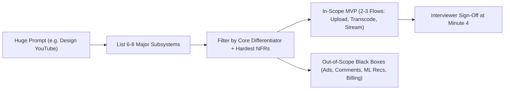
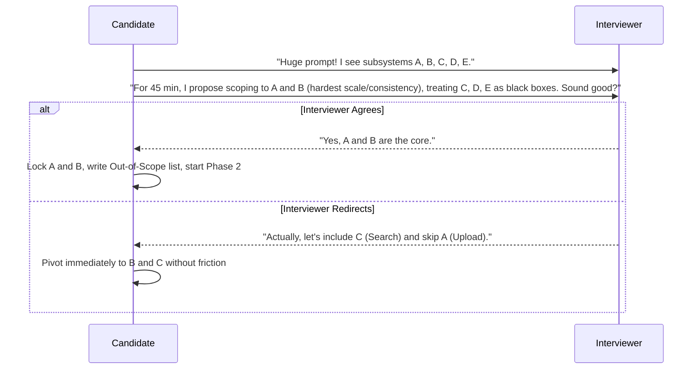
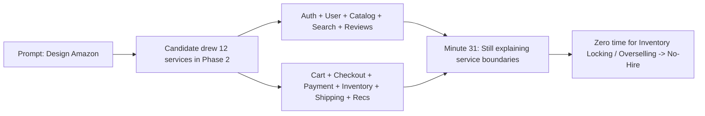

# Defining Scope in System Design Interviews: Handling Huge Prompts

> **Prerequisites:** [Lesson 03: Functional vs Non-Functional Requirements in System Design Interviews](../03-functional-vs-non-functional-requirements-in-system-design-i/README.md) · [Track Overview](../README.md).  
> **Estimated Reading Time:** 22–26 minutes  
> **Target Audience:** Candidates overwhelmed by massive open-ended prompts like *"Design YouTube"*, *"Design Uber"*, or *"Design Amazon"* who try to cover everything and run out of time.  
> **Free PDF Notes:** [Download SD-T-004.pdf](https://backendroadmap.com/notes/system-design/SD-T-004.pdf)

> [!NOTE]
> **In one line:** Huge prompts like *"Design YouTube"* represent thousands of engineer-years of production systems; your job in a 45-minute interview is **not** to summarize the whole company, but to **carve a high-signal vertical slice** (the 2–3 core flows that carry the hardest distributed systems problems) and explicitly mark everything else **Out of Scope**.

> [!TIP]
> **The Golden Rule:** Depth beats breadth 10 times out of 10. Designing **one** hard flow (e.g., video upload -> transcoding DAG -> adaptive HLS streaming) at L5/L6 depth earns a Strong Hire; drawing 15 shallow boxes for comments, ads, billing, recommendations, and live chat earns a No-Hire.

---

## 1. What Defining Scope Is, and What It Isn't

When an interviewer says *"Design Amazon.com"*, Amazon has user accounts, product catalog, search, reviews, cart, checkout, payments, inventory, warehouse fulfillment, recommendations, and fraud detection. Trying to design all 11 subsystems in 45 minutes gives each subsystem less than 3 minutes—impossible to show seniority.

| Term | Precise Meaning | Example |
| :--- | :--- | :--- |
| **Scope slicing** | Selecting the 2–3 core flows that maximize architectural signal | "Upload + Transcode + Stream" for YouTube |
| **MVP vertical slice** | End-to-end design of the core user journey from client to disk | Search -> Add to Cart -> Checkout (skipping reviews/ads) |
| **Explicit exclusion** | Naming features you will *not* design, with interviewer sign-off | "Deferring billing, notifications, and ML ranking" |
| **Black-box boundary** | Treating an adjacent system as an abstract dependency/interface | `[Auth Gateway]` or `[Payment PSP]` |
| **Scope creep** | Unplanned expansion of features mid-interview | Adding live-chat moderation at minute 28 |
| **Not** | Cutting *hard* parts to make the problem trivial | Cutting matching/geospatial from "Design Uber" |
| **Not** | Refusing to discuss an area the interviewer explicitly asks for | Ignoring the interviewer's pivot to search |

### Why It Matters
1. **Protects your deep-dive budget:** Every feature you keep in scope steals minutes from Phase 3 (Deep Dive). Cutting 70% of a huge prompt lets you spend 20 minutes on the 30% that matters.
2. **Signals Staff/Senior judgment:** In real life, Staff Engineers are paid to say *"No, we are not building that in v1; here is the minimal boundary that solves the core risk."*
3. **Prevents half-finished diagrams:** A clean, complete architecture for 2 flows beats a sprawling, unfinished mess for 10 flows.

---

## 2. Anatomy: The Scope Slicing Funnel (Huge Prompt -> Vertical Slice)



| Huge Prompt | Total Product Surface | High-Signal 45-Min Vertical Slice | Explicitly Out of Scope |
| :--- | :--- | :--- | :--- |
| **Design YouTube** | Upload, transcode, CDN, search, comments, recs, ads, live | **Video Upload + Async Transcoding DAG + HLS CDN Streaming** | Comments, ads, ML recommendations, billing |
| **Design Uber** | Maps, ETA, location stream, matching, surge, trips, billing | **Driver Location Ingestion (Geo-index) + Rider-Driver Matching** | Billing, ratings, driver onboarding, fraud |
| **Design Amazon** | Catalog, search, cart, checkout, inventory, warehouse, recs | **Product Page (Read-heavy) + Cart + Atomic Inventory/Checkout** | Warehouse routing, ML recs, seller portal, reviews |
| **Design Slack** | Auth, workspaces, DMs, channels, search, huddles, bots | **Real-time Channel Messaging + Presence + Offline Sync** | Audio/video huddles, bot marketplace, billing |

> [!WARNING]
> **The #1 Trap: Cutting the Wrong Thing.** Never scope out the *core differentiator* of the prompt. If asked to *"Design Google Docs"*, you cannot scope out concurrent editing (OT/CRDTs) and just design file upload/download. Always keep the hardest distributed systems problem in scope.

---

## 3. Mathematical Model: Feature-Count Penalty on Architectural Depth

Let $N$ be the number of in-scope subsystems and $T_{\text{avail}} = 32\text{ min}$ be the combined time for HLD + Deep Dive (Phases 2 and 3). The average time available per subsystem is:

$$t_{\text{sub}}(N) = \frac{T_{\text{avail}}}{N}$$

If reaching **L5/L6 deep-dive depth** on a subsystem requires at least $t_{\text{min}} = 10\text{ min}$ (covering schema, partitioning, concurrency, and failure modes), the probability of achieving deep signal across the interview drops sharply as $N$ grows:

$$\text{Depth Ratio} = \min\left(1,\; \frac{T_{\text{avail}}}{N \cdot t_{\text{min}}}\right)$$

### Worked Numerical Example
With $T_{\text{avail}} = 32\text{ min}$ and $t_{\text{min}} = 10\text{ min}$:
1. **Scoped ($N = 3$ core flows):**
   $$t_{\text{sub}}(3) = \frac{32}{3} = \mathbf{10.7\text{ min/subsystem}} \implies \text{Depth Ratio} = \mathbf{100\%}$$
   You have enough time to fully design all 3 flows *and* cover failure modes.
2. **Unscoped ($N = 8$ subsystems):**
   $$t_{\text{sub}}(8) = \frac{32}{8} = \mathbf{4.0\text{ min/subsystem}} \implies \text{Depth Ratio} = \mathbf{40\%}$$
   At 4 minutes per subsystem, you can only draw boxes and name technologies—zero time for trade-offs, math, or edge cases.

---

## 4. Metrics & Percentiles (Scope Discipline)

| Metric | Meaning | Alert When |
| :--- | :--- | :--- |
| **In-scope flows** | Count of end-to-end user journeys in Phase 2 | `> 3` (high risk of shallow HLD) |
| **Out-of-scope items** | Explicitly deferred subsystems | `0` (you forgot to bound a huge prompt) |
| **Core-to-peripheral ratio** | Time spent on core differentiator vs boilerplate (auth/CRUD) | `< 80%` (wasting time on solved problems) |
| **Black-box count** | Externalized dependencies (PSP, Auth, Email) | `0` (trying to rebuild Stripe/Auth0 in-house) |
| **Mid-interview scope additions** | New features added by candidate unprompted | `> 0` (self-inflicted scope creep) |

### Worked Example ("Design Netflix")
- **Candidate says at minute 2:** *"Netflix spans content licensing, billing, ML recommendations, adaptive video streaming, and watch history. For our 45 minutes, I'd like to scope this to **1) Video ingestion & encoding**, and **2) Global adaptive streaming & CDN delivery**—treating Auth, Billing, and Recommendations as black-box services. Does that match what you want to evaluate?"*
- **Result:** Interviewer immediately agrees (or pivots to e.g. Recommendations if that's their focus). Either way, the candidate looks organized, senior, and in control.

---

## 5. Compounding & Failure Modes: Unbounded Scope Cascade

| Scope Error | Immediate Effect | Compounding Result at Minute 35 |
| :--- | :--- | :--- |
| **No out-of-scope list** | Candidate draws Auth, Billing, Search, Notifications | 22 minutes gone; zero time for core storage or caching |
| **Rebuilding commoditized infra** | Designing JWT signing or SMTP server from scratch | Zero signal on distributed data systems |
| **Saying "yes" to every tangential thought** | Adding analytics + ML + multi-region simultaneously | Diagram becomes unreadable spaghetti; no NFRs verified |
| **Cutting the core hard problem** | Scoping "Design Uber" to just Driver Profile CRUD | Interviewer has to force a pivot at minute 15; lost momentum |

---

## 6. Numbers Every Engineer Must Know (Scope Anchors)

| Item | Typical | Implication |
| :--- | :---: | :--- |
| Core flows per 45-min interview | 2–3 flows | Keeps $t_{\text{sub}} \ge 10\text{ min}$ |
| HLD box count | 5–8 boxes | Readable on a whiteboard/Excalidraw |
| Boilerplate time budget (Auth/LB) | `< 60 seconds` | Name it, draw 1 box, move on |
| Out-of-scope items stated | 3–5 items | Shows awareness of the full product without building it |
| Core differentiator time share | 70–80% of interview | Focuses signal where the rubric weights it |

---

## 7. Protocol Deep Dive: Negotiating Scope with the Interviewer



| Situation | Exact Phrase to Use |
| :--- | :--- |
| **Starting a huge prompt** | *"This is a broad system. To go deep in 45 minutes, I'll focus on X and Y and keep Z out of scope—does that work?"* |
| **Touching auth/payments/email** | *"I'll treat authentication and payment processing as external black-box services behind our API gateway."* |
| **Interviewer asks "what about feature Z?"** | *"Great question—if we add Z, it plugs in here via an async event; shall we keep it high-level or dive into it now?"* |

**When NOT to cut scope aggressively:** If the prompt is *already* narrow (e.g., *"Design a Distributed Rate Limiter"* or *"Design a Consistent Hashing Ring"*), do not try to cut the core algorithm—instead, clarify edge cases (hot keys, multi-region, fail-open).

---

## 8. Hierarchical Budgets & Design Rules

| Slice | Rule | Control |
| :--- | :--- | :--- |
| **Product surface** | Decompose huge prompt into 5–8 areas, pick 2–3 | Verbalize the full map in 30s, then slice |
| **Differentiator** | Never cut the hardest distributed problem in the prompt | Ask: "What makes this system uniquely hard?" |
| **Commodities** | Black-box Auth, DNS, TLS, Billing, Email | 1 box + 1 sentence max |
| **Whiteboard hygiene** | Write `IN SCOPE` and `OUT OF SCOPE` lists visibly | Prevents accidental drift in Phase 2 |
| **Pivot readiness** | Always offer the interviewer veto power on scope | "Unless you'd prefer we focus on X?" |

---

## 9. Top Mitigations (Taming Giant Prompts)

1. **Name the full landscape in 20 seconds** so the interviewer knows you see the big picture (e.g., ads, ML, analytics), *then* propose cutting them.
2. **Pick flows that exercise both reads and writes** (e.g., Write = Upload/Post, Read = Stream/Feed) so you cover storage, caching, and fan-out.
3. **Black-box third-party commodities** (Stripe for payments, Auth0/OIDC for auth, SendGrid for email, CloudFront/Fastly for CDN).
4. **Defer admin/back-office UIs**—interviewers rarely want to see internal moderation dashboards unless the prompt is Trust & Safety.
5. **Use "Phase 4 hooks"**—if a feature is out of scope (like analytics), draw a single dashed arrow to `[Kafka -> Analytics]` and say *"We can revisit this in Phase 4."*
6. **Protect the clock:** If an interviewer asks a tangential question in Phase 2, answer in 30 seconds and ask whether to dive deeper or return to the core path.

---

## 10. Production Reference / War Story: The "Design Amazon" Microservice Explosion

A strong mid-level engineer was asked *"Design an e-commerce platform like Amazon."*



- **Root Cause:** The candidate never sliced the prompt. By trying to honor every part of "Amazon", they spent 31 minutes drawing 12 microservices and never reached the actual hard problem: **preventing overselling of limited-stock items during flash sales** (optimistic concurrency vs pessimistic row locks vs Redis Lua reservations).
- **The Fix:** Slice "Design Amazon" to **1) Product Catalog Read (100:1 cache)** and **2) Flash-Sale Checkout & Inventory Reservation**. Black-box search, reviews, shipping, and payments. That leaves 22 minutes to nail inventory consistency and idempotent checkout.

---

## 11. Multi-Language Production Code Tabs

A **Prompt Scope Slicer** modeling how to rank subsystems by architectural signal-per-minute so you stay within the $t_{\text{sub}} \ge 10\text{ min}$ depth threshold.

````carousel
```go
// Go: Ranks subsystems by architectural signal/min and selects an MVP slice within budget.
package main

import (
	"fmt"
	"sort"
)

type Subsystem struct {
	Name       string
	Signal     int // 1-10 rubric value (e.g. GeoIndex=10, Auth=2)
	MinMinutes int
}

func SelectScope(items []Subsystem, budgetMin int) {
	sort.Slice(items, func(i, j int) bool {
		return float64(items[i].Signal)/float64(items[i].MinMinutes) >
			float64(items[j].Signal)/float64(items[j].MinMinutes)
	})
	used := 0
	fmt.Println("=== IN SCOPE ===")
	var outOfScope []string
	for _, s := range items {
		if used+s.MinMinutes <= budgetMin {
			used += s.MinMinutes
			fmt.Printf("+ %-25s (%2dm, signal=%d)\n", s.Name, s.MinMinutes, s.Signal)
		} else {
			outOfScope = append(outOfScope, s.Name)
		}
	}
	fmt.Println("=== OUT OF SCOPE (Black Box) ===")
	for _, name := range outOfScope {
		fmt.Printf("- %s\n", name)
	}
}

func main() {
	SelectScope([]Subsystem{
		{"Geo-Index & Matching", 10, 14},
		{"Location Ingestion", 9, 10},
		{"Trip State Machine", 8, 8},
		{"Billing & Receipts", 3, 8},
		{"Auth & Driver KYC", 2, 6},
	}, 32)
}
```
<!-- slide -->
```typescript
// TypeScript: Depth-ratio calculator warning when too many flows are kept in scope.
export function assessScopeDepth(flows: number, availableMin = 32, minPerFlow = 10) {
  const minPerSubsystem = availableMin / flows;
  const depthRatio = Math.min(1, minPerSubsystem / minPerFlow);
  return {
    flows,
    minutesPerFlow: Number(minPerSubsystem.toFixed(1)),
    depthPct: Math.round(depthRatio * 100),
    verdict: depthRatio >= 1 ? "STRONG_DEPTH" : depthRatio >= 0.7 ? "RISKY" : "SHALLOW_NO_HIRE",
  };
}

console.log([2, 3, 5, 8].map((n) => assessScopeDepth(n)));
```
<!-- slide -->
```python
# Python: Scope slicer & depth-ratio simulator (stdlib only).
def evaluate_scope(subsystems: list[tuple[str, int, int]], budget_min: int = 32):
    """subsystems: list of (name, signal_1_to_10, minutes_needed)"""
    ranked = sorted(subsystems, key=lambda x: x[1] / x[2], reverse=True)
    in_scope, out_scope, used = [], [], 0
    for name, sig, mins in ranked:
        if used + mins <= budget_min:
            in_scope.append((name, mins, sig))
            used += mins
        else:
            out_scope.append(name)
    depth_ratio = min(1.0, (budget_min / max(1, len(in_scope))) / 10.0)
    return {"in_scope": in_scope, "out_of_scope": out_scope, "used_min": used, "depth_ratio": round(depth_ratio, 2)}

if __name__ == "__main__":
    amazon = [
        ("Inventory Locking & Checkout", 10, 14),
        ("Catalog Read & Caching", 8, 10),
        ("Cart Service", 6, 8),
        ("Full-Text Search", 6, 12),
        ("ML Recommendations", 4, 12),
        ("User Auth & Reviews", 2, 8),
    ]
    print(evaluate_scope(amazon, budget_min=32))
```
<!-- slide -->
```csharp
// C#: Scope budget guard for system design practice.
using System;
using System.Collections.Generic;

public sealed record ScopeItem(string Name, int Signal, int Minutes);

public static class ScopeSlicer
{
    public static void Partition(List<ScopeItem> items, int budgetMinutes = 32)
    {
        items.Sort((a, b) => ((double)b.Signal / b.Minutes).CompareTo((double)a.Signal / a.Minutes));
        int used = 0;
        foreach (var item in items)
        {
            if (used + item.Minutes <= budgetMinutes)
            {
                used += item.Minutes;
                Console.WriteLine($"[IN ] {item.Name} ({item.Minutes}m)");
            }
            else
            {
                Console.WriteLine($"[OUT] {item.Name} (black-boxed)");
            }
        }
    }
}
```
````

---

## 12. Hands-On CLI Verification Workflows

Run the depth-ratio formula across $N = 2..10$ subsystems in Python to see how fast depth collapses when you fail to scope:

```bash
python3 -c '
T_avail, t_min = 32, 10
for n in [2, 3, 4, 6, 8, 10]:
    t_sub = T_avail / n
    depth = min(1.0, t_sub / t_min) * 100
    print(f"N={n:2d} subsystems -> {t_sub:4.1f} min/subsystem | Depth={depth:5.1f}%")
'
```

Expected output:
```text
N= 2 subsystems -> 16.0 min/subsystem | Depth=100.0%
N= 3 subsystems -> 10.7 min/subsystem | Depth=100.0%
N= 4 subsystems ->  8.0 min/subsystem | Depth= 80.0%
N= 6 subsystems ->  5.3 min/subsystem | Depth= 53.3%
N= 8 subsystems ->  4.0 min/subsystem | Depth= 40.0%
N=10 subsystems ->  3.2 min/subsystem | Depth= 32.0%
```

---

## 13. Common Mistakes to Avoid

1. **Trying to design the entire company** when given a broad prompt like "Design Twitter" or "Design Uber".
2. **Scoping out the core differentiator** (e.g., cutting geospatial matching from Uber or CRDTs from Google Docs).
3. **Spending 5+ minutes designing Auth, Login, or Billing** instead of black-boxing them.
4. **Never stating what is Out of Scope**, leaving the interviewer guessing whether you forgot features or deferred them.
5. **Unilaterally cutting scope** without checking if the interviewer wants to focus on a different slice.
6. **Adding scope mid-interview** ("Oh, we should also add ML fraud scoring!") when you're already behind on time.
7. **Drawing 12+ boxes in Phase 2**, which guarantees shallow 3-minute coverage per box.

---

## 14. Key Terms Glossary

| Key Term | Definition |
| :--- | :--- |
| **Scope slicing** | Narrowing a broad prompt to 2–3 core flows that carry the hardest engineering problems. |
| **Vertical slice** | An end-to-end path through the system (client -> API -> compute -> storage) for one core flow. |
| **Out-of-scope list** | Explicit list of features deferred to protect deep-dive time. |
| **Black-box boundary** | Treating an adjacent commodity system (Auth, PSP, Email) as an external interface. |
| **Core differentiator** | The unique distributed systems challenge that defines the prompt (e.g., fan-out, geo-index, OT/CRDT). |
| **Scope creep** | Uncontrolled addition of features during Phase 2 or 3 that starves deep-dive time. |
| **Depth ratio** | Fraction of required deep-dive time ($t_{\text{min}}$) available per in-scope subsystem. |
| **Phase 4 hook** | A lightweight placeholder (e.g., async event) showing where deferred features attach later. |
| **Commoditized infra** | Solved problems (TLS, DNS, OAuth, SMTP) that rarely yield interview signal. |
| **Interviewer pivot** | Accepting an interviewer's redirect to a different slice without friction. |

---

## 15. System Design Interview Questions & Answers

### Basic Conceptual Questions

<details>
<summary><strong>Q1: Why is it impossible to design all of "YouTube" or "Amazon" in 45 minutes? [BASIC]</strong></summary>

**Answer:**
Those platforms contain dozens of distinct distributed systems (upload, transcoding, search, ads, billing, ML recommendations, fraud). With ~32 minutes for HLD and deep dive, covering 8+ subsystems leaves ~4 minutes per subsystem—enough only for shallow box-drawing, not L5/L6 depth.
</details>

<details>
<summary><strong>Q2: What should you do with commoditized features like Authentication, Billing, or Email? [BASIC]</strong></summary>

**Answer:**
Explicitly black-box them in 10 seconds (*"I'll assume an API Gateway handles JWT auth and Stripe handles payment processing"*), unless the prompt is specifically *"Design an OAuth Provider"* or *"Design a Payment Gateway"*.
</details>

<details>
<summary><strong>Q3: How many core flows should you keep in scope for a 45-minute interview? [BASIC]</strong></summary>

**Answer:**
Two to three core flows (ideally covering both a primary write path and a primary read path). That gives ~10–16 minutes per flow across HLD and Deep Dive.
</details>

<details>
<summary><strong>Q4: Why should you explicitly list "Out of Scope" items on the whiteboard? [BASIC]</strong></summary>

**Answer:**
It proves you *know* those subsystems exist in production (product awareness) while demonstrating the discipline to defer them so you can go deep on the core architecture.
</details>

### Scenario-Based Architecture Questions

<details>
<summary><strong>Q5: Prompt: "Design Google Drive." How do you slice the scope in 60 seconds? [SCENARIO]</strong></summary>

**Answer:**
*"Google Drive includes file upload/download, chunked delta sync, sharing/ACLs, real-time collaborative docs, and search. Let's scope this to **chunked file upload/download, deduplication, and multi-device sync notifications**, and treat Auth, Billing, and Full-Text Search as out-of-scope black boxes. Sound good?"*
</details>

<details>
<summary><strong>Q6: Prompt: "Design Twitter." Which flows are mandatory, and which can you cut? [SCENARIO]</strong></summary>

**Answer:**
Mandatory: **Post Tweet (write + fan-out)** and **Home Timeline (read)**. Cut: Direct Messages, Trending Hashtags, Ad Injection, Video Transcoding, and User Profile Settings (mention Trending only as a Phase 4 hook if time permits).
</details>

<details>
<summary><strong>Q7: You proposed scoping out Search, but the interviewer says "Actually, I want to see Search." What do you do? [SCENARIO]</strong></summary>

**Answer:**
Pivot immediately without hesitation: *"Great—let's make Search our primary read path instead of Recommendations, and design the inverted index ingestion pipeline and query scatter-gather."*
</details>

<details>
<summary><strong>Q8: How do you handle "analytics" in almost any consumer app prompt? [SCENARIO]</strong></summary>

**Answer:**
Don't build a data warehouse in Phase 2. Draw one dashed arrow from your service or outbox to a `[Kafka -> Analytics Sink]` box and say *"We emit domain events asynchronously so analytics never impacts the critical path."*
</details>

### Advanced & Tricky Interview Questions

<details>
<summary><strong>Q9: What is the danger of "over-scoping down" a prompt? [TRICKY]</strong></summary>

**Answer:**
If you cut away the prompt's hardest distributed problem (e.g., cutting geospatial indexing from Uber, or cutting conflict resolution from a collaborative editor), you turn the interview into a trivial CRUD app and fail to demonstrate senior engineering depth.
</details>

<details>
<summary><strong>Q10: How do you know which subsystem is the "core differentiator" of a prompt? [TRICKY]</strong></summary>

**Answer:**
Ask: *"What breaks first at 100x scale or breaks the product if inconsistent?"* For Twitter it's fan-out skew; for Uber it's geospatial write throughput + atomic matching; for Ticketmaster it's high-contention seat locking; for YouTube it's large-blob chunking + transcoding + CDN.
</details>

<details>
<summary><strong>Q11: Can you re-expand scope in Phase 4 if you finish early? [TRICKY]</strong></summary>

**Answer:**
Yes—that's the ideal way to earn bonus L6 signal. Once your core 2–3 flows are rock-solid with SPOFs and metrics covered, you can spend the last 4–5 minutes showing how a deferred feature (like Trending or Multi-Region) plugs cleanly into your event stream.
</details>

<details>
<summary><strong>Q12: Why do Staff (L6+) candidates spend *less* time explaining HLD boxes than Mid-level (L4) candidates? [TRICKY]</strong></summary>

**Answer:**
Because Staff candidates aggressively scope out boilerplate boxes, treat standard components concisely, and reserve the bulk of their time for the 2–3 non-obvious bottlenecks, failure modes, and quantitative trade-offs.
</details>

---

## 16. One-Page Master Cheat Sheet

```
+---------------------------------------------------------------------------------------------------------+
|               DEFINING SCOPE IN HUGE PROMPTS — MASTER CHEAT SHEET                                       |
+---------------------------------------------------------------------------------------------------------+
| 1. GOLDEN RULE: Depth beats breadth 10x. Carve a 2-3 flow vertical slice; mark the rest Out of Scope.   |
+---------------------------------------------------------------------------------------------------------+
| 2. THE DEPTH MATH: ~32 min available for HLD + Deep Dive; each deep dive needs ~10 min.                 |
|    - 2-3 flows = 100% depth | 8 flows = 4 min/flow (40% depth -> No-Hire).                              |
+---------------------------------------------------------------------------------------------------------+
| 3. WHAT TO KEEP vs CUT:                                                                                 |
|    - KEEP: The core differentiator (fan-out, geo-index, seat locking, chunked sync, OT/CRDT).           |
|    - CUT / BLACK-BOX: Auth, Billing, Admin UIs, ML Recs, Email/SMS, Deep Analytics.                     |
+---------------------------------------------------------------------------------------------------------+
| 4. SCRIPT: "I see A, B, C, D, E. For 45 min, I propose focusing on A and B and black-boxing C-E. OK?"   |
+---------------------------------------------------------------------------------------------------------+
```

---

## Further Reading & Sources

- Alex Xu, *System Design Interview — An Insider's Guide*, Volume 2 (Scoping large-scale systems like YouTube, Google Drive, and Nearby Friends).
- Martin Kleppmann, *Designing Data-Intensive Applications*, Chapter 1 (Maintainability & Evolvability).
- Google SRE Book, [Simplicity](https://sre.google/sre-book/simplicity/) (Reducing surface area and complexity).

---

## Free PDF Notes

[SD-T-004.pdf](https://backendroadmap.com/notes/system-design/SD-T-004.pdf)

---

## Next

Continue with [Lesson 05: Capacity Estimation in System Design Interviews: Numbers That Matter](../05-capacity-estimation-in-system-design-interviews/README.md).
