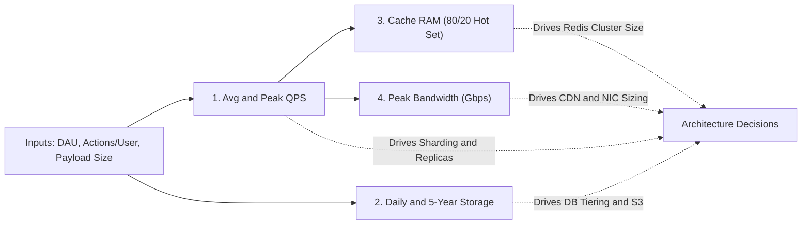
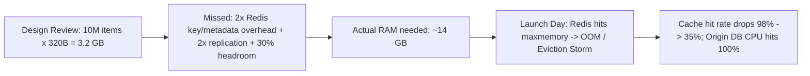

# Capacity Estimation in System Design Interviews: Numbers That Matter

> **Prerequisites:** [Lesson 04: Defining Scope in System Design Interviews](../04-defining-scope-in-system-design-interviews/README.md) · [Track Overview](../README.md).  
> **Estimated Reading Time:** 24–28 minutes  
> **Target Audience:** Engineers who get bogged down in tedious back-of-the-envelope arithmetic during interviews, or who compute numbers without connecting them to actual architectural decisions.  
> **Free PDF Notes:** [Download SD-T-005.pdf](https://backendroadmap.com/notes/system-design/SD-T-005.pdf)

> [!NOTE]
> **In one line:** Capacity estimation is **not an arithmetic exam**; it is a **90-second order-of-magnitude sanity check** that tells you whether your system fits on 1 machine, requires a Redis cache, saturates a single NIC, or needs horizontal sharding.

> [!TIP]
> **The Golden Rule:** Round everything to powers of 10 ($86{,}400\text{ s/day} \approx 10^5$), compute only the **4 numbers that change architecture** (**Peak QPS**, **5-Year Storage**, **Cache RAM (80/20)**, **Network Bandwidth**), and explicitly state the design decision each number forces.

---

## 1. What Capacity Estimation Is, and What It Isn't

Many candidates spend 8 minutes multiplying $3.7 \times 86{,}400$ and counting exact bytes for `created_at` and `is_deleted` columns—and then never use those numbers again. In contrast, a senior engineer spends 90 seconds estimating order-of-magnitude QPS, storage, RAM, and bandwidth, and immediately says: *"At 50k read QPS and 200 GB of hot working set, a single Postgres instance saturates, so we need a 3-node Redis cluster plus read replicas."*

| Term | Precise Meaning | Example |
| :--- | :--- | :--- |
| **Order-of-magnitude math** | Rounding to powers of 10 ($10^3, 10^5, 10^6$) for speed | $86{,}400\text{ s/day} \to 10^5\text{ s/day}$ |
| **Average QPS** | Total daily requests divided by $10^5$ seconds | $10^8\text{ req/day} / 10^5 = 1{,}000\text{ QPS}$ |
| **Peak QPS** | Average QPS multiplied by burst/diurnal factor ($3\times\text{–}10\times$) | $1{,}000 \times 5 = 5{,}000\text{ peak QPS}$ |
| **Hot working set (80/20)** | Active 20% of daily/monthly data kept in RAM cache | $20\% \times 100\text{ GB/day} = 20\text{ GB RAM}$ |
| **Egress bandwidth** | Peak QPS $\times$ payload size $\times 8$ (in bits/sec) | $5{,}000 \times 100\text{ KB} \times 8 = 4\text{ Gbps}$ |
| **Not** | Exact byte-by-byte schema accounting | Summing 4-byte ints and 1-byte booleans |
| **Not** | Computing numbers you never reference in Phase 2/3 | Calculating 5-year storage for a stateless rate limiter |

### Why It Matters
1. **Separates single-node from distributed:** Knowing if write QPS is $50$ vs $50{,}000$ tells you immediately whether a single PostgreSQL primary suffices or if you need sharding/LSM-trees.
2. **Reveals the true bottleneck:** A video service isn't CPU-bound or DB-bound—it's **network egress-bound** (Gbps/Tbps). A URL shortener isn't storage-bound (only ~1.5 TB over 5 years)—it's **read-QPS-bound**.
3. **Justifies cost and hardware:** Saying *"Our 20 GB hot set fits cleanly in a single `r6g.xlarge` Redis node"* proves you understand real production sizing.

---

## 2. Anatomy: The 4-Metric Estimation Pipeline



| Estimation Output | Formula Shortcut | Architectural Threshold |
| :--- | :--- | :--- |
| **1. Peak QPS** | $(\text{DAU} \times \text{req/user}) / 10^5 \times \text{PeakFactor}$ | `> 5k write QPS` -> shard DB; `> 15k read QPS` -> add cache/replicas |
| **2. 5-Year Storage** | $\text{Writes/day} \times \text{Bytes} \times 365 \times 5 \times \text{ReplFactor}$ | `< 2 TB` -> 1 DB; `> 10 TB` -> shard; `> 100 TB` -> object store / tiering |
| **3. Cache RAM (80/20)** | $0.20 \times \text{Daily Read Data (or Hot Keys)}$ | `< 64 GB` -> 1 Redis primary; `> 256 GB` -> Redis Cluster |
| **4. Peak Bandwidth** | $\text{Peak QPS} \times \text{Payload Bytes} \times 8\text{ bits}$ | `> 10 Gbps` -> saturates 1 NIC -> need CDN / multi-node LB |

> [!WARNING]
> **The #1 Trap: Math Without Decisions.** Never recite *"Storage is 18.25 TB, QPS is 2,314"* and then draw a generic diagram. Every number must end with **"therefore..."**: *"Peak read QPS is 50k and payload is 50 KB, which is 20 Gbps egress—therefore we MUST put a CDN in front of object storage."*

---

## 3. Mathematical Model: Little's Law, Powers-of-10 & Replication Overhead

**1. Powers-of-10 Daily Rate Shortcut.**
Since $1\text{ day} = 86{,}400\text{ s} \approx 10^5\text{ s}$ (an underestimate of ~14%, which is conservative for QPS—it slightly *overestimates* QPS by 1.15x, giving built-in safety margin):

$$\text{QPS}_{\text{avg}} \approx \frac{N_{\text{daily}}}{10^5}, \qquad \text{QPS}_{\text{peak}} = k_{\text{peak}} \cdot \text{QPS}_{\text{avg}} \quad (k_{\text{peak}} \in [3, 10])$$

**2. Concurrency via Little's Law.**
If peak arrival rate is $\lambda = \text{QPS}_{\text{peak}}$ and average request duration is $W$ seconds, the number of concurrent in-flight requests/connections $L$ is:

$$L = \lambda \cdot W$$

**3. Effective Storage with Replication & Index Overhead.**
Raw data size is multiplied by replication factor $R$ (typically $R = 3$) and B-tree/index/WAL overhead factor $\alpha \approx 1.3$:

$$S_{\text{total}} = S_{\text{raw}} \times R \times \alpha$$

### Worked Numerical Example ("Design a Photo Sharing Service like Instagram")
Assume **50M DAU**, **2 photos uploaded/user/day**? No—most users lurk: say **5M uploads/day**, **500M feed/photo views/day**, average photo = **500 KB**, metadata row = **1 KB**.

1. **Write & Read QPS:**
   - $\text{Write QPS}_{\text{avg}} = \frac{5 \times 10^6}{10^5} = \mathbf{50\text{ writes/s}}$ ($\text{Peak} \approx 5 \times 50 = \mathbf{250\text{ writes/s}}$).
   - $\text{Read QPS}_{\text{avg}} = \frac{5 \times 10^8}{10^5} = \mathbf{5{,}000\text{ reads/s}}$ ($\text{Peak} \approx 5 \times 5{,}000 = \mathbf{25{,}000\text{ reads/s}}$).
   - *Decision:* Writes fit on 1 DB; 25k peak reads need CDN (for photos) + Redis (for metadata).
2. **5-Year Photo Storage (Raw & Replicated):**
   - Daily raw photos: $5 \times 10^6 \times 500\text{ KB} = 2.5 \times 10^{12}\text{ B} = \mathbf{2.5\text{ TB/day}}$.
   - 5 years ($2{,}000\text{ days}$ rounded): $2.5\text{ TB} \times 2{,}000 = \mathbf{5\text{ PB raw}}$ ($\sim 15\text{ PB}$ with $3\times$ replication).
   - *Decision:* Object storage (S3) for blobs; metadata is only $5 \times 10^6 \times 1\text{ KB} \times 2{,}000 = \mathbf{10\text{ TB}}$ (fits in sharded SQL/NoSQL).
3. **Peak Egress Bandwidth:**
   - $25{,}000\text{ reads/s} \times 500\text{ KB} = 12.5\text{ GB/s} \times 8 = \mathbf{100\text{ Gbps}}$.
   - *Decision:* 100 Gbps saturates origin servers—a **CDN is mandatory** to offload 90%+ of image egress.
4. **Concurrency (Little's Law) for Uploads:**
   - At $250\text{ uploads/s}$ taking $W = 2\text{ s}$ each: $L = 250 \times 2 = \mathbf{500}$ concurrent upload connections (easily handled by pre-signed S3 URLs so app servers aren't blocked).

---

## 4. Metrics & Percentiles (Capacity Sanity Checks)

| Metric | Meaning | Alert / Architectural Trigger |
| :--- | :--- | :--- |
| **Peak Write QPS** | Max mutations per second during burst | `> 5,000/s` -> shard primary DB or buffer via queue |
| **Peak Read QPS** | Max lookups per second during burst | `> 15,000/s` -> add Redis cache and read replicas |
| **Working Set RAM** | Hot keys/objects served frequently (80/20) | `> 64 GB` -> partition Redis Cluster across shards |
| **5-Year Storage** | Cumulative disk footprint with replication | `> 5 TB` -> shard relational DB or offload blobs to S3 |
| **Peak Egress (Gbps)** | Outbound network traffic at peak | `> 10 Gbps` -> add CDN edge caching / compression |
| **In-Flight Connections ($L$)** | $\lambda \times W$ concurrent open sockets | `> 10,000/node` -> use async I/O, pre-signed URLs, or connection pooling |

### Worked Example ("Design a URL Shortener")
- **Inputs:** 100M new URLs/month ($\approx 3.3\text{M/day}$), 100:1 read:write ratio ($\approx 330\text{M reads/day}$), 500 bytes per URL record.
- **Numbers:**
  - Write QPS: $3.3 \times 10^6 / 10^5 \approx 33\text{ writes/s}$ (Peak $\sim 150\text{ writes/s}$).
  - Read QPS: $3{,}300\text{ reads/s}$ avg (Peak $\sim 15{,}000\text{ reads/s}$).
  - 5-Year Storage: $3.3\text{M/day} \times 500\text{ B} \times 2{,}000\text{ days} \approx \mathbf{3.3\text{ TB}}$ raw.
  - Cache RAM (20% of daily reads): $0.20 \times 330\text{M} \times 500\text{ B} \approx 33\text{ GB}$ (actually much smaller with unique key deduplication, ~10–15 GB).
- **Decisions:** 150 writes/s easily fits on a single primary DB; 15k peak reads + 15 GB hot set fits in **one Redis cache node**; 3.3 TB over 5 years fits on a single modern NVMe instance (or 2–4 shards for HA). No Kafka or Cassandra needed!

---

## 5. Compounding & Failure Modes: When Under-Estimation Breaks Production

| Estimation Error | Factor Off | Production Failure Mode |
| :--- | :---: | :--- |
| **Sizing for Average QPS instead of Peak** | $3\times\text{–}10\times$ | System collapses every evening peak or flash event; retry storms amplify load $3\times$ further |
| **Forgetting Replication & Index Overhead** | $3\times\text{–}4\times$ | Disk hits 100% in month 18 instead of year 5; WAL stalls writes globally |
| **Ignoring Little's Law on Slow Endpoints** | $10\times$ threads | A 2-second downstream slowdown at 500 QPS spikes concurrency to 1,000, exhausting DB/thread pools |
| **Confusing Bytes (B) and Bits (b)** | $8\times$ | Network link saturates at 12.5% of expected throughput (10 Gbps NIC = 1.25 GB/s, not 10 GB/s) |

The **Bytes vs Bits ($8\times$)** mistake is the most common real-world capacity bug: a `10 Gbps` NIC transfers at most `1.25 GB/s`, minus ~10% TCP/TLS framing overhead $\approx \mathbf{1.1\text{ GB/s}}$.

---

## 6. Numbers Every Engineer Must Know (Back-of-the-Envelope Cheat Table)

| Item | Exact / Typical | Interview Shortcut |
| :--- | :---: | :--- |
| Seconds in a day | $86{,}400$ | $10^5$ |
| Seconds in a month / year | $2.59\text{M}$ / $31.5\text{M}$ | $2.5 \times 10^6$ / $3 \times 10^7$ |
| 5 years in days | $1{,}825$ | $2{,}000$ |
| $2^{10}$ / $2^{20}$ / $2^{30}$ / $2^{40}$ | $1\text{ KB}$ / $1\text{ MB}$ / $1\text{ GB}$ / $1\text{ TB}$ | $10^3$ / $10^6$ / $10^9$ / $10^{12}$ |
| ASCII char / UTF-8 avg / UUID | $1\text{ B}$ / $1\text{–}4\text{ B}$ / $16\text{ B}$ (36 hex) | $1\text{ B}$ / $2\text{ B}$ / $16\text{ B}$ |
| Single Postgres/MySQL QPS | $5\text{k–}15\text{k}$ reads, $1\text{k–}5\text{k}$ writes | $10\text{k}$ reads, $2\text{k}$ writes |
| Single Redis node QPS | $50\text{k–}100\text{k}$ ops/s | $100\text{k}$ ops/s |
| Single Kafka broker throughput | $100\text{ MB/s–}1\text{ GB/s}$ | $100\text{ MB/s}$ sustained |
| Standard cloud NIC | $10\text{ Gbps}$ ($\approx 1.25\text{ GB/s}$) | $1\text{ GB/s}$ usable |

---

## 7. Protocol Deep Dive: The 90-Second Estimation Workflow

```mermaid
sequenceDiagram
    participant C as Candidate
    participant I as Interviewer
    C->>I: "Let's spend 90s on scale to size our DB, cache, and network."
    C->>C: Step 1 - Convert daily volume / 10^5 -> Avg QPS, x5 -> Peak QPS
    C->>C: Step 2 - Writes/day x Bytes x 2000 -> 5-Yr Storage (x3 repl)
    C->>C: Step 3 - Peak QPS x Payload x 8 -> Peak Egress Gbps
    C->>I: "Conclusion: 25k read QPS + 100 Gbps egress -> Redis + CDN; 250 write QPS -> single Postgres primary works. Agree?"
    I-->>C: "Clean math. Let's jump into APIs and HLD."
```

| Question | Answer |
| :--- | :--- |
| **When should you skip capacity math?** | When the interviewer explicitly says *"Assume web-scale, skip the math"*—respect the cue immediately |
| **Should you do capacity math before or after HLD?** | Do a 90-second QPS/storage pass in Phase 1 (before HLD) so you pick the right DB/cache; refine shard counts in Phase 3 |
| **What if you make an arithmetic slip?** | Use scientific notation ($5 \times 10^6 \times 5 \times 10^5 = 25 \times 10^{11} = 2.5\text{ TB}$) to avoid dropping zeros |
| **How do you size shards?** | Divide 5-year replicated storage (or peak write QPS) by single-node safe limit (e.g., `2 TB/shard` or `3k write QPS/shard`) |

**When NOT to do full 4-metric estimation:** For purely algorithmic or concurrency prompts (e.g., *"Design an In-Memory LRU Cache"* or *"Design a Rate Limiter Library"*), focus on memory per entry ($O(N)$ bytes) and CPU complexity ($O(1)$) rather than 5-year disk storage.

---

## 8. Hierarchical Budgets & Design Rules

| Slice | Rule | Control |
| :--- | :--- | :--- |
| **Time budget** | Max 90–120 seconds for Phase 1 capacity math | Use $10^5\text{ s/day}$ and $2{,}000\text{ days/5yr}$ |
| **Scientific notation** | Always multiply mantissas and add exponents | Eliminates dropped-zero errors under stress |
| **Headroom** | Size compute/DB for $3\times\text{–}5\times$ peak, keep utilization `< 70%` | Absorbs diurnal spikes and node failovers |
| **Unit discipline** | Write units (`B`, `KB`, `MB`, `Gbps`, `GB/s`) on every line | Prevents the $8\times$ bits-vs-bytes bug |
| **Actionability** | Every metric must end with a component decision | No orphan numbers on the board |

---

## 9. Top Mitigations (Avoiding Capacity Math Traps)

1. **Use scientific notation ($a \times 10^b$)** instead of counting trailing zeros on a whiteboard.
2. **Always state Peak-to-Average multiplier explicitly** ($3\times$ for steady B2B, $5\times\text{–}10\times$ for consumer/flash events).
3. **Separate metadata storage from blob storage** (10 TB of SQL rows vs 5 PB of S3 video/images).
4. **Apply Little's Law ($L = \lambda W$)** whenever an endpoint holds open connections (WebSockets, file uploads, LLM streaming).
5. **Account for $3\times$ replication and $1.3\times$ index overhead** before claiming *"it fits on one disk."*
6. **Check network egress early** for media-heavy systems—bandwidth saturates long before CPU does.

---

## 10. Production Reference / War Story: The "Dropped Zero" Cache Sizing Outage

A team launching a new product-catalog API estimated their Redis working set during design review as **"3.2 GB"** and provisioned a single `cache.r6g.large` (13 GB RAM).



- **Root Cause:** They multiplied `10M items * 320 bytes = 3.2 GB`, forgetting Redis per-key hash table & `redisObject` overhead (~64–96 bytes/key = +1 GB), serialization expansion, read-replica/failover buffer, and the **25% headroom rule** (`maxmemory` < 75% to leave room for `fork()` copy-on-write during RDB snapshots).
- **The Fix:** Apply a $2.5\times$ memory safety factor to raw object size (`3.2 GB -> 8 GB` minimum per shard, or `16 GB` with headroom) and always configure `allkeys-lru` eviction alerts before 80% memory saturation.

---

## 11. Multi-Language Production Code Tabs

A **Back-of-the-Envelope Capacity Estimator** implementing the 4-metric pipeline (QPS, 5-year replicated storage, 80/20 cache RAM, peak egress Gbps, and Little's Law concurrency) with automatic architectural recommendations.

````carousel
```go
// Go: 4-metric capacity estimator with architectural threshold flags.
package main

import "fmt"

type Workload struct {
	DailyReads       float64
	DailyWrites      float64
	PeakFactor       float64
	PayloadBytes     float64
	RecordBytes      float64
	AvgLatencySec    float64
}

func Estimate(w Workload) {
	readQpsAvg := w.DailyReads / 1e5
	writeQpsAvg := w.DailyWrites / 1e5
	readQpsPeak := readQpsAvg * w.PeakFactor
	writeQpsPeak := writeQpsAvg * w.PeakFactor

	// 5 years (~2000 days) * 3x replication * 1.3x index/WAL overhead
	storage5YrTB := (w.DailyWrites * w.RecordBytes * 2000 * 3 * 1.3) / 1e12
	cacheRamGB := (0.20 * w.DailyReads * w.RecordBytes) / 1e9
	egressGbps := (readQpsPeak * w.PayloadBytes * 8) / 1e9
	concurrency := (readQpsPeak + writeQpsPeak) * w.AvgLatencySec

	fmt.Printf("Peak Read QPS : %.0f/s | Peak Write QPS: %.0f/s\n", readQpsPeak, writeQpsPeak)
	fmt.Printf("5-Yr Storage  : %.2f TB (incl. 3x repl + index)\n", storage5YrTB)
	fmt.Printf("Cache RAM(20%%): %.2f GB | Peak Egress: %.2f Gbps\n", cacheRamGB, egressGbps)
	fmt.Printf("In-Flight (L) : %.0f concurrent requests\n", concurrency)
	if egressGbps > 10 {
		fmt.Println("-> DECISION: Egress > 10 Gbps; CDN is mandatory.")
	}
	if writeQpsPeak > 5000 {
		fmt.Println("-> DECISION: Write QPS > 5k; horizontal DB sharding required.")
	}
}

func main() {
	Estimate(Workload{
		DailyReads: 5e8, DailyWrites: 5e6, PeakFactor: 5,
		PayloadBytes: 5e5, RecordBytes: 1e3, AvgLatencySec: 0.05,
	})
}
```
<!-- slide -->
```typescript
// TypeScript: Capacity estimator converting daily inputs to QPS, storage, RAM, and Gbps.
interface CapacityInput {
  dailyReads: number;
  dailyWrites: number;
  peakMultiplier: number;
  avgPayloadBytes: number;
  recordBytes: number;
}

export function estimateCapacity(input: CapacityInput) {
  const peakReadQps = (input.dailyReads / 1e5) * input.peakMultiplier;
  const peakWriteQps = (input.dailyWrites / 1e5) * input.peakMultiplier;
  const fiveYearTb = (input.dailyWrites * input.recordBytes * 2000 * 3 * 1.3) / 1e12;
  const hotCacheGb = (0.2 * input.dailyReads * input.recordBytes) / 1e9;
  const peakEgressGbps = (peakReadQps * input.avgPayloadBytes * 8) / 1e9;

  return {
    peakReadQps: Math.round(peakReadQps),
    peakWriteQps: Math.round(peakWriteQps),
    fiveYearReplicatedTb: Number(fiveYearTb.toFixed(2)),
    hotCacheGb: Number(hotCacheGb.toFixed(2)),
    peakEgressGbps: Number(peakEgressGbps.toFixed(2)),
    needsCdn: peakEgressGbps > 10,
    needsDbSharding: peakWriteQps > 5000 || fiveYearTb > 5,
  };
}

console.log(estimateCapacity({
  dailyReads: 3.3e8, dailyWrites: 3.3e6, peakMultiplier: 5,
  avgPayloadBytes: 500, recordBytes: 500,
}));
```
<!-- slide -->
```python
# Python: Back-of-the-envelope capacity estimator & shard calculator (stdlib only).
import math

def estimate(daily_reads: float, daily_writes: float, peak_k: float,
             payload_bytes: float, record_bytes: float, avg_lat_s: float = 0.05):
    peak_r = (daily_reads / 1e5) * peak_k
    peak_w = (daily_writes / 1e5) * peak_k
    storage_5yr_tb = (daily_writes * record_bytes * 2000 * 3 * 1.3) / 1e12
    cache_gb = (0.20 * daily_reads * record_bytes) / 1e9
    egress_gbps = (peak_r * payload_bytes * 8) / 1e9
    in_flight = (peak_r + peak_w) * avg_lat_s
    shards_needed = max(1, math.ceil(storage_5yr_tb / 2.0), math.ceil(peak_w / 3000.0))

    return {
        "peak_read_qps": round(peak_r),
        "peak_write_qps": round(peak_w),
        "storage_5yr_tb": round(storage_5yr_tb, 2),
        "cache_ram_gb": round(cache_gb, 2),
        "peak_egress_gbps": round(egress_gbps, 2),
        "littles_law_concurrency": round(in_flight),
        "min_db_shards": shards_needed,
    }

if __name__ == "__main__":
    print("URL Shortener:", estimate(3.3e8, 3.3e6, 5, 500, 500))
    print("Instagram    :", estimate(5e8, 5e6, 5, 500_000, 1000))
```
<!-- slide -->
```csharp
// C#: Capacity estimation helper for quick architectural sizing.
using System;

public static class CapacityEstimator
{
    public static void PrintReport(double dailyReads, double dailyWrites, double peakK, double payloadBytes, double recordBytes)
    {
        double peakR = (dailyReads / 1e5) * peakK;
        double peakW = (dailyWrites / 1e5) * peakK;
        double storageTb = (dailyWrites * recordBytes * 2000 * 3 * 1.3) / 1e12;
        double egressGbps = (peakR * payloadBytes * 8) / 1e9;
        int shards = (int)Math.Max(1, Math.Ceiling(Math.Max(storageTb / 2.0, peakW / 3000.0)));

        Console.WriteLine($"Peak R/W QPS: {peakR:F0} / {peakW:F0} | 5-Yr Storage: {storageTb:F2} TB | Egress: {egressGbps:F2} Gbps | Shards: {shards}");
    }
}
```
````

---

## 12. Hands-On CLI Verification Workflows

Run this one-liner in Python to compare the capacity profile of a **URL Shortener** vs a **Photo Platform** vs **IoT Telemetry**:

```bash
python3 -c '
def est(name, dr, dw, k, pay, rec):
    pr, pw = (dr/1e5)*k, (dw/1e5)*k
    tb = (dw*rec*2000*3*1.3)/1e12
    gbps = (pr*pay*8)/1e9
    print(f"{name:14s} | PeakR={pr:7.0f}/s | PeakW={pw:6.0f}/s | 5Yr={tb:7.2f} TB | Egress={gbps:6.2f} Gbps")

est("URL Shortener", 3.3e8, 3.3e6, 5, 500, 500)
est("Instagram",     5.0e8, 5.0e6, 5, 5e5, 1000)
est("IoT Metrics",   1.0e7, 2.0e9, 3, 200, 200)
'
```

Expected output:
```text
URL Shortener  | PeakR=  16500/s | PeakW=   165/s | 5Yr=  12.87 TB | Egress=  0.07 Gbps
Instagram      | PeakR=  25000/s | PeakW=   250/s | 5Yr=  39.00 TB | Egress=100.00 Gbps
IoT Metrics    | PeakR=    300/s | PeakW= 60000/s | 5Yr=3120.00 TB | Egress=  0.00 Gbps
```

Notice how each system's bottleneck jumps off the screen: URL Shortener = Read QPS (`16.5k/s` -> Redis), Instagram = Egress (`100 Gbps` -> CDN + S3), IoT Metrics = Write QPS + Storage (`60k/s`, `3.1 PB` -> LSM-tree / Time-Series DB + downsampling).

---

## 13. Common Mistakes to Avoid

1. **Spending 7+ minutes on exact arithmetic** instead of rounding to powers of 10 in 90 seconds.
2. **Computing numbers you never use**—always end every calculation with *"therefore, we need X."*
3. **Sizing for average QPS** instead of $3\times\text{–}10\times$ peak QPS.
4. **Confusing bytes and bits** ($1\text{ GB/s} = 8\text{ Gbps}$, not $1\text{ Gbps}$).
5. **Forgetting replication ($3\times$) and index overhead ($1.3\times$)** in storage sizing.
6. **Lumping media blobs into database storage** instead of separating metadata (KB) from blobs (MB/GB in S3).
7. **Ignoring Little's Law ($L = \lambda W$)** when designing upload servers, WebSocket gateways, or slow third-party integrations.

---

## 14. Key Terms Glossary

| Key Term | Definition |
| :--- | :--- |
| **QPS (Queries Per Second)** | Request arrival rate ($\lambda$); split into Read QPS and Write QPS. |
| **Peak-to-average ratio** | Multiplier ($3\times\text{–}10\times$) capturing diurnal or bursty traffic spikes. |
| **Working set (80/20 rule)** | The hot subset (~20%) of data that serves ~80% of reads, sized for RAM caching. |
| **Little's Law ($L = \lambda W$)** | Average concurrency equals arrival rate times average residence/latency time. |
| **Egress bandwidth** | Outbound data rate in bits per second ($\text{QPS} \times \text{Payload Bytes} \times 8$). |
| **Replication factor ($R$)** | Number of durable copies stored (typically $3$), multiplying raw storage by $R$. |
| **Scientific notation** | Representing numbers as $a \times 10^b$ to avoid dropped-zero errors. |
| **Metadata vs Blob** | Small structured records (in SQL/NoSQL) vs large binary files (in Object Storage + CDN). |
| **Shard threshold** | Single-node storage (~2–5 TB) or write QPS (~3k–5k/s) limit triggering horizontal partitioning. |
| **Headroom** | Spare capacity (~30%) reserved above peak load to absorb failovers and GC/compaction. |

---

## 15. System Design Interview Questions & Answers

### Basic Conceptual Questions

<details>
<summary><strong>Q1: Why do we round 86,400 seconds/day to 100,000 ($10^5$) in interviews? [BASIC]</strong></summary>

**Answer:**
It lets you divide daily request counts by $10^5$ mentally in 2 seconds, and because $10^5 > 86{,}400$, wait—actually dividing by $10^5$ *slightly* underestimates avg QPS by ~14%, which is immediately absorbed (and dwarfed) by multiplying by the $3\times\text{–}5\times$ peak factor. The speed and zero-error clarity are worth far more than 14% precision.
</details>

<details>
<summary><strong>Q2: What are the 4 numbers you should compute in almost every capacity estimation? [BASIC]</strong></summary>

**Answer:**
1. Peak Read & Write QPS, 2. 5-Year Replicated Storage, 3. Hot Cache RAM (80/20 rule), and 4. Peak Network Egress Bandwidth (Gbps).
</details>

<details>
<summary><strong>Q3: How do you convert Megabytes per second (MB/s) to Gigabits per second (Gbps)? [BASIC]</strong></summary>

**Answer:**
Multiply MB/s by 8 to get Megabits/sec (Mbps), then divide by 1,000 to get Gbps. For example, $500\text{ MB/s} \times 8 = 4{,}000\text{ Mbps} = 4\text{ Gbps}$.
</details>

<details>
<summary><strong>Q4: Why do we separate metadata storage from media/blob storage in capacity math? [BASIC]</strong></summary>

**Answer:**
A 1 KB metadata row for 5M daily uploads is ~10 TB over 5 years (easily stored in sharded SQL/NoSQL), whereas 500 KB–50 MB media blobs total 5–500 PB and require object storage (S3) + CDN. Mixing them distorts DB sizing.
</details>

### Scenario-Based Architecture Questions

<details>
<summary><strong>Q5: You estimate 100M writes/day at 1 KB/record. Does this fit on one PostgreSQL instance? [SCENARIO]</strong></summary>

**Answer:**
Avg writes $= 10^8 / 10^5 = 1{,}000\text{ writes/s}$; Peak ($5\times$) $= 5{,}000\text{ writes/s}$. 5-year raw storage $= 10^8 \times 10^3 \times 2{,}000 \approx 200\text{ TB}$ raw (~600 TB replicated). Both the 5k peak write QPS and 200 TB footprint exceed a single PostgreSQL node—horizontal sharding is mandatory.
</details>

<details>
<summary><strong>Q6: A chat app has 10M concurrent WebSocket users, each sending 1 message/min (500 bytes). What is the bottleneck? [SCENARIO]</strong></summary>

**Answer:**
Message QPS is modest ($10^7 / 60 \approx 166\text{k msg/s}$), and bandwidth is small (~660 Mbps). The primary bottleneck is **concurrency ($L = 10\text{M}$ open TCP sockets)**: at ~50k–100k connections per tuned gateway node, you need **100–200 stateful WebSocket gateway instances** plus a pub/sub routing layer.
</details>

<details>
<summary><strong>Q7: Your service handles 20,000 peak read QPS with 2 KB responses. Do you need a CDN? [SCENARIO]</strong></summary>

**Answer:**
Peak egress $= 20{,}000 \times 2\text{ KB} \times 8 = 320\text{ Mbps} = 0.32\text{ Gbps}$—easily handled by 2–4 app servers without a CDN for bandwidth. You would only add a CDN if you need global edge latency reduction (`< 20 ms` worldwide) for static/cacheable content.
</details>

<details>
<summary><strong>Q8: How do you use Little's Law to size a thread/worker pool? [SCENARIO]</strong></summary>

**Answer:**
If a service receives $\lambda = 1{,}000\text{ req/s}$ peak and each request takes $W = 0.2\text{ s}$ (200 ms) waiting on a downstream DB, $L = 1{,}000 \times 0.2 = 200$ concurrent workers/connections are active. Provision at least $2\times$ headroom (400) and cap queues so a downstream slowdown ($W \to 2\text{ s}$) doesn't blow memory.
</details>

### Advanced & Tricky Interview Questions

<details>
<summary><strong>Q9: Why does the 80/20 cache calculation often *overestimate* unique RAM needed for read-heavy feeds? [TRICKY]</strong></summary>

**Answer:**
Because 20% of *daily read requests* often hit the **same** hot keys (e.g., 10,000 viral posts or 1M active timelines) repeatedly. Multiplying `0.2 * daily_reads * item_size` counts duplicate reads of the same object; deduplicating by *unique active keys* (e.g., `active_users * timeline_size`) gives a much tighter RAM bound.
</details>

<details>
<summary><strong>Q10: How does a 10x read-amplification or fan-out factor affect capacity estimation? [TRICKY]</strong></summary>

**Answer:**
In Twitter-like fan-out-on-write, 1 tweet from a user with 1M followers creates $10^6$ cache writes, not 1. Always check whether an action has a **fan-out multiplier** ($F$) so you estimate *internal* write QPS ($\text{External Writes} \times F_{\text{avg}}$), not just API QPS.
</details>

<details>
<summary><strong>Q11: Why is 5-year storage often misleading if you don't ask about TTL / retention? [TRICKY]</strong></summary>

**Answer:**
Ephemeral systems (rate limiter windows, 24-hour stories, 30-day session logs) have steady-state storage equal to `daily_bytes * TTL_days`, not `daily_bytes * 2,000`. Asking about retention in Phase 1 can shrink your storage estimate by $60\times$.
</details>

<details>
<summary><strong>Q12: What should you do if your capacity math shows the whole system easily fits on 1 server? [TRICKY]</strong></summary>

**Answer:**
Acknowledge it honestly (*"At 200 QPS and 50 GB over 5 years, a single primary + 1 standby Postgres handles the load"*), then clarify **High Availability** (multi-AZ failover so 1 crash doesn't cause downtime) and ask if the interviewer wants to scale the prompt $100\times$ to explore sharding.
</details>

---

## 16. One-Page Master Cheat Sheet

```
+---------------------------------------------------------------------------------------------------------+
|                  CAPACITY ESTIMATION — NUMBERS THAT MATTER CHEAT SHEET                                  |
+---------------------------------------------------------------------------------------------------------+
| 1. SHORTCUTS: 1 day = 86,400 s ~ 10^5 s | 5 years ~ 2,000 days | Peak = 3x-10x Avg | 1 GB/s = 8 Gbps.   |
+---------------------------------------------------------------------------------------------------------+
| 2. THE 4 METRICS -> DECISIONS:                                                                          |
|    - Peak QPS    = (Daily / 10^5) * PeakK       | > 5k W -> Shard DB | > 15k R -> Redis/Replicas        |
|    - 5-Yr Disk   = Daily * Bytes * 2000 * 3*1.3 | > 5 TB -> Shard    | Blobs -> S3 Object Storage       |
|    - Hot RAM     = 20% Daily Read Working Set   | > 64 GB -> Redis Cluster                              |
|    - Peak Egress = PeakReadQPS * Payload * 8    | > 10 Gbps -> CDN Mandatory                            |
+---------------------------------------------------------------------------------------------------------+
| 3. LITTLE'S LAW: Concurrency L = ArrivalRate * LatencySec (size thread pools & WebSocket gateways).     |
+---------------------------------------------------------------------------------------------------------+
| 4. GOLDEN RULE: 90 seconds max. Scientific notation. Every number ends with "therefore, we need X."     |
+---------------------------------------------------------------------------------------------------------+
```

---

## Further Reading & Sources

- Jeff Dean, *Numbers Everyone Should Know* (Stanford CS295 / Google Latency Numbers).
- Alex Xu, *System Design Interview — An Insider's Guide*, Volume 1, Chapter 2 ("Back-of-the-envelope Estimation").
- Brendan Gregg, *Systems Performance*, Chapter 2 (Little's Law, Utilization, and Saturation).
- Martin Kleppmann, *Designing Data-Intensive Applications*, Chapter 1 ("Describing Load").

---

## Free PDF Notes

[SD-T-005.pdf](https://backendroadmap.com/notes/system-design/SD-T-005.pdf)

---

## Next

Continue with [Lesson 06: API Design in System Design Interviews: How Much Detail Is Enough](../06-api-design-in-system-design-interviews/README.md).
