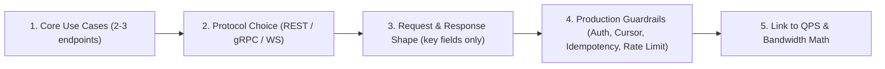
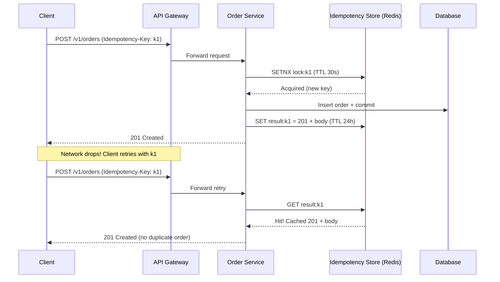
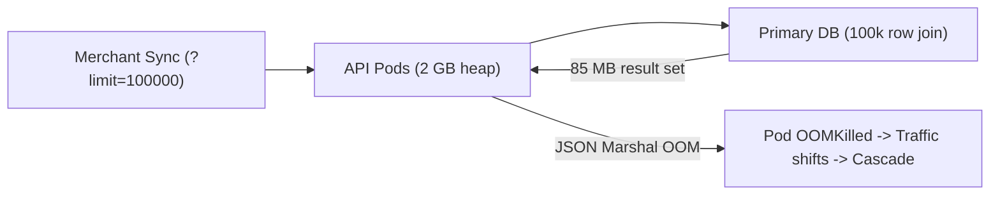

# API Design in System Design Interviews: How Much Detail Is Enough

> **Prerequisites:** [Lesson 05: Capacity Estimation in System Design Interviews: Numbers That Matter](../05-capacity-estimation-in-system-design-interviews/README.md) · [Track: Interview Framework](../README.md).  
> **Estimated Reading Time:** 22–26 minutes  
> **Target Audience:** Backend engineers and Staff/Senior interview candidates deciding how much API detail to write on a whiteboard without burning 15 minutes on boilerplate CRUD.  
> **Free PDF Notes:** [Download SD-T-006.pdf](https://backendroadmap.com/notes/system-design/SD-T-006.pdf)

> [!NOTE]
> **In one line:** In a system design interview, API design is not a Swagger spec—it is a **3-to-5-minute contract boundary** that locks down protocols (REST, gRPC, WebSockets), pagination, idempotency, rate-limiting headers, and payload shapes for the **2–3 core operations** that drive your data model and scaling bottlenecks.

> [!TIP]
> **The Golden Rule:** Spend **5 minutes max** on APIs. Write only the **core read/write endpoints**, explicitly name **auth, pagination, and idempotency**, and immediately connect each endpoint to the **QPS and payload math** from capacity estimation.

---

## 1. What Interview API Design Is, and What It Isn't

A candidate designing Twitter spends 12 minutes writing `GET /users/{id}`, `POST /login`, `DELETE /users/{id}`, `PATCH /users/{id}/bio`, HTTP status codes 200 through 422, and full JSON user-profile schemas. At minute 22, the interviewer interrupts: *"We still haven't drawn a single box or talked about fan-out."* The candidate treated API design as an OpenAPI specification exercise rather than a system boundary definition.

| Term | Precise Meaning | Example |
| :--- | :--- | :--- |
| **Core API surface** | The 2–4 endpoints that exercise the system's hardest paths | `POST /tweets`, `GET /feed`, `POST /follow` |
| **Contract boundary** | Protocol, auth, pagination, and consistency semantics exposed to callers | Cursor pagination, `Idempotency-Key`, REST vs gRPC |
| **External vs Internal API** | Public edge protocol vs service-to-service RPC | REST/JSON at gateway; gRPC/Protobuf internally |
| **Idempotency key** | Client-generated UUID preventing duplicate side effects on retry | `Idempotency-Key: 9b1deb4d-...` on `POST /payments` |
| **Cursor pagination** | Keyset-based paging (`?cursor=...&limit=20`) avoiding `OFFSET` scans | `WHERE id < :cursor ORDER BY id DESC LIMIT 20` |
| **Not** | Exhaustive CRUD, auth boilerplate, or every field of every DTO | Skip `/health`, `/login`, `/settings` unless asked |

### Why It Matters
1. **APIs dictate the data model and architecture:** Choosing cursor pagination over offset pagination changes your index; choosing WebSockets over polling changes your connection-tier math.
2. **Time-budget discipline:** Interviews are 45 minutes. Spending >5 minutes on trivial CRUD starves the deep-dive phase where Senior/Staff leveling is decided.
3. **Production maturity signals:** Mentioning `Idempotency-Key`, `429 Too Many Requests` with `Retry-After`, and cursor pagination in 30 seconds signals real-world operational experience without wasting time.

---

## 2. Anatomy: The 5-Minute API Contract Flow



Notice how each step feeds the next architecture decision:

| Decision | Options | When to Pick Which in an Interview |
| :--- | :--- | :--- |
| **Edge Protocol** | REST/HTTP+JSON vs GraphQL vs gRPC-Web | **REST/JSON** default for public APIs; **GraphQL** if mobile clients have wildly varying screen shapes; **gRPC** for mobile-to-BFF if latency/bandwidth is tight |
| **Real-time Push** | Polling vs Long-Polling vs SSE vs WebSockets | **SSE** for server-to-client feeds/AI streams; **WebSockets** for bidirectional chat, gaming, collaborative docs |
| **Internal RPC** | gRPC (Protobuf + HTTP/2) vs REST/JSON | **gRPC** for low-latency microservice meshes (binary, multiplexed, strict schema) |
| **Pagination** | Offset (`?page=5`) vs Cursor (`?cursor=xyz`) | **Cursor** for infinite feeds, timelines, logs; **Offset** only for small bounded admin tables |
| **Write Safety** | `Idempotency-Key` header vs Natural key | Always specify **`Idempotency-Key`** for payments, orders, bookings, or any non-idempotent `POST` |

> [!WARNING]
> **The #1 API Trap in Interviews: `OFFSET` Pagination on Live Feeds.** Writing `GET /feed?page=500&limit=20` implies `OFFSET 10000`, which forces the database to scan and discard 10,000 rows and produces duplicate/skipped items when new posts arrive. Always default to **cursor (keyset) pagination** for timelines and feeds.

---

## 3. Mathematical Model: Payload Size, Bandwidth, and Connection Budgets

Your API design directly determines network bandwidth and connection memory. Let:
- $Q_{\text{read}}$ = read requests per second
- $Q_{\text{write}}$ = write requests per second
- $S_{\text{req}}, S_{\text{resp}}$ = average serialized request/response payload size (bytes)
- $H_{\text{hdr}}$ = HTTP/TLS header overhead per request (typically $500\text{–}800\text{ B}$ uncompressed, $\sim 100\text{ B}$ with HPACK/HTTP2)

$$\text{Egress Bandwidth} = Q_{\text{read}} \times (S_{\text{resp}} + H_{\text{hdr}})$$

$$\text{JSON vs Protobuf Compression Ratio} \approx \frac{S_{\text{JSON}}}{S_{\text{Proto}}} \in [2.5, 4.0]$$

For persistent connections (WebSockets / SSE) with $N_{\text{conn}}$ concurrent users and per-connection kernel + app buffer $M_{\text{conn}}$ (typically $16\text{–}64\text{ KB}$):

$$\text{Gateway RAM} = N_{\text{conn}} \times M_{\text{conn}}$$

### Worked Numerical Example (Social Feed API)
Suppose $Q_{\text{read}} = 50{,}000\text{ req/s}$ for `GET /v1/feed?cursor=...&limit=20`:
- Each feed item in JSON averages $600\text{ B}$ (post ID, author summary, text snippet, media URL, counts).
- $20$ items $\Rightarrow S_{\text{resp}} \approx 12\text{ KB}$. With $H_{\text{hdr}} \approx 500\text{ B}$, total per response $\approx 12.5\text{ KB}$.
- Uncompressed egress: $50{,}000 \times 12.5\text{ KB} = 625\text{ MB/s} = 5.0\text{ Gbps}$.
- With gzip/Brotli ($\sim 3\times$ reduction on JSON): $\approx 1.67\text{ Gbps}$.
- If you instead returned full nested author objects and 50 comments per post ($120\text{ KB}$ per response), egress jumps $10\times$ to $50\text{ Gbps}$ uncompressed—a classic API over-fetching bottleneck!

---

## 4. Metrics & Percentiles

| Metric | Meaning | Alert when |
| :--- | :--- | :--- |
| **API $p_{99}$ latency** | 99th percentile gateway response time | Exceeds SLO (e.g., $> 200\text{ ms}$ for reads, $> 500\text{ ms}$ for writes) |
| **Payload size $p_{95}$** | 95th percentile serialized response bytes | Exceeds $64\text{ KB}$ on mobile endpoints (over-fetching signal) |
| **4xx rate (400 / 429)** | Client validation errors and rate-limit rejections | Sudden spike $> 2\%$ (broken client deploy or scraping attack) |
| **5xx rate** | Server-side unhandled errors / timeouts | $> 0.1\%$ for 1 minute (page on-call) |
| **Idempotency cache hit rate** | Percentage of `POST` requests replaying cached results | $> 5\%$ indicates client retry storm or network instability |
| **Schema validation failure** | Rejected requests due to contract drift | Any non-zero spike after deploy |

### Worked Example (Checkout `POST /v1/orders`)
A mobile client times out at $2{,}000\text{ ms}$ while the backend takes $2{,}300\text{ ms}$ to authorize payment. The client retries twice with the same `Idempotency-Key: a7f2...`. Without idempotency, the customer is charged 3 times (SEV-1). With an idempotency store (Redis/Postgres with `24h` TTL), the second and third retries return the cached `201 Created` response in $4\text{ ms}$, and the idempotency hit metric alerts engineering that payment latency is breaching mobile client timeouts.

---

## 5. Compounding & Failure Modes: Polling vs Push and Unbounded Responses

Consider $1{,}000{,}000$ active users waiting for live order-status updates:

| API Pattern | Request Rate at 1M Active Users | Wasted Requests | Server Load Profile |
| :--- | :--- | :--- | :--- |
| **Short Polling (every 2 s)** | $500{,}000\text{ req/s}$ | $\sim 98\%$ return `304` / empty | Massive CPU & DB read waste |
| **Long Polling (30 s hold)** | $\sim 33{,}333\text{ req/s}$ + reconnects | Low, but thundering herd on reconnect | High connection churn |
| **SSE / WebSockets** | $1\text{M}$ open TCP sockets; events pushed only on change | $0\%$ wasted polls | Memory-bound ($\sim 32\text{ GB}$ RAM across 20 edge nodes) |

Similarly, **unbounded list endpoints** (`GET /v1/orders` with no `limit` cap) compound during data growth: a power user with $50{,}000$ orders triggers a $25\text{ MB}$ JSON serialization spike, causing GC pauses that stall other requests on the same pod.

---

## 6. Numbers Every Engineer Must Know

| Item | Typical | Implication |
| :--- | :---: | :--- |
| Time spent on API design in 45-min interview | 3–5 minutes | Cover core 2–4 endpoints + guardrails, then move on |
| Default page size (`limit`) | 20–50 items (max cap 100) | Always enforce server-side `max_limit` |
| Idempotency key TTL | 24 hours | Covers client retries without unbounded storage |
| REST/JSON vs gRPC/Protobuf size | $2.5\text{–}4\times$ larger for JSON | Use gRPC internally on high-QPS paths |
| WebSocket / SSE memory per connection | $16\text{–}64\text{ KB}$ | $1\text{M}$ connections $\approx 16\text{–}64\text{ GB}$ RAM |
| Standard API gateway timeout | 5–30 seconds | Long tasks (>2 s) should return `202 Accepted` + job ID |

---

## 7. Protocol & Mechanism Deep Dive: Idempotent `POST` + Cursor Pagination



| Question | Answer |
| :--- | :--- |
| **Why return `202 Accepted` for slow operations?** | Video transcoding, report exports, or batch imports exceed HTTP timeouts; return `202` with `Location: /v1/jobs/{id}` for polling or webhook callback. |
| **How do you encode a cursor?** | Base64-encode an opaque token like `{"created_at": 1730000000, "id": "9912"}` so clients cannot couple to internal sort keys. |
| **How do you version APIs?** | URI prefix (`/v1/feed`) for coarse breaking changes; additive-only fields for backward compatibility. |
| **When NOT to use GraphQL?** | Public high-QPS cacheable APIs (CDN caching is harder with `POST /graphql`, and arbitrary nested queries risk N+1 DoS without query-cost limits). |

---

## 8. Hierarchical Budgets & Design Rules

| Slice | Rule | Control |
| :--- | :--- | :--- |
| Interview pacing | Max 5 minutes on API surface | Write 2–4 core endpoints; skip auth/CRUD |
| Pagination | Cursor-based on all feeds/lists | Opaque base64 cursor + `max_limit=100` |
| Mutations | Idempotent writes on retries | `Idempotency-Key` header + 24h store |
| Long-running work | Never block HTTP > 2 s | `202 Accepted` + `job_id` status endpoint |
| Rate limiting | Protect downstream capacity | Token bucket + `429` + `Retry-After` |
| Versioning | Additive changes never break clients | `/v1/` prefix + unknown-field tolerance |
| Internal vs Edge | Right protocol for each hop | REST/JSON edge; gRPC/Protobuf internal |

---

## 9. Top Mitigations

1. **Scope to the 2–3 core endpoints** that exercise the system's read/write paths; explicitly say *"I'll skip standard auth/CRUD unless you'd like to dive in."*
2. **Enforce server-side `max_limit`** on every list endpoint to prevent $O(N)$ memory/serialization DoS.
3. **Require `Idempotency-Key`** on all non-idempotent `POST` mutations (payments, orders, transfers).
4. **Use opaque cursor pagination** instead of `OFFSET` for any growing dataset or live feed.
5. **Return `202 Accepted` + job polling/webhook** for any operation taking $> 1\text{–}2$ seconds.
6. **Include `X-RateLimit-Remaining` and `Retry-After`** in your contract to show awareness of abuse protection.
7. **Separate edge DTOs from internal DB schemas** so schema migrations don't break external clients.

---

## 10. Production Reference / War Story: The Unbounded List Endpoint Outage

At a mid-sized e-commerce platform, `GET /v1/merchant/orders` initially used `OFFSET` pagination with an optional `limit` parameter that defaulted to `50`—but had **no server-side maximum cap**. A newly onboarded enterprise merchant integrated a nightly sync script that passed `?limit=100000` to "avoid paging."



- **Root Cause:** Missing server-side `max_limit` validation and unbounded JSON serialization in memory. Every retry by the merchant's cron job OOMKilled another API pod in a rolling cascade.
- **Fix:** Enforced `limit = min(requested_limit, 100)`, switched the endpoint to cursor-based streaming pagination (`cursor` + `has_more`), and added an API gateway payload-size circuit breaker at `5 MB`.

---

## 11. Multi-Language Production Code Tabs

Production-ready API handler pattern implementing **cursor pagination + `max_limit` clamping + `Idempotency-Key` checking**:

````carousel
```go
// Go: HTTP handler with cursor clamping and Idempotency-Key support.
package main

import (
	"encoding/base64"
	"encoding/json"
	"net/http"
	"strconv"
	"sync"
)

type Order struct {
	ID    string `json:"id"`
	Total int    `json:"total_cents"`
}

type IdempotencyCache struct {
	mu    sync.RWMutex
	store map[string][]byte
}

func (c *IdempotencyCache) CreateOrderHandler(w http.ResponseWriter, r *http.Request) {
	key := r.Header.Get("Idempotency-Key")
	if key == "" {
		http.Error(w, "missing Idempotency-Key", http.StatusBadRequest)
		return
	}
	c.mu.RLock()
	if cached, ok := c.store[key]; ok {
		c.mu.RUnlock()
		w.Header().Set("Content-Type", "application/json")
		w.WriteHeader(http.StatusCreated)
		w.Write(cached)
		return
	}
	c.mu.RUnlock()

	body, _ := json.Marshal(Order{ID: "ord_123", Total: 4900})
	c.mu.Lock()
	c.store[key] = body
	c.mu.Unlock()
	w.Header().Set("Content-Type", "application/json")
	w.WriteHeader(http.StatusCreated)
	w.Write(body)
}

func ClampLimit(raw string) int {
	n, err := strconv.Atoi(raw)
	if err != nil || n <= 0 {
		return 20
	}
	if n > 100 {
		return 100
	}
	return n
}

func EncodeCursor(lastID string) string {
	return base64.RawURLEncoding.EncodeToString([]byte(lastID))
}
```
<!-- slide -->
```typescript
// TypeScript: Express-style API contract helpers for cursor pagination & idempotency.
export interface PaginatedResponse<T> {
  items: T[];
  nextCursor: string | null;
  hasMore: boolean;
}

export function clampLimit(raw?: string, def = 20, max = 100): number {
  const parsed = Number(raw);
  if (!Number.isFinite(parsed) || parsed <= 0) return def;
  return Math.min(Math.floor(parsed), max);
}

export function encodeCursor(createdAtMs: number, id: string): string {
  return Buffer.from(JSON.stringify({ t: createdAtMs, id })).toString("base64url");
}

export function decodeCursor(token: string): { t: number; id: string } | null {
  try {
    return JSON.parse(Buffer.from(token, "base64url").toString("utf8"));
  } catch {
    return null;
  }
}

export class IdempotencyGuard {
  private cache = new Map<string, { status: number; body: unknown }>();

  async execute<T>(key: string | undefined, fn: () => Promise<T>): Promise<{ status: number; body: T }> {
    if (!key) throw new Error("Idempotency-Key header is required");
    const hit = this.cache.get(key);
    if (hit) return hit as { status: number; body: T };
    const body = await fn();
    const res = { status: 201, body };
    this.cache.set(key, res);
    return res;
  }
}
```
<!-- slide -->
```python
# Python: Payload math + cursor encoding + idempotent POST guard (stdlib only).
import base64
import json

def clamp_limit(raw: int | None, default: int = 20, max_limit: int = 100) -> int:
    if raw is None or raw <= 0:
        return default
    return min(raw, max_limit)

def encode_cursor(created_ts: int, item_id: str) -> str:
    payload = json.dumps({"t": created_ts, "id": item_id}, separators=(",", ":")).encode()
    return base64.urlsafe_b64encode(payload).decode().rstrip("=")

def decode_cursor(token: str) -> dict:
    padded = token + "=" * (-len(token) % 4)
    return json.loads(base64.urlsafe_b64decode(padded).decode())

def estimate_egress_gbps(qps: int, items_per_page: int, bytes_per_item: int, header_bytes: int = 500) -> float:
    total_bytes_per_req = items_per_page * bytes_per_item + header_bytes
    return round((qps * total_bytes_per_req * 8) / 1e9, 3)

class IdempotencyStore:
    def __init__(self):
        self._seen: dict[str, tuple[int, dict]] = {}

    def handle_post(self, key: str, create_fn) -> tuple[int, dict]:
        if not key:
            return 400, {"error": "Idempotency-Key required"}
        if key in self._seen:
            return self._seen[key]
        result = (201, create_fn())
        self._seen[key] = result
        return result
```
<!-- slide -->
```csharp
// C#: Minimal API style helpers for cursor pagination and idempotency.
using System.Collections.Concurrent;
using System.Text;
using System.Text.Json;

public sealed record CursorPage<T>(IReadOnlyList<T> Items, string? NextCursor, bool HasMore);

public static class ApiContractHelpers
{
    private static readonly ConcurrentDictionary<string, string> IdempotencyCache = new();

    public static int ClampLimit(int? raw, int def = 20, int max = 100) =>
        raw is null or <= 0 ? def : Math.Min(raw.Value, max);

    public static string EncodeCursor(long tsMs, string id)
    {
        var json = JsonSerializer.Serialize(new { t = tsMs, id });
        return Convert.ToBase64String(Encoding.UTF8.GetBytes(json))
            .TrimEnd('=').Replace('+', '-').Replace('/', '_');
    }

    public static (int Status, string Body) ExecuteIdempotent(string? key, Func<string> createOrderJson)
    {
        if (string.IsNullOrWhiteSpace(key))
            return (400, """{"error":"Idempotency-Key required"}""");

        var body = IdempotencyCache.GetOrAdd(key, _ => createOrderJson());
        return (201, body);
    }
}
```
````

---

## 12. Hands-On CLI Verification Workflows

Verify payload egress math and cursor encoding locally in Python:

```bash
python -c '
import json, base64
qps, items, item_b, hdr = 50000, 20, 600, 500
gbps = (qps * (items * item_b + hdr) * 8) / 1e9
cursor = base64.urlsafe_b64encode(json.dumps({"t": 1730000000, "id": "9912"}).encode()).decode().rstrip("=")
print(f"Uncompressed egress: {gbps:.2f} Gbps | Cursor: {cursor}")
'
```

Inspect real-world HTTP API headers, compression, and rate limits with `curl`:

```bash
# Check response compression, payload size, and rate-limit headers
curl -sI -H "Accept-Encoding: gzip" https://api.github.com/users/octocat | grep -iE "content-encoding|x-ratelimit|cache-control"

# Test idempotent POST with a deterministic UUID
curl -X POST https://httpbin.org/post \
  -H "Content-Type: application/json" \
  -H "Idempotency-Key: 9b1deb4d-3b7d-4bad-9bdd-2b0d7b3dcb6d" \
  -d '{"amount_cents": 4900, "currency": "USD"}'
```

---

## 13. Common Mistakes to Avoid

1. **Spending 12+ minutes writing full CRUD** (`/login`, `/logout`, `/users/{id}`, `/settings`) instead of the 2–4 core endpoints.
2. **Using `OFFSET` pagination** (`?page=100`) on live feeds or large tables.
3. **Omitting `Idempotency-Key`** on payment, order, or booking `POST` endpoints.
4. **Blocking synchronous HTTP calls** on multi-second tasks instead of returning `202 Accepted` + job ID.
5. **Forgetting server-side `max_limit`** on list endpoints, inviting OOM/DoS payloads.
6. **Using REST polling** for real-time updates at scale instead of WebSockets or SSE.
7. **Coupling API DTOs directly to database columns**, making schema evolution a breaking API change.

---

## 14. Key Terms Glossary

| Key Term | Definition |
| :--- | :--- |
| **Contract boundary** | The external interface (protocol, paths, payload, semantics) separating client from service. |
| **Cursor pagination** | Keyset-based paging using an opaque token representing the last seen item. |
| **Idempotency key** | Client-supplied unique token ensuring retried `POST` requests execute at most once. |
| **gRPC / Protobuf** | High-performance binary RPC framework over HTTP/2 with strict schema contracts. |
| **SSE (Server-Sent Events)** | Unidirectional HTTP stream for pushing server events to clients. |
| **WebSocket** | Full-duplex persistent TCP-backed connection for bidirectional real-time traffic. |
| **Rate limiting (`429`)** | Throttling excessive client requests with `Retry-After` backoff guidance. |
| **Over-fetching** | Returning more fields or nested objects than the client needs, inflating bandwidth. |
| **`202 Accepted`** | Async acknowledgement status code paired with a job polling or webhook URL. |
| **BFF (Backend for Frontend)** | Edge API layer tailored to specific client form factors (mobile vs web). |

---

## 15. System Design Interview Questions & Answers

### Basic Conceptual Questions

<details>
<summary><strong>Q1: How much time should you spend on API design in a 45-minute system design interview? [BASIC]</strong></summary>

**Answer:**
3 to 5 minutes. List only the 2–4 core endpoints that drive the system's architecture, state the protocol (REST, gRPC, WebSocket), mention pagination/idempotency/rate-limiting in one sentence, and immediately move to data modeling or high-level design.
</details>

<details>
<summary><strong>Q2: Why is cursor pagination preferred over offset pagination for feeds? [BASIC]</strong></summary>

**Answer:**
`OFFSET N` forces the database to scan and discard `N` rows ($O(N)$ cost) and causes duplicate or skipped items when new rows are inserted mid-scroll. Cursor pagination uses an indexed `WHERE (ts, id) < (:t, :id) LIMIT 20` seek, staying $O(\log N)$ regardless of page depth.
</details>

<details>
<summary><strong>Q3: When should you choose REST vs gRPC vs WebSockets? [BASIC]</strong></summary>

**Answer:**
Use REST/JSON at the public edge for browser compatibility and CDN caching; gRPC/Protobuf for internal microservice-to-microservice calls requiring low latency and strict contracts; and WebSockets (or SSE) when the server must push real-time updates to clients.
</details>

<details>
<summary><strong>Q4: What HTTP status code should you return for a job that takes 10 seconds to finish? [BASIC]</strong></summary>

**Answer:**
`202 Accepted` with a `job_id` and `Location: /v1/jobs/{id}` header (or a webhook callback). Holding an HTTP connection open for 10+ seconds ties up gateway threads and triggers mobile/proxy timeouts.
</details>

### Scenario-Based Architecture Questions

<details>
<summary><strong>Q5: Design the API for a URL shortener. Which endpoints do you write on the whiteboard? [SCENARIO]</strong></summary>

**Answer:**
Only two: `POST /v1/urls` (body: `{long_url, custom_alias?, expires_at?}` -> returns `201 {short_url}`) and `GET /{short_code}` (returns `301` or `302` with `Location` header). Mention `301` (browser caches, less analytics) vs `302` (hits server every time, accurate click tracking) and rate limiting on `POST`—done in 3 minutes.
</details>

<details>
<summary><strong>Q6: A mobile feed endpoint returns 120 KB per request at 50k QPS. How do you fix the API? [SCENARIO]</strong></summary>

**Answer:**
120 KB × 50k QPS = 6 GB/s (48 Gbps). Strip unused nested fields (BFF projection), return media URLs instead of inline metadata blobs, cap `limit` at 20, enable Brotli/gzip compression, and consider gRPC/Protobuf or field masks (`?fields=id,text,author_id`).
</details>

<details>
<summary><strong>Q7: Clients are double-charging users on flaky 3G networks. How do you fix the API contract? [SCENARIO]</strong></summary>

**Answer:**
Require an `Idempotency-Key` header (UUIDv4) on `POST /v1/payments`. Store the key + response in Redis/DB with a 24h TTL. Acquire a short lock while processing the first request; if a retry arrives with the same key, return the stored response without re-executing the charge.
</details>

<details>
<summary><strong>Q8: You are designing a collaborative document editor like Google Docs. What API protocol do you pick? [SCENARIO]</strong></summary>

**Answer:**
REST for initial document metadata/auth (`GET /v1/docs/{id}`), paired with **WebSockets** for bidirectional, low-latency operational-transform/CRDT delta frames (`op`, `doc_version`, `client_id`), plus an HTTP fallback for restricted corporate proxies.
</details>

### Advanced & Tricky Interview Questions

<details>
<summary><strong>Q9: How do you handle breaking API changes when mobile app users take months to update? [TRICKY]</strong></summary>

**Answer:**
Never break existing `/v1/` contracts: only make additive changes (new optional fields), ignore unknown fields on the server, support multiple versions at the API gateway/BFF layer, and use deprecation headers (`Sunset`, `Deprecation`) plus forced-upgrade flags only for critical security flaws.
</details>

<details>
<summary><strong>Q10: What happens if a client sends the same `Idempotency-Key` with a DIFFERENT request body? [TRICKY]</strong></summary>

**Answer:**
Hash the request payload (e.g., SHA-256) and store it alongside the `Idempotency-Key`. If the incoming payload hash differs from the stored hash, reject with `422 Unprocessable Entity` or `409 Conflict` to catch client bugs where a key was accidentally reused.
</details>

<details>
<summary><strong>Q11: Why can GraphQL cause unexpected database outages in high-scale systems? [TRICKY]</strong></summary>

**Answer:**
Clients can craft deeply nested queries (e.g., `user -> friends -> posts -> comments -> author`) that trigger exponential N+1 queries and bypass CDN HTTP caching (`POST /graphql`). Mitigate with DataLoader batching, max query depth, query complexity cost budgets, and persisted queries.
</details>

<details>
<summary><strong>Q12: How does API design affect your rate-limiting strategy? [TRICKY]</strong></summary>

**Answer:**
Not all endpoints cost the same: a cached `GET /feed` costs 1 unit, while `POST /search` or `POST /export` costs 50 units. Use weighted token buckets (cost-based rate limiting) keyed by user/API key + IP, and return `429 Too Many Requests` with `Retry-After` and `X-RateLimit-Reset`.
</details>

---

## 16. One-Page Master Cheat Sheet

```
+---------------------------------------------------------------------------------------------------------+
|                  API DESIGN IN SYSTEM DESIGN INTERVIEWS — MASTER CHEAT SHEET                            |
+---------------------------------------------------------------------------------------------------------+
| 1. TIME BUDGET: 3-5 minutes max. Write ONLY the 2-4 core endpoints; skip auth/CRUD boilerplate.         |
+---------------------------------------------------------------------------------------------------------+
| 2. PROTOCOLS: REST/JSON (public edge) | gRPC/Protobuf (internal RPC) | WebSockets/SSE (real-time push). |
+---------------------------------------------------------------------------------------------------------+
| 3. PAGINATION: Never OFFSET on live feeds. Use opaque cursor: ?cursor=base64&limit=20 (cap max=100).    |
+---------------------------------------------------------------------------------------------------------+
| 4. WRITE SAFETY: Idempotency-Key header on POST mutations (24h TTL + payload hash check).               |
+---------------------------------------------------------------------------------------------------------+
| 5. LONG TASKS (>2s): Return 202 Accepted + Location: /v1/jobs/{id} (never hold HTTP threads).           |
+---------------------------------------------------------------------------------------------------------+
| 6. MATH LINK: Egress = QPS * (Payload + Headers). Over-fetching 10x = 10x NIC & cloud egress cost.      |
+---------------------------------------------------------------------------------------------------------+
```

---

## Further Reading & Sources

- Google Cloud, [API Design Guide](https://cloud.google.com/apis/design) (resource-oriented design, pagination, idempotency).
- Stripe Engineering, [Designing robust and predictable APIs with idempotency](https://stripe.com/blog/idempotency).
- Martin Kleppmann, *Designing Data-Intensive Applications*, Chapter 4, "Encoding and Evolution".
- Alex Xu, *System Design Interview — An Insider's Guide*, Chapter 1 ("Back-of-the-envelope & API scope").

---

## Free PDF Notes

[SD-T-006.pdf](https://backendroadmap.com/notes/system-design/SD-T-006.pdf)

---

## Next

Continue with [Data Modeling in System Design Interviews: From Access Patterns to Schema](../07-data-modeling-in-system-design-interviews/README.md).