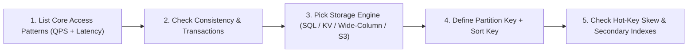
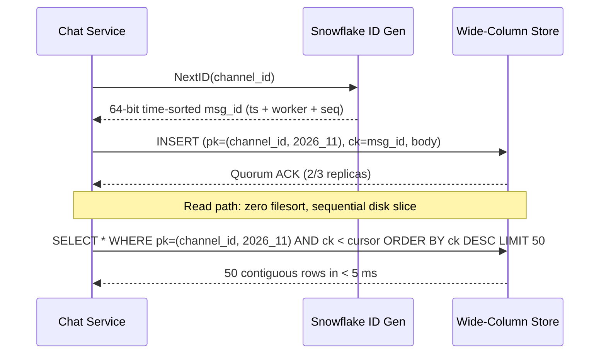
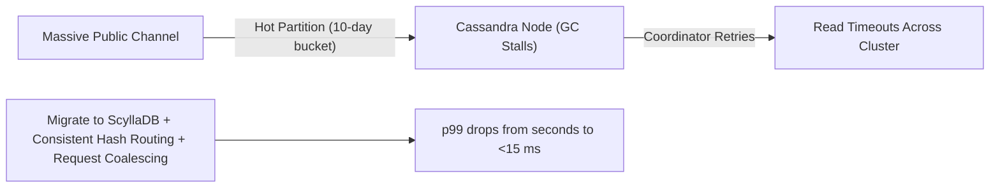

# Data Modeling in System Design Interviews: From Access Patterns to Schema

> **Prerequisites:** [Lesson 06: API Design in System Design Interviews: How Much Detail Is Enough](../06-api-design-in-system-design-interviews/README.md) · [Track: Interview Framework](../README.md).  
> **Estimated Reading Time:** 24–28 minutes  
> **Target Audience:** Backend engineers and interview candidates choosing between SQL, NoSQL, wide-column, and object stores—and justifying schemas, keys, and indexes aloud.  
> **Free PDF Notes:** [Download SD-T-007.pdf](https://backendroadmap.com/notes/system-design/SD-T-007.pdf)

> [!NOTE]
> **In one line:** Never pick a database by buzzword first. Start from your **top 3–4 read/write access patterns** (and QPS/consistency needs), choose the **storage engine** that matches them, and explicitly define **partition keys, sort keys, and secondary indexes** to avoid hot partitions and full-table scans.

> [!TIP]
> **The Golden Rule:** Every table you draw on a whiteboard must answer two questions immediately: **1) How is it partitioned?** (where does a row live?) and **2) How is it queried without a full scan?** (what is the primary/composite index?).

---

## 1. What Access-Pattern Data Modeling Is, and What It Isn't

In an interview for a chat system like WhatsApp, a candidate immediately writes `CREATE TABLE users`, `CREATE TABLE messages`, `CREATE TABLE groups`, draws a 3NF ER diagram with 6 foreign keys, and says *"We'll put it in Postgres."* When the interviewer asks how `GET /messages?channel_id=X&before=T` scales to $500{,}000\text{ writes/s}$ and $50\text{ TB}$ of history, the single-node relational join model collapses.

| Term | Precise Meaning | Example |
| :--- | :--- | :--- |
| **Access pattern** | A concrete query + frequency + latency/consistency requirement | "Fetch last 50 messages for `channel_id` at 100k QPS, `<20 ms`" |
| **Partition / Shard key** | The attribute hashed/ranged to route data to a physical node | `channel_id` (chat), `user_id` (orders), `url_code` (tinyURL) |
| **Sort / Clustering key** | The attribute ordering rows physically within a partition | `message_id` (Snowflake/ULID) or `created_at` |
| **Denormalization** | Duplicating fields to eliminate cross-node joins on hot reads | Storing `author_name` inside `timeline_items` |
| **Hot partition** | Skewed traffic hitting one shard while others sit idle | Celebrity `user_id` or unbucketed `channel_id` |
| **Not** | Blindly applying 3NF or picking "MongoDB because JSON" | Schema follows query patterns, not aesthetics |

### Why It Matters
1. **Storage choice falls out naturally:** Once you list access patterns, ACID vs high write throughput vs blob storage becomes an objective engineering deduction.
2. **Sharding comes free:** Defining the partition key early prevents the late-interview panic of *"Wait, how do we shard this?"*
3. **Index awareness prevents N+1 and scan bugs:** Showing composite keys `(partition_key, sort_key)` proves you understand B-Trees and LSM-Trees under the hood.

---

## 2. Anatomy: From Access Patterns to Storage & Schema



Use this decision matrix to justify your database choice in 30 seconds:

| Workload Shape | Best-Fit Store | Partition & Sort Strategy | Real-World Examples |
| :--- | :--- | :--- | :--- |
| **ACID transactions, complex joins, <50k TPS** | Relational (Postgres / MySQL + read replicas) | Vertical first; shard by `tenant_id` or `user_id` | Payments, ledger, inventory, user auth |
| **Massive append/time-series writes, range reads** | Wide-Column (Cassandra / DynamoDB / ScyllaDB) | `(partition_key, clustering_key DESC)` | Chat messages, IoT metrics, activity logs |
| **Point lookups by exact key, sub-ms latency** | Key-Value / In-Memory (Redis / DynamoDB) | Hash of `key` | Sessions, rate-limit counters, URL shortener |
| **Full-text search, facets, fuzzy matching** | Search Index (Elasticsearch / OpenSearch) | Inverted index sharded by `doc_id` | Product catalog search, log search |
| **Media blobs (images, videos, PDFs)** | Object Storage (S3 / GCS) + CDN | `bucket/prefix/hash_id` | Photos, video segments, backups |

> [!WARNING]
> **The #1 Data Modeling Trap: Choosing a Naive Partition Key.** Partitioning chat messages by `sender_id` makes "get all messages in channel X" a scatter-gather query across *every* shard. Partitioning by `date` puts 100% of today's writes on a single hot shard. Always align the partition key with your **primary read/write unit** (e.g., `(channel_id, month_bucket)`).

---

## 3. Mathematical Model: Row Size, Storage Growth, and Index Overhead

Let:
- $R_{\text{write}}$ = new records written per second
- $S_{\text{row}}$ = average payload size per row (bytes)
- $F_{\text{idx}}$ = index & storage-engine overhead factor (typically $1.3\text{–}1.5\times$ for B-Tree indexes + WAL/metadata; $2\text{–}3\times$ with replication factor $RF = 3$)
- $T_{\text{ret}}$ = retention duration in seconds ($1\text{ year} \approx 3.15 \times 10^7\text{ s}$)

$$\text{Raw Storage} = R_{\text{write}} \times S_{\text{row}} \times T_{\text{ret}}$$

$$\text{Total Cluster Disk} = \text{Raw Storage} \times F_{\text{idx}} \times RF$$

For B-Tree index depth $h$ with fan-out $B$ (typically $B \approx 200\text{–}500$ keys per 16 KB page) over $N$ rows:

$$h = \lceil \log_B(N) \rceil$$

### Worked Numerical Example (Chat Message Table)
Suppose a chat app receives $R_{\text{write}} = 100{,}000\text{ messages/s}$, average row $S_{\text{row}} = 250\text{ B}$ (`channel_id`, `msg_id`, `sender_id`, `body`, `ts`):
- Daily writes: $100{,}000 \times 86{,}400 = 8.64 \times 10^9\text{ rows/day}$.
- Daily raw data: $8.64 \times 10^9 \times 250\text{ B} = 2.16\text{ TB/day}$.
- Over $5\text{ years}$ ($1{,}825\text{ days}$): $2.16\text{ TB} \times 1{,}825 \approx 3.94\text{ PB}$ raw.
- With $RF = 3$ and $F_{\text{idx}} = 1.3$: $\sim 15.4\text{ PB}$ total cluster storage!
- Notice what this math immediately proves: you **cannot** keep 5 years of chat history on a single Postgres node—you need a **partitioned wide-column store** (e.g., Cassandra/DynamoDB) with **time-bucketed partitions** `(channel_id, yyyy_mm)` so no single partition grows unboundedly.

---

## 4. Metrics & Percentiles

| Metric | Meaning | Alert when |
| :--- | :--- | :--- |
| **Query $p_{99}$ latency** | 99th percentile DB read/write time | $> 10\text{ ms}$ (KV) or $> 50\text{ ms}$ (OLTP SQL) |
| **Partition size / skew** | Max partition bytes vs median partition | Max $> 100\text{ MB}$ (Cassandra) or $> 5\times$ median QPS |
| **Index hit / buffer pool ratio** | Queries served from RAM vs disk | Buffer cache hit $< 95\%$ on OLTP hot working set |
| **Rows scanned / returned** | Efficiency of index usage | Ratio $> 10:1$ (missing composite index or scan) |
| **Replication lag** | Delay between primary write and replica | $> 500\text{ ms}$ for read-after-write flows |
| **Write amplification** | Disk bytes written per logical byte | Spikes during LSM compaction storms |

### Worked Example (Celebrity Hot Partition)
A social network stores followers in DynamoDB keyed by `followee_id`. When a celebrity with $20\text{M}$ followers posts, $200{,}000\text{ reads/s}$ hit the exact same `followee_id` partition. Even though the cluster has 100 partitions provisioned for $500{,}000\text{ RCU}$, a single DynamoDB partition caps at $3{,}000\text{ RCU}$ ($1{,}000\text{ WCU}$). **Result:** `ProvisionedThroughputExceededException` throttles the celebrity's traffic while 99% of the cluster sits idle. **Fix:** Write-sharding (`followee_id#0`..`followee_id#19`) or caching the celebrity record in Redis/CDN.

---

## 5. Compounding & Failure Modes: Unbounded Partitions & Missing Composite Keys

| Anti-Pattern | What Happens at $10\times$ Scale | Quantitative Impact |
| :--- | :--- | :--- |
| **Unbounded partition** (`channel_id` only) | A 5-year-old active channel accumulates $10\text{M}$ rows in one partition | Partition exceeds $1\text{ GB}$, compaction stalls, $p_{99}$ spikes from $8\text{ ms}$ to $2{,}400\text{ ms}$ |
| **Single-column index** on `(user_id)` + `ORDER BY created_at DESC` | DB fetches all 50,000 user orders and sorts in memory (`filesort`) | CPU saturates at $2\text{k QPS}$ instead of $25\text{k QPS}$ |
| **Cross-shard `JOIN`** | Application or coordinator fans out to 32 shards per request | $p_{99}$ latency becomes the slowest of 32 shards (tail amplification) |
| **Dual-write to SQL + Search** without outbox | Network blip writes to SQL but drops Elasticsearch update | Silent data drift; search misses newly created items |

---

## 6. Numbers Every Engineer Must Know

| Item | Typical | Implication |
| :--- | :---: | :--- |
| Single Postgres node comfortable ceiling | $\sim 5\text{–}10\text{k}$ writes/s, $2\text{–}5\text{ TB}$ | Shard or move to wide-column above this |
| DynamoDB single-partition limit | $3{,}000\text{ RCU}$ / $1{,}000\text{ WCU}$ / $10\text{ GB}$ | Must shard hot keys with suffixing |
| Cassandra recommended max partition size | $< 100\text{ MB}$ (or $< 100\text{k}$ rows) | Always add time bucket `(id, yyyy_mm)` |
| B-Tree depth for $1\text{ billion}$ rows | $3\text{–}4$ levels | Index lookup is $O(\log N)$, fast if cached in RAM |
| Snowflake / ULID ID size | $64\text{ bits}$ ($8\text{ B}$) / $128\text{ bits}$ ($16\text{ B}$) | Time-sortable primary keys avoid random B-Tree page splits |
| Replication factor (production durable DB) | $3\times$ | Multiply raw storage by $3\times$ in capacity math |

---

## 7. Mechanism Deep Dive: Composite Keys & Time-Sortable IDs



| Question | Answer |
| :--- | :--- |
| **Why use Snowflake IDs or ULIDs instead of UUIDv4 as primary keys?** | UUIDv4 is completely random, causing random B-Tree page splits and poor buffer-pool locality on inserts. Snowflake/ULIDs are monotonic-ish by timestamp, keeping hot inserts at the right edge of the B-Tree and doubling as cursor sort keys. |
| **How do you handle a query that spans a month bucket?** | If `LIMIT 50` in `2026_11` returns only 12 rows, the application issues one follow-up query to `2026_10` for the remaining 38 rows. |
| **When NOT to denormalize?** | On low-QPS, strongly consistent financial/inventory fields (e.g., account balance, stock count). Updating denormalized copies everywhere creates race conditions and stale reads. |

---

## 8. Hierarchical Budgets & Design Rules

| Slice | Rule | Control |
| :--- | :--- | :--- |
| Workflow | Access patterns first, schema second | List top 3–4 queries before drawing tables |
| Primary keys | Time-sortable (`Snowflake` / `ULID`) | Avoids UUIDv4 B-Tree fragmentation |
| Partitioning | Bounded size + uniform distribution | Time-bucketing `(id, yyyy_mm)` + write-sharding |
| Indexing | Match `WHERE` + `ORDER BY` in composite key | Zero `filesort` or full-table scans |
| Relationships | Normalize for ACID; denormalize for hot reads | Sync denormalized views via CDC / Outbox |
| Blobs | Never store files/images in SQL/NoSQL rows | Store S3 URL + metadata only |
| Sharding | Shard by primary access unit (`user_id`, `channel_id`) | Avoid cross-shard joins on hot paths |

---

## 9. Top Mitigations

1. **Write down your 3–4 access patterns** (with QPS) before naming a database.
2. **Use composite keys `(partition_key, sort_key)`** tailored to your `WHERE` and `ORDER BY` clauses.
3. **Add time-bucketing** (`(entity_id, yyyy_mm)`) to any append-only wide-column partition.
4. **Use Snowflake IDs or ULIDs** instead of random UUIDv4 for primary/clustering keys.
5. **Apply write-sharding** (`key#0..N`) or a Redis read-through cache for celebrity hot keys.
6. **Keep large blobs in S3/GCS** and store only the URI/key in your database.
7. **Use CDC / Transactional Outbox** when syncing relational data to Elasticsearch or caches.

---

## 10. Production Reference / War Story: Discord's Trillion-Message Partition Crisis

In its early years, Discord stored billions of messages in MongoDB, then migrated to Cassandra partitioned by `(channel_id, bucket)` where `bucket` was a 10-day time window and `message_id` (Snowflake) was the clustering key. Even with 10-day buckets, massive public channels generated **millions of messages per bucket**, creating hot partitions that triggered multi-second garbage-collection pauses and cascading read timeouts.



- **Root Cause:** Read/write hot spots on large partitions combined with JVM GC pauses and uncoalesced concurrent reads for the exact same channel history.
- **Fix:** Discord migrated to **ScyllaDB** (C++ shard-per-core architecture eliminating JVM GC pauses) and introduced **data-service request coalescing** in Rust so 100 concurrent users loading the same channel trigger only **1** database query.

---

## 11. Multi-Language Production Code Tabs

Time-bucketed partition key generator + 64-bit Snowflake-style sortable ID + write-sharding helper:

````carousel
```go
// Go: Time-bucketed partition key, hot-key write sharding, and 64-bit sortable ID.
package main

import (
	"fmt"
	"hash/fnv"
	"sync/atomic"
	"time"
)

var seq uint64

// NextSortableID generates a 64-bit ID: 42 bits ms timestamp | 22 bits sequence.
func NextSortableID(epochMs int64) uint64 {
	now := time.Now().UnixMilli() - epochMs
	s := atomic.AddUint64(&seq, 1) & ((1 << 22) - 1)
	return (uint64(now) << 22) | s
}

// ChannelPartitionKey bounds partition growth by month.
func ChannelPartitionKey(channelID string, t time.Time) string {
	return fmt.Sprintf("%s#%04d_%02d", channelID, t.Year(), t.Month())
}

// WriteShardKey spreads hot celebrity keys across N virtual partitions.
func WriteShardKey(entityID, itemID string, shards int) string {
	h := fnv.New32a()
	_, _ = h.Write([]byte(itemID))
	return fmt.Sprintf("%s#%d", entityID, int(h.Sum32())%shards)
}
```
<!-- slide -->
```typescript
// TypeScript: Access-pattern partition key & sortable ID helpers.
export function channelPartitionKey(channelId: string, date: Date): string {
  const yyyy = date.getUTCFullYear();
  const mm = String(date.getUTCMonth() + 1).padStart(2, "0");
  return `${channelId}#${yyyy}_${mm}`;
}

export function writeShardKey(hotEntityId: string, itemId: string, shards = 16): string {
  let hash = 2166136261;
  for (let i = 0; i < itemId.length; i++) {
    hash ^= itemId.charCodeAt(i);
    hash = Math.imul(hash, 16777619);
  }
  return `${hotEntityId}#${(hash >>> 0) % shards}`;
}

let seq = 0n;
export function nextSortableId(epochMs = 1700000000000n): bigint {
  const ts = BigInt(Date.now()) - epochMs;
  seq = (seq + 1n) & ((1n << 22n) - 1n);
  return (ts << 22n) | seq;
}
```
<!-- slide -->
```python
# Python: Storage math + time-bucketed keys + sortable ID (stdlib only).
import hashlib
import time

def channel_partition_key(channel_id: str, ts_sec: float | None = None) -> str:
    t = time.gmtime(ts_sec or time.time())
    return f"{channel_id}#{t.tm_year:04d}_{t.tm_mon:02d}"

def write_shard_key(hot_entity_id: str, item_id: str, shards: int = 16) -> str:
    digest = hashlib.md5(item_id.encode()).digest()
    bucket = int.from_bytes(digest[:4], "big") % shards
    return f"{hot_entity_id}#{bucket}"

def estimate_cluster_tb(writes_per_s: int, row_bytes: int, days: int, rf: int = 3, idx_overhead: float = 1.3) -> float:
    raw_bytes = writes_per_s * row_bytes * 86400 * days
    return round((raw_bytes * rf * idx_overhead) / 1e12, 2)
```
<!-- slide -->
```csharp
// C#: Partition key bucketing, write-sharding, and sortable 64-bit ID.
using System.Security.Cryptography;
using System.Text;

public static class DataModelKeys
{
    private static long _seq;

    public static string ChannelPartitionKey(string channelId, DateTimeOffset utcTime) =>
        $"{channelId}#{utcTime:yyyy_MM}";

    public static string WriteShardKey(string hotEntityId, string itemId, int shards = 16)
    {
        var hash = SHA256.HashData(Encoding.UTF8.GetBytes(itemId));
        var bucket = BitConverter.ToUInt32(hash, 0) % (uint)shards;
        return $"{hotEntityId}#{bucket}";
    }

    public static ulong NextSortableId(long epochMs = 1700000000000L)
    {
        var ts = (ulong)(DateTimeOffset.UtcNow.ToUnixTimeMilliseconds() - epochMs);
        var s = (ulong)Interlocked.Increment(ref _seq) & ((1UL << 22) - 1);
        return (ts << 22) | s;
    }
}
```
````

---

## 12. Hands-On CLI Verification Workflows

Verify 5-year cluster storage math and write-sharding distribution in Python:

```bash
python -c '
writes_s, row_b, days, rf, idx = 100_000, 250, 1825, 3, 1.3
raw_pb = (writes_s * row_b * 86400 * days) / 1e15
total_pb = raw_pb * rf * idx
print(f"Raw 5yr: {raw_pb:.2f} PB | Total with RF=3 & idx=1.3: {total_pb:.2f} PB")
'
```

Inspect real query execution plans and index scans in PostgreSQL / SQLite:

```bash
# PostgreSQL: verify index scan vs sequential scan and buffer hits
psql "$DATABASE_URL" -c "EXPLAIN (ANALYZE, BUFFERS) SELECT id, body FROM messages WHERE channel_id = 'ch_1' ORDER BY id DESC LIMIT 50;"

# Cassandra: check partition size skew across a table
nodetool tablehistograms chat messages
```

---

## 13. Common Mistakes to Avoid

1. **Picking a database before listing access patterns** (*"Let's use MongoDB"* without justifying why).
2. **Drawing a 10-table 3NF diagram** with foreign keys for a high-throughput distributed NoSQL workload.
3. **Forgetting to specify the partition/shard key** and leaving sharding as an afterthought.
4. **Using UUIDv4 as a clustered primary key** in B-Tree databases, causing random disk I/O and page splits.
5. **Creating unbounded partitions** (e.g., partitioning by `channel_id` without a time bucket).
6. **Storing images, videos, or large JSON blobs inside SQL rows** instead of S3 + URI pointer.
7. **Ignoring hot-key skew** on celebrity/viral entities.

---

## 14. Key Terms Glossary

| Key Term | Definition |
| :--- | :--- |
| **Access pattern** | A specific read or write query paired with its QPS, latency, and consistency needs. |
| **Partition key** | Attribute determining which physical shard/node stores a record. |
| **Sort / Clustering key** | Attribute determining physical ordering of rows within a partition. |
| **Composite index** | Multi-column index `(a, b)` supporting both `WHERE a = ?` and `ORDER BY b`. |
| **Denormalization** | Intentional data duplication to serve hot reads without distributed joins. |
| **Time-bucketing** | Appending a date window (`yyyy_mm`) to a partition key to cap partition size. |
| **Write-sharding** | Appending a random/hashed suffix (`#0..N`) to spread hot-key writes across shards. |
| **Snowflake ID / ULID** | Time-ordered distributed unique IDs that preserve insert locality. |
| **Replication factor (RF)** | Number of copies of each partition stored across nodes for durability. |
| **Request coalescing** | Deduplicating concurrent identical DB reads into a single backend query. |

---

## 15. System Design Interview Questions & Answers

### Basic Conceptual Questions

<details>
<summary><strong>Q1: What is the first step of data modeling in a system design interview? [BASIC]</strong></summary>

**Answer:**
List your top 3–4 read and write access patterns (including expected QPS and consistency requirements) *before* choosing a database or drawing tables. Schema and storage engine choice must follow access patterns.
</details>

<details>
<summary><strong>Q2: What is the difference between a partition key and a sort key? [BASIC]</strong></summary>

**Answer:**
The partition key determines *which node/shard* stores the data (via consistent hashing or range), while the sort (clustering) key determines the *physical order* of rows inside that partition, enabling fast range queries like `ORDER BY created_at DESC LIMIT 50`.
</details>

<details>
<summary><strong>Q3: When should you choose SQL (PostgreSQL) over NoSQL (DynamoDB/Cassandra)? [BASIC]</strong></summary>

**Answer:**
Choose SQL when you need multi-row ACID transactions, complex ad-hoc joins, strict relational integrity, and write volume fits comfortably on a single primary or cleanly sharded cluster (e.g., payments, orders, inventory). Choose NoSQL wide-column/KV when you need massive horizontal write throughput, predictable key-range access, and simple schemas.
</details>

<details>
<summary><strong>Q4: Why shouldn't you store user-uploaded images or videos in your database? [BASIC]</strong></summary>

**Answer:**
Blobs bloat database backups, exhaust expensive SSD/RAM buffer pools, and prevent CDN edge caching. Store blobs in Object Storage (S3/GCS) behind a CDN, and store only the object key/URL and small metadata in the database.
</details>

### Scenario-Based Architecture Questions

<details>
<summary><strong>Q5: Design the data model for a URL shortener at 10k writes/s and 100k reads/s. [SCENARIO]</strong></summary>

**Answer:**
Only one core table is needed: `urls(short_code PK, long_url, user_id, created_at, expires_at)`. Since reads are pure point lookups by `short_code` with no joins, a distributed Key-Value store (DynamoDB) or sharded Postgres partitioned by `short_code` plus a Redis cache for the hot 20% works cleanly.
</details>

<details>
<summary><strong>Q6: A chat table partitioned by `channel_id` is timing out for a 500k-member channel. Why, and how do you fix it? [SCENARIO]</strong></summary>

**Answer:**
All historical messages for that channel live in one unbounded partition, exceeding memory/compaction limits. Fix by changing the partition key to `(channel_id, month_bucket)` (e.g., `ch_1#2026_11`) with `message_id` (Snowflake) as the clustering key, and add request coalescing for concurrent readers.
</details>

<details>
<summary><strong>Q7: How do you model an e-commerce order system where users query by `order_id`, `user_id`, and `merchant_id`? [SCENARIO]</strong></summary>

**Answer:**
Keep the source-of-truth `orders` table in an ACID SQL database (partitioned/sharded by `user_id` or `order_id` with a secondary index on `(user_id, created_at DESC)`). For merchant dashboards (`merchant_id` queries across shards), stream order events via CDC/Outbox to a separate read-optimized projection or Elasticsearch index partitioned by `merchant_id`.
</details>

<details>
<summary><strong>Q8: How do you model a "Who's Nearby" geospatial index for a ride-sharing app? [SCENARIO]</strong></summary>

**Answer:**
Standard B-Trees can't efficiently index 2D `(lat, lon)` bounding boxes. Use **Geohash** or **Uber H3** hexagonal cell IDs as the partition/index key (`driver_locations(cell_id PK, driver_id SK, lat, lon, updated_at)`), stored in Redis/in-memory KV with a short TTL (`15 s`) since driver coordinates are ephemeral.
</details>

### Advanced & Tricky Interview Questions

<details>
<summary><strong>Q9: Why does UUIDv4 hurt write throughput on large B-Tree tables? [TRICKY]</strong></summary>

**Answer:**
UUIDv4 is uniformly random, so every insert lands on a random leaf page across the entire B-Tree. Once the index exceeds RAM, nearly every insert triggers a random disk page read + dirty page write + page split. Time-ordered IDs (ULID, UUIDv7, Snowflake) append sequentially to the rightmost pages, keeping the working set in RAM.
</details>

<details>
<summary><strong>Q10: How do you handle a hot partition key in DynamoDB or Cassandra when a single user gets 100k RPS? [TRICKY]</strong></summary>

**Answer:**
For writes: use **write-sharding** by appending a bounded hash/random suffix (`celebrity_id#0`..`#19`), spreading writes across 20 physical partitions (reads scatter-gather those 20 keys). For reads: put a Redis/CDN cache with request coalescing in front of the DB so only 1 miss per TTL hits the partition.
</details>

<details>
<summary><strong>Q11: What is the danger of Global Secondary Indexes (GSIs) in distributed NoSQL databases? [TRICKY]</strong></summary>

**Answer:**
GSIs are replicated **asynchronously** across different partitions. This means GSI reads are eventually consistent, and if the GSI's partition key has low cardinality (e.g., `status = "PENDING"`), the GSI itself becomes a single-partition bottleneck that can backpressure writes on the base table.
</details>

<details>
<summary><strong>Q12: How do you keep a denormalized read table in sync with a normalized write table without distributed transactions? [TRICKY]</strong></summary>

**Answer:**
Use the **Transactional Outbox** pattern or **Change Data Capture (CDC)** (e.g., Debezium reading the Postgres WAL). Every write commits locally with an outbox event, and an asynchronous consumer updates the denormalized read table idempotently using a monotonic version/timestamp check to prevent out-of-order overwrites.
</details>

---

## 16. One-Page Master Cheat Sheet

```
+---------------------------------------------------------------------------------------------------------+
|                  DATA MODELING IN SYSTEM DESIGN INTERVIEWS — MASTER CHEAT SHEET                         |
+---------------------------------------------------------------------------------------------------------+
| 1. ORDER OF OPERATIONS: Access Patterns (QPS + Latency) -> Consistency -> Storage Engine -> Keys/Index. |
+---------------------------------------------------------------------------------------------------------+
| 2. EVERY TABLE NEEDS: (1) Partition Key (where it lives) + (2) Sort Key (how it's queried/ordered).     |
+---------------------------------------------------------------------------------------------------------+
| 3. ENGINE CHOICE: ACID/Joins -> SQL | High-write/Time-series -> Wide-column | Point KV -> Redis/DDB     |
|    Full-text -> Elasticsearch | Media Blobs -> S3/GCS + CDN (never inside DB rows).                     |
+---------------------------------------------------------------------------------------------------------+
| 4. PREVENT HOT PARTITIONS: Time-bucketing (id, yyyy_mm) + Write-sharding (key#0..N) + Read caching.     |
+---------------------------------------------------------------------------------------------------------+
| 5. PRIMARY KEYS: Prefer time-sortable IDs (Snowflake/ULID/UUIDv7) over random UUIDv4 for B-Tree health. |
+---------------------------------------------------------------------------------------------------------+
| 6. STORAGE MATH: Total Disk = Writes/s * Row_Bytes * Retention_s * Replication_Factor(3) * Index(1.3).  |
+---------------------------------------------------------------------------------------------------------+
```

---

## Further Reading & Sources

- Martin Kleppmann, *Designing Data-Intensive Applications*, Chapter 2 ("Data Models and Query Languages") & Chapter 3 ("Storage and Retrieval").
- AWS DynamoDB Documentation, [Best Practices for Designing and Architecting with DynamoDB](https://docs.aws.amazon.com/amazondynamodb/latest/developerguide/best-practices.html).
- Discord Engineering, [How Discord Stores Trillions of Messages](https://discord.com/blog/how-discord-stores-trillions-of-messages).
- Rick Houlihan, *AWS re:Invent Data Modeling with Amazon DynamoDB* (single-table & access-pattern design).

---

## Free PDF Notes

[SD-T-007.pdf](https://backendroadmap.com/notes/system-design/SD-T-007.pdf)

---

## Next

Continue with [Drawing High-Level Architecture in System Design Interviews](../08-drawing-high-level-architecture-in-system-design-interviews/README.md).