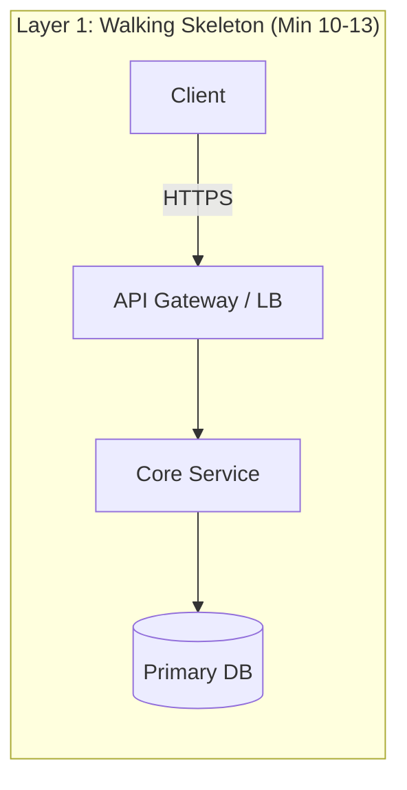
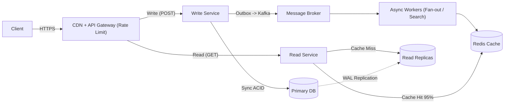
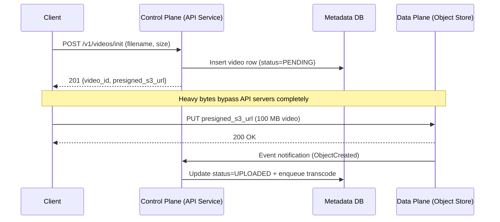
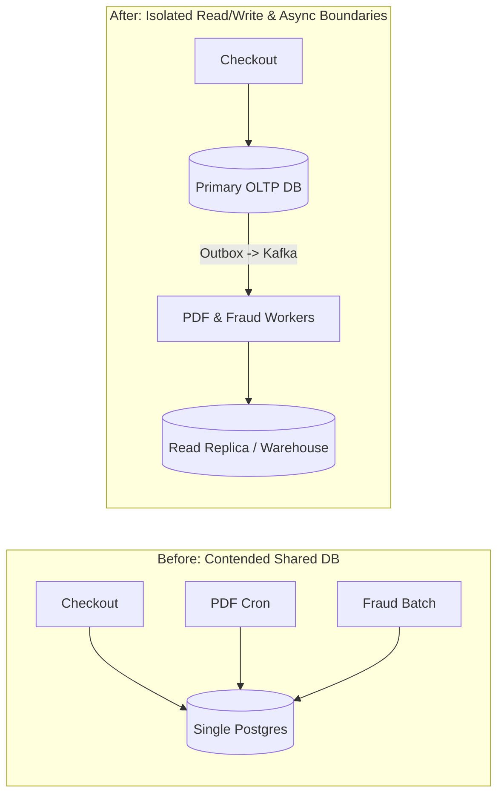

# Drawing High-Level Architecture in System Design Interviews

> **Prerequisites:** [Lesson 07: Data Modeling in System Design Interviews: From Access Patterns to Schema](../07-data-modeling-in-system-design-interviews/README.md) · [Track: Interview Framework](../README.md).  
> **Estimated Reading Time:** 22–26 minutes  
> **Target Audience:** Backend engineers and interview candidates learning how to draw clean, readable, left-to-right system diagrams on a whiteboard or Excalidraw without spaghetti arrows.  
> **Free PDF Notes:** [Download SD-T-008.pdf](https://backendroadmap.com/notes/system-design/SD-T-008.pdf)

> [!NOTE]
> **In one line:** A high-level architecture diagram is a **visual narrative**, not a microservice inventory. Start with a minimal **walking skeleton** (Client → Edge → Core Service → DB) in 3 minutes, then layer **caching, async queues, and read/write separation** one requirement at a time so the interviewer follows every box you add.

> [!TIP]
> **The Golden Rule:** Draw **left-to-right**, separate the **Write Path** from the **Read Path**, label **protocols/data on arrows**, and never draw a box (like Kafka or Redis) until you state the exact bottleneck it solves.

---

## 1. What High-Level Architecture Drawing Is, and What It Isn't

A candidate opens Excalidraw and immediately drops 14 boxes onto the canvas: CDN, WAF, API Gateway, Auth Service, User Service, Notification Service, Kafka, Spark, Flink, Redis, Postgres, S3, Prometheus, and Elasticsearch—before drawing a single arrow or explaining how a request flows. The interviewer sees a buzzword collage with no clear data flow and asks: *"Wait, what actually happens when a user clicks 'Post'?"*

| Term | Precise Meaning | Example |
| :--- | :--- | :--- |
| **Walking skeleton** | Minimal end-to-end path satisfying the core functional requirement | `Client -> LB -> API Service -> DB` |
| **Read/Write split** | Explicitly separating write ingestion from read serving paths | Write via Queue/Workers; Read via Cache + Replicas |
| **Control vs Data plane** | Metadata/config routing vs high-volume user payload traffic | Video upload metadata vs raw chunk upload to S3 |
| **Bounded box** | A component with one clear responsibility and labeled interfaces | `Feed Service (stateless, 50k QPS)` |
| **Annotated edge** | Arrow labeled with protocol + payload/purpose | `-- gRPC: CreateOrder -->` or `-- Async: OrderPlaced -->` |
| **Not** | Dropping 15 boxes upfront or drawing crossing spaghetti lines | Never add a component without a stated reason |

### Why It Matters
1. **Cognitive clarity for the interviewer:** Interviewers grade how clearly you communicate complex systems. Clean, progressive diagrams make your reasoning effortless to follow.
2. **Prevents premature complexity:** Building from a walking skeleton proves you can ship a simple v1 and scale only the pieces that actually bottleneck.
3. **Sets up the deep dive naturally:** A clean diagram with labeled QPS and storage tiers makes it obvious where the 10x bottlenecks live.

---

## 2. Anatomy: Progressive Layering (From Skeleton to Scaled System)



Once Layer 1 works end-to-end, layer in scale components *only* as your capacity numbers demand them:



| Layer | When to Add It | What You Say Aloud |
| :--- | :--- | :--- |
| **1. Walking Skeleton** | Always first (minutes 10–13) | *"Let's get the basic read/write path working end-to-end before optimizing."* |
| **2. CDN & Object Store** | Static assets, media, or global edge reads | *"Media bytes shouldn't hit app servers; clients upload via pre-signed S3 URLs."* |
| **3. Cache (Redis)** | Read-heavy ($>5:1$ read:write) or hot keys | *"At 100k read QPS, we put Redis in front of the DB to absorb 95% of reads."* |
| **4. Read Replicas / Shards** | DB CPU or storage exceeds single-node ceiling | *"Writes go to Primary/Shards; reads scale horizontally via replicas."* |
| **5. Async Broker (Kafka/SQS)** | Slow fan-out, email, analytics, or bursty writes | *"We don't block the user response on fan-out; we publish an event and return."* |

> [!WARNING]
> **The #1 Diagramming Trap: Crossing Arrows & Unlabeled Boxes.** A diagram with 12 unlabeled rectangles and bidirectional arrows everywhere forces the interviewer to constantly ask *"Which way does data flow here?"* Keep flow strictly **left-to-right** (or top-to-bottom), use **distinct shapes** (cylinder for DB, queue/pipe for broker, rounded box for stateless service), and label every arrow.

---

## 3. Mathematical Model: Diagram Complexity & Component Fan-Out

Cognitive load on a whiteboard grows quadratically with the number of components $V$ and edges $E$:

$$\text{Visual Complexity} \propto V + E, \qquad E_{\max} = \frac{V(V-1)}{2}$$

Keeping $V \le 8\text{–}10$ core boxes in your high-level diagram keeps $E \le 12\text{–}15$ clean directional arrows.

Furthermore, every box you add in the **synchronous critical path** compounds failure probability and tail latency. If the synchronous path has $k$ serial components with availability $a_i$ and $p_{99}$ latency $L_i$:

$$A_{\text{sync}} = \prod_{i=1}^{k} a_i, \qquad L_{\text{sync}, p_{99}} \approx \sum_{i=1}^{k} L_{i, p_{99}}$$

### Worked Numerical Example (Over-Engineered vs Clean Diagram)
Compare two architectures for an order-creation path:
- **Over-engineered sync diagram ($k = 6$ serial boxes):** Gateway → Auth → Order → Inventory → Loyalty → Notification ($99.9\%$ each, $40\text{ ms}$ $p_{99}$ each):
  - $A_{\text{sync}} = 0.999^6 = 99.40\%$ (over $4\times$ more downtime per year: $52.5\text{ hours}$ vs $8.7\text{ hours}$!).
  - $L_{\text{sync}} \approx 6 \times 40 = 240\text{ ms}$ minimum.
- **Clean decoupled diagram ($k = 3$ sync boxes):** Gateway → Order Service → Primary DB (plus async Kafka event for Loyalty/Notification):
  - $A_{\text{sync}} = 0.999^3 = 99.70\%$, and $L_{\text{sync}} \approx 90\text{ ms}$.

---

## 4. Metrics & Percentiles

| Metric | Meaning | Alert when |
| :--- | :--- | :--- |
| **Sync path hop count** | Number of network hops on critical user path | $> 4$ internal RPC hops (latency & availability risk) |
| **Control vs Data plane split** | Whether heavy bytes flow through API pods | Media/file bytes $> 1\text{ MB}$ passing through app tier |
| **Read:Write ratio** | Ratio of `GET` to `POST/PUT` traffic | $> 10:1$ without a caching/replica layer drawn |
| **Single Point of Failure (SPOF)** | Any box without N+1 redundancy or failover | Single-instance DB, LB, or stateful worker on diagram |
| **Cross-AZ traffic hops** | Chatty microservices crossing availability zones | High-QPS sync calls between un-colocated services |

### Worked Example (Video Upload Architecture)
A candidate draws `Client -> API Gateway -> Upload Service -> S3` for 100 MB video uploads at $1{,}000\text{ uploads/s}$. That forces $100\text{ GB/s}$ ($800\text{ Gbps}$) through the API Gateway and Upload Service! Simply splitting the **Control Plane** (`Client -> Upload Service -> returns Pre-Signed S3 URL`) from the **Data Plane** (`Client -> S3/CDN Edge directly`) drops Upload Service bandwidth by $99.99\%$.

---

## 5. Compounding & Failure Modes: What Happens When Diagrams Miss Boundaries

| Diagram Omission | Failure Mode at Scale | Why Interviewers Catch It |
| :--- | :--- | :--- |
| **No API Gateway / Rate Limiter** | DDoS or retry storm hits DB connection pool directly | *"What stops a bad client from taking down your DB?"* |
| **Stateful WebSocket + REST on same boxes** | Deploying REST code drops millions of WebSocket connections | *"Why are long-lived sockets coupled to stateless APIs?"* |
| **Direct DB writes from 5 different services** | Shared-database coupling; schema change breaks 5 teams | *"Who owns this table?"* |
| **Missing Dead-Letter Queue / Retry path** | One poison pill message blocks a Kafka partition forever | *"What happens if a worker crashes on a bad payload?"* |

---

## 6. Numbers Every Engineer Must Know

| Item | Typical | Implication |
| :--- | :---: | :--- |
| Time to draw High-Level Architecture | 10–15 minutes | 3 min skeleton + 8 min scaling layers + 2 min recap |
| Ideal box count on HLD whiteboard | 6–10 boxes | More than 12 boxes signals over-engineering or clutter |
| Cross-service RPC hop budget | $\le 3\text{–}4$ sync hops | Beyond 4 hops, tail latency and failure rates compound |
| Pre-signed URL payload threshold | $> 1\text{ MB}$ | Bypass app servers; upload/download directly to S3/CDN |
| Read:Write ratio triggering cache tier | $\ge 5:1$ | Add Redis/CDN before adding more DB shards |

---

## 7. Mechanism Deep Dive: Control Plane vs Data Plane Separation



| Question | Answer |
| :--- | :--- |
| **Why separate Read Service and Write Service on the diagram?** | Read traffic is often $10\text{–}100\times$ higher than write traffic and can scale independently via caches and read replicas. |
| **Should you draw Monitoring/Logging/CI-CD boxes?** | No—unless the prompt specifically asks for observability. Mention *"metrics, tracing, and alerts"* verbally in 10 seconds to save canvas space. |
| **When NOT to split into microservices on the diagram?** | When two operations share a single ACID transaction or tight data coupling. Start with a modular service and split only when scaling profiles diverge (e.g., CPU-heavy video transcoding vs I/O-heavy API). |

---

## 8. Hierarchical Budgets & Design Rules

| Slice | Rule | Control |
| :--- | :--- | :--- |
| Canvas layout | Left-to-right data flow | Clients on left, edge center-left, services middle, stores right |
| Progression | Skeleton first, scale layers second | Never drop 15 boxes at minute 1 |
| Shapes | Distinct visual grammar | Rectangles = stateless; Cylinders = state; Pipes = queues |
| Arrows | Directional + labeled | Protocol + operation (`gRPC`, `Async Event`, `Cache Miss`) |
| Paths | Separate Write Path & Read Path | Color-code or group into sub-flows |
| Data plane | Bypass app servers for large blobs | Pre-signed S3 URLs + CDN |
| Redundancy | No single points of failure | Note multi-AZ / active-active replicas |

---

## 9. Top Mitigations

1. **Draw the 3-box walking skeleton first** and verify it satisfies the core functional flow.
2. **Use a consistent left-to-right layout** with clients on the left and persistent storage on the right.
3. **Separate stateless compute from stateful storage** so horizontal autoscaling is visually obvious.
4. **Split heavy media/blob transfers onto a Data Plane** (pre-signed URLs + CDN) instead of routing bytes through API pods.
5. **GroupRead and Write paths clearly** (e.g., top half = Write Path, bottom half = Read Path).
6. **Label every arrow** with sync vs async and the protocol/event name.
7. **Defer operational boxes** (Prometheus, Vault, Service Mesh) to a 15-second verbal mention unless asked.

---

## 10. Production Reference / War Story: The "Shared-Everything" Monolith vs Clean Boundary

At a fast-growing fintech startup, the initial architecture diagram was a single API tier talking to one giant PostgreSQL cluster, with background cron jobs polling the same database every second for fraud checks, PDF statement generation, and webhook delivery. At $5\times$ growth, heavy analytical/PDF queries exhausted the DB's connection pool and IOPS, taking down live checkout payments.



- **Root Cause:** No architectural boundary between latency-sensitive OLTP writes (checkout) and heavy batch/async workloads (PDFs, fraud scans).
- **Fix:** Separated the diagram—and production topology—into a lean synchronous OLTP path and an asynchronous event-driven path reading from replicas. Checkout $p_{99}$ dropped from $1{,}800\text{ ms}$ to $45\text{ ms}$.

---

## 11. Multi-Language Production Code Tabs

Representing clean architectural boundaries in code: **Control Plane (pre-signed URL issuance) vs Data Plane separation** + **Sync/Async boundary**:

````carousel
```go
// Go: Clean Control Plane handler that issues a pre-signed upload URL and publishes async work.
package main

import (
	"encoding/json"
	"net/http"
	"time"
)

type InitUploadResp struct {
	VideoID      string `json:"video_id"`
	PresignedURL string `json:"presigned_url"`
	ExpiresInSec int    `json:"expires_in_sec"`
}

type URLSigner interface {
	SignPutURL(objectKey string, ttl time.Duration) (string, error)
}

func InitUploadHandler(signer URLSigner) http.HandlerFunc {
	return func(w http.ResponseWriter, r *http.Request) {
		videoID := "vid_9912"
		// Data plane: client uploads heavy bytes directly to Object Storage, bypassing API pods.
		url, err := signer.SignPutURL("uploads/"+videoID+".mp4", 15*time.Minute)
		if err != nil {
			http.Error(w, "signing failed", http.StatusInternalServerError)
			return
		}
		w.Header().Set("Content-Type", "application/json")
		w.WriteHeader(http.StatusCreated)
		_ = json.NewEncoder(w).Encode(InitUploadResp{
			VideoID:      videoID,
			PresignedURL: url,
			ExpiresInSec: 900,
		})
	}
}
```
<!-- slide -->
```typescript
// TypeScript: Control Plane vs Data Plane boundary + sync/async split.
export interface UploadInit {
  videoId: string;
  presignedPutUrl: string;
}

export class VideoControlPlane {
  constructor(
    private signer: (key: string, ttlSec: number) => Promise<string>,
    private db: { savePending: (id: string) => Promise<void> },
    private broker: { publish: (topic: string, payload: object) => Promise<void> }
  ) {}

  async initUpload(videoId: string): Promise<UploadInit> {
    await this.db.savePending(videoId);
    const presignedPutUrl = await this.signer(`raw/${videoId}.mp4`, 900);
    return { videoId, presignedPutUrl };
  }

  async onStorageUploaded(videoId: string): Promise<void> {
    // Async handoff: transcoding happens off the critical HTTP path.
    await this.broker.publish("video.uploaded", { videoId });
  }
}
```
<!-- slide -->
```python
# Python: Hop availability & latency calculator for HLD diagrams (stdlib only).
def sync_chain_metrics(hop_availabilities: list[float], hop_p99_ms: list[float]) -> tuple[float, float]:
    """Computes combined availability and approximate p99 latency for k serial sync boxes."""
    avail = 1.0
    for a in hop_availabilities:
        avail *= a
    return round(avail * 100, 3), round(sum(hop_p99_ms), 1)

def annual_downtime_hours(availability_pct: float) -> float:
    return round((1.0 - availability_pct / 100.0) * 8760, 2)
```
<!-- slide -->
```csharp
// C#: Control Plane service delegating heavy bytes to Object Storage.
public sealed record UploadTicket(string VideoId, string PresignedUrl, int ExpiresInSeconds);

public sealed class VideoControlPlaneService
{
    private readonly Func<string, TimeSpan, Task<string>> _signPutUrl;

    public VideoControlPlaneService(Func<string, TimeSpan, Task<string>> signPutUrl) =>
        _signPutUrl = signPutUrl;

    public async Task<UploadTicket> CreateUploadTicketAsync(string videoId)
    {
        var url = await _signPutUrl($"raw/{videoId}.mp4", TimeSpan.FromMinutes(15));
        return new UploadTicket(videoId, url, 900);
    }
}
```
````

---

## 12. Hands-On CLI Verification Workflows

Quantify why keeping your synchronous HLD path lean ($\le 3$ hops vs $6$ hops) matters:

```bash
python -c '
for k in (3, 6):
    avail = (0.999 ** k) * 100
    down_hr = (1 - avail / 100) * 8760
    print(f"{k} serial sync hops (99.9% each): avail={avail:.2f}%, downtime={down_hr:.1f} hrs/yr")
'
```

Inspect real-world control-plane/data-plane separation with AWS S3 pre-signed URLs:

```bash
# Generate a 15-minute pre-signed URL (control plane) so clients upload directly to S3 (data plane)
aws s3 presign s3://my-media-bucket/uploads/vid_9912.mp4 --expires-in 900
```

---

## 13. Common Mistakes to Avoid

1. **Dumping 15 boxes on the canvas at minute 1** before explaining the core flow.
2. **Drawing crossing, unlabeled arrows** where read and write directions are ambiguous.
3. **Routing large file/video uploads through API Gateway and app pods** instead of pre-signed S3/CDN URLs.
4. **Coupling stateful WebSocket servers with stateless REST servers** in the same deployment box.
5. **Adding Kafka, Elasticsearch, or Redis without stating the bottleneck** they solve.
6. **Drawing a single-node database** with no mention of replication or sharding boundaries.
7. **Spending 10 minutes drawing Monitoring/CI-CD/Auth boxes** instead of the core problem.

---

## 14. Key Terms Glossary

| Key Term | Definition |
| :--- | :--- |
| **Walking skeleton** | Minimal end-to-end architecture (Client → Edge → Service → DB) drawn first. |
| **Control plane** | Low-volume metadata, routing, and auth coordination path. |
| **Data plane** | High-volume user payload or media transfer path (e.g., client ↔ S3/CDN). |
| **Pre-signed URL** | Time-limited cryptographically signed URL allowing direct client-to-object-store transfer. |
| **Read/Write separation** | Splitting read-serving paths (cache/replicas) from write-ingestion paths (primary/queue). |
| **Single Point of Failure** | Any un-replicated component whose crash halts the entire system. |
| **Stateless tier** | Compute nodes holding no local session state, allowing trivial horizontal scaling. |
| **Stateful tier** | Storage/cache/broker nodes holding durable or in-memory state requiring replication/sharding. |
| **Fan-out** | Distributing one write event to multiple downstream consumers or user timelines. |
| **Visual grammar** | Consistent use of shapes, colors, and left-to-right flow to reduce cognitive load. |

---

## 15. System Design Interview Questions & Answers

### Basic Conceptual Questions

<details>
<summary><strong>Q1: What should you draw first in the High-Level Design phase? [BASIC]</strong></summary>

**Answer:**
Draw a minimal 3–4 box **walking skeleton** (Client → Load Balancer/Gateway → Core Service → Primary DB) that satisfies the primary functional requirement end-to-end. Then add caches, queues, and replicas incrementally as you address scale.
</details>

<details>
<summary><strong>Q2: Why should architecture diagrams flow left-to-right? [BASIC]</strong></summary>

**Answer:**
Left-to-right mirrors natural reading order (Client on left → Edge → Compute → Storage on right), minimizes crossing arrows, and makes it immediately obvious which tier is stateless vs stateful.
</details>

<details>
<summary><strong>Q3: What is the difference between the Control Plane and the Data Plane? [BASIC]</strong></summary>

**Answer:**
The control plane handles lightweight metadata, permissions, and orchestration (e.g., issuing a pre-signed upload URL), while the data plane handles heavy byte transfers (e.g., streaming 100 MB video directly between Client and S3/CDN).
</details>

<details>
<summary><strong>Q4: Should you draw logging, metrics, and auth services on your main diagram? [BASIC]</strong></summary>

**Answer:**
Usually no. Unless the prompt is specifically about observability or IAM, mention them verbally in 10 seconds (*"We'll terminate TLS and JWT auth at the API gateway and emit OpenTelemetry metrics/traces"*) so your canvas stays focused on the hard scaling problems.
</details>

### Scenario-Based Architecture Questions

<details>
<summary><strong>Q5: You are designing Instagram. How do you separate the Write Path from the Read Path on your diagram? [SCENARIO]</strong></summary>

**Answer:**
Write Path (top): `Client -> API Gateway -> Post Service -> Media DB + Pre-signed S3 Upload`, plus an async `Kafka -> Fan-out Worker -> Redis Feed Cache`. Read Path (bottom): `Client -> CDN (images) / API Gateway -> Feed Service -> Redis Feed Cache (hit) / Post DB (miss)`.
</details>

<details>
<summary><strong>Q6: An interviewer asks: "You drew Kafka here—why can't the API service just call the 3 downstream services directly?" [SCENARIO]</strong></summary>

**Answer:**
Direct synchronous calls sum latencies and multiply failure rates ($0.999^3 = 99.7\%$). Putting Kafka in between lets the API return immediately after a single durable publish, buffers traffic spikes, and isolates the checkout/write path if a downstream consumer goes down.
</details>

<details>
<summary><strong>Q7: How do you draw a WebSocket-based chat architecture cleanly? [SCENARIO]</strong></summary>

**Answer:**
Separate **stateless HTTP APIs** (login, history fetch, media upload) from the **stateful Chat/Gateway Service** (holding persistent WebSocket connections). Connect Chat Gateways via a Redis Pub/Sub or Kafka routing layer so User A on Gateway 1 can message User B on Gateway 2.
</details>

<details>
<summary><strong>Q8: Your capacity math says 100k read QPS and 1k write QPS. How does your diagram evolve from v1? [SCENARIO]</strong></summary>

**Answer:**
Start with `App -> Primary DB`. At 100k read QPS, a single DB saturates. Add a **Redis Cache** in front of the Read Service (absorbing 95% of reads, leaving 5k QPS), and add **2–3 Read Replicas** behind the Primary DB for cache misses.
</details>

### Advanced & Tricky Interview Questions

<details>
<summary><strong>Q9: How do you avoid drawing a "distributed monolith" when splitting services on a whiteboard? [TRICKY]</strong></summary>

**Answer:**
Give each service **ownership of its own database** (no two services reading/writing the same SQL tables), keep synchronous service-to-service chains $\le 2$ hops, and use async events for cross-domain side effects.
</details>

<details>
<summary><strong>Q10: Where should TLS termination, JWT validation, and rate limiting sit on your diagram? [TRICKY]</strong></summary>

**Answer:**
At the **Edge / API Gateway** layer before requests reach internal microservices. This centralizes security policies, rejects abusive traffic (`429`) before it consumes compute/DB resources, and lets internal services communicate over trusted mTLS/gRPC.
</details>

<details>
<summary><strong>Q11: How do you represent multi-region active-active architecture without making the diagram unreadable? [TRICKY]</strong></summary>

**Answer:**
Draw **one region in full detail** inside a `Region A` bounding box, then draw a compact mirrored `Region B` box connected via `Geo-DNS / Anycast LB` at the edge and an `Async Cross-Region Replication` arrow between the storage/broker layers.
</details>

<details>
<summary><strong>Q12: An interviewer says "Your diagram looks great, now what if Redis goes down?" How do you respond? [TRICKY]</strong></summary>

**Answer:**
Point to the fallback path on the diagram: Redis should run in replicated/clustered mode across AZs, and if the entire cache tier fails, a **circuit breaker / request coalescing** layer must protect the Primary DB from a thundering-herd stampede while serving degraded/rate-limited responses.
</details>

---

## 16. One-Page Master Cheat Sheet

```
+---------------------------------------------------------------------------------------------------------+
|            DRAWING HIGH-LEVEL ARCHITECTURE IN INTERVIEWS — MASTER CHEAT SHEET                           |
+---------------------------------------------------------------------------------------------------------+
| 1. START SIMPLE: 3-4 box Walking Skeleton (Client -> Edge -> Service -> DB) in first 3 minutes.         |
+---------------------------------------------------------------------------------------------------------+
| 2. LAYER BY NEED: Add CDN/S3 -> Redis Cache -> Read Replicas -> Async Queue only when QPS/latency asks. |
+---------------------------------------------------------------------------------------------------------+
| 3. VISUAL GRAMMAR: Left-to-right flow | 6-10 boxes max | Label every arrow (sync/async + protocol).     |
+---------------------------------------------------------------------------------------------------------+
| 4. SPLIT PATHS: Separate Write Path from Read Path; separate Control Plane from Data Plane (S3).       |
+---------------------------------------------------------------------------------------------------------+
| 5. KEEP SYNC LEAN: <= 3-4 serial sync hops; availability = product(a_i), latency = sum(L_i).            |
+---------------------------------------------------------------------------------------------------------+
| 6. AVOID CLUTTER: Mention Auth, Logging, Metrics verbally in 10s unless asked to design them.           |
+---------------------------------------------------------------------------------------------------------+
```

---

## Further Reading & Sources

- Alex Xu, *System Design Interview — An Insider's Guide*, Chapter 1 & Chapter 2 ("A Framework for System Design Interviews").
- Simon Brown, *The C4 Model for Visualising Software Architecture* (Context & Container levels).
- AWS Architecture Center, [Presigned URLs and Direct-to-S3 Uploads](https://docs.aws.amazon.com/AmazonS3/latest/userguide/PresignedUrlUploadObject.html).
- Martin Kleppmann, *Designing Data-Intensive Applications*, Chapter 1 ("Reliable, Scalable, and Maintainable Applications").

---

## Free PDF Notes

[SD-T-008.pdf](https://backendroadmap.com/notes/system-design/SD-T-008.pdf)

---

## Next

Continue with [Explaining Component Interactions: Walk Through a Request End to End](../09-explaining-component-interactions/README.md).