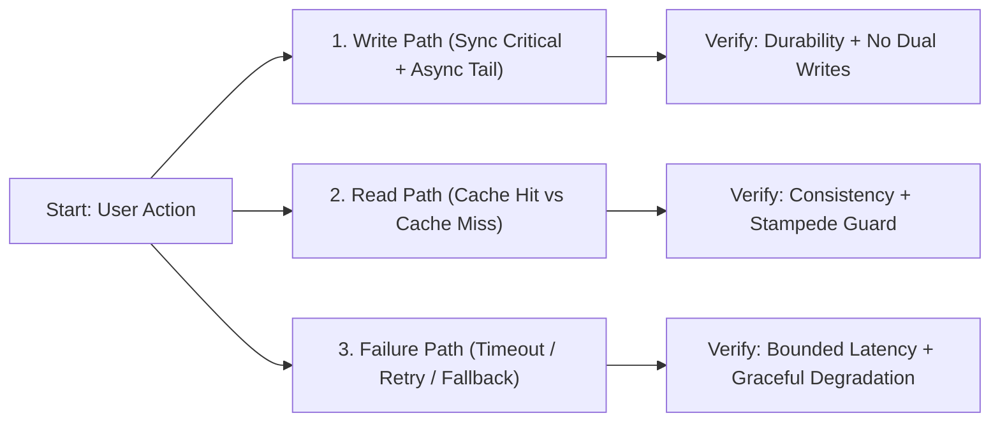
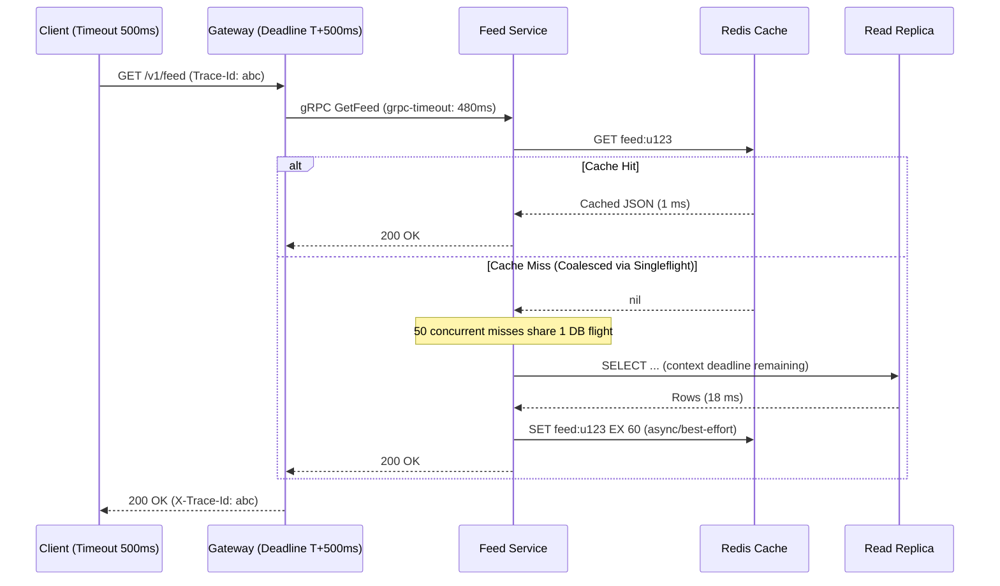
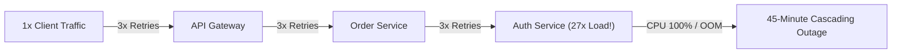

# Explaining Component Interactions: Walk Through a Request End to End

> **Prerequisites:** [Lesson 08: Drawing High-Level Architecture in System Design Interviews](../08-drawing-high-level-architecture-in-system-design-interviews/README.md) · [Track: Interview Framework](../README.md).  
> **Estimated Reading Time:** 22–26 minutes  
> **Target Audience:** Backend engineers and interview candidates transitioning from a static whiteboard diagram to a crisp, step-by-step runtime walkthrough of writes, reads, and failures.  
> **Free PDF Notes:** [Download SD-T-009.pdf](https://backendroadmap.com/notes/system-design/SD-T-009.pdf)

> [!NOTE]
> **In one line:** A diagram is only half the answer; interviewers hire engineers who can **trace a live request hop-by-hop**—explicitly naming **data transformations, cache hit/miss branches, timeouts, retries, and consistency handoffs** across both the **Happy Path** and the **Failure Path**.

> [!TIP]
> **The Golden Rule:** Walk through **1) Write Path**, **2) Read Path (Hit vs Miss)**, and **3) One Failure Path** in numbered steps (`Step 1 -> Step 2 -> ...`), stating the **payload, protocol, and state mutation** at every hop.

---

## 1. What End-to-End Request Walkthroughs Are, and What They Aren't

A candidate finishes drawing 9 boxes on the whiteboard and says: *"So yeah, requests come into the API Gateway, hit the Order Service, go to Kafka and Postgres, and Redis caches it. Any questions?"* That hand-wave hides every hard engineering detail: Does the API write to Postgres and Kafka in one transaction or two? Does Redis update on write or on read miss? What happens if Kafka is unreachable?

| Term | Precise Meaning | Example |
| :--- | :--- | :--- |
| **End-to-end walkthrough** | Numbered trace of a request from client DNS/TLS to storage and back | `1. Client -> 2. Gateway (JWT/RL) -> 3. Service -> 4. DB + Outbox` |
| **Critical path** | The synchronous hops the user is actively waiting on | Gateway → Order Service → Primary DB commit (`~45 ms`) |
| **Off-path / Async tail** | Background work triggered after the user receives `201/202` | Outbox relay → Kafka → Email / Analytics / Search |
| **Branching condition** | Explicit `if/else` behavior at cache, rate limiter, or circuit breaker | Cache hit (`2 ms`) vs Cache miss (`35 ms` + singleflight) |
| **Correlation ID (`trace_id`)** | Unique request ID propagated across HTTP headers and message metadata | `traceparent: 00-4bf92f35...-01` |
| **Not** | Naming boxes in order without explaining *what changes* or *what fails* | "Goes to service, then DB" is not a walkthrough |

### Why It Matters
1. **Exposes hidden bugs immediately:** Tracing a write hop-by-hop catches dual-write bugs, missing idempotency, and N+1 loops before the interviewer has to point them out.
2. **Proves operational ownership:** Explaining timeouts, retries with jitter, and fallback paths separates Senior/Staff candidates from textbook memorizers.
3. **Bridges HLD to Deep Dives:** Walking through the slow hop naturally reveals which component will break first at $10\times$ traffic.

---

## 2. Anatomy: The 3-Path Walkthrough Framework



When narrating any component interaction, hit these 5 checkpoints at each hop:

| Checkpoint | What to State Aloud | Concrete Example |
| :--- | :--- | :--- |
| **1. Entry & Edge** | Auth, rate limit, TLS, routing | *"API Gateway validates JWT, checks Redis token bucket, forwards `X-Request-Id`."* |
| **2. Validation & Idempotency** | Schema check, deduplication | *"Order Service checks `Idempotency-Key` before mutating state."* |
| **3. Primary State Mutation** | Local ACID commit + Outbox | *"Inserts `orders` + `outbox_events` in one Postgres transaction."* |
| **4. Async Handoff** | Relay, partition key, consumer | *"Debezium/relay publishes `OrderPlaced` keyed by `user_id` to Kafka."* |
| **5. Read & Fallback** | Cache-aside, TTL, DB replica | *"Read checks Redis first; on miss, coalesces via singleflight, queries replica, sets TTL 60s."* |

> [!WARNING]
> **The #1 Walkthrough Trap: The "Dual Write" Hand-Wave.** Saying *"The Order Service writes to Postgres and then publishes to Kafka"* is an instant red flag for Senior+ interviewers. If the process crashes or Kafka times out right after Postgres commits, the event is lost forever. Always narrate a **Transactional Outbox** or **CDC** handoff.

---

## 3. Mathematical Model: End-to-End Latency Budget & Retry Amplification

Every synchronous hop $i$ along the critical path contributes network RTT + serialization + execution time, and **retries** can multiply downstream load during partial outages.

Let:
- $L_{\text{net}}$ = intra-AZ network RTT ($\sim 0.5\text{ ms}$) or cross-AZ RTT ($\sim 1.5\text{ ms}$)
- $L_{\text{proc}, i}$ = compute/DB time at hop $i$
- $r$ = max retry attempts per hop on timeout

$$\text{Critical Path Latency } T_{\text{crit}} = \sum_{i=1}^{k} \left( L_{\text{net}, i} + L_{\text{proc}, i} \right)$$

If $k$ serial services *each* retry $r$ times on failure (unbounded retry amplification):

$$\text{Worst-Case Load Multiplier} = (1 + r)^k$$

### Worked Numerical Example (Latency Budget & Retry Storm)
Suppose a checkout request traverses $k = 3$ serial internal hops (Gateway → Order Service → Payment Service → Postgres):
- Network + TLS/gRPC overhead: $3 \times 1\text{ ms} = 3\text{ ms}$.
- Gateway auth/rate-limit: $4\text{ ms}$; Order logic: $8\text{ ms}$; Payment external call: $120\text{ ms}$; Postgres commit: $12\text{ ms}$.
- **Total $T_{\text{crit}}$:** $3 + 4 + 8 + 120 + 12 = 147\text{ ms}$.
- Now suppose each layer retries $r = 2$ times ($3$ total attempts) when Postgres slows down: $(1 + 2)^3 = 27\times$ **load amplification** hitting Postgres! Fixing this in your walkthrough means stating: **retries only at the edge/client with exponential backoff + jitter, or bounded retry budgets ($\le 10\%$ extra traffic) with deadline propagation**.

---

## 4. Metrics & Percentiles

| Metric | Meaning | Alert when |
| :--- | :--- | :--- |
| **Distributed trace span $p_{99}$** | Time spent in each hop of an end-to-end request | Any single hop consumes $> 50\%$ of total SLO |
| **Deadline / Context cancellation rate** | Requests aborted because upstream caller timed out | $> 1\%$ (indicates wasted downstream work) |
| **Retry amplification ratio** | Total downstream calls / original incoming requests | $> 1.15\times$ (retry storm forming) |
| **Cache hit ratio** | Percentage of reads served without hitting DB | Drops $> 5\%$ below baseline |
| **Outbox publish lag** | Time from DB commit to Kafka broker ACK | $> 1\text{ second}$ |
| **Circuit breaker open state** | Downstream dependency tripped to fast-fail | Any non-zero duration (page owner) |

### Worked Example (Read-Your-Own-Writes Interaction)
A user posts a comment (`POST /v1/comments`) and immediately reloads the page (`GET /v1/comments`). The write committed to the Primary DB, but the `GET` hits a Read Replica lagging by $400\text{ ms}$—so the user's comment "disappears"! In your walkthrough, explicitly resolve this: *"For 2 seconds after a user writes, we set a `read-from-primary` cookie/session flag or read from the write-through Redis cache so the author always sees their own comment."*

---

## 5. Compounding & Failure Modes: Cascading Timeouts Across Hops

| Interaction Bug | What Happens Under Slow Dependency | Result |
| :--- | :--- | :--- |
| **No deadline propagation** | Client gives up at `500 ms`, but Service B & DB keep running a `3 s` query | Wasted CPU/DB locks on dead requests |
| **Missing timeout on HTTP client** | Upstream holds thread pool waiting indefinitely | Thread-pool exhaustion; healthy endpoints also return `503` |
| **Blind retries without jitter** | 10,000 clients retry at exact `t = 1000 ms` | Synchronized thundering herd crashes recovering service |
| **Synchronous cache stampede** | Popular key expires; 5,000 concurrent reads miss and hit DB | DB CPU spikes to 100%, latency cascades |

---

## 6. Numbers Every Engineer Must Know

| Item | Typical | Implication |
| :--- | :---: | :--- |
| Intra-AZ RPC / Redis hop | $0.3\text{–}1.0\text{ ms}$ | Fast enough for synchronous critical path |
| Cross-AZ RPC hop | $1.0\text{–}2.5\text{ ms}$ | Keep high-QPS chatty calls within same AZ when possible |
| Local SSD OLTP DB write (with WAL fsync) | $3\text{–}10\text{ ms}$ | Primary write floor in latency budget |
| External third-party API (Stripe, Twilio) | $100\text{–}500\text{ ms}$ | Never hold DB transactions open across external HTTP calls |
| Recommended retry budget overhead | $\le 10\%$ of normal traffic | Prevents $(1+r)^k$ retry storms |
| Read replica lag (healthy async) | $10\text{–}200\text{ ms}$ | Must handle read-your-own-writes explicitly |

---

## 7. Protocol Deep Dive: Deadline Propagation & Singleflight Read Path



| Question | Answer |
| :--- | :--- |
| **What is deadline propagation?** | Passing remaining time (`T_deadline - now`) in request headers (`grpc-timeout`). If Service A has 20 ms left and a DB query needs 50 ms, abort immediately instead of doing doomed work. |
| **What if Redis `SET` fails on a cache miss?** | Treat cache population as best-effort: log a metric and still return the `200 OK` DB result to the user. |
| **When NOT to retry a failed hop?** | Never retry non-idempotent writes without an `Idempotency-Key`, and never retry `4xx` client errors or `503` overload responses without exponential backoff + jitter. |

---

## 8. Hierarchical Budgets & Design Rules

| Slice | Rule | Control |
| :--- | :--- | :--- |
| Narration order | Write Path → Read Path → Failure Path | Numbered steps (`1..N`) with protocol + payload |
| State & events | Atomic DB + Outbox (never raw dual-write) | Same local ACID transaction |
| Timeouts | Every outbound call has an explicit timeout | `< remaining_deadline` |
| Deadlines | Propagate remaining budget across hops | `context.WithTimeout` / `grpc-timeout` |
| Retries | Only idempotent ops, with jitter + retry budget | Max $\le 10\%$ extra load; no nested retries |
| Cache misses | Coalesce concurrent misses for same key | `singleflight` / request deduplication |
| Observability | Propagate `trace_id` through HTTP & Kafka headers | W3C `traceparent` standard |

---

## 9. Top Mitigations

1. **Narrate numbered steps** from Client → Edge → Service → Storage → Response, never skipping hops.
2. **Eliminate dual writes** by using a Transactional Outbox or CDC between DB and broker.
3. **Never hold a DB transaction open** while calling an external HTTP API (e.g., payment gateway); commit `PENDING`, call external API, then commit `CONFIRMED`.
4. **Propagate context deadlines** so downstream services abort work once the caller has timed out.
5. **Use singleflight (request coalescing)** on cache misses to prevent stampedes.
6. **Add jittered exponential backoff + circuit breakers** on transient downstream failures.
7. **Explicitly address read-your-own-writes** when read replicas lag behind the primary.

---

## 10. Production Reference / War Story: The Nested Retry Storm

At a large cloud SaaS provider, an internal authentication service experienced a brief $200\text{ ms}$ GC pause. The API Gateway retried `3` times, the Billing Service retried `3` times, and the User Service retried `3` times—with **no jitter and no deadline propagation**.



- **Root Cause:** Multiplicative $(1+r)^k$ retry amplification ($3^3 = 27\times$ traffic) turned a $200\text{ ms}$ blip into a 45-minute total outage because the Auth Service stayed saturated even after GC recovered.
- **Fix:** Enforced **single-layer retries** (only at the edge/client for idempotent reads), added **full jitter**, implemented **deadline propagation**, and deployed a **token-bucket retry budget** capping retries at $10\%$ of total requests.

---

## 11. Multi-Language Production Code Tabs

End-to-end **deadline propagation + singleflight cache-miss coalescing + jittered retry**:

````carousel
```go
// Go: Context deadline propagation + singleflight cache miss coalescing.
package main

import (
	"context"
	"errors"
	"time"
)

type Cache interface {
	Get(ctx context.Context, key string) (string, bool)
	Set(ctx context.Context, key, val string, ttl time.Duration)
}

func GetFeedWithDeadline(ctx context.Context, cache Cache, fetchDB func(context.Context) (string, error), key string) (string, error) {
	if ctx.Err() != nil {
		return "", ctx.Err() // Caller already timed out; abort before wasting work.
	}
	if val, ok := cache.Get(ctx, key); ok {
		return val, nil
	}
	// Reserve remaining deadline minus safety margin for DB call.
	dbCtx, cancel := context.WithTimeout(ctx, 150*time.Millisecond)
	defer cancel()

	val, err := fetchDB(dbCtx)
	if err != nil {
		if errors.Is(err, context.DeadlineExceeded) {
			return "", errors.New("upstream deadline exceeded")
		}
		return "", err
	}
	cache.Set(ctx, key, val, 60*time.Second) // Best-effort cache fill.
	return val, nil
}
```
<!-- slide -->
```typescript
// TypeScript: End-to-end request walkthrough with AbortSignal deadline & in-flight coalescing.
const inflight = new Map<string, Promise<string>>();

export async function getFeedEndToEnd(
  key: string,
  deadlineMs: number,
  cacheGet: (k: string) => Promise<string | null>,
  dbFetch: (signal: AbortSignal) => Promise<string>,
  cacheSet: (k: string, v: string) => Promise<void>
): Promise<string> {
  const cached = await cacheGet(key);
  if (cached !== null) return cached;

  // Coalesce concurrent misses for the same key (singleflight).
  let pending = inflight.get(key);
  if (!pending) {
    const controller = new AbortController();
    const timer = setTimeout(() => controller.abort(), deadlineMs);
    pending = dbFetch(controller.signal)
      .then(async (val) => {
        await cacheSet(key, val).catch(() => {}); // Best-effort
        return val;
      })
      .finally(() => {
        clearTimeout(timer);
        inflight.delete(key);
      });
    inflight.set(key, pending);
  }
  return pending;
}
```
<!-- slide -->
```python
# Python: Retry amplification & latency budget simulator (stdlib only).
import random

def retry_amplification(hops: int, retries_per_hop: int) -> int:
    return (1 + retries_per_hop) ** hops

def backoff_with_jitter_ms(attempt: int, base_ms: int = 50, cap_ms: int = 2000) -> float:
    exp = min(cap_ms, base_ms * (2 ** attempt))
    return round(random.uniform(0, exp), 1)  # Full jitter prevents synchronized herds

def check_deadline(start_ms: float, now_ms: float, budget_ms: float) -> float:
    remaining = budget_ms - (now_ms - start_ms)
    if remaining <= 0:
        raise TimeoutError("Request deadline expired before downstream hop")
    return remaining
```
<!-- slide -->
```csharp
// C#: CancellationToken deadline propagation + best-effort cache-aside.
public static class RequestWalkthrough
{
    public static async Task<string> GetFeedAsync(
        string key,
        TimeSpan remainingBudget,
        Func<CancellationToken, Task<string?>> cacheGet,
        Func<CancellationToken, Task<string>> dbFetch,
        Func<string, string, Task> cacheSet,
        CancellationToken callerCt)
    {
        using var cts = CancellationTokenSource.CreateLinkedTokenSource(callerCt);
        cts.CancelAfter(remainingBudget);

        var cached = await cacheGet(cts.Token);
        if (cached is not null) return cached;

        var fresh = await dbFetch(cts.Token);
        _ = cacheSet(key, fresh); // Best-effort populate
        return fresh;
    }
}
```
````

---

## 12. Hands-On CLI Verification Workflows

Simulate $(1+r)^k$ retry amplification vs bounded single-layer retries in Python:

```bash
python -c '
for hops in (2, 3, 4):
    for r in (1, 2):
        print(f"hops={hops}, retries={r} -> worst-case load multiplier = {(1+r)**hops}x")
'
```

Inspect real distributed trace headers and hop timings using `curl`:

```bash
# Measure DNS, TCP, TLS, TTFB, and total request breakdown
curl -s -o /dev/null -w "dns=%{time_namelookup}s tcp=%{time_connect}s tls=%{time_appconnect}s ttfb=%{time_starttransfer}s total=%{time_total}s\n" \
  -H "traceparent: 00-4bf92f3577b34da6a3ce929d0e0e4736-00f067aa0ba902b7-01" \
  https://httpbin.org/get
```

---

## 13. Common Mistakes to Avoid

1. **Hand-waving component interactions** (*"Data goes from Service A to Kafka and DB"*) without explaining order or atomicity.
2. **Narrating a dual write** (commit to DB, then publish to Kafka) with no Transactional Outbox or CDC.
3. **Forgetting the Cache Miss path**—only describing what happens when Redis has the data.
4. **Holding a database transaction open** across an external HTTP call (Stripe, Twilio, LLM API).
5. **Retrying blindly at every layer** without jitter or a retry budget, causing $(1+r)^k$ storms.
6. **Ignoring read-your-own-writes** when reads hit async read replicas.
7. **Skipping failure paths**—never mentioning what happens when a cache, broker, or replica goes down.

---

## 14. Key Terms Glossary

| Key Term | Definition |
| :--- | :--- |
| **Critical path** | Synchronous hops that directly determine user-perceived response latency. |
| **Off-path (Async tail)** | Background processing executed after the HTTP response is returned. |
| **Dual write** | Writing to two independent stores sequentially without atomic coordination (unsafe). |
| **Transactional Outbox** | Writing an event to an outbox table in the same local DB transaction as domain state. |
| **Deadline propagation** | Forwarding remaining request time budget across hops to cancel doomed work early. |
| **Retry amplification** | Multiplicative load spike $(1+r)^k$ when multiple layers retry failed calls. |
| **Full jitter** | Randomizing backoff delay in `[0, cap]` to desynchronize retrying clients. |
| **Singleflight** | Coalescing concurrent identical cache misses into a single downstream DB query. |
| **Read-your-own-writes** | Consistency guarantee ensuring a user immediately sees their own mutations. |
| **Correlation ID** | Unique trace identifier (`traceparent`) propagated across all sync and async hops. |

---

## 15. System Design Interview Questions & Answers

### Basic Conceptual Questions

<details>
<summary><strong>Q1: What are the three paths you should walk through after drawing your architecture? [BASIC]</strong></summary>

**Answer:**
1) The **Write Path** (synchronous critical path + async tail), 2) The **Read Path** (explicitly covering both cache hit and cache miss), and 3) At least one **Failure Path** (e.g., cache down, broker slow, or downstream timeout).
</details>

<details>
<summary><strong>Q2: Why is a "dual write" to Postgres and Kafka dangerous? [BASIC]</strong></summary>

**Answer:**
If Postgres commits and the process crashes (or Kafka times out) before the publish succeeds, the database has the order but Kafka never receives the event—causing silent permanent inconsistency. Use the Transactional Outbox or CDC instead.
</details>

<details>
<summary><strong>Q3: What happens on a cache miss in a cache-aside walkthrough? [BASIC]</strong></summary>

**Answer:**
The service checks Redis (miss), coalesces concurrent misses via singleflight, queries the DB/read replica, writes the result back to Redis with a TTL (best-effort), and returns the response to the client.
</details>

<details>
<summary><strong>Q4: Why shouldn't you hold a database transaction open while calling an external payment API? [BASIC]</strong></summary>

**Answer:**
External APIs take $100\text{–}500\text{ ms}$ (or seconds during slowdowns). Holding a DB connection and row locks open for that duration exhausts the DB connection pool and blocks other transactions. Commit `PENDING` first, release the DB connection, call the external API, then update to `CONFIRMED`.
</details>

### Scenario-Based Architecture Questions

<details>
<summary><strong>Q5: Walk through what happens end-to-end when a user posts a tweet in a fan-out-on-write system. [SCENARIO]</strong></summary>

**Answer:**
1) Client sends `POST /v1/tweets` with `Idempotency-Key`. 2) API Gateway validates JWT and rate limit. 3) Tweet Service commits the tweet + outbox row to Postgres (`~10 ms`) and returns `201 Created`. 4) Off-path: Outbox relay publishes `TweetCreated` to Kafka. 5) Fan-out workers read followers (skipping celebrities) and `LPUSH` the `tweet_id` into each follower's Redis timeline list.
</details>

<details>
<summary><strong>Q6: A user updates their profile bio and immediately refreshes, seeing the old bio. Trace why and fix it. [SCENARIO]</strong></summary>

**Answer:**
The write updated the Primary DB, but the refresh `GET` hit either a stale Redis cache entry or an asynchronously lagging Read Replica. Fix by invalidating/updating Redis on write, and routing the user's own reads to the Primary DB for a short window (e.g., 2 seconds post-write).
</details>

<details>
<summary><strong>Q7: Walk through a cache-stampede scenario when a celebrity's profile TTL expires at 50k RPS. [SCENARIO]</strong></summary>

**Answer:**
At `t = T`, the Redis key expires. Thousands of requests simultaneously miss Redis and slam the DB. Fix in the walkthrough by adding **singleflight** (request coalescing) per app instance, **probabilistic early expiration** (refreshing before TTL hits 0), or a short distributed mutex in Redis.
</details>

<details>
<summary><strong>Q8: Your Order Service calls Inventory, Payment, and Shipping in sequence, and `p99` is breaching 1s. How do you fix the interaction? [SCENARIO]</strong></summary>

**Answer:**
Check which calls truly need to be synchronous: Shipping label creation can move off-path via Kafka (`OrderConfirmed`). Inventory check and Payment stay sync, but we enforce strict per-hop timeouts, deadline propagation, and parallelizing independent pre-checks where possible.
</details>

### Advanced & Tricky Interview Questions

<details>
<summary><strong>Q9: How does deadline propagation prevent cascading failures? [TRICKY]</strong></summary>

**Answer:**
If a client's `500 ms` timeout expires while a request is mid-flight, without deadline propagation downstream services and databases keep executing expensive queries for a dead caller. Propagating `grpc-timeout` / `context.Context` lets downstream hops abort immediately, freeing CPU and DB locks during overload.
</details>

<details>
<summary><strong>Q10: Why is "retry at every microservice hop" an anti-pattern? [TRICKY]</strong></summary>

**Answer:**
Retries compound multiplicatively: $r=2$ retries across $k=3$ serial hops creates $(1+2)^3 = 27\times$ load on the deepest dependency, turning a brief hiccup into a sustained outage. Retry at only one layer (typically edge/client for idempotent ops), use full jitter, and enforce a $10\%$ retry budget.
</details>

<details>
<summary><strong>Q11: In an async walkthrough, how do you handle out-of-order message delivery updating a read cache? [TRICKY]</strong></summary>

**Answer:**
Include a monotonic `version` (or `updated_at` timestamp) in every event. When the consumer updates Redis or a denormalized table, use an atomic compare-and-set (Lua script in Redis or `WHERE version < :new_version` in SQL) so stale delayed events never overwrite newer state.
</details>

<details>
<summary><strong>Q12: What happens if your Transactional Outbox relay publishes a message to Kafka, then crashes before marking the outbox row as `SENT`? [TRICKY]</strong></summary>

**Answer:**
On restart, the relay re-reads the un-marked row and publishes the message a second time (at-least-once delivery). Downstream consumers handle this safely because every message carries a unique `event_id` and consumers deduplicate idempotently.
</details>

---

## 16. One-Page Master Cheat Sheet

```
+---------------------------------------------------------------------------------------------------------+
|            EXPLAINING COMPONENT INTERACTIONS — MASTER CHEAT SHEET                                       |
+---------------------------------------------------------------------------------------------------------+
| 1. 3 REQUIRED PATHS: (1) Write Path (Sync + Async) -> (2) Read Path (Hit + Miss) -> (3) Failure Path.   |
+---------------------------------------------------------------------------------------------------------+
| 2. ATOMIC HANDOFF: Never raw dual-write (DB + Kafka). Use Transactional Outbox or CDC.                  |
+---------------------------------------------------------------------------------------------------------+
| 3. NO LONG TXS: Commit PENDING -> release DB lock -> call external API -> commit CONFIRMED.             |
+---------------------------------------------------------------------------------------------------------+
| 4. PREVENT CASCADES: Propagate deadlines (context/grpc-timeout) + single-layer jittered retries.        |
+---------------------------------------------------------------------------------------------------------+
| 5. PROTECT READS: Singleflight coalescing on cache miss + read-your-own-writes for lagging replicas.    |
+---------------------------------------------------------------------------------------------------------+
| 6. TRACEABILITY: Propagate W3C traceparent / X-Request-Id across every HTTP and Kafka hop.              |
+---------------------------------------------------------------------------------------------------------+
```

---

## Further Reading & Sources

- Google SRE Book, [Addressing Cascading Failures](https://sre.google/sre-book/addressing-cascading-failures/) (retry budgets, deadline propagation).
- AWS Builders' Library, [Timeouts, retries, and backoff with jitter](https://aws.amazon.com/builders-library/timeouts-retries-and-backoff-with-jitter/).
- Chris Richardson, *Microservices Patterns*, "Transactional Outbox Pattern".
- Martin Kleppmann, *Designing Data-Intensive Applications*, Chapter 5 ("Replication Lag & Read-Your-Own-Writes").

---

## Free PDF Notes

[SD-T-009.pdf](https://backendroadmap.com/notes/system-design/SD-T-009.pdf)

---

## Next

Continue with [Deep Dives and Bottlenecks: What Breaks First at 10x Traffic?](../10-deep-dives-and-bottlenecks/README.md).