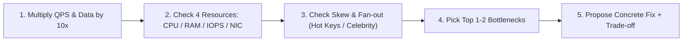
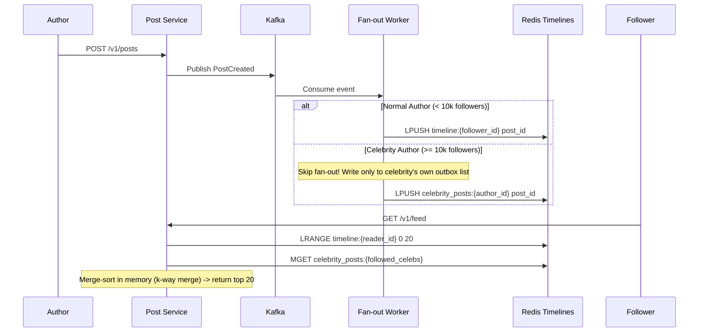
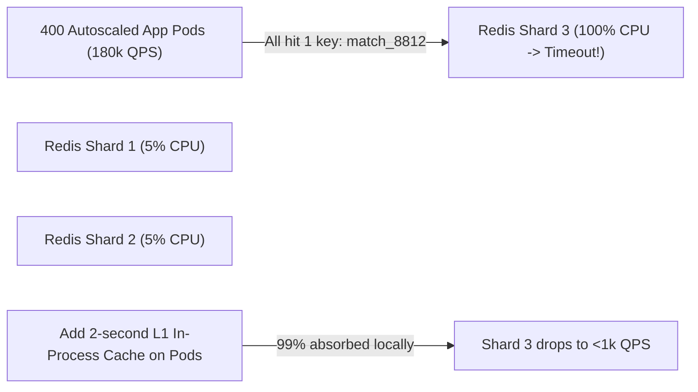

# Deep Dives and Bottlenecks: What Breaks First at 10x Traffic?

> **Prerequisites:** [Lesson 09: Explaining Component Interactions: Walk Through a Request End to End](../09-explaining-component-interactions/README.md) · [Track: Interview Framework](../README.md).  
> **Estimated Reading Time:** 24–28 minutes  
> **Target Audience:** Senior & Staff backend interview candidates mastering the 15-minute Deep Dive phase—where hiring levels are decided by identifying bottlenecks at 10x scale and engineering concrete fixes.  
> **Free PDF Notes:** [Download SD-T-010.pdf](https://backendroadmap.com/notes/system-design/SD-T-010.pdf)

> [!NOTE]
> **In one line:** The Deep Dive (minutes 25–40) is where you **stress-test your own diagram at 10x traffic**. Instead of waiting for the interviewer to poke holes, proactively hunt for **the first resource to saturate** (DB connections, hot keys, fan-out amplification, tail latency, or network egress), prove it with math, and propose targeted mitigations.

> [!TIP]
> **The Golden Rule:** Every system has **1–2 true bottlenecks** at $10\times$ scale. Use **Little's Law, Amdahl's Law, and Universal Scalability** to pinpoint *which* box saturates first—and spend your final 15 minutes going deep on those exact 2 boxes, not 10 shallow topics.

---

## 1. What Interview Deep Dives Are, and What They Aren't

After finishing a clean high-level diagram, a candidate sits back and waits for the interviewer to lead. The interviewer asks: *"Okay, traffic just jumped 10x—what breaks first?"* The candidate guesses vaguely: *"Maybe we just add more Kubernetes pods?"* Adding stateless pods while a single-primary database is at 100% CPU or a celebrity hot key is melting one Redis shard makes the outage **worse**, not better.

| Term | Precise Meaning | Example |
| :--- | :--- | :--- |
| **Deep dive** | Focused 10–15 min technical drill-down into the 1–2 hardest subsystems | Hybrid fan-out for celebrities, or consistent-hash shard rebalancing |
| **Bottleneck** | The resource hitting 100% utilization or queuing delay first under load | Primary DB IOPS, connection pool, NIC bandwidth, or hot shard CPU |
| **Write amplification** | One logical user action multiplying into $N$ backend writes | 1 celebrity tweet fanning out to $20\text{M}$ Redis timelines |
| **Tail amplification** | Scatter-gather $p_{99}$ degrading as fan-out width $N$ grows | Querying 50 shards in parallel → slowest shard dictates latency |
| **Contention / Coherence** | Serialization overhead (locks, consensus) limiting parallel speedup | Hot inventory row `UPDATE stock = stock - 1 WHERE id = 42` |
| **Not** | Hand-waving *"We'll autoscale Kubernetes and shard the DB"* | Autoscaling stateless pods doesn't fix stateful bottlenecks |

### Why It Matters
1. **This is the Senior/Staff bar:** Junior/mid candidates stop at the High-Level Design. Senior/Staff leveling is won by predicting failure modes at $10\times$ scale and quantifying trade-offs.
2. **Proactive vs reactive:** Driving the deep dive yourself (*"Looking at our numbers, the two things that break at 10x are X and Y—let's dive into X first"*) demonstrates architectural leadership.
3. **Every domain has classic traps:** Knowing the 5 universal bottlenecks lets you spot them in any prompt (feeds, chat, payments, search, or video).

---

## 2. Anatomy: The 10x Bottleneck Hunting Loop



When traffic jumps $10\times$, inspect these 5 bottleneck archetypes:

| Bottleneck Archetype | Symptom at 10x | Concrete Fix |
| :--- | :--- | :--- |
| **1. Hot Key / Skew** | 1 Redis/DB shard at 100% CPU while 99% sit idle | Local L1 cache, read replicas, or key-suffix write-sharding (`#0..15`) |
| **2. Fan-Out Amplification** | Celebrity write triggers $10\text{M}$ timeline pushes | **Hybrid Fan-out**: push for normal users, pull/merge for celebrities |
| **3. Row / Lock Contention** | Flash-sale SKU row lock serializes all checkouts | Partitioned inventory buckets (`sku#0..19`) or Redis atomic `DECR` |
| **4. Connection Pool Exhaustion** | 500 app pods × 20 conns = 10,000 Postgres connections | PgBouncer / RDS Proxy transaction pooling + bounded pod limits |
| **5. Scatter-Gather Tail Latency** | Search/feed fans out to 64 shards; $p_{99}$ explodes | Hedged requests, bounded shard count, or pre-computed projections |

> [!WARNING]
> **The #1 Deep-Dive Trap: "Just Autoscale the App Tier."** Stateless API pods scale linearly, but if the bottleneck is a **single primary DB**, **a hot row lock**, or **a connection pool**, scaling app pods from 50 to 500 just sends $10\times$ more concurrent queries into the saturated database and accelerates the collapse.

---

## 3. Mathematical Model: Little's Law, Contention, and Tail Amplification

**1. Little's Law (Concurrency & Connection Pools):**
With arrival rate $\lambda$ (req/s) and average service time $W$ (seconds):

$$L = \lambda \times W$$

If a DB query slows from $10\text{ ms}$ to $200\text{ ms}$ ($20\times$ slower) at $\lambda = 5{,}000\text{ req/s}$, required concurrent connections jump from $50$ to $1{,}000$—instantly exhausting a $200$-connection pool!

**2. Universal Scalability Law (USL) — Why Adding Nodes Stops Helping:**
Throughput $C(N)$ across $N$ nodes with serialization fraction $\alpha$ (locks/contention) and coherency delay $\beta$ (cross-node coordination):

$$C(N) = \frac{N}{1 + \alpha(N - 1) + \beta N(N - 1)}$$

When $\alpha > 0$ and $\beta > 0$, adding more nodes beyond $N_{\max} = \sqrt{\frac{1-\alpha}{\beta}}$ actually **decreases** total throughput (retrograde scaling).

**3. Tail Amplification Across $k$ Parallel Shards:**
If one shard has probability $p = 0.01$ ($p_{99}$) of being slow, querying $k$ shards in parallel gives probability of *at least one* slow shard:

$$P(\text{slow}) = 1 - (1 - p)^k$$

### Worked Numerical Example (Scatter-Gather Tail Latency)
Suppose a search query fans out to $k = 50$ shards in parallel, where each individual shard has $p_{99} = 200\text{ ms}$ ($p = 0.01$ of exceeding $200\text{ ms}$):
- $P(\text{at least 1 shard} > 200\text{ ms}) = 1 - (1 - 0.01)^{50} = 1 - 0.99^{50} \approx 39.5\%$!
- Nearly **40% of all user searches** now experience the $p_{99}$ tail latency instead of $1\%$!
- **Fix:** Use **hedged requests** (if a shard hasn't replied in $30\text{ ms}$, send a duplicate request to its replica and take the first response) or reduce shard fan-out via document-partitioned routing.

---

## 4. Metrics & Percentiles

| Metric | Meaning | Alert when |
| :--- | :--- | :--- |
| **Saturation (CPU / IOPS / Pool %)** | Utilization of the tightest resource | $> 70\%$ sustained (leaves zero headroom for bursts/failover) |
| **Queue wait vs service time** | Time spent waiting for a lock/pool vs executing | Queue time $> 2\times$ execution time (hockey-stick inflection) |
| **Hot-key ratio** | Top-10 keys QPS / median key QPS | $> 50:1$ on a single shard |
| **$p_{99} / p_{50}$ latency ratio** | Tail skew indicator | $> 5\times$ (signals GC pauses, lock contention, or scatter-gather tail) |
| **Lock wait time** | Time transactions spend blocked on row/table locks | $> 5\text{ ms}$ average on OLTP hot tables |

### Worked Example (Flash-Sale Row Lock Bottleneck)
An e-commerce site sells $10{,}000$ concert tickets (`sku_id = 99`) at $5{,}000\text{ checkout attempts/s}$. Every checkout runs `UPDATE inventory SET qty = qty - 1 WHERE sku_id = 99 AND qty > 0`. Because Postgres locks row `99` for the duration of the transaction ($10\text{ ms}$), max serial throughput on that single row is $\frac{1000\text{ ms}}{10\text{ ms}} = 100\text{ TPS}$—regardless of whether your Postgres box has 64 cores! **Fix:** Split `sku_id = 99` into $100$ virtual inventory buckets (`sku_id = 99, bucket = 0..99`, each holding 100 tickets), raising theoretical throughput $100\times$ to $10{,}000\text{ TPS}$.

---

## 5. Compounding & Failure Modes: What Breaks First at 10x

| Scenario | At 1x Traffic | At 10x Traffic (What Breaks First) | Deep-Dive Fix |
| :--- | :--- | :--- | :--- |
| **Social Feed Fan-out** | $500\text{ tweets/s}$, max 10k followers | Celebrity with $20\text{M}$ followers tweets → $20\text{M}$ Redis writes stall workers for minutes | **Hybrid fan-out**: push for $<10\text{k}$ followers; pull-on-read for celebrities |
| **URL Shortener Reads** | $10\text{k}$ QPS on 1 Redis node | $100\text{k}$ QPS + viral link hits 1 shard's single-threaded core | **Read replicas** + **local L1 in-memory LRU** (`5s` TTL) on API pods |
| **Chat Group Broadcast** | 100-member groups | 100k-member livestream channel → $100\text{k} \times$ fan-out per message | Dedicated **pub/sub fan-out tree** + shard-per-core gateway routing |
| **Metrics Ingestion** | $50\text{k}$ data points/s | $500\text{k}$ points/s → B-Tree random I/O thrashes disk | Switch to **LSM-Tree / TSDB** + in-memory batching before flush |

---

## 6. Numbers Every Engineer Must Know

| Item | Typical | Implication |
| :--- | :---: | :--- |
| Single Postgres row lock ceiling | $\sim 100\text{–}500\text{ TPS}$ on 1 hot row | Must bucket/shard hot inventory or counters |
| Single Redis shard throughput | $\sim 80\text{k–}120\text{k ops/s}$ (single-threaded) | One viral key saturates 1 shard; use L1 cache or replicas |
| Postgres max healthy direct connections | $\sim 200\text{–}500$ (before context-switch overhead) | Put PgBouncer / proxy in front of app pods |
| Healthy utilization ceiling | $60\text{–}70\%$ | At $>80\%$, queueing delay explodes non-linearly |
| Tail amplification at $k=50$ shards ($p_{99}$) | $39.5\%$ of requests hit tail | Bound fan-out or use hedged requests |
| Celebrity fan-out threshold | $\sim 10\text{k–}50\text{k}$ followers | Switch from push-on-write to pull-on-read above this |

---

## 7. Mechanism Deep Dive: Hybrid Fan-Out (Solving Celebrity Write Amplification)



| Question | Answer |
| :--- | :--- |
| **Why not use pure Fan-out-on-Read (pull) for everyone?** | If a user follows 500 normal people, `GET /feed` would query 500 user timelines on every read, blowing up read latency. Hybrid keeps 99.9% of reads to 1 Redis fetch + 1–3 celebrity merges. |
| **What if a normal user becomes a celebrity overnight?** | Track follower count; once `followers > threshold`, flip a `is_celebrity` flag so future posts route to the pull list without migrating old timeline entries. |
| **When NOT to optimize a bottleneck?** | Never optimize a path that isn't actually hot at $10\times$ (e.g., sharding an admin `settings` table that gets 5 QPS). Always verify with math first. |

---

## 8. Hierarchical Budgets & Design Rules

| Slice | Rule | Control |
| :--- | :--- | :--- |
| Time management | 10–15 min on top 1–2 bottlenecks | Don't scatter across 6 shallow topics |
| Headroom | Design for $\le 70\%$ peak utilization | Leaves margin for bursts + AZ failover |
| Connections | Bound DB connections via pooling | PgBouncer / RDS Proxy (`transaction` mode) |
| Hot keys | Never let 1 key saturate 1 shard | L1 in-memory cache (`5s` TTL) + write-bucketing |
| Fan-out | Bound per-write amplification | Hybrid push/pull above `10k` followers |
| Scatter-gather | Bound tail amplification | Hedged requests + shard-key routing |
| Trade-offs | Every fix has a cost—name it aloud | E.g., L1 cache adds `5s` staleness; buckets complicate `COUNT(*)` |

---

## 9. Top Mitigations

1. **Multiply your capacity numbers by 10x** and explicitly check CPU, RAM, IOPS, network, and lock contention.
2. **Use Hybrid Fan-Out** (push for normal users, pull-merge for celebrities) to crush write amplification.
3. **Add a tiny L1 in-process cache (`2–5 s` TTL)** on API pods to shield Redis shards from viral hot-key reads.
4. **Bucket hot database rows** (`sku#0..99`) to eliminate serial row-lock contention on flash sales.
5. **Put PgBouncer / connection pooling** between autoscaling app pods and relational databases.
6. **Use hedged requests** on multi-shard scatter-gather reads to cut $p_{99}$ tail amplification.
7. **Always state the trade-off** of your mitigation (e.g., stale L1 reads, complex inventory count aggregation).

---

## 10. Production Reference / War Story: The Viral Key Redis Shard Meltdown

During a major live sports broadcast, a sports-betting app's API pods autoscaled cleanly from 40 to 400 pods—yet the entire app went down with `504 Gateway Timeout`. Every user was polling `GET /v1/odds/match_8812` at $180{,}000\text{ QPS}$. Because Redis Cluster routes by key hash, `match_8812` lived on **1 single Redis shard** (1 CPU core), which capped out at $\sim 90{,}000\text{ ops/s}$ and dropped connections.



- **Root Cause:** Hot-key skew on a single-threaded Redis shard; autoscaling app pods only increased connection pressure on that single shard.
- **Fix:** Added a **2-second L1 in-memory cache** (with singleflight) inside the API pods, cutting traffic to Redis Shard 3 from $180{,}000\text{ QPS}$ to $\sim 200\text{ QPS}$ ($400\text{ pods} / 2\text{ s}$), at the explicit trade-off of up to 2 seconds of odds staleness.

---

## 11. Multi-Language Production Code Tabs

Deep-dive primitives: **L1 hot-key cache (solving Redis shard meltdown)** + **virtual bucketed inventory** + **tail-amplification math**:

````carousel
```go
// Go: Tiny L1 in-memory cache with short TTL to protect Redis shards from viral hot keys.
package main

import (
	"sync"
	"time"
)

type l1Entry struct {
	val       string
	expiresAt time.Time
}

type L1HotKeyCache struct {
	mu    sync.RWMutex
	items map[string]l1Entry
	ttl   time.Duration
}

func NewL1HotKeyCache(ttl time.Duration) *L1HotKeyCache {
	return &L1HotKeyCache{items: make(map[string]l1Entry), ttl: ttl}
}

func (c *L1HotKeyCache) GetOrFetch(key string, fetchRedis func() (string, error)) (string, error) {
	now := time.Now()
	c.mu.RLock()
	if e, ok := c.items[key]; ok && now.Before(e.expiresAt) {
		c.mu.RUnlock()
		return e.val, nil
	}
	c.mu.RUnlock()

	val, err := fetchRedis()
	if err != nil {
		return "", err
	}
	c.mu.Lock()
	c.items[key] = l1Entry{val: val, expiresAt: now.Add(c.ttl)}
	c.mu.Unlock()
	return val, nil
}
```
<!-- slide -->
```typescript
// TypeScript: Hybrid fan-out decision + virtual inventory bucketing for hot rows.
export interface Author {
  id: string;
  followerCount: number;
}

export function routeFanout(author: Author, celebThreshold = 10_000): "PUSH_TO_FOLLOWERS" | "PULL_ON_READ" {
  return author.followerCount >= celebThreshold ? "PULL_ON_READ" : "PUSH_TO_FOLLOWERS";
}

export function pickInventoryBucket(skuId: string, requestId: string, buckets = 100): string {
  let hash = 0;
  for (let i = 0; i < requestId.length; i++) {
    hash = (hash * 31 + requestId.charCodeAt(i)) | 0;
  }
  return `${skuId}#${Math.abs(hash) % buckets}`;
}
```
<!-- slide -->
```python
# Python: Bottleneck calculators (Little's Law, USL, Tail Amplification) (stdlib only).
import math

def littles_law_concurrency(qps: float, avg_latency_s: float) -> float:
    return round(qps * avg_latency_s, 1)

def scatter_gather_tail_prob(num_shards: int, shard_tail_p: float = 0.01) -> float:
    """Probability that at least 1 of k parallel shards hits its tail latency."""
    return round((1.0 - (1.0 - shard_tail_p) ** num_shards) * 100, 2)

def usl_throughput(n: int, alpha: float = 0.02, beta: float = 0.0005) -> float:
    """Universal Scalability Law: contention (alpha) and coherency (beta)."""
    return round(n / (1 + alpha * (n - 1) + beta * n * (n - 1)), 2)
```
<!-- slide -->
```csharp
// C#: Short-TTL L1 hot-key shield + virtual inventory bucketing.
using System.Collections.Concurrent;

public sealed class HotKeyShield
{
    private readonly ConcurrentDictionary<string, (string Val, DateTimeOffset Exp)> _l1 = new();
    private readonly TimeSpan _ttl;

    public HotKeyShield(TimeSpan ttl) => _ttl = ttl;

    public async Task<string> GetAsync(string key, Func<Task<string>> fetchRedis)
    {
        var now = DateTimeOffset.UtcNow;
        if (_l1.TryGetValue(key, out var entry) && now < entry.Exp)
            return entry.Val;

        var fresh = await fetchRedis();
        _l1[key] = (fresh, now + _ttl);
        return fresh;
    }

    public static string BucketKey(string skuId, int buckets = 100) =>
        $"{skuId}#{Random.Shared.Next(buckets)}";
}
```
````

---

## 12. Hands-On CLI Verification Workflows

Verify tail-latency amplification across $k$ shards and Universal Scalability Law peak $N$ in Python:

```bash
python -c '
for k in (1, 10, 50, 100):
    p = (1 - (1 - 0.01) ** k) * 100
    print(f"k={k:3d} parallel shards -> P(at least 1 hits p99) = {p:.1f}%")

for n in (1, 8, 16, 32, 64, 128):
    c = n / (1 + 0.02*(n-1) + 0.0005*n*(n-1))
    print(f"N={n:3d} nodes -> USL effective throughput = {c:.1f}x")
'
```

Inspect real-time hot keys and connection pool saturation on Redis / Postgres:

```bash
# Redis: find hot keys in real time (Redis 4+)
redis-cli --hotkeys

# Postgres: check active vs waiting connections in pool
psql "$DATABASE_URL" -c "SELECT state, wait_event_type, count(*) FROM pg_stat_activity GROUP BY 1, 2;"
```

---

## 13. Common Mistakes to Avoid

1. **Saying *"We'll just autoscale Kubernetes pods"*** when the actual bottleneck is a database, hot key, or lock.
2. **Waiting passively for the interviewer** to point out what breaks at $10\times$ traffic.
3. **Trying to deep-dive 6 different components superficially** instead of going deep on the top 1–2 bottlenecks.
4. **Ignoring hot-key skew** on Redis/DynamoDB/Cassandra when traffic follows a Zipfian (80/20) distribution.
5. **Forgetting connection pool math** (500 pods × 20 connections = 10,000 Postgres connections).
6. **Proposing pure fan-out-on-write** without addressing celebrity write amplification.
7. **Presenting a mitigation without naming its trade-off** (e.g., L1 caching introduces brief staleness).

---

## 14. Key Terms Glossary

| Key Term | Definition |
| :--- | :--- |
| **Bottleneck** | The first system resource (CPU, IOPS, lock, pool, NIC) to saturate under increased load. |
| **Little's Law** | $L = \lambda W$: concurrency equals arrival rate times average service time. |
| **Universal Scalability Law** | Model showing how lock contention ($\alpha$) and coherency ($\beta$) cap horizontal scaling. |
| **Write amplification** | Single user write fanning out into many backend storage/cache writes. |
| **Tail amplification** | Multi-shard parallel reads ($k$ shards) magnifying the chance of hitting $p_{99}$ latency. |
| **Hedged request** | Sending a backup read to a replica if the primary hasn't responded within a threshold. |
| **L1 in-process cache** | Tiny per-pod memory cache (`1–5 s` TTL) shielding Redis shards from viral hot keys. |
| **Virtual bucketing** | Splitting one hot DB row (e.g., flash-sale SKU) into $N$ sub-rows to parallelize locks. |
| **Hybrid fan-out** | Push-on-write for normal users + pull-on-read for celebrities. |
| **PgBouncer / RDS Proxy** | Connection pooler multiplexing thousands of app connections onto hundreds of DB connections. |

---

## 15. System Design Interview Questions & Answers

### Basic Conceptual Questions

<details>
<summary><strong>Q1: What is the goal of the Deep Dive phase in a system design interview? [BASIC]</strong></summary>

**Answer:**
To stress-test your architecture at $10\times$ scale, identify the 1–2 components that break first (using math), and engineer concrete mitigations along with their trade-offs.
</details>

<details>
<summary><strong>Q2: Why doesn't autoscaling stateless app servers fix a database bottleneck? [BASIC]</strong></summary>

**Answer:**
More app pods open more concurrent connections and send more queries into an already saturated database, increasing lock contention and context-switching overhead and accelerating the outage.
</details>

<details>
<summary><strong>Q3: What is Little's Law and how does it expose bottlenecks? [BASIC]</strong></summary>

**Answer:**
$L = \lambda W$ (concurrency = arrival rate × service time). If a database slows down $10\times$ ($W$ increases $10\times$), the number of in-flight connections/threads $L$ also jumps $10\times$, exhausting connection pools and memory even if arrival rate $\lambda$ hasn't changed.
</details>

<details>
<summary><strong>Q4: What is the difference between fan-out-on-write and fan-out-on-read? [BASIC]</strong></summary>

**Answer:**
Fan-out-on-write pushes a post to every follower's timeline at write time (fast reads, expensive celebrity writes). Fan-out-on-read merges followed authors' posts at read time (cheap writes, slower reads). Hybrid combines both.
</details>

### Scenario-Based Architecture Questions

<details>
<summary><strong>Q5: A Redis Cluster has 10 shards, but Shard 4 is at 100% CPU while others are at 5%. What happened and how do you fix it? [SCENARIO]</strong></summary>

**Answer:**
A viral hot key hashes to Shard 4, saturating its single-threaded event loop. Fix by adding a short-TTL (`2–5 s`) **L1 in-process cache** on API pods (absorbs 99% of reads locally), or replicating the key across $N$ suffixed keys (`key#0..9`) for read distribution.
</details>

<details>
<summary><strong>Q6: During a flash sale, 10,000 users/sec try to buy the last 500 units of SKU #42. What breaks first in Postgres? [SCENARIO]</strong></summary>

**Answer:**
Single-row lock contention on `sku_id = 42`. Even with 64 cores, transactions serialize on that row lock, capping throughput at $\sim 100\text{–}300\text{ TPS}$ and exhausting connection pools. Fix by **bucketing** SKU #42 into 50 sub-rows (`42#0..49`, 10 units each) or using atomic Redis `DECR` pre-reservations.
</details>

<details>
<summary><strong>Q7: Your search service queries 64 shards in parallel and $p_{99}$ latency just jumped from 150 ms to 900 ms. Why? [SCENARIO]</strong></summary>

**Answer:**
Tail amplification: $1 - 0.99^{64} \approx 47\%$ of requests hit at least one slow shard. Fix with **hedged requests** (retry a slow shard on a replica after `40 ms`), shard pruning (route by tenant/category so queries hit 1–4 shards instead of 64), or accepting partial results after a strict deadline.
</details>

<details>
<summary><strong>Q8: You scale from 50 to 500 microservice pods and suddenly Postgres refuses all new connections. Why? [SCENARIO]</strong></summary>

**Answer:**
Each pod opens a pool of 20 DB connections ($500 \times 20 = 10{,}000$), exceeding Postgres `max_connections` (typically 200–500). Fix by placing **PgBouncer** (in transaction-pooling mode) between the pods and Postgres, and capping per-pod pool sizes.
</details>

### Advanced & Tricky Interview Questions

<details>
<summary><strong>Q9: How does the Universal Scalability Law explain why adding more nodes can actually make a system slower? [TRICKY]</strong></summary>

**Answer:**
USL models serialization/locks ($\alpha$) and cross-node coherency/coordination ($\beta$). When $\beta > 0$ (e.g., distributed locks, cache invalidation chatter, or Paxos/Raft consensus across too many nodes), coordination overhead grows as $O(N^2)$ and eventually exceeds the capacity gained by adding node $N+1$.
</details>

<details>
<summary><strong>Q10: In a hybrid fan-out system, how do you handle a user who follows 2,000 celebrities? [TRICKY]</strong></summary>

**Answer:**
Merging 2,000 celebrity lists on every `GET /feed` would be slow. Bound the merge by keeping an **active-celebrity index** (only merge celebrities who posted recently, e.g., in the last 24h), cap max follows, or pre-compute a shared "celebrity digest" cache for popular combinations.
</details>

<details>
<summary><strong>Q11: Why is `2-second L1 caching` safe for a Redis hot key, and when is it dangerous? [TRICKY]</strong></summary>

**Answer:**
It is safe for read-heavy, eventually consistent data (odds, view counts, viral tweet text, feature flags) where $2\text{ s}$ of staleness is invisible. It is dangerous for strict financial balances, auth revocation, or inventory counts where $2\text{ s}$ stale reads cause overdrafts or overselling.
</details>

<details>
<summary><strong>Q12: How do you decide *which* bottleneck to deep-dive first when an interviewer gives you free rein? [TRICKY]</strong></summary>

**Answer:**
Pick the bottleneck that is **most unique to the problem domain** and **proven by your math**: e.g., write amplification in Twitter, row-lock contention in Ticketmaster, geo-index write rate in Uber, or tail latency in Search. State *"At 10x scale, X saturates first because [number]—let's dive into X."*
</details>

---

## 16. One-Page Master Cheat Sheet

```
+---------------------------------------------------------------------------------------------------------+
|            DEEP DIVES AND BOTTLENECKS AT 10X TRAFFIC — MASTER CHEAT SHEET                               |
+---------------------------------------------------------------------------------------------------------+
| 1. DON'T GUESS: Multiply QPS & data by 10x -> check CPU, RAM, IOPS, NIC, Locks, and Key Skew.           |
+---------------------------------------------------------------------------------------------------------+
| 2. NEVER "JUST AUTOSCALE PODS": Scaling stateless compute into a saturated DB/lock accelerates collapse. |
+---------------------------------------------------------------------------------------------------------+
| 3. 5 CLASSIC BOTTLENECKS & FIXES:                                                                       |
|    - Hot Key (Redis) -> 2s L1 in-process cache + read replicas                                          |
|    - Fan-Out (Feeds) -> Hybrid push (normal) + pull-merge (celebrities)                                 |
|    - Row Lock (Flash Sale) -> Virtual inventory buckets (sku#0..99)                                     |
|    - Conn Pool (Postgres) -> PgBouncer transaction pooling                                              |
|    - Scatter-Gather Tail -> Hedged requests + shard pruning (1 - 0.99^k)                                |
+---------------------------------------------------------------------------------------------------------+
| 4. ALWAYS NAME THE TRADE-OFF: L1 cache = brief staleness; buckets = harder exact COUNT(*).              |
+---------------------------------------------------------------------------------------------------------+
```

---

## Further Reading & Sources

- Brendan Gregg, *Systems Performance*, Chapter 2 ("Methodologies": USE Method — Utilization, Saturation, Errors).
- Neil J. Gunther, *Guerrilla Capacity Planning* (Universal Scalability Law).
- Jeffrey Dean & Luiz André Barroso, [The Tail at Scale](https://research.google/pubs/the-tail-at-scale/) (hedged requests, tail amplification).
- Martin Kleppmann, *Designing Data-Intensive Applications*, Chapter 1 ("Twitter's Hybrid Fan-Out").

---

## Free PDF Notes

[SD-T-010.pdf](https://backendroadmap.com/notes/system-design/SD-T-010.pdf)

---

## Next

Continue with [Evaluating Trade-offs Aloud in System Design Interviews](../11-evaluating-trade-offs-aloud-in-system-design-interviews/README.md).