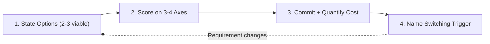
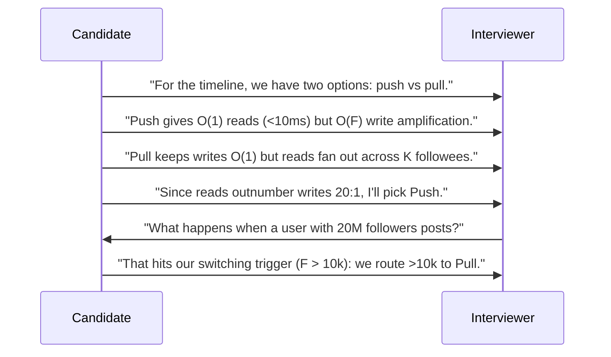
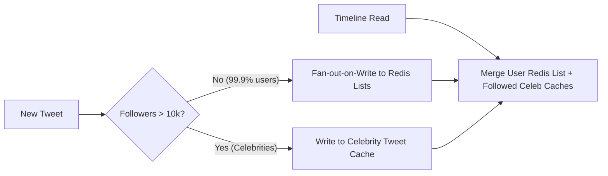

# Evaluating Trade-offs Aloud in System Design Interviews

> **Prerequisites:** [Lesson 10: Deep Dives and Bottlenecks](../10-deep-dives-and-bottlenecks/README.md).  
> **Estimated Reading Time:** 22–26 minutes  
> **Target Audience:** Senior and Staff backend candidates who know the building blocks but lose points by stating choices ("I'll use Kafka and Redis") without justifying *why*, *at what cost*, and *when they would flip*.  
> **Free PDF Notes:** [Download SD-T-011.pdf](https://backendroadmap.com/notes/system-design/SD-T-011.pdf)

> [!NOTE]
> **In one line:** Evaluating trade-offs aloud means **comparing at least two viable options across explicit axes** (latency, consistency, cost, operational complexity), **quantifying the delta**, **picking one for the stated requirements**, and **naming the trigger that would make you switch**.

> [!TIP]
> **The Golden Rule:** Never name a technology or pattern without naming what you are *giving up* to get it. In an interview, an unexamined choice reads as cargo-culting; a quantified trade-off reads as production experience.

---

## 1. What Evaluating Trade-offs Aloud Is, and What It Isn't

When an interviewer asks *"Why DynamoDB instead of PostgreSQL?"* or *"Why push instead of pull for the news feed?"*, weak candidates defend their pick as if it were objectively superior. Strong candidates treat architecture as a constrained optimization problem: every gain on one axis (read latency, write throughput, availability) is paid for on another (staleness, storage amplification, operational burden, dollar cost).

| Term | Precise Meaning | Example |
| :--- | :--- | :--- |
| **Trade-off evaluation** | Structured comparison of 2+ viable designs on measurable axes | Fan-out-on-write vs fan-out-on-read for 100M users |
| **Decision axis** | A concrete engineering dimension used to score options | $p_{99}$ read latency, write amplification, monthly cost, ops toil |
| **Reversibility (two-way door)** | How costly it is to change the decision later | Cache TTL (minutes) vs primary data model (quarters) |
| **Switching trigger** | Quantitative threshold that invalidates the chosen option | "If celebrity accounts exceed 1% of writes, switch to hybrid" |
| **Decision matrix** | Weighted or un-weighted table mapping options to axes | Scoring Postgres vs Cassandra on ACID, scale, ops |
| **Cargo-culting** | Picking a trendy tool without tying it to requirements | "We'll use Kafka and microservices" for 50 RPS |
| **False dichotomy** | Treating a spectrum or hybrid as binary | Push vs pull instead of hybrid fan-out |
| **Not** | Listing pros/cons from memory without picking a winner | "Both have pros and cons" with no recommendation |

### Why It Matters
1. **Rubric weight:** At Senior (L5) and Staff (L6) levels, *"Trade-offs and Justification"* is typically 25–35% of the hiring rubric; drawing boxes without trade-offs caps you at Mid-level.
2. **Signal compression:** A 45-minute interview cannot test everything you know; a single crisp trade-off ("We pay 20 ms of write latency for synchronous quorum so we never lose a ledger entry") proves you understand distributed systems deeply.
3. **Resilience to pushback:** When the interviewer challenges your design, having an explicit switching trigger turns confrontation into collaboration.

---

## 2. Anatomy: The 4-Step Trade-off Loop



Instead of jumping straight to *"Let's use Redis"*, run the 4-step loop in 45–60 seconds:
1. **State Options:** Name the two realistic contenders (e.g., *fan-out-on-write* vs *fan-out-on-read*, or *Postgres read replicas* vs *Redis cache-aside*).
2. **Score on Axes:** Pick the 3–4 axes that actually matter for this prompt (e.g., $p_{99}$ latency, write amplification, consistency lag, cost/ops).
3. **Commit & Quantify Cost:** Choose one and explicitly state what breaks or worsens because of your choice.
4. **Name Switching Trigger:** State the exact number or product change that would flip your decision.

| Trade-off Pair | What You Gain | What You Pay | Typical Switching Trigger |
| :--- | :--- | :--- | :--- |
| **Sync vs Async write** | Immediate error feedback, simpler client | Higher tail latency, coupled availability | Downstream $p_{99} > 100\text{ ms}$ or non-critical side effect |
| **SQL vs NoSQL (wide-column)** | Joins, ACID transactions, ad-hoc queries | Harder horizontal write sharding above ~50k WPS | Write rate $> 50\text{k WPS}$ or storage $> 10\text{ TB}$ |
| **Cache-aside vs Write-through** | Only hot keys cached, resilient to cache miss | Stale reads until TTL/invalidation, cold-start spike | Read:write ratio $< 5:1$ or strict read-your-writes |
| **Push vs Pull (feed)** | $O(1)$ read latency ($< 10\text{ ms}$) | $O(F)$ write amplification for $F$ followers | Celebrity threshold $F > 10{,}000$ followers |
| **Strong vs Eventual consistency** | Linearizable reads, no anomalies | Cross-AZ/region RTT ($2$–$150\text{ ms}$), lower availability | Read latency budget $< 20\text{ ms}$ across regions |

> [!WARNING]
> **The #1 interview trap is "free-lunch architecture."** Saying *"We'll add a cache so reads are fast and consistent"* without mentioning invalidation races, cache stampedes, or memory cost tells the interviewer you have never operated a cache in production.

---

## 3. Mathematical Model: Quantifying the Trade-off Delta

To evaluate trade-offs aloud convincingly, replace adjectives (*"fast"*, *"expensive"*, *"heavy"*) with back-of-the-envelope equations.

### Model A: Fan-out-on-Write (Push) vs Fan-out-on-Read (Pull)

Suppose a social feed has $U = 10^7$ daily active users, average follower count $\bar{F} = 200$, tweet write rate $\lambda_w = 5{,}000\text{ writes/s}$, feed read rate $\lambda_r = 100{,}000\text{ reads/s}$, and average followee count $\bar{K} = 200$.

$$\text{Ops}_{\text{push}} = \lambda_w \cdot \bar{F} + \lambda_r \cdot 1, \qquad \text{Ops}_{\text{pull}} = \lambda_w \cdot 1 + \lambda_r \cdot \bar{K}$$

Plugging in the numbers:
- **Push:** $5{,}000 \times 200 + 100{,}000 \times 1 = 1{,}000{,}000 + 100{,}000 = 1.1 \times 10^6\text{ ops/s}$.
- **Pull:** $5{,}000 \times 1 + 100{,}000 \times 200 = 5{,}000 + 20{,}000{,}000 = 2.0005 \times 10^7\text{ ops/s}$.

Push wins by **$18.2\times$ fewer total operations**, *until* a celebrity with $F_{\text{celeb}} = 10^7$ followers tweets: a single write triggers $10^7$ fan-out writes, taking $10^7 / 10^6 = 10\text{ s}$ at 1M ops/s. That gives you an exact mathematical switching trigger:

$$F_{\text{threshold}} \approx \frac{\text{acceptable fan-out lag} \times \text{worker throughput}}{\text{concurrent celebrity writes}}$$

For a 1-second lag budget with $10^6$ ops/s shared across 100 concurrent celebrity tweets, $F_{\text{threshold}} = 10^4$ followers. Users above $10^4$ switch to pull (hybrid).

### Model B: Weighted Decision Score & Switching Cost

When comparing two architectures $A$ and $B$ across $n$ axes with normalized scores $s_{i} \in [0, 10]$ and requirement weights $w_i$ ($\sum w_i = 1$):

$$\Delta S = \sum_{i=1}^{n} w_i \left(s_{i,A} - s_{i,B}\right)$$

If $|\Delta S| < 0.5$, the two options are effectively tied on technical merit—pick the one with **lower operational complexity** or **higher reversibility** (two-way door).

---

## 4. Metrics & Percentiles

| Metric | Meaning | Alert when (in Interview / Prod) |
| :--- | :--- | :--- |
| **Write Amplification Factor (WAF)** | Storage/queue writes per logical user write | $> 100\times$ without async batching |
| **Read Amplification Factor (RAF)** | Backend lookups per logical user read | $> 10\times$ on hot user-facing path |
| **Consistency Lag ($\Delta t_{\text{stale}}$)** | Time from write commit to replica/cache visibility | Exceeds product SLA (e.g., $> 500\text{ ms}$ for feed, $> 0\text{ ms}$ for balance) |
| **Cost per Million Requests** | Compute + storage + network egress per $10^6$ ops | $> 2\times$ alternative for $< 10\%$ latency gain |
| **Reversibility Horizon** | Engineering weeks to migrate from Option A to B | $> 4$ weeks (one-way door: needs deep justification) |
| **Availability Coupling** | $\prod a_i$ across synchronous dependencies | Any non-critical dep in the sync critical path |

### Worked Example (Checkout Inventory: Pessimistic Lock vs Optimistic Concurrency)
Suppose an e-commerce flash sale sees $5{,}000\text{ RPS}$ across $10{,}000$ SKUs, with $1$ hot SKU receiving $500\text{ RPS}$ (contention).
- **Pessimistic locking (`SELECT ... FOR UPDATE`):** Each transaction holds a row lock for $t_{\text{hold}} = 15\text{ ms}$. Max throughput on the hot SKU is $1 / 0.015 = 66.7\text{ TPS}$. At $500\text{ RPS}$, $433\text{ req/s}$ queue up and time out.
- **Optimistic concurrency control (OCC with `version` column):** No locks held during read/compute; conflict rate on the hot SKU is high ($> 85\%$ retries), causing $500 / 0.15 \approx 3{,}333$ DB write attempts/s.
- **Spoken Trade-off:** *"For normal SKUs, OCC gives us lock-free reads and high throughput. For the 1% hot SKUs where contention exceeds ~20%, OCC thrashes the DB with retries, so we switch those SKUs to an atomic Redis `DECRBY` reservation with a 5-minute TTL."*

---

## 5. Compounding & Failure Modes of Bad Trade-offs

What happens when a candidate picks an option without evaluating its failure mode? Let's trace 3 compounding effects:

| Unexamined Choice | 1x Load (100 RPS) | 10x Load (1,000 RPS) | 100x Load (10,000 RPS) |
| :--- | :--- | :--- | :--- |
| **Sync cross-service calls** (3 services @ 99.9%) | $99.7\%$ avail, $150\text{ ms}$ | Tail latency spikes to $1.2\text{ s}$ | Cascading thread-pool exhaustion; $0\%$ avail |
| **Pure Fan-out-on-Write** (no celebrity cap) | $20\text{k}$ queue ops/s | $200\text{k}$ queue ops/s | Single 20M-follower post stalls queue for $20\text{ s}$ |
| **Global Strong Consistency** (multi-region Raft) | $80\text{ ms}$ cross-region RTT | Lock contention on hot keys | $p_{99} > 800\text{ ms}$, write throughput collapses |

The compounding lesson: **trade-off costs are non-linear.** A 5 ms lock or a 200-follower fan-out looks free at 100 RPS and becomes the primary outage vector at 10,000 RPS.

---

## 6. Numbers Every Engineer Must Know

| Item | Typical | Implication |
| :--- | :---: | :--- |
| Same-AZ network RTT | $0.2$–$0.5\text{ ms}$ | Sync RPCs within an AZ are cheap |
| Cross-AZ network RTT | $1$–$2\text{ ms}$ | Multi-AZ quorum adds ~2 ms per round trip |
| Cross-region RTT (US-East to US-West) | $60$–$80\text{ ms}$ | Strong multi-region consistency costs $\ge 70\text{ ms}$ |
| Cross-continent RTT (US to EU) | $80$–$150\text{ ms}$ | Async replication + local reads is the default |
| Redis single-thread throughput | ~100,000 ops/s | Hot keys saturate 1 core long before cluster CPU |
| Postgres single-primary writes | ~10k–50k WPS | Above this, shard or offload to wide-column/queue |
| Kafka committed write (acks=all) | ~5–15 ms | Durable async decoupling for tiny latency cost |
| Two-way door vs One-way door | Days vs Quarters | Spend 80% of trade-off time on one-way doors |

---

## 7. Mechanism Deep Dive: Structuring the Spoken Comparison



| Question | Answer |
| :--- | :--- |
| **How many options should I compare?** | 2 (rarely 3). Comparing 4+ wastes time and blurs the decision. |
| **Should I mention options I reject?** | Yes—briefly! Naming and rejecting an option shows breadth and prevents the interviewer from asking *"Did you consider X?"* |
| **What if I don't know exact benchmark numbers?** | Use orders of magnitude ($1\text{ ms}$ vs $100\text{ ms}$, $O(1)$ vs $O(F)$) and state your assumptions aloud. |
| **What if the interviewer disagrees with my pick?** | Validate their axis ("If cost is weighted higher than $p_{99}$ latency, Option B wins") and adapt cleanly. |

**When NOT to run a full trade-off comparison:** On commodity choices that are not the bottleneck or differentiator (e.g., JSON vs Protobuf on an internal 50 RPS admin API, or Nginx vs Envoy as a generic reverse proxy). State the default in 5 seconds and move on.

---

## 8. Hierarchical Budgets & Design Rules

| Slice | Rule | Control |
| :--- | :--- | :--- |
| **Option Enumeration** | Always pair 2 viable contenders | Never present a single choice as inevitable |
| **Axis Selection** | Pick 3–4 axes tied to NFRs | Drop generic axes that don't differentiate |
| **Cost Disclosure** | State the #1 downside of your own pick | "We accept 500 ms staleness to hit 10 ms $p_{99}$" |
| **Switching Trigger** | Quantify when to flip or hybridize | Follower count, WPS, data size, or SLA |
| **Door Classification** | Label one-way vs two-way doors | Deep-dive one-way doors (schema, sharding key) |
| **Time Budget** | 45–90 seconds per major trade-off | Watch interviewer cues; don't over-explain |

---

## 9. Top Mitigations (How to Fix Weak Trade-off Answers)

1. **Use the "Option A vs Option B on [Axis 1, Axis 2]" template** so you never ramble.
2. **Tie every trade-off back to the non-functional requirements (NFRs)** agreed upon in the first 5 minutes.
3. **Quantify amplification factors** (write amplification, read amplification, fan-out factor) with simple multiplication.
4. **Always state the downside of your chosen option first** before the interviewer points it out.
5. **Propose a hybrid** when a single strategy breaks on skewed distributions (e.g., Zipfian celebrity accounts).
6. **Distinguish reversible from irreversible decisions** (TTL/batch size = reversible; partition key/consistency model = irreversible).
7. **Acknowledge operational cost** (running a distributed lock service or multi-master DB has real on-call toil).

---

## 10. Production Reference: Twitter/X Home Timeline Hybrid Fan-out

Twitter's home timeline is the canonical industry example of a trade-off that evolved from pure push to a quantified hybrid:

- **Phase 1 (Pure Pull):** Reading the timeline queried tweets from all followed accounts and merged them at read time. As read QPS grew to >300k/s, $p_{99}$ read latency degraded into seconds.
- **Phase 2 (Pure Push):** Every tweet was fanned out to Redis lists for every follower, yielding fast $O(1)$ reads.
- **The Failure Mode:** When accounts with 30M+ followers (Katy Perry, Barack Obama) tweeted, fan-out workers backed up for minutes, causing severe timeline inconsistency and Redis memory pressure.
- **Phase 3 (Hybrid Switching Trigger):** Users below the follower threshold ($F \le F_{\text{threshold}}$) use fan-out-on-write; celebrity accounts ($F > F_{\text{threshold}}$) are excluded from push and merged at read time from a small per-celebrity cache.



**Lesson:** In production—and in interviews—the best answer is rarely "Option A is good, Option B is bad." It is *"Option A handles 99.9% of traffic cheaply; Option B handles the 0.1% tail without melting the cluster."*

---

## 11. Multi-Language Production Code Tabs

A runnable **Trade-off & Fan-out Cost Evaluator** that computes exact operation counts for Push vs Pull vs Hybrid given any traffic profile and celebrity skew—useful for verifying back-of-the-envelope interview math.

````carousel
```go
// Go: Quantifies Push vs Pull vs Hybrid fan-out cost and finds the switching threshold.
package main

import "fmt"

type TrafficProfile struct {
	WriteRPS       float64
	ReadRPS        float64
	AvgFollowers   float64
	AvgFollowees   float64
	CelebShare     float64 // fraction of writes from celebrities
	CelebFollowers float64
}

func EvaluateFanout(p TrafficProfile) {
	pushOps := p.WriteRPS*((1-p.CelebShare)*p.AvgFollowers+p.CelebShare*p.CelebFollowers) + p.ReadRPS
	pullOps := p.WriteRPS + p.ReadRPS*p.AvgFollowees
	// Hybrid: regular users push; celebrity tweets (assume avg user follows 3 celebs) pull at read time.
	hybridOps := p.WriteRPS*(1-p.CelebShare)*p.AvgFollowers + p.ReadRPS*(1+3)

	fmt.Printf("Push Ops/s:   %.0f\n", pushOps)
	fmt.Printf("Pull Ops/s:   %.0f\n", pullOps)
	fmt.Printf("Hybrid Ops/s: %.0f\n", hybridOps)
}

func main() {
	EvaluateFanout(TrafficProfile{
		WriteRPS: 5000, ReadRPS: 100000,
		AvgFollowers: 200, AvgFollowees: 200,
		CelebShare: 0.001, CelebFollowers: 10_000_000,
	})
}
```
<!-- slide -->
```typescript
// TypeScript: Weighted trade-off decision matrix evaluator for interview options.
interface OptionScores {
  name: string;
  scores: Record<string, number>; // 1-10 per axis
}

function evaluateTradeoff(
  weights: Record<string, number>,
  a: OptionScores,
  b: OptionScores
): { winner: string; delta: number; recommendation: string } {
  let scoreA = 0;
  let scoreB = 0;
  for (const [axis, w] of Object.entries(weights)) {
    scoreA += w * (a.scores[axis] ?? 0);
    scoreB += w * (b.scores[axis] ?? 0);
  }
  const delta = Number((scoreA - scoreB).toFixed(2));
  const winner = delta >= 0 ? a.name : b.name;
  const recommendation =
    Math.abs(delta) < 0.5
      ? `Near tie (|delta|=${Math.abs(delta)}): pick lower ops complexity / higher reversibility.`
      : `Pick ${winner} (margin ${Math.abs(delta)}).`;
  return { winner, delta, recommendation };
}

console.log(
  evaluateTradeoff(
    { readLatency: 0.4, writeAmp: 0.3, opsSimplicity: 0.3 },
    { name: "Push", scores: { readLatency: 10, writeAmp: 4, opsSimplicity: 6 } },
    { name: "Pull", scores: { readLatency: 4, writeAmp: 10, opsSimplicity: 9 } }
  )
);
```
<!-- slide -->
```python
# Python: Computes Push vs Pull vs Hybrid ops/s and crossover follower threshold.
def fanout_tradeoff(
    write_rps: float = 5_000,
    read_rps: float = 100_000,
    avg_followers: float = 200,
    avg_followees: float = 200,
    celeb_share: float = 0.001,
    celeb_followers: float = 10_000_000,
    celebs_followed_avg: float = 3,
) -> dict[str, float]:
    push_ops = write_rps * ((1 - celeb_share) * avg_followers + celeb_share * celeb_followers) + read_rps
    pull_ops = write_rps + read_rps * avg_followees
    hybrid_ops = write_rps * (1 - celeb_share) * avg_followers + read_rps * (1 + celebs_followed_avg)
    return {
        "push_ops_s": round(push_ops),
        "pull_ops_s": round(pull_ops),
        "hybrid_ops_s": round(hybrid_ops),
        "hybrid_speedup_vs_push": round(push_ops / hybrid_ops, 2),
    }


if __name__ == "__main__":
    print(fanout_tradeoff())
```
<!-- slide -->
```csharp
// C#: Evaluates synchronous vs asynchronous availability and latency trade-offs.
using System;
using System.Linq;

public static class TradeoffEvaluator
{
    public static (double SyncLatencyMs, double SyncAvail, double AsyncLatencyMs, double AsyncAvail)
        CompareSyncVsAsync(double[] depLatenciesMs, double[] depAvailabilities, double brokerLatencyMs, double brokerAvail)
    {
        double syncLatency = depLatenciesMs.Sum();
        double syncAvail = depAvailabilities.Aggregate(1.0, (acc, a) => acc * a);
        return (syncLatency, Math.Round(syncAvail, 5), brokerLatencyMs, brokerAvail);
    }

    public static void Main()
    {
        var res = CompareSyncVsAsync(new[] { 80.0, 120.0, 60.0 }, new[] { 0.999, 0.999, 0.999 }, 10.0, 0.9999);
        Console.WriteLine($"Sync: {res.SyncLatencyMs}ms @ {res.SyncAvail:P3} | Async: {res.AsyncLatencyMs}ms @ {res.AsyncAvail:P3}");
    }
}
```
````

---

## 12. Hands-On CLI Verification Workflows

Verify the fan-out trade-off numbers in Python 3:

```bash
python3 -c '
w, r, f, k = 5000, 100000, 200, 200
push = w * (0.999 * f + 0.001 * 10_000_000) + r
pull = w + r * k
hybrid = w * (0.999 * f) + r * 4
print(f"Push: {push:,.0f}/s | Pull: {pull:,.0f}/s | Hybrid: {hybrid:,.0f}/s")
'
```

Expected output:
```text
Push: 51,099,000/s | Pull: 20,005,000/s | Hybrid: 1,399,000/s
```

Notice how adding just $0.1\%$ celebrity tweets flips pure Push from $1.1\text{M/s}$ to $51.1\text{M/s}$ (worse than Pull!), while Hybrid stays at $1.4\text{M/s}$ ($36\times$ cheaper than Push).

---

## 13. Common Mistakes to Avoid

1. **Stating a technology without an alternative** ("I'll use Cassandra" with no mention of Postgres/DynamoDB).
2. **Listing textbook pros/cons without picking a winner** for the current prompt's constraints.
3. **Hiding or ignoring the downside of your chosen option** until the interviewer calls it out.
4. **Using qualitative adjectives only** ("faster", "cheaper") instead of orders of magnitude ($10\times$, $1\text{ ms}$ vs $80\text{ ms}$).
5. **Treating skewed distributions as uniform** (ignoring celebrity accounts, hot keys, or Zipfian access).
6. **Over-engineering low-scale components** (e.g., multi-region active-active for an internal admin tool).
7. **Forgetting operational and human cost** (schema migrations, on-call complexity, debugging distributed traces).
8. **Treating a two-way door as a one-way door** and burning 10 minutes debating a 1-line config change.

---

## 14. Key Terms Glossary

| Key Term | Definition |
| :--- | :--- |
| **Trade-off** | A situation where improving one architectural quality requires degrading another. |
| **Decision Matrix** | A structured comparison scoring 2+ options against weighted NFR axes. |
| **Write Amplification** | Total storage/network writes generated per logical user write. |
| **Read Amplification** | Total backend queries/reads required per logical user read. |
| **Switching Trigger** | A concrete quantitative threshold that causes you to change or hybridize your design. |
| **Two-Way Door** | A reversible decision (e.g., cache TTL, batch size) that should be made quickly. |
| **One-Way Door** | A hard-to-reverse decision (e.g., shard key, consistency model) deserving deep analysis. |
| **Hybrid Architecture** | Combining two strategies (e.g., push + pull) partitioned by a threshold. |
| **Cargo-Culting** | Adopting complex technologies without matching them to actual requirements. |
| **Tail Latency ($p_{99}$)** | The 99th-percentile response time, often dominated by fan-out or lock contention. |

---

## 15. System Design Interview Questions & Answers

### Basic Conceptual Questions

<details>
<summary><strong>Q1: What makes a good trade-off explanation in a system design interview? [BASIC]</strong></summary>

**Answer:**
Four parts: (1) name at least two viable options, (2) compare them on 3–4 concrete axes tied to the prompt's requirements, (3) commit to one while explicitly stating its main cost, and (4) name the quantitative trigger that would make you switch.
</details>

<details>
<summary><strong>Q2: What is the difference between a one-way door and a two-way door decision? [BASIC]</strong></summary>

**Answer:**
A two-way door is easily reversible (e.g., Redis TTL, worker concurrency, page size)—decide it in 10 seconds and move on. A one-way door is costly to reverse later (e.g., primary database engine, sharding key, public API contract, strong vs eventual consistency)—spend your trade-off budget here.
</details>

<details>
<summary><strong>Q3: Why shouldn't you just say "It depends" when asked to choose? [BASIC]</strong></summary>

**Answer:**
Saying "It depends" without specifying *what it depends on* signals hesitation. Instead, say: *"It depends on the read-to-write ratio and celebrity skew. Assuming 20:1 reads-to-writes and <0.1% accounts above 10k followers, I'll choose hybrid fan-out."*
</details>

<details>
<summary><strong>Q4: When is operational complexity a valid reason to reject a "more scalable" option? [BASIC]</strong></summary>

**Answer:**
Whenever the simpler option comfortably handles the 10x growth horizon. Running a sharded Cassandra cluster or Kafka + Flink for a 200 RPS workload adds on-call toil, failure modes, and hiring overhead for zero user-facing benefit.
</details>

### Scenario-Based Architecture Questions

<details>
<summary><strong>Q5: How do you evaluate SQL (PostgreSQL) vs NoSQL (DynamoDB/Cassandra) aloud for an order service? [SCENARIO]</strong></summary>

**Answer:**
Compare on ACID transactions, query flexibility, and write scale. Orders need multi-row atomicity (order + line items + payment state) and ad-hoc customer/admin queries, which favor PostgreSQL. The cost is horizontal write sharding complexity above ~30k–50k WPS. Trigger: if order volume exceeds 30k sustained WPS, shard by `customer_id` or move immutable order-history archives to DynamoDB.
</details>

<details>
<summary><strong>Q6: You need to deliver real-time notifications. How do you trade off WebSockets vs Server-Sent Events (SSE) vs Long Polling? [SCENARIO]</strong></summary>

**Answer:**
Compare on directionality, firewall/proxy compatibility, and connection overhead. If notifications are strictly server-to-client, SSE runs over standard HTTP/2, auto-reconnects, and avoids WebSocket upgrade complexity. The cost is no binary framing or client-to-server push over the same stream. Trigger: if we add bidirectional chat or low-latency gaming, switch to WebSockets.
</details>

<details>
<summary><strong>Q7: For a global read-heavy app, how do you trade off Strong Consistency vs Eventual Consistency? [SCENARIO]</strong></summary>

**Answer:**
Strong consistency (multi-region Raft/Paxos) prevents stale reads but pays at least one cross-region RTT (70–150 ms) on writes or quorum reads, and loses write availability during WAN partitions. Eventual consistency serves local reads in <10 ms and stays available, at the cost of stale reads for ~100–500 ms. Pick strong for financial balances/inventory; pick eventual for profiles, feeds, and view counts.
</details>

<details>
<summary><strong>Q8: The interviewer asks: "Why not just add a Redis cache in front of everything?" How do you respond? [SCENARIO]</strong></summary>

**Answer:**
Caching trades memory cost and invalidation complexity for read latency and DB offload. For cold/long-tail keys (hit rate <50%), a cache adds a network hop on misses without helping the DB; for strongly consistent data, invalidation races cause subtle bugs. Add a cache only where read:write > 5:1, hit rate > 80%, and brief staleness is acceptable.
</details>

### Advanced & Tricky Interview Questions

<details>
<summary><strong>Q9: What if two architectural options score almost identically in your trade-off analysis? [TRICKY]</strong></summary>

**Answer:**
Explicitly state that they are within noise on performance, and break the tie using (1) operational simplicity (fewer moving parts), (2) team familiarity, and (3) reversibility—choosing the option that is easiest to migrate away from later.
</details>

<details>
<summary><strong>Q10: How do you handle a trade-off where the interviewer pushes back on your assumption? [TRICKY]</strong></summary>

**Answer:**
Treat pushback as a new constraint, not an argument. Say: *"Good catch—if our consistency SLA is 0 ms instead of 500 ms, that invalidates cache-aside for this path. We flip to synchronous DB reads with read-replicas or write-through caching."*
</details>

<details>
<summary><strong>Q11: Why can a "hybrid" architecture be worse than either pure option? [TRICKY]</strong></summary>

**Answer:**
A hybrid forces you to build, test, monitor, and maintain *two* code paths and a routing/classification layer between them. Only introduce a hybrid when skewed traffic (like 0.1% celebrity accounts causing 98% of fan-out work) makes both pure options fail.
</details>

<details>
<summary><strong>Q12: How do you quantify the "cost" axis in an interview without memorizing AWS pricing? [TRICKY]</strong></summary>

**Answer:**
Compare *relative resource multipliers*: RAM vs SSD vs S3 (~100:10:1 cost ratio per GB), cross-AZ/cross-region network egress vs intra-AZ, and write amplification (100x writes = ~100x compute/IOPS). Relative ratios are durable across cloud providers and decades.
</details>

---

## 16. One-Page Master Cheat Sheet

```
+---------------------------------------------------------------------------------------------------------+
|                  EVALUATING TRADE-OFFS ALOUD — MASTER CHEAT SHEET                                       |
+---------------------------------------------------------------------------------------------------------+
| 1. 4-STEP LOOP: (1) Name 2 options -> (2) Score 3-4 axes -> (3) Commit + state cost -> (4) Trigger.     |
+---------------------------------------------------------------------------------------------------------+
| 2. NEVER FREE-LUNCH: Every gain (latency, scale, avail) has a cost (staleness, write amp, ops, $$).     |
+---------------------------------------------------------------------------------------------------------+
| 3. QUANTIFY DELTAS: Push vs Pull = w*F + r vs w + r*K. Celebrity skew flips Push -> Hybrid at F > 10k.   |
+---------------------------------------------------------------------------------------------------------+
| 4. DOOR RULE: Two-way doors (TTL, page size) = 10s. One-way doors (shard key, consistency) = deep dive. |
+---------------------------------------------------------------------------------------------------------+
| 5. HYBRIDS: Only add a second code path when Zipfian skew breaks both pure options.                      |
+---------------------------------------------------------------------------------------------------------+
| 6. TIE-BREAKER: When options tie, pick lower operational complexity and higher reversibility.           |
+---------------------------------------------------------------------------------------------------------+
```

---

## Further Reading & Sources

- Martin Kleppmann, *Designing Data-Intensive Applications*, Chapter 1 ("Reliable, Scalable, and Maintainable Applications") & Chapter 5 ("Replication").
- Jeff Bezos / AWS Well-Architected Framework, *One-Way vs Two-Way Door Decisions* and *Trade-off Analysis*.
- Raffi Krikorian (Twitter Engineering), *Timelines at Scale* (hybrid fan-out-on-write vs fan-out-on-read architecture).
- Google SRE Book, *Embracing Risk* (error budgets as a quantitative trade-off between velocity and reliability).

---

## Free PDF Notes

[SD-T-011.pdf](https://backendroadmap.com/notes/system-design/SD-T-011.pdf)

---

## Next

Continue with [Lesson 12: Failures and Security in System Design Interviews: A Compact Pass](../12-failures-and-security-in-system-design-interviews/README.md).
