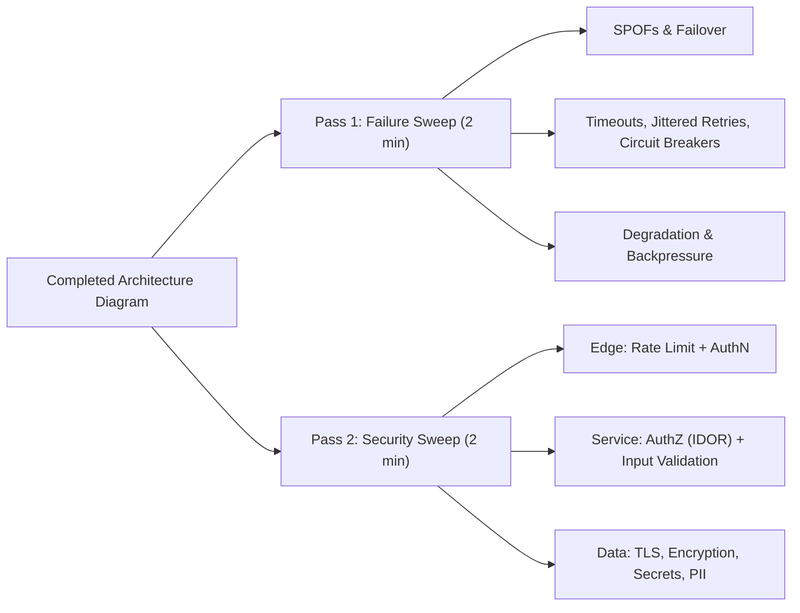
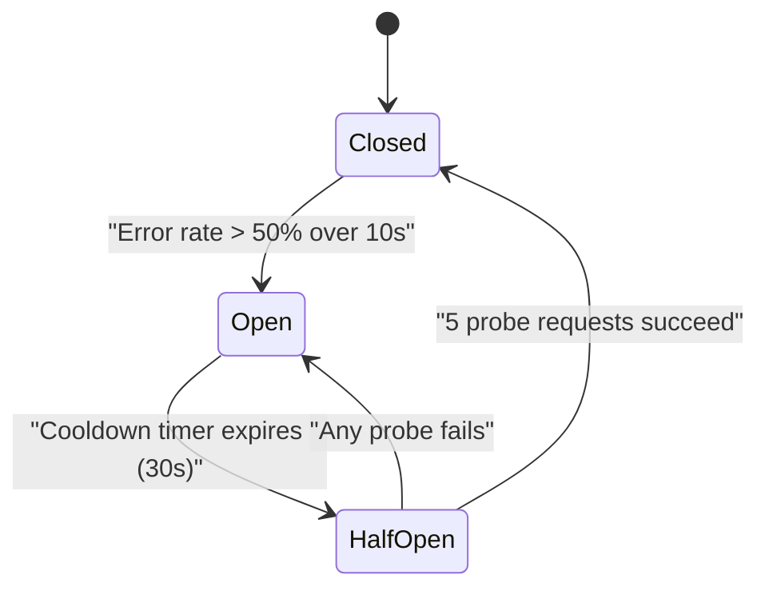
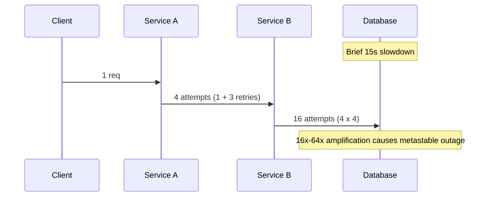

# Failures and Security in System Design Interviews: A Compact Pass

> **Prerequisites:** [Lesson 11: Evaluating Trade-offs Aloud in System Design Interviews](../11-evaluating-trade-offs-aloud-in-system-design-interviews/README.md).  
> **Estimated Reading Time:** 22–26 minutes  
> **Target Audience:** Backend engineers preparing for the final 5–8 minutes of a system design interview where interviewers probe failure modes, blast radius, and security boundaries.  
> **Free PDF Notes:** [Download SD-T-012.pdf](https://backendroadmap.com/notes/system-design/SD-T-012.pdf)

> [!NOTE]
> **In one line:** A compact failure and security pass is a **3-to-5 minute structured sweep** across your diagram that eliminates single points of failure (SPOFs), bounds cascading retries, and closes the top abuse vectors (authN/authZ, rate limiting, data-at-rest/in-transit) without derailing the interview.

> [!TIP]
> **The Golden Rule:** Don't wait for the interviewer to ask *"What happens if this crashes?"* or *"How do you prevent abuse?"* Proactively run a 4-minute **Failure + Security Sweep** right after your deep dive—it is the fastest way to signal Senior/Staff production ownership.

---

## 1. What a Compact Failure & Security Pass Is, and What It Isn't

In a 45-minute interview, you do not have time for a full threat model or chaos-engineering plan. A **compact pass** is a disciplined checklist applied to the boxes already on your whiteboard: trace what breaks when any node, link, or dependency degrades, and verify where untrusted input enters your trust boundary.

| Term | Precise Meaning | Example |
| :--- | :--- | :--- |
| **Single Point of Failure (SPOF)** | Any component whose loss halts the system | Single primary DB with no standby or failover |
| **Blast radius** | Fraction of users/features impacted by one failure | One shard down = 1/16th of users, not 100% |
| **Cascading failure** | A local slowdown triggers fleet-wide collapse | Unbounded retries amplify a 10% slowdown to 100% |
| **Graceful degradation** | Shedding non-critical features to save the core | Serving cached recommendations when ML is down |
| **Trust boundary** | Line separating untrusted callers from internal services | API Gateway / Edge proxy validating JWTs |
| **AuthN vs AuthZ** | Identity verification vs permission check | Valid JWT (AuthN) vs "owns `order_id`" (AuthZ/IDOR) |
| **Defense in depth** | Layered controls so one bypass isn't fatal | Edge WAF + rate limiter + mTLS + least-privilege IAM |
| **Not** | Reciting OWASP Top 10 or adding 12 firewalls | Focus only on the 3–4 risks specific to *your* diagram |

### Why It Matters
1. **Production realism:** Happy-path designs always work on a whiteboard; senior engineers are hired for how their systems behave at 3:00 AM during a partial outage or DDoS.
2. **Time efficiency:** A structured 4-minute sweep covers 90% of interviewer follow-ups before they are even asked.
3. **High-leverage signals:** Mentioning **retry storms**, **IDOR (Broken Object Level Authorization)**, and **blast-radius isolation** separates battle-tested engineers from textbook memorizers.

---

## 2. Anatomy: The Two-Pass Sweep (Failure + Security)



Walk your diagram **left-to-right** (Edge $\rightarrow$ Compute $\rightarrow$ Data) twice: once for **availability/failures**, once for **security/abuse**.

| Layer | Failure Question | Security Question |
| :--- | :--- | :--- |
| **Edge / Gateway** | Multi-AZ load balancer? Health checks? | Rate limiting (per IP/user), WAF, TLS 1.3? |
| **Stateless Services** | Auto-scaling? Timeouts + circuit breakers? | JWT/OAuth2 AuthN? Object-level AuthZ (IDOR)? |
| **Async / Queues** | DLQ for poison pills? Idempotent consumers? | Signed webhooks/messages? Payload size cap? |
| **Cache (Redis)** | Stampede protection? Fallback if cache dies? | Tenant key isolation? No PII in unencrypted keys? |
| **Database** | Multi-AZ replica + automated failover? Backups? | Parameterized queries? Encryption at rest (KMS)? |

> [!WARNING]
> **The #1 failure trap is "infinite/immediate retries without circuit breaking."** If a database slows down and every upstream service retries 3 times immediately, load triples ($3\times$) at the exact moment capacity is lowest, turning a minor blip into a total outage.

---

## 3. Mathematical Model: Availability, Retry Amplification & Blast Radius

### Model A: Serial Availability & Redundancy

If a request requires $n$ serial components with availability $a_i$, total availability is:

$$A_{\text{serial}} = \prod_{i=1}^{n} a_i$$

With 4 serial dependencies at $99.9\%$ each: $0.999^4 = 99.60\%$ (35 hours/year downtime). Adding a parallel redundant replica (active-active or fast failover) with availability $a$ raises that stage's availability to:

$$A_{\text{parallel}} = 1 - (1 - a)^2$$

For $a = 0.999$, $A_{\text{parallel}} = 1 - 0.001^2 = 0.999999$ (**six nines**, ~31.5 seconds/year), assuming independent failure domains (different AZs).

### Model B: Retry Amplification Factor

Suppose a service chain has depth $d = 3$ (Gateway $\rightarrow$ Order $\rightarrow$ Inventory $\rightarrow$ DB), and each hop retries $r = 3$ times on timeout. In the worst case where the DB is slow:

$$\text{Amplification} = (1 + r)^d = (1 + 3)^3 = 64\times \text{ load on the DB}$$

That is why **retries belong at only one layer** (usually the outermost client/gateway or via a strict **retry budget** of $\le 10\%$ extra traffic) with exponential backoff + jitter.

### Model C: Blast Radius via Cellular / Sharded Isolation

If you partition $100\%$ of users across $C = 16$ isolated cells (or shards) with independent failure domains:

$$\text{Blast Radius} = \frac{1}{C} = \frac{1}{16} = 6.25\%$$

Even a total meltdown in one cell leaves $93.75\%$ of customers unaffected.

---

## 4. Metrics & Percentiles

| Metric | Meaning | Alert when |
| :--- | :--- | :--- |
| **Error Budget Burn Rate** | Rate at which 99.9% SLO budget is consumed | $> 14.4\times$ over 1 hour (consumes 2% of monthly budget) |
| **Retry Ratio** | $\text{retries} / \text{original requests}$ | $> 10\%$ (indicates looming retry storm) |
| **Circuit Breaker Open %** | Fraction of upstream calls short-circuited | $> 0\%$ for critical dependency |
| **429 Rate-Limit Rejects** | Requests blocked by rate limiter | Sudden $10\times$ spike (DDoS or misconfigured client) |
| **401 / 403 Spike** | AuthN/AuthZ failures | Sustained spike (credential stuffing or IDOR probing) |
| **RPO / RTO** | Max data loss window / max recovery time | Exceeds stated SLA (e.g., RPO $> 0$ for payments) |

### Worked Example (Payment API Failure & Security Pass)
Suppose your payment API handles $2{,}000\text{ RPS}$ with a 99.95% SLO.
- **Failure check:** If the fraud-scoring ML service times out ($p_{99} > 200\text{ ms}$), a circuit breaker trips after 50% errors in 10 s and falls back to rule-based checks (`amount < $500` allowed, else manual review), preserving core checkout availability.
- **Security check:** Every `GET /v1/payments/{id}` enforces `payment.user_id == jwt.sub` (preventing IDOR), `POST /v1/payments` requires an `Idempotency-Key` header (preventing replay/double-charge), and PAN/card data is tokenized at the edge (PCI scope reduction).

---

## 5. Compounding & Failure Modes: Retry Storm Simulation

Consider a database with capacity $C = 1{,}000\text{ QPS}$ receiving $\lambda = 800\text{ QPS}$ normal traffic ($80\%$ utilization). A 30-second GC pause drops DB capacity to $400\text{ QPS}$, causing timeouts.

| Retry Policy | Peak Load on DB | Recovery After Pause Ends | Outcome |
| :--- | :--- | :--- | :--- |
| **No retries (fail fast)** | $800\text{ QPS}$ | Instant ($0\text{ s}$ after DB recovers) | 50% errors for 30 s, then 100% healthy |
| **3 immediate retries, 2 hops** | $800 \times 4^2 = 12{,}800\text{ QPS}$ | **Never recovers** (metastable collapse) | 100% outage until traffic is shed manually |
| **10% retry budget + jitter + CB** | $\le 880\text{ QPS}$ | $< 5\text{ s}$ after DB recovers | Brief degradation, automatic recovery |

**Lesson:** Without bounded retries and circuit breakers, a 30-second hiccup becomes a 2-hour metastable outage.

---

## 6. Numbers Every Engineer Must Know

| Item | Typical | Implication |
| :--- | :---: | :--- |
| 99.9% availability (three 9s) | $8.76\text{ hours/year}$ downtime | Acceptable for standard SaaS |
| 99.99% availability (four 9s) | $52.6\text{ minutes/year}$ downtime | Requires multi-AZ + automated failover |
| Multi-AZ failover (managed RDS) | $30$–$60\text{ seconds}$ | Clients must handle transient connection drops |
| Retry budget cap | $\le 10\%$ of normal traffic | Prevents metastable retry storms |
| Bcrypt / Argon2 password hash | $50$–$250\text{ ms}$ | CPU-bound; rate-limit login endpoints strictly |
| JWT verification (RS256/EdDSA) | $< 0.1\text{ ms}$ | Stateless at gateway; cache JWKS public keys |
| Token bucket rate-limit overhead | $< 1\text{ ms}$ (in-memory/Redis) | Protects origin from L7 floods |

---

## 7. Mechanism Deep Dive: Circuit Breaker & Trust Boundary Flow



| Question | Answer |
| :--- | :--- |
| **Where should authentication happen?** | At the API Gateway / Edge (verify JWT/session, attach verified `user_id` header). |
| **Where should authorization (AuthZ) happen?** | In the owning microservice (`resource.owner_id == user_id`), because only it owns the resource record. |
| **What if Redis rate limiter goes down?** | Fail-open for normal users with an in-memory per-pod fallback cap so a Redis outage doesn't take down the entire API. |
| **How do you handle a bad deployment?** | Canary rollout (1% $\rightarrow$ 10% $\rightarrow$ 100%) with automated rollback on error-budget burn. |

**When NOT to over-index on security:** Do not spend 10 minutes explaining TLS handshake cryptography or AES key rotation internals unless the prompt is specifically a security/auth system. Name the standard control (*"TLS 1.3 in transit, KMS-managed AES-256 at rest, short-lived IAM roles"*) and move on.

---

## 8. Hierarchical Budgets & Design Rules

| Slice | Rule | Control |
| :--- | :--- | :--- |
| **Time Budget** | 3–5 minutes total for both sweeps | 90s Failure + 90s Security + 60s Trade-offs |
| **Redundancy** | Zero SPOFs on the critical path | Multi-AZ load balancers, replicated DBs, clustered cache |
| **Timeouts** | Every network call has a bounded timeout | Deadline propagation ($T_{\text{remaining}}$) across hops |
| **Retries** | Only idempotent ops; jittered; $\le 10\%$ budget | Circuit breaker trips before upstream collapses |
| **AuthN / AuthZ** | Authenticate at edge; authorize at resource | Prevents IDOR / broken object-level access |
| **Abuse Control** | Multi-tier rate limiting (IP + User + Tenant) | Token bucket / sliding window at gateway |
| **Data Protection** | TLS 1.3 in transit; KMS at rest; mask PII in logs | Never log tokens, passwords, or raw PANs |

---

## 9. Top Mitigations

1. **Eliminate SPOFs** by deploying stateless compute across $\ge 2$ AZs and databases with synchronous/semi-sync replicas.
2. **Enforce strict timeouts and deadline propagation** so slow dependencies don't exhaust worker threads.
3. **Cap retries with exponential backoff + full jitter + a 10% retry budget** to prevent retry storms.
4. **Add circuit breakers with graceful fallbacks** (stale cache, default rules, or feature shedding).
5. **Enforce object-level authorization (AuthZ)** on every endpoint to stop IDOR attacks.
6. **Rate-limit by both IP and authenticated user/tenant** at the API gateway.
7. **Isolate blast radius** using cells, shards, or per-tenant bulkheads (separate thread/connection pools).

---

## 10. Production Reference: AWS / Industry Retry Storm & Cascading Collapse

A classic production SEV-1 pattern (documented in the AWS Builders' Library *"Timeouts, retries, and backoff with jitter"*):
- **The Trigger:** A downstream metadata service experienced a brief 15-second packet loss spike.
- **The Failure:** Three layers of upstream microservices each had `retries = 3` with fixed 100 ms backoff. Total amplification hit $(1+3)^3 = 64\times$ normal traffic, saturating the metadata service's CPU and connection pool.
- **Why It Didn't Recover:** Even after packet loss stopped, the backlog of synchronized retries kept CPU at 100% for 45 minutes until engineers manually shed 80% of edge traffic.
- **The Fix:** Retries were removed from intermediate layers, moved to a single layer with **exponential backoff + full jitter**, and paired with a **circuit breaker** and **10% retry budget**.



**Lesson:** Retries are a load multiplier. Always pair them with jitter, budgets, and circuit breakers.

---

## 11. Multi-Language Production Code Tabs

A production-grade **Circuit Breaker + Exponential Backoff with Full Jitter** (the core failure-mitigation primitive from this lesson) in all 4 languages, stdlib-only.

````carousel
```go
// Go: Thread-safe Circuit Breaker + Full Jitter Backoff.
package main

import (
	"errors"
	"math/rand"
	"sync"
	"time"
)

var ErrCircuitOpen = errors.New("circuit breaker open")

type CircuitBreaker struct {
	mu           sync.Mutex
	failures     int
	threshold    int
	openUntil    time.Time
	resetTimeout time.Duration
}

func (cb *CircuitBreaker) Call(fn func() error) error {
	cb.mu.Lock()
	if time.Now().Before(cb.openUntil) {
		cb.mu.Unlock()
		return ErrCircuitOpen
	}
	cb.mu.Unlock()

	err := fn()
	cb.mu.Lock()
	defer cb.mu.Unlock()
	if err != nil {
		cb.failures++
		if cb.failures >= cb.threshold {
			cb.openUntil = time.Now().Add(cb.resetTimeout)
		}
		return err
	}
	cb.failures = 0
	return nil
}

// FullJitterDelay computes random delay in [0, min(cap, base * 2^attempt)].
func FullJitterDelay(attempt int, base, cap time.Duration) time.Duration {
	exp := base << attempt
	if exp > cap || exp <= 0 {
		exp = cap
	}
	return time.Duration(rand.Int63n(int64(exp) + 1))
}
```
<!-- slide -->
```typescript
// TypeScript: Circuit Breaker + Full Jitter Exponential Backoff.
export class CircuitBreaker {
  private failures = 0;
  private openUntil = 0;

  constructor(private threshold = 5, private resetMs = 30_000) {}

  async execute<T>(fn: () => Promise<T>): Promise<T> {
    if (Date.now() < this.openUntil) {
      throw new Error("CircuitBreakerOpen");
    }
    try {
      const res = await fn();
      this.failures = 0;
      return res;
    } catch (err) {
      this.failures += 1;
      if (this.failures >= this.threshold) {
        this.openUntil = Date.now() + this.resetMs;
      }
      throw err;
    }
  }
}

export function fullJitterMs(attempt: number, baseMs = 50, capMs = 2000): number {
  const maxDelay = Math.min(capMs, baseMs * Math.pow(2, attempt));
  return Math.random() * maxDelay;
}
```
<!-- slide -->
```python
# Python: Circuit Breaker + Full Jitter + Retry Budget Simulator.
import random
import time


class CircuitBreaker:
    def __init__(self, threshold: int = 5, reset_s: float = 30.0):
        self.threshold = threshold
        self.reset_s = reset_s
        self.failures = 0
        self.open_until = 0.0

    def call(self, fn):
        if time.monotonic() < self.open_until:
            raise RuntimeError("CircuitBreakerOpen")
        try:
            result = fn()
            self.failures = 0
            return result
        except Exception:
            self.failures += 1
            if self.failures >= self.threshold:
                self.open_until = time.monotonic() + self.reset_s
            raise


def full_jitter_delay(attempt: int, base_s: float = 0.05, cap_s: float = 2.0) -> float:
    return random.uniform(0, min(cap_s, base_s * (2 ** attempt)))


def retry_amplification(depth: int, retries_per_hop: int) -> int:
    return (1 + retries_per_hop) ** depth
```
<!-- slide -->
```csharp
// C#: Thread-safe Circuit Breaker + Full Jitter Backoff.
using System;
using System.Threading;

public sealed class CircuitBreaker
{
    private readonly int _threshold;
    private readonly TimeSpan _resetTimeout;
    private int _failures;
    private long _openUntilTicks;

    public CircuitBreaker(int threshold = 5, int resetSeconds = 30)
    {
        _threshold = threshold;
        _resetTimeout = TimeSpan.FromSeconds(resetSeconds);
    }

    public T Execute<T>(Func<T> action)
    {
        if (DateTime.UtcNow.Ticks < Interlocked.Read(ref _openUntilTicks))
            throw new InvalidOperationException("CircuitBreakerOpen");

        try
        {
            var result = action();
            Interlocked.Exchange(ref _failures, 0);
            return result;
        }
        catch
        {
            if (Interlocked.Increment(ref _failures) >= _threshold)
                Interlocked.Exchange(ref _openUntilTicks, DateTime.UtcNow.Add(_resetTimeout).Ticks);
            throw;
        }
    }

    public static int FullJitterMs(int attempt, int baseMs = 50, int capMs = 2000)
    {
        int maxDelay = Math.Min(capMs, baseMs * (1 << Math.Min(attempt, 10)));
        return Random.Shared.Next(0, maxDelay + 1);
    }
}
```
````

---

## 12. Hands-On CLI Verification Workflows

Verify retry amplification and serial vs parallel availability math:

```bash
python3 -c '
# 1. Retry amplification across 3 hops with 3 retries each
amp = (1 + 3) ** 3
# 2. Serial vs Parallel availability (4 deps at 99.9%)
a_serial = 0.999 ** 4
a_parallel_stage = 1 - (1 - 0.999) ** 2
print(f"Retry amplification: {amp}x | Serial avail: {a_serial:.4%} | Redundant stage: {a_parallel_stage:.6%}")
'
```

Inspect real TLS/rate-limit headers on an API endpoint with `curl`:

```bash
curl -sI https://api.github.com | grep -iE "x-ratelimit|strict-transport|http/"
```

---

## 13. Common Mistakes to Avoid

1. **Waiting for the interviewer to ask about failures** instead of running a proactive 2-minute sweep.
2. **Adding retries without jitter or a retry budget**, creating a textbook retry storm.
3. **Putting AuthN at the gateway and forgetting object-level AuthZ (IDOR)** in the service.
4. **Saying "we'll use HTTPS" and stopping there** for security—missing rate limiting, secrets management, and PII masking.
5. **Designing a global SPOF** (single Redis instance, single Kafka broker, single-AZ DB) on a high-availability prompt.
6. **Failing closed on non-critical dependencies** (e.g., failing checkout because the analytics or recommendation service is slow).
7. **Burning 15 minutes on low-probability edge cases** (e.g., asteroid hitting two AWS regions) instead of common failures (AZ loss, slow DB, bad deploy).

---

## 14. Key Terms Glossary

| Key Term | Definition |
| :--- | :--- |
| **SPOF** | Single Point of Failure; a component whose failure takes down the entire system. |
| **Blast Radius** | The scope of users or functionality affected by a single failure. |
| **Retry Storm** | Cascading overload caused by multiple layers retrying failed requests simultaneously. |
| **Circuit Breaker** | State machine that stops calling a failing dependency to allow recovery and fail fast. |
| **Graceful Degradation** | Dropping non-essential features to keep core functionality alive under load/failure. |
| **Bulkhead** | Isolating resources (threads, connections, cells) so one noisy tenant/feature cannot sink others. |
| **IDOR** | Insecure Direct Object Reference; accessing another user's resource by changing an ID without AuthZ. |
| **Trust Boundary** | Perimeter where untrusted external requests are authenticated, validated, and rate-limited. |
| **RPO / RTO** | Recovery Point Objective (max data loss) / Recovery Time Objective (max downtime). |
| **Error Budget** | Allowable unreliability ($1 - \text{SLO}$) used to balance feature velocity and stability. |

---

## 15. System Design Interview Questions & Answers

### Basic Conceptual Questions

<details>
<summary><strong>Q1: What is the fastest way to run a failure pass on a whiteboard diagram? [BASIC]</strong></summary>

**Answer:**
Walk left-to-right across every box and ask three questions: (1) If this box dies, is it a SPOF? (2) If this box slows down by 10x, do timeouts and circuit breakers isolate it? (3) If this box is non-critical, what is our graceful fallback?
</details>

<details>
<summary><strong>Q2: What is the difference between Authentication (AuthN) and Authorization (AuthZ)? [BASIC]</strong></summary>

**Answer:**
AuthN verifies *who* the caller is (e.g., validating a JWT or API key at the API gateway). AuthZ verifies *what* that caller is allowed to do on a specific resource (e.g., checking `order.user_id == jwt.sub` inside the order service to prevent IDOR).
</details>

<details>
<summary><strong>Q3: Why is exponential backoff alone not enough for retries? [BASIC]</strong></summary>

**Answer:**
Without **jitter** (randomness), clients that failed at the same time will back off for the exact same intervals (1s, 2s, 4s) and hit the recovering server in synchronized waves ("thundering herd"). Full jitter spreads retries smoothly over the window.
</details>

<details>
<summary><strong>Q4: What is a bulkhead pattern? [BASIC]</strong></summary>

**Answer:**
Named after ship hull compartments, a bulkhead isolates resource pools (connection pools, thread pools, worker queues, or cellular shards) per dependency or tenant so a slow downstream service or noisy-neighbor tenant cannot exhaust resources for healthy traffic.
</details>

### Scenario-Based Architecture Questions

<details>
<summary><strong>Q5: Your recommendation service slows down from 20 ms to 5 s. How do you protect checkout? [SCENARIO]</strong></summary>

**Answer:**
Enforce a strict 100 ms timeout on the recommendation call, wrap it in a circuit breaker, and isolate it in its own thread/connection pool (bulkhead). When the breaker opens, degrade gracefully by returning a cached "Top Sellers" list or omitting recommendations so checkout completes normally.
</details>

<details>
<summary><strong>Q6: How do you protect a public URL shortener or login API from abuse and DDoS? [SCENARIO]</strong></summary>

**Answer:**
Layer defenses at the edge: (1) CDN/WAF for L3/L4 and known bot signatures, (2) token-bucket rate limiting per IP and per user/API key at the gateway, (3) CAPTCHA or proof-of-work challenges on suspicious login/creation bursts, and (4) strict payload size limits and input validation.
</details>

<details>
<summary><strong>Q7: A multi-AZ database primary fails. What happens to in-flight and new requests? [SCENARIO]</strong></summary>

**Answer:**
In-flight writes fail or time out; managed failover (DNS update + standby promotion) takes 30–60 seconds. During that window, read-only traffic can still be served from read replicas or cache, while writes return `503 Retry-After` (or queue asynchronously if the product allows eventual writes).
</details>

<details>
<summary><strong>Q8: How do you prevent a single malicious or buggy tenant from taking down a multi-tenant SaaS? [SCENARIO]</strong></summary>

**Answer:**
Apply per-tenant rate limits at the gateway, per-tenant queue partitioning (or fair-scheduling queues) for async jobs, and cellular/shard isolation so one tenant's spike only affects their own cell/quota.
</details>

### Advanced & Tricky Interview Questions

<details>
<summary><strong>Q9: What is a metastable failure, and why doesn't fixing the root cause immediately recover the system? [TRICKY]</strong></summary>

**Answer:**
A metastable failure occurs when a trigger (like a brief GC pause) pushes the system into a self-sustaining degraded state—typically fueled by retries, lock contention, or growing queues. Even after the trigger disappears, the amplified retry/backlog load keeps the system saturated until load is actively shed.
</details>

<details>
<summary><strong>Q10: When should a rate limiter fail-open vs fail-closed? [TRICKY]</strong></summary>

**Answer:**
For general product APIs, a distributed rate limiter (e.g., Redis) should **fail-open** to a local per-instance fallback cap if Redis dies, so a rate-limiter outage doesn't cause a total site outage. For high-risk endpoints (password reset, fund transfer, OTP), **fail-closed** or fall back to strict local limits to prevent brute-force/fraud.
</details>

<details>
<summary><strong>Q11: Why is "failover" to a cold standby often dangerous in production? [TRICKY]</strong></summary>

**Answer:**
A cold standby or secondary region has cold caches (0% hit rate), uncalibrated connection pools, and hasn't been exercised under real load. Switching 100% of traffic onto it can immediately overload its database via cache stampede. Keep standbys warm or continuously exercise multi-region traffic (e.g., 5–10% canary).
</details>

<details>
<summary><strong>Q12: How do you handle PII and compliance (GDPR "right to be forgotten") in an event-driven architecture? [TRICKY]</strong></summary>

**Answer:**
Avoid putting raw PII in immutable event logs (like Kafka). Instead, store PII in an encrypted, mutable PII vault keyed by `user_id` (or encrypt each user's events with a per-user KMS key—"crypto-shredding"). Deleting the user's key or vault record renders all historical events unreadable without rewriting Kafka topics.
</details>

---

## 16. One-Page Master Cheat Sheet

```
+---------------------------------------------------------------------------------------------------------+
|               FAILURES & SECURITY COMPACT PASS — MASTER CHEAT SHEET                                     |
+---------------------------------------------------------------------------------------------------------+
| 1. 4-MIN SWEEP: Walk diagram left-to-right twice: Pass 1 = Failures (2m), Pass 2 = Security (2m).       |
+---------------------------------------------------------------------------------------------------------+
| 2. NO SPOFs: Multi-AZ LB + stateless compute + replicated DB + fallback for cache/non-critical deps.    |
+---------------------------------------------------------------------------------------------------------+
| 3. STOP RETRY STORMS: Bounded timeouts + 1 retry layer + exponential backoff + full jitter + 10% budget. |
|    Amplification = (1 + r)^d. Circuit breaker + graceful degradation keep core flows alive.             |
+---------------------------------------------------------------------------------------------------------+
| 4. BLAST RADIUS: Shard/cell isolation (1/C users impacted) + per-tenant bulkheads & rate limits.        |
+---------------------------------------------------------------------------------------------------------+
| 5. SECURITY ESSENTIALS: Edge WAF/rate-limit -> Gateway AuthN (JWT) -> Service AuthZ (stop IDOR) ->      |
|    TLS 1.3 in transit + KMS at rest + no raw PII in logs/immutable streams.                             |
+---------------------------------------------------------------------------------------------------------+
```

---

## Further Reading & Sources

- Marc Brooker (AWS Builders' Library), *Timeouts, retries, and backoff with jitter*.
- Nathan Bronson et al. (Facebook/Meta), *Metastable Failures in Distributed Systems* (HotOS).
- OWASP, *API Security Top 10* (especially API1: Broken Object Level Authorization / IDOR).
- Google SRE Book, *Handling Overload* and *Addressing Cascading Failures*.

---

## Free PDF Notes

[SD-T-012.pdf](https://backendroadmap.com/notes/system-design/SD-T-012.pdf)

---

## Next

Continue with [Lesson 13: Prioritizing Under Time Pressure in System Design Interviews](../13-prioritizing-under-time-pressure-in-system-design-interviews/README.md).
