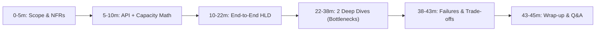
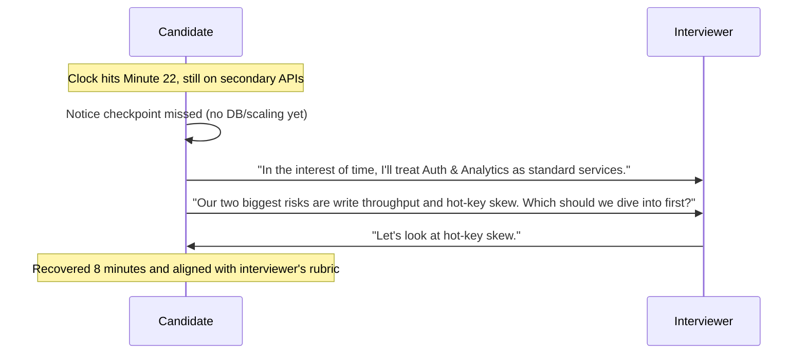

# Prioritizing Under Time Pressure in System Design Interviews

> **Prerequisites:** [Lesson 12: Failures and Security in System Design Interviews: A Compact Pass](../12-failures-and-security-in-system-design-interviews/README.md).  
> **Estimated Reading Time:** 22–26 minutes  
> **Target Audience:** Candidates who run out of time before reaching the deep dive, or get bogged down in low-value details (login forms, CSS, boilerplate CRUD) during a 45-minute loop.  
> **Free PDF Notes:** [Download SD-T-013.pdf](https://backendroadmap.com/notes/system-design/SD-T-013.pdf)

> [!NOTE]
> **In one line:** Prioritizing under time pressure means **allocating your 45 minutes strictly by rubric weight**: spend ~5 min scoping, ~5 min estimating, ~12 min on an end-to-end high-level design, ~18 min on the 2 hardest bottlenecks, and ~5 min on failures, trade-offs, and wrap-up—never spending 15 minutes on commodity boilerplate.

> [!TIP]
> **The Golden Rule:** Get a working end-to-end diagram on the board by **minute 22**. An incomplete "perfect" design with no storage or deep dive fails the rubric; a working baseline with 2 deep dives passes.

---

## 1. What Prioritizing Under Time Pressure Is, and What It Isn't

A 45-minute system design interview is actually ~38 minutes of design after introductions and candidate Q&A. You cannot design every microservice, schema migration, and CI/CD pipeline in 38 minutes. Strong candidates aggressively triage: they **sketch commodity parts in 30 seconds** and **invest 75% of their energy in the 20% of the system that carries 80% of the architectural risk**.

| Term | Precise Meaning | Example |
| :--- | :--- | :--- |
| **Time-boxing** | Hard minute caps per interview phase | "5 min requirements, 12 min HLD, 18 min deep dive" |
| **Critical path** | The core user flows that define the problem | `shorten()` + `redirect()` for TinyURL; not `resetPassword()` |
| **Commodity component** | Solved infrastructure needing no invention | Auth service, CDN, standard API gateway, metrics stack |
| **Differentiator / Risk** | The 1–2 hard distributed-systems problems | Geo-spatial index for Uber; hot-key skew for counters |
| **Scope negotiation** | Explicitly deferring secondary features | "Let's defer billing and analytics to focus on matching" |
| **Bike-shedding** | Spending 10 minutes on trivial details | Debating REST vs GraphQL or UUIDv4 vs UUIDv7 too early |
| **Recovery checkpoint** | Mid-interview pivot when behind schedule | Skipping secondary endpoints to jump straight to bottleneck |
| **Not** | Rushing, talking faster, or skipping requirements | Calm, deliberate pacing with explicit scope cuts |

### Why It Matters
1. **Incomplete interviews fail automatically:** Interviewers cannot award Senior/Staff signal if you never reach data modeling, scaling, or failure handling.
2. **Signal-to-noise ratio:** Spending 8 minutes on user registration and JWT refresh tokens produces zero signal for a distributed rate-limiter or chat prompt.
3. **Executive presence:** Managing the clock aloud (*"We have 15 minutes left—let's zoom into the write-path bottleneck"*) demonstrates Staff-level leadership.

---

## 2. Anatomy: The 45-Minute Time Budget



Notice the **asymmetry**: Phases 1–3 take half the clock (22 min) to establish a complete baseline; Phase 4 + 5 take the other half (21 min) where Senior/Staff hiring decisions are actually made.

| Phase | Minute Mark | Target Output | Cut Rule (If Behind) |
| :--- | :---: | :--- | :--- |
| **1. Scope & NFRs** | 0–5 | 3–4 functional reqs, 3 NFRs (QPS, latency, consistency) | Stop at 3 core flows; defer admin/analytics |
| **2. API & Math** | 5–10 | 2–3 key endpoints + QPS/storage order-of-magnitude | Skip exact byte counts; compute peak QPS + 5-yr storage |
| **3. High-Level Design** | 10–22 | Client $\rightarrow$ LB $\rightarrow$ Service $\rightarrow$ Cache/Queue/DB | Draw the happy path for #1 flow first; skip auth box |
| **4. Deep Dives** | 22–38 | Partitioning, hot keys, concurrency, consistency | Pick top 2 bottlenecks; ask interviewer which first |
| **5. Failures & Security** | 38–43 | SPOFs, retry/CB, rate limit, AuthZ | 90s failure sweep + 90s security sweep |
| **6. Wrap-up** | 43–45 | Summarize bottlenecks solved + remaining trade-offs | Leave 2 min for interviewer questions |

> [!WARNING]
> **The #1 time-killer is "premature optimization during High-Level Design."** Do not design sharding, CDC pipelines, and multi-region failover at minute 12 before you have a single end-to-end box diagram. Get the baseline working first, then scale it in the deep dive.

---

## 3. Mathematical Model: Signal Density per Minute

Think of your interview score $S$ as the sum of rubric signals $s_k$ earned across $K$ categories, where each minute spent on category $k$ has diminishing returns $\alpha_k \in (0, 1)$:

$$S = \sum_{k=1}^{K} w_k \cdot s_k(t_k), \qquad s_k(t_k) = 1 - e^{-t_k / \tau_k}$$

Here $w_k$ is the rubric weight and $\tau_k$ is the saturation time constant:
- **Auth / Boilerplate CRUD:** $w_{\text{crud}} \approx 0.05$, $\tau \approx 1\text{ min}$. Spending $t = 8\text{ min}$ yields $0.05 \times (1 - e^{-8}) = 0.050$, whereas spending $t = 1\text{ min}$ yields $0.032$. Those extra 7 minutes buy **$0.018$ points**.
- **Deep Dives & Bottlenecks:** $w_{\text{deep}} \approx 0.40$, $\tau \approx 8\text{ min}$. Moving those 7 minutes from CRUD to Deep Dives increases deep-dive time from $11\text{ min}$ to $18\text{ min}$, raising its score from $0.40(1 - e^{-11/8}) = 0.299$ to $0.40(1 - e^{-18/8}) = 0.358$ (**$+0.059$ points**, over $3\times$ higher ROI)—plus it prevents a $0$ in the Failure/Security category at the end!

### Expected Value of Triage (45-Minute Budget)

$$\text{ROI}(t_k) = \frac{\partial S}{\partial t_k} = \frac{w_k}{\tau_k} e^{-t_k / \tau_k}$$

Always invest the next minute where $\text{ROI}(t_k)$ is highest: an unstarted category ($t_k = 0$) with $w_k \ge 0.20$ always beats polishing an already-drawn box.

---

## 4. Metrics & Percentiles (Clock Checkpoints)

| Checkpoint | Target State | Red Flag (Behind Schedule) | Recovery Action |
| :--- | :--- | :--- | :--- |
| **Minute 10** | Scope + NFRs + QPS math done | Still debating edge-case requirements | Lock assumptions aloud and start drawing |
| **Minute 22** | End-to-end HLD + DB schema sketched | No storage layer or data flow yet | Skip secondary flows; finish primary path in 2 min |
| **Minute 30** | Deep Dive #1 complete | Still explaining basic API endpoints | Ask interviewer: *"Should I jump to [Bottleneck] now?"* |
| **Minute 38** | Deep Dive #2 complete | Zero mention of failures or scaling | Stop deep dive; run 3-min Failure + Security sweep |
| **Minute 43** | Failures + trade-offs complete | Mid-sentence on a minor detail | Summarize in 30 seconds and hand floor back |

### Worked Example (Designing Uber in 45 Minutes)
- **What to CUT at minute 3:** Driver onboarding, surge pricing ML model training, receipt PDF generation, trip rating UI.
- **What to BOX-AND-MOVE-ON at minute 14:** AuthN/JWT, push notification provider (APNs/FCM), payment gateway (Stripe).
- **Where to SPEND minutes 22–38:** (1) Geospatial indexing (Geohash/S2/H3) for high-frequency driver location updates ($500\text{k}$ writes/s) and nearby-driver search, and (2) Distributed trip-matching lock / double-dispatch prevention.

---

## 5. Compounding & Failure Modes of Poor Pacing

| Pacing Mistake | Early Effect (Min 0–15) | Late Effect (Min 30–45) | Rubric Outcome |
| :--- | :--- | :--- | :--- |
| **Over-scoping** (listing 10 features) | Feels thorough | Only 3 of 10 features designed; fragmented | "Lacks focus, incomplete" |
| **20-min capacity math** | Precise byte-level math | No time for sharding or failure modes | "Strong junior, missed Senior bar" |
| **Auth/CRUD bike-shedding** | Comfortable, easy talk | Rushed 2-min deep dive at minute 41 | "No depth on hard problems" |
| **Silent stalling** | Candidate thinks quietly | Interviewer has to pull every answer | "Needs heavy prompting" |

The compounding effect: **every 1 minute wasted in Phase 1–2 steals 1 minute from Phase 4–5**, where the highest-weighted Senior/Staff signals live.

---

## 6. Numbers Every Engineer Must Know

| Item | Typical | Implication |
| :--- | :---: | :--- |
| Actual design time in a 45-min slot | $36$–$38\text{ minutes}$ | Plan for 38 min, not 45 |
| Actual design time in a 60-min slot | $48$–$50\text{ minutes}$ | Extra 10 min goes to Deep Dive #2–3 |
| Target time for Scope + Math | $\le 10\text{ minutes}$ | Never exceed 12 min before drawing |
| Target time to reach Deep Dive | Minute $20$–$22$ | Halfway mark = baseline complete |
| Commodity component explanation | $\le 30\text{ seconds}$ | "Standard OAuth2/JWT at gateway" |
| Core Deep Dive allocation | $15$–$20\text{ minutes}$ | Largest single block on the clock |
| Failure + Security compact pass | $3$–$5\text{ minutes}$ | Protects final rubric categories |

---

## 7. Mechanism Deep Dive: The Mid-Interview Pivot



| Question | Answer |
| :--- | :--- |
| **What if the interviewer keeps asking questions during HLD?** | Answer crisply in 20 seconds, then bridge back: *"Does that address your concern, or should we deep-dive that now?"* |
| **What if I'm stuck on capacity math?** | Round aggressively to powers of 10 ($86{,}400 \approx 10^5\text{ s/day}$) and move on; exact arithmetic has zero rubric weight. |
| **What if the interviewer redirects me away from my plan?** | Follow their lead immediately—they are telling you which rubric box they still need to check. |
| **Should I check my watch/clock openly?** | Yes! Glance at the clock at minutes 10, 22, and 38 and narrate the transition aloud. |

**When NOT to cut scope silently:** Never quietly skip a requirement you agreed to in Minute 3. Always say *"To protect time for the storage deep dive, I'm deferring X—is that okay?"*

---

## 8. Hierarchical Budgets & Design Rules

| Slice | Rule | Control |
| :--- | :--- | :--- |
| **Requirements** | Max 3–4 core functional, 3 NFRs | Explicitly defer secondary features |
| **Math** | Powers-of-10 rounding only | Cap at 4–5 min; derive Peak QPS + Storage |
| **HLD** | Primary read + write path first | Draw boxes, label protocols, no premature sharding |
| **Deep Dive** | Pick top 2 riskiest bottlenecks | Confirm priority with interviewer at min 22 |
| **Failures/Security** | 4-minute compact sweep at min 38 | SPOFs, retries/CB, rate limit, AuthZ |
| **Time Checks** | 3 hard checkpoints (10m, 22m, 38m) | Trigger recovery script if >2 min late |

---

## 9. Top Mitigations (How to Never Run Out of Time)

1. **Write the 5-phase agenda on the corner of the whiteboard** at minute 0 so both you and the interviewer share the map.
2. **Use the $86{,}400 \approx 10^5$ shortcut** for all QPS math so calculations take 60 seconds, not 5 minutes.
3. **Black-box commodity services** (*"We'll use an existing Auth0/JWT gateway and S3/CDN for static assets"*) in one sentence.
4. **Design the #1 critical path end-to-end** before touching secondary paths (e.g., search, admin, billing).
5. **Ask the interviewer to co-prioritize at minute 22:** *"We have ~18 minutes left—I see bottlenecks in A and B; where should we go deep?"*
6. **Keep a 3-minute emergency landing script** if you hit minute 40 without a failure pass: 90s on SPOFs/retries + 90s on rate-limiting/AuthZ.
7. **Practice with a visible 38-minute countdown timer** in mock interviews until checkpoints become muscle memory.

---

## 10. Production Reference: The "Incomplete Whiteboard" Anti-Pattern

Across engineering hiring committees (Meta, Google, Stripe, Uber), the single most common reason strong backend engineers receive a *No Hire* or *Down-level* on System Design is **running out of time before demonstrating depth**:
- **Minute 0–14:** Thorough requirements + exhaustive capacity math (calculating exact header bytes and compression ratios).
- **Minute 14–32:** Drawing 8 microservices including User Profile, Notification, Auth, Billing, and Analytics, plus full SQL schemas for all of them.
- **Minute 32–42:** Interviewer finally asks *"Okay, how does the actual core matching/feed/rate-limiter scale to 100k QPS?"*
- **Minute 42–45:** Candidate rushes through sharding and caching in 3 minutes with no failure modes or trade-offs.
- **Committee Verdict:** *"Candidate has good breadth and communication, but we lack sufficient signal on distributed systems depth, bottleneck analysis, and failure handling."*

**The Fix:** Aggressive triage in the first 10 minutes buys 18 minutes for the exact signal the hiring committee grades.

---

## 11. Multi-Language Production Code Tabs

A **45-Minute Interview Pacing & Signal-ROI Simulator** that models rubric score under different time allocations (Balanced vs Boilerplate-Heavy vs Math-Heavy) and outputs checkpoint alerts.

````carousel
```go
// Go: Models interview rubric score using diminishing-returns ROI per phase.
package main

import (
	"fmt"
	"math"
)

type Phase struct {
	Name   string
	Weight float64
	TauMin float64
}

func ScoreAllocation(phases []Phase, minutes []float64) float64 {
	total := 0.0
	for i, p := range phases {
		total += p.Weight * (1.0 - math.Exp(-minutes[i]/p.TauMin))
	}
	return total
}

func main() {
	phases := []Phase{
		{"Scope+Math", 0.15, 4.0},
		{"HLD", 0.25, 6.0},
		{"DeepDive", 0.40, 8.0},
		{"Failures+Sec", 0.20, 3.0},
	}
	balanced := []float64{9, 12, 18, 6}      // 45 min total
	unbalanced := []float64{16, 22, 5, 2}    // bogged down in math/CRUD
	fmt.Printf("Balanced Score:   %.3f / 1.000\n", ScoreAllocation(phases, balanced))
	fmt.Printf("Unbalanced Score: %.3f / 1.000\n", ScoreAllocation(phases, unbalanced))
}
```
<!-- slide -->
```typescript
// TypeScript: Interview Checkpoint Tracker with automatic recovery advice.
interface Checkpoint {
  minute: number;
  phase: string;
  milestone: string;
}

const PLAN: Checkpoint[] = [
  { minute: 10, phase: "Scope + Math", milestone: "3 NFRs + Peak QPS done" },
  { minute: 22, phase: "High-Level Design", milestone: "End-to-end happy path drawn" },
  { minute: 38, phase: "Deep Dives", milestone: "Top 2 bottlenecks resolved" },
  { minute: 43, phase: "Failures + Security", milestone: "SPOFs, retries, AuthZ covered" },
];

function checkPace(elapsedMin: number, completedIndex: number): string {
  const expected = PLAN.findIndex((c) => elapsedMin <= c.minute);
  if (expected !== -1 && completedIndex < expected) {
    const missed = PLAN[completedIndex];
    return `BEHIND at ${elapsedMin}m: Cut secondary flows, finish "${missed.milestone}" in 2m.`;
  }
  return `ON PACE at ${elapsedMin}m.`;
}

console.log(checkPace(25, 1));
```
<!-- slide -->
```python
# Python: Computes marginal ROI per minute to decide what to cut under time pressure.
import math

PHASES = [
    ("Scope+Math", 0.15, 4.0),
    ("HLD", 0.25, 6.0),
    ("DeepDive", 0.40, 8.0),
    ("Failures+Sec", 0.20, 3.0),
]


def marginal_roi(weight: float, tau: float, t: float) -> float:
    return (weight / tau) * math.exp(-t / tau)


def total_score(alloc: list[float]) -> float:
    return sum(w * (1 - math.exp(-t / tau)) for (_, w, tau), t in zip(PHASES, alloc))


if __name__ == "__main__":
    print("Balanced (9,12,18,6):", round(total_score([9, 12, 18, 6]), 3))
    print("Unbalanced (16,22,5,2):", round(total_score([16, 22, 5, 2]), 3))
```
<!-- slide -->
```csharp
// C#: Compares Balanced vs Boilerplate-heavy 45-minute interview allocations.
using System;

public static class PacingSimulator
{
    public static double Score(double[] weights, double[] taus, double[] mins)
    {
        double total = 0;
        for (int i = 0; i < weights.Length; i++)
            total += weights[i] * (1.0 - Math.Exp(-mins[i] / taus[i]));
        return Math.Round(total, 3);
    }

    public static void Main()
    {
        double[] w = { 0.15, 0.25, 0.40, 0.20 };
        double[] tau = { 4.0, 6.0, 8.0, 3.0 };
        Console.WriteLine($"Balanced:   {Score(w, tau, new[] { 9.0, 12.0, 18.0, 6.0 })}");
        Console.WriteLine($"Unbalanced: {Score(w, tau, new[] { 16.0, 22.0, 5.0, 2.0 })}");
    }
}
```
````

---

## 12. Hands-On CLI Verification Workflows

Run the diminishing-returns rubric simulation in Python 3:

```bash
python3 -c '
import math
phases = [("Scope+Math",0.15,4.0), ("HLD",0.25,6.0), ("DeepDive",0.40,8.0), ("Fail+Sec",0.20,3.0)]
score = lambda alloc: sum(w*(1-math.exp(-t/tau)) for (_,w,tau), t in zip(phases, alloc))
print("Balanced (9,12,18,6):   ", round(score([9,12,18,6]), 3))
print("Math/CRUD heavy (16,22,5,2):", round(score([16,22,5,2]), 3))
'
```

Expected output:
```text
Balanced (9,12,18,6):    0.858
Math/CRUD heavy (16,22,5,2): 0.658
```

That $0.200$ gap ($85.8\%$ vs $65.8\%$) is the exact difference between a **Strong Hire** and a **Down-level / No Hire**—with the exact same technical knowledge, differing *only* in time allocation.

---

## 13. Common Mistakes to Avoid

1. **Designing User Registration / Login / Password Reset** on a non-auth prompt.
2. **Spending 10+ minutes on exact byte-level capacity math** instead of rounding to powers of 10.
3. **Writing full DDL `CREATE TABLE` statements** for 6 tables instead of sketching the 1–2 core entities.
4. **Refusing to cut scope** when the prompt is intentionally too big for 45 minutes (e.g., *"Design Amazon"*).
5. **Not watching the clock** and hitting minute 35 with zero scaling or failure discussion.
6. **Optimizing a non-bottleneck** (e.g., caching static user profiles when the bottleneck is write-heavy telemetry ingestion).
7. **Silent scrambling** when behind instead of resetting expectations aloud with the interviewer.

---

## 14. Key Terms Glossary

| Key Term | Definition |
| :--- | :--- |
| **Time-Boxing** | Assigning fixed minute budgets to each phase of the interview. |
| **Critical Path** | The primary user flows that carry the core architectural complexity. |
| **Commodity Component** | Standard infrastructure (auth, CDN, logging) that should be black-boxed quickly. |
| **Bike-Shedding** | Spending disproportionate time on trivial, low-signal details. |
| **Scope Negotiation** | Proactively agreeing with the interviewer on what to include and exclude. |
| **Checkpoint** | A target clock time (e.g., min 10, 22, 38) used to verify pacing. |
| **Signal Density** | Rubric value earned per minute spent on a topic. |
| **Emergency Landing** | A 3–4 minute wrap-up covering failures, security, and trade-offs when short on time. |

---

## 15. System Design Interview Questions & Answers

### Basic Conceptual Questions

<details>
<summary><strong>Q1: How should you divide a 45-minute system design interview? [BASIC]</strong></summary>

**Answer:**
Assume ~38–43 minutes of actual design: 0–5m Scope & NFRs, 5–10m API & Capacity Math, 10–22m High-Level Design, 22–38m Deep Dives (2 bottlenecks), 38–43m Failures & Security sweep, and 43–45m Wrap-up.
</details>

<details>
<summary><strong>Q2: What should you explicitly defer in the first 5 minutes of almost any prompt? [BASIC]</strong></summary>

**Answer:**
User registration/authentication details, admin dashboards, billing/invoicing, email/SMS template management, and full analytics pipelines—unless one of those is the explicit subject of the prompt.
</details>

<details>
<summary><strong>Q3: Why is "Design YouTube" or "Design Uber" intentionally too large for 45 minutes? [BASIC]</strong></summary>

**Answer:**
Interviewers make prompts broad on purpose to test whether you can **scope, prioritize, and drive** toward the hardest technical bottlenecks instead of trying to boil the ocean.
</details>

<details>
<summary><strong>Q4: When is the right time to check in with the interviewer about priorities? [BASIC]</strong></summary>

**Answer:**
Twice: (1) at minute 5 after scoping (*"Does this scope match what you want to focus on?"*) and (2) at minute 22 after the baseline diagram (*"I see two main bottlenecks: X and Y—which should we dive into first?"*).
</details>

### Scenario-Based Architecture Questions

<details>
<summary><strong>Q5: You are at minute 26 and haven't finished the high-level diagram. What do you do? [SCENARIO]</strong></summary>

**Answer:**
Stop adding secondary services immediately. Draw the single database and cache for the #1 critical flow in 90 seconds, label it as the baseline, and say: *"To protect time for scaling and failure modes, I'll treat notifications and analytics as async events and jump into the primary bottleneck now."*
</details>

<details>
<summary><strong>Q6: The interviewer asks you to design "Amazon.com". How do you prioritize in the first 3 minutes? [SCENARIO]</strong></summary>

**Answer:**
Propose focusing on the high-contention core: Product Catalog Browse + Cart + Checkout/Inventory Reservation, while explicitly deferring Seller Onboarding, Ads, Reviews, and Fulfillment Logistics. Confirm with the interviewer before drawing.
</details>

<details>
<summary><strong>Q7: You have 4 minutes left and haven't discussed failures or security. What do you say? [SCENARIO]</strong></summary>

**Answer:**
Run the 4-minute compact pass: 2 minutes on eliminating SPOFs (multi-AZ DB, stateless compute), bounding retries with circuit breakers, and graceful degradation; 2 minutes on gateway rate limiting, JWT AuthN, object-level AuthZ (IDOR), and encryption at rest/in transit.
</details>

<details>
<summary><strong>Q8: The interviewer keeps pulling you into deep-dive questions during your High-Level Design at minute 14. How do you handle it? [SCENARIO]</strong></summary>

**Answer:**
Answer their question crisply in 30 seconds, then ask: *"Would you like to go deep on that right now, or should I finish the end-to-end write path first so we have the full picture?"* This keeps you in control while staying collaborative.
</details>

### Advanced & Tricky Interview Questions

<details>
<summary><strong>Q9: Why does spending 15 minutes on capacity estimation hurt Senior/Staff candidates? [TRICKY]</strong></summary>

**Answer:**
Capacity math is a pass/fail sanity check (worth ~5–10% of the rubric) to verify orders of magnitude (KB vs TB, 100 RPS vs 100k RPS). Spending 15 minutes on exact byte counts steals 10 minutes from deep dives and failure modes, which carry 60%+ of Senior/Staff rubric weight.
</details>

<details>
<summary><strong>Q10: How do you prioritize when a prompt has two equally hard problems (e.g., Search + Real-time Feed)? [TRICKY]</strong></summary>

**Answer:**
Name both problems explicitly, sketch a 1-box placeholder for each in the HLD, and ask the interviewer which one they'd like to deep-dive first. Solving one deeply and outlining the second beats doing half a job on both.
</details>

<details>
<summary><strong>Q11: What is the danger of "bottom-up" designing under time pressure? [TRICKY]</strong></summary>

**Answer:**
Starting from database schemas or class definitions before establishing QPS, latency SLAs, and data flow often forces a complete redesign at minute 25 when you realize a single RDBMS can't handle the write rate. Always go top-down: Requirements $\rightarrow$ Math $\rightarrow$ HLD $\rightarrow$ Deep Dive.
</details>

<details>
<summary><strong>Q12: How do you signal seniority when you intentionally skip a detail? [TRICKY]</strong></summary>

**Answer:**
State *both* what you are skipping and *the standard pattern* you would use: *"I'm going to black-box auth here—standard OAuth2/JWT validation at the API gateway—so we can spend our time on the distributed locking problem."* This proves you know it without wasting clock.
</details>

---

## 16. One-Page Master Cheat Sheet

```
+---------------------------------------------------------------------------------------------------------+
|             PRIORITIZING UNDER TIME PRESSURE — MASTER CHEAT SHEET                                       |
+---------------------------------------------------------------------------------------------------------+
| 1. 45-MIN CLOCK: 0-5m Scope | 5-10m Math | 10-22m HLD | 22-38m Deep Dives | 38-43m Fail+Sec | 43-45 Wrap|
+---------------------------------------------------------------------------------------------------------+
| 2. HARD CHECKPOINT: Working end-to-end HLD on the board by Minute 22.                                   |
+---------------------------------------------------------------------------------------------------------+
| 3. TRIAGE RULE: Black-box commodity (Auth, CDN, CRUD) in 10s; invest 75% of time in top 2 bottlenecks.  |
+---------------------------------------------------------------------------------------------------------+
| 4. MATH SHORTCUT: 1 day = 10^5 s. Round aggressively to orders of magnitude; cap math at 5 minutes.    |
+---------------------------------------------------------------------------------------------------------+
| 5. RECOVERY SCRIPT: If behind at min 25, cut secondary flows aloud and jump straight to bottleneck #1.  |
+---------------------------------------------------------------------------------------------------------+
```

---

## Further Reading & Sources

- Alex Xu, *System Design Interview – An Insider's Guide*, Chapter 4 ("A Framework for System Design Interviews").
- Gergely Orosz (*The Pragmatic Engineer*), *How to Prepare for System Design Interviews*.
- Google / Meta Engineering Interview Guides (time-boxing and candidate-driven pacing).

---

## Free PDF Notes

[SD-T-013.pdf](https://backendroadmap.com/notes/system-design/SD-T-013.pdf)

---

## Next

Continue with [Lesson 14: Communicating Design Decisions Clearly: Signposting and Check-ins](../14-communicating-design-decisions-clearly/README.md).
